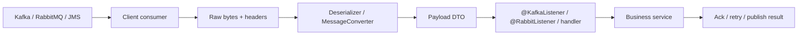

# Messaging, Scheduled Tasks, and Dynamically Converted Message Classes

## 1. Why Messaging and Scheduled Tasks Require Separate Verification in Native Image

A Spring Boot application typically does more than handle HTTP requests. It may consume messages from Kafka, RabbitMQ, or JMS; convert byte payloads into DTOs; invoke listeners; publish downstream messages; and run periodic tasks via `@Scheduled`. These flows contain many points where classes or methods are selected indirectly through annotations, message headers, serializers, converters, or configuration.

On the JVM, class metadata and reflection are usually available at runtime. GraalVM Native Image analyzes reachability at build time and assumes the code set, classpath, and bean graph are already determined. A message carrying a type identifier, a converter instantiating DTOs by class name, or a listener invoking methods via reflection may need additional metadata if Spring or the library does not supply it automatically.

This does not mean every application using Kafka, RabbitMQ, or `@Scheduled` must write reflection hints manually. Spring Boot, Spring Framework, and many integration projects already contribute AOT/native hints for common use cases. The development team's job is to understand the conversion flow, distinguish what the framework already supports from custom code, and test the real payload branches.

This lesson belongs to the **Application Integration** chapter of the **SPRING_BOOT_NATIVE_IMAGE** module. The module covers compiling Spring Boot into GraalVM Native Image with Spring AOT, evaluating startup time and memory, practicing Maven/Gradle builds, configuring reflection/resources, testing compatibility, packaging containers, and operating native builds. This lesson focuses on messaging, scheduled tasks, and dynamically converted message classes.

After this lesson, learners will be able to:

- Describe the path of a message from broker to listener and converter.
- Distinguish fixed payload types from polymorphic payloads selected via headers.
- Register reflection/binding hints for dynamically converted DTOs.
- Identify the AOT hints provided by Spring Kafka, Spring AMQP, and Spring Integration.
- Test listeners, message gateways, and `@Scheduled` tasks on the native executable.
- Design tests for brokers, schedulers, retries, and error branches.

## 2. Three Layers to Analyze in a Messaging Flow

A message typically passes through three independent layers:

1. **Transport:** the broker and client library receive/send bytes or frames.
2. **Message envelope:** Spring represents the message along with headers, routing key, topic, partition, and delivery metadata.
3. **Payload conversion:** converters/deserializers turn bytes or intermediate objects into the data type handled by the listener.

General inbound flow:



Native Image can impose different requirements at each layer:

| Layer | Example AOT/Native Issue | How to Verify |
|---|---|---|
| Transport | Client library or native dependency incompatible | Check reachability metadata and run broker connection smoke tests |
| Envelope | Framework creates `Message`, headers, or dynamic proxies | Check hints provided by the integration framework |
| Payload conversion | Jackson/Avro/JSON converter instantiates DTOs via reflection | Check type mappings and binding hints |
| Listener invocation | Framework locates methods by annotation or method name | Check AOT hints; some POJO endpoints require `@Reflective` |
| Error handling | Retry/DLQ converter or exception payload uses another type | Exercise error branches and verify those DTOs are supported |

Do not lump every error into "missing reflection." `ClassNotFoundException`, `MessageConversionException`, type-header validation errors, broker connection errors, and `MissingReflectionRegistrationError` have different causes. Read the initial exception and determine whether the failure occurs before or after payload conversion.

## 3. Which Class Set Is Known at Build Time?

Spring AOT requires a classpath and bean graph determinable at build time. That does not prevent an application from processing multiple message types. An application can receive diverse event types as long as all valid classes are on the classpath at build time and the necessary dynamic accesses are described.

For example, a topic may receive two event types:

```java
public interface DomainEvent {
}

public record OrderCreated(
    String orderId,
    List<OrderLine> lines
) implements DomainEvent {
}

public record PaymentCaptured(
    String paymentId,
    String orderId,
    long amountInCents
) implements DomainEvent {
}

public record OrderLine(String sku, int quantity) {
}
```

Both payload classes and their nested types are known at build time. The listener can handle them via an interface or accept specific DTOs depending on the converter:

```java
@Component
public class DomainEventListener {

    public void handle(DomainEvent event) {
        if (event instanceof OrderCreated created) {
            handleOrder(created);
        }
        else if (event instanceof PaymentCaptured captured) {
            handlePayment(captured);
        }
        else {
            throw new IllegalArgumentException("Unsupported event type");
        }
    }

    private void handleOrder(OrderCreated event) {
        // ...
    }

    private void handlePayment(PaymentCaptured event) {
        // ...
    }
}
```

If the application uses reflection to instantiate subtypes based on a type header, restrict the header to an allowlist of supported event types. Never take arbitrary class names from external messages and call `Class.forName()` to instantiate arbitrary classes. Doing so both makes metadata hard to determine and creates security risks when message sources are untrusted.

### Distinguishing Dynamically Selected Types from Dynamically Loaded Classes

| Scenario | Suitable for Native Image? | What to Do |
|---|---|---|
| Choosing `OrderCreated` or `PaymentCaptured` from a fixed allowlist | Yes | Ensure both types are on the classpath and have suitable binding hints |
| Choosing a converter from a fixed build-time configuration | Yes | Configure beans/converters in the AOT environment |
| Message header carries token `order-created`, mapped to a fixed DTO | Yes | Use an explicit type mapping or registry |
| Message header carries arbitrary class name loaded from an external JAR | Not suitable for closed-world Native Image | Redesign as an allowlist or isolate plugins into a separate process |
| Adding a new event type already in source without rebuilding | Not yet | Rebuild AOT/native to include the new class and metadata in the image |

## 4. Message Converters and DTOs Instantiated via Reflection

`MessageConverter` typically translates between `org.springframework.messaging.Message<?>`, broker messages, and Java payloads. For JSON, converters may use Jackson to construct DTOs from byte arrays. Jackson may require constructors, accessors, fields, annotation metadata, or creators depending on the DTO structure and `ObjectMapper` configuration.

Spring AOT infers hints automatically for many common cases, yet it cannot always see every subtype chosen from a message header, custom configuration, or custom converter. When a payload class is not inferred by the framework, register binding hints explicitly.

### 4.1. Using @RegisterReflectionForBinding

For DTOs serialized/deserialized by Jackson or similar binders, you can place `@RegisterReflectionForBinding` on an application configuration class:

```java
import org.springframework.aot.hint.annotation.RegisterReflectionForBinding;
import org.springframework.context.annotation.Configuration;

@Configuration(proxyBeanMethods = false)
@RegisterReflectionForBinding({
    OrderCreated.class,
    OrderLine.class,
    PaymentCaptured.class
})
public class EventBindingHints {
}
```

This annotation instructs Spring to contribute the reflection hints needed for binding the listed types. If DTOs contain nested types, generic payloads, or custom serializers/deserializers, verify those types are handled as well.

For a large or modular type set, you can create a `RuntimeHintsRegistrar` and attach it with `@ImportRuntimeHints` near the converters/beans that use them. Register only types that can appear in valid messages.

### 4.2. Do Not Confuse JSON Binding with Java Serialization

JSON conversion with Jackson and Java native serialization (`ObjectInputStream`/`ObjectOutputStream`) are two distinct mechanisms.

- Jackson typically needs reflection/binding hints for DTOs and their members.
- Java serialization needs serialization hints for the types actually serialized/deserialized.
- A message containing only a byte array or `String` does not automatically need reflection hints for a DTO that is never instantiated.
- A message carrying a type header does not mean the entire classpath needs reflection opened up.

If an integration framework uses Java serialization for payloads or message stores, register the exact serialization types per the documentation of the framework and version in use. Do not use `RuntimeHints.serialization()` as a substitute for Jackson binding hints.

## 5. Kafka: Type Mapping and @KafkaListener

Spring for Apache Kafka supports its own serializers/deserializers as well as conversion at the Spring Messaging layer. For JSON, `JacksonJsonSerializer` and `JacksonJsonDeserializer` can place type information into record headers. The deserializer uses type mapping to map a token in the header to the corresponding class.

Example configuration for an allowed set of events:

```yaml
spring:
  kafka:
    bootstrap-servers: localhost:9092
    producer:
      properties:
        spring.json.type.mapping: orderCreated:com.example.events.OrderCreated,paymentCaptured:com.example.events.PaymentCaptured
    consumer:
      group-id: billing
      properties:
        spring.json.trusted.packages: com.example.events
        spring.json.type.mapping: orderCreated:com.example.events.OrderCreated,paymentCaptured:com.example.events.PaymentCaptured
```

In this example, producer and consumer share the same type mapping: the sender writes the token `orderCreated` or `paymentCaptured` into the type header; the consumer maps that token to the two known DTOs. `trusted.packages` restricts which packages may be deserialized. Put only trusted DTO packages in the allowlist; never use wildcards for messages from uncontrolled sources.

Listener example:

```java
@Component
public class OrderListener {

    @KafkaListener(topics = "orders")
    public void onOrder(OrderCreated event) {
        // Handle deserialized OrderCreated.
    }
}
```

If the same topic carries multiple event types, design listeners and converters to distinguish those types explicitly. You can use dedicated listener methods per DTO, a shared interface/envelope, or a custom converter with an allowlist. Do not assume a method accepting `Object` will automatically resolve every type and generic payload in Native Image.

### Checking Spring Kafka AOT Hints

Spring for Apache Kafka provides Spring AOT native hints for common use cases, including Avro-generated classes used in `@KafkaListener`. Before adding manual registrars, check your Spring Kafka version and which hints the framework already contributes.

There is an important limitation: `spring-kafka-test`, specifically `EmbeddedKafkaBroker`, is not supported in native images per current Spring Kafka documentation. You can continue using Embedded Kafka for JVM tests; for the native executable, test consumers/producers against a separately running broker in an appropriate integration test environment.

If using Avro, Protobuf, or a schema registry, verify generated classes, schema resources, custom serializers/deserializers, and runtime libraries of the exact version. Framework hints do not replace compatibility testing of the client and schema registry.

## 6. RabbitMQ/AMQP: @RabbitListener and Converters

Spring AMQP provides the `MessageConverter` abstraction for both outbound and inbound flows. For JSON, you can configure a Jackson converter to convert the body into DTOs. Spring AMQP currently provides AOT native hints for applications using the library; custom converters, payload classes, or custom extensions still require verification. Choose the converter according to the major version: Spring AMQP 4.x uses `JacksonJsonMessageConverter` based on Jackson 3; 3.x lines typically use `Jackson2JsonMessageConverter` based on Jackson 2.

Converter configuration example:

```java
@Configuration(proxyBeanMethods = false)
public class RabbitConfiguration {

    @Bean
    JacksonJsonMessageConverter rabbitMessageConverter() {
        return new JacksonJsonMessageConverter();
    }
}
```

Listener receiving a typed payload:

```java
@Component
public class RabbitOrderListener {

    @RabbitListener(queues = "orders")
    public void receive(OrderCreated event) {
        // Handle event created by the converter.
    }
}
```

With multiple payload types, you can use type mapping or a custom type mapper to map tokens/headers to an allowed set of DTOs. Avoid letting headers from untrusted producers supply arbitrary class names. Check trusted-package/type-mapper settings for your Spring AMQP and Jackson versions; property names and APIs can change across releases.

### Testing Listeners and Error Paths

An AMQP flow typically has several paths beyond the happy path:

- Valid JSON payload converted into a DTO.
- Invalid payload, missing fields, or mismatched schema version.
- Message carrying an unrecognized type header.
- Listener throws an exception, broker redelivers, or message routes to a dead-letter queue.
- Retry interceptor converts exceptions into recovery messages.

These branches may involve different converters or exception types. Run all supported scenarios on the native executable, especially when dead-letter handlers or custom argument resolvers use reflection.

### JMS: Listeners and Providers Must Be Verified Separately

With JMS, Spring Boot can auto-configure a `ConnectionFactory` and send/receive infrastructure when the corresponding provider is on the classpath. A listener can receive DTOs through a message converter, for example:

```java
@Component
public class JmsOrderListener {

    @JmsListener(destination = "orders")
    public void receive(OrderCreated event) {
        // Handle event from JMS destination.
    }
}
```

However, native compatibility also depends on the JMS provider/client, transport, converter, and provider dependencies. Spring Boot detecting the starter or creating a `ConnectionFactory` on the JVM does not prove the entire provider has reachability metadata. Check the provider's GraalVM documentation, custom message converters, and actual payload types; then connect to a real broker in native integration tests.

## 7. Spring Integration: Gateways, Endpoints, and POJO Handlers

Spring Integration provides AOT hints for common use cases such as endpoints declared with `@Bean`, Java DSL with lambdas, and `@MessagingGateway` discovered via `@IntegrationComponentScan` or imports. These hints may cover reflection, proxies, and serialization.

Gateway interface:

```java
@MessagingGateway
public interface OrderGateway {

    void submit(OrderCreated event);
}
```

Component scan configuration:

```java
@Configuration(proxyBeanMethods = false)
@EnableIntegration
@IntegrationComponentScan
public class IntegrationConfiguration {
}
```

When a gateway is scanned in a manner supported by Spring Integration, the framework can contribute the corresponding proxy hint. If you create a gateway proxy programmatically in another way, such as `IntegrationFlow.from(SomeGateway.class)`, check your Spring Integration version's documentation and supply manual proxy hints if the framework cannot infer them.

### 7.1. POJO Methods Invoked via Reflection

If you use annotations such as `@ServiceActivator`, `@Splitter`, or the `IntegrationFlowBuilder.handle(service, methodName)` API so the framework invokes a POJO method via reflection, Spring Integration requires marking that method with `@Reflective` in the corresponding configurations.

Example:

```java
import org.springframework.aot.hint.annotation.Reflective;
import org.springframework.integration.annotation.ServiceActivator;
import org.springframework.stereotype.Component;

@Component
public class OrderMessageHandler {

    @ServiceActivator(inputChannel = "orders.input")
    @Reflective
    public void handle(OrderCreated event) {
        // Handle message.
    }
}
```

`@Reflective` tells Spring AOT that the method must be invokable via reflection. Do not confuse Spring Integration providing general hints with automatic discovery of every custom POJO method.

### 7.2. Serialization of Custom Payloads

Spring Integration contributes serialization hints for certain internal types it uses, such as `GenericMessage`, `ErrorMessage`, and `MessageHeaders`. For application-defined payloads, if the use case genuinely uses Java serialization, contribute dedicated serialization hints:

```java
public class OrderPayloadSerializationHints
        implements RuntimeHintsRegistrar {

    @Override
    public void registerHints(
            RuntimeHints hints,
            ClassLoader classLoader) {
        hints.serialization().registerType(OrderCreated.class);
    }
}
```

Attach the registrar to the relevant configuration via `@ImportRuntimeHints`. Use serialization hints only when data is serialized using Java serialization; JSON payloads need binding hints suited to the converter.

### 7.3. XML Configuration Limitations

Current Spring Integration documentation states that XML configuration is not supported for native images. For applications targeting GraalVM Native Image, prefer AOT-verified Java configuration, `@Bean` methods, and Java DSL. If an existing system relies heavily on XML integration flows, convert and test each flow before enabling native builds.

## 8. Scheduled Tasks in AOT and Native Image

Messaging is frequently combined with scheduled tasks. For instance, an application periodically polls an outbox table and publishes events to Kafka, or checks delayed messages and requeues them.

Spring activates annotation-driven scheduling via `@EnableScheduling`. A scheduled method typically takes no parameters and returns `void`:

```java
@Configuration(proxyBeanMethods = false)
@EnableScheduling
public class SchedulingConfiguration {
}

@Component
public class OutboxPublisher {

    private final OutboxService outboxService;

    public OutboxPublisher(OutboxService outboxService) {
        this.outboxService = outboxService;
    }

    @Scheduled(fixedDelay = 5000, initialDelay = 3000)
    public void publishPendingEvents() {
        outboxService.publishPending();
    }
}
```

`@Scheduled` supports fixed delay, fixed rate, and cron. With cron, you can specify a timezone so schedules run consistently across local machines and containers. Numeric values for fixed delay/rate default to milliseconds unless another time unit is configured.

### 8.1. Reflection Hints for Scheduled Methods

`ScheduledAnnotationBeanPostProcessor` discovers `@Scheduled` methods and registers them with `TaskScheduler`. Starting in Spring Framework 6.2, `@Scheduled` is meta-annotated with `@Reflective` so AOT can contribute invocation hints for scheduled methods.

Consequently, with standard usage on Spring Framework 6.2 or later, you typically do not need to manually register reflection hints for each scheduled method. On older versions, inspect the Javadoc/source of the exact version in dependency management. If using a custom annotation, custom post-processor, or separate scheduler library invoking methods via reflection, verify whether that mechanism contributes hints.

Do not equate schedule registration with bean creation. `@Scheduled` does not cause a new class to appear after building; it registers a method on a bean already in the context. Still, the bean hosting the scheduled method must be present in the AOT bean graph.

### 8.2. Explicit Scheduler Configuration

For tasks with nontrivial execution time or concurrency, configure `TaskScheduler` explicitly:

```java
@Configuration(proxyBeanMethods = false)
@EnableScheduling
public class SchedulerConfiguration {

    @Bean
    ThreadPoolTaskScheduler taskScheduler() {
        ThreadPoolTaskScheduler scheduler =
            new ThreadPoolTaskScheduler();
        scheduler.setPoolSize(4);
        scheduler.setThreadNamePrefix("outbox-");
        scheduler.setWaitForTasksToCompleteOnShutdown(true);
        scheduler.setAwaitTerminationSeconds(20);
        return scheduler;
    }
}
```

Thread pools, lifecycles, and shutdown still need testing in the native executable. If a task publishes messages, confirm that the scheduler shuts down cleanly without abandoning in-flight transactions or sends.

### 8.3. Multiple Replicas Can Run the Same Scheduled Task

Native Image does not automatically provide leader election or distributed locking. If you deploy three replicas of the same application, each replica can register the same `@Scheduled` task and publish the same outbox batch concurrently.

Depending on business requirements, use an appropriate coordination mechanism: database locks, time-bounded leases, Quartz JDBC JobStore, leader election, or offloading schedules to a dedicated scheduler service. Whichever approach you choose, message processing operations should remain idempotent because retries, redeliveries, and network errors can still cause duplicate execution.

## 9. Combining Scheduled Tasks with Message Publishing

A common pattern is the transactional outbox:

1. A business transaction writes business data and an outbox row in the same transaction.
2. A scheduled task reads unsent rows.
3. The publisher sends events to the broker.
4. Once the broker acknowledges per the chosen policy, the application marks the row published.
5. On failure, the row is retried in the next pass.

Example separating business logic from the schedule:

```java
@Service
public class OutboxService {

    private final OutboxRepository repository;
    private final KafkaTemplate<String, OrderCreated> kafkaTemplate;

    public OutboxService(
            OutboxRepository repository,
            KafkaTemplate<String, OrderCreated> kafkaTemplate) {
        this.repository = repository;
        this.kafkaTemplate = kafkaTemplate;
    }

    public void publishPending() {
        for (OutboxEvent row : repository.findNextBatch()) {
            OrderCreated event = row.toOrderCreated();
            kafkaTemplate.send("orders", event.orderId(), event);
            // Mark as sent only after handling acknowledgement
            // and transaction state per the application's policy.
        }
    }
}
```

This is an illustrative skeleton; production code must handle asynchronous send outcomes, transactions, batch locking/claiming, retries, and idempotency. Never mark a row as sent immediately after calling `send()` before delivery is confirmed under the broker/client semantics.

For Native Image, test both branches: the scheduler invoking the publisher and the message consumer converting payloads into DTOs. A test invoking only the listener does not prove the scheduled publisher works; a test invoking only `publishPending()` does not prove consumers/deserializers have sufficient hints.

## 10. Runtime Configuration vs. Build-Time Fixed Configuration

Spring AOT processes the bean graph based on the classpath and `Environment` at build time. Therefore, distinguish runtime configuration values from conditions that decide whether a bean exists.

| Configuration | Typically Changeable at Runtime? | Notes |
|---|---|---|
| Broker host/port | Yes | Beans/clients already exist; only the connection endpoint changes |
| Username/password or secrets | Yes | Read from secret manager/environment, never embedded in image |
| Consumer group ID | Yes | Verify how the client and lifecycle are configured |
| Topic/queue name | Yes in many configurations | If names decide beans/endpoints during AOT, check build-time conditions |
| Cron expression | Can be resolved when registering tasks at startup | Verify the scheduler receives the desired value in the native runtime |
| `@ConditionalOnProperty` deciding whether to create a listener bean | Cannot arbitrarily alter the bean graph after building | Set appropriate properties during AOT processing |
| Classpath plugins or DTO classes | No | Adding new dependencies/types requires rebuilding |

For instance, if `@ConditionalOnProperty` determines whether a Kafka listener configuration is created, that property must have the intended value during AOT processing. Changing the broker URL at runtime normally does not alter the bean graph; adding a new listener bean via classpath scanning after building is a different requirement and is unsupported under the closed-world assumption.

Never write broker credentials, tokens, or secrets into generated AOT code, `RuntimeHints`, or native image properties. Put sensitive values in your deployment environment's secret store.

## 11. Layered Testing for Messaging and Scheduled Tasks

Split tests by layer so you can pinpoint where failures occur.

### 11.1. Unit Tests for Converters and Business Handlers

Test converters against every payload variant:

- Valid JSON for `OrderCreated`.
- Valid JSON for `PaymentCaptured`.
- Missing required fields or wrong types.
- Type token outside the allowlist.
- Older payload versions requiring mapping or migration.

Test business handlers directly to confirm business logic does not depend on the broker. Test converters separately to distinguish deserialization errors from logic errors.

### 11.2. Integration Tests with a Broker

Use a real broker or a separate broker running in the test environment to verify:

- Producer sends the right payload and type header.
- Consumer receives the right DTO.
- Ack/retry/redelivery behave as configured.
- Dead-letter queue or recovery handlers work.
- Shutdown and reconnect work when the broker is temporarily unavailable.

With Spring Kafka, you can use `spring-kafka-test`/Embedded Kafka for JVM tests, but current Spring Kafka documentation explicitly states that `EmbeddedKafkaBroker` is not supported in native images. Native integration tests should connect to a separately running broker rather than assuming the JVM embedded test broker can be compiled into a native test.

With RabbitMQ/JMS, test the exact client and broker provider. Spring Boot auto-configuring a `ConnectionFactory` does not itself prove every driver/provider version has reachability metadata and native compatibility.

### 11.3. Testing Scheduled Methods Without Long Sleeps

Extract single-run logic out of the scheduled method:

```java
@Component
public class OutboxPublisher {

    private final OutboxService outboxService;

    public OutboxPublisher(OutboxService outboxService) {
        this.outboxService = outboxService;
    }

    @Scheduled(fixedDelay = 10000)
    public void scheduledRun() {
        runOnce();
    }

    public void runOnce() {
        outboxService.publishPending();
    }
}
```

Unit/integration tests can call `runOnce()` directly to verify logic. A separate native smoke test should confirm the scheduler actually triggers the method, for example using a test probe or persistent state with a bounded timeout. Avoid relying on long `Thread.sleep()` calls and nondeterministic timings.

If cron uses a specific timezone, test execution timing under that timezone. If the scheduler runs across multiple replicas, also test locking/leader election to prevent duplicate publishing.

### 11.4. Testing JVM AOT Then Native Image

A suitable workflow:

1. Run unit tests on the JVM.
2. Run Spring AOT processing.
3. Run the AOT application on the JVM and verify listener/scheduler startup.
4. Build the Native Image.
5. Run the native executable connected to a real broker or separate test broker.
6. Send each payload type and await listener confirmation.
7. Wait for the scheduled task to run at least once and verify published output.
8. Test retries, DLQ, shutdown, and reconnect in the native runtime.

## 12. Building Native and Verifying in the Deployment Environment

After JVM/AOT testing, build the Native Image per your project's Maven or Gradle setup. Example with Native Build Tools:

```bash
# Maven: project with Spring Boot AOT and Native Build Tools configured.
./mvnw -Pnative native:compile

# Gradle: project with Spring Boot and GraalVM Native Image plugin applied.
./gradlew nativeCompile
```

If using Cloud Native Buildpacks to package a container:

```bash
./mvnw -Pnative spring-boot:build-image
```

Or with Gradle:

```bash
./gradlew bootBuildImage
```

Exact goals/tasks depend on Spring Boot, GraalVM Native Build Tools, and plugin versions. Ensure Kafka/RabbitMQ/JMS dependencies, serializers, converters, and AOT profiles match the configuration to be released.

### 12.1. Inspecting Metadata and Generated Output

After AOT processing, inspect the hints contributed by the framework and application. Spring Boot typically writes hints under `META-INF/native-image/{groupId}/{artifactId}/` in build output. Exact generated resource locations in Maven and Gradle can vary by plugin version.

Check these points:

- DTOs selected from type mappings have appropriate binding/reflection hints.
- Custom converters and custom serializers have metadata for types/members they access dynamically.
- POJO methods invoked via reflection by Spring Integration are annotated or registered properly.
- Gateway proxies have framework-generated hints or manual hints.
- Serialization hints exist only for types actually using Java serialization.
- Classpath contains all required drivers/providers and generated schema classes.

Do not edit generated JSON directly as a long-term fix. Fix annotations, registrars, dependency metadata, or build configuration, then rerun AOT processing.

### 12.2. Testing Broker and Scheduler in the Final Container

When running the container, verify:

- The native executable can connect to the broker at the environment's address.
- TLS certificates, truststores, DNS, and network policies work.
- Consumer groups, topics, queues, and subscriptions match release configuration.
- Listeners process every declared payload type.
- Retries, acknowledgements, dead-letter routing, and reconnects work.
- The scheduler actually runs and does not double-publish unexpectedly.
- Container shutdown does not lose in-flight messages or incomplete outbox rows.

Do not use `localhost` inside a container to point to a broker on the host unless network topology truly requires it. Use the service DNS or endpoint provided by the deployment environment.

## 13. Common Errors and How to Resolve Them

| Symptom | Possible Cause | Resolution |
|---|---|---|
| JVM reads JSON fine, native fails creating DTO | Missing binding/reflection hint for payload or nested type | Register exact DTOs via `@RegisterReflectionForBinding` or a registrar |
| Listener receives wrong subtype | Mismatched type header/mapping or converter inferred wrong target | Check tokens, type mappings, and listener signatures |
| Class not found in type mapping | Class absent from classpath or wrong name in mapping | Check dependencies, packages, and class names at build time |
| Message header allows unexpected types | Overly broad trusted packages or arbitrary class names | Use a token allowlist and trust only authenticated producers |
| `@KafkaListener` works on JVM, fails in native with Avro | Generated Avro types or dependencies lack hints | Check Spring Kafka version, generated classes, and AOT metadata |
| Spring Integration POJO handler reflection error | Method invoked by name without reflective hint | Mark method with `@Reflective` per version guidance |
| Gateway proxy fails in native | Gateway created programmatically so AOT cannot see interface | Use supported component scanning/imports or register JDK proxy hints |
| Serialization error in native | Uses Java serialization without registering type | Register serialization hints for the exact payload type |
| Spring Kafka Embedded Kafka test fails in native | `EmbeddedKafkaBroker` unsupported in native image | Use embedded broker for JVM tests; connect native tests to a separate broker |
| Scheduled method never runs | Missing `@EnableScheduling`, bean not created, or trigger disabled | Check configuration, bean graph, and cron/triggers |
| Scheduled task runs multiple times | Each replica registers its own schedule or multiple triggers target same method | Use distributed lock/leader election and check repeatable schedules |
| Broker connects on host, fails in container | Different DNS, TLS, secrets, networking, or runtime dependencies | Test in final image with real endpoints/container configuration |

## 14. Hands-On Exercises

### Exercise A — Converting Two Kafka Event Types

Create two DTOs `OrderCreated` and `PaymentCaptured`, configure type mapping with fixed tokens, and write a listener receiving the payloads. Register binding hints if the framework does not infer enough.

**Acceptance criteria:** both JVM and native executable receive the right subtypes; invalid tokens are explicitly rejected.

### Exercise B — RabbitMQ Listener and Dead-Letter Flow

Create a `@RabbitListener` receiving `OrderCreated` via a Jackson converter. Send one valid JSON message and one schema-invalid message; verify the listener processes the valid one and the invalid one routes per DLQ policy.

**Acceptance criteria:** converter, listener, and error handler work inside the final native container.

### Exercise C — Spring Integration Gateway

Create a `@MessagingGateway` interface and a POJO method with `@ServiceActivator`. Run AOT processing, mark reflective methods where needed, and verify the gateway proxy on the native executable.

**Question:** why can a component-scanned gateway receive framework-generated proxy hints, while a gateway created via Java DSL may need manual hints?

### Exercise D — Outbox Publisher with @Scheduled

Create a scheduled task reading outbox rows and publishing events. Extract a `runOnce()` method to unit-test logic, then run the native executable and confirm the scheduler invokes the method on schedule.

**Acceptance criteria:** idempotent processing, rows are not marked before proper acknowledgement, and no duplicate publishing across multiple replicas.

### Exercise E — Native Integration Test with a Separate Broker

Run Kafka or RabbitMQ outside the native app process. Send each payload type, trigger retries/DLQ, verify listener handling, and verify the scheduler. Record logs, broker/client versions, AOT profile, and native build options.

## 15. Pre-Release Checklist

- [ ] Listener, converter, and scheduler beans exist in the intended AOT bean graph.
- [ ] The DTO/type mapping set is fixed and present on the classpath at build time.
- [ ] Message type headers map through an allowlist rather than loading arbitrary classes.
- [ ] Binding/reflection hints cover required payloads and nested types.
- [ ] JSON binding is distinguished from Java serialization.
- [ ] Spring Kafka, Spring AMQP, or Spring Integration AOT hints are verified for the exact version.
- [ ] Spring Integration POJO endpoints are marked with `@Reflective` where required.
- [ ] Custom gateway proxies and serialization hints are verified.
- [ ] `@Scheduled` beans are created and the scheduler has proper thread/lifecycle settings.
- [ ] Cron, timezone, initial delay, and multi-replica behavior are tested.
- [ ] Every payload type has been executed on the native executable.
- [ ] Retries, acknowledgements, DLQ, reconnects, and shutdown have been tested.
- [ ] Native integration tests use an appropriate broker without relying on `EmbeddedKafkaBroker` inside native image.
- [ ] Final container has required networking, TLS, secrets, and runtime dependencies.

## References

- [Spring Framework — Task Execution and Scheduling](https://docs.spring.io/spring-framework/reference/integration/scheduling.html): `@EnableScheduling`, `@Scheduled`, `TaskScheduler`, cron, and reactive scheduled methods.
- [Spring Framework — Ahead of Time Optimizations](https://docs.spring.io/spring-framework/reference/core/aot.html): AOT bean graph, `RuntimeHints`, `@Reflective`, and classpath/build-time limits.
- [Spring Kafka — Native Images](https://docs.spring.io/spring-kafka/reference/appendix/native-images.html): native hints for `@KafkaListener`, Avro generated classes, and `EmbeddedKafkaBroker` limitations.
- [Spring Kafka — Serialization, Deserialization, and Message Conversion](https://docs.spring.io/spring-kafka/reference/kafka/serdes.html): JSON serializer/deserializer, type mappings, headers, and message converters.
- [Spring AMQP — Native Images](https://docs.spring.io/spring-amqp/reference/appendix/native.html): AOT native hints for Spring AMQP applications.
- [Spring AMQP — Message Converters](https://docs.spring.io/spring-amqp/reference/amqp/message-converters.html): converting message bodies and payloads.
- [Spring Integration — Native Images Support](https://docs.spring.io/spring-integration/reference/native-aot.html): hints for gateways, Java DSL, POJO endpoints, serialization, and XML configuration limitations.
- [Spring Boot — Advanced Native Image Topics](https://docs.spring.io/spring-boot/reference/packaging/native-image/advanced-topics.html): `RuntimeHintsRegistrar` and custom native hints.

## Conclusion

For messaging and scheduled tasks to operate reliably in Spring Boot Native Image, clearly define transport, message envelopes, payload converters, and listener invocation. Dynamically selected payloads are still supported as long as the valid type set is known at build time, type mappings use an allowlist, and binding/serialization hints cover actual needs. Spring Kafka, Spring AMQP, Spring Integration, and Spring Framework already supply many AOT hints, yet custom converters, POJO handlers, and programmatically built gateways still require individual verification. With `@Scheduled`, confirm beans and triggers are registered properly, schedulers have sound lifecycles, and multiple replicas do not unintentionally duplicate work. Finally, run tests on the native executable and final container against a real broker to verify the entire message path, retries, schedules, and shutdown.
