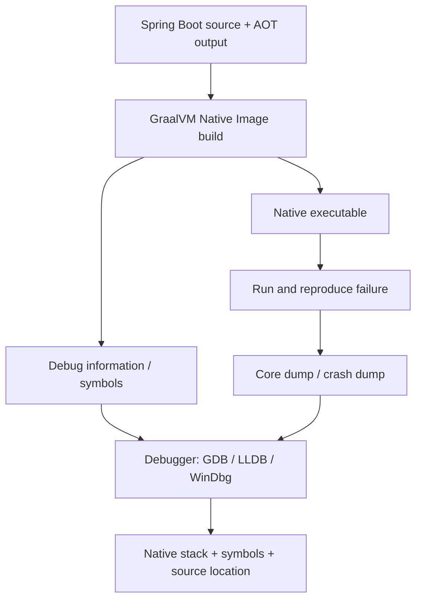

# Debug Symbols and Native Debugging Tools by Operating System

## 1. Why Are Debug Symbols Needed for Native Image?

When Spring Boot runs on the JVM, stack traces normally display classes, methods, and line numbers from bytecode/source metadata. When compiled with GraalVM Native Image, the application becomes a native OS executable. When a crash, segmentation fault, JNI error, deadlock, or error inside a native library occurs, a debugger needs information to map machine addresses back to functions and source locations.

**Debug symbols** are debugging information generated alongside compilation. Depending on the target/toolchain, this information may reside in ELF/DWARF, Mach-O/dSYM, or a Windows-compatible debug format. Symbols allow debuggers to show function names, stack frames, variables, and source locations when the corresponding information has been generated and preserved.

With **Spring Boot Native Image**, symbols must be managed as part of your build artifacts: generate debug information for the exact binary, store the symbols matching the released executable, and use a debugger appropriate for the OS/architecture. If symbols are stripped or symbols from a different build are used, crash dumps may show only raw addresses or inaccurate stack frames.

This lesson focuses on debug symbols and native debugging tools by operating system. Syntax and level of support vary across GraalVM Native Image versions, compiler toolchains, and target platforms; always verify options on your exact installation.



## 2. Distinguishing Executables, Debug Information, and Source Code

Three components are typically required when analyzing a crash:

- **Executable**: the native binary built and running in the environment where the failure occurred.
- **Debug information/symbol file**: information mapping machine addresses to functions, compilation units, source files, and line numbers when available.
- **Corresponding source code**: the exact source revision used to build the binary.

A debugger may read symbols yet fail to locate source files if source paths differ from the build machine. Having the latest source code is insufficient if the binary was built from a different commit.

Each release should record the following information:

| Component | Information to store |
|---|---|
| Application binary | Name, version, SHA-256 or build ID |
| Debug symbols | Matching file, build ID/UUID/PDB identity |
| Source | Commit SHA and source archive if needed |
| Toolchain | GraalVM distribution/version, JDK, compiler, linker |
| Target | OS, CPU architecture, ABI/libc |
| Build flags | Optimization, debug-info, and strip options |
| Container | Image digest, base/run image, and shared libraries |

Do not pair symbols from a similar build or merely the same version string. Only symbols matching the exact binary let a debugger resolve addresses reliably.

## 3. Enabling Debug Information When Building a Native Image

GraalVM Native Image provides an option to generate debug information. In many versions, `-g` requests generating debug info; options related to optimization and debug info may vary by version/toolchain.

Example command:

```bash
native-image -g -jar application.jar
```

In a Spring Boot Gradle/Maven build, pass the option through Native Build Tools or the Spring Boot plugin your project uses. Check build logs to verify `-g` actually reaches the `native-image` process.

Before using in CI, verify:

```bash
native-image --help
native-image --version
```

With GraalVM Native Build Tools, configuration options usually live in the binary/task build arguments. DSL APIs and task names depend on the plugin version. Do not assume a single Gradle/Maven configuration works across all versions.

Debug builds usually produce larger binaries and can affect build times. You can maintain two artifacts: an optimized production executable and a separately stored symbol/debug artifact for investigations. Do not strip symbols before creating the archive that matches the binary.

## 4. Linux: ELF and DWARF

On Linux, native executables are typically ELF. Debug information commonly uses the DWARF format. Frequently used tools:

- `file`: identifies binary type and architecture.
- `readelf`: inspects ELF sections, notes, and build ID.
- `nm`: displays the symbol table.
- `objdump`: displays symbols/disassembly.
- `gdb`: interactive debugger.
- `addr2line`: maps addresses to functions/source lines when DWARF is present.
- `objcopy`/`strip`: separates or strips symbols in a controlled workflow.

Inspecting a binary:

```bash
file ./api-app
readelf -n ./api-app
readelf -S ./api-app
```

Finding debug sections:

```bash
readelf -S ./api-app | grep -E 'debug|symtab'
```

If built with debug information, you may see sections such as `.debug_info`, `.debug_line`, `.debug_abbrev`, or corresponding symbol information. Section names and layout depend on the compiler/linker.

## 5. Linux: Separating Debug Symbols from the Executable

A common deployment pattern stores debug information separately and strips the executable to shrink the runtime image. GNU binutils supports an illustrative workflow:

```bash
objcopy --only-keep-debug api-app api-app.debug
strip --strip-debug api-app
objcopy --add-gnu-debuglink=api-app.debug api-app
```

The commands above assume an ELF binary and compatible binutils tools. Keep `api-app.debug` in a secure artifact repository; the stripped executable must retain a matching identity/build ID so debuggers locate the right debug file.

Another workflow uses build IDs and a system-structured debug symbol directory. Do not arbitrarily rename or overwrite symbol files and break their link to the binary. After stripping, re-verify with `readelf`, `file`, and a test GDB session.

Do not delete symbol artifacts immediately after publishing an image. When an incident happens weeks later, you will need the exact symbols matching the binary running in production.

## 6. Linux: Using GDB to Analyze an Executable

Launch GDB with the executable:

```bash
gdb ./api-app
```

Commonly used commands:

```gdb
break main
run
bt
info threads
thread apply all bt
info registers
frame 0
list
quit
```

Meaning:

- `break`: sets a breakpoint at a function or address.
- `run`: runs the process inside the debugger.
- `bt`: displays the backtrace of the current thread.
- `info threads`: lists threads.
- `thread apply all bt`: collects backtraces across all threads.
- `info registers`: inspects CPU registers.
- `frame`: selects a stack frame.
- `list`: displays source code if the debugger finds the matching file.

The native entry point name is not necessarily Java's `main` as seen in source code; if a `main` breakpoint does not match, set breakpoints on symbols/functions listed by the debugger or use addresses/source lines that have debug info.

## 7. Linux: Mapping Addresses with addr2line

When a crash log only has instruction addresses, you can use `addr2line`:

```bash
addr2line -e ./api-app -f -C 0xADDRESS
```

- `-e`: the executable or corresponding debug file.
- `-f`: prints function names.
- `-C`: demangles C++ symbols when needed.
- `0xADDRESS`: the address to resolve.

For PIE executables or shared libraries loaded at a different base address, you must handle load bias/relative addresses accurately. Absolute runtime process addresses cannot always be passed directly to `addr2line`. GDB usually handles relocations better when a matching core dump and executable are provided.

Native Image can produce stacks containing frames from the runtime, generated code, or native libraries. Debug info only helps where the compiler/toolchain generated mappings; not every frame will have a source line.

## 8. Linux: Generating and Analyzing Core Dumps

A core dump saves the process state at crash time, potentially including memory mappings, registers, and thread state. Core dump configuration depends on the shell, systemd, and OS policy.

Checking limits in the shell:

```bash
ulimit -c
ulimit -c unlimited
```

On systems using `systemd-coredump`:

```bash
coredumpctl list
coredumpctl info <PID-or-executable>
coredumpctl dump <PID-or-executable> --output=core.api-app
```

Analysis:

```bash
gdb ./api-app core.api-app
```

Inside GDB:

```gdb
bt
thread apply all bt
info registers
info sharedlibrary
```

Core dumps can contain sensitive data in memory: tokens, credentials, request bodies, personal data, and key material. Restrict access permissions, encrypt storage, enforce short retention, and never upload cores to public locations.

## 9. Linux: Native Libraries and Dependency Symbols

If a crash occurs inside JNI or a shared library, symbols for the application executable alone are not enough. You need the exact debug package/symbol file for each involved shared library.

Checking dependencies:

```bash
ldd ./api-app
readelf -d ./api-app
```

In GDB, inspect shared libraries and stack frames:

```gdb
info sharedlibrary
bt full
thread apply all bt full
```

If system libraries are stripped, the stack may show only addresses or generic symbols. Install matching debug symbols from your distro's package repository in the investigation environment, or obtain symbols from the dependency vendor. Do not swap a production shared library with a debug build of a different version to guess.

## 10. macOS: Mach-O and dSYM

On macOS, native executables typically use the Mach-O format. Debug information is commonly packaged in a `.dSYM` bundle, generated with `dsymutil` when supported by the toolchain.

Inspecting a binary:

```bash
file ./api-app
dwarfdump --uuid ./api-app
```

Creating a dSYM:

```bash
dsymutil ./api-app -o ./api-app.dSYM
```

Checking the dSYM UUID:

```bash
dwarfdump --uuid ./api-app.dSYM
```

The UUID in the dSYM must match the binary. If UUIDs do not match, LLDB cannot use that symbol bundle to symbolicate the executable.

Store `.dSYM` alongside the build identity in your artifact store. When packaging the application, you can omit the dSYM from the runtime image and store it separately where operations teams can access it.

## 11. macOS: Using LLDB and atos

Open an executable with LLDB:

```bash
lldb ./api-app
```

Common commands:

```lldb
breakpoint set --name main
run
bt
thread backtrace all
register read
frame select 0
source list
quit
```

If you have a crash address and matching binary/dSYM, `atos` can map the address:

```bash
atos -o ./api-app -arch arm64 0xADDRESS
```

For addresses from a process with ASLR, supply the corresponding load address or use LLDB/core crash reports to handle relocation. Do not use a runtime address directly without determining the image base.

macOS generates OS crash reports in Diagnostic Reports. A crash report can include thread backtraces, binary images, and exception types. Match the report with the exact version's binary UUID/dSYM before deep analysis.

## 12. macOS: Crash Reports and Symbolication

When a native application crashes, collect:

- Full crash report.
- Binary version/build identity.
- Matching UUID dSYM.
- OS version and hardware architecture.
- Native library/framework versions.
- Environment and executed command line.

View crash reports in Console or the macOS Diagnostic Reports folder per system policy. Use appropriate Xcode/LLDB symbolication tools to resolve frames. Apple tools and crash report formats can vary by macOS/Xcode version.

If a crash report shows `EXC_BAD_ACCESS`, `SIGABRT`, or similar errors, that signals a need to investigate native memory/access paths. Do not immediately blame Spring; frames may be inside a JNI library, allocator, runtime, or compiler-generated code.

## 13. Windows: Symbols and PDB

On Windows, the common system debugger is WinDbg; Visual Studio also provides debugger windows and symbol support. PDB is the familiar symbol format in the Microsoft ecosystem, though whether and how Native Image generates and uses PDBs depends on the GraalVM version, Windows toolchain, and linker configuration.

Before designing a pipeline, verify:

- Whether your Native Image version supports debug info on the Windows target in the way you need.
- Which toolchain/linker is being used (e.g., Visual Studio Build Tools).
- Whether outputs include PDB or an equivalent debug format.
- Whether PDB identity matches the executable.
- Whether the debugger can load symbols and source mappings.

Do not assume Linux `objcopy` options or DWARF workflows apply to Windows. Use tools suited to your binary's actual format.

## 14. Windows: Using WinDbg

WinDbg can open an executable or a dump file:

```text
windbg.exe C:\path\to\api-app.exe
```

With a crash dump:

```text
windbg.exe -z C:\dumps\api-app.dmp
```

Commonly used WinDbg commands:

```text
.symfix
.reload
!analyze -v
k
~* k
lm
!threads
```

- `.symfix` configures the default symbol path for Microsoft symbols.
- `.reload` reloads symbols.
- `!analyze -v` analyzes the dump.
- `k` displays the stack.
- `~* k` displays stacks for all threads.
- `lm` lists modules.
- `!threads` helps inspect threads when supported by the extension/runtime.

Command names and extensions may depend on the WinDbg version. The symbol path must include the exact PDBs for your application/dependencies; Microsoft public symbols do not replace application PDBs.

## 15. Windows: Creating Dumps on Process Crash

You can use Windows Error Reporting LocalDumps or ProcDump according to system policy. Example with ProcDump:

```powershell
procdump -ma -e -x C:\dumps C:\app\api-app.exe
```

Flags and usage depend on the ProcDump version. `-ma` requests a full dump, which can contain all sensitive data in process memory. The dump directory requires strict ACLs, adequate disk space, and controlled retention.

For services running under Windows Service Manager or Windows containers, configure dump settings to match the identity and a writable path for the process. Do not run the application as Administrator just to make dump writing easier if unnecessary.

## 16. Debug Symbols in Production Containers

A common strategy separates a small runtime image from the symbol artifact:

- Build the native executable with debug info.
- Store the unstripped binary or separated symbol file in an artifact store.
- Produce a stripped runtime executable/image if release policy requires it.
- Record the build ID/UUID/PDB identity and digest.
- On crash, retrieve the core/dump along with its matching symbols.
- Analyze in a secure environment equipped with the toolchain/debugger.

Do not rebuild an "identical" binary to extract symbols after an incident. Compilers, timestamps, linker inputs, build flags, or dependency versions can differ, causing addresses/symbols to mismatch. Keep symbols from the exact build that produced the production artifact.

When using multi-stage Dockerfiles, you can copy only the runtime executable into the final stage and archive symbols as a CI artifact. If debugging directly inside a container is required, evaluate debugger permissions, ptrace policies, seccomp, user namespaces, and memory dump security. Collecting cores according to host policy and analyzing them outside the container is usually safer.

## 17. Addresses in Stack Traces and ASLR

Operating systems can enable Address Space Layout Randomization (ASLR), causing module addresses to vary across runs. Consequently:

- Absolute addresses from logs do not always correspond directly to file offsets.
- Shared libraries have their own base addresses.
- PIE executables can be relocated.
- Core dumps and debuggers have mappings to handle relocation when binaries match.
- Use build ID/UUID and module load addresses to identify the exact binary.

With only raw addresses and no core, executable, or load map, symbolication may be inaccurate. Capture crash dumps and log module mappings as soon as an incident occurs.

## 18. Native Image and Java-Level Debugging

Native debug symbols help OS debuggers inspect instructions, native functions, threads, and generated source mappings. However, the experience is not completely identical to debugging a Java application on the JVM:

- Not every Java local variable can be inspected as in a JVM IDE.
- Some methods may be inlined or optimized away.
- Stack frames may pass through generated runtime code.
- Source paths may point to a build workspace that does not exist on the debugging machine.
- JNI frames and native libraries require their own symbols.

To investigate Java business-logic bugs, continue maintaining logs with correlation IDs, structured logging, exception context, and metrics. Native debuggers complement observability; they do not replace application logging/tracing.

## 19. Repeatable Crash Investigation Workflow

When receiving a crash report:

1. Record the timestamp, instance/container, version, and request/job correlation ID.
2. Collect application logs, native stack traces, and OS crash reports.
3. Collect the core/dump according to security policy.
4. Identify the OS, architecture, libc/runtime, and shared libraries.
5. Retrieve the executable and debug symbols matching the build ID/UUID.
6. Open the dump in GDB, LLDB, or WinDbg.
7. Capture backtraces for all threads and relevant registers.
8. Identify the first frame belonging to application/JNI/dependency/runtime code.
9. Cross-reference the source commit, compiler flags, and dependency versions.
10. Write a test reproducing the bug and verify the fix on the native executable/container.

Never share core dumps, PDBs, or dSYMs publicly without reviewing sensitive data and access permissions.

## 20. Common Debug Symbol Errors

| Symptom | Possible cause | Resolution |
|---|---|---|
| GDB only shows addresses | Binary was stripped or debug file is missing | Retrieve symbols from the exact build and configure debug path |
| `addr2line` returns `??:0` | No DWARF, wrong binary, or wrong address | Check build ID, PIE/load bias, and debug sections |
| dSYM is not recognized by LLDB | UUID does not match executable | Generate/retrieve dSYM from the exact build |
| WinDbg does not load PDB | Wrong PDB identity/path or PDB not generated | Check linker/toolchain and symbol path |
| Stack has unnamed frames | Dependency/runtime was stripped | Obtain debug symbols from the vendor |
| Wrong source lines | Source revision differs from binary or optimizations occurred | Use exact commit and build metadata |
| Cannot create core dump | ulimit/systemd/container policy/permissions | Check host core policy and disk space |
| Dump is too large | Full memory dump | Choose appropriate dump type, retention, and encryption |
| Native stack is hard to read | Missing symbols, inlined frames, or runtime-generated code | Retrieve complete symbols and add app-level logs |

## 21. Build and Symbol Storage Checklist

- Native Image build enables debug information per the exact GraalVM version.
- Build logs record compiler/linker/debug options.
- Binary has a build ID/UUID or equivalent identity.
- Debug symbol artifacts are stored alongside the commit and dependency versions.
- If stripped, symbols are separated and archived before stripping.
- Runtime image contains only components required by release policy.
- Debugger instructions exist for Linux/macOS/Windows targets.
- Core/crash dump policy enforces access restrictions, encryption, and retention.
- Symbols for JNI/shared libraries are stored or have a known retrieval source.
- CI can look up binaries and symbols by image digest/build ID.

## 22. Self-Check Questions

1. What information do debug symbols help a debugger map native addresses to?
2. Why must you keep symbols matching the exact build ID/UUID of the released executable?
3. On Linux, how do DWARF, GDB, `addr2line`, and core dumps work together?
4. How are dSYM and LLDB used on macOS?
5. Why shouldn't a Linux `objcopy` workflow be applied to Windows?
6. What conditions do PDBs and WinDbg need to symbolicate a crash?
7. How does ASLR affect mapping crash addresses?
8. Why must core dumps be protected like sensitive data?
9. How does native debugging differ from debugging Java on the JVM?
10. Which artifacts should a release pipeline store for future crash investigations?

**Key takeaway:** debug symbols must match the exact executable that ran. Generate and archive symbols alongside the build identity, use GDB/DWARF on Linux, LLDB/dSYM on macOS, or WinDbg/PDB when supported by the Windows toolchain, and analyze core/crash dumps in a secure environment.
