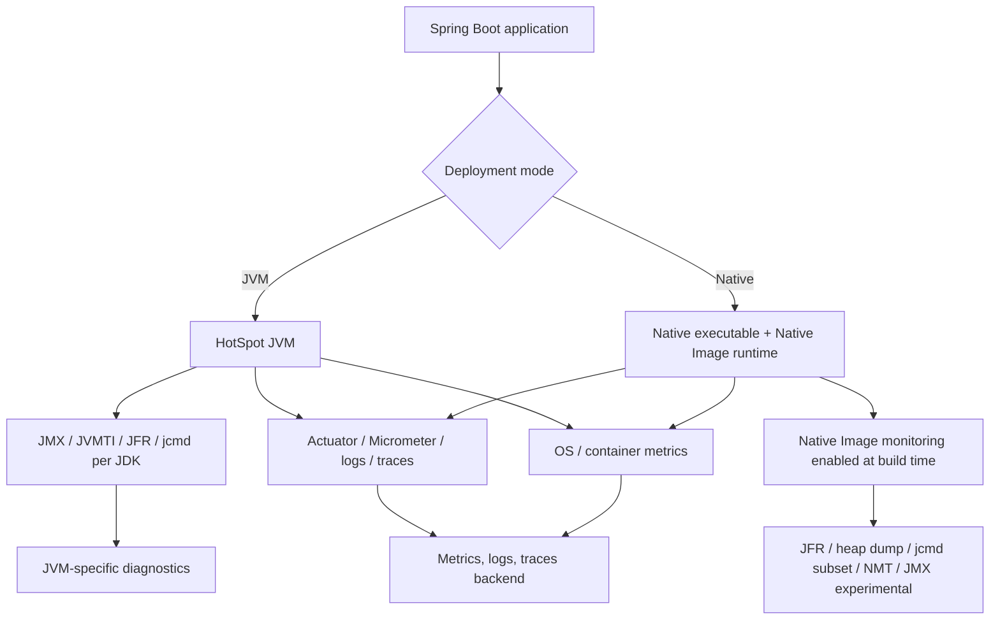

# Distinguishing JVM Process Monitoring Tools from Native Binary Tools

> **Chapter: Observability.** The **SPRING_BOOT_NATIVE_IMAGE** module compiles Spring Boot applications into GraalVM Native Images using Spring AOT to evaluate startup time and memory benefits. Once compiled, the application runs as a target-platform executable rather than on the HotSpot JVM. Consequently, several familiar JVM monitoring tools cannot attach or cease to be meaningful; other features still have supported equivalents in Native Image if enabled at build time. This lesson helps you choose the right tool for each kind of data and build an observability workflow for both JVM applications and native binaries.

## 1. Learning Objectives

After this lesson, you will be able to:

1. Explain why tools relying on the HotSpot attach API, JVMTI, or JIT do not work fully with Native Image.
2. Distinguish JVM monitoring tools, Native Image diagnostic tools, and application/OS-level observability tools.
3. Choose the right tool for CPU, heap, native memory, threads, GC, logs, metrics, and distributed tracing.
4. Enable GraalVM monitoring features at build time via the `enable-monitoring` option.
5. Use JFR, `jcmd`, heap dumps, Native Memory Tracking, JMX, and `perf` within Native Image's supported scope.
6. Use Spring Boot Actuator, Micrometer, and OpenTelemetry to keep metrics, logs, and traces consistent between JVM and native builds.
7. Design JVM/native comparison measurements with identical load, data, and deployment environments.

## 2. Fundamental Differences: JVM Process vs. Native Executable

A Spring Boot application running on the JVM is executed by a HotSpot runtime. HotSpot manages class loading, JIT compilation, code cache, heap, garbage collectors, and multiple serviceability interfaces. Tools such as JConsole, VisualVM, JDK Mission Control, `jcmd`, `jstack`, `jmap`, `jstat`, or JVMTI-based profilers can use these interfaces to observe the process.

Native Image analyzes the program at build time, compiles reachable code into machine code, and packages it into an executable for the target OS/architecture. At runtime, the binary has its own Native Image runtime and garbage collector, but lacks a HotSpot JIT compiler or the full serviceability interfaces of a standard JVM.

Therefore, distinguish between:

- **HotSpot-bound tools:** depend on HotSpot's attach mechanism, JVMTI, JIT compiler, class loaders, or memory pool structures. They may fail to connect or report meaningless data on a native executable.
- **Selectively supported Native Image tools:** JFR, heap dumps, `jcmd`, Native Memory Tracking, and JMX can be used in certain configurations, though many features must be enabled at build time and have specific limitations.
- **Application/OS-level tools:** metrics, tracing, logs, process monitors, container metrics, `perf`, and native debuggers observe behavior outside the Java runtime. They remain useful provided the application and environment supply the needed data.



The key point is that **Native Image does not mean zero Java tooling remains usable**. JFR, `jcmd`, and heap dumps now have meaningful support. However, do not assume a tool that works on HotSpot will have the same commands, events, or attach mechanism on a native binary.

## 3. Tool Matrix: JVM, Native Image, and Operating System

| Tool | JVM/HotSpot | Native Image | Notes |
|---|---|---|---|
| JConsole | Connects via JMX and inspects MBeans | Can connect if remote JMX is enabled; Native Image support is still limited | Native Image JMX is currently experimental |
| VisualVM | Monitors processes, threads, heap, and profiling | Can open JFR/heap dumps; can discover native processes via `jvmstat` in suitable configs | Do not expect live profiling on native to behave identically to HotSpot |
| JDK Mission Control | Analyzes JFR and HotSpot data | Can analyze native JFR files with events recorded by Native Image | Native event set differs from HotSpot |
| jcmd | Many HotSpot diagnostic commands | Subset of commands if built with `enable-monitoring=jcmd` | Does not include all HotSpot diagnostic commands |
| jstack | JVM thread dump | Use `jcmd Thread.print` or `Thread.dump_to_file` when supported feature is enabled | Do not assume direct `jstack` attach works |
| jmap | Heap inspection/dump depending on JDK | Use `GC.heap_dump` via `jcmd` or `HeapDumpOnOutOfMemoryError` when heap dump is enabled | Not all `jmap` commands have equivalents |
| jstat | HotSpot GC/class loading statistics | No full equivalent `jstat` interface | Use JFR, `jcmd`, NMT, and OS metrics as needed |
| JVMTI profiler/agent | Can instrument bytecode and VM events | Does not support HotSpot-style runtime bytecode-based interfaces | Use Native Image JFR or native profilers |
| perf | Profiles process/JVM native code at OS level | Profiles executable machine code; should build with debug info | Linux; requires appropriate symbol/frame information |
| GDB | Debugs native runtime/JVM when needed | Directly debugs native executable with debug info | GraalVM native debug support has platform limitations |
| top, ps, pidstat, docker stats | Usable | Usable | Observes CPU, RSS, threads, I/O, and container resources |

This matrix guides tool selection, not a guarantee that every version and OS behaves identically. Verify your exact GraalVM JDK, Native Image version, and deployment platform before adopting a tool into operational procedures.

## 4. HotSpot Tools That Should Not Be Assumed Default for Native

### 4.1. JIT Compiler and Code Cache

HotSpot compiles bytecode to machine code at runtime via JIT. JVM tools can track compilation queues, compilation time, code cache, deoptimization, and warm-up.

Native Image compiles code before the process starts. Therefore:

- There is no HotSpot-like JIT warm-up cycle.
- HotSpot JIT compilation time and code cache are not appropriate comparison metrics.
- Tools that only analyze bytecode being JIT-compiled may yield no data on native.
- Evaluate CPU using request latency, CPU time, native profilers, and supported JFR events.

Some Native Image runtimes can perform runtime compilation for special cases like Truffle; that does not turn every native Spring Boot application into a HotSpot JIT process.

### 4.2. Attach API and JVMTI

HotSpot tooling often relies on the attach mechanism to ask the JVM for heap dumps, threads, class histograms, or to activate a profiler. JVMTI relies on observing bytecode and VM events.

Native Image uses closed-world compilation and does not preserve HotSpot's full bytecode/class-loading model. Thus, agents relying on JVMTI or bytecode instrumentation cannot be assumed compatible by default. If a tool advertises GraalVM support, verify specifically whether it supports:

- Running on the GraalVM JVM vs. executables built by Native Image.
- Attaching to a running process vs. only reading output files.
- Profiling Java-level methods vs. native machine code.
- Which GraalVM versions and operating systems are supported.

### 4.3. JMX and Platform MXBeans

JMX can still be used with Native Image in specific configurations, though remote JMX is currently described by GraalVM as experimental. Native Image supports MXBeans and standard user-defined MBeans; dynamic MBeans and model MBeans are not supported in the usual way. Not every platform MXBean is fully implemented or meaningful in the native runtime.

If using custom standard MBeans, reachability metadata may be needed for interface proxies. Enable JMX only when there is a clear administrative need and after verifying connection security, authentication, TLS, firewalls, and metadata. Never open an unauthenticated JMX port on a production network.

## 5. Native Image Monitoring Must Be Enabled at Build Time

Unlike HotSpot, many Native Image diagnostic features must be compiled into the executable at build time. The primary option is:

```bash
native-image --enable-monitoring=jcmd,jfr,heapdump,nmt,jvmstat \
    -jar orders-service.jar
```

The example above enables a common set of features. Omit unneeded features and verify support for your target version/OS. Certain features such as JFR or `jcmd` are currently unavailable on Windows per GraalVM JDK 25 documentation; `jvmstat` mainly helps tools discover processes.

With Gradle Native Build Tools, you can pass the build argument:

```groovy
graalvmNative {
    binaries {
        main {
            buildArgs.add(
                "--enable-monitoring=jcmd,jfr,heapdump,nmt,jvmstat"
            )
        }
    }
}
```

With Maven Native Build Tools, configure build arguments in the plugin:

```xml
<plugin>
    <groupId>org.graalvm.buildtools</groupId>
    <artifactId>native-maven-plugin</artifactId>
    <configuration>
        <buildArgs>
            <buildArg>--enable-monitoring=jcmd,jfr,heapdump,nmt,jvmstat</buildArg>
        </buildArgs>
    </configuration>
</plugin>
```

This is a direct plugin configuration example. If the Spring Boot plugin drives native compilation, place build arguments in the exact native image configuration used by that plugin. Do not confuse native executable build arguments with JVM arguments used to run Maven/Gradle.

`enable-monitoring` can increase binary size and add overhead depending on the features. Choose configurations based on operational needs: release builds with JFR/NMT/heap dump when investigations require them; minimal builds can omit unused features.

## 6. JDK Flight Recorder on Native Image

JFR records time-stamped events such as CPU sampling, GC, threads, allocations, and container information. GraalVM Native Image supports JFR, but it must be enabled at build time:

```bash
native-image --enable-monitoring=jfr -jar orders-service.jar
```

Then start the executable and begin recording:

```bash
./orders-service \
  -XX:StartFlightRecording="filename=orders.jfr,duration=5m,dumponexit=true"
```

Properties such as `filename`, `duration`, `maxage`, `maxsize`, and `dumponexit` bound the recording's size and duration. For long-running applications, set capacity and time limits to avoid filling filesystems/container volumes.

You can quickly inspect a recording file with:

```bash
jfr summary orders.jfr
jfr print --events jdk.ExecutionSample orders.jfr
```

Open the `.jfr` file in JDK Mission Control or VisualVM to view timelines, threads, stack traces, and supported events. Native Image JFR can generate `jdk.ExecutionSample` and several allocation/GC/thread events. However, the event set differs from HotSpot: Java-level events generated via bytecode instrumentation on HotSpot, such as certain file I/O and exception events, are not fully available in Native Image. Some events also depend on Serial GC or NMT.

### 6.1. Controlling JFR with jcmd

If the executable was built with both `jcmd` and `jfr`, you can use:

```bash
jcmd <pid> help
jcmd <pid> JFR.start name=incident filename=incident.jfr duration=5m
jcmd <pid> JFR.check
jcmd <pid> JFR.dump name=incident filename=incident.jfr
jcmd <pid> JFR.stop name=incident
```

Supported JFR commands include `JFR.start`, `JFR.stop`, `JFR.check`, and `JFR.dump`. Detailed syntax can be checked with `jcmd <pid> help JFR.start`. If the process does not appear when running `jcmd -l`, check the `jvmstat` feature and process/container environment.

### 6.2. Platform and Event Limitations

- Per GraalVM JDK 25 documentation, JFR recording is not yet available with Native Image on Windows.
- Some events are only available when using Serial GC.
- Leak profiling via `jdk.OldObjectSample` is only partially supported; paths to GC roots are not available.
- Stack traces in JFR files can still be viewed, but stack traces in event streaming callbacks are not available in the same way.
- Remote JMX to control `FlightRecorderMXBean` is experimental.

Do not take a HotSpot JFR profile and assume every event will appear in a native recording. Check the actual event list and verify recordings contain data before analyzing.

## 7. Heap Dumps and Memory Analysis

Native Image can produce heap dumps in HPROF format when enabled:

```bash
native-image --enable-monitoring=heapdump -jar orders-service.jar
```

To create a dump when the Java heap runs out of memory:

```bash
./orders-service \
  -XX:+HeapDumpOnOutOfMemoryError \
  -XX:HeapDumpPath=/var/diagnostics/orders.hprof
```

You can use `jcmd <pid> GC.heap_dump /var/diagnostics/orders.hprof` when built with `jcmd` and `heapdump`. On Linux/macOS, Native Image also supports sending `SIGUSR1` to request a dump when the heap dump feature is enabled. This signal mechanism is unavailable on Windows.

VisualVM can open HPROF files generated from native executables. On Windows, VisualVM can read existing dump files, though it currently cannot request a heap dump directly from a running Native Image process. On Linux/macOS, it can discover processes via `jvmstat` and request a heap dump through the appropriate interface.

Note: a heap dump only describes the GC-managed Java heap. It does not replace checking RSS, native allocations, memory mappings, thread stacks, or memory allocated by C/JNI libraries.

## 8. Native Memory Tracking (NMT)

NMT tracks a portion of native/off-heap memory managed by the runtime. On Native Image, NMT is disabled by default and must be enabled at build time:

```bash
native-image --enable-monitoring=nmt -jar orders-service.jar
```

To print statistics when the process exits:

```bash
./orders-service -XX:+PrintNMTStatistics
```

If built with `jcmd`, you can query:

```bash
jcmd <pid> VM.native_memory
```

Unlike HotSpot, once NMT is compiled into Native Image, it is always active in the executable. Native Image currently supports summary-level NMT; HotSpot's detailed mode with call-site tracking and baselines is not yet available. NMT tracks VM-level allocations and allocations via `Unsafe.allocateMemory`; a library calling `malloc` directly may not be counted in NMT figures.

NMT is useful for distinguishing GC-managed heap from certain native memory regions. When investigating overall memory footprint, still cross-check:

- Java heap and heap dumps.
- NMT summary.
- Process RSS/working set.
- Container memory usage and memory limits.
- Native allocations from JNI/external libraries if present.

Do not treat `jvm.memory.used` or NMT alone as total process memory.

## 9. JMX, VisualVM, and JDK Mission Control

Remote JMX can be enabled for Native Image using dedicated features:

```bash
native-image \
  --enable-monitoring=jmxserver,jmxclient,jvmstat \
  -jar orders-service.jar
```

`jmxserver` allows the executable to accept JMX management connections; `jmxclient` lets the process connect to another JMX server; `jvmstat` helps VisualVM and similar tools discover processes. Enable only the components truly needed.

Native Image remote JMX is currently experimental. Key limitations:

- Only MXBeans and standard user-defined MBeans are supported.
- Dynamic MBeans and model MBeans are not supported in the usual way.
- Some platform MXBeans are unimplemented or not applicable to Native Image.
- Custom standard MBeans may require reflection/dynamic proxy metadata.
- If using JMX to control JFR, `jfr` must also be enabled in the native executable.

VisualVM and JDK Mission Control can be helpful when opening JFR snapshots, heap dumps, or configured JMX connections. They do not turn Native Image into a HotSpot process and do not add events/management interfaces that the native runtime does not support.

## 10. OS-Level Native Profilers and Debuggers

Because Native Image emits platform-native machine code, native tools can observe the process without needing the HotSpot attach API.

### 10.1. Linux perf

For `perf` to display method names and unwind stack traces cleanly, build with debug information and frame pointers:

```bash
native-image -g -H:+PreserveFramePointer \
  -H:+SourceLevelDebug \
  -jar orders-service.jar
```

Then capture a CPU profile:

```bash
perf record -g -- ./orders-service
perf report
```

`-g` generates debug information; `PreserveFramePointer` helps `perf` unwind stacks more reliably; `SourceLevelDebug` adds source-level info. You may need to retain symbols for deeper annotation features. Debug info enlarges binaries/artifacts; `-O0` can make debugging easier but alters optimization levels, so never use performance results from an `-O0` build for production comparisons.

`perf` is a Linux tool. Symbolization capability depends on the GraalVM release, kernel, performance counter permissions, and how the binary was stripped/packaged.

### 10.2. GDB

GDB can debug native executables with debug info:

```bash
native-image -g -O0 -jar orders-service.jar
gdb --args ./orders-service
```

Inside GDB, you can set breakpoints by symbol or source line, view native stack traces, and inspect crashes. Native Image source-level debugging is currently supported primarily on Linux, with initial experimental support on macOS. Use a dedicated debug build for investigation, then revalidate on a production-like optimized build.

### 10.3. Process and Container Tools

The following tools remain useful for both JVM and native:

| Tool | Data |
|---|---|
| `ps`, `top`, `htop` | CPU, RSS, thread count, process uptime |
| `pidstat` | CPU, memory, I/O per PID over time |
| `lsof` | Open file descriptors and sockets |
| `ss` | Sockets and connection states |
| `strace` | System calls on Linux |
| `docker stats` | Container CPU, memory, network, and block I/O |
| Kubernetes/cAdvisor metrics | CPU throttling, working set, restarts, OOM, and pod resources |

These metrics are especially important for native because RSS also includes code segments, shared libraries, thread stacks, mapped files, and native allocations; the Java heap is only one part of total process memory.

## 11. Spring Boot Actuator, Micrometer, and OpenTelemetry Remain the Primary Observability Layer

HotSpot-bound tools may change, but application-level observability can remain consistent between JVM and native builds. Spring Boot provides Actuator; Micrometer Observation produces metrics/traces; logging frameworks write logs; and exporters forward data to monitoring backends.

### 11.1. Metrics

Add Actuator and the Prometheus registry if your system uses Prometheus:

```groovy
dependencies {
    implementation("org.springframework.boot:spring-boot-starter-actuator")
    runtimeOnly("io.micrometer:micrometer-registry-prometheus")
}
```

Example endpoint configuration:

```yaml
management:
  endpoints:
    web:
      exposure:
        include: health,info,metrics,prometheus
  endpoint:
    health:
      probes:
        enabled: true
```

Commonly used endpoints:

- `/actuator/health`: overall health status.
- `/actuator/health/liveness`: whether the application is still alive.
- `/actuator/health/readiness`: whether the application is ready to accept traffic.
- `/actuator/metrics`: inspect registered meters.
- `/actuator/prometheus`: export metrics in Prometheus format when the registry is configured and the endpoint is exposed.

Application-level metrics such as request count, latency, error rate, connection pools, executor queues, cache hit/miss, and business counters remain key signals on native. System/process metrics such as CPU, uptime, file descriptors, and disk can also be useful.

### 11.2. Be Careful with `jvm.*`-Prefixed Metrics

Spring Boot/Micrometer may register meters such as `jvm.memory.*`, `jvm.gc.*`, `jvm.threads.*`, class loading, and JIT compilation. However, the meaning of these meters depends on the runtime:

- Native Image has no HotSpot JIT compilation; JIT metrics are not meaningful for comparing native performance.
- Classpath and reachable code are fixed at build time; class loading/unloading does not occur like in a normal JVM application.
- HotSpot memory pools and non-heap areas such as Metaspace or Code Cache do not necessarily have counterparts in a native executable.
- Native Image has a GC and Java heap, but heap structure, memory pools, and reporting may differ from HotSpot.

Therefore, verify which meters are actually present and whether their values make sense in the native runtime. Do not automatically treat a `jvm.*` metric as identical between the two deployments. When comparing memory footprint, separately record RSS/container memory, Java heap, and NMT rather than relying solely on `jvm.memory.used`.

### 11.3. Traces and Logs

Spring Boot uses Micrometer Observation for metrics and traces. You can instrument business operations with `ObservationRegistry`, and use Micrometer Tracing with an OTLP exporter to send traces to compatible OpenTelemetry backends. Logging via SLF4J/Logback or Log4j2 also continues to work once dependencies and configurations are verified for Native Image.

With `@Async` and reactive pipelines, pay attention to context propagation. If using the auto-configured `AsyncTaskExecutor`, configure `spring.task.execution.propagate-context=true` when observation context must be propagated. If creating an executor manually, register `ContextPropagatingTaskDecorator`.

Exporter libraries, logging appenders, and tracing bridges must still be compatible with Native Image. Build and test native with the actual exporter; do not test only on the JVM and assume the exporter will initialize identically inside the binary.

### 11.4. Securing Management Endpoints

Do not expose all of Actuator or JMX to the public internet. Expose only required endpoints, restricting them with Spring Security, network policies, internal ingress, and appropriate authentication. Heap dumps, thread dumps, system properties, and logs can contain sensitive information; protect access permissions and retention.

## 12. Choosing Tools by Investigation Question

| Investigation question | Preferred tool for JVM | Preferred tool for Native Image |
|---|---|---|
| Which method has high CPU? | JFR, JMC, async-profiler/JVMTI profiler | JFR ExecutionSample, Linux `perf`, GDB when needed |
| Where are threads blocked? | `jstack`, VisualVM, JFR | `jcmd Thread.print`/`Thread.dump_to_file`, JFR thread events |
| Why is Java heap growing abnormally? | `jmap`, VisualVM heap dump, JFR | HPROF heap dump, VisualVM, JFR allocation events |
| Why is native/off-heap memory growing? | NMT, OS process metrics | NMT summary, RSS, container metrics, native profiler |
| Why are GC pauses long? | JFR, GC logs, `jstat` | Supported JFR GC events, GC logs, and runtime metrics |
| Why is a request slow or failing? | Actuator, Micrometer, tracing, logs | Same Actuator/Micrometer/tracing/logs layer |
| Why did the container hit OOM? | Container metrics, JVM heap, NMT | Container metrics, RSS, heap dump, NMT, and cgroup events |
| Native/JNI crash? | `hs_err` log, native debugger depending on case | GDB, core dump, debug symbols, OS logs |

## 13. Workflow for Observing and Comparing JVM vs. Native

To make comparisons meaningful, keep workloads and conditions identical:

1. Use the same commit, dependencies, business configuration, dataset, and backing services.
2. Run JVM and native on the same machine/container type with identical CPU/memory limits.
3. Record GraalVM JDK, Spring Boot, Native Build Tools, OS/architecture, and build arguments.
4. Collect application metrics: request rate, p50/p95/p99 latency, error rate, DB pool, executors, and caches.
5. Collect process/container metrics: CPU, RSS, working set, file descriptors, thread counts, and restarts/OOMs.
6. For native, enable JFR/NMT/heapdump/`jcmd` when needed and clearly document which features the binary was built with.
7. Run for the same duration under steady load; for JVM, separate the warm-up phase from the measurement phase.
8. Analyze JFR/heap dumps/`perf` and correlate with traces/logs to explain causes rather than comparing a single aggregate number.

Sample results table:

| Metric | JVM | Native | Notes |
|---|---:|---:|---|
| Startup time to readiness | … | … | Measured from process start to readiness |
| RSS after startup | … | … | Process resident memory |
| RSS under steady load | … | … | Same workload |
| Request p95 | … | … | Same endpoint and dataset |
| Average CPU | … | … | Same CPU limit |
| Error rate | … | … | Same measurement window |
| Java heap peak | … | … | Specify how each runtime reports it |
| Container memory peak | … | … | Includes native/OS memory |
| GC pause | … | … | Use events/metrics meaningful on each runtime |

Do not compare HotSpot's `jvm.memory.used` with native's RSS; the two metrics measure different scopes. Nor should you conclude native is faster solely from startup time if throughput and latency under load have not been tested.

## 14. Common Errors

| Symptom | Possible cause | Resolution |
|---|---|---|
| VisualVM does not see native process | `jvmstat` not enabled or platform does not support discovery | Enable `enable-monitoring=jvmstat`; check PID and OS |
| `jcmd` cannot connect | `jcmd` not enabled at build time or running on Windows | Rebuild with `enable-monitoring=jcmd`; check platform limits |
| `jcmd` lacks expected command | Native Image only supports a subset of commands | Run `jcmd <pid> help` and use listed commands |
| Cannot create JFR recording | `jfr` not enabled or platform unsupported | Build with `enable-monitoring=jfr`; check GraalVM JDK/OS |
| JFR missing file I/O or exception events | Java-level events relying on bytecode instrumentation not fully supported | Use application logs, tracing, OS tools, or business instrumentation |
| Cannot create heap dump | `heapdump` not enabled or path not writable | Enable monitoring feature; check permissions and volume space |
| NMT misses `malloc` from external libraries | Direct allocations in native libraries are not tracked by NMT | Use OS/native profilers and library documentation |
| JMX client cannot read custom MBean | Missing dynamic proxy/reflection metadata or unsupported MBean type | Add proper metadata; use supported standard MBeans/MXBeans |
| `jvm.*` metrics are 0 or absent | Native runtime does not provide the same HotSpot management data | Inspect actual meters; use application/process/container metrics |
| `perf` shows only unknown symbols | Missing debug info/frame pointers or stripped binary | Build with `-g`, preserve frame pointers, and retain debug artifacts |
| GDB cannot map source | Missing source/debug info or platform unsupported | Build debug with `-g`, check source cache and OS |

## 15. Hands-On Exercise

An order-processing Spring Boot service is deployed in two forms: a JVM container and a GraalVM Native Image container. The team needs to determine why the native build's RSS increases under high concurrent load.

Steps:

1. Enable Actuator, Micrometer Prometheus, and OTLP tracing; expose health, metrics, and prometheus on an internal network.
2. Collect identical request rate, latency, error rate, executor metrics, datasource pool metrics, and container RSS for both builds.
3. Build native with `enable-monitoring=jcmd,jfr,heapdump,nmt,jvmstat` on Linux if these features are needed.
4. Capture a native JFR recording during rising load; analyze available execution samples, allocations, and GC events.
5. Use `jcmd <pid> Thread.print` and `VM.native_memory` to inspect thread/NMT summaries.
6. When Java heap growth is suspected, create an HPROF dump and open it in VisualVM.
7. Use `perf` with debug information if CPU profiles do not yet explain the increase.
8. Cross-reference RSS with Java heap, NMT, and container memory; identify whether the growth comes from heap, thread stacks, native libraries, or caches.
9. Re-run on a production-optimized build after investigation; never use `-O0` build results as official performance figures.

Report template:

| Data source | JVM | Native | Conclusion |
|---|---|---|---|
| Actuator request metrics | … | … | … |
| Distributed traces | … | … | … |
| Container RSS/CPU | … | … | … |
| Heap dump | … | … | … |
| JFR events/profile | … | … | … |
| NMT summary | … | … | … |
| Thread dump | … | … | … |
| Native perf profile | Not applicable or … | … | … |

## 16. Self-Check Questions

1. Why can JConsole/VisualVM not be assumed to monitor a native process identically to HotSpot?
2. Does Native Image still have a runtime and garbage collector?
3. Which monitoring features must be enabled at build time?
4. Which command groups does `jcmd` support on Native Image, and why is it not equivalent to HotSpot `jcmd`?
5. Why does native JFR have a different event set from HotSpot?
6. How does a native heap dump differ from process RSS?
7. Which memory regions does Native Image NMT track, and what are its limits?
8. Why should remote JMX on Native Image be treated as experimental?
9. When should you use `perf`/GDB instead of a JVM profiler?
10. Why are Actuator/Micrometer/tracing the right observability layer for keeping measurements consistent between JVM and native?

## Key Takeaways

**Choose tools based on the actual runtime, not solely on the application's Java language.** HotSpot has a rich attach/JVMTI/JIT ecosystem; Native Image provides a bounded set of JFR, `jcmd`, heap dump, NMT, and JMX features that must be enabled at build time. For Spring Boot operations, keep Actuator, Micrometer, logs, and tracing as your shared application observability layer, and supplement them with OS/container tools, JFR, and native profilers to investigate process-level resources.

## Official References

- [GraalVM — Debugging and Diagnostics](https://www.graalvm.org/jdk25/reference-manual/native-image/debugging-and-diagnostics/): Native Image observability and diagnostic capabilities.
- [GraalVM — Java Diagnostic Command with Native Image](https://www.graalvm.org/jdk25/reference-manual/native-image/debugging-and-diagnostics/jcmd/): enabling `jcmd` and list of supported commands.
- [GraalVM — JDK Flight Recorder with Native Image](https://docs.oracle.com/en/graalvm/jdk/25/docs/reference-manual/native-image/debugging-and-diagnostics/JFR/): JFR build-time options, event set, and platform limitations.
- [GraalVM — Create a Heap Dump from a Native Executable](https://www.graalvm.org/jdk25.5/reference-manual/native-image/guides/create-heap-dump/): heap dumps, VisualVM, and OOME.
- [GraalVM — Native Memory Tracking](https://www.graalvm.org/jdk25/reference-manual/native-image/debugging-and-diagnostics/NMT/): NMT and native memory tracking limits.
- [GraalVM — Build and Run Native Executables with Remote JMX](https://www.graalvm.org/latest/reference-manual/native-image/guides/build-and-run-native-executable-with-remote-jmx/): experimental JMX and supported MBean types.
- [GraalVM — Debug Info Feature](https://www.graalvm.org/jdk25/reference-manual/native-image/debugging-and-diagnostics/DebugInfo/): debug symbols, GDB, `perf`, and source-level debugging.
- [GraalVM — Native Image Compatibility Guide](https://www.graalvm.org/jdk25/reference-manual/native-image/metadata/Compatibility/): differences between JVM and Native Image.
- [Spring Boot — Observability](https://docs.spring.io/spring-boot/reference/actuator/observability.html): Micrometer Observation, metrics, traces, and context propagation.
- [Spring Boot — Metrics](https://docs.spring.io/spring-boot/reference/actuator/metrics.html): Actuator, Micrometer, Prometheus, and built-in meters.
- [Spring Boot — Actuator Endpoints](https://docs.spring.io/spring-boot/reference/actuator/endpoints.html): health, readiness, metrics, and management endpoints.
- [Micrometer — JVM Metrics](https://docs.micrometer.io/micrometer/reference/reference/jvm.html): JVM binders and meters.
