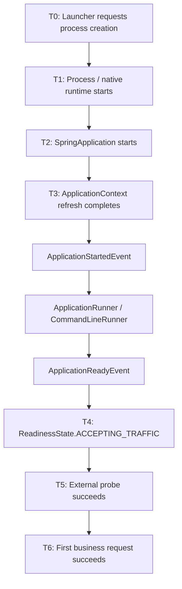

# Distinguishing Process Startup Time from When the Application Is Actually Ready

> **Chapter:** Performance Measurement  
> **Module:** `SPRING_BOOT_NATIVE_IMAGE`  
> **Goal:** Accurately identify start and end milestones when measuring Spring Boot Native Image startup; distinguish process launch, Spring context refresh, application ready, readiness probe, and the first business request; use Spring Boot events, Micrometer metrics, ApplicationStartup, and Kubernetes probes for consistent measurement and operations.

## 1. Why Separate Startup Milestones?

A native executable can spawn a process very quickly, but that does not prove the application is ready to handle requests. After the operating system creates the process, the program still has to run runtime initialization, initialize the Spring context, instantiate beans, open the web server, run startup tasks, and complete any required data preparation.

Conversely, a Spring log message reporting that the application is ready does not necessarily prove an external client can connect successfully through the network, load balancer, or service mesh. A readiness endpoint can respond before a specific business flow has been initialized for the first time.

Therefore, the question "how long does the application take to start?" must be broken down into several smaller questions:

- When is the process created and started?
- When has Spring refreshed the ApplicationContext?
- Have all ApplicationRunners and CommandLineRunners finished?
- Has Spring Boot transitioned to accepting traffic?
- Has an external probe received a successful response?
- Has the first business request completed?

If you rely on a single number, you may mistakenly conclude that a native image is ready just because a PID appeared, or think Spring startup is slow when most of the time was spent on warm-up, the database, or network probes.

## 2. Milestones to Distinguish

Order the timestamps chronologically:



| Milestone | Meaning | Appropriate Measurement Source |
|---|---|---|
| T0 — Process launch | OS/container runtime starts creating the process | Launcher, container runtime, or orchestrator |
| T1 — Process started | Process exists and is executing | OS/process supervisor; does not imply app ready |
| T2 — SpringApplication start | Spring Boot begins its startup lifecycle | Early listener or application instrumentation |
| T3 — Context refreshed | Bean factory/context refreshed; web server may be initialized | `ApplicationStartedEvent` and `application.started.time` |
| T4 — Application ready | Runners completed; Spring Boot sets readiness to `ACCEPTING_TRAFFIC` | `ApplicationReadyEvent`, `ApplicationAvailability`, `application.ready.time` |
| T5 — External probe success | External client/probe receives a successful HTTP response | Probe harness, Kubernetes, or load balancer |
| T6 — First business success | A request representing real business logic completes | Synthetic client or integration test |

T0 to T4 measures process and framework startup. T0 to T5 measures practical deployment time until network traffic can be served. T0 to T6 measures the first-request experience. The three measurements serve different purposes, so label them clearly in reports.

## 3. `ApplicationStartedEvent` Does Not Mean the Application Is Ready

Spring Boot publishes application events in a defined sequence:

1. `ApplicationStartingEvent`.
2. `ApplicationEnvironmentPreparedEvent`.
3. `ApplicationContextInitializedEvent`.
4. `ApplicationPreparedEvent`.
5. `ApplicationStartedEvent` after the ApplicationContext refresh completes.
6. `AvailabilityChangeEvent` with `LivenessState.CORRECT`.
7. `ApplicationReadyEvent` after ApplicationRunners and CommandLineRunners finish.
8. `AvailabilityChangeEvent` with `ReadinessState.ACCEPTING_TRAFFIC`.
9. `ApplicationFailedEvent` if startup fails.

The key point is that `ApplicationStartedEvent` occurs **before** runners execute. A runner may still be loading caches, validating configuration, fetching reference data, or performing mandatory startup tasks. During this window, the context is refreshed, yet the application is still not considered ready to accept traffic.

`ApplicationReadyEvent` is emitted after runners finish. Immediately after that event, Spring Boot switches readiness to `ACCEPTING_TRAFFIC`. This is the better framework milestone when measuring when the application is ready. [Spring Boot Reference — Application Events and Listeners](https://docs.spring.io/spring-boot/reference/features/spring-application.html#features.spring-application.application-events-and-listeners)

### 3.1. Liveness and Readiness States Are Different

Spring Boot manages two states:

- **Liveness — `CORRECT`:** the context has refreshed and the application is considered capable of functioning. If liveness is broken, the infrastructure may need to restart the process.
- **Readiness — `ACCEPTING_TRAFFIC`:** the application has completed startup tasks and can accept traffic. When `REFUSING_TRAFFIC`, the infrastructure should not route requests to the instance.

Lifecycle table:

| Phase | Liveness | Readiness | Meaning |
|---|---|---|---|
| Starting | `BROKEN` | `REFUSING_TRAFFIC` | Context not ready yet |
| Started | `CORRECT` | `REFUSING_TRAFFIC` | Context refreshed, runners still executing |
| Ready | `CORRECT` | `ACCEPTING_TRAFFIC` | Startup tasks completed, ready for traffic |
| Graceful shutdown | `CORRECT` | `REFUSING_TRAFFIC` | Stops accepting new requests, drains in-flight requests |

You can query states via `ApplicationAvailability` or listen for `AvailabilityChangeEvent`. [Spring Boot Reference — Application Availability](https://docs.spring.io/spring-boot/reference/features/spring-application.html#features.spring-application.application-availability)

## 4. `ApplicationReadyEvent` Still Differs from an External Probe

When Spring Boot transitions to `ACCEPTING_TRAFFIC`, the framework has finished the startup steps it manages. However, an external probe also depends on:

- The web server binding its port and accepting connections.
- Container networking, port mapping, and firewalls.
- Service discovery, ingress, load balancer, or service mesh.
- HTTP routes and security filters on the probed endpoint.
- Whether management endpoints use a separate port/context.
- Probe polling interval and timeout.

Therefore, a production measurement should record both the `ApplicationReadyEvent` timestamp and the timestamp when an external probe receives an HTTP success.

A successful readiness probe also does not guarantee that every business flow is warmed up. For instance, a simple endpoint might reply immediately while a product cache, connection pool, or request-processing model is not yet ready. If the business requires those components before serving traffic, place them in startup tasks or a dedicated readiness gate.

## 5. The First Business Request Is Another Distinct Milestone

The first request can be slower than subsequent requests because:

- The JVM is performing JIT compilation and optimizing hot code.
- Lazy initialization is creating beans or initializing serializers for the first time.
- Connection pools are opening their initial connections.
- DNS lookup, TLS handshake, or authentication occurs for the first time.
- Cache misses trigger reads from the database or remote services.
- A native executable executes static initialization or touches a previously unexecuted code path.

`ApplicationReadyEvent` does not measure these costs. When comparing a JVM JAR with a native executable, report separately:

- Time to readiness.
- First-request latency.
- Post-warm-up latency.
- Throughput and latency under a representative workload.

A native image may reach readiness faster while the first request still spends time initializing dependencies. Conversely, a JVM app may report ready before JIT warm-up reaches steady state.

## 6. Using Spring Boot's Built-In Startup Metrics

Spring Boot automatically publishes two important metrics via Micrometer:

| Metric | Meaning |
|---|---|
| `application.started.time` | Time taken for the application to start |
| `application.ready.time` | Time taken for the application to become ready to serve requests |

These metrics are tagged with the fully qualified name of the application class. They are two useful internal milestones for tracking startup changes across builds and environments. [Spring Boot Reference — Application Startup Metrics](https://docs.spring.io/spring-boot/reference/actuator/metrics.html#actuator.metrics.supported.application-startup-metrics)

To view metrics via Actuator, you need Spring Boot Actuator and the appropriate endpoint exposed:

```yaml
management:
  endpoints:
    web:
      exposure:
        include: health,metrics
```

You can query:

```http
GET /actuator/metrics/application.started.time
GET /actuator/metrics/application.ready.time
```

These metrics are not timers starting from container image pull or OS process creation. They measure startup time within the Spring Boot lifecycle. To measure from T0, add a measurement outside the process.

## 7. Inspecting Startup Details with `ApplicationStartup`

The two metrics show total duration, but not which bean or startup step took the time. Spring Boot provides `ApplicationStartup` to record steps during initialization.

`BufferingApplicationStartup` stores startup steps in a buffer. Configure it before calling `run`:

```java
import org.springframework.boot.SpringApplication;
import org.springframework.boot.autoconfigure.SpringBootApplication;
import org.springframework.boot.context.metrics.buffering.BufferingApplicationStartup;

@SpringBootApplication
public class PaymentApplication {

    public static void main(String[] args) {
        SpringApplication application =
                new SpringApplication(PaymentApplication.class);

        application.setApplicationStartup(
                new BufferingApplicationStartup(2048));

        application.run(args);
    }
}
```

The buffer size `2048` is an example. If the application has many startup steps, choose a capacity large enough not to drop data needed for analysis.

Enable the `startup` endpoint to inspect the data as JSON:

```yaml
management:
  endpoints:
    web:
      exposure:
        include: health,metrics,startup
```

Once Actuator and `BufferingApplicationStartup` are enabled, query:

```http
GET /actuator/startup
```

This endpoint exposes the startup steps collected by `ApplicationStartup`. It is useful for identifying which configuration, bean initialization, or phase contributes most to startup time. [Spring Boot Reference — ApplicationStartup](https://docs.spring.io/spring-boot/reference/features/spring-application.html#features.spring-application.application-startup)

`ApplicationStartup` only measures steps instrumented by Spring. It does not measure OS process creation, container scheduling, image pull, or the time from the readiness event until an external client connects successfully. Use it to explain internal startup after total external time has already been measured.

## 8. Measuring from Process Launch to External Readiness

Spring Boot metrics begin inside the Spring lifecycle. To know the elapsed time from when a process/container launches until a client can send requests, measure outside the process.

A probe harness can follow this procedure:

1. Record T0 using a monotonic clock immediately before asking the OS/container runtime to create the process.
2. Launch the executable or container.
3. Poll the readiness endpoint on the exact port used by real traffic.
4. Record T4 upon receiving the first successful response matching the chosen criterion, such as HTTP 200.
5. Send a representative business request and record T5 when it completes.
6. Compute durations from the harness's single clock.

Formulas:

```text
Process-to-ready = T4 - T0
Process-to-first-business-success = T5 - T0
Ready-to-first-business-success = T5 - T4
```

Use a monotonic clock because it does not jump due to NTP synchronization or system clock changes. Do not compare raw `System.nanoTime()` values across two processes or two machines; the value is only meaningful when taking differences within the same measurement domain. If the probe runs on another host, have the probe harness itself measure both launch and response times with a single clock or appropriate synchronized tracing.

### 8.1. Poll Interval Introduces Measurement Error

If a probe checks every 100 ms, actual readiness may occur up to nearly one full poll cycle earlier than what the harness records, excluding network and probe-processing time.

Therefore:

- Use the same poll interval and timeout for JVM and native image.
- Document the poll interval in the report.
- Do not set the interval so low that the probe itself generates significant load.
- If higher precision is needed, also log the internal readiness event and use the external probe to verify the network path.
- Use a lightweight endpoint that does not run heavy queries or call multiple services on every poll.

### 8.2. Separate Container Creation and Image Pull Time

When measuring with Docker or Kubernetes, clearly state what T0 represents:

- From invoking the container launch command.
- From when the container runtime creates the process.
- From when the Pod is created.
- From when the container starts running.

Image pull, scheduling, volume mounts, and init containers can take substantial time that is not Spring startup time. If the goal is measuring cold deployment, report those parts separately. If the goal is comparing JVM and native runtimes, pre-pull images to exclude image pull from the measurement.

## 9. Recording Internal Milestones with `System.nanoTime()`

When you need to correlate Spring events with an external probe, you can record relative elapsed time from the start of `main`. The example below measures from when Java/native execution enters `main`, not from when the OS starts creating the process:

```java
import org.slf4j.Logger;
import org.slf4j.LoggerFactory;
import org.springframework.boot.SpringApplication;
import org.springframework.boot.context.event.ApplicationStartedEvent;
import org.springframework.boot.context.event.ApplicationReadyEvent;
import org.springframework.boot.availability.AvailabilityChangeEvent;
import org.springframework.boot.availability.ReadinessState;
import org.springframework.context.ApplicationListener;

public class PaymentApplication {

    private static final Logger log =
            LoggerFactory.getLogger(PaymentApplication.class);

    public static void main(String[] args) {
        long mainEntryNanos = System.nanoTime();

        SpringApplication application =
                new SpringApplication(PaymentApplication.class);

        ApplicationListener<ApplicationStartedEvent> startedListener =
                event -> log.info("Context refreshed after {} ms",
                        elapsedMillis(mainEntryNanos));

        ApplicationListener<ApplicationReadyEvent> readyListener =
                event -> log.info("ApplicationReadyEvent after {} ms",
                        elapsedMillis(mainEntryNanos));

        ApplicationListener<AvailabilityChangeEvent<ReadinessState>>
                readinessListener = event -> {
                    if (event.getState() == ReadinessState.ACCEPTING_TRAFFIC) {
                        log.info("Accepting traffic after {} ms",
                                elapsedMillis(mainEntryNanos));
                    }
                };

        application.addListeners(
                startedListener,
                readyListener,
                readinessListener);

        application.run(args);
    }

    private static long elapsedMillis(long startNanos) {
        return (System.nanoTime() - startNanos) / 1_000_000;
    }
}
```

This example reveals the gap between context refresh, ApplicationReadyEvent, and readiness state. It does not replace external T0 measurement because `main` only executes after the OS creates the process and the runtime reaches the entry point.

In production systems, you do not necessarily need custom listeners if the two default startup metrics already meet your needs. Only add instrumentation when you need to correlate milestones, profile runners, or align logs across startups.

## 10. Deliberately Including Warm-Up Tasks in Readiness

If the application needs to load mandatory data before receiving traffic, decide whether that task belongs to startup.

For synchronous, mandatory tasks, use `ApplicationRunner` or `CommandLineRunner`. Spring Boot emits `ApplicationReadyEvent` only after runners complete, so the task duration is included in `application.ready.time`.

Example:

```java
@Component
public class ReferenceDataWarmup implements ApplicationRunner {

    private final ReferenceDataService referenceDataService;

    public ReferenceDataWarmup(ReferenceDataService referenceDataService) {
        this.referenceDataService = referenceDataService;
    }

    @Override
    public void run(ApplicationArguments args) {
        referenceDataService.loadRequiredReferenceData();
    }
}
```

Do not put long startup tasks in `@PostConstruct` merely to intentionally delay readiness. Spring Boot recommends using runners for work expected to execute during startup.

If warm-up runs asynchronously after the runner returns, Spring Boot may transition to `ACCEPTING_TRAFFIC` before warm-up completes. In that case, add a dedicated readiness health indicator and include it in the readiness group, or block the runner until mandatory data is ready. Never let readiness report UP when real requests would still fail because caches/models/configs have not loaded yet.

Not every external dependency belongs in readiness. Only check a database, cache, or external service if the application truly cannot serve requests when that dependency is unavailable. Do not put external service health checks in liveness because a shared dependency outage could restart every instance and trigger a cascading failure. [Spring Boot Reference — Liveness and Readiness](https://docs.spring.io/spring-boot/reference/features/spring-application.html#features.spring-application.application-availability)

## 11. Configuring Readiness and Liveness Endpoints for Spring Boot

When running on Kubernetes, Spring Boot Actuator provides health groups:

- `/actuator/health/liveness`
- `/actuator/health/readiness`

If management endpoints use a separate port, probes may succeed even if the main web server cannot accept connections. You can expose additional probe paths on the main server port:

```yaml
management:
  endpoint:
    health:
      probes:
        enabled: true
        add-additional-paths: true
```

This configuration creates the default paths `/livez` and `/readyz` on the main server port. When deployed on Kubernetes, Spring Boot normally enables probe support automatically upon detecting a Kubernetes environment; declaring it explicitly makes configuration and local testing more predictable.

Expose only necessary endpoints. By default, Actuator exposes only health over HTTP; `startup` and `metrics` endpoints must be added to exposure when analysis is needed. Protect endpoints that could reveal configuration details or internal application information. [Spring Boot Reference — Actuator Kubernetes Probes](https://docs.spring.io/spring-boot/reference/actuator/endpoints.html#actuator.endpoints.kubernetes-probes)

## 12. Using `startupProbe`, `livenessProbe`, and `readinessProbe` Properly

Kubernetes' three probe types serve distinct roles:

| Probe | Question | Action on Failure |
|---|---|---|
| `startupProbe` | Has the application finished its initial startup phase? | Kubelet restarts the container if failure threshold is exceeded |
| `livenessProbe` | Is the process still in a state where it can keep running? | Kubelet restarts the container |
| `readinessProbe` | Can this instance accept traffic right now? | Pod is removed from traffic-receiving endpoints |

Deployment example:

```yaml
apiVersion: apps/v1
kind: Deployment
metadata:
  name: payment-api
spec:
  replicas: 2
  selector:
    matchLabels:
      app: payment-api
  template:
    metadata:
      labels:
        app: payment-api
    spec:
      containers:
        - name: payment-api
          image: example/payment-api:native
          ports:
            - name: http
              containerPort: 8080
          startupProbe:
            httpGet:
              path: /livez
              port: http
            periodSeconds: 2
            failureThreshold: 30
          livenessProbe:
            httpGet:
              path: /livez
              port: http
            periodSeconds: 10
            failureThreshold: 3
          readinessProbe:
            httpGet:
              path: /readyz
              port: http
            periodSeconds: 2
            failureThreshold: 3
```

The numbers in the example are illustrative only. Set `periodSeconds`, `failureThreshold`, `timeoutSeconds`, and `initialDelaySeconds` based on your measured startup distribution, resource limits, and availability requirements.

When `startupProbe` is configured, kubelet holds off on liveness and readiness probes until the startup probe succeeds. A startup probe is helpful if time from process start to liveness can be long and variable. The readiness probe continues running throughout the Pod's lifecycle to stop routing traffic when an instance is temporarily unable to serve. [Kubernetes Documentation — Startup, Liveness and Readiness Probes](https://kubernetes.io/docs/concepts/workloads/pods/probes/)

### 12.1. Do Not Turn Liveness into a Database Check

Liveness answers whether an instance can recover on its own or needs a restart. If a shared database is down, restarting every Pod will not bring the database back; it only increases load on an already failing system.

Readiness may check a dependency if a specific instance cannot serve requests while that dependency is down. For shared dependencies, consider carefully because if all Pods become unready together, the Service may have no endpoints left to route traffic. Circuit breakers, fallbacks, and retry policies may be more appropriate than putting every dependency into readiness.

### 12.2. A Startup Probe Is Not a Startup Benchmark

A startup probe is a container lifecycle safeguard. It only indicates that the probe passed within configured bounds. The value `failureThreshold × periodSeconds` is the allowed startup budget, not an accurate measurement of startup time.

For benchmarking, you still need timestamp T0 and the actual probe success timestamp. Do not treat the startup probe threshold as the application's startup metric.

## 13. Designing Comparable JVM and Native Image Benchmarks

When comparing a JAR on the JVM against a native executable, keep these conditions consistent:

- Same commit/source code and feature set.
- Same Spring Boot, dependencies, and application configuration.
- Same test data, database, schema, and migration state.
- Same CPU architecture, CPU count, and memory/cgroup limits.
- Same container runtime, network path, and readiness endpoint.
- Same probe interval, timeout, and definition of HTTP success.
- Same image pull/page cache state, or explicitly document cold/warm scenarios.

Separate the measurements:

1. **Cold process start:** each run creates a new process/container.
2. **Warm host/container start:** image and required files are already cached.
3. **First request:** the first business request after readiness.
4. **Steady state:** post-warm-up workload measuring throughput and latency.

Do not include native image compile time or container image build time in runtime startup. If build duration or deployment duration needs measurement, report it as a separate metric. For the JVM, readiness does not mean JIT optimization is finished; therefore, a separate steady-state measurement is required.

### 13.1. Repeat and Report Distributions

Startup can fluctuate due to CPU scheduling, filesystem cache, page cache, DNS, database behavior, and node load. Do not draw conclusions from a single run.

A practical baseline:

- Run at least 20–30 independent launches per configuration when possible.
- Alternate JVM/native order to reduce bias from environment drift over time.
- Report median, p95, min/max, and sample count.
- Clearly note which runs were cold and which were warm.
- Discard failed runs only with a documented reason; never drop outliers just because they worsen results.
- Record CPU throttling, memory limits, and node load when benchmarking in containers.

With small sample sizes, p95 can be unstable. Publish sample counts so readers can assess confidence.

### 13.2. Report Each Milestone Instead of a Single Number

Use a results table with these columns:

| Metric | JVM JAR | Native executable | Notes |
|---|---:|---:|---|
| Process launch → Spring started | Measured value | Measured value | T0 to context refresh |
| `application.started.time` | Measured value | Measured value | Internal Spring milestone |
| `application.ready.time` | Measured value | Measured value | Runners completed |
| Process launch → readiness probe success | Measured value | Measured value | T0 to external HTTP success |
| Readiness → first business success | Measured value | Measured value | Warm-up and first request |
| First request latency | Measured value | Measured value | Record endpoint/payload separately |
| Steady-state p95 latency | Measured value | Measured value | Post-warm-up workload |

Do not fill in illustrative numbers as if they were benchmark results. Every value must be tied to build configuration, environment, and run count.

## 14. Common Interpretation Mistakes

| Wrong Conclusion | Why It Is Wrong | Correct Way to Measure |
|---|---|---|
| PID appearing means app is ready | Process may still be initializing Spring | Measure readiness event/probe |
| `ApplicationStartedEvent` means ready | Runners have not finished yet | Use `ApplicationReadyEvent` and readiness state |
| Port open means all routes work | Web server may bind before business endpoints are ready | Call readiness endpoint and representative request |
| `/actuator/health` UP means ready for traffic | Global health does not necessarily equal readiness group | Probe `/actuator/health/readiness` or `/readyz` |
| Startup probe passed means startup took exactly that long | Probe is only a control threshold | Record T0 and actual probe success timestamp |
| Native ready faster means first request is faster | First request may initialize lazy dependencies | Measure first request separately |
| JVM ready means JIT is warm | Readiness does not wait for steady-state optimization | Benchmark workload after warm-up |
| `application.ready.time` is process-to-ready | Metric belongs to Spring lifecycle | Use external harness to measure from T0 |
| Management port probe passing means main port works | Management context may use different infrastructure | Use additional probe paths on the main port |

## 15. Startup Measurement Workflow for a Release

1. **Lock definitions:** decide whether T0 is process launch, container start, or Pod creation; choose whether T4 is readiness state or external probe success.
2. **Configure internal metrics:** enable `application.started.time` and `application.ready.time`; enable `BufferingApplicationStartup` when step analysis is needed.
3. **Configure readiness:** identify which runners, cache warm-ups, model loads, and dependencies are mandatory before traffic.
4. **Configure probes:** separate startup, liveness, and readiness; use endpoints on the main port when appropriate.
5. **Prepare environment:** keep CPU/memory limits, database, image cache, network, and probe intervals identical.
6. **Run iterations:** measure cold and warm starts, saving all samples along with environment metadata.
7. **Measure first request:** send a representative business request after readiness passes.
8. **Measure steady state:** run the workload long enough to observe post-warm-up throughput, latency, and memory.
9. **Analyze startup steps:** use `/actuator/startup` to locate slow beans or internal phases.
10. **Report:** present median/p95, sample count, milestones T0–T6, and all measurement limitations.

## 16. Checklist for Distinguishing Process Startup and Application Readiness

- [ ] Clear definition of T0: process launch, container start, or Pod creation.
- [ ] Do not use PID, process logs, or port binding as sole proof of readiness.
- [ ] Distinguish `ApplicationStartedEvent` from `ApplicationReadyEvent`.
- [ ] Understand that runners execute after context refresh and before application ready.
- [ ] Record `ReadinessState.ACCEPTING_TRAFFIC`.
- [ ] Measure external readiness probe over the actual network path used by real traffic.
- [ ] Separate first business request from readiness time.
- [ ] Record `application.started.time` and `application.ready.time` separately.
- [ ] `BufferingApplicationStartup` enabled when startup step analysis is needed.
- [ ] Actuator endpoints exposed and secured only as needed.
- [ ] Startup, liveness, and readiness probes have distinct purposes.
- [ ] Liveness does not depend on shared databases or external services.
- [ ] Readiness checks only dependencies truly required to serve requests.
- [ ] Startup probe timeout is based on the actual startup distribution.
- [ ] JVM and native image use identical probes, workloads, and resource limits.
- [ ] Build time, image pull, process launch, and Spring startup are reported separately.
- [ ] Results include sample count, median, p95, and cold/warm scenarios.
- [ ] First request and steady-state performance are measured independently.

## 17. Key Takeaways

Process launch time, Spring context refresh, application ready, and external readiness are distinct milestones. `ApplicationStartedEvent` only confirms the context has refreshed; `ApplicationReadyEvent` is emitted after runners finish; immediately afterward Spring Boot transitions readiness to `ACCEPTING_TRAFFIC`. An external probe additionally verifies the network path and endpoint used by infrastructure to route traffic.

When measuring Spring Boot Native Image, report at least the time from process launch to readiness probe success, `application.started.time`, `application.ready.time`, and the latency of the first business request. Use `ApplicationStartup` to pinpoint slow startup steps, Kubernetes probes to control traffic/restarts, and repeated benchmarks under controlled conditions. Only by separating these milestones can a comparison between JVM and native executable accurately reflect both startup speed and when the application can actually serve users.

### References

- [Spring Boot Reference — SpringApplication and Application Events](https://docs.spring.io/spring-boot/reference/features/spring-application.html)
- [Spring Boot Reference — Application Availability](https://docs.spring.io/spring-boot/reference/features/spring-application.html#features.spring-application.application-availability)
- [Spring Boot Reference — Application Startup Metrics](https://docs.spring.io/spring-boot/reference/actuator/metrics.html#actuator.metrics.supported.application-startup-metrics)
- [Spring Boot Reference — ApplicationStartup](https://docs.spring.io/spring-boot/reference/features/spring-application.html#features.spring-application.application-startup)
- [Spring Boot Reference — Kubernetes Probes](https://docs.spring.io/spring-boot/reference/actuator/endpoints.html#actuator.endpoints.kubernetes-probes)
- [Kubernetes Documentation — Liveness, Readiness and Startup Probes](https://kubernetes.io/docs/concepts/workloads/pods/probes/)
