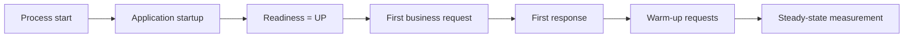

# First-Request Latency, Cold State, and Steady State

When comparing Spring Boot on the JVM with GraalVM Native Image, fast startup time does not automatically mean the first request is fast, and a fast first request does not mean the system maintains that latency under sustained load. You must separately measure **process startup time**, **time to traffic readiness**, **first-request latency**, and **steady-state latency**.

A freshly started application may not have built its connection pool, populated its caches, initialized certain lazy beans, or executed its first query. The JVM also undergoes JIT compilation as code runs repeatedly. Native Image has no runtime JVM JIT, yet it can still incur first-time initialization, data loading, connection setup, and cache-warming costs.

This lesson belongs to the **Performance Measurement** chapter of the `SPRING_BOOT_NATIVE_IMAGE` module. We will define measurement milestones, distinguish cold process from cold request and steady state, build repeatable HTTP measurements, fairly compare JVM/native, and interpret results using percentiles rather than a single average.

## 1. Four Milestones to Measure Separately

A service startup and request flow can be split into these milestones:

1. **Process start:** when the OS starts creating the process.
2. **Ready:** when the application reports it is ready to accept traffic.
3. **First request start:** when the client sends the first business request after readiness.
4. **First response:** when the client finishes receiving the first response.



From those milestones, compute three distinct metrics:

| Metric | Formula | Meaning |
| --- | --- | --- |
| Startup-to-ready | T_ready - T_start | Time from process creation until the application is ready |
| First-request latency | T_first-response - T_first-request-start | Time to process the first business request, from the client's perspective |
| Startup-to-first-response | T_first-response - T_start | Time from startup until the client receives the first business response |

Do not add or substitute these metrics for one another. An application with low startup-to-ready but high first-request latency can still make users wait on the first request.

Illustrative example:

| Milestone | JVM | Native |
| --- | ---: | ---: |
| Startup-to-ready | 1,800 ms | 350 ms |
| First-request latency after readiness | 420 ms | 260 ms |
| Startup-to-first-response | 2,220 ms | 610 ms |

These are purely hypothetical figures to illustrate how to read the table, not general benchmark results for Spring Boot. Actual results depend on the application, dependencies, hardware, configuration, and workload.

## 2. What Are Cold State and Steady State?

The term "cold" can describe multiple states. When designing a benchmark, specify which state you mean.

| State | Definition | Example |
| --- | --- | --- |
| Cold process | A brand-new process that has just started | Container just spawned the native executable process |
| Cold application state | Certain components inside the application have not been exercised yet | Empty cache, uninitialized lazy beans, pool has no open connections |
| Cold connection | No reusable TCP/TLS or DB connection exists yet | The first request has to establish connections |
| Cold OS/page cache | Executable data or files are not yet in the OS page cache | Host just rebooted or system cache is not warmed |
| Warm-up state | Application has served some requests warming caches/JIT/connections | Several business requests executed before measuring |
| Steady state | Behavior has stabilized over a defined measurement window | Latency/throughput no longer shows a clear upward or downward trend |

Not every benchmark needs a cold OS/page cache. In most cases, the goal is comparing a cold process and first business request on the same host with equivalent page cache state. Do not clear the OS page cache on a production machine to create a cold state; that affects other processes and is hard to reproduce.

### 2.1. Cold Process Does Not Mean Cold Request

A process may be ready without ever having received a business request. At that point:

- The Spring context has been created.
- The readiness endpoint may return UP.
- Some lazy beans have not been instantiated yet.
- The connection pool may not have opened connections.
- Business caches may be empty.

The first request to a business endpoint may pay initialization costs that the health endpoint never touched.

Conversely, if a startup runner already invokes services and populates caches before reporting ready, the client's first request may be faster, while startup-to-ready takes longer. Both sides therefore need to be measured.

### 2.2. Steady State Must Have a Definition

Do not call a process steady just because it served a handful of requests. Define criteria before benchmarking, for example:

- Run warm-up for a fixed duration or request count.
- Measure across multiple consecutive windows.
- Compare p50/p95 and throughput across windows.
- Declare steady state only when metrics no longer show significant drift.

A practical example is a 60-second warm-up followed by three 60-second measurement windows. This is an illustrative setup; your workload and application may need different durations.

## 3. How JVM and Native Image Differ on the First Request

Both deployment modes have startup costs and first-use costs, though their causes can differ.

### 3.1. JVM

The JVM may perform:

- Class loading, verification, and initialization.
- Spring ApplicationContext initialization.
- Connection pool and bean creation.
- JIT compilation once methods execute frequently enough.
- Runtime profile-guided optimization across compiler tiers.
- Warming caches, DNS, TLS sessions, or client connections.

Hence, the first request may execute plenty of code that has not been JIT-compiled yet. Once the workload repeats, the JVM may reach higher throughput or lower latency on certain code paths.

### 3.2. GraalVM Native Image

A native executable is compiled ahead of time, so it lacks JVM runtime JIT compilation. However, a native application may still have to:

- Initialize runtime and static state.
- Instantiate lazy beans or components.
- Read configuration, templates, or resources for the first time.
- Open connections to databases, caches, or external services.
- Populate caches with data.
- Establish TLS/DNS and connection pools.
- Execute business logic with its own initialization cost.

Native Image can reduce startup time and footprint in many workloads, but does not guarantee every request is faster than on the JVM. A warmed-up JVM can deliver very competitive steady-state performance depending on workload and configuration.

### 3.3. Comparison by Cause

| Factor | JVM Mode | Native Image |
| --- | --- | --- |
| Spring context initialization | Yes | Yes, with AOT-generated initialization |
| Class loading/runtime initialization | Yes | Corresponding runtime initialization mechanism; many decisions resolved at build time |
| Runtime JIT warm-up | Yes | No JVM runtime JIT |
| Lazy bean initialization | Yes | Yes |
| Cache warming | Yes | Yes |
| DB/HTTP connection establishment | Yes | Yes |
| DNS/TLS setup | Yes | Yes |
| First-use resource loading | Yes | Yes, provided resources are packaged/configured properly |
| PGO | JVM-specific profile optimization mechanisms | Optional build-time profile-guided optimization depending on GraalVM/toolchain; not runtime JIT |

Do not try to force the exact same kind of warm-up onto both runtimes and call it fair. Keep the workload identical and report cold behavior, JVM warm-up, and steady-state behavior separately.

## 4. Verifying Readiness Before Sending Requests

To measure the first request after the application is ready, you need an explicit readiness signal. Do not rely solely on a "Started" log line if you can check a health endpoint.

If the project uses Spring Boot Actuator, you can enable readiness/liveness probes:

```yaml
management:
  endpoint:
    health:
      probes:
        enabled: true
  endpoints:
    web:
      exposure:
        include: health
```

When configured appropriately, the readiness endpoint is typically:

```http
GET /actuator/health/readiness
```

Readiness UP means the application qualifies to receive traffic according to configured health indicators. It does not automatically guarantee that every cache or lazy component is initialized.

If the benchmark asks for the first business request prior to any cache warming, do not add a startup runner just to pre-call business endpoints. If real production includes a warm-up step, keep that step in the benchmark and measure startup-to-ready along with warm-up duration.

### 4.1. Readiness and Liveness Have Different Purposes

- **Liveness:** is the process still alive and should it keep running?
- **Readiness:** is the instance ready to receive traffic?

A process can have liveness UP while readiness is REFUSING_TRAFFIC during startup or while waiting on dependencies. Benchmarks should wait for readiness rather than merely checking whether a TCP port is open.

### 4.2. Benchmark Endpoints Must Represent the Workload

Do not use a health endpoint as the first business request if your goal is measuring order processing, database queries, or JSON serialization.

You can have two types of endpoints:

- A very lightweight endpoint to measure HTTP/framework overhead.
- A realistic business endpoint to measure services, persistence, caches, and serialization.

Clearly specify which endpoint is measured. These two types answer different performance questions.

## 5. Designing a Comparable Workload

Before running a benchmark, define a representative request:

```java
@RestController
@RequestMapping("/benchmark")
class BenchmarkController {

    private final BenchmarkService service;

    BenchmarkController(BenchmarkService service) {
        this.service = service;
    }

    @GetMapping("/light")
    Map<String, String> light() {
        return Map.of("status", "ok");
    }

    @GetMapping("/orders/{id}")
    OrderResponse order(@PathVariable long id) {
        return service.findOrder(id);
    }
}
```

The `/light` endpoint measures a minimal HTTP path, while `/orders/{id}` represents a business flow involving a service and potentially a database. Do not merge both results into a single number.

A sound benchmark keeps the following identical between JVM and native:

- Same source commit and dependency versions.
- Same business endpoint, HTTP method, request body, and response size.
- Same external databases/caches/services and dataset.
- Same CPU architecture, host, and container resource limits.
- Same TLS/proxy/network path.
- Same logging level, metrics instrumentation, and tracing configuration.
- Same instance count and concurrency.
- Recorded JVM heap/GC options and native runtime/build options.

If one side uses a local database while the other hits a remote database, the comparison no longer isolates runtime differences.

## 6. Measuring First-Request Latency and Startup-to-Ready

A client-side measurement should capture at minimum:

- Process start time.
- Readiness success time.
- Time when the first request is sent.
- Time when the first response is received.
- HTTP status and response size.
- Request ID or marker to correlate with server logs if needed.

Use a monotonic clock such as `System.nanoTime()` or `time.perf_counter_ns()` to measure intervals. Do not subtract wall-clock timestamps directly because the system clock may be adjusted or synced mid-run.

Distinguish client-side latency from server-side processing time:

- Client-side latency includes DNS, TCP/TLS, network, queueing, and server processing time.
- Server-side request timers typically measure the portion observed by the web server/framework, excluding full process initialization or client connection setup.

Both are useful; just name them accurately and avoid cross-comparing them by mistake.

## 7. Using a Persistent-Connection HTTP Client for First and Steady Requests

If you invoke a separate `curl` command per request, each curl process usually opens a brand-new client connection. That can cause the benchmark to measure repeated TCP/TLS handshakes instead of connection reuse like a real client.

Use an HTTP client session to:

1. Poll readiness using a separate session.
2. Open a fresh session for the business endpoint.
3. Record the first request's timing.
4. Send warm-up requests over the same session.
5. Record steady-state requests over the same session.

The example below uses Python and `requests`. The script launches the supplied command, waits for readiness, measures the first request, and then measures sequential requests over the same connection pool.

```python
import argparse
import json
import math
import subprocess
import time

import requests


def percentile(values, fraction):
    ordered = sorted(values)
    index = max(0, math.ceil(fraction * len(ordered)) - 1)
    return ordered[min(index, len(ordered) - 1)]


parser = argparse.ArgumentParser()
parser.add_argument("--ready-url", required=True)
parser.add_argument("--url", required=True)
parser.add_argument("--startup-timeout", type=float, default=90)
parser.add_argument("--request-timeout", type=float, default=10)
parser.add_argument("--warmup", type=int, default=100)
parser.add_argument("--samples", type=int, default=500)
parser.add_argument("--log-file", default="benchmark-app.log")
parser.add_argument("command", nargs=argparse.REMAINDER)
args = parser.parse_args()

if args.samples < 1 or args.warmup < 0:
    parser.error("--samples must be positive and --warmup cannot be negative")

command = args.command
if command and command[0] == "--":
    command = command[1:]

if not command:
    parser.error("Provide the application command after --")

started_ns = time.perf_counter_ns()
log_file = open(args.log_file, "w", encoding="utf-8")
process = subprocess.Popen(
    command,
    stdout=log_file,
    stderr=subprocess.STDOUT
)

try:
    deadline = time.monotonic() + args.startup_timeout

    with requests.Session() as readiness_client:
        while time.monotonic() < deadline:
            if process.poll() is not None:
                raise RuntimeError(
                    "Application exited before readiness"
                )

            try:
                response = readiness_client.get(
                    args.ready_url,
                    timeout=1
                )
                if response.status_code == 200:
                    break
            except requests.RequestException:
                pass

            time.sleep(0.1)
        else:
            raise TimeoutError("Readiness timeout")

    ready_ns = time.perf_counter_ns()

    with requests.Session() as client:
        first_started_ns = time.perf_counter_ns()
        first_response = client.get(
            args.url,
            timeout=args.request_timeout
        )
        first_finished_ns = time.perf_counter_ns()
        first_response.raise_for_status()

        first_request_ms = (
            first_finished_ns - first_started_ns
        ) / 1_000_000

        for _ in range(args.warmup):
            response = client.get(
                args.url,
                timeout=args.request_timeout
            )
            response.raise_for_status()

        samples_ms = []
        for _ in range(args.samples):
            request_started_ns = time.perf_counter_ns()
            response = client.get(
                args.url,
                timeout=args.request_timeout
            )
            request_finished_ns = time.perf_counter_ns()
            response.raise_for_status()

            samples_ms.append(
                (request_finished_ns - request_started_ns)
                / 1_000_000
            )

    result = {
        "startup_to_ready_ms": (
            ready_ns - started_ns
        ) / 1_000_000,
        "first_request_ms": first_request_ms,
        "startup_to_first_response_ms": (
            first_finished_ns - started_ns
        ) / 1_000_000,
        "steady_samples": len(samples_ms),
        "steady_p50_ms": percentile(samples_ms, 0.50),
        "steady_p95_ms": percentile(samples_ms, 0.95),
        "steady_p99_ms": percentile(samples_ms, 0.99),
        "steady_max_ms": max(samples_ms),
        "first_status": first_response.status_code
    }

    print(json.dumps(result, indent=2))

finally:
    if process.poll() is None:
        process.terminate()
        try:
            process.wait(timeout=10)
        except subprocess.TimeoutExpired:
            process.kill()
            process.wait()
    log_file.close()
```

Install the dependency for the client harness:

```bash
python -m pip install requests
```

Example running a native executable:

```bash
python measure.py --ready-url http://127.0.0.1:8080/actuator/health/readiness --url http://127.0.0.1:8080/benchmark/orders/100 --warmup 100 --samples 500 -- ./orders-service
```

Example running in JVM mode:

```bash
python measure.py --ready-url http://127.0.0.1:8080/actuator/health/readiness --url http://127.0.0.1:8080/benchmark/orders/100 --warmup 100 --samples 500 -- java -jar target/orders-service.jar
```

The script is a sequential harness with concurrency of one. It measures startup-to-ready, the first request, and a post-warm-up sample set. The first request includes the cost of opening a new HTTP client connection; that is part of the client experience. If you want to isolate server processing time, use the server-side metrics in the next section.

Readiness is polled every 100 ms, so the startup-to-ready milestone has quantization error up to roughly one polling interval plus health request response time. Use the same interval for JVM and native; if finer resolution is required, shorten the interval or use a readiness signal pushed directly to the harness. The first business request uses a new session, so its latency includes HTTP connection setup. If production uses TLS, a proxy, or remote DNS, run the benchmark through that same network path.

To measure a cold first request across multiple processes, run the harness multiple times, starting a new process each time and recording a separate sample. Do not send 500 requests and treat request 501 as a cold request.

## 8. Measuring Server-Side Processing Time with Micrometer

Client-side latency reflects the external experience. Correlate it with server-side metrics to determine whether time is spent in HTTP/network layers or inside the application.

Spring Boot Actuator/Micrometer automatically records the `http.server.requests` timer. You can enable histograms:

```yaml
management:
  metrics:
    distribution:
      percentiles-histogram:
        http.server.requests: true
  endpoints:
    web:
      exposure:
        include: health, prometheus
```

If exporting metrics via Prometheus, add the appropriate registry dependency, such as `micrometer-registry-prometheus`, and expose the endpoint per operational policy.

Server-side metrics help observe:

- Request count by URI/method/status.
- Latency distribution.
- Request error rate.
- Differences between the first request and subsequent requests when tagged or instrumented appropriately.

Avoid high-cardinality tags such as user ID or order ID. Never put per-request identifiers into metric labels.

If you want to analyze the first request separately, add a custom Timer or log marker for the first request. Keep instrumentation identical across JVM and native; metrics and tracing also add overhead, so do not change instrumentation levels between runs.

## 9. JVM Warm-Up and Steady State

The JVM generally needs warm-up so the JIT compiler can collect profiles and optimize hot code paths. A practical approach:

1. Start the process and wait for readiness.
2. Send the first business request and record its latency separately.
3. Run a warm-up workload matching the distribution of the measured workload.
4. Observe latency/throughput across successive windows.
5. Begin steady-state sampling once metrics stabilize.
6. Sustain load long enough to observe GC, allocations, and tail latency.

Do not choose warm-up purely by request count without checking the workload. If warm-up calls only a lightweight endpoint while measurement calls an endpoint doing JSON serialization and database access, the target code paths will not be warmed up.

JVM steady-state reporting should record heap, GC configuration, and JIT behavior when deep analysis is the goal. Do not enable a heavy profiler in one run and disable it in the other.

## 10. Native Image Warm-Up and Steady State

Native Image does not require runtime JIT warm-up, yet you still need to inspect behavior after initial usage. Some costs disappear once the process has been active:

- Connection pools have opened connections.
- HTTP clients have completed DNS/TLS/session setup.
- Caches are populated with data.
- Templates/schemas/configs have been read.
- Lazy beans or singletons have been initialized.
- OS page cache holds frequently accessed files.

Therefore, do not conclude "native has no warm-up" in the sense that latency never changes after the first request. You can only state that Native Image does not undergo JVM-style runtime JIT compilation.

If native first-request latency is high while steady-state is low, investigate lazy initialization, external dependencies, connection pools, and caches before adding compiler-level optimizations.

## 11. Measuring Cold First Request Across Multiple Startups

The first request provides one sample per process. To obtain a reliable distribution, you need multiple independent startups.

Recommended procedure:

1. Pick a fixed workload and readiness endpoint.
2. Stop the process completely after each run.
3. Start a new process.
4. Wait for readiness.
5. Send exactly one first business request and record its latency.
6. Optionally continue with warm-up/steady-state sampling in the same process.
7. Stop the process and repeat.
8. Compute median, p95, and min/max of the first request across processes.

For example, 20 independent startups yield 20 first-request latency samples. That is still a small sample set for p99; do not report a trustworthy p99 from a few dozen samples. If tail percentiles are required, increase run counts or use an appropriate statistical method and report sample size explicitly.

Decide up front whether to preserve the OS page cache. Normally you keep host conditions similar between JVM/native and document that the executable/image was pre-pulled/cached before benchmarking. If the goal is cold host boot, that is a separate benchmark requiring its own controlled environment.

## 12. Measuring Steady-State Latency and Throughput

To measure steady state, generate enough load representative of how the application is used:

- Concurrency 1: baseline latency of sequential requests.
- Low/medium concurrency: observe queueing and contention.
- Target production concurrency: evaluate latency and throughput at expected load.
- Stress/load limit: find the point where latency or error rate climbs sharply.

You can use k6, Gatling, JMeter, or wrk. Minimal k6 example:

```javascript
import http from "k6/http";
import { check, sleep } from "k6";

export const options = {
  vus: 1,
  duration: "60s",
  thresholds: {
    http_req_failed: ["rate<0.01"],
    http_req_duration: ["p(95)<500"]
  }
};

export default function () {
  const response = http.get(
    "http://127.0.0.1:8080/benchmark/orders/100"
  );

  check(response, {
    "status is 200": (r) => r.status === 200
  });

  sleep(0.1);
}
```

The 500 ms threshold is only illustrative; set thresholds based on your actual SLA. When using k6 for steady state, configure warm-up separately and start measurement afterward. A first-request measurement needs a separate client harness so warm-up requests are not accidentally sent before the first sample.

## 13. Metrics to Report

Do not report only average latency. Tail latency is usually critical for production APIs.

| Metric | Meaning | When Used |
| --- | --- | --- |
| p50 | Half of requests are faster than or equal to this value | Typical latency |
| p90 | 90% of requests are faster than or equal | Moderate tail |
| p95 | 95% of requests are faster than or equal | Common SLO/SLA |
| p99 | 99% of requests are faster than or equal | Tail latency |
| Max | Slowest request in the sample set | Outlier detection, must include sample count |
| Throughput | Requests/second | Processing capacity under load |
| Error rate | Percentage of failed requests | Ensure latency is not improved by returning errors |
| Startup-to-ready | Time to readiness | Scale-out, restarts, serverless |
| First-request latency | Latency of the first business request | Post-startup user experience |
| Startup-to-first-response | Total time from process start to first response | Cold-start user experience |

Always report sample count and measurement duration alongside percentiles. A p99 from 100 samples is far less stable than a p99 from tens of thousands of samples.

## 14. Fair Comparison Between JVM and Native Image

A benchmark comparison table should maintain identical conditions:

| Condition | JVM | Native Image |
| --- | --- | --- |
| Source commit | Same commit | Same commit |
| Dependency versions | Identical | Identical |
| OS/CPU architecture | Same host/target | Same host/target |
| CPU/memory limits | Same limits | Same limits |
| External services | Same DB/cache/API | Same DB/cache/API |
| Request data | Same payload/dataset | Same payload/dataset |
| Logging/metrics | Same configuration | Same configuration |
| Number of process starts | Same count | Same count |
| Warm-up policy | Explicitly documented | Explicitly documented |
| Concurrency | Same profile | Same profile |

Do not compare a JVM with a huge heap on an uncapped CPU machine against native inside a tightly constrained container. Do not enable TLS on one side and disable it on the other. Do not run two benchmarks concurrently on the same host if CPU/memory contention distorts results.

If the JVM uses specific options like `-Xms`, `-Xmx`, GC flags, or class data sharing, record them in the report. Native image also requires documenting build options and runtime environment settings affecting memory/GC.

## 15. Analyzing Results by Phase

Suppose results look like this:

| Metric | JVM | Native | Difference |
| --- | ---: | ---: | --- |
| Startup-to-ready | 1,800 ms | 350 ms | Native lower |
| First request | 420 ms | 260 ms | Native lower |
| Steady p50 | 8 ms | 9 ms | JVM lower |
| Steady p95 | 24 ms | 27 ms | JVM lower |
| Throughput | 4,500 req/s | 4,200 req/s | JVM higher |

These hypothetical numbers show a completely plausible outcome: native starts and serves the first request faster, while a warmed-up JVM achieves higher steady-state throughput on this specific workload.

Do not conclude one runtime is "faster" from a single metric. Interpret results against deployment goals:

- Serverless/scale-to-zero may prioritize startup-to-first-response.
- Long-lived API instances may prioritize steady-state p95/p99 and throughput.
- Workloads with many short-lived instances may balance startup, memory, and CPU cost.
- Database-heavy workloads may be dominated by connection establishment time rather than runtime choice.

## 16. Common Measurement Mistakes

| Mistake | Consequence | Fix |
| --- | --- | --- |
| Using startup time instead of first request | Misses lazy init and connection setup | Measure first business request separately |
| Sending a health request and calling it the first business request | Health endpoint skips measured code paths | Wait for readiness, then call business endpoint |
| Measuring only one process start | Misses variance across runs | Repeat independent cold starts |
| Spawning a new curl process per request | Includes TCP/TLS setup in every sample | Use a client session/keep-alive |
| Reporting only average | Hides tail latency | Report p50/p95/p99 and sample count |
| Comparing un-warmed JVM with native steady state | Compares mismatched states | Report cold and steady separately |
| Saying native "has no warm-up" | Overlooks caches, lazy beans, and connection pools | Measure first-use and steady-state |
| Warming up with an endpoint different from the workload | Fails to warm actual code paths | Use a representative request mix |
| Running benchmarks concurrently on the same host | CPU/memory contention skews results | Run sequentially or isolate hosts |
| Ignoring error rate | Fast errors can create artificially low latency | Report HTTP status and error rate |
| Including image pull in startup without noting it | Mixes deployment time with process startup | Separate image pull/scheduling from process start |
| Reporting p99 from too few samples | Statistically meaningless percentile | Increase sample count or omit p99 |

## 17. Benchmark Report Template

Each benchmark run should store metadata for reproducibility:

```text
Application:
Git commit:
Spring Boot version:
JDK / GraalVM version:
Native Build Tools version:
OS / CPU architecture:
Container image:
CPU limit:
Memory limit:
Database/cache version:
Endpoint and payload:
Logging/metrics settings:
JVM options:
Native build options:

Startup runs:
Startup-to-ready: median / p95
First request: median / p95 across independent process starts
Startup-to-first-response: median / p95

Steady-state:
Warm-up policy:
Measurement duration:
Sample count:
Concurrency:
p50 / p90 / p95 / p99:
Throughput:
Error rate:

Notes:
Known external dependencies:
Outliers and reruns:
```

Save raw samples, not just summary tables. That lets you inspect outliers, recompute percentiles, and compare after upgrading JDK, GraalVM, or dependencies.

## 18. Recommended Benchmark Workflow

1. **Choose the goal:** cold-start, first request, steady latency, throughput, or a combination.
2. **Choose endpoints:** health/readiness only marks the ready milestone; the measured workload must hit business endpoints.
3. **Lock the environment:** source, toolchain, OS/CPU, resource limits, dependencies, and external services.
4. **Measure startup:** from process spawn to readiness.
5. **Measure first request:** send the first business request after readiness via a fresh client session.
6. **Repeat cold starts:** stop the process completely and rerun multiple times to gather independent first-request samples.
7. **Warm-up:** use a representative workload; explicitly record warm-up request count or duration.
8. **Measure steady state:** run long enough and record p50/p95/p99, throughput, and error rate.
9. **Cross-check server metrics:** separate network/client overhead from server processing.
10. **Repeat JVM/native:** keep identical conditions and run sequentially to reduce noise.
11. **Analyze by goal:** do not collapse startup, first request, and steady-state into one point.
12. **Archive raw data and configuration:** so the benchmark can be repeated after every upgrade.

## 19. Pre-Conclusion Checklist

- [ ] Startup-to-ready and first-request latency are measured separately.
- [ ] Startup-to-first-response is calculated from process start to the first business response.
- [ ] Readiness endpoint is not confused with a business endpoint.
- [ ] Cold process, cold application state, and cold OS cache are clearly defined.
- [ ] JVM JIT warm-up is distinguished from Native Image lazy initialization/cache warming.
- [ ] First request is measured on a fresh process, not taken after warm-up.
- [ ] Cold first request is repeated across multiple independent process starts.
- [ ] HTTP client keeps connections open for steady sequential samples.
- [ ] Workload, payload, response size, and external dependencies are identical.
- [ ] CPU, memory, OS, architecture, and container limits are identical.
- [ ] Warm-up policy and steady-state window are explicitly documented.
- [ ] p50/p95/p99 are reported alongside sample count, throughput, and error rate.
- [ ] Server-side metrics are collected when network needs to be separated from application processing.
- [ ] Benchmarks are not run concurrently on a shared host causing contention.
- [ ] A single average is not used to declare one runtime faster.
- [ ] Raw samples, toolchain versions, and benchmark configuration are saved.

### Self-Assessment Questions

1. What is the difference between startup-to-ready and first-request latency?
2. Why does readiness UP not guarantee caches or connection pools are warmed up?
3. How do a cold process and a cold OS page cache differ?
4. Which JVM mechanisms can make the first request slower than steady state?
5. Why can Native Image still exhibit first-use latency even without JVM JIT?
6. Why are multiple independent process starts needed to measure the first-request latency distribution?
7. In what components does client-side latency differ from a server-side HTTP timer?
8. When should p99 be reported, and why do small sample sizes make p99 unreliable?
9. Why should you not send a health request first and treat it as the first business request?
10. How should a benchmark be interpreted if native has faster startup while JVM has better steady-state performance?

## References

- [Spring Boot — Application Availability](https://docs.spring.io/spring-boot/reference/features/spring-application.html): application startup, readiness, and liveness states.
- [Spring Boot — Actuator Endpoints](https://docs.spring.io/spring-boot/reference/actuator/endpoints.html): health endpoints and endpoint management.
- [Spring Boot — Metrics](https://docs.spring.io/spring-boot/reference/actuator/metrics.html): Micrometer and HTTP server metrics.
- [GraalVM Native Image](https://www.graalvm.org/latest/reference-manual/native-image/): ahead-of-time build and runtime characteristics of native executables.
- [OpenJDK HotSpot Virtual Machine Performance Enhancements](https://docs.oracle.com/en/java/javase/21/vm/java-hotspot-virtual-machine-performance-enhancements.html): JIT compilation and JVM optimization mechanisms.
- [k6 Documentation](https://grafana.com/docs/k6/latest/): workload generation, warm-up, latency, and throughput measurement.

**Expected outcome:** separately measure startup time, time to readiness, first business request, and steady state; explain why JVM and Native Image show different latency curves; and design repeatable multi-run benchmarks with identical workloads, conditions, and sufficient data to make deployment decisions.
