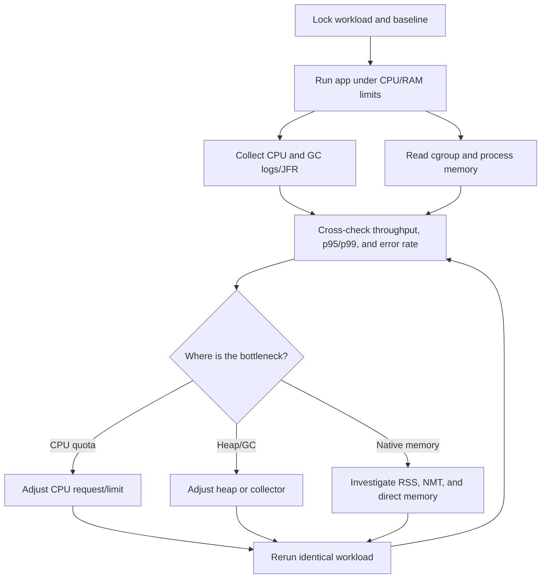

# Measuring CPU, GC Activity, and the Impact of Allocated Resources

A native executable may start fast and use little memory in one test scenario, yet those results do not automatically hold under production container CPU and RAM limits. When the CPU quota is low, the process may be throttled by the scheduler; when the memory limit sits close to the working set, the garbage collector must run more frequently or the container may be OOM-killed.

To evaluate Spring Boot Native Image performance, you must measure **CPU consumption, garbage collection, process/container memory, and request latency** together. This lesson explains how to gather metrics from Spring Boot Actuator, Native Image GC logs, JFR, Linux perf, and cgroups; then adjust CPU/memory limits in a controlled way to understand their effect on throughput, latency, and footprint.

## 1. Learning Objectives

After this lesson, you will be able to:

- Distinguish CPU time, CPU utilization, throughput, and CPU throttling.
- Measure process and container CPU while running a representative workload.
- Read GC logs and analyze collection counts, pause durations, and pre-/post-GC heap.
- Distinguish Serial, G1, and Epsilon GC in GraalVM Native Image.
- Use JFR to collect execution samples, GC events, and container resource events.
- Use Linux perf to locate CPU-consuming methods or call paths.
- Read CPU quota, throttling, and memory usage from cgroup v2.
- Explain differences among Java heap, native memory, RSS, and total container memory.
- Vary CPU/memory limits in Docker or Kubernetes and compare outcomes.
- Design repeatable measurements with a baseline and clear evaluation criteria.

## 2. Why Measure CPU, GC, and Resource Limits Together?

These metrics are tightly coupled:

- A low CPU quota gives application threads and GC less CPU time to run. Requests can queue up even though CPU utilization appears maxed out.
- A small heap triggers GC more frequently. GC consumes CPU and can increase tail latency.
- An overly large heap can raise footprint and press against the memory limit; some collections require extra temporary memory.
- A container can be OOM-killed even if Java heap has not hit max heap, because the process also consumes native memory, thread stacks, direct buffers, mapped files, and other regions.
- Raising the CPU limit may boost throughput or shorten GC pauses, yet will not necessarily help if the bottleneck is the database, network, or lock contention.

Therefore, do not conclude "Native Image is faster" from a single CPU or RSS figure. Tie metrics back to request rate, latency, error rate, and actual resource limits.



## 3. Metrics Suite to Track

| Group | Metrics | Questions to Answer |
| --- | --- | --- |
| CPU | CPU time, CPU usage, CPU per request | How much CPU does one request consume? Is the process CPU-saturated? |
| CPU quota | nr_throttled, throttled_usec, CPU pressure | Is the kernel throttling the container's runtime? |
| GC | GC count, total GC time, pause duration, allocation rate | Is GC running too often or pausing too long? |
| Java heap | Heap used, committed, max, live data after GC | Is heap large enough for the workload and growing steadily? |
| Process memory | RSS, peak RSS, native memory | How much RAM is the process actually using? |
| Container memory | memory.current, memory.peak, memory.events | Is the container near its limit or hitting OOM? |
| Application | Throughput, p50/p95/p99 latency, error rate | How does resource pressure affect users? |

### 3.1. CPU Time vs. CPU Utilization

CPU time is the total time CPUs actually spent executing the process. Wall-clock time is elapsed real time. A process averaging one core for 10 seconds accumulates roughly 10 seconds of CPU time.

If the process runs in parallel across multiple cores, CPU time can accumulate faster than wall time. CPU utilization also depends on how a tool normalizes by core count or CPU quota. When comparing, state the denominator explicitly:

- Percentage of a single logical CPU.
- Percentage of total host CPU.
- Percentage of the CPU quota granted to the container.

The metric **CPU seconds per request** is often more informative than raw CPU percentage when comparing two binaries processing the same request volume.

### 3.2. GC Throughput, Latency, and Footprint

A garbage collector balances three primary goals:

- **Throughput:** the fraction of time the application spends outside GC over an extended period.
- **Latency:** responsiveness; stop-the-world pauses can delay requests.
- **Footprint:** the memory working set occupied by the process.

Increasing heap or young-generation size can improve throughput while raising footprint and changing pause behavior. Shrinking heap can lower memory reservation while triggering collections more often. No single configuration is optimal for every workload.

## 4. Distinguishing JVM and Native Image When Measuring

HotSpot JVM and GraalVM Native Image have different runtimes:

| Aspect | JVM | Native Image |
| --- | --- | --- |
| Code execution | JIT-compiled at runtime | Application code is primarily AOT-compiled at build time |
| Startup | May require class loading, JIT, and warm-up | Typically starts faster, though Spring still initializes context and connections |
| GC | HotSpot-provided and configured collectors | Native Image runtime collectors |
| Profiling | JFR, JMX, async-profiler, perf | Dedicated JFR and perf support; some events/features differ from JVM |
| Heap | HotSpot Java heap and native memory | Native Image Java heap and other native/runtime regions |
| CPU warm-up | Can have significant JIT warm-up | No JIT warm-up for AOT code, though caches, connection pools, and app state still warm up |

When benchmarking JVM and native, measure startup separately from steady-state. Do not compare a native cold start against a warmed-up JVM or vice versa. Also do not assume every HotSpot JMX/MXBean or JFR event exists in Native Image.

## 5. Measuring Application-Layer CPU with Spring Boot Actuator

Spring Boot Actuator and Micrometer provide meters for system/process CPU, uptime, startup, and various other resources. JVM metrics can also include GC statistics, thread utilization, memory pools, and class loading.

Add Actuator and an appropriate registry, such as Prometheus:

```xml
<dependency>
    <groupId>org.springframework.boot</groupId>
    <artifactId>spring-boot-starter-actuator</artifactId>
</dependency>

<dependency>
    <groupId>io.micrometer</groupId>
    <artifactId>micrometer-registry-prometheus</artifactId>
</dependency>
```

Configure endpoints:

```properties
management.endpoints.web.exposure.include=health,metrics,prometheus
management.endpoint.health.probes.enabled=true
```

Expose metrics endpoints only on trusted management networks or protect them with authentication/authorization. Do not expose diagnostic endpoints to the public internet.

Commonly useful meters:

- System/process CPU usage and CPU time.
- application.started.time and application.ready.time.
- JVM memory and garbage collection metrics when provided by the runtime/registry.
- HTTP server request duration, request count, and error status.

You can list meters via /actuator/metrics and query individual meters. Exact metric names and tags vary by Micrometer version, OS, and runtime.

**Note on Native Image:** Spring Boot documents `jvm.*` meters as JVM metrics. Do not assume every meter backed by HotSpot MXBeans has identical support or semantics in a native executable. Inspect actual meters on the native binary. For native GC, use GC logs/JFR as direct diagnostic sources.

## 6. Measuring CPU with Linux perf

perf is a Linux profiler capable of recording CPU samples, call stacks, and hardware performance counters. To see Java methods inside a native executable, generate debug information and preserve frame pointers at build time.

### 6.1. Building a Binary with Debug Symbols

With the native-image command:

```bash
native-image \
  -g \
  -H:+PreserveFramePointer \
  -jar target/order-service.jar \
```

With the Spring Boot Maven/Gradle plugin, pass the corresponding build arguments through Native Build Tools configuration. The example above illustrates Native Image builder options; exact syntax depends on the plugin and version.

- -g generates debug information so profilers can map addresses back to symbols/methods.
- -H:+PreserveFramePointer preserves frame pointers so perf unwinds call stacks reliably.

Debug information increases artifact size. Keep symbol files matched to the binary being measured and never read profiles using a binary from a different commit.

### 6.2. Recording CPU Samples

On Linux:

```bash
perf record -g -o perf.data -- ./order-service
```

Run the workload long enough, then:

```bash
perf report -i perf.data
```

Inspect the call graph to locate:

- CPU-intensive methods.
- Expensive serialization/deserialization or mapping.
- Hashing, compression, and cryptography.
- Lock contention or thread scheduling.
- CPU-heavy GC and runtime functions.

To measure hardware counters, list events supported by the host:

```bash
perf list
perf stat -e cycles,instructions,cache-misses -- ./order-service
```

Event names depend on CPU, kernel, and perf permissions. Not all virtual machines or containers allow reading hardware counters.

### 6.3. Permissions and Limitations

perf can be restricted by perf_event_paranoid, kernel policy, container capabilities, or administrative privileges. Do not relax kernel security settings in production just to capture a profile. Profile in a dedicated measurement environment or ask administrators to grant minimal required permissions.

perf is a Linux tool. When building or running on Windows/macOS, use platform-appropriate profiling tools or JFR where supported.

## 7. Profiling with JFR in Native Image

GraalVM Native Image supports JDK Flight Recorder (JFR), provided support is enabled at build time. JFR records execution samples, GC events, container CPU events, and other runtime details.

### 7.1. Enabling JFR at Build Time

Add the option:

```bash
native-image --enable-monitoring=jfr ...
```

With Maven/Gradle, add --enable-monitoring=jfr to the Native Image build arguments for the application binary.

Native Image JFR recording is not currently supported on Windows. Event and stack trace availability also differs from HotSpot; verify the supported events list for your GraalVM version.

### 7.2. Recording at Runtime

```bash
./order-service \
  -XX:StartFlightRecording="filename=order-service.jfr,dumponexit=true,duration=120s"
```

Or record until the process exits:

```bash
./order-service \
  -XX:StartFlightRecording="filename=order-service.jfr,dumponexit=true"
```

Read summaries and events:

```bash
jfr summary order-service.jfr
jfr print --events jdk.ExecutionSample,jdk.GarbageCollection,jdk.GCHeapSummary order-service.jfr
```

You can open .jfr files in JDK Mission Control or VisualVM to examine timelines, execution samples, GC, and thread activity.

### 7.3. Useful Events

Native Image JFR can emit these events:

| Event | Meaning |
| --- | --- |
| jdk.ExecutionSample | Stack sample showing which methods consume CPU |
| jdk.GarbageCollection | GC event |
| jdk.GCHeapSummary | Heap statistics around GC |
| jdk.GCPhasePause | GC pause phase |
| jdk.ContainerCPUUsage | Container CPU usage |
| jdk.ContainerCPUThrottling | Container CPU throttling |
| jdk.ContainerMemoryUsage | Container memory usage |
| jdk.ThreadCPULoad | Per-thread CPU load |

Certain GC events such as jdk.GarbageCollection, jdk.GCHeapSummary, and jdk.GCPhasePause are available only with Serial GC. Native memory events require Native Memory Tracking (NMT). Do not assume missing events mean the application performs no GC or uses no native memory.

## 8. Which Garbage Collectors Does Native Image Offer?

Native Image uses its own runtime GC, not HotSpot GC running inside the binary.

| Collector | Characteristics | When to Consider |
| --- | --- | --- |
| **Serial GC** | Default; stop-and-copy, non-parallel/non-concurrent; low footprint, suited for small heaps | Small services, tight RAM limits, or workloads not needing high GC concurrency |
| **G1 GC** | Multithreaded with concurrent work; aims to balance throughput and pause latency | Larger workloads needing lower stop-the-world pauses, where edition/OS/architecture supports it |
| **Epsilon GC** | Reclaims no objects at all | Very short-lived processes with small, bounded allocations; unsuitable for long-running services |

According to current GraalVM documentation:

- Serial GC is the default.
- G1 can be enabled with --gc=G1, currently supported for Native Image on Linux AMD64 and AArch64 in Oracle GraalVM; not available in GraalVM Community Edition.
- Epsilon can be enabled with --gc=epsilon, but performs no garbage collection and never frees memory.

Always verify edition, platform, and GraalVM version before selecting a collector. Do not apply a G1 build flag across all runners assuming binaries will build in every environment.

## 9. Reading GC Logs and Evaluating GC Activity

A native executable can print GC details directly:

```bash
./order-service -XX:+PrintGC
```

For more detail:

```bash
./order-service -XX:+PrintGC -XX:+VerboseGC
```

Exact output depends on the collector. When analyzing logs, record:

- Number of young collections and full collections.
- Duration of each collection and total GC time.
- Heap before and after collection.
- Heap growth between consecutive GCs.
- Allocation frequency and interval between collections.
- Whether back-to-back collections fail to reclaim enough memory.

Common interpretations:

| Observation | Possible Cause | What to Check Next |
| --- | --- | --- |
| Frequent young GCs | High allocation rate or small young generation | CPU/request, object allocations, request payloads |
| Frequent full GCs | Old generation filling up, large live set, or ill-sized heap | Post-GC heap, object retention, and memory leaks |
| GC pauses grow as CPU limit drops | GC gets less CPU time or faces throttling | cpu.stat, CPU pressure, collector, and thread count |
| Post-GC heap grows across cycles | Growing live set, expanding cache, or leak | Compare identical workload over a longer run |
| Low GC time but high RSS | Large native memory, stacks, direct buffers, or file mappings | Cgroup memory, RSS, NMT, and direct memory |
| High GC time yet latency stays good | Collector runs often with short pauses | Total GC CPU, throughput, and p99 latency |

Do not merely count GC events. A collector can run many brief young collections while preserving good latency; a rare yet lengthy full collection can severely hurt p99.

## 10. Java Heap Is Not Total Container Memory

Native Image maintains a Java heap for managed objects. However, the process also uses memory outside the Java heap, such as:

- Thread stacks.
- Direct byte buffers.
- Native libraries and JNI allocations.
- Runtime/GC internal data structures.
- Memory-mapped files and shared libraries.
- Socket buffers and kernel memory accounted to the cgroup.

Xmx caps only the **Java heap**. It does not cap total RSS or container memory. Therefore, never set Xmx equal to the container memory limit.

### 10.1. Memory Concepts

| Metric | Meaning |
| --- | --- |
| Java heap used | Object memory currently in use |
| Java heap committed | Memory committed by the runtime for the heap |
| Xmx | Maximum Java heap limit |
| RSS | Process memory pages resident at measurement time |
| Container memory current | Memory currently charged by cgroup to the container and descendants |
| Container memory limit | Cgroup limit; exceeding it can trigger OOM |
| Peak memory | Highest memory observed over the measurement window or container lifecycle |

RSS and cgroup memory need not be equal. Cgroups may include page cache, socket buffers, and kernel memory. Monitor both process metrics and container metrics.

### 10.2. GC Can Temporarily Increase RSS

GC requires extra memory during collection. Native Image documentation notes that RSS can spike temporarily while GC runs; in the worst case, temporary overhead can approach twice the maximum heap, though in practice it is usually much lower. Under tight container memory limits, factor this transient spike into headroom.

If a container is OOM-killed while the heap is not full, inspect:

1. Xmx and heap usage.
2. RSS/peak RSS.
3. Direct memory and native library allocations.
4. Thread count and stack memory.
5. GC activity and spikes during collections.
6. memory.events to verify whether cgroup recorded oom or oom_kill.

### 10.3. Tracking Native Memory with NMT

Native Memory Tracking (NMT) captures part of memory outside the Java heap. This feature is off by default and must be enabled at build time:

```bash
native-image --enable-monitoring=nmt -jar target/order-service.jar
```

To print a summary when the native process exits:

```bash
./order-service -XX:+PrintNMTStatistics
```

Native Image NMT currently provides summary mode; it lacks HotSpot's detailed call-site tracking. It tracks VM-managed memory and Unsafe allocations, though it does not necessarily observe libraries calling malloc directly. If JFR native-memory events are needed, build with --enable-monitoring=jfr,nmt and capture a JFR recording.

## 11. Observing cgroup v2 on Linux

Linux containers commonly receive resource limits through cgroups. Under cgroup v2, key files include:

| File | Contents |
| --- | --- |
| cpu.max | CPU quota and period |
| cpu.stat | CPU usage and throttling counters |
| cpu.pressure | CPU pressure stall information |
| memory.current | Current cgroup memory |
| memory.peak | Peak cgroup memory |
| memory.max | Hard memory limit |
| memory.high | Threshold triggering reclaim/throttling memory pressure |
| memory.events | Counts of high/max hits, OOM, and OOM kills |
| memory.stat | Breakdown of memory usage by type |

In cgroup v2, paths are typically mounted at /sys/fs/cgroup, though cgroup namespaces and runtimes can alter exact paths. Locate the process's cgroup via /proc/self/cgroup and mounts via /proc/self/mountinfo.

Example check inside a container:

```bash
cat /proc/self/cgroup
cat /sys/fs/cgroup/cpu.max
cat /sys/fs/cgroup/cpu.stat
cat /sys/fs/cgroup/memory.current
cat /sys/fs/cgroup/memory.max
cat /sys/fs/cgroup/memory.events
```

If the host uses cgroup v1, filenames and controller layouts differ. Do not apply cgroup v2 commands verbatim to cgroup v1.

### 11.1. Understanding cpu.max

cpu.max has the format:

```text
MAX PERIOD
```

Example:

```text
150000 100000
```

This means the cgroup receives at most 150,000 CPU microseconds per 100,000-microsecond period, equivalent to a 1.5-CPU time quota. max in the first position means no bandwidth limit is enforced at this cgroup.

### 11.2. Understanding cpu.stat

cpu.stat may contain:

```text
usage_usec 12345678
user_usec 10000000
system_usec 2345678
nr_periods 5000
nr_throttled 1200
throttled_usec 45000000
```

These numbers are illustrative. Meaning:

- usage_usec: total CPU time of the cgroup.
- user_usec: CPU time in user mode.
- system_usec: CPU time in kernel mode.
- nr_periods: number of quota periods.
- nr_throttled: number of periods throttled.
- throttled_usec: total throttled duration recorded.

Read values at the start and end of a workload to calculate deltas. nr_throttled / nr_periods gives the fraction of periods throttled, not CPU utilization percentage. Combine it with latency and throughput to assess real impact.

### 11.3. Understanding memory.current, memory.max, and memory.events

- memory.current is total memory currently used by the cgroup.
- memory.max is the hard limit; if enough memory cannot be reclaimed, the kernel may invoke the OOM killer.
- memory.events records occurrences such as high, max, oom, and oom_kill.
- memory.stat helps separate anonymous memory, file cache, kernel memory, and other categories.

If oom_kill increments in memory.events, inspect container restart count and exit reason in the orchestrator. Exit code 137 often suggests SIGKILL, but inspect container state to confirm whether it was an OOM kill.

## 12. Varying CPU and Memory Limits

### 12.1. Docker

Run a container with specific CPU and RAM limits:

```bash
docker run --rm \
  --cpus=1.5 \
  --memory=768m \
  --name order-service \
  order-service:native
```

Test a different CPU limit while keeping memory unchanged:

```bash
docker run --rm \
  --cpus=0.75 \
  --memory=768m \
  --name order-service \
  order-service:native
```

After each run, collect throughput, latency, CPU time, GC logs, peak RSS, and container memory. Do not run two benchmark runs concurrently on the same host when seeking an accurate comparison.

### 12.2. Kubernetes

Example resource requests/limits:

```yaml
apiVersion: apps/v1
kind: Deployment
metadata:
  name: order-service
spec:
  replicas: 1
  selector:
    matchLabels:
      app: order-service
  template:
    metadata:
      labels:
        app: order-service
    spec:
      containers:
        - name: app
          image: order-service:native
          resources:
            requests:
              cpu: "500m"
              memory: "512Mi"
            limits:
              cpu: "1500m"
              memory: "768Mi"
```

In Kubernetes:

- CPU request affects scheduling and CPU share weights under node contention.
- CPU limit is a hard ceiling enforced by the kernel via throttling.
- Memory request primarily affects scheduling.
- Memory limit is enforced via the memory cgroup and can lead to OOM kill.

A CPU-throttled container usually keeps running, just slower. A container exceeding its memory limit can be terminated by the kernel; Kubernetes displays statuses like OOMKilled when applicable.

### 12.3. Leaving Headroom for the Java Heap

Suppose the container memory limit is 768 MiB. Do not set Xmx768m and expect the process to stay within limits. Reserve memory for the native runtime, thread stacks, direct buffers, shared libraries, GC, and kernel-accounted cgroup memory.

Example explicit heap limits:

```bash
./order-service -Xms128m -Xmx512m
```

Values are illustrative only. Pick limits after measuring peak RSS and container memory under realistic workloads. If native memory or direct buffers grow, you may need to lower heap or raise the container limit.

## 13. GC Configuration and Selection

### 13.1. Serial GC

Serial GC is the default:

```bash
native-image --gc=serial -jar target/order-service.jar
```

It usually suits smaller heaps where low footprint is desired. Because it is neither parallel nor concurrent, a low CPU quota can prolong collections when the live set is large.

### 13.2. G1 GC

If using Oracle GraalVM on Linux AMD64/AArch64 and an edition supporting G1:

```bash
native-image --gc=G1 -jar target/order-service.jar
```

G1 uses multiple threads and performs concurrent work to balance throughput and pause latency. When a container receives little CPU, monitor GC thread count and concurrent work. Do not enable G1 merely expecting it to always outperform Serial.

### 13.3. Epsilon GC

```bash
native-image --gc=epsilon -jar target/short-task.jar
```

Epsilon reclaims no objects. It suits only very short-lived processes with small, known bounded allocations. Using Epsilon on long-running services causes memory to climb continuously until allocation fails or the container is OOM-killed.

### 13.4. Heap Size Options

Native Image determines heap settings from system configuration and the selected collector. Current documentation notes Serial GC defaults max heap to 80% of physical memory, whereas G1 defaults to 25% of physical memory unless otherwise constrained. These percentages are not sizing recommendations for every container. Under tight memory limits, verify actual sizing and consider setting explicit Xmx to preserve headroom for native memory, thread stacks, and GC.

Native Image supports these runtime options:

| Option | Meaning |
| --- | --- |
| Xms | Minimum heap size |
| Xmx | Maximum heap size |
| Xmn | Young generation size |
| MaximumHeapSizePercent | Percentage of physical memory used as max heap with Serial GC |
| MaxRAMPercentage | Percentage of RAM used as max heap with G1 GC |

Defaults can be set at build time with R:MaxHeapSize, R:MinHeapSize, and R:MaxNewSize. Do not copy JVM heap values directly to native without re-measuring; collectors and runtimes differ.

## 14. Controlled Benchmark Procedure

To observe how changing CPU/memory limits affects performance, hold other variables constant.

### 14.1. Prepare the Baseline

Record:

- GraalVM distribution, version, Java version, and Native Image build arguments.
- Spring Boot version, dependencies, and commit SHA.
- OS, kernel, CPU model, architecture, and host memory.
- GC collector, heap options, and monitoring features.
- Container image, CPU request/limit, and memory request/limit.
- Workload, dataset, concurrency, arrival rate, and run duration.

Do not change code, GC collector, heap size, and resource limits simultaneously in a single run when trying to isolate cause.

### 14.2. Separate Startup Tests from Steady-State Tests

**Startup test:**

1. Launch a fresh process/container.
2. Measure time from process start to ApplicationReadyEvent or readiness success.
3. Repeat multiple times to avoid concluding from one run.
4. Record peak memory during startup.

**Steady-state test:**

1. Start the application and wait for readiness.
2. Warm up caches/connection pools with a fixed workload.
3. Begin measurement after warm-up.
4. Sustain steady load long enough to capture multiple GC cycles.
5. Record throughput, p50/p95/p99, error rate, CPU time, throttling, GC, and memory.

Do not fold startup duration into steady-state request latency.

### 14.3. Choose a Workload

Select a workload representative of the service:

- JSON parsing and serialization.
- Database queries/updates.
- HTTP calls to external services.
- Allocation-heavy mapping or batch processing.
- Message consumption or scheduled jobs.
- Mixed load if production handles multiple request types.

Keep payloads, datasets, request mix, and concurrency identical. When using a fixed arrival rate, record queued or dropped requests; when using fixed concurrency, note that concurrency was held steady.

### 14.4. Resource Variation Matrix

Example single-variable test matrix:

| Run | CPU Limit | Memory Limit | Purpose |
| --- | ---: | ---: | --- |
| A | 1.5 CPU | 768 MiB | Baseline |
| B | 0.75 CPU | 768 MiB | Measure CPU quota impact |
| C | 1.5 CPU | 512 MiB | Measure memory limit impact |
| D | 0.75 CPU | 512 MiB | Observe interaction between CPU and memory |
| E | 2 CPU | 1 GiB | Determine whether extra resources still improve performance |

This is an example matrix, not a sizing recommendation. Choose levels suited to your environment and avoid memory limits so low that tests only measure OOM behavior.

### 14.5. Repeat and Record Results

Each configuration should run multiple times on equivalent hosts. Report median and dispersion; if results fluctuate widely, inspect background load, CPU frequency, cache state, network, or noisy neighbors.

Results table template:

| Run | CPU Limit | Throughput | p95 | p99 | CPU sec/request | GC time % | Peak container memory | Throttling |
| --- | ---: | ---: | ---: | ---: | ---: | ---: | ---: | --- |
| A | 1.5 | — | — | — | — | — | — | — |
| B | 0.75 | — | — | — | — | — | — | — |
| C | 1.5 | — | — | — | — | — | — | — |
| D | 0.75 | — | — | — | — | — | — | — |

Never fill in hypothetical numbers in reports. Specify measurement duration and source for each metric.

## 15. Analyzing CPU Limit Effects

When the CPU limit decreases:

- Maximum CPU time per interval drops.
- nr_throttled and throttled_usec can rise.
- Request queues may lengthen, raising p95/p99.
- GC threads receive less runtime; pauses or concurrent collections can stretch out.
- Throughput can fall even while CPU utilization hugs the quota.

If CPU utilization is high and throttling increases, test raising the CPU limit in a separate run. If CPU usage is low while latency is high, the bottleneck may lie in I/O, locks, connection pools, or external services.

Never draw conclusions from CPU percentage alone. Combine CPU seconds/request, throughput, p99, and cgroup throttling.

## 16. Analyzing Memory Limit Effects

When the memory limit decreases:

- Heap gets less space if Xmx or default sizing adjusts accordingly.
- GC may run more frequently.
- Memory reclaim and page cache pressure may rise.
- Peak RSS during GC may hit the container limit.
- The container may be OOM-killed even if Java heap has not reached Xmx.

Under tight memory limits, compare:

1. Heap used before/after GC.
2. Heap max and Xmx.
3. Peak RSS and memory.current.
4. memory.events before/after the test.
5. GC count, total GC time, and pauses.
6. Restart count, OOMKilled status, and application exit logs.

If post-GC heap is stable while container memory continues rising, investigate native allocations, direct buffers, thread stacks, memory mappings, or page cache instead of merely shrinking the heap.

## 17. Joint CPU and GC Analysis

| Observation | Hypothesis | Next Action |
| --- | --- | --- |
| High CPU throttling, rising GC pauses | GC is starved of CPU time | Test higher CPU quota; inspect GC thread count and latency |
| High GC time, low post-GC heap | High allocation rate | Use JFR allocation samples or a profiler to locate object allocations |
| Frequent full GCs, high post-GC heap | Large live set or object retention | Inspect caches, collections, sessions, and heap dumps if supported |
| High CPU, low GC time | CPU spent mostly in application code | Use perf/JFR execution samples to find hot methods |
| Low CPU, high latency | Likely waiting on network, database, locks, or queues | Inspect thread states, socket events, and dependency latency |
| High RSS, low heap | Native memory or off-heap usage | Inspect direct buffers, JNI, thread stacks, and cgroup stats |
| OOM kill without Java OOME | Kernel terminated process at container limit | Check memory.events, Kubernetes OOMKilled, and peak memory |

These are hypotheses to guide investigation, not automatic conclusions. Confirm with corresponding profiles or metrics.

## 18. Spring Boot Actuator and Metric Export

With Prometheus, expose the metrics endpoint on an internal network:

```properties
management.endpoints.web.exposure.include=health,prometheus
management.endpoint.prometheus.access=read-only
```

Prometheus scrapes /actuator/prometheus. Build dashboards to monitor:

- Process/system CPU.
- HTTP request count, duration, and status.
- Startup/ready time.
- JVM memory/GC meters when available.
- Executor/thread-pool metrics.

With Native Image, supplement with JFR and container metrics for visibility that JVM meters may omit. Keep metric labels low-cardinality; never attach order IDs, customer IDs, or full URLs as tags.

## 19. Troubleshooting

| Symptom | Possible Cause | How to Check |
| --- | --- | --- |
| CPU usage hits quota, throughput flat | CPU throttling | Compare cpu.max, cpu.stat, JFR ContainerCPUThrottling |
| Low CPU yet slow requests | I/O wait, slow dependency, locks, or queueing | Check JFR thread/socket events and dependency latency |
| GC log shows no output | GC logging not enabled or option unsupported for version | Run binary with PrintGC and VerboseGC |
| JFR creates no file | Built without enable-monitoring=jfr, unwritable path, or unsupported platform | Verify build args, write permissions, and GraalVM platform |
| JFR lacks GC pause events | Events restricted to Serial GC or different runtime version | Verify GC collector and JFR event availability |
| perf omits Java method names | Binary lacks debug symbols/frame pointers or mismatched symbols | Build with -g and PreserveFramePointer; match exact binary |
| perf permission denied | Kernel perf policy or container lacks permissions | Use a profiling runner with appropriate permissions |
| Container OOM while heap is not full | Native memory, direct buffers, stacks, or cgroup accounting | Compare Xmx, RSS, memory.current, memory.events |
| GC runs too frequently | Small heap/young generation or high allocation rate | Inspect GC logs, post-GC heap, and allocation profiles |
| Raising memory limit still sees rising RSS | Leak, unbounded cache, or native allocation | Watch peaks over time; profile allocations and native memory |
| G1 fails to build | GraalVM edition/platform unsupported | Confirm Oracle GraalVM, Linux AMD64/AArch64, and version |
| Benchmark results fluctuate wildly | Host contention, frequency scaling, or unstable workload | Rerun on quiet host, lock workload, and report median |

## 20. Comprehensive Practice Lab

**Scenario:** order-service runs as a GraalVM Native Image in Kubernetes. Its workload reads orders, confirms orders, and queries a database. You need to explain why p99 rises when the deployment receives less CPU.

Steps:

1. Build the native executable with JFR support via enable-monitoring=jfr.
2. Enable Actuator metrics and capture startup, HTTP requests, and system/process CPU.
3. Run the baseline with CPU limit 1.5 and memory limit 768 MiB.
4. Send a fixed workload for 5–10 minutes after warm-up; record throughput, p95/p99, CPU time, and error rate.
5. Capture a JFR recording via StartFlightRecording and enable GC logs via PrintGC and VerboseGC.
6. Read cpu.max, cpu.stat, memory.current, memory.max, and memory.events before/after the workload.
7. Lower CPU limit to 0.75 while keeping memory limit unchanged and repeat the workload.
8. Compare throttling, CPU seconds/request, GC pauses, throughput, and p99.
9. Restore baseline CPU limit, reduce memory limit, and observe GC frequency, peak RSS, and OOM events.
10. If CPU profiling highlights specific hot methods, build a profiling binary with debug info/frame pointers and run perf.
11. Test changing one variable such as max heap or GC collector in a separate run, only where platform-supported.
12. Write a conclusion identifying which resource limit caused the bottleneck and which metrics prove it.

**Self-check question:** Why can a container be OOM-killed even when heap usage is below Xmx? Because Xmx caps only the Java heap. Cgroup memory also accounts for native memory, direct buffers, thread stacks, mapped pages, socket buffers, and some kernel/page-cache memory. You must cross-check RSS, cgroup memory, and OOM events.

## 21. Key Takeaways

- Measure CPU, GC, process/container memory, throughput, and latency simultaneously to identify bottlenecks.
- Serial GC is the Native Image default; G1 is available only on supported editions/platforms; Epsilon reclaims no memory.
- PrintGC and VerboseGC provide GC logs; JFR requires enable-monitoring=jfr at build time.
- Native Image JFR supports execution samples and container CPU events, though certain GC events require Serial GC; JFR recording is not currently supported for Native Image on Windows.
- Linux perf can profile native executables built with debug information and frame pointers.
- Low CPU quotas can throttle containers and raise tail latency; tight memory limits can trigger reclaim or OOM kills.
- cpu.max, cpu.stat, memory.current, memory.max, and memory.events are key cgroup v2 files.
- Xmx limits the Java heap, not total RSS or container memory. Always reserve headroom for native memory and GC.
- Compare benchmark runs using identical workloads, host/toolchain, and changing only one variable at a time.
- Test under production-like resource limits before finalizing CPU, memory, and GC sizing.

When you properly measure CPU quota, GC, and cgroup memory together, you can tell whether an application is CPU-starved, heap-pressured, or hitting container boundaries. These figures let you choose resource requests/limits and GC settings grounded in the native executable's actual behavior.

## Official References

- [GraalVM Native Image — Memory Management](https://www.graalvm.org/latest/reference-manual/native-image/optimizations-and-performance/MemoryManagement/): Serial, G1, Epsilon GC, heap settings, GC logs, and throughput/latency/footprint trade-offs.
- [GraalVM Native Image — JFR](https://www.graalvm.org/jdk25/reference-manual/native-image/debugging-and-diagnostics/JFR/): enabling JFR, recording options, execution samples, and supported events list.
- [GraalVM Native Image — Linux Perf Profiler](https://www.graalvm.org/latest/reference-manual/native-image/debugging-and-diagnostics/perf-profiler/): debug symbols, frame pointers, and CPU profiling with perf.
- [GraalVM Native Image — Native Memory Tracking](https://www.graalvm.org/latest/reference-manual/native-image/debugging-and-diagnostics/NMT/): tracking memory outside the Java heap.
- [Spring Boot — Metrics](https://docs.spring.io/spring-boot/reference/actuator/metrics.html): Micrometer, JVM/system/process metrics, and application startup metrics.
- [Linux Kernel — Control Group v2](https://docs.kernel.org/admin-guide/cgroup-v2.html): CPU quota/throttling, memory limits, and memory events.
- [Kubernetes — Resource Management for Pods and Containers](https://kubernetes.io/docs/concepts/configuration/manage-resources-containers/): CPU requests/limits, throttling, memory limits, and OOM behavior.
- [Docker — Resource Constraints](https://docs.docker.com/engine/containers/resource_constraints/): container CPU and memory limits.
