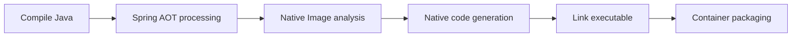

# Build Time, Build RAM, Binary Size, and Container Image Size

## 1. Why Measure Both Build Cost and Artifact Size?

GraalVM Native Image typically produces executables that start fast and can use less runtime memory for certain workloads. In return, native compilation usually consumes significantly more time and RAM than packaging a JAR. A native binary can also be larger or smaller than a JAR depending on dependencies, debug information, static/dynamic linking, and container packaging.

When evaluating **SPRING_BOOT_NATIVE_IMAGE**, measuring startup or runtime RSS alone is insufficient. You must measure four categories simultaneously:

- **Build duration:** elapsed time from starting the build until the artifact finishes.
- **Build memory:** peak RAM used by the compiler/build process.
- **Executable size:** size of the native binary and any required companion files.
- **Container image size:** size of the built image distributed through registries.

Metrics must be measured across the exact same source revision, dependencies, toolchain, build configuration, and hardware environment. If multiple factors vary between runs, differences cannot be reliably attributed to Native Image.

## 2. Distinguishing Quantities to Record

| Metric | Common Unit | Meaning |
|---|---|---|
| Wall-clock build time | seconds/minutes | Real elapsed time a developer or CI must wait |
| CPU time | seconds | Total CPU time consumed by the process or process group |
| Peak build RSS | MiB/GiB | Highest resident memory observed |
| Peak container/cgroup memory | MiB/GiB | Peak memory of the build container, including related processes |
| Native executable size | MiB | Size of the binary file after build |
| Runtime support files | MiB | Shared libraries, configs, certificates, or companion files |
| Container image size | MiB/GiB | Image size according to the documented measurement method |
| Compressed transfer size | MiB/GiB | Image payload transferred over registry/network |

Never substitute one quantity for another. For example, `du -sh` on the output directory is not peak RAM; binary size is not container size; image size shown in a registry may be compressed layer size rather than unpacked disk usage on a host.

## 3. Building a Fair JVM and Native Baseline

To compare build costs, set up two pipelines from the same revision:

**JVM artifact**
- Compile application.
- Run required tests.
- Package executable JAR.
- Record time and JAR size.

**Native artifact**
- Compile application and tests with the same scope.
- Run Spring AOT.
- Run the GraalVM Native Image compiler.
- Package the executable and runtime files.
- Record time, RAM, and sizes.

Do not compare a single JVM `package` command against an entire native pipeline that additionally runs tests, AOT, code generation, and container builds and blame the entire difference on the compiler. Break timings down by stage to see how much cost sits in compile, AOT, Native Image, or container packaging.

State clearly whether dependency downloads, test execution, Docker builds, and cache warm-up are included in total build time. Reporting both total pipeline duration and per-stage timings helps readers understand trade-offs.

## 4. Locking Measurement Conditions

Before running benchmarks, record:

- Git commit, working tree status, and any uncommitted changes.
- JDK/GraalVM distribution, version, and architecture.
- Spring Boot, Spring Framework, Native Build Tools, and plugin versions.
- Maven/Gradle wrapper version.
- CPU model, allocated cores, and RAM limit.
- OS, kernel, filesystem, and container runtime.
- Native Image build arguments, profiles, and RuntimeHints.
- Dependency cache state (cold/warm).
- Whether debug symbols, build reports, PGO, or monitoring features are enabled.
- Whether parallel jobs share the same host.

Example benchmark metadata:

```text
commit=8a12f3c
jdk=21
graalvm=version-pinned
spring-boot=version-pinned
native-build-tools=version-pinned
cpu-limit=8
memory-limit=16GiB
cache=warm
profile=native-prod
build-mode=release
```

Values are examples only. Real reports must state exact pinned versions, never generic labels like "latest". If a shared host cannot be fully isolated, run multiple times and report variance.

## 5. Measuring Wall-Clock Build Time

Wall-clock time is the most direct measure of how long CI or developers wait. On PowerShell:

```powershell
$timer = [System.Diagnostics.Stopwatch]::StartNew()
./mvnw -Pnative -DskipTests package
$exitCode = $LASTEXITCODE
$timer.Stop()

"exitCode=$exitCode"
"elapsedSeconds=$($timer.Elapsed.TotalSeconds)"
if ($exitCode -ne 0) {
    throw "Native build failed"
}
```

On a POSIX shell:

```bash
/usr/bin/time -f 'elapsed=%e sec user=%U sec system=%S sec' \
  ./mvnw -Pnative -DskipTests package
```

With Gradle:

```bash
/usr/bin/time -f 'elapsed=%e sec user=%U sec system=%S sec' \
  ./gradlew nativeCompile
```

Exact tasks/goals depend on plugins and project setup. Verify tasks exist before benchmarking. Measure stages individually when needed: compile, `processAot`, native compile, and container image build.

Never ignore exit codes. A build that fails quickly cannot count as a successful build time. Log failed durations separately for investigation rather than mixing them into success samples.

## 6. Separating Spring AOT and Native Image Compilation Time

A native pipeline typically spans multiple stages. Simplified model:



Depending on plugins, one task may invoke multiple stages or cache outputs from prior stages. Read build logs and task graphs to break down durations:

| Stage | Costs to Observe |
|---|---|
| Dependency resolution | Downloads, metadata, and caching |
| Java compile/test compile | JVM compiler |
| Spring AOT | Context analysis and generated sources |
| Native Image analysis | Reachability analysis, initialization |
| Code generation/link | Compiling/linking native code |
| Container packaging | File copying, layer creation, compression |

If total build time rises, you need to know which stage dominates. Optimizing dependency download caching will not fix code generation time; adding CPU may help compilation without necessarily speeding up linking or filesystem-bound stages.

## 7. Measuring Peak RAM of a Native Image Build

Peak RAM is critical because the native compiler can consume substantial memory. On Linux, `/usr/bin/time -v` commonly reports maximum resident set size for the measured process:

```bash
/usr/bin/time -v ./gradlew nativeCompile
```

Look for the `Maximum resident set size` line. Output units depend on OS/tool version; verify units before converting to MiB.

Note: the build tool process may spawn the Native Image compiler as a child process. A shell wrapper's measurement may not reflect total peak memory across the entire process tree as expected. Inside CI containers, cgroup memory peak is often more reliable for capturing total job memory consumption.

## 8. Measuring Memory by Cgroup/Container

If builds run inside a Linux container or CI runner with cgroup v2, you can read files such as:

```bash
cat /sys/fs/cgroup/memory.peak
cat /sys/fs/cgroup/memory.max
```

`memory.peak` typically records cgroup peak memory in bytes; `memory.max` shows the limit if configured. Exact paths and permissions depend on cgroup version, container runtime, and mount setup.

With Docker, you can observe:

```bash
docker stats --no-stream native-build-container
```

This is a point-in-time snapshot and is not guaranteed to catch earlier peaks. For accurate peak measurements, use cgroup counters or CI/container runtime metrics. Specify whether numbers represent process RSS, process-tree RSS, or cgroup peak.

If a build container is OOM-killed, record the exit status and kernel/container OOM event. Do not treat the configured memory limit as actual RAM consumed.

## 9. Tuning Memory Limits and Compiler Parallelism

The Native Image compiler can use multiple worker threads/CPUs and substantial RAM. Increasing parallelism can shorten build time while raising peak memory. Reducing parallelism can stabilize builds on smaller runners at the expense of longer duration.

Depending on GraalVM version, options exist to control compiler thread count, for example:

```bash
native-image --parallelism=4 ...
```

Confirm supported options using `native-image --help` for your exact version. Never use flags from another release without checking.

Design benchmarks across several resource tiers:

| Profile | CPU Limit | Memory Limit | Goal |
|---|---:|---:|---|
| Small runner | 2 cores | 4 GiB | Determine whether the build is feasible |
| Standard CI | 4 cores | 8 GiB | Common runner tier |
| Large runner | 8 cores | 16 GiB | Evaluate speedup with extra resources |

This is an illustrative matrix, not a fixed recommendation. Measure multiple times per profile while holding all other factors constant and tracking OOMs/failures.

## 10. Cold Cache and Warm Cache

Initial builds may download dependencies, populate compiler caches, or perform work absent from subsequent builds. Distinguish accordingly:

- **Cold build:** dependency/compiler caches are empty or isolated.
- **Warm build:** caches already contain required artifacts from previous runs.
- **Incremental build:** source changed partially and the build tool reuses valid outputs.

Never compare a cold JVM build against a warm native build. Match measurement mode to the question:

- Evaluating CI experience on fresh runners: cold build.
- Evaluating cached CI pipelines: warm build.
- Evaluating the developer inner loop: incremental build.

Document cache keys and invalidation policies. If cached native outputs are reused across incompatible commits, results may be invalid or irreproducible.

## 11. Measuring Native Executable Size

After a successful build, inspect the exact binary:

```bash
ls -lh target/orders-service
stat target/orders-service
file target/orders-service
```

On PowerShell:

```powershell
Get-Item target/orders-service |
    Select-Object Name, Length, LastWriteTime
```

File size is reported in bytes; convert to MiB by dividing by (1024^2). Record both raw byte size and unit convention (decimal MB vs. binary MiB).

Do not measure only the executable file if the application also requires:
- Shared libraries missing from the runtime base image.
- CA certificates or timezone data.
- External configurations/templates.
- Native libraries such as `.so` or `.dll`.
- Entrypoint scripts and file permission metadata.

You can report the binary alone and the total runtime payload separately so readers see full deployment costs.

## 12. Factors Affecting Binary Size

Native executable size is influenced by:

- Reachability graph and included dependencies.
- Reflection, resource, proxy, and serialization metadata.
- Optimization level and target architecture.
- Debug information and symbol stripping.
- Static vs. dynamic linking.
- Native libraries and runtime support.
- Build arguments and monitoring features.
- PGO/profile-guided optimization if used.
- Compiler and toolchain versions.

Do not conclude how much a library inflates binary size from a single build. To evaluate a dependency, produce two builds differing by exactly one variable, using identical toolchain and build arguments, and compare artifacts/reports.

Debug symbols may be separated or stripped depending on platform/toolchain. When comparing release binaries, apply the same symbol policy across measurements. If production debugging is needed, archive matching symbols in an artifact store rather than comparing a binary with symbols against a stripped binary.

## 13. Distinguishing Binary Size, Filesystem Size, and Container Image Size

Three metrics are frequently confused:

- **Logical file size:** number of bytes declared by the file.
- **Filesystem allocated size:** actual disk blocks allocated by the filesystem, depending on block size/sparse files.
- **Container image size:** sum of layers as reported by the container engine/registry.

An 80 MiB binary does not mean the container image is 80 MiB. The image also contains the base OS, shared libraries, CA certificates, timezone data, metadata, and other layers.

Similarly, multi-layer images may share base layers on a local host; network transfer size from a registry and unpacked disk size after pull can differ. Reports must specify which command produced the number and whether it is compressed or unpacked size.

## 14. Measuring Container Image Size

After building the image:

```bash
docker image ls orders-service:1.0
docker image inspect orders-service:1.0
```

You can inspect layers:

```bash
docker history --no-trunc orders-service:1.0
```

These commands offer different views. `docker image ls` displays size per the Docker engine; `inspect` returns metadata; `history` shows layers and build commands. To measure registry transfer size, use appropriate registry/manifest tools and state how compressed layers are summed.

If using Podman or buildpacks, use their corresponding tools and avoid directly comparing numbers with differing semantics. When comparing JVM and native, build both images on the same base image family and architecture when isolating artifact/runtime costs.

## 15. Base Image Choice Heavily Affects Image Size

A native executable can run on a small base image if built compatibly with that base's libc and shared libraries. However, picking a distroless/minimal image does not automatically guarantee the binary will run.

Items to verify:

- glibc vs. musl and how the binary was linked.
- Shared libraries required by the executable.
- CA certificates for TLS.
- Timezone data if the application handles timezones.
- User/group and filesystem permissions.
- Temp directories, writable paths, and working directory.
- Additional native libraries.

A tiny image missing runtime libraries has no practical value. Measure image size only after running smoke/integration tests inside that exact image.

## 16. Dockerfile Example for a Native Executable

Simple multi-stage example:

```dockerfile
FROM ubuntu:24.04 AS runtime
WORKDIR /app
COPY target/orders-service /app/orders-service
USER 10001:10001
EXPOSE 8080
ENTRYPOINT ["/app/orders-service"]
```

This is an illustrative example; choose a base image matching the environment where the binary was built. If the executable depends on shared libraries absent from the Ubuntu base, install runtime packages or choose a compatible base image.

To keep toolchains and build caches out of the runtime image, compile native in a separate stage/job and copy only the executable plus necessary runtime files. If using buildpacks, configure builder/run images via buildpack mechanisms rather than assuming this Dockerfile applies verbatim.

After building:

```bash
docker build -t orders-service:native .
docker image ls orders-service:native
docker run --rm -p 8080:8080 orders-service:native
```

Verify health/readiness and a representative business flow before recording the image as valid.

## 17. Fair Comparison Between JVM and Native Containers

To measure container size fairly:

- Same CPU architecture and build platform.
- Same base image family, or explicitly document differences.
- Same CA certificates/timezone policy.
- Exclude source code, compiler caches, and test reports from runtime images unless required.
- Do not compare a JVM image carrying a full JDK against a distroless native image and attribute the entire difference to the executable.
- Explicitly note compressed/uncompressed sizes and layer sharing.
- Confirm both images pass the same endpoint/test fixtures.

You can report two perspectives:
1. **Operational image:** the realistically optimized image each runtime would deploy in practice.
2. **Controlled comparison:** fixed base image and support files to isolate differences caused by the runtime artifact itself.

Both are useful, yet answer different questions.

## 18. Repeating Measurements and Summarizing Statistics

Build time and peak RAM fluctuate due to CPU contention, filesystem cache, daemon state, GC, and background jobs. Never conclude from a single sample.

Perform enough repetitions to observe variance—for example 3–5 runs for preliminary benchmarks and more when margins are narrow. Record individual samples, not only averages.

Sample data table:

| Run | JVM build (s) | Native build (s) | Native peak RAM (GiB) | Binary (MiB) | Native image (MiB) |
|---:|---:|---:|---:|---:|---:|
| 1 | 42 | 318 | 7.4 | 86 | 112 |
| 2 | 40 | 305 | 7.1 | 86 | 112 |
| 3 | 43 | 326 | 7.6 | 86 | 112 |

These figures merely illustrate presentation, not Spring Boot benchmarks or expected numbers.

Report median, min/max, and spread where useful. For build times, median is typically less skewed than mean by a single noisy CI run. Record failed/OOM runs separately and never silently omit them from reports.

## 19. Separating Build Benchmarks from Runtime Benchmarks

This lesson measures artifact creation costs. When evaluating runtime choices, also measure:

- Startup to readiness.
- Idle RSS and loaded RSS.
- Throughput and latency.
- CPU usage.
- Scale-out time and required replica count.
- Cold start in the target deployment environment.

Do not mix these metrics into build duration. A native build taking several minutes can still yield an executable ideal for serverless workloads; a faster build does not guarantee a better runtime.

Decisions should weigh total lifecycle cost: CI duration, runner resources, registry storage, image pull time, production memory/CPU, and scaling requirements.

## 20. Common Measurement Pitfalls

| Symptom | Possible Cause | How to Address |
|---|---|---|
| Native build time fluctuates widely | Host contention, inconsistent caches | Isolate runner, document cache state, repeat runs |
| Unusually low peak RAM | Measured only parent process, missed compiler child | Measure cgroup/process tree |
| Build hits OOM | Low memory limit or high compiler parallelism | Raise limit or lower parallelism per version |
| Small binary but large container | Large base image/libraries/files | Inspect layers and runtime payload |
| Small container fails to run | Missing libc/shared library/certificates | Check dependencies and test inside the actual image |
| Skewed JVM/native comparison | Different base images, tests, or build flags | Standardize pipelines |
| Subsequent build much faster | Warm cache/incremental outputs | Report cold and warm separately |
| Unexplained binary size swings | Different symbols, optimizations, metadata, or toolchain | Pin build configuration and inspect reports |

## 21. Practice Lab: Building a Build and Artifact Cost Table

**Scenario:** The team must choose between an executable JAR and Native Image for an Order API. The goal is understanding CI cost and deployment footprint before measuring runtime performance.

**Step 1 — Pin environment.** Record commit, JDK/GraalVM, Spring Boot, plugins, CPU/RAM limits, and cache policy.

**Step 2 — Build JVM.** Run the same compile/test/package scope, measure wall-clock time, record JAR size, and build the JVM container image.

**Step 3 — Build native.** Run AOT and Native Image, measuring individual stages plus total wall-clock time. Record peak memory via cgroup or process-tree monitoring.

**Step 4 — Measure executable.** Record logical file size, runtime support files, and debug symbol policy.

**Step 5 — Build container image.** Use a compatible base image, measure image size/layers, and state whether compressed or unpacked.

**Step 6 — Repeat.** Collect multiple samples with cold/warm caches separated; never mix samples across conditions.

**Step 7 — Verify artifacts.** Run smoke and integration scenarios inside both images to ensure measured sizes reflect runnable artifacts.

**Step 8 — Summarize.** Report median/min/max, peak RAM, binary size, image size, failures/OOMs, and CI trade-offs.

Completion criteria: reproducible figures; build time broken down by stage; peak memory reflects accurate scope; binary/container sizes clearly defined; both images pass runtime smoke/integration checks.

## 22. Conclusion

Evaluating Spring Boot Native Image build costs requires separately measuring build duration, peak RAM, executable size, and container image size. Numbers are meaningful only when source revision, toolchain, resource limits, cache policy, and pipeline scope are controlled. In particular, distinguish process RSS from cgroup peak, binary size from image size, and compressed registry size from host disk usage.

Separate Spring AOT, Native Image compilation, and container packaging stages; repeat runs, record individual samples, and verify artifacts inside real runtime images. Combining CI/registry costs with startup, memory, and runtime throughput lets you decide between JVM and native on total operational cost rather than a single isolated metric.
