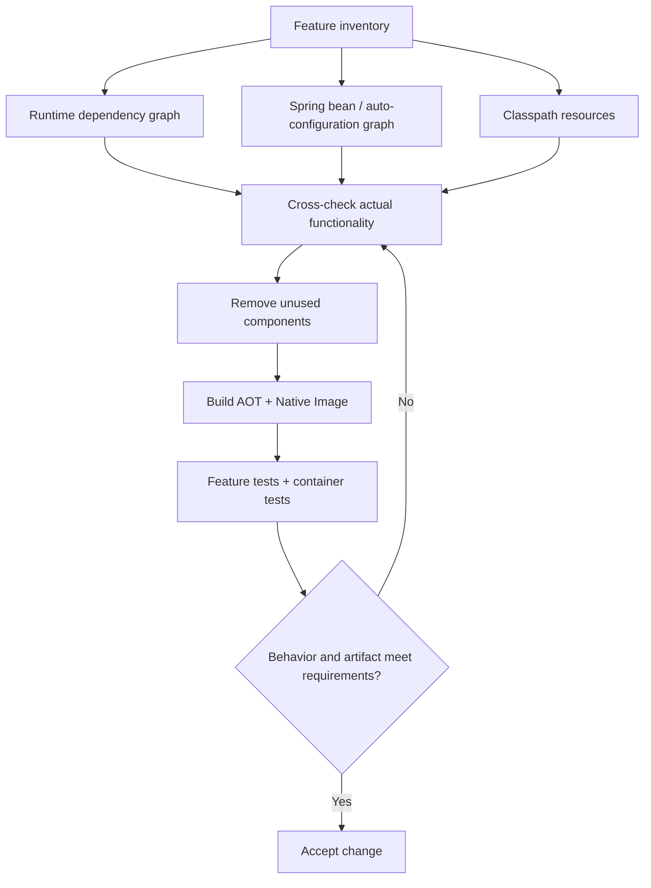

# Reducing Unnecessary Dependencies and Resources Based on Actual Functionality

## 1. Optimization Starts from Application Functionality

Native Image generally produces a smaller executable than packaging a full JVM runtime, yet size and memory consumption still depend on what the application actually uses. Redundant dependencies, unnecessary auto-configuration, unused resources, unneeded drivers, or multiple coexisting implementations can increase build time, artifact size, maintenance surface, and sometimes runtime footprint.

The safe way to optimize is to start from a **feature inventory**: list the capabilities the Spring Boot service must deliver in the deployment environment. From there, cross-check against the dependency graph, bean graph, resources, and runtime metadata to remove components that do not serve those capabilities.

Do not delete a dependency just because its library name does not appear in source code. It may be used indirectly through auto-configuration, reflection, `ServiceLoader`, JDBC driver discovery, serializers, logging providers, or other libraries. Every change must be verified by building and testing the actual application executable.

In the **SPRING_BOOT_NATIVE_IMAGE** module, optimizing dependencies/resources lowers build and packaging costs while still preserving full Spring AOT behavior, reflection/resource hints, compatibility testing, and container operations.



## 2. Distinguishing Layers Eligible for Optimization

Dependencies and resources exist across multiple layers. Removing a dependency from a build file is not the same as removing a bean from the Spring context or dropping a resource from the native image.

| Layer | Example | How to Inspect |
|---|---|---|
| Build dependency | Unused library module | Gradle/Maven dependency graph |
| Runtime dependency | JDBC driver, logging backend | Runtime classpath and artifact |
| Auto-configuration | Client or integration enabled automatically | Condition evaluation report, bean graph |
| Spring bean | Service/adapter not belonging to any feature | ApplicationContext and AOT output |
| Class reachability | Class retained due to static references/metadata | Native Image analysis |
| Reflection/proxy metadata | Constructors, methods, JDK proxies | RuntimeHints and reachability metadata |
| Classpath resource | Templates, schemas, fonts, message bundles | JAR contents and resource hints |
| OS shared library | JNI dependencies, CA certificates | Container filesystem and binary dependencies |

A library might never be called directly yet still be required because it supplies an implementation for an interface discovered by the framework. Conversely, a dependency might resolve on the runtime classpath while being unnecessary for the production artifact if it only serves a separate tool/test.

## 3. Building a Feature Inventory Before Editing Dependencies

Document the features the application must support. For example, an invoice management service:

| Feature | Potentially Related Components |
|---|---|
| HTTP API | Spring MVC, JSON mapper, validation |
| Persistence | JDBC/JPA, database driver, connection pool |
| Authentication | Security framework, token/JWT library |
| PDF export | PDF engine, fonts, templates |
| Sending email | Mail client, template resources |
| Metrics | Micrometer registry, Actuator |
| Logging | Logging facade and backend |
| Migration | Flyway/Liquibase and migration resources |
| Messaging | Kafka/RabbitMQ client |
| Health checks | Actuator health contributors |

Mark each feature as mandatory, optional, operations-only, or retired. Record which profile/feature flag activates it.

Do not remove a module simply because it currently receives few requests. If it is a committed API capability or enabled by production configuration, it remains within the required scope.

## 4. Inspecting the Runtime Dependency Graph

Gradle:

```bash
./gradlew :api-app:dependencies --configuration runtimeClasspath
./gradlew :api-app:dependencyInsight --dependency library-name --configuration runtimeClasspath
```

Maven:

```bash
./mvnw dependency:tree
```

Cross-check the graph against the feature inventory:

- Direct and transitive dependencies.
- Actual resolved versions.
- Optional/classifier modules.
- Exclusions and dependency constraints.
- Runtime scope versus test scope.
- Indirectly discovered drivers/providers.
- Libraries left behind only by legacy dependencies or removed integrations.

In a Gradle multi-project build, run these commands on the actual application module. A library may be declared in a shared module, yet only the application module pulls it into the runtime artifact.

Do not remove transitive dependencies by adding exclusions before knowing which library needs them. If a dependency comes from a starter or auto-configuration, verify whether the starter is still needed and whether a smaller module fits better.

## 5. Choosing Focused Starters Instead of Pulling the Entire Ecosystem

Spring Boot starters make integration setup convenient, but a starter can pull in more libraries than the feature requires. Inspect the dependency tree and pick the right starter/module.

For example:

- If you only need JDBC, you can use the JDBC starter instead of the Data JPA starter when ORM is unnecessary.
- If you only need an HTTP client, you may not need the full MVC stack.
- If you only need the metrics API, you may not need exporters for unused monitoring systems.
- Do not include multiple logging backends at the same time.
- Do not include multiple JDBC drivers if the service connects to only one database type.

This is a functionality-driven selection principle, not a rule to strip every transitive dependency. A starter can provide essential configuration, version alignment, and integrations. Before replacing a starter with individual modules, check auto-configuration, dependency management, and test behavior.

## 6. Managing Dependencies by Scope

Gradle typically distinguishes:

| Configuration | Purpose |
|---|---|
| implementation | Dependencies needed at compile time and runtime |
| runtimeOnly | Needed at runtime but not for compile-time APIs |
| compileOnly | Needed only at compile time; runtime is provided by the environment |
| testImplementation | Used only when compiling tests |
| testRuntimeOnly | Used only when running tests |

Maven has scopes such as compile, runtime, provided, and test. Choose scopes based on actual lifecycle usage.

For example, a JDBC driver is typically a runtime dependency:

```groovy
dependencies {
    implementation("org.springframework.boot:spring-boot-starter-jdbc")
    runtimeOnly("org.postgresql:postgresql")
    testImplementation("org.springframework.boot:spring-boot-starter-test")
}
```

Do not move a driver to test scope just to shrink the artifact. The production application still needs the driver to connect to the database. Conversely, JUnit, Mockito, and test fixtures must not leak onto the production runtime classpath.

## 7. Removing Unused Dependencies Safely

A dependency can be considered for removal when:

- No production feature needs its API.
- No other dependency requires it at runtime.
- It does not provide an active auto-configuration or provider.
- It is not loaded via reflection, `ServiceLoader`, or a plugin registry.
- It does not contain required resources/runtime metadata.
- Tests and builds still pass after removal.

Safe workflow:

1. Record the dependency and its path in the graph.
2. Identify which modules/features use it.
3. Check APIs, auto-configuration, and provider discovery.
4. Remove or replace the dependency.
5. Run dependency resolution and AOT processing.
6. Build the Native Image.
7. Run feature tests on the executable.
8. Run container integration tests.
9. Compare size, build time, and runtime metrics before and after.

Do not use a drop in JAR count as sole proof of a successful optimization. Native Image may already eliminate unreachable classes even when a dependency JAR is in the build graph; conversely, a small dependency can pull in critical native libraries or resources.

## 8. Excluding Unnecessary Auto-Configuration

Spring Boot auto-configuration is typically activated based on classpath presence, properties, and existing beans. A present dependency can cause auto-configuration to be evaluated, though not every auto-configuration creates beans or significantly enlarges the executable.

If an integration is genuinely unused, prefer removing the corresponding dependency/starter. You can exclude a specific auto-configuration when you know for sure it is outside the feature set.

Exclusion configuration example:

```java
@SpringBootApplication(exclude = SomeClientAutoConfiguration.class)
public class ApiApplication {
}
```

Or via property if supported by the auto-configuration:

```yaml
spring:
  autoconfigure:
    exclude:
      - com.example.client.SomeClientAutoConfiguration
```

Class names are illustrative; use the library's real class/property. Excluding auto-configuration does not necessarily remove the dependency from the artifact and could omit a bean required by another integration. Inspect the condition evaluation report and application context after changing it.

## 9. Profiles and Feature Flags: Avoid Confusing Runtime with Build-Time

Spring AOT analyzes the bean graph in the build environment. Conditions such as profiles, conditional properties, and classpath conditions can determine which beans enter the generated context.

If production only needs one profile, build AOT with the target profile and document it. Do not expect changing a profile at runtime to instantiate a bean already omitted from AOT output.

Runtime feature flags work well for toggling behavior inside existing beans. If a feature flag alters the structure of the bean graph, verify how Spring AOT handles it and consider separate artifacts for distinct configurations.

Do not delete a feature's dependency just because that feature is disabled in the test environment. Verify all supported profiles, tenants, and deployment configurations.

## 10. Removing Unused Resources

Classpath resources can come from the application or dependency JARs:

- HTML/email templates.
- JSON/XML schemas.
- Fonts, images, static assets.
- Message bundles.
- SQL migrations/queries.
- Default configuration files.
- Public certificates or lookup data.

Inspect resources inside an archive:

```bash
jar tf build/libs/api-app.jar
```

Resources may be loaded by dynamically constructed names or via the framework. Do not delete a file simply because no direct reference appears in source search. Check code paths, resource loaders, libraries, and tracing/test evidence.

When using resource hints, keep patterns narrow and feature-accurate:

```java
hints.resources().registerPattern("templates/invoice/*.html");
```

Pattern shown as an example. Overly broad patterns can retain many unneeded resources; overly narrow patterns cause missing templates when runtime selects another valid name. After changing hints, test every locale/template/schema the application commits to supporting on the native executable.

## 11. Distinguishing Classpath Resources from Runtime Files

Classpath resources are typically packaged inside the JAR or native image metadata. Runtime files are mounted or created on the filesystem while the application runs.

For example:

- Default templates packaged inside the JAR: classpath resource.
- User-uploaded files: runtime filesystem/object storage.
- Platform-mounted CA bundle: runtime file or configured truststore.
- SQL migrations packaged with the application: classpath resource.
- Secret files mounted by the orchestrator: runtime secret.

Do not embed runtime secrets as native image resources. Do not use `Resource.getFile()` assuming a resource inside an executable/JAR is a regular file. Read classpath resources via streams; access runtime files via configured paths and check permissions.

## 12. Optimizing Reflection and Proxy Metadata by Functionality

`RuntimeHints` and GraalVM reachability metadata should reflect the dynamic operations actually needed:

- Register only constructors/methods/fields that are used.
- Register JDK proxies only with the required set of interfaces.
- Keep only necessary resource patterns.
- Register only serialization types in the actual object graph.
- Declare JNI access only when a dependency genuinely uses JNI.

Do not remove metadata solely because no direct call appears in code; the framework may use reflection or proxies indirectly. Rely on test scenarios, the RuntimeHints Agent, and vendor documentation to determine requirements.

Likewise, do not use broad hints to compensate for an unclear dependency graph. If a plugin is no longer supported, remove the plugin and its associated metadata in the same change, then re-test the remaining plugins.

## 13. Removing Unused Logging and Observability Backends

A service can accidentally package multiple logging implementations or metrics exporters. Check:

- Selected logging facade and backend.
- Bridges between logging APIs.
- Actuator endpoints actually enabled.
- Active Micrometer registry/exporters.
- Tracing exporters and transports.
- Agents or diagnostic libraries needed only in specific environments.

Do not remove the production logging backend if the application relies on logs for operations. For metrics, retain the needed API/instrumentation while including only the exporter matching your monitoring platform. Verify behavior after removing a backend to avoid silently dropping logs or metrics.

## 14. Native Libraries and Drivers: Do Not Optimize by Dropping Needed Files

A dependency may contain OS/architecture-specific binaries or load native libraries at runtime. Check:

- Whether the native library is actually called in production features.
- Whether the artifact/classifier matches the target platform.
- Whether JNI metadata and resource extraction are required.
- Whether shared library dependencies are present in the run image.
- Whether a supported and tested Java fallback exists.

Do not delete a native resource merely because it enlarges the JAR if runtime paths require it. If only one platform is shipped, use vendor-supported platform-specific dependencies/packaging instead of deleting files with target-blind scripts.

## 15. Measuring Impact Before and After Optimization

Record a baseline before making edits:

| Metric | Before | After | Meaning |
|---|---|---|---|
| Runtime dependency count | Record actual count | Record actual count | Reference indicator, not the sole goal |
| Native executable size | MiB | MiB | Binary size |
| Container image size | MiB | MiB | Released image size |
| Native build duration | minutes | minutes | Build cost |
| Startup-to-ready | ms/s | ms/s | Startup impact |
| RSS after fixed milestone | MiB | MiB | Resident memory |
| Throughput/latency | By workload | By workload | Must not regress beyond threshold |

Measure in the same environment, same commit except for the tested change, same toolchain, workload, and container limits. Repeat measurements and report distributions; do not draw conclusions from a single build or a single run.

A lower dependency count does not guarantee a proportionally smaller executable because reachability analysis can already strip unused code. Conversely, a library adding large resources or native binaries can have a major impact even if dependency count rises only slightly.

## 16. Incremental Small-Change Optimization Workflow

Follow an iterative loop:

1. **Inventory**: document features, dependencies, beans, and resources.
2. **Hypothesis**: state which component is unnecessary and which metrics should change.
3. **Baseline**: record graphs, artifact size, build time, and runtime metrics.
4. **Change**: remove one small group of dependencies/resources/auto-configurations.
5. **Build**: run dependency resolution, Spring AOT, and Native Image.
6. **Test**: run JVM tests, native feature tests, and container integration tests.
7. **Measure**: re-measure under the same protocol.
8. **Decision**: keep the change if functionality remains intact and measured gains are meaningful.
9. **Document**: record the rationale, affected features, and limitations.

Changing one small group at a time makes root-cause analysis fast if a feature breaks. If you remove multiple starters, hints, and resources together, a native runtime failure becomes much harder to diagnose.

## 17. Example: Service Uses Only JDBC Yet Pulls In JPA

Suppose a service only executes SQL via `JdbcTemplate`, yet the dependency graph still includes the Data JPA starter added at project inception.

Before removing JPA:

- Search for `EntityManager`, repository interfaces, entity scanning, and JPA configuration.
- Check whether Flyway/Liquibase depends on JPA configuration.
- Check whether integration tests use repositories.
- Inspect auto-configuration and the transaction manager being created.

Once confirmed that JPA is unused, you can drop the Data JPA starter while keeping the JDBC starter and driver. Then rebuild and verify the bean graph, transaction behavior, migrations, and database endpoints on the native executable.

This is functionality-based optimization. Do not remove the driver or transaction manager just because they were pulled in via the dependency tree.

## 18. Example: Keeping Only Shipped Templates

Suppose an application contains many legacy templates, while production supports only `invoice` and `receipt`. Before removing other templates:

- Find where template names are selected.
- Check whether locales/tenants can select other variants.
- Check fallback templates.
- Check whether email/PDF libraries load templates by runtime name.
- Add tests covering all valid names.

Then narrow the resource hint or remove files confirmed to be retired. If template names come from user input, never allow arbitrary paths; use an allowlist to prevent path traversal and unintended resource access.

## 19. Common Mistakes

| Mistake | Consequence | Right Approach |
|---|---|---|
| Removing a dependency because it is not imported directly | Loss of indirect providers/auto-configuration | Inspect dependency graph and discovery |
| Looking only at JAR count | Does not reflect reachability/native resources | Measure binary/image and runtime |
| Excluding auto-configuration too broadly | Missing required beans | Check condition report and context |
| Building AOT with an unrepresentative profile | Bean graph lacks production features | Align with the target profile |
| Deleting resources based on text search | Missing dynamically loaded resources | Test every valid name |
| Deleting reflection hints by guesswork | Native runtime fails on rare branches | Rely on tests/agent and metadata evidence |
| Removing driver to reduce size | Database integration fails to run | Keep drivers needed in production |
| Running only JVM tests | Fails to catch native reachability issues | Run native/container feature tests |
| Changing too many things at once | Hard to pinpoint cause of regression | Optimize one small group at a time |

## 20. Pre-Acceptance Optimization Checklist

- Feature inventory reflects all shipped functionality.
- Runtime dependency graph of the exact application module has been inspected.
- Transitive dependencies, providers, drivers, and auto-configurations have been verified.
- Test-only dependencies are separated from the runtime artifact.
- Bean/profile/conditional configuration matches the AOT build.
- Classpath resources and runtime files are clearly distinguished.
- Reflection, proxy, serialization, and JNI metadata remain sufficient for features.
- Native Image build completes successfully.
- Native feature tests and container integration tests pass.
- Artifact size, build time, startup, RSS, and workload metrics are measured before and after.
- Changes do not degrade functionality, SLAs, or operability.
- Optimization rationale and constraints are documented.

## 21. Self-Check Questions

1. Why must a feature inventory come before removing dependencies?
2. What is the difference between a build dependency, a runtime dependency, and a test dependency?
3. Why can a dependency not directly imported still be required in production?
4. How can auto-configuration and the AOT bean graph be affected when removing a starter?
5. How do you distinguish a classpath resource from a mounted runtime file?
6. Why should you not delete `RuntimeHints` based solely on source code search?
7. Why does reducing JAR count not guarantee a smaller native executable?
8. What should you measure and test before accepting an optimization change?

**Key takeaway:** reducing dependencies and resources must be grounded in actual features, the runtime dependency graph, and tested behavior. Remove components systematically with evidence, preserve metadata/drivers/resources needed by the framework, then rebuild and re-measure on the native executable and release container.
