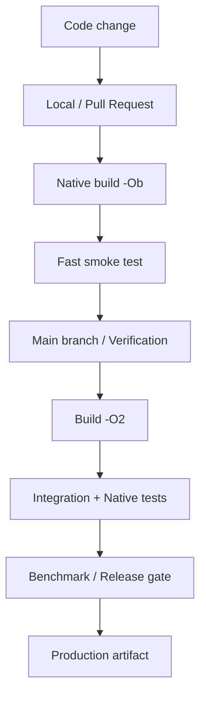

# Choosing Compilation Optimization Levels for Build Time, Size, and Speed Requirements

## 1. The Optimization Level Selection Problem

GraalVM Native Image compiles a Java application into a native executable at build time. This process runs reachability analysis, processes metadata, optimizes code, and links with the native runtime. Optimization choices affect several metrics at once:

- Time and resources required to produce the executable.
- Native binary size and container image size.
- Processing speed when the application runs.
- Startup time and memory usage under real workloads.
- Debugging, profiling, and CPU compatibility at deployment time.

No single optimization level is optimal for every stage. A configuration suited for a fast development loop may not suit a production artifact needing high throughput. Conversely, forcing maximum optimization on every build can slow down CI, consume heavy RAM, and lengthen the team's feedback cycle.

This lesson belongs to the **Optimization** chapter of the **SPRING_BOOT_NATIVE_IMAGE** module. It focuses on choosing optimization levels by goal, configuring them via Maven/Gradle, running controlled benchmarks, and deciding when to optimize by profile.

## 2. Metrics to Consider

Before picking flags, identify the target metric to improve and its corresponding measurement.

| Metric | How to Measure | Significance |
| --- | --- | --- |
| Native build duration | Time from start until the executable is created | Impacts dev loop and CI duration |
| Peak build memory | Maximum RAM used during the build | Determines parallelism capacity and runner sizing |
| Executable size | Size of the native binary file | Impacts storage, distribution, and download time |
| Container image size | Size of the final container image | Impacts registry, network transfer, and rollout |
| Startup time | Time from process start until readiness succeeds | Critical for scale-to-zero, autoscaling, and restarts |
| Throughput | Requests/second under a defined load | Measures overall processing capacity |
| Latency | Request p50, p95, p99 | Reflects response time and tail latency |
| Runtime memory | RSS, heap, and container memory | Affects density and cgroup limits |

Do not equate executable size with container image size. The image also includes the base image, system libraries, certificates, timezone data, and other runtime files. A smaller binary does not automatically shrink the container by the same ratio.

Likewise, do not equate startup time with throughput. Code optimization generally has a stronger effect on runtime execution speed; startup time also depends on class initialization, filesystem, configuration, dependency connections, and readiness checks.

## 3. Native Image Optimization Levels

Native Image provides the `-O` option to control code optimization level. Common levels in current GraalVM documentation:

| Option | Behavior | When to Consider |
| --- | --- | --- |
| `-Ob` | Quick build mode, reducing expensive optimizations | Development loops and fast verification |
| `-O0` | No compiler optimizations | Investigating/debugging at the native code level |
| `-O1` | Basic optimizations, balancing fast builds and performance | Builds needing faster turnaround while retaining basic optimization |
| `-O2` | Advanced optimizations; default in current toolchains | Reasonable baseline for production |
| `-O3` | Full optimization level targeting peak performance | Throughput-critical workloads with sufficient build budget |
| `-Os` | Size optimization, skipping optimizations that substantially enlarge the binary | Constrained storage, image transfer, or footprint |

Key points to remember:

- `-Ob` is quick build mode, not an alias for `-O0`.
- `-O0` disables compiler optimizations; typically helpful when debugging native code.
- `-O2` is the default in current GraalVM Native Image and aims to balance performance, size, and build time.
- `-Os` generally produces a smaller executable, though it may reduce runtime performance.
- The exact semantics of `-O1` and `-O3` depend on the GraalVM distribution and version. Oracle GraalVM documentation notes that `-O1` has an optimization level close to `-O2` in GraalVM Community Edition. In current GraalVM Community Edition, `-O2` and `-O3` are equivalent; do not expect merely switching from `-O2` to `-O3` to yield a performance difference on that distribution.

Check `native-image` output and the documentation for your actual GraalVM version before standardizing configuration.

## 4. Choosing Optimization Levels by Goal

A practical selection matrix:

| Context | Starting Level | Rationale |
| --- | --- | --- |
| Local development AOT testing | `-Ob` | Cuts build wait time to verify integration |
| Debugging native errors or symbols | `-O0` combined with `-g` when appropriate | Makes investigating native code easier |
| CI checking native build per pull request | `-Ob` or `-O1` | Balances feedback speed and optimization level |
| Staging close to production | `-O2` | Uses configuration matching production |
| Production API needing steady throughput | `-O2` first, then benchmark `-O3` if distribution differentiates them | Establishes a baseline before raising build cost |
| Size-constrained function/container | `-Os` | Prioritizes a smaller executable |
| Workload with real profile needing hot-path optimization | PGO if supported by the GraalVM distribution | Compiler uses representative behavioral data |

These are starting points, not substitutes for benchmarking. If `-Ob` yields an adequate binary in an internal environment yet misses production SLAs, use a separate build profile for release artifacts.

### 4.1. Using Separate Build Profiles

You can separate configurations by goal:

- Development profile: `-Ob` for fast feedback.
- Verification profile: `-O1` or `-O2` to catch differences from production early.
- Release profile: `-O2` or a benchmark-validated level.
- Size profile: `-Os` when size is the primary criterion.

Avoid adding the same flag simultaneously across multiple places—such as Maven profiles, plugin configuration, and Buildpacks environment—without checking precedence. During builds, log the complete actual command line and options.

## 5. Configuring Optimization Level with Maven

If a Spring Boot project uses the GraalVM Native Build Tools Maven Plugin, pass the option via `buildArgs`.

Plugin configuration example:

```xml
<plugin>
    <groupId>org.graalvm.buildtools</groupId>
    <artifactId>native-maven-plugin</artifactId>
    <configuration>
        <buildArgs>
            <buildArg>-Ob</buildArg>
        </buildArgs>
    </configuration>
</plugin>
```

In the release profile, replace `-Ob` with the chosen level, such as `-O2`:

```xml
<profiles>
    <profile>
        <id>native-release</id>
        <build>
            <plugins>
                <plugin>
                    <groupId>org.graalvm.buildtools</groupId>
                    <artifactId>native-maven-plugin</artifactId>
                    <configuration>
                        <buildArgs>
                            <buildArg>-O2</buildArg>
                        </buildArgs>
                    </configuration>
                </plugin>
            </plugins>
        </build>
    </profile>
</profiles>
```

Build with the profile:

```bash
./mvnw -Pnative,native-release native:compile
```

Exact plugin configuration depends on the Native Build Tools version and how the project declares profiles. Avoid declaring the same optimization argument multiple times. After building, inspect logs to confirm GraalVM received the right option.

## 6. Configuring Optimization Level with Gradle

With the Gradle Native Build Tools Plugin, set build arguments on the binary:

```groovy
graalvmNative {
    binaries {
        main {
            buildArgs.add("-Ob")
        }
    }
}
```

For release builds:

```groovy
graalvmNative {
    binaries {
        main {
            buildArgs.add("-O2")
        }
    }
}
```

Then run:

```bash
./gradlew nativeCompile
```

If using Kotlin DSL, block syntax may differ slightly depending on plugin version, though the idea remains adding the `native-image` argument to the binary configuration. Inspect task output to verify the option was passed to `native-image`.

Do not edit generated commands or build output files directly. Keep configuration in project build scripts/profiles so CI and local builds follow the same rules.

## 7. Using Buildpacks and Spring Boot build-image

Spring Boot can use Cloud Native Buildpacks to build a container image containing a native executable. When building through Buildpacks, optimization arguments must be passed to the Native Image builder via the environment/buildpack configuration supported by your builder version.

Key notes:

- Identify the exact builder and buildpack version in use.
- Inspect logs to verify the `native-image` command includes the desired optimization flag.
- Do not assume flags configured in the Maven/Gradle plugin automatically apply to every builder.
- Record the builder image digest and GraalVM version so benchmark results are reproducible.
- Compare the final container image size, not just the binary.

With Buildpacks, the builder may use its own build environment and cache. First-build time often differs from subsequent builds due to dependency downloads, layer caching, and native compilation. When comparing optimization levels, fix the cache state or measure cold builds and warm builds separately.

## 8. Build Time and Peak Memory

Optimization levels affect compiler work. Higher optimization levels typically require more time and resources, though the gap depends on application size, reachable class count, libraries, target platform, and GraalVM version.

To compare fairly:

1. Use the same commit and dependency lock/versions.
2. Use the same JDK, GraalVM distribution, and Native Build Tools version.
3. Use the same machine/runner, CPU count, and RAM limits.
4. Fix the cache state: all cold or all warm.
5. Run each configuration multiple times and record the median.
6. Record both peak memory and build time, not only final duration.
7. Separate dependency resolution time from native compilation time if tooling reports it.

A results table should look like:

| Configuration | Build time | Peak RAM | Binary size | Container size |
| --- | ---: | ---: | ---: | ---: |
| `-Ob` | Actual measurement | Actual measurement | Actual measurement | Actual measurement |
| `-O1` | Actual measurement | Actual measurement | Actual measurement | Actual measurement |
| `-O2` | Actual measurement | Actual measurement | Actual measurement | Actual measurement |
| `-Os` | Actual measurement | Actual measurement | Actual measurement | Actual measurement |

Do not fill your project's table with numbers from another application. A Spring Boot application with heavy reflection metadata, proxies, and large libraries can exhibit very different build characteristics from a small Java program.

## 9. Executable Size and Container Image Size

If the goal is reducing size, start with `-Os`. This option retains `-O2` optimizations except those that can significantly increase code/image size.

However, final size also depends on:

- Reachability: which classes/resources actually enter the image.
- Reflection/proxy metadata and resource configuration.
- Native libraries and static/dynamic linking.
- Debug information and symbols.
- Base image, CA certificates, timezone data, and system files.
- Compression when storing or transferring the image.

Do not use `-Os` as a substitute for checking unnecessary dependencies. If the application pulls in an unused adapter or driver, removing unnecessary dependencies can reduce both build effort and artifact footprint.

### 9.1. Measuring Binary and Container Separately

After building:

```bash
ls -lh target/application
docker image ls
```

Exact file name and output path depend on project configuration. Record binary size and container image size separately. If the container uses a large base image, shaving a few MB off the binary may make little difference to the total image.

### 9.2. Debug Information

The `-g` option generates debug information useful for debuggers and native profiling tools. It changes the artifact/debug symbols and can increase distribution file size if debug data remains in the executable. Depending on the toolchain, debug information can be split or stored in a separate artifact.

`-g` is not an optimization level. It can be combined with `-O0` when easier debugging is needed, though disabling all optimization is not mandatory for debugging. Keep symbols/build IDs matching production binaries in a controlled artifact repository.

## 10. Runtime Performance and Throughput

Compiler optimization level can affect code quality, inlining, control flow, and other optimization decisions. Real-world gains still depend on the workload. A higher optimization level does not guarantee every endpoint becomes faster.

When benchmarking runtime:

- Use the same dataset and request mix.
- Keep instance count, CPU quota, and memory limits identical.
- Warm up with a procedure suited to a native application, even though a native executable has no HotSpot JIT warmup.
- Measure p50, p95, p99 latency and throughput.
- Track CPU, RSS, GC/memory metrics, and error rates.
- Run long enough to observe steady state and tail latency.
- Repeat multiple times; avoid concluding from a single run.

Native Image has no HotSpot JIT compilation during normal runtime. Therefore, warmup should focus on stabilizing connection pools, application caches, DNS, and external dependencies—not waiting for JIT compilation as in JVM benchmarks.

If the bottleneck sits in the database, network, or lock contention, changing optimization levels may barely shift latency. Use a profiler/metrics to identify CPU hot paths before raising compiler optimization.

## 11. Profile-Guided Optimization (PGO)

Profile-Guided Optimization uses data collected from a representative run so the compiler knows which code paths execute most often. It is valuable when throughput is the primary goal and production workloads are stable enough for profiles to be meaningful.

General workflow:

1. Build an instrumented executable with `--pgo-instrument`.
2. Run that executable against a workload representative of production.
3. Collect the profile file, typically `default.iprof` by default.
4. Rebuild the application passing the profile via `--pgo=default.iprof`.
5. Benchmark the new executable with the same workload and compare against the baseline.

Example `native-image` arguments:

```text
--pgo-instrument
--pgo=default.iprof
```

The profile must be collected from a genuinely representative workload: request mix, payload sizes, critical branches, startup paths, and background tasks. If the profile covers only a toy endpoint, the compiler may optimize for that behavior and miss production traffic patterns.

PGO can add build time and requires storing profiles tied to the exact version/source/configuration. Do not blindly reuse an old profile after major code or workload changes.

**PGO availability depends on the GraalVM distribution.** Current GraalVM documentation notes that PGO is unavailable in GraalVM Community Edition. Before designing a PGO pipeline, confirm edition/licensing, supported options, and the profile collection workflow for your toolchain.

## 12. Targeting the Destination CPU with -march

Native Image provides `-march` to choose the CPU instruction set the compiler may emit. This affects performance and binary portability across machines.

Common choices:

- `-march=native`: uses instruction features present on the build machine. Can improve performance on compatible machines, but the binary may fail on older CPUs or different feature sets.
- `-march=compatibility`: prioritizes running across a wider range of machines, potentially sacrificing newer instructions.
- `-march=list`: lists target machine types supported by the toolchain.

In CI, build machines often run newer CPUs than production nodes. Building with `-march=native` on a newer runner and deploying to an older node can fail due to missing instructions. Build on a compatible target or specify an explicit target CPU.

Do not optimize for the destination CPU based solely on a developer laptop. Know the CPU capabilities of the entire deployment fleet, especially when one image deploys across heterogeneous nodes.

## 13. Separating Development, Verification, and Release Pipelines

A practical pipeline can use different configurations by stage:



This structure shortens feedback loops while still validating production-like artifacts before release.

If releases require `-Os` or PGO, add a dedicated build stage and record metadata on compiler version, flags, profile, and commit. Do not ship an `-Ob` binary to production just because it passed smoke tests.

Release artifacts should be built once and promoted across staging/production. Avoid rebuilding the same version with different flags or builders after staging sign-off.

## 14. Other Factors Affecting Size and Speed

Optimization level is only one variable among many.

### 14.1. Reachability and Dependencies

Native Image includes only reachable components along with required metadata/resources. Removing unused dependencies and avoiding overly broad reflection/resource registrations can shrink image footprint and build effort.

Do not delete metadata merely to shrink the binary if the application genuinely needs that reflection, proxy, or resource. Verify with native tests.

### 14.2. Class Initialization

Initializing classes at build time can reduce work at process startup, yet it is safe only for deterministic state independent of the runtime environment. Never freeze hostnames, environment variables, secrets, random seeds, or live connections into the image.

Optimizing startup via class initialization should be benchmarked separately from compiler optimization levels. The two mechanisms address different costs.

### 14.3. Garbage Collector and Memory

Native Image supports different GC policies depending on version/runtime. Choose a GC based on workload throughput, latency, and memory footprint—never infer the right GC from executable size alone.

Measure heap, RSS, pause/collection behavior, and container memory under identical load. RSS includes code, stacks, and native allocations, not just the Java heap.

### 14.4. Build Resources and CI Parallelism

Native Image compilation can consume substantial RAM and CPU. Raising concurrent builds can sometimes lengthen total CI time due to RAM, disk I/O, or CPU contention. Size concurrency based on measured peak memory rather than runner core count alone.

If you hit OutOfMemory during native builds, check memory limits, parallelism, and compiler options before merely raising builder heap. Build resources and runtime memory are two separate limits.

## 15. Reproducible Benchmarking

To choose an optimization level, build a benchmark matrix:

| Comparison Axis | Fix or Record |
| --- | --- |
| Source | Commit SHA and working tree state |
| Java/GraalVM | JDK, vendor, edition, and version |
| Build tooling | Maven/Gradle, Native Build Tools, and Spring Boot versions |
| Builder | Buildpacks builder digest if used |
| Machine | CPU model, core count, RAM, OS, and architecture |
| Resource limits | CPU quota, memory limit, and disk |
| Cache | Cold/warm cache, dependency cache, and build cache |
| Runtime config | Environment, native arguments, GC, and heap limit |
| Workload | Request mix, payload, concurrency, duration, and dataset |
| Output | Build time, peak RAM, size, startup, p50/p95/p99, throughput, RSS |

Run each variant multiple times and record the median and spread. Do not change optimization level, GC, CPU target, and base image simultaneously and then guess which factor caused the difference.

A results table might look like this (cells filled with actual measurements):

| Variant | Build time | Binary size | Startup | p95 latency | Throughput |
| --- | ---: | ---: | ---: | ---: | ---: |
| `-Ob` | Measure | Measure | Measure | Measure | Measure |
| `-O2` | Measure | Measure | Measure | Measure | Measure |
| `-Os` | Measure | Measure | Measure | Measure | Measure |
| `-O2` + PGO if supported | Measure | Measure | Measure | Measure | Measure |

Choose the configuration that meets SLAs and overall operational cost. If `-O3` or PGO yields minimal throughput gain while sharply inflating build time, it may not be worth it. If `-Os` shrinks image size noticeably yet pushes latency past the SLA, do not pick it just for a smaller binary.

## 16. Common Pitfalls When Choosing Optimization Levels

| Symptom | Possible Cause | Resolution |
| --- | --- | --- |
| Local build is fast but CI is very slow | Different runner, cache, CPU, or concurrency | Standardize environment and measure cold/warm builds separately |
| Used `-O0` for faster builds | Confused with quick build mode | Use `-Ob` for development loops |
| Switched `-O2` to `-O3` with no difference | GraalVM Community Edition may treat both as equivalent | Check distribution and build output |
| `-Os` yields a smaller binary but higher latency | Traded runtime performance for size | Benchmark the workload and review SLAs |
| Binary shrank but container barely changed | Base image/libraries dominate total size | Measure binary and container separately |
| `-march=native` build fails on other nodes | Target CPU lacks instruction features | Use a compatible target or build for the fleet |
| PGO produces no profile | Instrumented run did not execute or write profile | Check working directory and workload |
| PGO rejected | Edition/toolchain does not support it | Verify GraalVM distribution and license |
| Increased build parallelism yet CI runs slower | RAM/CPU/I/O contention | Measure peak memory and cap concurrency |
| Startup did not improve even with `-O3` | Bottleneck is in config, class init, DNS, or dependencies | Profile startup path and optimize the real bottleneck |

## 17. Hands-On Exercise: Choosing Configuration for Spring Boot Native Image

**Scenario:** A Spring Boot service is compiled natively for container deployment. The team wants faster pull-request builds, while production needs reasonable image size and steady latency.

**Steps:**

1. Record GraalVM vendor/edition/version, JDK, Spring Boot, and Native Build Tools versions.
2. Create a baseline native build with the default `-O2`.
3. Build the same source with `-Ob` and measure build duration, peak RAM, and binary size.
4. Build with `-Os` and measure both binary size and container image size.
5. If your distribution differentiates `-O3` from `-O2`, build and benchmark both.
6. Run the same workload to measure startup, throughput, p50/p95/p99, and RSS.
7. If PGO is supported, build an instrumented binary, run a representative workload, and rebuild using the profile.
8. Check `-march` to verify the binary is compatible with the deployment fleet's CPUs.
9. Select development, verification, and release profiles based on measurements.
10. Store flags, toolchain versions, and benchmark results alongside build metadata.

**Acceptance criteria:**

- Can explain the differences among `-Ob`, `-O0`, `-O1`, `-O2`, `-O3`, and `-Os`.
- Chooses optimization levels based on build time, size, or runtime performance goals.
- Passes options cleanly via Maven or Gradle plugins.
- Measures binary size separately from container image size.
- Benchmarks runtime under identical workloads and resource limits.
- Confirms edition support for PGO before adopting it.
- Selects a CPU target that preserves portability across the deployment fleet.
- Documents results thoroughly enough for builds and benchmarks to be reproduced.

## 18. Summary

Choosing an optimization level is a balancing decision across build time, artifact size, and runtime performance. Use `-Ob` to speed up development loops; use `-Os` when size takes priority; use `-O2` as the production baseline; consider `-O3` or PGO when your toolchain supports them and benchmarks prove the benefit. `-O0` is primarily for debugging, not a replacement for quick build mode.

For Spring Boot Native Image, pass options through Maven/Gradle or Buildpacks according to your plugin version, verify the actual command executed, and measure both the binary and container. Benchmarks must fix source, GraalVM, CPU, cache, resource limits, and workload. Your application's own measurements—not the optimization level name itself—are the basis for selecting release configuration.
