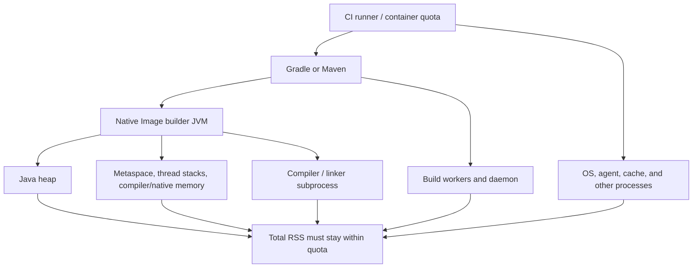

# Limiting RAM, Build Threads, and Trade-Offs When Compiling in CI

> **Chapter: Optimization.** The **SPRING_BOOT_NATIVE_IMAGE** module compiles Spring Boot applications into GraalVM Native Images using Spring AOT to evaluate startup time, memory usage, and operability. Native Image compilation consumes substantial CPU and RAM; in CI, multiple builds may run concurrently on the same runner or across different modules. This lesson covers limiting the Native Image builder's memory, analysis threads, Gradle/Maven workers, and cross-image parallelism to balance build duration with stability.

## 1. Learning Objectives

After this lesson, you will be able to:

1. Explain why the Native Image builder needs more RAM and CPU than a standard Java compile step.
2. Distinguish the heap of the JVM running the Native Image builder from the process's actual RSS.
3. Limit builder memory using JVM options passed through `native-image`.
4. Limit internal threads using **--parallelism**.
5. Distinguish Gradle/Maven worker limits from thread counts inside a single Native Image build.
6. Prevent running multiple concurrent `native-image` processes that exceed the CI runner/container quota.
7. Read Build Output to spot peak RSS, CPU load, GC time, and resource limits.
8. Choose suitable settings for small, medium, and large runners; understand trade-offs among speed, cost, and stability.

## 2. Why Does Native Compilation Need Substantial Resources?

The Native Image builder runs on a JVM. While creating the executable, the builder must analyze the dependency graph, determine reachable classes/methods, process reflection and metadata, build the image heap, optimize code, compile machine code, and invoke the native linker.

Each phase consumes resources differently:

- **Analysis:** points-to analysis traverses the graph of types, fields, and methods that may be used. Applications with many dependencies, reflection metadata, or proxies make this phase heavier.
- **Compilation:** the Graal compiler optimizes and compiles reachable methods into machine code. This phase can consume high CPU and temporary memory.
- **Image heap/layout:** the builder prepares the object graph, metadata, and data sections for the executable.
- **Native toolchain/linker:** the OS compiler and linker may spawn subprocesses or use memory outside the builder JVM heap.

Therefore, the builder heap limit is not an absolute cap on total memory. The process also includes metaspace, thread stacks, code cache/compiler data, mapped files, native allocations, and subprocess memory.



A runner with 8 GiB RAM cannot allocate all 8 GiB to the builder heap. Even if heap reaches its limit, the process still needs off-heap memory; if total RSS exceeds the memory limit, the OS or container runtime may kill the process.

## 3. Distinguishing Builder Heap, RSS, and Memory Limit

These three figures answer three different questions:

| Concept | Meaning | Used For |
|---|---|---|
| Builder heap limit | Java heap limit of the JVM running the Native Image builder | Controlling the amount of Java objects the builder can retain |
| Peak RSS | Highest resident memory of the process as seen by the OS | Estimating how much memory the runner actually needs |
| CI/container memory limit | Hard limit of the runner or container | Identifying the threshold where the process risks an OOM kill |

Native Image Build Output reports the builder's memory limit and peak RSS at the end of the build. **The reported memory limit is the Java heap limit; actual RSS can be higher.** Read both figures rather than assuming the runner needs only the heap value.

For example, if the builder is given an 8 GiB max heap yet peak RSS reaches 10 GiB, the runner still needs room for Gradle/Maven, the OS, the CI agent, and other processes. If two image builds run concurrently, the combined RSS of both builders adds up and can breach the quota even though each build succeeds individually.

### 3.1. Native Image Builder Defaults in CI

According to current GraalVM documentation, when running inside a container or a CI environment with **CI=true**, Native Image uses dedicated mode and defaults the heap limit to roughly 85% of the system memory detected by the builder, subject to a ceiling depending on the GraalVM release. In developer environments, the builder typically uses shared mode to avoid monopolizing machine memory. If available memory falls below a release-defined threshold, the builder may switch to dedicated mode.

This means a small CI runner may automatically pick a relatively high heap limit compared to the RAM needed for Gradle/Maven and the OS. Check Build Output to see how much memory and how many threads the builder detected. If your CI provider does not set **CI=true**, default behavior may differ from expectations.

Do not rely on one fixed default figure across all GraalVM versions. Ceilings and container memory detection can change between releases.

## 4. Limiting Native Image Builder Heap

Native Image uses the **-J** prefix to pass a JVM option to the JVM running the builder. You can set an absolute max heap:

```bash
native-image -J-Xmx6g --parallelism=4 -jar orders-service.jar
```

Or cap it as a percentage of memory detected by the builder:

```bash
native-image -J-XX:MaxRAMPercentage=60.0 \
    --parallelism=4 \
    -jar orders-service.jar
```

Pick an appropriate capping method:

- **-J-Xmx6g** sets an absolute heap ceiling, predictable when CI runners have fixed specs.
- **-J-XX:MaxRAMPercentage=60.0** sets heap as a percentage of RAM detected by the builder JVM; useful when runner sizes vary.
- **-J-Xms** only sets minimum initial heap. Do not raise `Xms` without measurement data, as it can cause the builder to reserve more memory earlier.

Do not set builder heap equal to the entire container memory limit. Leave headroom for off-heap memory, the linker, Gradle/Maven, and the OS. Setting **-J-Xmx** too low can trigger `OutOfMemoryError` or heavy GC; setting it too high can cause the container to OOM-kill the process before the JVM reports a heap error.

### 4.1. Limiting via Gradle Native Build Tools

Gradle Native Build Tools separates two option groups:

- **jvmArgs** passes arguments directly to the JVM running the Native Image builder.
- **buildArgs** passes options to the `native-image` tool.

Example:

```groovy
graalvmNative {
    binaries {
        main {
            jvmArgs.add("-Xmx6g")
            buildArgs.add("--parallelism=4")
        }
    }
}
```

Here **-Xmx6g** caps builder heap; **--parallelism=4** caps Native Image internal threads. Do not put `-Xmx6g` into `buildArgs` as a regular Native Image option, since it is a builder JVM argument.

### 4.2. Limiting via Maven Native Build Tools

With Maven, configure `jvmArgs` and `buildArgs` separately:

```xml
<plugin>
    <groupId>org.graalvm.buildtools</groupId>
    <artifactId>native-maven-plugin</artifactId>
    <configuration>
        <jvmArgs>
            <arg>-Xmx6g</arg>
        </jvmArgs>
        <buildArgs>
            <buildArg>--parallelism=4</buildArg>
        </buildArgs>
    </configuration>
</plugin>
```

The Maven plugin forwards `jvmArgs` to the builder JVM and `buildArgs` to Native Image. If the Spring Boot plugin drives the native build, place these values in the exact configuration forwarded by that plugin to Native Build Tools.

## 5. Limiting Internal Threads with --parallelism

By default, Native Image uses the processors detected by the builder to speed up builds; current documentation states a maximum of 32 threads, not exceeding available processors. Default limits may change across GraalVM releases. Use **--parallelism** to set thread count explicitly:

```bash
native-image --parallelism=2 -jar orders-service.jar
native-image --parallelism=4 -jar orders-service.jar
native-image --parallelism=8 -jar orders-service.jar
```

Reducing parallelism typically helps:

- Reduce concurrent analysis/compilation tasks.
- Lower CPU pressure and part of temporary memory usage.
- Reduce resource contention when the runner also hosts build workers or containers.
- Make builds more stable on small or shared runners.

In return, build duration may increase. Raising threads from 4 to 8 does not guarantee twice the speed; analysis, GC, linking, and sequential phases have their own parallelism limits. If a runner is already CPU-throttled, setting parallelism above allocated CPUs usually only increases contention.

A practical starting rule is setting parallelism at or below the CPU count allocated to the container. Then measure build time and peak RSS to adjust. If build CPU load is low while duration is long, inspect GC, I/O, dependency resolution, and the linker before adding threads.

## 6. Gradle: Workers, Project Parallelism, and Native Build Concurrency

Gradle has multiple concurrency controls independent of Native Image:

| Mechanism | How to Limit | Scope |
|---|---|---|
| Gradle worker count | **--max-workers=N** or **org.gradle.workers.max=N** | Number of Gradle workers used |
| Parallel project execution | **--parallel** or **org.gradle.parallel=true** | Number of projects/modules built in parallel |
| Native Image parallelism | **--parallelism=N** | Number of threads inside a single `native-image` process |
| Concurrent native image builds | **org.graalvm.buildtools.max.parallel.builds=N** | Number of native images the plugin allows to build concurrently when Gradle runs in parallel |

Small CI runner example:

```bash
./gradlew nativeCompile \
    --no-daemon \
    --max-workers=2 \
    --no-parallel
```

Combined with binary configuration:

```groovy
graalvmNative {
    binaries {
        main {
            jvmArgs.add("-Xmx4g")
            buildArgs.add("--parallelism=2")
        }
    }
}
```

For multi-project builds, configure in `gradle.properties`:

```properties
org.gradle.workers.max=2
org.gradle.parallel=false
org.graalvm.buildtools.max.parallel.builds=1
```

The Native Build Tools Gradle plugin automatically caps how many native images build concurrently when parallel project builds are enabled; the default is based on CPU cores divided by 16. Override it via the **org.graalvm.buildtools.max.parallel.builds** property or **GRAALVM_BUILDTOOLS_MAX_PARALLEL_BUILDS** environment variable.

On low-RAM CI runners, setting concurrent native image builds to 1 is usually a safe starting point. Once peak RSS is measured and spare RAM is confirmed, you can try raising it to 2. Do not confuse **--max-workers=2** with **--parallelism=2**: one limits Gradle workers, the other limits builder threads.

### 6.1. gradle.properties and Gradle Daemon Heap

Example:

```properties
org.gradle.jvmargs=-Xmx1g -XX:MaxMetaspaceSize=512m
org.gradle.workers.max=2
org.gradle.parallel=false
org.graalvm.buildtools.max.parallel.builds=1
```

**org.gradle.jvmargs** limits the Gradle daemon JVM, not the JVM running the Native Image builder. Setting only this property still allows the builder to claim a large default heap. Manage both the Gradle daemon and the Native Image builder separately.

## 7. Maven: Reactor Threads and Native Image Threads

Maven can build multiple reactor modules in parallel via the **-T** option:

```bash
# Run reactor sequentially.
./mvnw -T 1 -Pnative package

# Run at most two modules in parallel.
./mvnw -T 2 -Pnative package

# Thread count as a multiple of CPU cores.
./mvnw -T 1C -Pnative package
```

**-T** controls Maven reactor parallelism, not threads inside Native Image. If two modules trigger native builds simultaneously, two builders can run concurrently, each with its own heap and parallelism.

Example with two modules building native images concurrently:

- Maven reactor: **-T 2**.
- Each Native Image builder: **--parallelism=4**.
- Total builder threads can be roughly 8, not counting Maven, the linker, and other processes.
- Both builders' heaps can add up; the runner must hold enough RAM for both peaks combined.

On small CI runners, start with **-T 1** and one native build at a time. Increase reactor threads only when modules are genuinely independent and the runner has sufficient CPU/RAM. Do not use **-T 1C** mechanically on runners with high core counts but tight memory quotas.

## 8. Balancing RAM and CPU by Runner Size

The table below is a starting point for experimentation, not an optimal configuration for every application. It assumes one native image build at a time per runner:

| Runner/Container RAM | Initial Builder Heap | Native Image Parallelism | Gradle/Maven Concurrency |
|---:|---:|---:|---|
| 8 GiB | 3–4 GiB | 2 | One native image; Gradle workers 1–2 or Maven `-T 1` |
| 16 GiB | 7–8 GiB | 4 | One native image; Gradle workers 2–4 or Maven `-T 1` |
| 32 GiB | 14–16 GiB | 6–8 | One image first; try 2 images if peak RSS permits |

Heap values in the table are not RSS. Start lower if the application has heavy dependencies, extensive reflection metadata, memory-hungry compiler/linker steps, or other processes in the container. Adjust upward using measured peak RSS and build duration.

### 8.1. 8 GiB Runner Example

Gradle:

```groovy
graalvmNative {
    binaries {
        main {
            jvmArgs.add("-Xmx3g")
            buildArgs.add("--parallelism=2")
        }
    }
}
```

Run:

```bash
./gradlew nativeCompile --max-workers=1 --no-parallel
```

The goal is keeping headroom for the Gradle daemon, OS, linker, and CI agent. If the build hits OOM in the Java heap, inspect GC/build output before raising heap; if the container is OOM-killed even though builder heap is not exhausted, reduce concurrency or heap to free off-heap headroom.

### 8.2. 16 GiB Runner Example

Maven:

```xml
<plugin>
    <groupId>org.graalvm.buildtools</groupId>
    <artifactId>native-maven-plugin</artifactId>
    <configuration>
        <jvmArgs>
            <arg>-Xmx8g</arg>
        </jvmArgs>
        <buildArgs>
            <buildArg>--parallelism=4</buildArg>
        </buildArgs>
    </configuration>
</plugin>
```

Run reactor sequentially:

```bash
./mvnw -T 1 -Pnative package
```

After several builds, take the highest peak RSS observed across successful and failed runs. If plenty of RSS headroom remains and CPU load is high, you can try raising parallelism. If RSS approaches the memory limit, reduce heap or threads before scaling up the runner size.

## 9. Container Resource Limits

When building inside Docker or Kubernetes, the container memory/CPU quota is the real boundary the builder must respect. Example running a constrained build container:

```bash
docker run --rm \
    --memory=12g \
    --cpus=4 \
    -v "$PWD:/workspace" \
    -w /workspace \
    native-build-image \
    ./gradlew nativeCompile --max-workers=1 --no-parallel
```

Inside a 12 GiB / 4 CPU container, builder configuration must leave RAM for the daemon, linker, thread stacks, and OS. Do not set **-Xmx12g** merely because the container has **--memory=12g**; a max heap equal to the memory limit will push total RSS past the quota.

Before building, inspect what resources the Linux container actually sees:

```bash
nproc
free -h
cat /sys/fs/cgroup/memory.max
cat /sys/fs/cgroup/memory.current
```

On cgroup v1, memory controller paths and filenames differ. A value of **max** in cgroup v2 indicates no memory limit is set at that cgroup level; a quota may still exist at a parent level or on the CI runner.

If CI runs multiple jobs concurrently on the same host, account for those jobs as well. Each job seeing 8 CPUs / 16 GiB does not mean the host can simultaneously deliver all those resources to every job.

## 10. Reading Native Image Build Output to Tune Settings

Native Image Build Output provides key metrics to watch:

| Output Line | Meaning | Action |
|---|---|---|
| Build resources: memory limit | Java heap limit detected by builder | Compare against `-J-Xmx` or `MaxRAMPercentage` |
| Build resources: thread count | Thread count used by builder | Compare against `--parallelism` and CPU quota |
| Memory per stage | Memory usage during each phase | Identify whether analysis or compilation causes the peak |
| GC time/count | Builder garbage collection pressure | Too-low heap or heavy allocation can slow builds |
| Peak RSS | Highest resident memory of process | Compare with cgroup/runner limit, keeping headroom |
| CPU load | CPU time divided by process wall time | High CPU load may benefit from more cores; low load warrants checking I/O/GC |

Suppose a build reports an 8 GiB heap limit, 10 GiB peak RSS, and high CPU load. On a 16 GiB runner, the build still has moderate headroom; account for Gradle/Maven and other processes as well. On a 10 GiB runner, that configuration risks being killed.

### 10.1. Using Build Report for Deep Investigation

You can instruct Native Image to emit a build report:

```bash
native-image --emit build-report \
    --parallelism=4 \
    -J-Xmx8g \
    -jar orders-service.jar
```

The build report provides deeper insight into reachability, reflection, resources, image heap, and contributors to the executable. It does not replace peak RSS or container metrics; use it alongside build logs to locate why an image build is heavy once resources are controlled.

## 11. Trade-Offs When Increasing or Decreasing Resources

| Change | Benefit | Cost/Risk |
|---|---|---|
| Increase builder heap | Lowers risk of Java heap OOM, may cut GC | RSS can rise; easier to hit container memory limit |
| Decrease builder heap | Preserves headroom for OS/daemon/linker | More GC, slower builds, or OOM inside builder |
| Increase parallelism | Better CPU utilization, shortens some stages | More contention and temporary memory; sub-linear speedup |
| Decrease parallelism | Lowers CPU/RAM load and improves stability | Longer build duration |
| Increase Gradle workers / Maven `-T` | Multiple modules can finish concurrently | Multiple simultaneous builders spike total RAM/CPU |
| Run one image at a time | Predictable peak RSS, fewer OOMs | Total multi-module pipeline duration may lengthen |
| Increase runner size | Adds headroom and CPU | Higher CI cost; does not fix wasteful concurrency configs |

Build speed does not depend solely on thread count. If a build is thrashing in GC, adding threads can make it worse. If CPU load is low because dependency downloads, filesystem, or the linker are I/O-bound, raising analysis parallelism will not clear the bottleneck.

Do not treat raising heap as a cure-all. Distinguish:

- `OutOfMemoryError: Java heap space`: builder heap may be too small or the object graph too large.
- Container/pod OOM-killed: total memory exceeded quota; reduce heap, parallelism, or concurrent builds.
- Slow build without memory pressure: check CPU load, GC, dependency resolution, filesystem, and linker.
- Native build failed in compiler/linker: inspect toolchain, OS/architecture, and compiler logs; increasing Java heap may not help.

## 12. Caching and Pipeline Organization

Gradle/Maven dependency caching avoids re-downloading artifacts and shortens build preparation time. It does not directly reduce the peak memory of Native Image analysis by much. Never treat dependency caching as a fix for OOM.

A CI pipeline can be structured into:

1. Resolve dependencies and compile/test on the JVM.
2. Run Spring AOT preparation if the build tool separates this step.
3. Run one native image build on a runner with adequate RAM.
4. Run native tests and smoke tests.
5. Save build logs, Build Report, peak RSS, exit code, and test reports.

Avoid running native compilation concurrently with memory-heavy tasks such as large test suites, multi-stage Docker builds, or another native image build on the same small runner. To utilize multi-core runners, measure controlled parallelism and cap overall concurrency.

For multi-module projects, build independent JVM modules in parallel first; consolidate native image builds into a separate sequential stage or cap concurrent image builds. This typically yields much more predictable peak RAM.

## 13. Controlled Tuning Workflow

Never change heap, thread count, and module concurrency all at once. Iterate one round at a time:

1. **Establish baseline:** run a native build with the current configuration, recording duration, heap limit, peak RSS, CPU load, and exit code.
2. **Verify quota:** record the RAM/CPU actually seen by the runner and container; include co-located jobs on the host.
3. **Cap concurrency:** start with one native image build at a time.
4. **Set builder heap:** pick `-J-Xmx` or `MaxRAMPercentage` low enough to preserve off-heap headroom.
5. **Set parallelism:** start at or below allocated CPUs; small runners commonly use 2–4 threads.
6. **Repeat runs:** compare peak RSS, GC time, and build duration across multiple builds.
7. **Adjust one variable:** if heap-starved, raise heap by one step; if over quota, lower concurrency/parallelism or upsize the runner.
8. **Verify stability:** run native builds under realistic CI load, not only on an idle runner.
9. **Document configuration:** record GraalVM JDK, Native Build Tools, Gradle/Maven, RAM/CPU limits, and builder options.

Tracking table template:

| Run | Heap limit | Parallelism | Concurrent images | Duration | Peak RSS | GC time | Outcome |
|---|---:|---:|---:|---:|---:|---:|---|
| Baseline | … | … | … | … | … | … | … |
| Experiment A | … | … | … | … | … | … | … |
| Experiment B | … | … | … | … | … | … | … |
| Chosen config | … | … | … | … | … | … | … |

Select a configuration with acceptable duration that keeps safe headroom below the memory limit. Do not pick a setting solely from a single fastest build if it routinely flirts with the OOM threshold.

## 14. Common Errors

| Symptom | Possible Cause | Resolution |
|---|---|---|
| Native build hits OOM even though runner still has RAM | Builder heap capped too low or process does not see enough cgroup memory | Check build resources, `-J-Xmx`, `MaxRAMPercentage`, and cgroup |
| Container gets OOMKilled even though builder reported no Java OOM | Total RSS exceeded container limit | Reduce heap/parallelism/concurrency; check `memory.events` or container inspect |
| Raised Gradle `org.gradle.jvmargs` yet native build still uses lots of RAM | Limiting Gradle daemon, not the builder JVM | Use Native Build Tools `jvmArgs` or Maven plugin `jvmArgs` |
| `--max-workers=2` set yet many native threads spawn | Gradle workers differ from builder threads | Also limit `--parallelism` |
| Maven `-T 1C` causes runner OOM | Multiple modules build native images concurrently | Use `-T 1`, then increase only with measurements |
| Raised parallelism yet build got slower | CPU/memory contention or rising GC | Lower thread count, inspect CPU load and GC |
| Build passes on developer machine but fails in CI | Smaller CI quota or `CI=true` triggers builder dedicated mode | Check Build Output and set explicit builder limits |
| Peak RSS exceeds heap limit | Native memory, stacks, metaspace, linker, and mapped files | Leave headroom; never set heap equal to full container memory |
| Cache hit yet native build still slow | Native Image analysis/compilation still runs | Optimize builder resources and concurrent image count |

## 15. Hands-On Exercise

A native Spring Boot service build takes 18 minutes on a 16 GiB RAM / 4 CPU CI runner. Some builds get OOM-killed when the pipeline runs two native modules in parallel.

Perform the following:

1. Run a baseline with one native image build at a time; record heap limit, thread count, peak RSS, CPU load, and GC time.
2. Configure an initial builder heap of 7–8 GiB and `--parallelism=4`.
3. With Gradle, set `org.gradle.workers.max=2`, `org.gradle.parallel=false`, and cap native image concurrency at 1.
4. With Maven, run `-T 1` and raise reactor threads only when modules do not compete for RAM.
5. Run at least three times, comparing peak RSS and build duration.
6. Test parallelism 2 and 4 while holding other variables constant.
7. Try stepping heap down slightly if RSS nears quota; check whether the builder hits GC pressure or OOM.
8. Try two concurrent native images only if combined peak RSS and memory headroom allow.
9. Select the stable configuration and save the options and build logs as the CI baseline.

Report template:

| Config | Heap | Parallelism | Concurrent images | Peak RSS | Duration | OOM |
|---|---:|---:|---:|---:|---:|---|
| A | 8 GiB | 4 | 1 | … | … | Yes/No |
| B | 8 GiB | 2 | 1 | … | … | Yes/No |
| C | 6 GiB | 2 | 1 | … | … | Yes/No |
| D | … | … | 2 | … | … | Yes/No |

## 16. Self-Check Questions

1. Why is the Native Image builder's Java heap limit not the RSS limit?
2. How does `CI=true` affect Native Image's default memory allocation mode?
3. Which two aspects do `-J-Xmx` and `--parallelism` control?
4. Why does `org.gradle.jvmargs` not cap the Native Image builder's heap?
5. How does `--max-workers` differ from `--parallelism`?
6. What resource pressure can Maven `-T 2` combined with two native builds create?
7. Why should you not use `-T 1C` on every CI runner?
8. How do peak RSS, GC time, and CPU load guide configuration tuning?
9. When a container is OOMKilled while the builder JVM reports no `OutOfMemoryError`, what should you investigate?
10. Why should you change only one variable at a time when tuning RAM and thread count?

## Key Takeaways

**Manage resources across all three layers: builder JVM, build tool, and CI/container.** `-J-Xmx` limits builder heap; `--parallelism` limits internal threads; Gradle workers/Maven reactor threads and plugin concurrency govern how many native images build at once. Read peak RSS instead of looking solely at heap limit, preserve headroom for native memory and the linker, and tune one variable at a time based on build duration, GC, CPU load, and real stability.

## Official References

- [GraalVM — Native Image Build Output](https://www.graalvm.org/latest/reference-manual/native-image/overview/BuildOutput/): Build Resources, peak RSS, CPU load, and per-stage information.
- [GraalVM — Native Image Build Configuration](https://www.graalvm.org/latest/reference-manual/native-image/overview/BuildConfiguration/): limiting builder heap with `-J` and thread count with `--parallelism`.
- [GraalVM Native Build Tools — Gradle Plugin](https://graalvm.github.io/native-build-tools/latest/gradle-plugin): `jvmArgs`, `buildArgs`, and Max Parallel Builds.
- [GraalVM Native Build Tools — Maven Plugin](https://graalvm.github.io/native-build-tools/latest/maven-plugin.html): `jvmArgs`, `buildArgs`, and native image configuration.
- [Gradle — Command-Line Interface](https://docs.gradle.org/current/userguide/command_line_interface.html): `--max-workers`, `--parallel`, and execution options.
- [Gradle — Build Environment](https://docs.gradle.org/current/userguide/build_environment.html): `org.gradle.jvmargs`, worker limits, and daemon configuration.
- [Maven — Guide to Working with Multiple Modules](https://maven.apache.org/guides/mini/guide-multiple-modules.html): Maven reactor and parallel module builds.
- [Maven — CLI Options](https://maven.apache.org/components/ref/current/maven-embedder/cli.html): the `-T` option controlling Maven thread count.
