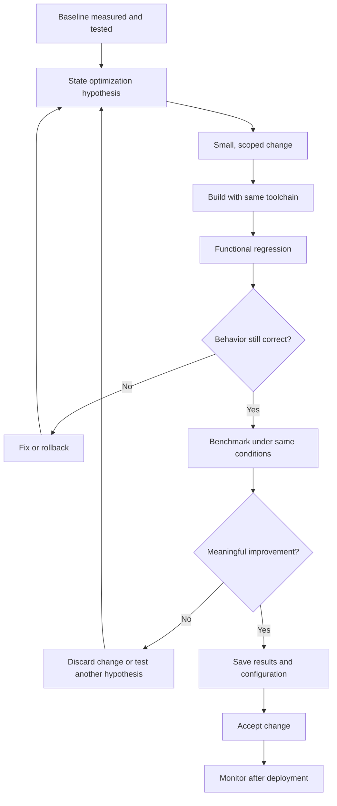
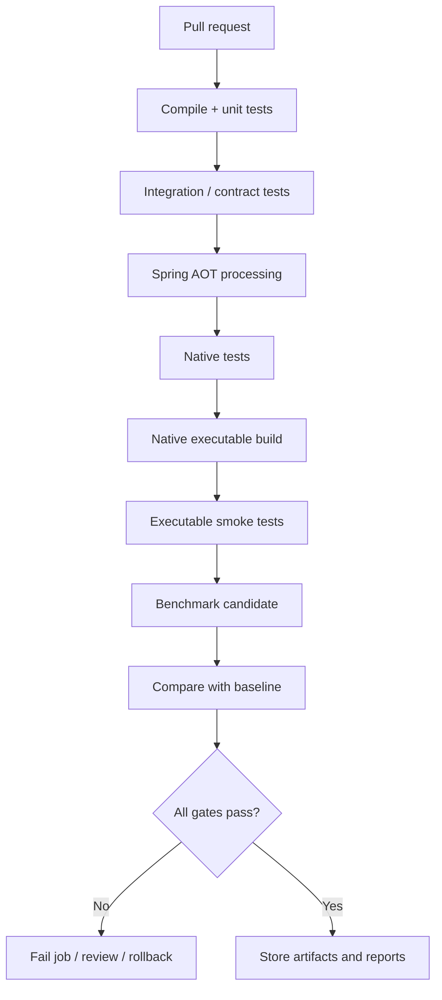

# Re-Measuring and Running Functional Regression After Every Optimization Change

Optimizing a Spring Boot Native Image is meaningful only when results are measured under identical conditions and the application preserves its exact behavior. A change that speeds up startup yet breaks JSON responses, drops a resource, alters transaction boundaries, or fails on a rare code path is not a shippable optimization.

After every change, two independent questions must be answered:

1. **Did performance actually improve?** Re-measure the exact metric targeted by the change using a comparable baseline, workload, and environment.
2. **Is functionality still correct?** Run regression tests across affected business flows, edge cases, and dynamic access paths.

This lesson belongs to the **Optimization** chapter of the `SPRING_BOOT_NATIVE_IMAGE` module. We will build an optimization loop grounded in hypotheses, baselines, controlled changes, repeated benchmarks, functional regression, acceptance criteria, and rollback procedures. The examples apply to optimizing startup, memory, throughput, Runtime Hints, resources, class initialization, caching, and native build configuration.

## 1. The Optimization Loop Must Have Two Verification Gates

Never judge a change by a gut feeling that the application "feels faster." Every change must clear both a functional gate and a performance gate.



These two gates do not substitute for one another:

- Passing tests does not prove performance improved.
- A good benchmark does not prove behavior remains intact.
- A successful native build proves neither.
- A fast startup number does not compensate for a regression on a less-called endpoint.

Accept an optimization only when the behavioral contract remains intact and measurements meet the defined objective.

## 2. Establishing a Baseline Before Editing

A baseline is the reference point of the current version. Save both configuration and results, not just a single number pasted into a ticket.

A useful baseline includes:

| Group | Details to Record |
| --- | --- |
| Source | Git commit, working tree status, applied patches |
| Framework | Spring Boot, Spring Framework, GraalVM, Native Build Tools |
| Build | Maven/Gradle version, build profile, `native-image` options |
| Runtime | JVM flags or native runtime arguments |
| Host | OS, kernel, CPU model, architecture, memory |
| Container | Base image, CPU/memory limits, UID, environment |
| Workload | Endpoint, method, payload, dataset, concurrency |
| External services | Database/cache/API versions, network path |
| Correctness | Test suite, test report, native smoke test |
| Performance | Startup-to-ready, first request, p50/p95/p99, throughput, RSS, CPU |
| Repetition | Run count, warm-up, measurement duration, raw samples |

Example result directory layout:

```text
benchmark/
├── baseline/
│   ├── metadata.json
│   ├── startup-runs.csv
│   ├── latency.csv
│   ├── memory.csv
│   └── test-report/
└── candidate/
    ├── metadata.json
    ├── startup-runs.csv
    ├── latency.csv
    ├── memory.csv
    └── test-report/
```

The path layout above is an illustrative organizational convention. Artifacts can live in CI or a dedicated benchmarking system, provided commit, toolchain, and raw measurements remain traceable.

### 2.1. The Baseline Must Represent a Shippable Version

Do not take a baseline from a broken build, a debug build, or a run with a heavy profiler attached if production does not run with those settings. If measuring an unstable branch, document that explicitly.

Before starting:

- Run functional tests on the JVM.
- Run existing native tests or native smoke tests.
- Build the native executable from the baseline commit.
- Confirm the endpoints and dataset used for benchmarking.
- Record resource limits and external dependencies.
- Save raw data across multiple runs.

If the baseline already has functional bugs, do not use it as a baseline for accepting regressions. Fix or document known failures before evaluating new optimizations.

## 3. Writing a Testable Hypothesis

An optimization proposal should state the cause, the change, and the expected impacted metric.

Hypothesis template:

> Under [workload/condition], [current cause] increases [metric]. Replacing [mechanism A] with [mechanism B] will improve [target metric] while keeping [required behavior] unchanged.

Examples:

| Planned Change | Hypothesis | Primary Metric | Priority Regressions to Check |
| --- | --- | --- | --- |
| Lazy-initialize a rarely used bean | Skipping bean creation at startup will reduce startup-to-ready | Startup-to-ready | First endpoint using the bean, init errors, thread safety |
| Narrow Runtime Hints | Dropping redundant metadata can reduce image/build footprint | Image size, build time | Reflection, serialization, proxies on real branches |
| Narrow resource patterns | Packaging fewer resources will shrink image size | Image size | Templates, schemas, message bundles, included files |
| Change cache strategy | Reducing repeated queries will lower latency under load | p95, throughput | Cache invalidation, stale data, tenant isolation |
| Optimize query/database access | Fewer round trips will cut server processing time | p95, DB calls | Transactions, ordering, pagination, consistency |
| Adjust class initialization | Avoiding early init of unneeded components can speed up startup | Startup-to-ready | Static state, environment-dependent initialization |
| Enable PGO | A representative profile can improve compiled hot code | Throughput, latency | Behavior must stay identical; verify profile does not skew workload |
| Change GC/runtime options | New settings may reduce pauses or footprint | RSS, GC pauses, p99 | Allocation pressure, OOM, throughput |

A hypothesis must include a failure criterion. If the change fails to improve the target metric or introduces a regression, revert to the baseline and record the outcome instead of keeping the change just because effort was invested.

## 4. Changing One Cause Group at a Time

If you change lazy initialization, GC, caching, Runtime Hints, and logging all at once, it becomes nearly impossible to tell which factor drove the outcome.

Safe workflow:

1. Pick one measured or observed bottleneck.
2. Make one small change.
3. Run appropriate tests.
4. Rebuild the artifact.
5. Measure the exact target metric.
6. Compare against the baseline.
7. Accept, adjust, or roll back.
8. Move on to the next hypothesis.

Group multiple changes only when they strictly depend on each other and are tracked as one unit. Even then, measure parts individually if possible to understand each change's contribution.

Never alter the benchmark workload between baseline and candidate. If the workload changes, establish a new baseline or re-run both versions under the new workload.

## 5. Choosing Metrics by Optimization Type

A change must be judged by metrics directly tied to its goal.

| Goal | Primary Metric | Guardrail Metrics |
| --- | --- | --- |
| Reduce cold start | Startup-to-ready, startup-to-first-response | First request, error rate |
| Reduce first-request latency | First-request p50/p95, server timer | Startup, steady p95 |
| Increase throughput | Requests/second | p95/p99, CPU, error rate |
| Reduce tail latency | p95/p99 | Throughput, error rate |
| Reduce memory | RSS, peak RSS, container memory | GC behavior, latency, OOM |
| Reduce executable/image size | Binary size, container image size | Startup, dependency/resource availability |
| Reduce native build time | Build duration, peak build memory | Runtime performance, correctness |
| Reduce resource metadata | Image size/build diagnostics | Resource lookup and reflection behavior |

Never declare an optimization successful when the target metric improves nicely yet a guardrail metric regresses past its threshold. For instance, lower p50 paired with a sharp p99 spike can worsen user experience.

### 5.1. Set Acceptance Thresholds Before Running

Thresholds should reflect SLAs/SLOs, benchmark noise, and operational cost. Illustrative example:

- Startup-to-ready drops by at least 10%.
- Steady-state p95 increases by no more than 3%.
- Error rate does not increase.
- Peak RSS stays within the container memory budget.
- All functional/native regression tests pass.

These numbers are not universal standards. Set thresholds based on your product and actual baseline. For noisy metrics, use multiple runs and variance bounds instead of concluding from a single measurement.

## 6. Measuring Baseline and Candidate Under Identical Conditions

For a valid comparison, hold constant:

- Same source commit except for the evaluated patch.
- Same JDK/GraalVM, Spring Boot, Gradle/Maven, and dependency versions.
- Same OS/CPU architecture and host class.
- Same CPU/memory quota, base container image, and runtime UID.
- Same database/cache/API and dataset.
- Same request payloads, concurrency, and duration.
- Same logging, metrics, tracing, and security settings.
- Same warm-up and iteration count.

Run baseline and candidate sequentially so two benchmarks never compete for CPU/RAM on the same host. If using cloud runners with variable resources, record the runner class and run enough iterations to detect noise.

### 6.1. Clean Builds When Changes Affect AOT/Native Output

When changing Runtime Hints, resource configuration, class initialization, or `native-image` options, make sure the artifact is built from fresh inputs. Incremental builds can be valid, yet when investigating unexpected results, run a controlled clean build:

```bash
./gradlew clean test
./gradlew processAot
./gradlew nativeCompile
```

With Maven, exact tasks/profiles depend on configured plugins:

```bash
./mvnw clean test
./mvnw spring-boot:process-aot
./mvnw -Pnative native:compile
```

These native commands are examples for projects configured with the corresponding Spring Boot/GraalVM Native Build Tools. Verify project tasks/plugins/profiles before putting them into CI. Do not run native compile if only checking a JVM unit test; choose gates matching change scope.

## 7. Functional Regression: What to Verify?

Functional regression means more than re-running unit tests. After each optimization, identify which behaviors could be affected.

Areas to examine:

| Behavior Area | Verification Examples |
| --- | --- |
| API contract | HTTP status, response schema, headers, content type |
| Validation | Valid/invalid input, boundary values |
| Business rules | Pricing, order states, authorization, workflows |
| Persistence | Transactions, rollbacks, query results, pagination |
| Serialization | JSON properties, enums, date/time, polymorphic subtypes |
| Reflection | Dynamically accessed constructors, methods, fields |
| Resources | Templates, schemas, message bundles, config files |
| Proxy/AOP | Transactions, security, caching, method interception |
| Concurrency | Race conditions, thread safety, duplicate processing |
| Error handling | Exception mapping, retries, timeouts, fallbacks |
| Security | Authentication, authorization, secret handling |
| Observability | Log fields, metrics, tracing context, correlation IDs |

Not every change requires running every test in this table. Select tests according to the dependency graph and impact scope, while always running the application's core smoke/contract suite.

## 8. Building a Regression Matrix Before Editing

A regression matrix maps each change to the behaviors that must be verified.

Example changing Runtime Hints for a Jackson-bound DTO:

| Change | Behavior at Risk | Mandatory Test |
| --- | --- | --- |
| Removed reflection hint on constructor | Deserializing DTO without default constructor | JSON integration test on native |
| Narrowed member category | Setter/field access breaks | Payload test covering all corresponding fields |
| Removed resource pattern | Schema or template not packaged | Resource read test on native |
| Changed proxy hint | Interface proxy fails to instantiate | Proxy invocation test on native |
| Changed class initialization | Static config read at the wrong time | Startup test across multiple environment values |

Creating the matrix beforehand prevents forgetting rarely invoked branches. After editing, update the matrix if the change uncovers a new dependency.

### 8.1. Layered Testing

| Layer | Objective | Examples |
| --- | --- | --- |
| Unit | Pure logic, fast | Pricing rules, mappers, validators |
| Slice | Partial Spring context | `WebMvcTest`, `DataJpaTest` |
| Integration | Multiple components working together | HTTP + DB, serialization |
| Contract | Preserve API/message/event contracts | JSON schemas, status codes, event fields |
| Native test | Catch Native Image differences | Reflection, resources, proxies |
| Executable smoke | Verify packaged binary | Startup, readiness, primary endpoints |
| Deployment smoke | Verify production-like environment | Container UID, volumes, env, network |

Fast JVM tests catch errors early. Native tests and executable smoke tests guard against differences introduced by AOT/native packaging.

## 9. Running Regression Tests on JVM and Native Image

A standard verification cycle typically includes:

**JVM tests:**

```bash
./gradlew test
```

**Spring AOT processing:**

```bash
./gradlew processAot
./gradlew processTestAot
```

**Native tests:**

```bash
./gradlew nativeTest
```

**Build and run the application executable:**

```bash
./gradlew nativeCompile
./gradlew nativeRun
```

With Maven, profiles and goals depend on project configuration:

```bash
./mvnw test
./mvnw spring-boot:process-aot
./mvnw -PnativeTest test
./mvnw -Pnative native:compile
```

Do not assume every project uses the same profile names or task graph. Check plugin versions and available build commands. Crucially, the regression suite must run against the actual native artifact whenever a change can affect native behavior.

## 10. Example: Optimizing Resource Hints While Preserving Behavior

Suppose an application reads two templates:

- `templates/invoice.html` for the invoice generation endpoint.
- `templates/statement.html` for the statement endpoint.

Initially the registrar registers a broad pattern:

```java
hints.resources().registerPattern("templates/.*");
```

After measuring image size, the team wants to restrict resources to only the files used:

```java
hints.resources().registerPattern("templates/invoice.html");
hints.resources().registerPattern("templates/statement.html");
```

This can reduce redundant metadata/resources, yet you must verify:

1. Are both resources actually found inside the native image?
2. Were any included templates or fragments left out?
3. Do locales/profiles select other templates?
4. Do error pages or email templates share the same pattern?
5. Are resources loaded via dynamic names from a database/config?

Regression tests must invoke both rendering flows on the native executable. Testing only the registrar predicate does not prove the templates exist with the right content.

If a template is used only in a rare profile, add a test scenario for that profile or document clearly which artifact does not support that profile. Do not drop a resource merely because the main benchmark never hits it.

## 11. Example: Lazy Initialization and First-Request Regression

A heavy bean may be switched to lazy initialization to reduce startup time:

```java
@Service
class ReportService {
    ReportService(ExpensiveReportCatalog catalog) {
        // Initialize report data/metadata.
    }
}
```

When using a lazy bean:

```java
@Service
@Lazy
class ReportService {
    ReportService(ExpensiveReportCatalog catalog) {
        // Initialize report data/metadata when the bean is requested.
    }
}
```

This change can shrink startup-to-ready while shifting cost to the first request that touches `ReportService`. Therefore, measure together:

- Startup-to-ready.
- First request to an endpoint not using `ReportService`.
- First request to an endpoint using `ReportService`.
- Subsequent requests to the report endpoint.
- Concurrent first accesses to check initialization contention.

If production runs a warm-up job calling the report service before readiness goes `UP`, the benchmark must preserve that exact behavior. Otherwise, startup and first-request numbers will not reflect reality.

## 12. Example: Cache Optimization and Data Regression

Caching can cut latency and database load, yet also introduces risks of stale data, faulty invalidation, and cross-tenant data leaks.

When changing caching policy, tests must cover:

- Cache miss and cache hit.
- Updates/deletes and invalidation.
- TTL expiration.
- Concurrent requests for the same key.
- Two tenants sharing the same business key with distinct data.
- Database errors or cache unavailability.
- Process restarts and cold caches.
- Memory pressure as the cache grows.

Benchmarks should record hit ratio, evictions, heap/RSS, and p95/p99. A cache that improves p50 while driving memory to a container OOM is not an overall improvement.

## 13. Example: Changing Class Initialization

Native Image can perform certain class initializations at build time or runtime. Shifting initialization timing can affect startup, yet can also change when environment variables, timezones, locales, files, or random seeds are read.

When adjusting initialization:

- Check whether the class relies on environment-specific values.
- Avoid accidentally freezing secrets, endpoints, or file paths from the build machine.
- Test across multiple runtime configurations.
- Test across different timezones/locales if the code depends on them.
- Inspect static caches and singleton state.
- Run the native executable inside a container matching production environment settings.

If a value must be read per deployment, ensure it is read at runtime. Never move initialization to build time just to shave startup without verifying environment correctness.

## 14. Re-Measuring the Right Metrics with Enough Runs

Once functional regression passes, run the candidate benchmark under the exact baseline protocol.

For cold start:

- Fully stop the process between runs.
- Repeat across multiple independent runs.
- Wait for the exact same readiness signal.
- Send the exact same first business request.
- Save raw startup/first-request samples.

For steady state:

- Use the same warm-up policy.
- Same concurrency and request mix.
- Measure long enough for reliable percentiles.
- Report p50/p95/p99, throughput, and error rate.

For memory:

- Distinguish RSS, heap, and container memory.
- Measure both peak and steady state.
- Keep traffic profile and duration identical.
- Record memory limits and OOM events.

Never report a single fastest run as the result. Compare medians and spread, and check whether outliers have an identifiable cause.

## 15. Evaluating Meaningful Improvement vs. Noise

Suppose baseline and candidate produce:

| Metric | Baseline | Candidate | Notes |
| --- | ---: | ---: | --- |
| Startup-to-ready | 480 ms | 430 ms | 10.4% improvement |
| First-request p95 | 190 ms | 235 ms | 23.7% regression |
| Steady p95 | 42 ms | 40 ms | Slight improvement |
| Peak RSS | 180 MB | 176 MB | Slight reduction |
| Error rate | 0% | 0% | Unchanged |

The candidate cut startup yet slowed the first request substantially. If the target is scale-to-zero, this may be an unacceptable trade-off. If the bean initializes during warm-up before receiving traffic, re-measure with the real startup policy.

Percentage change formula:

\[
\text{Change \%} = \frac{\text{Candidate} - \text{Baseline}}{\text{Baseline}} \times 100
\]

Negative numbers indicate the metric decreased. For latency and memory, lower is usually better; for throughput, higher is usually better. Always state each metric's good/bad direction to avoid misinterpretation.

Do not apply a single percentage threshold across all metrics. A 2% improvement can be meaningful on a large, stable workload, or pure noise in a high-variance benchmark.

## 16. Acceptance Criteria and Rollback

Before starting, define the criteria:

| Gate | Acceptance Condition |
| --- | --- |
| Correctness | Relevant unit/integration/contract tests pass |
| Native compatibility | Native tests or executable smoke tests pass |
| Performance target | Target metric improves past the agreed threshold |
| Guardrail | No regression beyond thresholds in p95/p99, memory, throughput, or error rate |
| Reproducibility | Results are repeatable and build metadata is complete |
| Operability | Logs, metrics, health checks, and rollback path remain functional |

Roll back when:

- A functional regression cannot be fixed within the change's scope.
- The native executable works only in an environment other than the target.
- The target metric fails to improve after accounting for noise.
- A guardrail metric breaches its threshold.
- Memory/CPU trade-offs introduce operational risk.
- The change makes builds or deployments hard to reproduce.

Preserve the baseline commit/patch for straightforward reverting. Never keep an optimization simply because it improves one number while breaking behavior or inflating costs somewhere more important.

## 17. Automating Regression and Benchmarks in CI

A pipeline can be split into gates:



Not every pull request needs a long benchmark. You can:

- Run unit/integration tests on every pull request.
- Run AOT/native tests when changes can affect native compatibility.
- Run a short benchmark for performance-related changes.
- Run full benchmarks on dedicated runners or nightly.
- Run executable/container smoke tests before release.

CI benchmarks require runners with stable resources. If runners share CPUs across jobs, do not auto-fail a change from a single minor p95 uptick. Use thresholds with hysteresis or require multiple confirmations when variance is high.

### 17.1. Archiving Reports Tied to Commits

Each candidate should archive:

- Commit and patch/PR identifier.
- Baseline commit.
- Build toolchain and `native-image` arguments.
- Test reports and native executable artifact identifier.
- Benchmark workload/configuration.
- Raw samples and summary.
- Gate pass/fail outcomes and rationale.
- Accept/rollback decision.

Never write credentials or sensitive production data into reports.

## 18. Post-Deployment Monitoring

CI benchmarks cannot represent every production condition. After deploying, continue monitoring:

- Startup/readiness duration during instance restarts or scale-out.
- First-request latency after deploy or scale-to-zero.
- p50/p95/p99 and throughput under real traffic.
- CPU, RSS, container memory, and OOM events.
- Error rates, timeouts, and retries.
- Database pool/cache hit ratios.
- Logs/traces for modified code paths.

Compare canary or staged rollouts against the baseline over matching time windows and traffic mixes. When possible, retain enough traffic share for valid comparison without creating two cohorts with starkly different workloads.

An optimization can shine in synthetic benchmarks yet degrade under real traffic due to differing payloads, tenant distributions, cache hit ratios, or downstream service behavior.

## 19. Common Mistakes When Optimizing Without Full Regression

| Mistake | Consequence | Fix |
| --- | --- | --- |
| Measuring once before/after | Results dominated by noise | Repeat multiple times and archive raw samples |
| Changing multiple mechanisms at once | Impossible to tell what helped or regressed | Split changes by hypothesis |
| Running only unit tests | Misses context, reflection, resource, or native issues | Run scoped integration/native tests |
| Relying on native build success alone | Misses runtime failures on rare paths | Run native executable smoke/integration tests |
| Looking only at startup | May shift cost onto the first request | Measure startup and first request separately |
| Looking only at p50 | Masks tail latency | Report p95/p99 and error rate |
| Over-narrowing Runtime Hints | Reflection/serialization/proxy failures | Regression-test affected targets/members |
| Dropping broad resource patterns blindly | Missing templates/schemas/locales | Test every critical resource path |
| Lazy-initializing every bean | Fast startup yet slow first request or contention | Measure first-use and concurrent access |
| Moving class init to build time | Freezes environment-specific state | Test across environments and init timings |
| Caching without testing invalidation | Returns stale data or leaks across tenants | Test TTL, updates, isolation, and concurrency |
| Not saving build metadata | Results cannot be reproduced | Version-track toolchain/options and raw data |

## 20. Post-Optimization Checklist

- [ ] Have a baseline from a known artifact and commit.
- [ ] Have a hypothesis stating cause, target metric, and preserved behavior.
- [ ] Change is tightly scoped and documented.
- [ ] Workload and measurement environment match between baseline and candidate.
- [ ] Relevant unit/integration/contract tests pass.
- [ ] Native tests run if changes can affect AOT/reachability/runtime.
- [ ] Native executable smoke tests run when the main artifact or packaging is affected.
- [ ] Re-measured exact target and guardrail metrics.
- [ ] Collected multiple runs and raw samples.
- [ ] Evaluated p50/p95/p99, throughput, error rate, and memory appropriately.
- [ ] Zero functional regressions or native-only errors.
- [ ] Compared results against pre-set thresholds.
- [ ] Archived reports, toolchain, options, and commit.
- [ ] Clear accept, adjust, or rollback decision recorded.
- [ ] Post-deployment monitoring plan in place.

### Self-Check Questions

1. Why are both a functional regression gate and a performance measurement gate necessary?
2. What elements must a solid optimization hypothesis state?
3. Why does changing multiple mechanisms in a single patch obscure root causes?
4. When narrowing Runtime Hints, which behaviors must be verified?
5. Which metric can lazy initialization improve, and which metric can it worsen?
6. Why can changing class initialization break environment-specific configuration?
7. Which conditions must stay identical between baseline and candidate?
8. Why can lower p50 with higher p99 still be a regression?
9. When are native tests needed versus smoke tests on the application executable?
10. Under what conditions should a team roll back an optimization?

## References

- [Spring Boot — GraalVM Native Images](https://docs.spring.io/spring-boot/reference/packaging/native-image/): build process and native compatibility issues.
- [Spring Framework — Ahead-of-Time Optimizations](https://docs.spring.io/spring-framework/reference/core/aot.html): Spring AOT, Runtime Hints, and runtime constraints.
- [GraalVM Native Image — Build Configuration](https://www.graalvm.org/latest/reference-manual/native-image/overview/BuildConfiguration/): native build configuration and options.
- [GraalVM Native Image — Profile-Guided Optimization](https://www.graalvm.org/latest/reference-manual/native-image/optimizations-and-performance/PGO/): using profiles to optimize native executables.
- [Micrometer — Histograms and Percentiles](https://docs.micrometer.io/micrometer/reference/concepts/histogram-quantiles.html): latency distributions, histograms, and percentiles.
- [k6 — Test lifecycle](https://grafana.com/docs/k6/latest/using-k6/test-lifecycle/): setup, warm-up, and measurement lifecycle.

**Desired outcome:** after every optimization change, you can prove the application preserves its behavioral contract, the native executable runs properly, and the target metric improves under reproducible measurement conditions. An optimization is accepted only when both functional regression and performance measurements satisfy pre-defined criteria.
