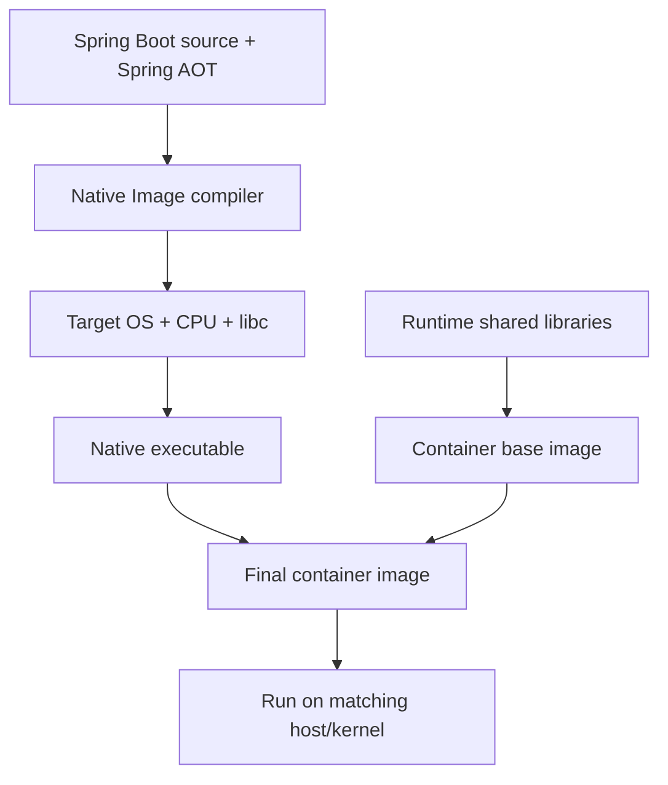

# Choosing a Runtime Base Image Based on libc and Required Binary Libraries

## 1. Why Does the Base Image Affect Native Image?

GraalVM Native Image builds a native executable for the target OS and CPU architecture of the build. This binary is not portable Java bytecode that can run in any container. It depends on the ABI, libc, dynamic loader, and shared libraries that the compiler/linker linked against or that the binary must load at runtime.

Therefore, choosing the container base image is part of build and release design. An executable built on Linux with glibc may not run directly on an image that provides only musl; a binary built for amd64 cannot run as an arm64 binary; and a shared library present in the builder but absent from the runtime image can also cause failures at process startup or when the corresponding feature is invoked.

In the **SPRING_BOOT_NATIVE_IMAGE** module, you need to align three things properly: the native executable's target, the required runtime libraries, and the deployment base image. The smallest image is not always the right choice if it lacks libc, CA certificates, timezone data, or system libraries the application needs.



## 2. Distinguishing libc, ABI, and Shared Libraries

**libc** is the C runtime library providing core functions that many native programs rely on. On Linux, the two common families are glibc and musl.

**ABI (Application Binary Interface)** defines binary conventions such as calling conventions, symbols, data layouts, dynamic linking, and how programs interact with libraries and the OS. Both being Linux does not mean all binaries are compatible with one another.

**Shared library** is a native library dynamically loaded when a process runs, typically `.so` files on Linux. An executable may require libc, libstdc++, libgcc, SSL/crypto libraries, or vendor libraries depending on the build and dependencies.

| Concept | Role | Question to Check |
|---|---|---|
| OS/target | Environment the binary is built for | Linux, Windows, or macOS? |
| CPU architecture | Instruction set and binary format | amd64/x86_64 or arm64/aarch64? |
| libc | C runtime and dynamic linking | glibc or musl? |
| ABI | Binary compatibility | Do the compiler/linker and libraries share the same ABI? |
| Dynamic loader | Loads executable/shared libraries | Does the loader path exist in the image? |
| Shared libraries | Native dependencies at runtime | Are all required libraries in the final image? |

## 3. glibc and musl

**glibc** is the GNU C Library, widely used across many Linux distributions such as Debian, Ubuntu, and enterprise Linux systems. It has a broad package and debugging ecosystem and is the standard choice for binaries built in glibc environments.

**musl** is a lightweight libc commonly used in Alpine Linux. Alpine images are small, but a binary built for glibc does not automatically run on musl. Some binaries require the glibc dynamic loader or glibc symbols/versions that Alpine does not provide.

Do not assume glibc is always better or musl is always smaller in every scenario. The choice depends on the build target, drivers/native dependencies, security policy, image size, and vendor support.

| Characteristic | glibc-Based Image | musl-Based Image |
|---|---|---|
| Example distributions | Debian, Ubuntu, UBI | Alpine |
| libc | glibc | musl |
| Binary compatibility | For binaries built targeting glibc/ABI | For binaries built targeting musl/ABI |
| Package ecosystem | Broad, common on servers | Compact, Alpine-packaged |
| Risk when switching base | Missing shared library/version | glibc binary will not run directly without a compatibility layer |
| Best fit | Native executables built targeting glibc | Executables built targeting musl with supported dependencies |

## 4. Choosing a Base Image by Target Binary

Before choosing an image, determine what target the executable was built for:

- Linux amd64 or arm64.
- glibc or musl.
- Dynamic or static linking (if supported by the toolchain and dependencies).
- Whether native libraries beyond libc are required.
- Whether a CA bundle, timezone database, or fonts are required.

If building a Linux x86_64 binary dynamically linked against glibc, use a runtime image with compatible glibc. Debian slim or Ubuntu minimal of the same architecture is usually an easy-to-manage starting point.

If you want to use Alpine, you must build a musl-compatible native executable according to the GraalVM/toolchain guide for your version and verify every native dependency. Simply changing the Dockerfile from Debian to Alpine does not convert the ABI of an already built binary.

## 5. Dynamic Linking and Static Linking

With dynamic linking, the executable references shared libraries loaded when the process runs. The runtime image must include those libraries and the appropriate dynamic loader.

With static linking, certain libraries are linked into the executable, reducing reliance on those shared libraries. However, static linking does not automatically remove every runtime dependency: the application may still need DNS/NSS behavior, CA certificates, timezone data, filesystem files, or libraries loaded dynamically via JNI.

Native Image can produce binaries with different linking options depending on the target and toolchain. Static linking support—especially with musl—depends on the GraalVM distribution, native toolchain, and dependencies. Do not assume that adding a single flag statically links every library.

| Mode | Advantages | Considerations |
|---|---|---|
| Dynamic | Runtime image can share system libraries; easier package updates | Must provide the right loader and shared libraries |
| Static | Reduces some runtime dependencies and simplifies the image | Binary may be larger; some libraries/behaviors still need runtime files |
| Mixed | Some components static, some dynamic | Must verify exact actual dependencies |

## 6. Inspecting a Binary on Linux

Use tools from the target environment to inspect the binary:

```bash
file api-app
readelf -h api-app
readelf -l api-app
readelf -d api-app
```

These commands show the ELF class and machine architecture, program interpreter/dynamic loader, dynamic section, and shared library dependencies.

View dynamic libraries:

```bash
ldd api-app
```

Run commands only on trusted binaries in an appropriate test environment. For cross-compiled binaries or when the loader is missing, ldd may not behave as expected; readelf inspects ELF metadata without executing the binary.

If the runtime image does not include ldd, inspect the binary in the builder/debug stage or use the distribution's equivalent tools. Do not install heavy toolchains into the final image solely for routine debugging.

## 7. Checking the Dynamic Loader

An ELF binary can specify an interpreter, such as the path to the glibc dynamic loader. If that path does not exist inside the container, the shell may report an error like “No such file or directory” even though the executable file exists.

Run:

```bash
readelf -l api-app | grep interpreter
```

Compare the interpreter path against the runtime image filesystem. musl and glibc binaries can require different loader paths. Do not create a fake symlink to a different libc's loader to bypass the error; the two libcs are not safely binary-interchangeable.

## 8. Checking Shared Libraries in the Final Image

Check not only the executable itself, but also JNI/native dependencies. A JDBC driver is usually Java bytecode, whereas some authentication providers, crypto providers, compression libraries, or clients may use JNI/native code.

Required libraries and data may include:

- libc and the dynamic loader.
- libstdc++/libgcc if the binary or dependencies require them.
- OpenSSL or crypto libraries if dependencies link dynamically.
- CA certificates for TLS.
- timezone database if the application needs time zones beyond built-in runtime data.
- fontconfig/fonts if PDF/image processing needs system fonts.
- vendor libraries or native clients loaded via JNI.

Do not install every package in this list blindly. Use binary inspection, vendor documentation, and integration tests to identify actual dependencies.

## 9. Debian Slim as a Runtime Image

Debian slim is often a convenient choice when the executable is built for glibc. Example Dockerfile:

```dockerfile
FROM debian:bookworm-slim
WORKDIR /app

RUN apt-get update \
    && apt-get install -y --no-install-recommends ca-certificates \
    && rm -rf /var/lib/apt/lists/*

COPY build/native/nativeCompile/api-app /app/api-app

USER 10001
EXPOSE 8080
ENTRYPOINT ["/app/api-app"]
```

This is an illustrative example. Choose a Debian release matching your security/support requirements and the binary's glibc version. Install needed runtime packages, keep the image updated, and pin digests in your pipeline if reproducibility is required.

If the application makes HTTPS or TLS database calls, an appropriate trust store is required and TLS endpoints must be tested in the final image.

## 10. Alpine as a Runtime Image

Alpine uses musl. Illustrative Dockerfile:

```dockerfile
FROM alpine:3.XX
WORKDIR /app
COPY build/native/nativeCompile/api-app /app/api-app
USER 10001
EXPOSE 8080
ENTRYPOINT ["/app/api-app"]
```

The version placeholder must be replaced with an organization-supported Alpine release. This Dockerfile is only suitable if the executable is built to be musl-compatible and all required shared libraries/runtime files are present.

If the executable was built for glibc, copying it into Alpine typically results in loader/library errors. Installing a glibc compatibility package is not a default fix; verify vendor support and all dependencies, because compatibility layers do not guarantee that every symbol and behavior will match.

## 11. Distroless and Minimal Images

Distroless images omit the shell, package manager, and many administrative tools from the runtime image. The benefit is fewer unnecessary components and a smaller attack surface.

However, minimal images make direct debugging harder. Verify that:

- The required libc and dynamic loader are present.
- All shared libraries needed by the executable are present.
- CA certificates/timezone/fonts are present if features require them.
- User/group and filesystem permissions are correct.
- Entrypoint and signal handling work properly.
- Health checks do not depend on a shell if the image has no shell.

Test the executable in a debug stage or equivalent image before switching to distroless. Do not assume distroless contains every library just because the image is small or commonly used for Java.

## 12. Multi-Stage Builds: Builder and Runtime Do Not Have to Share the Same Image

A multi-stage build typically uses a full image/toolchain to compile and a minimal image to run. The two stages can differ, provided the runtime satisfies the ABI and shared library requirements of the binary built in the builder.

General example:

```dockerfile
FROM ghcr.io/graalvm/native-image-community:VERSION AS builder
WORKDIR /workspace
COPY . .
RUN ./gradlew nativeCompile

FROM debian:bookworm-slim AS runtime
WORKDIR /app
COPY --from=builder /workspace/build/native/nativeCompile/api-app /app/api-app
USER 10001
EXPOSE 8080
ENTRYPOINT ["/app/api-app"]
```

Replace VERSION with a specific image tag and verify that the builder supports the right GraalVM Native Image version. If the builder produces a glibc binary, a compatible Debian glibc runtime is usually easy to pair. If targeting musl, choose a supported musl toolchain/build image and the corresponding musl runtime.

Do not copy the entire build directory into the final image. Copy only the application executable and identified runtime files.

## 13. Matching the Build Target Architecture to the Runtime

amd64 and arm64 binaries use different instruction sets. An amd64 executable will not run directly on an arm64 host without appropriate emulation; emulation is not a default production strategy.

With Docker Buildx, you can build multi-platform images, but native compilation requires a compiler/toolchain for each target or a supported cross-compilation mechanism. Not every Native Image toolchain cross-compiles conveniently from another host architecture.

A reliable workflow is to build the binary for each target platform on an appropriate runner, then package a multi-arch manifest. Verify the ELF machine type and run smoke tests on a runner/host of the target architecture.

## 14. CA Certificates, Timezones, and Fonts

A binary can start successfully yet still fail on a specific feature due to missing system data:

- TLS clients reject certificates because the CA bundle is missing.
- Timezone formatting differs from expectations due to a missing timezone database or configuration.
- PDF/image rendering lacks system fonts.
- Locale behavior differs across images.
- DNS/NSS lookups do not behave as expected.

These components are not always shared libraries. Some are data files or runtime packages. Test the exact features that rely on them in the final image and install only the minimal packages needed.

For time zones, determine which zones the application needs and configure TZ/timezone data according to the runtime. For fonts, distribute licensed fonts matching product requirements; avoid installing an entire large font pack when only one family is needed.

## 15. JNI and Native Libraries from Dependencies

If a Java library calls JNI, the executable may require separate shared libraries. Verify:

- The JNI library is built for the right OS/architecture.
- The ABI/libc matches.
- Dynamic dependencies of the JNI library are also present in the image.
- Library load paths and read/execute permissions are correct.
- Runtime hints/JNI configuration are suitable for Native Image.
- The vendor supports Native Image for the exact version used.

Some libraries extract native binaries from a JAR into a temporary directory at runtime. In that case, the container needs a writable directory and an appropriate filesystem policy. If the root filesystem is read-only, mount a writable temp volume as required by the library.

## 16. Choosing an Image via a Compatibility Matrix

| Native Binary Target | Runtime Image | Condition |
|---|---|---|
| Linux amd64 + glibc | Debian/Ubuntu/UBI glibc | Compatible glibc and shared libraries |
| Linux arm64 + glibc | Debian/Ubuntu/UBI arm64 | Matching architecture and ABI |
| Linux amd64 + musl | Alpine amd64 | Binary and JNI dependencies built for musl |
| Linux arm64 + musl | Alpine arm64 | Toolchain/vendor supports the target |
| Static/mixed binary | Appropriate minimal image | Still verify runtime files and dynamic dependencies |

This is a general matrix. Actual image tags, libc versions, and packages must be pinned and tested per release. Do not draw conclusions solely from the distribution name.

## 17. Testing Workflow for the Final Runtime Image

After building the image, run tests on the final image, not just the builder stage:

1. Confirm the binary's target architecture and libc.
2. Inspect the dynamic loader and shared libraries.
3. Start the container with the production user.
4. Wait for the readiness endpoint.
5. Call business endpoints involving JSON, resources, databases, and TLS.
6. Test JNI/native features if the application uses them.
7. Verify volumes, temp directories, and filesystem permissions.
8. Send SIGTERM and confirm graceful shutdown.
9. Measure startup-to-ready time, RSS, and image size.
10. Record the image digest, binary hash, toolchain, and platform.

If there are multiple targets (amd64/arm64 or glibc/musl), run the pipeline for each target. Testing on one architecture does not verify the other.

## 18. Diagnosing Errors Caused by Base Image/libc

| Symptom | Possible Cause | Where to Check |
|---|---|---|
| Executable exists but shell reports not found | Dynamic loader path missing | readelf -l, check interpreter |
| Error loading shared library | Missing .so or wrong library path | ldd/readelf -d, package list |
| GLIBC_x.y not found | Runtime glibc is older than binary requires | Choose a compatible glibc base image or build for the right target |
| glibc binary does not run on Alpine | musl lacks required ABI/symbols | Build a musl target or use a glibc image |
| Exec format error | Wrong CPU architecture or binary format | file, ELF machine, image platform |
| TLS handshake fails | Missing CA/truststore or TLS config | Check CA bundle and driver config |
| PDF missing fonts | Final image lacks required fonts | Install required fonts and test rendering |
| JNI UnsatisfiedLinkError | Native library missing or wrong ABI | Check library and dependency chain |
| Fails only in distroless | Missing runtime file/permission or entrypoint | Compare filesystem, user, and loader |
| Runs locally but fails in container | Different libc, loader, library, or permissions | Reproduce in the final image |

Do not fix ABI errors by randomly copying a `.so` file from a developer machine into the image. Use packages compatible with the distribution and verify the dependency chain.

## 19. Securing and Updating Base Images

The base image is part of your supply chain. Manage it carefully:

- Pin versions or digests according to policy.
- Monitor distribution security updates.
- Rebuild images when libc, OpenSSL, or CA packages receive patches.
- Scan for CVEs and evaluate actual impact.
- Run the process as a non-root user.
- Keep the filesystem read-only when the application supports it.
- Minimize unnecessary packages and shells in runtime images.
- Store SBOMs/image digests and build provenance.

Do not keep an old base image simply because the binary used to run on it. Upgrading a base image requires re-running native/container tests because libc or shared library updates can affect behavior.

## 20. Checklist for Choosing a Runtime Base Image

- Identified the OS and CPU architecture of the native executable.
- Identified whether the binary targets glibc or musl.
- Dynamic loader path exists in the final image.
- Required shared libraries and JNI dependencies are present.
- Runtime libc version satisfies required symbols/versions.
- CA certificates, timezone data, locales, and fonts are provided when features need them.
- User, permissions, temp directory, and read-only filesystem settings are appropriate.
- Builder/runtime compatibility is documented.
- Native executable passes feature tests on the final image.
- Multi-architecture targets are built and tested separately.
- Base images are pinned, scanned, and updated per process.

## 21. Self-Check Questions

1. Why doesn't a Linux binary automatically run on every Linux container?
2. What is the difference between glibc and musl?
3. How do the ABI and dynamic loader affect a native executable?
4. How do you use readelf and ldd to inspect shared library dependencies?
5. Why doesn't adding a compatibility package to Alpine always fix a glibc binary?
6. When does static linking still require runtime files such as CA certificates or timezone data?
7. What requirements must be checked when using distroless?
8. Why cannot an amd64 binary be released as an arm64 binary?
9. What requirements can JNI dependencies introduce in the final image?
10. Which tests must be run on the exact runtime image to be released?

**Key Takeaway:** Choose the base image based on the native executable's target OS/architecture, libc, and actual shared libraries. Build specifically for glibc or musl, verify the loader/ABI/dependencies, add required runtime files, and run feature tests on the final container image before release.
