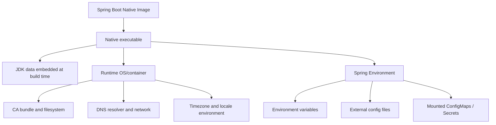

# CA Certificates, DNS, Timezone, Locale, and External Configuration Files

> **Chapter:** Container  
> **Module:** `SPRING_BOOT_NATIVE_IMAGE`  
> **Objective:** Prepare the container environment for Spring Boot Native Image; manage CA trust stores properly across build time and runtime; verify DNS and service discovery; configure timezone, locale, and charset; externalize configuration and secrets outside the executable; and verify settings on the actual runtime image.

## 1. Why Does the Container Environment Affect a Native Executable?

A native executable does not carry the entire operating system. It contains application code, the necessary runtime parts, and components included by Native Image in the binary. Data and services belonging to the deployment environment must still exist inside the container or be mounted at runtime.

Common issues after migrating an application from the JVM to a native container:

- HTTPS calls to internal APIs fail because the corporate proxy CA is not in the trust store used by the native executable.
- A database hostname resolves on the developer machine but fails to resolve inside a Docker network or Kubernetes namespace.
- Timestamps display incorrectly because the builder, container, and business timezones differ.
- Numbers, currencies, dates, or Vietnamese messages format incorrectly because locale data was not included in the native image.
- Unicode characters are corrupted when reading files, writing logs, or exchanging data with other processes because the default charset differs from the build environment.
- The application fails to pick up configuration after deployment because files outside the classpath were neither mounted nor imported.
- Secrets are baked into the executable or image, forcing rebuilds for credential rotation and exposing sensitive information.

Two groups of data must be distinguished:

1. **Data fixed when building the native image:** reachability metadata, certain JDK data initialized at build time, the default trust store captured by Native Image, and locale/charset data selected for inclusion in the image.
2. **Data supplied when running the container:** DNS resolver, environment variables, file mounts, secrets, timezone environment, explicitly configured runtime trust stores, and application configuration.

A configuration that works on the JVM does not automatically prove it will behave identically in a native executable. Test in the final runtime image using the same filesystem, user, network, and environment as production.

## 2. Four Layers to Distinguish When Configuring Containers



| Layer | Examples | When Decided |
|---|---|---|
| Native executable | Captured default trust store, included locale/charset data | Build time, unless a runtime override mechanism is supported |
| Runtime OS | `/etc/ssl/certs`, `/etc/resolv.conf`, `/etc/localtime`, zoneinfo | When creating/running the container |
| Spring Environment | `SPRING_DATASOURCE_URL`, `SPRING_CONFIG_IMPORT`, profiles | When Spring Boot starts |
| External files | CA trust stores, YAML, properties, secret files | Mounted before process start or reloaded per application mechanism |

Do not treat every file in the runtime image as a Native Image resource. A file mounted at `/etc/payment/application.yaml` is a filesystem file; Spring Boot can read it via `file:` or `configtree:` without declaring it as a classpath resource. Conversely, files read via `ClassPathResource` or `ClassLoader.getResource()` must be present in the artifact and may require reachability metadata.

## 3. CA Certificates, Certificate Chains, and Trust Stores

When an application opens an HTTPS connection, the client must verify the server certificate. Typically the server sends its certificate along with required intermediate certificates; the client builds a chain up to a trusted root CA while checking validity periods, key usage, and hostname.

A TLS error is not necessarily caused by Native Image lacking reflection metadata. Classify it first:

| Symptom | Investigation Direction |
|---|---|
| `PKIX path building failed` or `unable to find valid certification path` | Root/intermediate CA is untrusted or the server sent an incomplete chain |
| `No subject alternative DNS name matching ...` | The URL hostname does not match the certificate's SAN |
| `certificate expired` or `not yet valid` | Certificate expired or the container clock is skewed |
| `handshake_failure` | TLS protocol, cipher, client certificate, or security provider |
| `UnknownHostException` | DNS/name resolution, not CA trust |
| `Connection refused` or timeout | Port, route, firewall, service endpoint, or server |

A **trust store** contains the certificates a client accepts as trust anchors. Public CA certificates can be placed in the image or trust store. Private keys/client certificates used for mutual TLS are sensitive data and must be managed as secrets; never place private keys in the image build context.

Never disable hostname verification, use a trust-all trust manager, or skip chain validation as a “quick fix” for TLS errors. Install the proper CAs and fix the certificate chain/hostname on the issuing side.

## 4. Special Note: Native Image Captures the Default Trust Store at Build Time

This is a critical distinction when operating native executables.

According to the GraalVM documentation, by default the Native Image builder captures the build environment's default TrustStore and embeds its contents into the executable. This TrustStore is typically built from the JDK's root certificates file; a different trust store can be selected at build time via the `javax.net.ssl.trustStore` system property. When the executable runs, if none of the `javax.net.ssl.trustStore*` properties are set, it uses the trust store captured at build time. [GraalVM — Certificate Management in Native Image](https://www.graalvm.org/latest/reference-manual/native-image/dynamic-features/CertificateManagement/)

This leads to three scenarios:

| How the CA Is Installed | Impact |
|---|---|
| CA is only installed in the OS trust bundle of the final runtime image | OS tools like `curl` may trust the CA; does not automatically update the trust store embedded in the native executable |
| CA is added to the JDK trust store used by the Native Image builder before compilation | The CA can be captured into the executable's default trust store |
| CA is supplied via a trust store file and configured with `javax.net.ssl.trustStore*` at runtime | The native executable uses the runtime trust store if the file exists and is readable |

Therefore, merely copying `company-root-ca.crt` into `/usr/local/share/ca-certificates` in the final image and running `update-ca-certificates` may not suffice for HTTPS calls made by the Java native executable. Verify which trust store the native binary actually uses.

### 4.1. Choosing CA Strategy by Deployment Lifecycle

- If the CA is stable, managed alongside the toolchain, and safe to treat as non-sensitive in the binary, it can be added to the JDK trust store at build time.
- If each environment uses different CAs or CAs must rotate without rebuilding the binary, provide a separate trust store at runtime.
- If OS tools also need HTTPS access, the OS CA bundle still needs to be installed in the runtime image.
- If the application both makes Java HTTPS calls and invokes external native tools, you may need to manage both the JDK trust store and the OS CA bundle.

Do not embed staging or production environment CAs into a shared binary used across all environments if security policy forbids it.

### 4.2. Configuring a Runtime Trust Store

GraalVM supports switching the trust store at runtime using these system properties:

- `javax.net.ssl.trustStore`
- `javax.net.ssl.trustStoreType`
- `javax.net.ssl.trustStoreProvider`
- `javax.net.ssl.trustStorePassword`

If any property in this group is set when the executable runs, Native Image requires `javax.net.ssl.trustStore` to point to an accessible file. If the path does not exist or is unreadable, an `UnsupportedFeatureError` may occur. Unlike OpenJDK, Native Image does not fall back to the JDK's `cacerts` when a runtime path is invalid. [GraalVM — Runtime Trust Store Options](https://www.graalvm.org/latest/reference-manual/native-image/dynamic-features/CertificateManagement/)

Example mount layout:

```text
/run/certs/
  application-truststore.p12

/run/secrets/
  truststore-password
```

You can read the path/password from a secret and set system properties before initializing any HTTP client or the Spring context. Illustrative example:

```java
import java.nio.file.Files;
import java.nio.file.Path;

public final class RuntimeTrustStore {

    private RuntimeTrustStore() {
    }

    public static void configureFromEnvironment() throws Exception {
        String trustStorePath = System.getenv("APP_TRUST_STORE");
        String passwordFile = System.getenv("APP_TRUST_STORE_PASSWORD_FILE");

        if (trustStorePath == null || trustStorePath.isBlank()) {
            return; // Use the trust store captured at build time.
        }

        Path store = Path.of(trustStorePath);
        if (!Files.isRegularFile(store) || !Files.isReadable(store)) {
            throw new IllegalStateException(
                    "Configured trust store is missing or unreadable");
        }

        System.setProperty("javax.net.ssl.trustStore", store.toString());
        System.setProperty("javax.net.ssl.trustStoreType", "PKCS12");

        if (passwordFile != null && !passwordFile.isBlank()) {
            String password = Files.readString(Path.of(passwordFile)).trim();
            System.setProperty(
                    "javax.net.ssl.trustStorePassword", password);
        }
    }
}
```

Invoke this configuration very early, before any library creates the default `SSLContext` or initializes an HTTP client. Ensure the password file has restricted read permissions; never log the password and never pass passwords in a Dockerfile, image layer, or source control. If an HTTP client manages its own SSL context, configure the trust store for that client via the library's API.

Example calling it before creating the Spring context:

```java
public static void main(String[] args) throws Exception {
    RuntimeTrustStore.configureFromEnvironment();
    SpringApplication.run(PaymentApplication.class, args);
}
```

### 4.3. Creating a Trust Store and Verifying Certificates

You can use the JDK's `keytool` to import a verified root CA into a PKCS12 trust store:

```bash
keytool -importcert -noprompt \
  -alias company-root \
  -file company-root-ca.crt \
  -keystore application-truststore.p12 \
  -storetype PKCS12
```

The command prompts for a password if no password option is passed. Create the file in a controlled environment, verify the CA fingerprint through a trusted channel, and mount the trust store only into containers that need it.

You can inspect the contents of the trust store:

```bash
keytool -list -keystore application-truststore.p12 -storetype PKCS12
```

For HTTPS, check the certificate chain and hostname from the actual container/network path. For example, when the image includes `openssl`:

```bash
openssl s_client \
  -connect api.internal.example:443 \
  -servername api.internal.example \
  -verify_return_error
```

This is an OpenSSL TLS check and does not replace integration tests of the Java HTTP client or JDBC driver. The two components may use different trust stores.

## 5. Installing a CA into a Linux Container Image

For Debian/Ubuntu, Docker documents installing `ca-certificates`, copying `.crt` certificates into `/usr/local/share/ca-certificates/`, and running `update-ca-certificates`. Other distributions have their own packages, paths, and commands; do not apply Debian commands verbatim to Alpine, RHEL, or distroless. [Docker Docs — Use CA Certificates with Docker](https://docs.docker.com/engine/network/ca-certs/)

Example for a Debian runtime image:

```dockerfile
FROM debian:bookworm-slim

RUN apt-get update \
    && apt-get install -y --no-install-recommends ca-certificates tzdata \
    && rm -rf /var/lib/apt/lists/*

COPY docker/certs/company-root-ca.crt \
    /usr/local/share/ca-certificates/company-root-ca.crt

RUN update-ca-certificates

COPY --from=build /workspace/target/application \
    /app/application

ENV TZ=Asia/Ho_Chi_Minh
ENV LANG=C.UTF-8
ENV LC_ALL=C.UTF-8

USER 10001:10001
ENTRYPOINT ["/app/application"]
```

This illustrates the runtime stage; the `build` stage must be defined earlier and produce the executable at that exact path. If the application uses the embedded trust store, copying the certificate in this step updates only the OS bundle; either add the CA to the builder JDK trust store or configure a runtime trust store as shown earlier.

Minimal/distroless images may lack a shell, package manager, or `update-ca-certificates`. Prepare the CA bundle in a stage that has the tools, then copy the generated bundle to the exact path used by the runtime base image. Check the base image documentation instead of assuming every Linux image uses the same trust store path.

## 6. DNS and Service Discovery in Containers

A native application uses the runtime environment's resolver to resolve hostnames. Native compilation does not turn a database hostname into a fixed IP. Configure endpoints by service name and test DNS within the container's network namespace.

### 6.1. Docker Networks

Docker has two notable resolver configurations:

- Containers on the default bridge receive a copy of the host's resolver configuration in `/etc/resolv.conf`.
- Containers on a user-defined network use Docker's embedded DNS server at `127.0.0.11`. This resolver forwards external queries to the DNS servers configured on the host.

Containers can reach each other by service/container name on a user-defined network. With Docker Compose, services on the same network can connect by service name:

```yaml
services:
  payment-api:
    image: example/payment-api:native
    networks:
      - backend

  postgres:
    image: postgres:17
    networks:
      - backend

networks:
  backend:
```

Database URL inside the container:

```text
jdbc:postgresql://postgres:5432/payments
```

Do not use `localhost` to point to another container. Inside a container, `localhost` and `127.0.0.1` always refer to that container itself. If the database runs on the host, use the platform's host gateway mechanism or a host address provided by an administrator.

Docker can also configure an explicit DNS server with `--dns`. Specify an internal DNS server only when the network actually allows the container to reach that address; never copy a host loopback resolver address into a container. [Docker Docs — Networking Overview](https://docs.docker.com/engine/network/)

### 6.2. Kubernetes Service DNS

In Kubernetes, a Service is normally resolved by name within its namespace. A service named `postgres` in the `database` namespace typically has the FQDN:

```text
postgres.database.svc.cluster.local
```

The cluster domain can be customized, so use the DNS name published by the platform. Pods in the same namespace can normally use the short service name:

```text
jdbc:postgresql://postgres:5432/payments
```

Kubernetes creates DNS records for Services and configures Pods to use cluster DNS. Do not hardcode a ClusterIP because that address can change if the service is recreated. [Kubernetes Docs — DNS for Services and Pods](https://kubernetes.io/docs/concepts/services-networking/dns-pod-service/)

### 6.3. Diagnosing DNS from the Right Network Namespace

If the image includes a shell and standard utilities:

```bash
cat /etc/resolv.conf
getent hosts postgres
getent hosts api.internal.example
```

If `getent`, `nslookup`, or a shell is unavailable in a distroless image, use a debug/ephemeral container or a diagnostic image attached to the same network. Do not install debugging tools into a production image just for ad-hoc checks.

Distinguish the outcomes:

- DNS lookup fails: check the resolver, search domains, network policy, and DNS service.
- DNS succeeds but TCP times out: check routes, firewalls, NetworkPolicy, and endpoints.
- TCP connects but TLS fails: check CAs, certificate chain, hostname, and clock.
- TLS succeeds but HTTP fails: check authentication, paths, proxies, and application protocol.

Avoid hardcoding static IPs in application properties to mask DNS failures. Fix service discovery or the resolver instead.

## 7. Timezone: Distinguishing OS Timezone from Application Timezone

The container timezone affects OS utilities, native logs, and APIs that rely on the system default. Java also has a timezone rules database to compute historical offsets and daylight saving time by region ID.

Use explicit IANA IDs, for example:

- `UTC` or `Etc/UTC` for technical timestamps and distributed systems.
- `Asia/Ho_Chi_Minh` for displaying Vietnam local time.
- `America/New_York` or `Europe/Paris` when business logic genuinely depends on those regions.

Do not use a fixed offset such as `GMT+7` in place of a regional timezone if business logic requires historical rules or daylight saving time.

### 7.1. Configuring the Timezone of a Linux Container

On an image with tzdata, you can set:

```dockerfile
ENV TZ=Asia/Ho_Chi_Minh
```

Some images require the `tzdata` package and zoneinfo files under `/usr/share/zoneinfo`. You can verify:

```bash
date
readlink -f /etc/localtime
test -e /usr/share/zoneinfo/Asia/Ho_Chi_Minh
```

If containers use UTC for logs and technical processing, set `TZ=Etc/UTC`. When displaying Vietnam local time, prefer converting in the presentation layer according to the business timezone rather than changing the entire system clock.

### 7.2. Configuring Timezone in Java/Spring

`ZoneId.systemDefault()` returns the runtime's default timezone. `ZoneId.of("Asia/Ho_Chi_Minh")` represents a specific region with its own rules. Java uses TZDB to look up zone rules; timezone rules can change by government decree and are updated in newer data releases. [Java SE — ZoneId](https://docs.oracle.com/en/java/javase/25/docs/api/java.base/java/time/ZoneId.html), [Java SE — ZoneRulesProvider](https://docs.oracle.com/en/java/javase/25/docs/api/java.base/java/time/zone/ZoneRulesProvider.html)

In business code, pass the timezone explicitly when formatting:

```java
ZoneId businessZone = ZoneId.of("Asia/Ho_Chi_Minh");

ZonedDateTime localTime = instant.atZone(businessZone);

String display = DateTimeFormatter
        .ofPattern("dd/MM/yyyy HH:mm")
        .withLocale(Locale.forLanguageTag("vi-VN"))
        .format(localTime);
```

For timestamps exchanged between services, store `Instant` or offset-aware values; do not store local times as `LocalDateTime` and assume every system shares the same timezone. `LocalDateTime` contains neither an offset nor a zone ID.

If you set the system default at build time or initialize timezones in a static initializer, the native image may retain the initialized state. Test the executable inside a runtime container whose `TZ` differs from the builder's, and avoid caching `ZoneId.systemDefault()` in build-time state if the application must resolve it from the runtime environment.

For JDBC data, you can configure Hibernate to use UTC for timestamp operations:

```yaml
spring:
  jpa:
    properties:
      hibernate:
        jdbc:
          time_zone: UTC
```

Align timezones across the application, database session, and business rules. Setting `TZ` does not automatically replace database or formatter timezone settings.

## 8. Locale and Charset: OS Locale Is Not Java Locale Data

Locale affects number, currency, and date formatting, language names, and certain comparison/formatting behaviors. Java determines the default locale at runtime startup from system properties such as `user.language`, `user.country`, and host settings. [Java SE — Locale](https://docs.oracle.com/en/java/javase/25/docs/api/java.base/java/util/Locale.html)

Charset determines how bytes are decoded into and encoded from text. Java `String` uses Unicode, yet when reading files, writing to stdout, or communicating with native processes, the default encoding and chosen charset still matter.

### 8.1. Configuring the OS Locale

In Debian/glibc images, you can set a UTF-8 locale if that locale is supported:

```dockerfile
ENV LANG=C.UTF-8
ENV LC_ALL=C.UTF-8
```

Not all base images include the same locales or packages. Check with `locale`/`locale -a` when the image provides those commands. Alpine, Debian, UBI, and distroless supply locales differently; do not assume `C.UTF-8` exists in every image.

The OS locale affects native programs and some system libraries. It does not automatically ensure Native Image includes enough locale data for `java.text` and `java.util`.

### 8.2. Including Locale Data When Building Native Image

GraalVM lets you select which locales are included in the executable. For example, if the application needs Vietnamese and English:

```text
-Duser.language=vi
-Duser.country=VN
-H:IncludeLocales=vi,en
```

These are build arguments for Native Image; configure them via the native build plugin or buildpack arguments for your toolchain version. `-Duser.language` and `-Duser.country` select the default locale; `-H:IncludeLocales` specifies which locale data to bundle.

You can use `-H:+IncludeAllLocales` to bundle all locales into the image, though the binary will be larger. Include only the locales the application actually needs. [GraalVM — Reachability Metadata: Locales](https://www.graalvm.org/latest/reference-manual/native-image/metadata/)

In business code, pass the locale explicitly:

```java
Locale vietnamese = Locale.forLanguageTag("vi-VN");

NumberFormat currency = NumberFormat
        .getCurrencyInstance(vietnamese);

DateTimeFormatter formatter = DateTimeFormatter
        .ofLocalizedDate(FormatStyle.LONG)
        .withLocale(vietnamese);
```

Do not rely on the builder's default locale if the application serves multiple tenants or users across multiple countries.

### 8.3. Charset and Unicode

If the application uses only the default UTF-8 charset, there is no need to include every charset. If it must read/write additional encodings, Native Image supports:

```text
-H:+AddAllCharsets
```

This option can increase binary size. Choose it based on actual requirements, such as integrating legacy CSV files, mainframe systems, or non-UTF-8 data. [GraalVM — Troubleshoot Native Image Run-Time Errors](https://www.graalvm.org/latest/reference-manual/native-image/guides/troubleshoot-run-time-errors/)

Native Image can carry system properties such as `file.encoding` and `native.encoding` determined at build time. Therefore, set the builder environment and build configuration to UTF-8 consistently, and verify the values inside the executable. Do not merely change `LANG` in the final runtime image and assume Java's default encoding changed along with it.

Example runtime check:

```java
System.out.println("defaultLocale=" + Locale.getDefault());
System.out.println("defaultZone=" + ZoneId.systemDefault());
System.out.println("fileEncoding=" + System.getProperty("file.encoding"));
System.out.println("nativeEncoding=" + System.getProperty("native.encoding"));
```

Test Vietnamese diacritics, non-ASCII characters, UTF-8 file reading, log output, and round-trips through databases and APIs.

## 9. Spring Boot Externalized Configuration

Spring Boot supports configuration from files, environment variables, system properties, command-line arguments, and configuration trees. This is how you keep the same native executable decoupled from environment-specific configuration.

By default, Spring Boot looks for `application.properties`/`application.yaml` in the classpath root, classpath `/config`, the current directory, and external config directories such as `./config/`. External files can override default configuration packaged inside the application artifact.

Two properties to distinguish:

- `spring.config.location` replaces the default configuration search locations.
- `spring.config.additional-location` adds external locations alongside the defaults; values from additional locations can override earlier ones.

Example adding an external directory:

```bash
SPRING_CONFIG_ADDITIONAL_LOCATION=file:/etc/payment/
```

Or passing it directly on launch:

```bash
./application --spring.config.additional-location=file:/etc/payment/
```

Properties that determine where config files are read are processed very early. Therefore, `spring.config.name`, `spring.config.location`, and `spring.config.additional-location` must be supplied via environment variables, system properties, or command-line arguments, rather than waiting until application beans are created. [Spring Boot — Externalized Configuration](https://docs.spring.io/spring-boot/reference/features/external-config.html)

### 9.1. Configuration Files Outside the Image

A deployment directory can be mounted as follows:

```text
/etc/payment/
  application.yaml
  application-production.yaml
```

Example external `application.yaml`:

```yaml
spring:
  datasource:
    url: jdbc:postgresql://postgres.database.svc.cluster.local:5432/payments
  jpa:
    open-in-view: false

server:
  port: 8080
```

Select a profile via environment variable:

```bash
SPRING_PROFILES_ACTIVE=production
```

With a native executable, files must exist and be readable when Spring Boot starts. Files mounted after the process starts are not automatically reloaded. Standard Spring Boot does not automatically watch every external file to refresh all beans; if reload is needed, use a supported refresh mechanism or restart the instance after updating configuration.

### 9.2. Environment Variables

Configuration can be set directly via environment variables:

```text
SPRING_DATASOURCE_URL=jdbc:postgresql://postgres:5432/payments
SPRING_DATASOURCE_USERNAME=payment_app
SERVER_PORT=8080
SPRING_PROFILES_ACTIVE=production
```

Environment variables are convenient for non-secret values and short settings. Never pass passwords, tokens, or private keys via command-line arguments because process arguments can be observed by administrative tools.

## 10. Configuration Trees for Secrets and Docker/Kubernetes Mounts

Spring Boot can read a directory of files as a set of properties using the `configtree:` prefix. Each filename becomes a property key, and the file content becomes the property value. This works well with Kubernetes Secrets, Docker Swarm secrets, and platform-provided secret volumes.

Example directory layout:

```text
/run/secrets/
  spring.datasource.username
  spring.datasource.password
  payment.partner.api-key
```

Import into the Spring Environment:

```yaml
spring:
  config:
    import: configtree:/run/secrets/
```

When secrets are allowed to be absent in certain environments, use the `optional:` prefix:

```yaml
spring:
  config:
    import: optional:configtree:/run/secrets/
```

If the application cannot operate without a secret, omit `optional:` so startup fails fast. Do not mark mandatory credentials as optional just so the container turns “green” and then fails when handling requests.

You can place secrets in a dedicated config tree and use a wildcard import if there are multiple configuration groups:

```yaml
spring:
  config:
    import: optional:configtree:/etc/config/*/
```

You can supply the import via an environment variable if you prefer not to hardcode it in a config file:

```bash
SPRING_CONFIG_IMPORT=optional:configtree:/run/secrets/
```

Spring Boot also supports extensionless files using extension hints and supports config tree values as `String` or `byte[]` depending on data type. [Spring Boot — Using Configuration Trees](https://docs.spring.io/spring-boot/reference/features/external-config.html#features.external-config.files.configtree)

### 10.1. Kubernetes ConfigMap and Secret

Example Deployment mounting configuration files and secrets read-only:

```yaml
apiVersion: apps/v1
kind: Deployment
metadata:
  name: payment-api
spec:
  replicas: 2
  selector:
    matchLabels:
      app: payment-api
  template:
    metadata:
      labels:
        app: payment-api
    spec:
      securityContext:
        runAsNonRoot: true
        runAsUser: 10001
        runAsGroup: 10001
      containers:
        - name: payment-api
          image: example/payment-api:native
          env:
            - name: SPRING_CONFIG_ADDITIONAL_LOCATION
              value: file:/etc/payment/
          volumeMounts:
            - name: app-config
              mountPath: /etc/payment
              readOnly: true
            - name: app-secrets
              mountPath: /run/secrets
              readOnly: true
      volumes:
        - name: app-config
          configMap:
            name: payment-api-config
        - name: app-secrets
          secret:
            secretName: payment-api-secrets
            defaultMode: 0440
```

If the application uses a config tree, add the `configtree:/run/secrets/` import in the packaged config or via environment variables. Ensure the container's user/group can read the volume. On some clusters, set an appropriate `fsGroup` per security policy so the non-root process can read secret volumes.

Do not mount secrets read-write if the application only needs to read them. Do not copy secrets into the image with Dockerfile `COPY` or build arguments. When rotating secrets, confirm whether the application reloads them or requires a Pod restart; an updated mounted file does not mean Spring beans automatically refreshed.

### 10.2. Docker Compose and Docker Secrets

In local environments, Compose can mount configs and secrets from files:

```yaml
services:
  payment-api:
    image: example/payment-api:native
    environment:
      SPRING_CONFIG_ADDITIONAL_LOCATION: file:/etc/payment/
    volumes:
      - ./deploy/application.yaml:/etc/payment/application.yaml:ro
      - ./secrets:/run/secrets:ro
    networks:
      - backend
```

The `./secrets` directory must be kept outside source control with appropriate permissions. Never commit real secret files to the repository. Docker Compose file-based secrets are handy for local development; production should use the platform's proper secret management mechanism.

## 11. External Configuration and Native Image Resource Metadata

Distinguish how the application opens files:

| Access Method | Example | Packaging Approach |
|---|---|---|
| Classpath resource | `ClassPathResource("defaults.yaml")` | Must be inside the JAR/native build input; may require resource metadata |
| OS file | `file:/etc/payment/application.yaml` | Mount/copy into runtime filesystem; verify read permissions |
| Configuration tree | `configtree:/run/secrets/` | Mount directory; filenames become property keys |
| Environment variable | `SPRING_DATASOURCE_URL` | Inject when creating container/Pod |

Native Image does not need to embed an external config file just because Spring Boot reads it with `file:`. Conversely, if the application calls `getResource()` to read classpath files by dynamic name, verify those resources are retained in the executable.

Avoid baking environment-specific configuration into the binary when it can be supplied at deployment time. Keep non-sensitive defaults in the artifact; keep hostnames, ports, credentials, feature flags, and environment-specific endpoints external. This allows a single signed binary to be deployed across dev, staging, and production with different configurations.

## 12. Example Runtime Image for a Native Executable

A final image can contain the native executable together with only the truly required OS components. Debian slim example:

```dockerfile
FROM debian:bookworm-slim

RUN apt-get update \
    && apt-get install -y --no-install-recommends ca-certificates tzdata \
    && rm -rf /var/lib/apt/lists/*

WORKDIR /app

COPY --from=build /workspace/target/application /app/application

ENV TZ=Etc/UTC
ENV LANG=C.UTF-8
ENV LC_ALL=C.UTF-8

USER 10001:10001

ENTRYPOINT ["/app/application"]
```

This example assumes the `build` stage produced a Linux executable matching the runtime image's architecture and ABI. Choose a base image compatible with how the native executable was built, especially regarding glibc/musl and required shared libraries. A binary built for glibc will not run by default on Alpine/musl.

If OS commands need CAs, install the OS package and update the CA bundle in the final image. If the Java native executable needs an additional CA, remember the default TrustStore may have been captured at build time; installing an OS CA in the final stage does not automatically update the embedded TrustStore. For runtime CAs that vary by environment, mount a trust store and configure it explicitly as shown in section 4.2.

If a read-only root filesystem is enabled, grant writable paths only where genuinely needed—such as `/tmp` via tmpfs/emptyDir. Application configs, certificates, and secrets should be mounted read-only. Run as a non-root user with minimal permissions to read the executable, configs, and trust store.

## 13. Verifying Configuration Directly Inside the Container

Do not test only on the host. Run checks from the exact network namespace, filesystem, user, and environment of the final image.

### 13.1. DNS and Networking

```bash
cat /etc/resolv.conf
getent hosts postgres
getent hosts api.internal.example
```

If the final image lacks `getent`, `nslookup`, or a shell in a distroless image, use a debug/ephemeral container or a diagnostic image on the same network. Do not install debugging tools into the production image solely for temporary use.

Once DNS succeeds, test TCP/HTTP/TLS to the exact port and hostname. Distinguish results:

- DNS lookup fails: check resolver, search domains, network policies, and DNS service.
- DNS succeeds but TCP times out: check routes, firewalls, NetworkPolicy, and endpoints.
- TCP connects but TLS fails: check CAs, certificate chain, hostname, and clock.
- TLS succeeds but HTTP fails: check authentication, paths, proxies, and application protocol.

### 13.2. CAs and TLS

```bash
keytool -list -keystore /run/certs/application-truststore.p12 \
  -storetype PKCS12
```

Testing with a Java HTTP client/JDBC integration test is mandatory when the Java native executable itself initiates the connection. Passing `curl` or `openssl` only proves that the tool's OS trust store and network path work.

### 13.3. Timezone, Locale, and Charset

```bash
date -Is
printenv TZ
printenv LANG
printenv LC_ALL
readlink -f /etc/localtime
```

In the application, log diagnostic values after startup:

```java
log.info("defaultZone={}", ZoneId.systemDefault());
log.info("defaultLocale={}", Locale.getDefault());
log.info("fileEncoding={}", System.getProperty("file.encoding"));
log.info("nativeEncoding={}", System.getProperty("native.encoding"));
```

Never log the entire environment or dump secrets for diagnostics. Print only the non-sensitive variables you need to verify.

### 13.4. External Configuration

Verify:

- Config files are mounted at the right path and readable by the non-root process.
- `SPRING_CONFIG_ADDITIONAL_LOCATION` points to a directory ending with a trailing slash.
- Profile-specific files use the right name and profile suffix.
- Secret files match the exact property name and have no trailing newlines that break parsing.
- Missing required config causes the application to fail fast.
- Values bound to beans match expectations after the Spring context initializes.

You can check non-sensitive properties via selective startup logs or a secured internal test endpoint. Never expose Actuator `env` or `configprops` publicly just to debug configuration.

## 14. Common Errors and How to Diagnose Them

| Symptom | Possible Cause | What to Check |
|---|---|---|
| Java HTTPS fails while `curl` succeeds | Native executable uses an embedded TrustStore different from the OS CA bundle | Build-time TrustStore and runtime properties |
| `UnsupportedFeatureError` during TLS | A `javax.net.ssl.trustStore*` property is set, but the trust store file is inaccessible | Path, type, permissions, and secret mount |
| `UnknownHostException` | Wrong service name, resolver, or namespace | `/etc/resolv.conf`, Docker network, Kubernetes DNS |
| DNS works but connection times out | NetworkPolicy, firewall, route, or endpoint | TCP path and service endpoints |
| Wrong timestamps | Container/Java TZ differs from business timezone or outdated zone rules | `TZ`, tzdata, JDK TZDB, `ZoneId.systemDefault()` |
| Corrupted Vietnamese text in logs/files | Build/runtime charset mismatch or mismatched file-reading tool | `file.encoding`, `native.encoding`, UTF-8 |
| Incorrect currency/date format | Default locale or missing locale data | `user.language`, `user.country`, `-H:IncludeLocales` |
| External YAML not loaded | Wrong location property or mount path | `spring.config.location` vs. `spring.config.additional-location` |
| Secret property is empty | Config tree not imported or filename does not map to key | `spring.config.import`, tree path, and read permissions |
| ConfigMap updated but app unchanged | Spring context does not automatically reload all external files | Restart/refresh mechanism |
| Container works on host but fails in Kubernetes | Different user, architecture, filesystem, DNS, or mounted volume | Test the final image on the actual runtime platform |

## 15. Pre-Release Verification Workflow

1. **Finalize the runtime base image:** confirm the distro, libc, architecture, user, and required shared libraries.
2. **Choose the CA strategy:** decide whether CAs are captured into the JDK trust store at build time or mounted via a runtime trust store.
3. **Test TLS:** verify the chain, hostname, validity, and Java HTTP/JDBC clients in the native executable.
4. **Test DNS:** use service DNS names in Docker/Kubernetes and test from the actual network namespace.
5. **Choose the timezone:** use IANA zone IDs aligned with the database and business rules.
6. **Choose locale/charset:** include the required locales/charsets at build time; keep UTF-8 consistent.
7. **Externalize configuration:** package non-sensitive defaults; mount environment configs and secrets at runtime.
8. **Verify permissions:** run as non-root, mount configs/secrets read-only, and ensure the process can read the files.
9. **Run tests inside the final image:** do not test only the builder stage or run the executable directly on a dev machine.
10. **Test rotation:** rotate CAs, secrets, and configs using the real workflow and confirm whether restart or reload applies.
11. **Record the baseline:** save the image digest, Native Image/GraalVM version, CA strategy, timezone, locale, and tested runtime configuration.

## 16. Checklist for CA, DNS, Timezone, Locale, and External Config

- [ ] Clearly distinguish between the OS CA bundle and the Java/native TrustStore.
- [ ] Aware that Native Image captures the default TrustStore from the build environment.
- [ ] If using a runtime trust store, the file exists and is readable before TLS initializes.
- [ ] `javax.net.ssl.trustStore*` never points to a missing file.
- [ ] CA certificate fingerprints are verified; private keys are never inside the image.
- [ ] Certificate chain and hostname verification are never disabled.
- [ ] DNS uses service names/FQDNs, not hardcoded IPs or mistaken `localhost`.
- [ ] Resolver behavior has been tested from an actual container/Pod.
- [ ] Timezone uses an IANA ID and required zone data exists at runtime.
- [ ] Technical timestamps are standardized; display timezones are chosen explicitly.
- [ ] Required locale data is included in the native executable.
- [ ] UTF-8 charset is verified in both the builder and final runtime.
- [ ] `spring.config.location` and `spring.config.additional-location` are used appropriately.
- [ ] Config trees are imported with `configtree:` and filenames map to the right properties.
- [ ] Secrets are mounted read-only and never baked into images or source control.
- [ ] The non-root process has permission to read configs, certificates, and secrets.
- [ ] The final image has been tested with production-like networking, filesystem, and environment.
- [ ] Restart/reload workflow after updating configs or secrets is defined.

## 17. Key Takeaways

A native executable only handles the code and runtime compiled into the binary. CA trust stores, DNS, timezones, locales, charsets, and environment configuration still depend on how the build and runtime container are prepared.

The most important point to remember is that Native Image can capture its default TrustStore at build time, so adding an OS CA bundle in the final image does not automatically alter Java's trust store. DNS must be verified in the actual network namespace; timezones and locales must be configured consistently across builder, binary, and runtime; and configs/secrets should be mounted outside the image and imported via Spring Boot's externalized configuration mechanisms.

Verify every setting on the final runtime image itself, running as a non-root user with production-equivalent networking, volumes, CAs, timezones, and locales. Then a single native binary can be reused across environments without embedding hostnames, credentials, or deployment settings in the executable.

### References

- [Spring Boot — Externalized Configuration](https://docs.spring.io/spring-boot/reference/features/external-config.html)
- [Spring Boot — Using Configuration Trees](https://docs.spring.io/spring-boot/reference/features/external-config.html#features.external-config.files.configtree)
- [GraalVM — Certificate Management in Native Image](https://www.graalvm.org/latest/reference-manual/native-image/dynamic-features/CertificateManagement/)
- [GraalVM — Reachability Metadata and Locales](https://www.graalvm.org/latest/reference-manual/native-image/metadata/)
- [GraalVM — Troubleshoot Native Image Run-Time Errors](https://www.graalvm.org/latest/reference-manual/native-image/guides/troubleshoot-run-time-errors/)
- [Docker Docs — Use CA Certificates with Docker](https://docs.docker.com/engine/network/ca-certs/)
- [Docker Docs — Networking Overview](https://docs.docker.com/engine/network/)
- [Kubernetes Docs — DNS for Services and Pods](https://kubernetes.io/docs/concepts/services-networking/dns-pod-service/)
- [Java SE — Locale](https://docs.oracle.com/en/java/javase/25/docs/api/java.base/java/util/Locale.html)
- [Java SE — ZoneId](https://docs.oracle.com/en/java/javase/25/docs/api/java.base/java/time/ZoneId.html)
- [Java SE — ZoneRulesProvider](https://docs.oracle.com/en/java/javase/25/docs/api/java.base/java/time/zone/ZoneRulesProvider.html)
