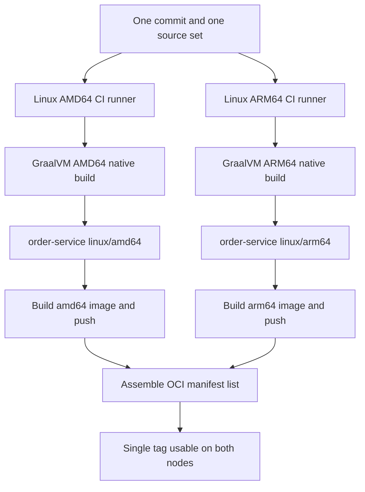

# amd64 and arm64 Architectures and Per-Target Build Strategies

A Spring Boot JAR file can run across multiple CPU architectures wherever a matching JVM is available. When compiled with **GraalVM Native Image**, however, the output is an executable built for one specific operating system and CPU architecture. A Linux AMD64 binary cannot run directly on Linux ARM64; even a Docker image with a multi-architecture tag does not turn a single binary into one that runs on every CPU.

To ship a Spring Boot Native Image for both x86-64 and ARM64 servers, you must build **one native executable per target**, package each executable into its corresponding image, test on the target architecture, and then combine those images into an OCI manifest list. Docker then selects the image matching the node's platform when users pull the same tag.

## 1. Learning Objectives

After this lesson, you will be able to:

- Distinguish the `amd64` and `arm64` CPU architectures, OS names, and executable ABIs.
- Explain why a native executable only runs on compatible platforms.
- Distinguish cross-platform Java bytecode/JARs from target-specific native executables.
- Choose the GraalVM Native Image distribution and C toolchain for Linux AMD64 or AArch64.
- Understand the impact of `glibc`, `musl`, shared libraries, and CPU instruction sets.
- Use `-march` to balance performance against CPU compatibility.
- Distinguish `native-image --target` from `docker buildx --platform`.
- Choose a build strategy using native runners, multiple Buildx nodes, QEMU, or cross-compilation.
- Build per-architecture images and assemble an OCI multi-platform manifest.
- Verify the binary, container image, native dependencies, and runtime on each architecture.
- Organize CI caches, test matrices, and traceable release artifacts.

## 2. What Are amd64 and arm64?

Two common architectures in server environments:

| Common CPU/ABI Name | OCI/Docker Platform Name | Typical `uname -m` Output | Hardware Examples |
| --- | --- | --- | --- |
| x86-64 / AMD64 | `linux/amd64` | `x86_64` | Intel Xeon, AMD EPYC |
| AArch64 / ARM64 | `linux/arm64` | `aarch64` | AWS Graviton, Ampere Altra, ARM servers |

`amd64` and `arm64` are platform names in the OCI/Docker ecosystem. `x86_64` and `aarch64` are architecture names commonly reported by Linux and toolchains. Each pair refers to the same corresponding architecture family, not the same machine instruction set.

### 2.1. Why Cannot Binaries Be Shared?

Native Image compiles bytecode and the runtime into machine code for one specific target. Architecture-dependent components include:

- Instruction set and calling convention.
- ELF machine type and binary format.
- OS and libc ABI.
- Linked native/JNI libraries.
- CPU features the compiler is permitted to emit.

An ELF executable for AMD64 contains x86-64 machine code. An ARM64 CPU cannot execute those instructions directly. Conversely, an AArch64 binary cannot run directly on an x86-64 CPU.

Java source code, bytecode, and most JAR dependencies can still be shared. Native executables and native libraries must be built per platform.

## 3. Distinguishing OS, Architecture, libc, and CPU Features

The platform name `linux/arm64` only specifies the OS and CPU architecture at the OCI level. For an executable to run, you must also verify the ABI and runtime libraries.

### 3.1. OS and Architecture

Examples of distinct platforms:

- `linux/amd64`: Linux on x86-64.
- `linux/arm64`: Linux on AArch64.
- `windows/amd64`: Windows on x86-64.
- `darwin/arm64`: macOS on Apple Silicon.

A Linux native executable cannot simply be renamed to run on Windows or macOS. It must be rebuilt with the appropriate toolchain and target OS.

### 3.2. glibc and musl

Linux distributions can use different libc implementations:

| Runtime Base | Typical libc | Notes |
| --- | --- | --- |
| Debian, Ubuntu, Red Hat, Oracle Linux, Amazon Linux | glibc | Suitable for executables linked against glibc |
| Alpine Linux | musl | Requires musl-compatible executables and native dependencies |
| Debian-based distroless | glibc | Can run mostly-static executables that require glibc |
| `scratch` | No libc/runtime files | Suitable only for static executables needing no extra runtime files |

An executable built against glibc will not automatically run on Alpine just because both are Linux. Inspect the interpreter and shared libraries with `readelf`/`ldd`, then choose a matching runtime base.

For executables dynamically linked against glibc, the runtime image must also provide a glibc version satisfying the symbol versions required by the binary. Building on a newer distribution and running on a base image with an older glibc can trigger `GLIBC_x.y not found` even though both images use glibc.

Native Image supports selecting libc depending on the toolchain. However, limitations vary by architecture and GraalVM release. Current compatibility documentation notes that Linux AArch64 does not yet support `musl`; therefore, do not assume a single Alpine/musl strategy works across both AMD64 and ARM64.

### 3.3. Native Dependencies

If the application uses JNI or native libraries, each architecture needs its exact binary:

- `libfoo-linux-x86_64.so` cannot replace `libfoo-linux-aarch64.so`.
- Maven dependencies may distribute native binaries via separate classifiers.
- Some libraries load native libraries dynamically by OS/architecture; verify their artifact selection mechanism.
- `libstdc++`, `libgcc`, OpenSSL, or other native clients must match the runtime image's ABI and libc.

Never copy a directory of native libraries from an AMD64 build into an ARM64 image.

## 4. GraalVM Native Image Targets

### 4.1. Builder Produces an Executable for a Specific Platform

The Native Image builder uses the Java toolchain, the Native Image tool, and a C compiler/linker to create the executable. On Linux, the toolchain needs components such as a compiler, libc headers/development files, and zlib development files. Exact package names depend on the distribution.

Example checks on Linux:

```bash
uname -m
java -version
native-image --version
gcc --version
```

On Linux AMD64, the GraalVM distribution for Linux x64 normally produces an AMD64 executable; on Linux AArch64, you need the corresponding GraalVM distribution and toolchain to produce an ARM64 executable.

### 4.2. Building Separately with Maven or Gradle

Maven:

```bash
./mvnw -Pnative native:compile
```

Gradle:

```bash
./gradlew nativeCompile
```

Outputs are placed in the module's build directory, for example:

```text
target/order-service
build/native/nativeCompile/order-service
```

Exact paths and filenames depend on the Maven/Gradle plugin and project configuration. When run on an AMD64 runner, a standard build produces an AMD64 binary; when run on an ARM64 runner with ARM64 GraalVM/toolchain, the build produces an ARM64 binary.

### 4.3. `--target` Is Not Docker `--platform`

Native Image provides an option:

```bash
native-image --target=linux-aarch64 ...
```

This option selects the target OS/architecture of the Native Image compiler. It does not install a cross-compiler, target libc headers, linker, sysroot, or native dependencies. Cross-compiling requires the matching target toolchain and libraries, and the target must be supported by the GraalVM release in use.

Docker Buildx has a different option:

```bash
docker buildx build --platform linux/arm64 ...
```

This option instructs BuildKit to build a container image for the specified platform. It does not automatically make `native-image` in a build stage produce an ARM64 binary if that build stage is running on an AMD64 builder. The build stage must run on a matching target builder, use an appropriate cross-toolchain, or run under emulation.

Do not treat these two options as interchangeable.

## 5. Selecting the CPU Instruction Set with -march

Beyond OS and architecture, an executable can also depend on specific CPU instruction sets.

Native Image provides the `-march` option:

| Value | Meaning | When to Use |
| --- | --- | --- |
| `-march=native` | Uses instructions detected by the compiler on the build host | Use only when deployment hosts have equivalent CPU features |
| `-march=compatibility` | Restricts instructions to improve compatibility across CPU generations | Good for images distributed broadly within the same architecture |
| `-march=list` | Lists supported machine types | Use to inspect available toolchain targets |

According to the GraalVM 25.5 documentation, the default machine type is `x86-64-v3` on AMD64 and `armv8-a` on AArch64. Defaults can vary by release; check build output and the documentation for your exact version.

### 5.1. When to Use native?

For example, building with `-march=native` on an AMD64 host with AVX-512 and deploying to an older AMD64 node without AVX-512 can fail with an illegal instruction error. Sharing an architecture does not mean CPUs share the same feature set.

For an image targeting multiple server generations within the same architecture, consider:

```bash
native-image -march=compatibility -jar target/order-service.jar
```

With a controlled fleet and homogeneous CPUs, you can benchmark `-march=native` on the exact deployment hardware.

### 5.2. Never Use One march for Both Architectures

AMD64 and AArch64 have distinct instruction sets. Build each binary with the appropriate option for its own architecture. `-march=compatibility` only widens compatibility within that single architecture; it does not produce a binary that runs on both AMD64 and ARM64.

## 6. Multi-Architecture Build Strategies

Docker Buildx/BuildKit supports three main strategies:

1. Emulation via QEMU.
2. Multiple native builder nodes.
3. Cross-compilation inside a multi-stage build.

For Native Image, the chosen strategy strongly affects build duration and stability.

### 6.1. Building on Native Runners per Architecture

This is the easiest approach to control:



Each runner:

- Runs the exact GraalVM distribution and C toolchain for its target.
- Builds the executable with Maven/Gradle.
- Runs unit and native smoke tests on that architecture itself.
- Packages the binary into a matching platform runtime image.
- Pushes the image with an architecture-specific tag.

The advantage is avoiding CPU emulation during heavy compilation. The trade-off is maintaining two runner types or agent pools.

### 6.2. Multiple Native Nodes in Docker Buildx

Buildx can combine multiple Docker contexts into a single builder. Suppose contexts `node-amd64` and `node-arm64` exist:

```bash
docker buildx create --use --name native-multi node-amd64
docker buildx create --append --name native-multi node-arm64
docker buildx inspect --bootstrap
```

Then:

```bash
docker buildx build \
  --platform linux/amd64,linux/arm64 \
  --tag registry.example.com/order-service:1.0.0 \
  --push .
```

BuildKit dispatches each platform build to the corresponding native node. The Dockerfile must select a builder image matching the target platform and execute native compilation in that stage. Each builder image must have the matching GraalVM, Native Image, C toolchain, and dependency cache.

This is convenient when you want a single Buildx command to produce a multi-architecture manifest while still compiling on real hardware.

### 6.3. QEMU Emulation

QEMU user-mode emulation allows running binaries for another architecture on the current host. Buildx can leverage QEMU when the builder supports it and emulators are registered.

Advantages:

- Easy to get started with a single host.
- No separate physical runners needed per architecture.
- Can reuse the same Dockerfile across platforms.

Limitations:

- Native Image compilation is CPU- and memory-intensive; QEMU can be dramatically slower.
- Some builds or toolchains may hit issues under emulation.
- Build-time benchmarks do not represent builds on real hardware.
- A successful QEMU build does not replace testing on real ARM64/AMD64 nodes.

Therefore, QEMU suits quick experiments or light workloads. For large release builds, prefer native nodes/runners whenever possible.

### 6.4. Cross-Compilation

Cross-compilation can help when the toolchain supports building for a target different from the host. However, it requires:

- Native Image target support for that host/target pair.
- Cross C compiler and linker.
- Target sysroot, libc headers, and native libraries.
- Build dependencies with matching classifiers/architectures.
- Appropriate target CPU and ABI configuration.

Adding `--target=linux-aarch64` alone does not supply these components. Unless you have verified a specific cross-compilation toolchain, building on a native ARM64 runner carries much lower risk.

## 7. Structuring Dockerfiles and Runtime Images

### 7.1. Build the Binary First, Package the Runtime Afterward

An easy-to-control pattern is having CI build the executable on a native runner, then build the runtime image from that artifact.

Example `Dockerfile.runtime`:

```dockerfile
FROM --platform=$TARGETPLATFORM debian:bookworm-slim

WORKDIR /app
COPY --chown=10001:10001 order-service /app/order-service

USER 10001:10001
EXPOSE 8080
ENTRYPOINT ["/app/order-service"]
```

The build context contains the `order-service` file compiled for the corresponding platform. Debian slim is an example glibc runtime base; choose a base image matching your binary's libc and shared libraries.

On the AMD64 runner:

```bash
./mvnw -Pnative native:compile
mkdir -p dist-amd64
cp target/order-service dist-amd64/order-service

docker buildx build \
  --platform linux/amd64 \
  --file Dockerfile.runtime \
  --tag registry.example.com/order-service:1.0.0-amd64 \
  --push dist-amd64
```

On the ARM64 runner, build the executable again and package it:

```bash
./mvnw -Pnative native:compile
mkdir -p dist-arm64
cp target/order-service dist-arm64/order-service

docker buildx build \
  --platform linux/arm64 \
  --file Dockerfile.runtime \
  --tag registry.example.com/order-service:1.0.0-arm64 \
  --push dist-arm64
```

In each job, `target/order-service` must be built on a runner of the matching architecture. Never copy the AMD64 binary from the first job into the ARM64 job.

### 7.2. The Runtime Base Image Must Be Compatible

If the binary dynamically links against glibc, the runtime image must provide a compatible glibc. If it uses musl, the runtime must match musl and that architecture. Beyond libc, verify:

- Shared libraries reported as missing by `ldd`.
- CA certificates if the application calls HTTPS.
- Timezone data if the application needs the timezone database.
- Locale data if code depends on locales.
- Config files, resources, and writable log/tmp directories.
- User/group and filesystem permissions.

A small image does not mean runtime dependencies can be omitted. `scratch` is only suitable if the executable is static and the application needs no extra runtime files.

### 7.3. Direct Multi-Stage Build with Buildx

If the builder image has a multi-architecture manifest, you can define a build stage running on the target platform:

```dockerfile
# syntax=docker/dockerfile:1
ARG GRAALVM_BUILDER_IMAGE=registry.example.com/build-images/graalvm-native-builder:25.5

FROM --platform=$TARGETPLATFORM $GRAALVM_BUILDER_IMAGE AS build
WORKDIR /workspace
COPY . .
RUN ./mvnw -Pnative native:compile

FROM --platform=$TARGETPLATFORM debian:bookworm-slim AS runtime
WORKDIR /app
COPY --from=build --chown=10001:10001 /workspace/target/order-service /app/order-service
USER 10001:10001
EXPOSE 8080
ENTRYPOINT ["/app/order-service"]
```

`GRAALVM_BUILDER_IMAGE` is an image selected and version/digest-pinned by your organization; it must contain GraalVM Native Image and the native toolchain. Ensure the builder image provides variants for both `linux/amd64` and `linux/arm64`. With multi-node Buildx, this stage runs on the matching native node. With a single node, BuildKit may need QEMU to execute the other architecture's stage.

The image name in the example is an internal registry placeholder; replace it with a verified, digest-pinned builder image. You can pass another value via `--build-arg GRAALVM_BUILDER_IMAGE=...` when invoking Buildx.

This is a skeleton Dockerfile. Verify the builder image, Maven Wrapper, build context, and output path in your actual project.

## 8. Creating an OCI Multi-Platform Manifest

After pushing the two architecture-specific images:

```bash
docker buildx imagetools create \
  --tag registry.example.com/order-service:1.0.0 \
  registry.example.com/order-service:1.0.0-amd64 \
  registry.example.com/order-service:1.0.0-arm64
```

Tag `1.0.0` points to a manifest list/index. This manifest holds descriptors for each platform and the digest of its corresponding image. When an AMD64 node pulls the tag, the runtime selects the AMD64 image; an ARM64 node selects the ARM64 image.

**A multi-architecture manifest does not hold a single universal executable.** It simply groups platform-specific images under one tag.

### 8.1. Inspecting the Manifest

```bash
docker buildx imagetools inspect registry.example.com/order-service:1.0.0
```

The output should list at least:

- `linux/amd64`
- `linux/arm64`

If only one platform appears, the tag is not the expected multi-platform release. Check the pushed images and the manifest creation command.

## 9. Verifying the Binary and Image Before Release

### 9.1. Checking Host and Binary Architecture

On the runner:

```bash
uname -m
file target/order-service
readelf -h target/order-service
```

In the ELF output, check `Machine`:

- AMD64 typically reports `Advanced Micro Devices X86-64`.
- ARM64 typically reports `AArch64`.

Never rely solely on filename or Docker tag to determine binary architecture.

### 9.2. Checking Dynamic Dependencies

For dynamically linked Linux executables:

```bash
ldd target/order-service
```

If any entry reads `not found`, the runtime image may lack a shared library. If the binary is static, `ldd` may report it is not a dynamic executable; in that case verify linking mode via `readelf` and build documentation.

Run checks on binaries produced by your pipeline itself; never run `ldd` on untrusted files.

### 9.3. Checking Image Platform Metadata

```bash
docker image inspect \
  --format '{{.Os}}/{{.Architecture}}' \
  registry.example.com/order-service:1.0.0-amd64
```

For a multi-architecture manifest:

```bash
docker buildx imagetools inspect registry.example.com/order-service:1.0.0
```

These two checks serve different purposes: ELF machine verifies the executable; image/manifest inspect verifies the container image's platform metadata.

### 9.4. Running on Target Architectures

On AMD64:

```bash
docker run --rm --platform linux/amd64 \
  registry.example.com/order-service:1.0.0
```

On ARM64:

```bash
docker run --rm --platform linux/arm64 \
  registry.example.com/order-service:1.0.0
```

`--platform` may trigger emulation if the host architecture differs and QEMU is configured. For release validation, run smoke/integration tests on native nodes of each architecture to verify ABI, native dependencies, and CPU instructions on real hardware.

## 10. Testing Strategy per Architecture

Do not publish simply because compilation succeeded. Each platform needs its own test evidence.

| Test Layer | AMD64 | ARM64 | Goal |
| --- | --- | --- | --- |
| JVM unit tests | Run | Can share source/tests | Verify business logic |
| Native compilation | Build on AMD64 runner | Build on ARM64 runner | Verify toolchain and metadata |
| Native test executable | Run natively | Run natively | Verify dynamic access and runtime |
| Container smoke test | AMD64 node | ARM64 node | Startup, health, config, filesystem |
| Integration test | Connect to real/test deps | Connect to real/test deps | TLS, DB, broker, DNS, and native libraries |
| Load/performance test | Measure separately | Measure separately | Never assume two CPUs perform identically |

### 10.1. Edge Cases to Watch

- JNI libraries packaged only with an AMD64 classifier.
- Native libraries using instructions missing on ARM64 or older AMD64 CPUs.
- Endianness or alignment differences in native code.
- Different C library or OpenSSL versions between builder and runtime.
- Different file paths and permissions across base images.
- Architecture-specific resources picked incorrectly by a dependency.
- Build scripts hardcoding binary names or output paths.

### 10.2. Testing Health and Graceful Shutdown

For a Spring Boot service, verify:

- Process starts and the readiness endpoint returns the expected status.
- Main HTTP endpoints handle requests.
- Database/message broker connections work.
- TLS and CA certificates are present when needed.
- SIGTERM is handled and the application context shuts down cleanly.
- Container runs as a non-root user.
- Logs and temporary files have writable locations.

## 11. CI/CD Matrix and Caching

### 11.1. One Source Commit, Two Build Jobs

Example CI matrix:

```yaml
strategy:
  fail-fast: false
  matrix:
    include:
      - arch: amd64
        runner: linux-amd64
        platform: linux/amd64
      - arch: arm64
        runner: linux-arm64
        platform: linux/arm64
```

The `runner` values above are illustrative labels; replace them with your CI platform's actual runner labels. Both runners must use the same source commit on distinct physical/virtual architectures with matching native toolchains installed.

Each job uses the same commit SHA, the same Spring Boot/GraalVM/Native Build Tools versions, and the defined build arguments. Runner, GraalVM distribution, compiler, and target native libraries vary by architecture.

### 11.2. Caches Must Be Separated by Architecture

Cache keys should include at least:

- OS and architecture.
- GraalVM distribution/version and Java version.
- Maven/Gradle and Native Build Tools plugin versions.
- Native Image build arguments, including `-march` and libc if specified.
- Dependency lockfiles or checksums of dependency inputs.

Never share native executable outputs or caches containing object files between AMD64 and ARM64. JAR dependency caches may be shared only if artifacts are truly architecture-independent; native library caches and compilation outputs must stay separate.

### 11.3. Artifact Naming and Provenance

Name artifacts to reflect their target:

```text
order-service-1.0.0-linux-amd64
order-service-1.0.0-linux-arm64
```

Record alongside them:

- Commit SHA.
- GraalVM distribution/version.
- Java version.
- OS/architecture and libc.
- Native Image build arguments.
- Image digest.
- Per-platform test reports.

Never label a build “multi-arch” if the pipeline only produced an AMD64 binary and packaged it under an ARM64 image tag.

## 12. Choosing a Strategy by Environment

| Situation | Strategy to Consider | Reason |
| --- | --- | --- |
| AMD64 and ARM64 runners available | Build separately on native runners | Easy toolchain control and real testing |
| Multi-node Buildx builder available | Multi-node Buildx | Single command produces manifest; compiles run natively |
| Quick experiment, no ARM64 runner | QEMU emulation | Convenient for initial checks; compilation can be slow |
| Verified cross-toolchain available | Cross-compilation | Can reduce runner count, but requires managing sysroot/ABI |
| Deploying only one architecture | Build single platform | Simpler pipeline and artifacts |
| Deploying across CPU generations in one arch | Use `-march=compatibility` and test representative fleet | Reduces illegal instruction risk |

## 13. Troubleshooting

| Symptom | Possible Cause | Resolution |
| --- | --- | --- |
| `exec format error` | Binary architecture mismatches CPU/container platform | Check `file`, `readelf -h`, and image manifest |
| `Illegal instruction` | Binary uses CPU features absent on the node | Rebuild with `-march=compatibility` or target matching CPU fleet |
| `No such file or directory` even though executable exists | Dynamic loader/interpreter or shared library missing in runtime image | Check ELF interpreter and `ldd` |
| `libXYZ.so: cannot open shared object file` | Runtime image lacks native dependency | Install/copy the right library for the matching OS/architecture |
| AMD64 works, ARM64 build fails | GraalVM/toolchain/dependency lacks ARM64 support or wrong classifier | Check GraalVM ARM64, compiler, and native dependencies |
| ARM64 runs, Alpine fails | musl/glibc incompatibility or target lacks musl support | Pick a base image with the right libc; check support matrix |
| `--target` fails to produce desired binary | Missing cross-compiler, sysroot, or target libraries | Use a native runner or configure full cross-toolchain |
| Buildx reports missing platform | Builder lacks a node/emulator for target | Add a native node or install appropriate QEMU |
| ARM64 build via QEMU is very slow | Native Image compilation running under emulation | Switch to an ARM64 native runner/node |
| Manifest shows only AMD64 | ARM64 image not pushed or manifest created incorrectly | Check arch-specific tags and re-run `imagetools create` |
| Image metadata says ARM64, binary is AMD64 | Wrong artifact packaged into build context | Check ELF machine in every job before pushing |
| Native dependency works on one node, fails on another | CPU features, libc, or shared library versions differ | Standardize runtime base and `-march`, test representative fleet |

## 14. Comprehensive Hands-On Exercise

**Scenario:** `order-service` must run on a Kubernetes cluster containing both AMD64 and ARM64 nodes. The team wants to publish a single `1.0.0` tag so Deployments do not have to pick tags per node.

Steps:

1. Confirm the GraalVM distribution provides Native Image for Linux AMD64 and Linux AArch64.
2. Choose a libc-compatible runtime base image; use the same multi-architecture base image line if appropriate.
3. Create CI jobs on a native AMD64 runner and a native ARM64 runner.
4. Both jobs check out the same commit and run JVM unit tests.
5. The AMD64 job runs Maven `native:compile` or Gradle `nativeCompile`, then verifies the ELF machine.
6. The ARM64 job runs the native build on the ARM64 toolchain and verifies the ELF machine.
7. Package both executables into separate images and push tags `1.0.0-amd64` and `1.0.0-arm64`.
8. Run native smoke/integration tests on nodes of each matching architecture.
9. Use `docker buildx imagetools create` to assemble the manifest under tag `1.0.0`.
10. Use `docker buildx imagetools inspect` to confirm the manifest lists both `linux/amd64` and `linux/arm64`.
11. Deploy tag `1.0.0` to the cluster and confirm each node pulls the matching image.
12. Archive the image digest, commit SHA, GraalVM version, and per-platform test reports.

**Self-check question:** Why doesn't `docker buildx build --platform linux/amd64,linux/arm64` guarantee the Native Image builder produces both executables? Because `--platform` controls the container image platform. If the build stage still runs AMD64 GraalVM, native compilation may still output an AMD64 binary. The build stage must run on a native node of the target architecture, use QEMU, or use a configured and verified cross-toolchain.

## 15. Key Takeaways

- Java source and JARs can usually be shared; Native Image executables must be built for each target OS/architecture.
- `amd64` corresponds to x86-64; `arm64` corresponds to AArch64. OCI platform names differ from what Linux returns via `uname -m`.
- Verify architecture, libc, ABI, shared libraries, and CPU instruction sets together; checking `linux/amd64` or `linux/arm64` alone is not enough.
- Native Image requires a matching GraalVM and C toolchain. `--target` selects the compiler target but does not automatically supply a cross-compiler or sysroot.
- `-march=compatibility` helps binaries run across CPU generations within the same architecture; `-march=native` is only safe for fleets matching the build CPU.
- Docker Buildx `--platform` selects the image platform. It does not automatically change the architecture of binaries compiled inside the build stage.
- QEMU is convenient for experiments but can slow Native Image builds significantly; native runners or multi-node Buildx are better suited for releases.
- Build one executable for AMD64 and one for ARM64, test each on its matching architecture, and push separate images.
- An OCI manifest list groups platform-specific images under one tag; the runtime selects the image matching the node.
- Separate caches and artifacts by OS/architecture, toolchain, libc, and build arguments; store provenance and test evidence per platform.

By building, packaging, and testing per target, Spring Boot Native Image can be released under one unified container tag for mixed AMD64/ARM64 clusters while preserving the right binary and native dependencies for every node.

## Official References

- [GraalVM Native Image — Getting Started](https://www.graalvm.org/reference-manual/native-image/): Native Image creates OS- and architecture-specific executables; requires a local toolchain.
- [GraalVM Native Image — Command-line Options](https://www.graalvm.org/latest/reference-manual/native-image/overview/Options/): `--target`, `-march`, machine types, and build options.
- [GraalVM Native Image — Optimizations and Performance](https://www.graalvm.org/jdk25.5/reference-manual/native-image/optimizations-and-performance/): machine-specific instruction sets, `-march=native`, and `-march=compatibility`.
- [GraalVM Native Image — Compatibility Guide](https://www.graalvm.org/dev/reference-manual/native-image/metadata/Compatibility/): platform support limits, including Linux AArch64 and libc.
- [GraalVM Native Image — Static Executables](https://www.graalvm.org/latest/reference-manual/native-image/guides/build-static-executables/): fully static, mostly-static, glibc, musl, and runtime base images.
- [Docker — Multi-platform builds](https://docs.docker.com/build/building/multi-platform/): QEMU, native multi-node builders, cross-compilation, and `--platform`.
- [Docker Buildx — Building multi-platform images](https://github.com/docker/buildx): manifest lists/indexes and how Docker selects images per platform.
