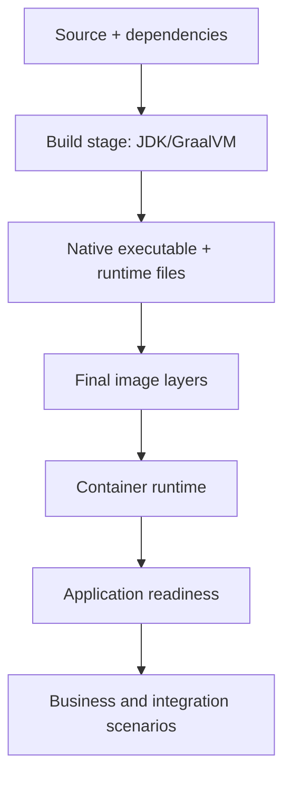

# Verifying the Final Image Instead of Only Testing the Binary on the Build Machine

## 1. Why Must You Test the Exact Image Being Deployed?

A native executable can run successfully on the build machine yet fail once packaged into a container. The build machine typically has OS libraries, CA certificates, timezone data, a shell, environment variables, and filesystem permissions that a minimal runtime image lacks. The binary may also have been built for a different architecture or libc than the deployment environment.

Therefore, running `./orders-service` directly on the builder only proves the binary works in the builder environment. It does not prove the final Docker image has the dependencies, configuration, permissions, networking, and system data needed to serve requests.

In the **SPRING_BOOT_NATIVE_IMAGE** module, this lesson guides you through verifying artifacts at the true deployment boundary: the final built image, running with the actual user and resource limits, receiving runtime configuration, connecting to dependencies, serving requests, emitting logs, and shutting down. Every critical test should run against the final container, not the builder stage.

## 2. Distinguishing Artifact Layers

A native container pipeline typically spans multiple layers:



| Layer | What to Verify |
|---|---|
| Native executable | Binary matches architecture and compiles cleanly |
| Builder stage | Has toolchain and dependencies to build the binary |
| Final image | Contains only the binary and required runtime files |
| Container process | Runs under real UID/GID, environment, and filesystem |
| Application | Spring context boots, readiness and endpoints work |
| Integration | DNS, TLS, database, broker, volumes, and external services work |
| Deployment platform | Probes, resource limits, signal handling, and rollout behave properly |

Each layer can pass independently while a downstream layer still fails. For example, a passing Docker build does not prove the entrypoint is executable; a starting container does not prove database queries work.

## 3. Do Not Run Final Tests on the Builder Stage

A multi-stage Dockerfile typically has a builder containing GraalVM, compilers, a shell, and packages. The final stage may be distroless or scratch, lacking all of those tools.

Example structure:

```dockerfile
FROM build-image AS build
WORKDIR /workspace
COPY . .
RUN ./mvnw -Pnative -DskipTests package

FROM runtime-image AS runtime
WORKDIR /app
COPY --from=build /workspace/target/orders-service /app/orders-service
USER 10001:10001
ENTRYPOINT ["/app/orders-service"]
```

Testing on the `build` stage can mask bugs because the binary sees shared libraries or config files that exist only in the builder. Build a tag from the final stage, then run containers from that tag.

Never use `docker run --target build` as release evidence for a production image. A test stage can help debug compiler issues, but it does not represent the shipped image.

## 4. Confirming the Image, Tag, and Digest Under Test

Before running tests, identify the exact image:

```bash
docker build -t orders-service:candidate .
docker image inspect orders-service:candidate
docker image ls orders-service:candidate
```

Record:

- Image tag and immutable digest once pushed to a registry.
- Build commit and pipeline run.
- Target OS/architecture.
- Base image and version/tag.
- Image creation timestamp.
- Binary digest or build provenance if provided by the pipeline.

Tags can be overwritten. In release pipelines, use a digest or immutable tag to guarantee the tested image is the exact image deployed. If you rebuild the same tag after testing, earlier results no longer vouch for the new image.

## 5. Checking Architecture and OS Compatibility

The image manifest and executable must match the deployment node. Inspect:

```bash
docker image inspect orders-service:candidate
docker image inspect --format '{{.Os}}/{{.Architecture}}' orders-service:candidate
```

On a Linux builder, inspect the binary:

```bash
file target/orders-service
readelf -h target/orders-service
readelf -l target/orders-service
readelf -d target/orders-service
```

Items to cross-check:

- `linux/amd64` vs. `linux/arm64`.
- ELF machine type.
- Dynamic loader and libc.
- Shared library requirements.
- CPU instruction set assumptions if built with a specific target.
- Native libraries packaged alongside the binary.

A Docker image built on an ARM machine is not guaranteed to run on an AMD64 node. If releasing a multi-architecture image, build and test each platform or use appropriate runners/emulators, then verify the manifest list.

## 6. Verifying Shared Libraries in the Final Image

If the binary is dynamically linked, the final image must provide a compatible loader and shared libraries. Use an appropriate builder/tooling to analyze:

```bash
ldd target/orders-service
readelf -d target/orders-service
```

`ldd` output on the builder only reflects library resolution inside the builder. To verify the final image, use a debug image sharing the same filesystem/runtime libraries or tools that inspect the image root filesystem. For distroless/scratch, you can export/copy the filesystem layer to inspect it with external tools.

Do not install arbitrary packages into a production image just so `ldd` can run. Identify true dependencies and add only the required runtime libraries to the final stage. Then run the executable inside the final image to verify the real dynamic loader.

## 7. Verifying Entrypoint and Process Signals

A native executable is normally launched directly via exec form:

```dockerfile
ENTRYPOINT ["/app/orders-service"]
```

Exec form lets the process receive signals directly from the container runtime. Shell-form entrypoints can introduce a shell as PID 1 and alter how signals are forwarded.

Verify:

- The executable has execute permission.
- The entrypoint path exists.
- The working directory is correct.
- The process runs under the intended user.
- SIGTERM is received and the application shuts down gracefully.
- The container is not kept alive by an unnecessary shell/wrapper.

You can test stopping the container:

```bash
docker stop --time 30 orders-service-test
docker inspect --format '{{.State.ExitCode}} {{.State.FinishedAt}}' orders-service-test
```

Compare the exit code and stop duration against application logs. If the process hits SIGKILL after the timeout, investigate shutdown hooks, in-flight requests, and drain duration.

## 8. Verifying Non-Root and Filesystem Permissions

An image may succeed as root yet fail under the production UID because it cannot read files or write to required directories.

The Dockerfile should specify an unprivileged user:

```dockerfile
USER 10001:10001
```

Test the final image:

```bash
docker run --rm   --user 10001:10001   orders-service:candidate
```

Even when the Dockerfile already declares a user, this verifies behavior with an explicit UID/GID. Confirm that:

- The binary and application directory have read/execute permissions.
- Mounted configs are readable.
- Temporary or upload directories are writable if needed.
- Volume ownership/permissions are compatible.
- Nothing tries to write into the application directory.
- Nothing depends on a home directory or username in `/etc/passwd`.

Never fix permission errors by switching the process back to root. Grant proper permissions to needed paths and keep the filesystem read-only wherever possible.

## 9. Running with a Read-Only Filesystem

If the application does not need to write to the root filesystem, test running read-only:

```bash
docker run --rm   --read-only   --tmpfs /tmp:rw,noexec,nosuid,size=64m   -p 8080:8080   orders-service:candidate
```

This example supplies a private in-memory `/tmp`. Add a tmpfs only if the application or a library genuinely needs a temporary directory. If the application writes exports or uploads, mount a dedicated volume with clear permissions and quotas.

A read-only root filesystem exposes hidden assumptions about writable directories. If the container fails, inspect which path required a write and mount the minimal writable path needed. Never make the entire filesystem writable to hide errors.

## 10. Runtime Configuration and Secrets

Native Image packages code and some metadata at build time, while deployment settings such as URLs, credentials, feature values, and resource limits are normally supplied at runtime.

Example:

```bash
docker run --rm   -e SPRING_PROFILES_ACTIVE=container   -e INVENTORY_BASE_URL=https://inventory.internal   -p 8080:8080   orders-service:candidate
```

Never pass real secrets on command lines recorded in shell history or CI logs. Use Docker/Kubernetes secrets or an appropriate secret manager; mount secret files or inject them through the platform's secure mechanism.

Verify:

- Runtime profiles do not invalidate a bean graph locked in by AOT.
- Runtime properties only vary values supported by the artifact.
- Secrets never appear in logs or image layers.
- Config files are mounted at the right paths with proper permissions.
- The container receives all required environment variables.
- Missing mandatory configuration produces a clear failure instead of falling back dangerously.

Never bake credentials into a Dockerfile via `ARG` or `ENV`. Those values persist in layer metadata or build history.

## 11. Verifying CA Certificates and HTTPS

If the application makes HTTPS calls, run tests from the final container against a representative TLS endpoint. Verify:

- The CA bundle is in the image or a trust store is mounted.
- The Java/native TLS stack uses the intended trust configuration.
- Proxy settings are present if required by the environment.
- Hostname verification is not disabled.
- Certificate rotation and private CAs are supported per policy.

Do not test TLS only from the host, since the host may carry a CA bundle absent from the final image. Execute a real request from application code to confirm the TLS path used by the Spring client/SDK.

When using a private CA, supply certificates via runtime secret/config mechanisms and test rotation. Never embed private keys in the image.

## 12. Verifying DNS and Network Policies

The container must resolve service names and reach the right networks. Test within the same runtime platform:

- DNS names of databases, brokers, and services.
- DNS search domains.
- Egress policies and firewalls.
- Proxy settings.
- IPv4/IPv6 behavior if the environment uses dual-stack.
- Connection timeouts and retry behavior.

Do not test solely with static IPs when production uses DNS service discovery. An image can appear healthy yet fail when DNS/NSS configuration differs.

With distroless/scratch images lacking `nslookup` or `curl`, use an internal test endpoint, a debug container sharing the network namespace, or a separate test job. Avoid adding debugging tools to production images unless necessary.

## 13. Verifying Readiness, Liveness, and Startup Probes

Kubernetes distinguishes between:

- **Startup probe:** gives the application time for initial startup.
- **Readiness probe:** determines when the pod can receive traffic.
- **Liveness probe:** determines whether the process must be restarted.

Example:

```yaml
startupProbe:
  httpGet:
    path: /actuator/health/liveness
    port: 8080
  periodSeconds: 2
  failureThreshold: 30

readinessProbe:
  httpGet:
    path: /actuator/health/readiness
    port: 8080
  periodSeconds: 5
  failureThreshold: 3

livenessProbe:
  httpGet:
    path: /actuator/health/liveness
    port: 8080
  periodSeconds: 10
  failureThreshold: 3
```

Adjust these examples to match your Actuator configuration and service policies. The startup probe should cover cold start and required initialization; readiness reflects ability to serve; liveness should not restart the process solely because an external dependency is briefly unavailable.

Test endpoints using actual platform probes. Do not use a Docker `HEALTHCHECK` invoking `curl` if the final image lacks a shell or curl.

## 14. Running Business Smoke Tests Against the Container

Once readiness passes, send requests via the published port or test environment network. Example:

```bash
curl -i   -H "Content-Type: application/json"   --data-binary @src/test/resources/contract/orders/valid-order.json   http://localhost:8080/api/orders
```

This illustrates testing from the host against the container. In CI, a dedicated contract test runner can verify status codes, response schemas, and side effects.

Choose scenarios exercising key capabilities:

- JSON binding and polymorphic subtypes.
- Validation and exception mapping.
- Resource/template loading.
- Locale-specific resource bundles.
- Spring AOP/proxies and transactions.
- Database repository CRUD/queries.
- HTTP/TLS calls to dependencies.
- JNI/native libraries if used by the application.

A health endpoint returning 200 validates only a small surface. Run representative business flows directly against the final image.

## 15. Testing Databases, Brokers, and External Dependencies

If the application needs a database or message broker, test the container in a network mirroring deployment:

1. Start dependencies with pinned versions.
2. Wait for dependency readiness.
3. Supply endpoints/credentials via runtime configuration.
4. Run migrations/schema initialization if owned by the application.
5. Perform a read/write or publish/consume operation.
6. Verify transactions/acknowledgments.
7. Stop the container and inspect shutdown.

Tests must distinguish native runtime bugs from unready dependencies. Use explicit timeouts and retain logs from both the application and dependencies.

If using Testcontainers inside a native test process, verify compatibility between Testcontainers/Docker clients and the runtime environment. Another option is starting the native app container and driving tests from a separate JVM process.

## 16. Verifying Locale, Timezone, and System Data

Minimal images may omit required timezone data or locale resources. Test in the final image with explicit values:

- `ZoneId.of("Asia/Ho_Chi_Minh")`.
- Locale `vi-VN` and other product-supported locales.
- Date/time formatting via real APIs.
- Handling instants across day/timezone boundaries.
- TLS certificate validity when clock/timezone affects display.
- Resource bundles and message fallbacks.

Do not inspect only the `TZ` environment variable; the application may use explicit zone IDs or bundled data. Verify actual outputs produced by the native executable inside the image.

## 17. Logging, Metrics, and Debugging in the Final Image

Verify logs go to stdout/stderr and are collected by the container platform. With Actuator/Micrometer, confirm metrics endpoints exist and registries actually emit data.

Distroless/scratch images typically lack a shell, debugger, or package manager. Prepare an out-of-container debugging workflow:

- Store the image digest and binary build metadata.
- Retain matching debug symbols per policy.
- Archive native build logs and build reports.
- Use ephemeral debug containers or node-level tooling.
- Protect heap dumps/JFR/core dumps as they may contain sensitive data.
- Ensure logs include correlation/request IDs and never contain secrets.

Never evaluate a final image by requiring tools to be installed into a running container. Design debugging workflows for immutable images.

## 18. Testing Shutdown and Rollout

In Kubernetes or Docker, processes typically receive SIGTERM before being killed. The native executable must close its server, stop accepting new requests, and finish in-flight work within the termination grace period.

Test:

- Send SIGTERM.
- Confirm readiness flips to false or traffic drains per platform behavior.
- Confirm in-flight requests complete or cancel per policy.
- Confirm datasources, brokers, and clients close cleanly.
- Verify exit code and shutdown duration.
- Test rollouts under active traffic.

Set `terminationGracePeriodSeconds` long enough for real shutdowns. Never assume fast startup implies fast shutdown.

## 19. CI Verification Workflow for the Final Image

A pipeline can run sequentially:

1. Build the native executable and save logs/toolchain metadata.
2. Build the final container image.
3. Record the image digest and target architecture.
4. Inspect image metadata, user, entrypoint, and exposed ports.
5. Run the image as a non-root user.
6. Run startup/readiness probes.
7. Run contract/business smoke tests.
8. Test HTTPS, DNS, and dependency integration.
9. Run with a read-only filesystem and controlled writable mounts.
10. Send SIGTERM and verify graceful shutdown.
11. Archive logs, test reports, image digest, and results.
12. Promote only the exact digest that passed every step.

You can split this into smoke checks per pull request and a full integration/container suite before release. Checks for TLS, databases, JNI, and read-only filesystems must run in a production-equivalent environment before release.

## 20. Verification Matrix and Pass Criteria

| Item | Check | Evidence |
|---|---|---|
| Artifact identity | Digest, commit, architecture | Metadata archived |
| ELF/runtime | Loader, libc, shared libraries | Binary runs in final image |
| Process identity | Non-root UID/GID | Container runs as intended user |
| Filesystem | Read-only, tmp/volumes | Write-dependent features still work |
| Configuration | Profile, env, secret mounts | App receives intended config |
| TLS | HTTPS to test endpoints | Handshake and cert validation pass |
| DNS/network | Resolve service names, reach deps | Real requests succeed |
| Readiness | Startup/readiness/liveness | Probes pass per policy |
| Business behavior | Contract scenarios | Responses and side effects match |
| Observability | Logs/metrics/traces | Telemetry reaches collectors |
| Shutdown | SIGTERM and drain | Clean exit within grace period |

If an item does not apply, mark it N/A with justification. Never mark PASS solely because the container process state is running.

## 21. Diagnosing Common Errors

| Symptom | Possible Cause | How to Investigate |
|---|---|---|
| Binary runs in builder, fails in final image | Missing loader/shared library or system file | ELF inspection and runtime dependency inventory |
| Container exit code 126/127 | Entrypoint not executable or interpreter missing | Check path, mode, and ELF interpreter |
| Container starts then exits | Missing config, port bind failure, or startup exception | Inspect stdout/stderr and exit code |
| Readiness never passes | Wrong endpoint, wrong port/path, or app unready | Check Actuator config and probes |
| HTTPS fails | Missing CA bundle/trust store | Test TLS from inside the final image |
| DNS fails | Resolver/NSS/network policy | Test hostname inside the same network |
| Permission denied | Wrong UID/GID or mount ownership | Check file modes and security context |
| File export fails | Read-only filesystem or missing temp directory | Check writable mounts |
| Shutdown hits SIGKILL | Short grace period or hung shutdown hook | Measure drain/close duration |
| Only one architecture fails | Incompatible binary or native library | Build and test separately per platform |

Investigate from the exact image digest and preserve container logs. Never rebuild a different image and use new results to explain an old run.

## 22. Hands-On Exercise: Verifying the Order API Final Image

**Scenario:** The native Order API is packaged in a distroless image. The application calls an HTTPS payment provider, connects to an internal database, reads an invoice template, and writes temporary files when exporting invoices.

**Step 1 — Build the artifact.** Build the native executable with a pinned toolchain; record the commit and digest.

**Step 2 — Build the final image.** Use a multi-stage build, copy only the binary and required runtime dependencies, set a non-root UID/GID, and use an exec-form entrypoint.

**Step 3 — Inspect the image.** Check OS/architecture, base image, entrypoint, user, layers, and runtime files.

**Step 4 — Run the container.** Run the exact final tag/digest with test profile, environment, and secrets supplied at runtime.

**Step 5 — Verify startup/readiness.** Confirm the process boots and Actuator probes reflect accurate status.

**Step 6 — Verify integrations.** Exercise the database, HTTPS payment sandbox, DNS service names, and invoice templates.

**Step 7 — Verify filesystem.** Run with a read-only root filesystem, mount the required temp volume, and verify file export.

**Step 8 — Verify observability.** Collect logs/metrics and confirm no secrets appear in the output.

**Step 9 — Verify shutdown.** Send SIGTERM while requests are active; confirm draining and exit within the grace period.

**Step 10 — Archive evidence.** Record the image digest, platform, test reports, logs, and any N/A items.

Completion criteria: the final image (exact digest) runs non-root; readiness and business scenarios pass; TLS/DNS/database/filesystem behave properly; logs/metrics are collected; shutdown is graceful; and all results are tied to the tested image.

## 23. Conclusion

Testing a binary on the build machine only confirms it works in the build environment. To prove a container is deployable, run the exact final image with production-aligned architecture, libc, user, filesystem, environment, secrets, certificates, DNS, and networking.

Identify images by digest, verify the entrypoint and runtime dependencies, run as non-root, test readiness alongside real business flows, and verify shutdown and observability. Promote only artifacts that pass final-image verification, tying every result to the exact digest and environment tested for full traceability and reproducibility.
