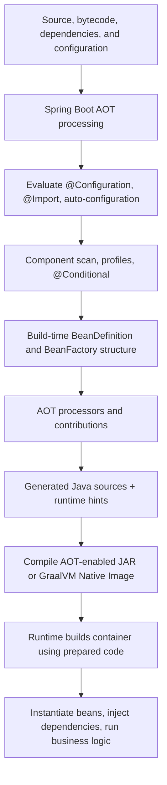
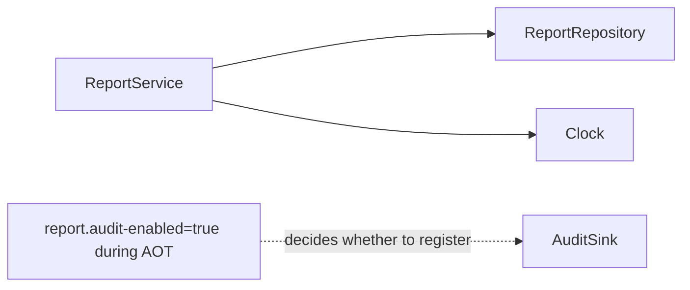

# Configuration Analysis and Preparing BeanFactory During the AOT Phase

In a traditional Spring Boot application, Spring Framework reads configuration, discovers components, evaluates conditions, and prepares the `BeanFactory` when the process starts running. **Spring AOT (Ahead-of-Time)** shifts a significant portion of this work to **build time**: analyzing the application structure in the build environment, determining which beans are needed, and generating code to reconstruct the container structure faster at startup.

This is a critical step when compiling Spring Boot into a **GraalVM Native Image**. Native Image needs to know upfront many components that the application will use; Spring AOT helps make explicit parts that were previously discovered or processed dynamically by Spring. This mechanism can also support running the application on the JVM with generated AOT code; **Spring AOT is not itself a native compiler**.

After this lesson, learners will be able to:

- Explain how `BeanDefinition`, `BeanFactory`, and the *bean graph* relate to Spring AOT.
- Describe the path from Spring Boot configuration to `BeanFactory` initialization code generated during the build.
- Identify the impact of `@Configuration`, component scanning, auto-configuration, `@Conditional`, and profiles on the prepared set of beans.
- Distinguish **build-time bean analysis** from **actual runtime bean instantiation**.
- Determine when to inspect dynamic processing, add AOT contributions or runtime hints, and then test the native build.

## 1. How Is BeanFactory Prepared in Standard JVM Execution?

A Spring Boot application typically begins with `SpringApplication.run(...)`. While preparing the `ApplicationContext`, Spring can:

1. Gather configuration sources: `@Configuration` classes, component scanning, auto-configuration, `@Import`, and bean definitions registered programmatically via APIs.
2. Inspect the classpath, profiles, and environment properties to evaluate conditions such as `@ConditionalOnClass`, `@ConditionalOnProperty`, and `@Profile`.
3. Create or refine `BeanDefinition`s: describing bean type, name, scope, factory method, dependencies, initialization conditions, and related metadata.
4. Allow `BeanDefinitionRegistryPostProcessor` and `BeanFactoryPostProcessor` to process the registry/factory structure according to Spring's contract.
5. Use `BeanFactory` to instantiate beans when needed, resolve dependency injection, and apply lifecycle callbacks when runtime actually initializes the application.

**`BeanDefinition` is not synonymous with a bean instance.** For example, a `BeanDefinition` might describe that the `reportService` bean is created by a constructor taking `ReportRepository` and `Clock`. Only during singleton instantiation does the container invoke the constructor, inject dependencies, and apply the appropriate lifecycle steps.

`BeanFactory` is the component that manages bean definitions as well as bean creation, lookup, and wiring. `ApplicationContext` provides additional application-level capabilities such as events, resources, and environment; underneath, it still relies on a bean factory to manage beans.

For large applications, discovering configuration and resolving the bean graph incurs CPU, memory, and class-loading costs. **Spring AOT aims to shift this early-decidable work to build time**, reducing the amount of dynamic structural processing runtime has to perform.

## 2. What Does Spring AOT Take In and What Does It Produce?

The input to AOT processing is **the Spring Boot application along with its build environment**, including source/bytecode, dependencies, configuration sources, properties, and profiles that affect the graph. The tooling uses Spring to analyze the container model that can be produced under those conditions.

The output typically includes:

| AOT Output | Purpose |
| --- | --- |
| **Generated Java code** | Registers `BeanDefinition`s, wires dependencies, and prepares pre-determined container initialization structures |
| **ApplicationContext/BeanFactory initialization code** | Loads the bean structure along a pre-computed path, reducing dynamic configuration discovery steps at runtime |
| **Runtime hints/metadata** | Describes requirements for reflection, proxies, resources, serialization, JNI, etc. for the Native Image build process |
| **Additional resources and classes** | Artifacts required so that AOT code can be compiled and packaged with the application |

The exact output, generated class names, and file locations depend on the Spring Boot/Spring Framework version and build tooling. Application code should not depend on internal names of auto-generated classes.

`Spring AOT` and `GraalVM Native Image` have distinct roles:

- **Spring AOT** understands Spring's configuration and bean model; it generates container preparation code and provides hints.
- **Native Image** analyzes reachable code and compiles it into a native executable; this process uses both the generated code and the hints supplied by Spring and the application.
- **Runtime** still performs a great deal of real work: instantiating required beans, opening connections, executing callbacks, running business logic, and managing memory.

`Spring AOT` is therefore a **step for preparing application structure**, not an action that "runs the entire application at build time."

## 3. Flow from Configuration Analysis to BeanFactory



### 3.1. Collecting Bean Definitions

Spring analyzes determinable bean sources, such as:

- `@Component`, `@Service`, `@Repository`, `@Controller` from component scanning.
- `@Configuration` and `@Bean` methods.
- `@Import`, Spring Boot auto-configuration, and compatible bean registration mechanisms.
- `BeanDefinition`s registered by infrastructure or extensions during context analysis.

Example of a service using a repository and a system clock:

```java
import java.time.Clock;
import org.springframework.boot.autoconfigure.condition.ConditionalOnProperty;
import org.springframework.context.annotation.Bean;
import org.springframework.context.annotation.Configuration;
import org.springframework.stereotype.Repository;
import org.springframework.stereotype.Service;

@Repository
class ReportRepository {
}

@Service
class ReportService {
    private final ReportRepository repository;
    private final Clock clock;

    ReportService(ReportRepository repository, Clock clock) {
        this.repository = repository;
        this.clock = clock;
    }
}

class AuditSink {
}

@Configuration(proxyBeanMethods = false)
class ReportConfiguration {
    @Bean
    Clock clock() {
        return Clock.systemUTC();
    }

    @Bean
    @ConditionalOnProperty(
        prefix = "report", name = "audit-enabled", havingValue = "true"
    )
    AuditSink auditSink() {
        return new AuditSink();
    }
}
```

Assuming the classes reside in packages scanned by the application with all dependencies present, Spring determines that `ReportService` requires `ReportRepository` and `Clock`; `AuditSink` only joins the graph if its condition is satisfied in the analysis environment.

Here is the *bean graph* at an easily observable level:



**Note:** the example includes `@Service` and `@Repository` classes to illustrate how Spring discovers dependency structure. Real data, database connections, or service execution are not "already completed" merely because Spring has described these beans.

### 3.2. Evaluating Conditions at Build Time

When AOT prepares the container model, decisions that **alter the set of beans** must remain consistent with build conditions. Common factors include:

| Condition Source | Example | What to watch out for |
| --- | --- | --- |
| **Classpath** | `@ConditionalOnClass` | Dependencies and classes visible at build time must match the deployed artifact |
| **Profile** | `@Profile("prod")` | Profiles affect bean structure during AOT processing; changing profiles at runtime cannot implicitly rebuild the entire graph |
| **Conditional property** | `@ConditionalOnProperty` | Values affecting whether a bean is registered must be controlled from the build stage |
| **Bean presence** | `@ConditionalOnBean`, `@ConditionalOnMissingBean` | Outcomes depend on discovered beans and processing order of related configurations |
| **Custom condition** | `@Conditional` or custom registrars | If conditions depend on time, runtime files, network, or mutable data, AOT results can easily become invalid |

For example: if `report.audit-enabled=false` during AOT analysis, you should not expect that simply setting `report.audit-enabled=true` when **running the binary** will add `AuditSink` into the generated graph. This is a **bean structure change**, distinct from changing a business value that an existing bean reads at runtime.

Not *every* Spring Boot property is frozen at build time. Values read at runtime that **do not alter the bean graph** can still be configured normally, depending on the binding mechanism and access timing. Distinguish between:

- **Bean/configuration-selecting properties:** must remain stable between AOT processing and deployment.
- **Runtime data properties:** such as endpoint URLs, timeouts, or secrets read by a bean during initialization/runtime; still test to verify specific behavior.

A sound design rule is: **stable container structure, with operational values configurable within supported boundaries**.

### 3.3. Processing and Contributing AOT Information

Spring Framework provides extension points for the container preparation phase. Two key concepts:

**`BeanFactoryInitializationAotProcessor`** inspects the `BeanFactory` as a whole and can return a contribution to append initialization code at runtime. It is suited for extensions that need a factory-wide view or must add infrastructure initialization steps.

**`BeanRegistrationAotProcessor`** processes information about a registered bean (`RegisteredBean`) and can return a contribution for how that bean is registered/created. It is suited for beans needing custom instantiation, wiring, or metadata that default code generation does not fully cover.

Both contribution groups participate in **build-time code generation**; they do not mean executing business logic immediately at build time. Exact method/API names should be checked against the project's Spring Framework version.

Additionally, **`RuntimeHints`** records technical requirements so native compilation does not omit components used indirectly (such as reflection or resources). Runtime hints govern accessibility of code/resources inside the native executable; they **do not create new `BeanDefinition`s on their own**.

### 3.4. Generating BeanFactory Initialization Code

Once the required beans are known, Spring AOT can generate Java code to register bean definitions and supply appropriate instantiation logic. Consequently, the AOT execution path reduces the need to scan and infer information already known at build time.

The following snippet is **pseudocode explaining the concept**, not a Spring AOT Java API and not meant to be copied into an application:

```text
prepareBeanFactory(factory):
    register("reportRepository", definition(ReportRepository))
    register("clock", definition(factoryMethod: ReportConfiguration.clock))
    register("reportService",
             definition(constructor: [ReportRepository, Clock]))
    if auditWasEnabledWhenGenerating:
        register("auditSink", definition(ReportConfiguration.auditSink))
```

In actual generated files, Spring may produce more complex classes, suppliers, method references, and dependency-handling code. The key takeaway is that **registration and wiring instructions are pre-written from analysis results**, rather than repeating the full dynamic discovery process on every startup.

### 3.5. What Does Runtime Still Do?

Generating `BeanFactory` code does **not** mean all singletons were instantiated during the build. When the process runs, Spring can still:

- Execute constructors, factory methods, and dependency injection.
- Run appropriate callbacks/lifecycle methods such as `@PostConstruct`.
- Establish connection pools, thread pools, schedulers, and real integrations.
- Read supported runtime configuration values.
- Handle HTTP requests, event listeners, and business logic.

This explains why an AOT-enabled application can still encounter database connection errors, wrong credentials, or business-logic errors at runtime. Spring AOT reduces part of the **container preparation** overhead; it does not automatically verify that all external resources are ready.

## 4. Differences Between Spring AOT, Bean Initialization, and GraalVM Native Image

| Concept | Primary Phase | Responsibility |
| --- | --- | --- |
| **Spring AOT configuration analysis** | Build | Determines supported beans/configurations under known conditions |
| **BeanFactory code generation** | Build | Generates Java code/metadata to reproduce registration and wiring |
| **GraalVM Native Image** | Build | Performs reachability analysis and compiles the program into native machine code |
| **Bean instantiation/lifecycle** | Runtime | Creates instances and executes actual initialization steps |
| **Request processing and I/O** | Runtime | Runs business logic, communicates with DBs, message brokers, and external services |

When optimizing startup time or memory, separate the contribution of each layer. Spring AOT can reduce framework work at initialization; Native Image also changes packaging, code loading, and runtime characteristics; the actual application still depends on bean design and dependencies.

## 5. Dynamic Configuration Cases Requiring Careful Evaluation

### 5.1. Registering Beans Based on Data Only Available at Runtime

For instance, a `BeanDefinitionRegistryPostProcessor` fetches a list of tenants over the network and registers each tenant as a separate bean. During AOT processing, that runtime data may not exist yet, may change post-build, or may differ across environments. The generated code will not know the extra set of beans ahead of time.

Remediation approaches depending on the situation:

1. If the tenant set is fixed per build, provide a stable build configuration and test the generated output.
2. If tenants change continuously, avoid turning each tenant into a new `BeanDefinition`; use a regular service/registry holding tenant configuration and look it up dynamically at the business layer.
3. If dynamic registration cannot be avoided, evaluate the extension's AOT contract and design an explicit contribution; verify the native binary along this execution path.

**Principle:** when the number or types of beans depend on unpredictable runtime data, revisit how the model is represented; merely adding runtime hints will not resolve bean-graph decisions.

### 5.2. Reflection Operations

A library might take a class name from a string and use `Class.forName(...)`, constructor reflection, or field reflection. Spring AOT automatically provides hints for many common Spring mechanisms, but **does not guarantee** recognition of every custom reflection call in application code or libraries.

If the type accessed via reflection is known, you can provide a `RuntimeHintsRegistrar`:

```java
import org.springframework.aot.hint.MemberCategory;
import org.springframework.aot.hint.RuntimeHints;
import org.springframework.aot.hint.RuntimeHintsRegistrar;
import org.springframework.context.annotation.Configuration;
import org.springframework.context.annotation.ImportRuntimeHints;

final class AuditPayload {
    public AuditPayload() {
    }
}

class AuditRuntimeHints implements RuntimeHintsRegistrar {
    @Override
    public void registerHints(RuntimeHints hints, ClassLoader classLoader) {
        hints.reflection().registerType(
            AuditPayload.class,
            MemberCategory.INVOKE_PUBLIC_CONSTRUCTORS
        );
    }
}

@Configuration(proxyBeanMethods = false)
@ImportRuntimeHints(AuditRuntimeHints.class)
class AuditNativeConfiguration {
}
```

This example illustrates registering public constructors for reflective access when runtime code genuinely instantiates that type. Register only the members actually needed; if the application uses fields, methods, resources, or dynamic proxies, corresponding hints are required. Afterwards, **test the native binary** to confirm the feature path works.

`RuntimeHintsRegistrar` can also provide resource patterns when the application reads files on the classpath. With `ResourceLoader` reading packaged configuration files, ensure the resources are included in the native executable, not merely present in `src/main/resources` during development.

### 5.3. Changing Profiles or Properties Between Build and Runtime

For example, a service is AOT-built with profile `dev`, yet at native deployment it expects a bean that only exists under profile `prod`. If that structural decision was fixed at build time, runtime configuration will not automatically re-analyze and generate extra beans.

Treat profiles and properties **that affect the graph** as part of the build recipe. If multiple distinct graphs are required, consider building separate artifacts per environment or adjusting the design so differing logic resides inside a bean capable of handling runtime data.

### 5.4. Side Effects During the Analysis Step

Certain framework components or extensions are invoked during AOT analysis. Code in those places should not assume access to production endpoints, create real data, or rely on secrets only present after deployment.

Keep operations related to **bean structure** deterministic and repeatable. Opening connections, sending requests, running migrations, or executing business logic should have explicit, independently controlled execution timing.

## 6. Hands-On Observation of AOT Output

The following examples apply to a Spring Boot project configured with compatible plugins and an appropriate JDK/toolchain. Artifact names and paths vary by project; illustrative commands do not automatically install GraalVM or plugins.

### 6.1. With Maven

```bash
./mvnw -DskipTests spring-boot:process-aot
```

In certain Spring Boot Maven configurations, generated code may appear under directories similar to:

```text
target/spring-aot/main/sources/
target/spring-aot/main/resources/
```

Open the generated code to look for sections related to `ReportService`, `Clock`, or your application's bean names. Observe the initialization and registration code, but do not edit tool-generated files directly; modify configuration sources or extensions and regenerate AOT.

### 6.2. With Gradle

```bash
./gradlew processAot
```

Plugin versions may output code to directories similar to `build/generated/aotSources` along with corresponding resources/classes. Check task output and build configuration for exact locations.

### 6.3. Testing Native Image

Once a compatible GraalVM Native Image toolchain and Native Build Tools are present, the project can provide commands such as:

```bash
# Maven (when a native profile exists)
./mvnw -Pnative native:compile

# Or Gradle
./gradlew nativeCompile
```

Run the actual native file produced, hit endpoints, and inspect logs. For example on macOS/Linux with a hypothetical binary name:

```bash
./target/my-service
```

With Gradle, the artifact usually resides under `build/native/nativeCompile/`; on Windows the executable name may end with `.exe`. The name `my-service` is illustrative and should be replaced with the name from your project configuration.

**Observation exercise:** change `report.audit-enabled` at build time and regenerate the AOT output. Compare the generated code snippets related to `AuditSink`, then run the native build. Next, change only the property value at runtime and observe whether the bean graph changes as expected. This experiment clarifies the difference between bean-determining conditions and ordinary data.

## 7. Checklist for Verifying BeanFactory Correctness After AOT

Successful analysis does not prove that every branch of the application works properly in the native executable. For a Spring Boot service with a database, JSON, and static resources, verify:

| Check | What to confirm |
| --- | --- |
| **Bean graph** | Critical beans are registered; dependency injection and scopes behave as intended |
| **Profiles and conditions** | Build-time choices match the intended deployment profiles/features |
| **Lifecycle** | Constructors, `@PostConstruct`, listeners, and startup tasks execute properly |
| **Reflection/serialization** | JSON binding, DTOs, third-party libraries, and dynamic proxies run on native |
| **Resources** | Required packaged JSON/YAML/templates/certificates can be read at runtime |
| **External services** | Databases, brokers, and TLS are properly configured; connection failures are detected/retried reasonably |
| **Startup and memory** | Record time to readiness, RSS, and process CPU under identical benchmark conditions |
| **Build reproducibility** | Same commit, dependencies, profiles, and toolchain produce equivalent graphs and behavior |

### Example Investigation When a Bean Is Missing in Native

**Symptom:** the JVM application runs fine, but the native binary fails to start because a dependency requiring `AuditSink` is missing.

**Investigation steps:**

1. Identify which bean requires `AuditSink` and which condition enables it.
2. Check the value of `report.audit-enabled`, profiles, and classpath **while AOT ran**.
3. Inspect the generated AOT code: was `auditSink` registered?
4. Compare values and artifacts at runtime, especially if build and deploy use separate pipelines.
5. If the failure stems from a condition changing at runtime, either fix the appropriate bean structure or redesign the feature toggle mechanism; then rebuild and retest.

If AOT code **does** define the bean yet instantiation fails, shift investigation toward constructors, dependencies, lifecycle, reflection/resources, and infrastructure errors. Distinguishing between **bean registration** and **bean instantiation** failures prevents adding hints for the wrong problem.

## 8. Common Misconceptions

**"AOT instantiates all bean objects during the build."** False. AOT primarily analyzes configuration and generates code to assist container initialization; many instances and lifecycle steps still execute when the application runs.

**"Using Spring AOT means you already have a Native Image."** False. Spring AOT prepares the Spring model; GraalVM Native Image is a separate native compilation stage. AOT code can also run within an appropriate JVM context.

**"Adding runtime hints makes conditions automatically register every bean."** False. Hints concern accessibility of code, resources, or reflection; deciding **which beans exist** belongs to configuration/`BeanFactory`.

**"Changing profiles at runtime always builds a fresh graph."** Do not assume this with AOT: decisions made during ahead-of-time processing must be controlled consistently across build and deployment.

**"A passing native build guarantees zero runtime errors."** False. Rare code paths, custom reflection, resources, and external systems still require integration tests against the native binary.

## 9. Takeaways and Application

- `BeanDefinition` describes a bean; `BeanFactory` registers and manages bean creation. Spring AOT prepares **that structure** from build-time analysis results.
- Component scanning, auto-configuration, `@Conditional`, profiles, classpath, and bean post-processing can influence the predetermined set of beans.
- AOT processors provide extension points to contribute preparation code for the `BeanFactory` or individual beans; runtime hints describe dynamic access needs for Native Image.
- After code generation, runtime still instantiates beans and executes business logic; AOT optimization does not replace testing dependencies, I/O, and lifecycle behavior.
- When evaluating Spring Boot Native Image benefits for **startup** and **memory**, measure from the same commit while verifying build/runtime configuration, bean graph, and functional compatibility.

A worthwhile exercise is to take a small Spring Boot service, add a conditional bean, run `process-aot`, read the generated code, and note the difference when changing the condition **before build** versus **after build**. Direct observation makes clear why Spring AOT demands a stable and predictable container model.
