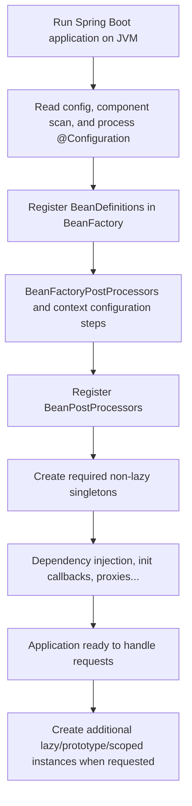
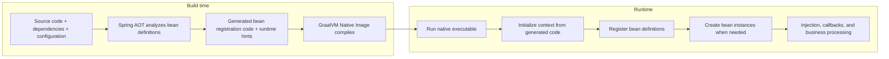
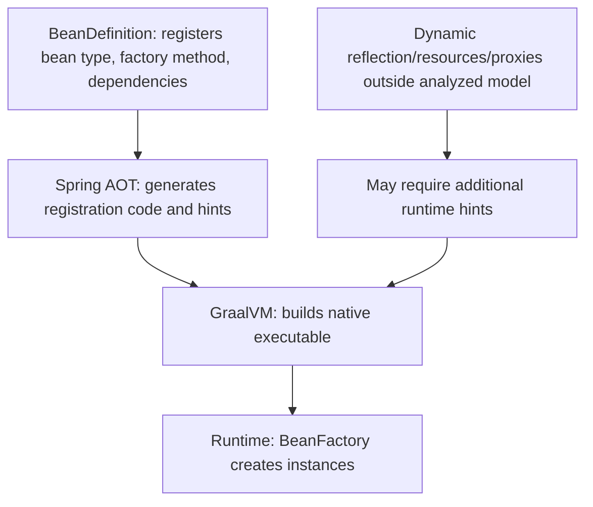

# Bean Definition vs. Bean Instance and When Each Is Processed

In **Spring AOT** (*Ahead-of-Time processing*), Spring Boot analyzes most of the application context structure **before the application runs** to generate initialization code suitable for GraalVM Native Image. This often leads to a misconception: "Spring AOT already processed the beans during the build, so are the beans already pre-created inside the native executable?" The answer is **no**, when talking about ordinary business objects.

To understand this process accurately, you must distinguish **`BeanDefinition`** — the blueprint describing how Spring will manage and create a bean — from a **bean instance** — the actual Java object the application uses. They differ in when they exist and what role they play. This distinction also helps explain errors when building Spring Boot into a GraalVM Native Image, especially with conditional configuration, dynamic bean registration, reflection, and runtime resources.

## 1. Two Concepts to Keep Separate

### `BeanDefinition`: The Blueprint Telling Spring What to Do

A `BeanDefinition` is metadata inside the `BeanFactory` describing **the recipe for creating and managing a bean**. It can contain information about:

- Bean type, bean name, and registration source (for example, a class scanned from `@Component` or a `@Bean` method).
- How to instantiate it: constructor, factory method, instance supplier, and arguments or dependencies to resolve.
- Scope such as `singleton` or `prototype`; `lazy-init` flag; initialization or destruction method names if any.
- Qualifiers, bean role, and other metadata used for selection, wiring, and lifecycle processing.

A `BeanDefinition` is **not** a business object. The fact that Spring has registered a `BeanDefinition` for `PaymentService` does not mean the `PaymentService(...)` constructor has executed, the database has been connected, or business fields have been populated.

For typical application code, annotations serve as the **input source** for Spring to discover and register definitions. For example:

```java
@Service
public class PaymentService {
    private final PaymentRepository repository;

    public PaymentService(PaymentRepository repository) {
        this.repository = repository;
    }

    public void pay(long orderId) {
        // Payment business logic.
    }
}
```

The `@Service` annotation helps Spring recognize the class and create the corresponding bean definition; the constructor runs only when Spring actually needs to create the instance according to the bean's lifecycle.

### Bean Instance: The Object Created from the Blueprint

A **bean instance** is a real object, such as a concrete `PaymentService` holding a reference to `PaymentRepository`. When creating a bean, the container typically:

1. Selects the definition and resolves dependencies.
2. Invokes the constructor or factory method, or uses an appropriate supplier.
3. Performs injection and `BeanPostProcessor` processing steps.
4. Executes initialization callbacks such as `@PostConstruct` or `InitializingBean.afterPropertiesSet()` if present.
5. Makes the initialized object available for use, possibly through a container-managed proxy.
6. For applicable scopes, runs destruction logic when the lifecycle ends.

One bean name typically points to a single singleton instance per `BeanFactory`, though not always. `prototype` can create a new instance on each request; request-scoped beans have instances tied to a single request; Spring can also return a proxy, making the object type seen by the caller differ from the target implementation.

| Attribute | `BeanDefinition` | Bean instance |
| --- | --- | --- |
| Nature | Metadata/recipe for creating a bean | Actual Java object |
| Stored/looked up by | `BeanDefinitionRegistry`, `BeanFactory` | `BeanFactory` and the corresponding instance/scope manager |
| Has the business constructor run? | Not necessarily | Object creation step has run |
| Can it be used for business calls? | No | Yes, after appropriate initialization |
| Relation to Spring AOT | Key input for analysis and generating registration code | Normally created when the application executes |
| Can there be multiple instances for one definition? | One definition describes how to supply the bean | Yes, e.g., `prototype` or other scopes |

**Key takeaway:** "Spring knows how to create a bean" and "Spring has already created a bean" are two different statements.

## 2. On the JVM, In What Order Do Definitions and Instances Appear?

In standard Spring Boot execution mode, context initialization generally follows this high-level sequence:



The diagram shows a **high-level** sequence: infrastructure beans may be created early to support subsequent processing steps; some registration and processing activities interleave. Do not assume all beans are created simultaneously or wait until the application is already serving HTTP traffic.

For standard `singleton` beans, Spring creates the instance during `ApplicationContext.refresh()`, unless the bean is configured as lazy or uses a special mechanism. With `@Lazy`, having a definition does not trigger the constructor: the instance is created only when requested, unless an eager bean depends on it earlier. With `prototype`, the container creates instances for each appropriate request and does not manage full destruction lifecycle as it does for singletons.

## 3. When Spring AOT Is Enabled, Which Part Shifts to Build Time?

Spring AOT focuses on **analyzing the container configuration** and generating code to assist context initialization. With Spring Boot integrated with GraalVM Native Image, two phases must be distinguished:

| Phase | Primary Activity | Are business beans created for later use? |
| --- | --- | --- |
| **AOT processing at build time** | Identifies many bean definitions, processes pre-evaluatable configuration/conditions, aggregates metadata, generates bean registration code and runtime hints | **Does not** pre-create business instances and freeze them for runtime reuse |
| **Native-image compilation at build time** | Performs reachability analysis and compiles required code and metadata | Not an application startup session serving requests |
| **Application startup at runtime** | Runs generated bootstrap code, builds the context, registers definitions, instantiates required beans, injects dependencies, and runs lifecycle callbacks | **Yes**, needed instances are created during process execution |



Code generated by Spring AOT may include generated bean definitions, instance suppliers, initializers, and reflection/resource/proxy hint registrations. Class names and generated code structure vary across Spring versions, so you should not rely on a fixed filename pattern.

Conceptual example (pseudocode, not actual generated code from a specific Spring version):

```java
// BUILD TIME - conceptual illustration, not an API recommended for copying.
BeanDefinition description = analyzeBeanConfiguration(...);
GeneratedCode output = generateRegistrationCode(description);

// RUNTIME - illustrates the sequence after running the binary.
registerGeneratedDefinitions(beanFactory);
PaymentService service = beanFactory.getBean(PaymentService.class);
```

At runtime, `getBean(...)` may return an already-created instance or trigger new creation depending on the bean's scope and state.

### Important Exception: Some Beans May Be Created While AOT Is Analyzing

Do not interpret "AOT analyzes definitions" as a rule that **no constructors ever run during the build**. Spring may need to instantiate **certain infrastructure beans** — particularly processors involved in refining the bean factory, processing configuration, and participating in AOT — to gather required information.

This does **not** mean infrastructure instances or application beans are "carried over as live objects" from the build machine to native runtime. You must distinguish **temporary execution for build-time analysis** from **runtime lifecycle of instances serving the application**.

Therefore, do not rely on side effects from constructors or processors during the build phase to generate business data, send emails, migrate databases, or call external services. If a piece of logic might run during AOT analysis, ensure it does not depend on the production environment and causes no unintended side effects.

## 4. Practical Example: Definition Exists, Instance Not Yet Created

Consider an application with a `DeliveryClient` bean that is only instantiated when needed. The example sits in package `com.example.delivery`; each class snippet can be saved to a file with the matching name.

```java
// DeliveryClient.java
package com.example.delivery;

public final class DeliveryClient {
    private final String endpoint;

    public DeliveryClient(String endpoint) {
        this.endpoint = endpoint;
        System.out.println("CONSTRUCTOR: DeliveryClient -> " + endpoint);
    }

    public String endpoint() {
        return endpoint;
    }
}
```

```java
// DeliveryConfiguration.java
package com.example.delivery;

import org.springframework.beans.factory.annotation.Value;
import org.springframework.context.annotation.Bean;
import org.springframework.context.annotation.Configuration;
import org.springframework.context.annotation.Lazy;

@Configuration(proxyBeanMethods = false)
public class DeliveryConfiguration {

    @Bean
    @Lazy
    DeliveryClient deliveryClient(@Value("${delivery.endpoint}") String endpoint) {
        System.out.println("FACTORY METHOD: deliveryClient");
        return new DeliveryClient(endpoint);
    }
}
```

Illustrative configuration in `src/main/resources/application.properties`:

```properties
delivery.endpoint=https://delivery.example.test
```

The `@Bean` configuration creates a **definition** for a bean named `deliveryClient`, whose creation strategy is invoking the factory method `deliveryClient(...)`. `@Lazy` requests deferring singleton instantiation until the bean is needed (unless another dependency forces earlier creation). `@Value` is resolved by Spring when creating the bean; this is an example of **a configuration value needed at runtime**, different from a condition determining *whether a bean definition exists* at build time.

Both the definition and singleton state can be observed via the context:

```java
// DeliveryApplication.java
package com.example.delivery;

import org.springframework.beans.factory.config.BeanDefinition;
import org.springframework.beans.factory.config.ConfigurableListableBeanFactory;
import org.springframework.boot.SpringApplication;
import org.springframework.boot.autoconfigure.SpringBootApplication;
import org.springframework.context.ConfigurableApplicationContext;

@SpringBootApplication
public class DeliveryApplication {
    public static void main(String[] args) {
        ConfigurableApplicationContext context =
                SpringApplication.run(DeliveryApplication.class, args);

        ConfigurableListableBeanFactory factory = context.getBeanFactory();
        BeanDefinition definition = factory.getBeanDefinition("deliveryClient");

        System.out.println("Definition exists: " + (definition != null));
        System.out.println("Lazy: " + definition.isLazyInit());
        System.out.println("Singleton created: " + factory.containsSingleton("deliveryClient"));

        DeliveryClient first = context.getBean(DeliveryClient.class);

        System.out.println("Singleton created: " + factory.containsSingleton("deliveryClient"));
        DeliveryClient second = context.getBean(DeliveryClient.class);
        System.out.println("Same instance: " + (first == second));
    }
}
```

In a sample application with no other eager bean requesting `DeliveryClient` beforehand, the expected output is:

```text
Definition exists: true
Lazy: true
Singleton created: false
FACTORY METHOD: deliveryClient
CONSTRUCTOR: DeliveryClient -> https://delivery.example.test
Singleton created: true
Same instance: true
```

The order or appearance of other framework log lines depends on configuration. This is an **observation pattern**: if the singleton was already requested earlier elsewhere, `Singleton created: false` may instead print `true`.

Connection to AOT: the **definition** is understood by Spring AOT and translated into generated registration code during the build; meanwhile, logs from the lazy bean's factory method and constructor normally appear when **the native executable is running and the bean is requested**. Instantiation code does not need to execute at build time just for Spring to know that factory method exists.

## 5. How Do Scope and Laziness Affect Instance Creation Timing?

A bean definition may exist from the moment the context is built, but when the instance is created depends on scope and usage:

| Declaration | When does the definition take effect? | When is the instance created? | Observable behavior |
| --- | --- | --- | --- |
| Default `@Component`/`@Bean` singleton | When Spring registers definitions into the context | Typically during the context's singleton initialization phase | Two `getBean` calls typically return the same instance |
| `@Lazy` singleton | Definition is still registered | First time the bean is needed, unless triggered by an eager dependency | Constructor runs later |
| `@Scope("prototype")` | Definition is still registered | Each time the container is asked to create a prototype | Two `getBean` calls typically yield two objects |
| Request scope in a web application | Definition is registered | When an HTTP request needs that bean | Each request has an instance per scope |
| Singleton depending on prototype | Both definitions are registered | Prototype is created when the singleton requires injection | Prototype does not automatically change on every method call on the singleton |

Scope example:

```java
@Bean
@Scope(ConfigurableBeanFactory.SCOPE_PROTOTYPE)
ReportFormatter reportFormatter() {
    return new ReportFormatter();
}
```

Requires importing `org.springframework.beans.factory.config.ConfigurableBeanFactory` and `org.springframework.context.annotation.Scope`. With prototype scope, Spring creates a new instance per lookup from the container; if a prototype is injected directly into a singleton **once**, the singleton continues holding that instance unless `ObjectProvider` or an equivalent lookup mechanism is used.

**AOT does not change the semantics of scopes.** It optimizes the registration and creation path; beans must still obey Spring-supported lifetime rules.

## 6. `@Bean` and `@Configuration`: Processing Definitions vs. Executing Factory Methods

A `@Configuration` class containing `@Bean` methods is commonly used by Spring to register bean definitions. There are three distinct activities:

1. **Configuration discovery:** Spring reads `@Configuration`, `@Bean`, and related annotations to know which definitions the application has.
2. **Building the initialization path:** Spring prepares how to invoke the factory method and resolve parameters; in AOT, it can generate code for these operations.
3. **Creating the bean instance:** Spring invokes the factory method when the bean actually needs to be created, executing the code inside the method.

Example:

```java
@Configuration(proxyBeanMethods = false)
class AnalyticsConfiguration {

    @Bean
    AnalyticsService analyticsService(EventRepository repository) {
        // Normally runs when the AnalyticsService instance is created.
        return new AnalyticsService(repository);
    }
}
```

Spring AOT can analyze that the `analyticsService` bean depends on `EventRepository` and is created by a known factory method. **Being able to analyze the call does not mean the factory method has already run to create an instance for application runtime.**

### What Does `proxyBeanMethods = false` Affect?

With `@Configuration(proxyBeanMethods = false)`, a **direct** Java call from one configuration method to another `@Bean` method is not intercepted by CGLIB to look up the container-managed singleton. Therefore, pass dependencies via method parameters:

```java
@Configuration(proxyBeanMethods = false)
class MetricsConfiguration {

    @Bean
    MetricsRepository metricsRepository() {
        return new MetricsRepository();
    }

    @Bean
    MetricsService metricsService(MetricsRepository repository) {
        return new MetricsService(repository);
    }
}
```

Rather than calling `metricsRepository()` directly inside `metricsService(...)`. Using parameter injection makes the dependency relationship explicit to Spring, supporting both JVM and AOT. Depending on the case, calling a factory method directly can create **a Java object outside bean management** and violate singleton expectations; this is a design bug distinct from whether AOT generates definitions.

## 7. Build-Time Configuration Conditions vs. Runtime Data

This is a critical distinction when deploying a Native Image across multiple environments.

Suppose an application declares:

```java
@Configuration(proxyBeanMethods = false)
class StorageConfiguration {

    @Bean
    @ConditionalOnProperty(
        prefix = "storage",
        name = "provider",
        havingValue = "s3"
    )
    StorageClient s3StorageClient() {
        return new S3StorageClient();
    }
}
```

Note that `@ConditionalOnProperty` belongs to `org.springframework.boot.autoconfigure.condition`; `StorageClient` and `S3StorageClient` are hypothetical application types.

In standard JVM mode, the condition is evaluated when the container processes startup configuration. With Spring AOT, **conditions evaluated at build time can determine the generated set of bean definitions upfront**. If built with configuration that excludes the S3 definition, you cannot assume changing `storage.provider` at runtime will make that definition magically appear in the native executable. To support multiple bean implementations varying at runtime, design the supported implementations into the build-known set and select among them using runtime data via an appropriate mechanism.

Distinguish two groups of values:

| Question | Example | Impact in AOT/native |
| --- | --- | --- |
| **Should this definition be registered?** | `@ConditionalOnProperty`, `@Profile`, certain auto-configuration conditions | Can be decided at AOT build time; changing the condition post-build does not necessarily create a new definition |
| **When creating the instance, what data is used?** | URLs, timeouts, tokens, credentials injected via runtime configuration | Can still be read at runtime if properly programmed and bound; not implicitly frozen with definitions |
| **In this request, which branch runs?** | Selecting a strategy per request type from a built-in set | Usually a normal runtime decision if required code and metadata exist in the binary |

Do not infer that **every** property is fixed after a native build. Nor should you assume you can change profiles or conditional properties at runtime to arbitrarily add bean definitions that Spring AOT did not include in the generated context. Exact details depend on condition type, processing phase, and Spring Boot version.

### Note on Environment-Specific Configuration

A common deployment mistake: building a native image with profile/condition set A, then running the container in environment B and expecting beans that only exist under condition B to appear. Clearly identify **which configuration determines context structure at build time** and **which configuration only supplies values to instances at runtime**. For the Native Image module, this must be tested per configuration variant or redesigned around a supported set of beans.

## 8. Bean Factory Post-Processors and Dynamic Bean Registration

Extension points such as `BeanDefinitionRegistryPostProcessor` or `BeanFactoryPostProcessor` can add or modify definitions when the container starts on the JVM. In an application running on the JVM, such code can insert additional definitions into the registry at startup using a dynamic rule.

Spring AOT needs to analyze the definitions model and generate corresponding code **during the preprocessing phase before the native build**. Therefore, a component that only decides to register beans based on indeterminate runtime data (such as a list of plugins fetched from a database after the container starts) is very likely incompatible with the generated model. If a processor participates in the AOT phase, it must be designed to produce a model that can be stably built at build time; custom runtime manipulations must be evaluated for their specific limits.

Example business requirement:

> The system retrieves a list of notification channels from the database at startup and automatically creates each channel as a new Spring bean.

This design may work on the JVM, but requires caution in Native Image because classes and metadata must be known ahead of time. A more controllable approach is to pre-register supported implementations in the binary, then **select or configure them from the database at runtime** without creating new Java classes outside the built set. If loading new plugin JARs is genuinely required, consider separate process/API boundaries for extensibility.

Do not confuse `BeanFactoryPostProcessor` with `BeanPostProcessor`:

- `BeanFactoryPostProcessor` acts on **metadata/definitions** before most regular beans are instantiated.
- `BeanPostProcessor` acts on **instances** during creation or initialization, such as applying wrapping/proxies.

Both can be essential infrastructure, but they operate at different layers. Spring AOT also has dedicated contracts for contributing logic and pre-generated code before runtime; you cannot conclude an arbitrary custom processor is automatically compatible just because it works on the JVM.

## 9. Impact on Reflection, Resources, and GraalVM Native Image

GraalVM Native Image operates under a *closed-world* assumption: the set of code and dynamic access types the program may need must be identified or declared at build time. Spring AOT leverages the definitions model to generate initialization code and many required **runtime hints**.

There are three distinct layers:



For example: the framework sees `@Bean ReportService reportService(ReportRepository repo)` and can generate how to create `ReportService` without discovering the factory method via reflection at runtime. However, if **inside `ReportService`** it calls `Class.forName` with a class name sent by a request, Spring AOT cannot automatically know every possible string value. That case may still require reflection hints or a design change.

Similarly, having a `BeanDefinition` for `TemplateRenderer` does not automatically embed every dynamically constructed template filename into the binary. Resources must be present in build inputs and, when the framework does not declare enough automatically, require corresponding resource hints.

**Principle:** generated definitions solve Spring **knowing how to provide beans**; reachability metadata ensures Native Image retains **the code and dynamic access capabilities** needed along the bean's execution path. The two concerns are closely related but do not replace each other.

## 10. Building, Observing, and Testing at the Right Time

For a Spring Boot project integrated with GraalVM Native Build Tools, typical commands are:

```bash
# Maven project configured with native profile and corresponding plugins.
./mvnw -Pnative native:compile

# Gradle project with the Native Build Tools plugin applied.
./gradlew nativeCompile
```

These commands depend on project configuration, Spring Boot version, and installed build tools. In practice, observe **two separate places**:

1. **Logs during AOT/native build:** prove only that build-time processing and compilation occurred; they may reveal context analysis details or processor errors.
2. **Logs from the running native executable:** show when constructors, factory methods, `@PostConstruct`, and runtime business interactions actually occurred.

Do not use a log line printed during the build to conclude that a business instance was pre-saved into the binary. Conversely, a lazy bean's constructor not appearing at startup does not prove its bean definition was unregistered.

### Investigation Checklist When JVM and Native Behaviors Differ

| Symptom | Distinguish first | Investigation direction |
| --- | --- | --- |
| Bean not found by name/type | Does the definition exist in the native context? | Check `@Conditional`, profiles, component scanning, custom registration, and the AOT phase |
| Bean has definition but fails on `getBean` | Did instance creation/dependencies/injection fail? | Check constructor, factory method, init callbacks, circular dependencies, runtime config |
| Singleton initializes later than expected | Is there `@Lazy`, scope, or a provider? | Identify when `getBean`/injection is invoked |
| Bean initializes but internal reflection fails | Is Native Image metadata missing? | Check type/member reflection hints matching the dynamic access |
| Changing runtime property fails to create new bean | Is the property selecting a definition or passed as constructor arg? | Review conditions evaluated by AOT in that build |
| Logic produces unexpected side effects during AOT build | Was an infrastructure bean/processor created during analysis? | Separate build-time logic from connections, writes, and runtime actions |

### Four Questions to Diagnose the Right Layer

For each failure, ask in order:

1. **Was the definition registered?** If not, this is a configuration/bean registration or AOT-phase issue; editing the constructor is usually off target.
2. **Was the instance created?** If not, check `@Lazy`, scope, dependency resolution, and the `getBean` call site.
3. **Created yet unusable?** Check injection, `BeanPostProcessor`, initialization callbacks, proxies, and exceptions inside the factory method.
4. **Bean works on JVM but native fails on a specific branch?** Check reflection/resources/proxies/JNI and native test coverage.

## 11. Self-Check Exercise

Consider the following scenario:

```java
@Configuration(proxyBeanMethods = false)
class ReportConfiguration {

    @Bean
    @Lazy
    ReportService reportService(ReportRepository repository) {
        System.out.println("Creating ReportService");
        return new ReportService(repository);
    }
}
```

Assume Spring AOT discovers the definition above when building a Native Image application, no other eager bean depends on `ReportService`, and Spring has registered the necessary dependencies.

**Question 1:** At build time, what information can Spring know about `ReportService`? Must the line `Creating ReportService` be printed during the AOT phase?

**Question 2:** If `context.getBean(ReportService.class)` is called for the first time after the application has started, when do the constructor and factory method execute? Do two retrievals of the bean return the same object?

**Question 3:** Changing `@Lazy` to `@Scope("prototype")` alters what about the definition and instances? If a prototype is injected once into a singleton, does it create a new object on every business call?

**Question 4:** If `@ConditionalOnProperty` is added to register `ReportService` only under a specific profile/configuration, what must be checked when building natively once but running across multiple environments?

**Question 5:** After `ReportService` is created, it invokes `Class.forName(formatterName)` based on a runtime value. Is having the `BeanDefinition` for `ReportService` sufficient to guarantee every formatter works in the native executable? Why?

### Reference Hints

- **1:** AOT can know the bean name, factory method, type, dependencies, scope/laziness, and related metadata; the business bean's factory method does not need to run just to create the definition.
- **2:** A lazy bean is created when first genuinely needed; singletons are normally reused within the same context.
- **3:** The definition describes a prototype, and the container creates an instance per request; direct injection into a singleton does not automatically become a per-use lookup.
- **4:** You must identify which conditions determined the set of definitions at build time; do not assume every condition can be switched at runtime merely by changing environment variables.
- **5:** Not sufficient; dynamic class lookup may require reflection metadata, and all required implementations must be present in the native build inputs.

**Learning outcome:** explain the relationship between `BeanDefinition` and instance, identify when each is processed on the JVM and in Spring AOT/native, and distinguish **missing definition**, **instance initialization**, and **reachability metadata** errors.
