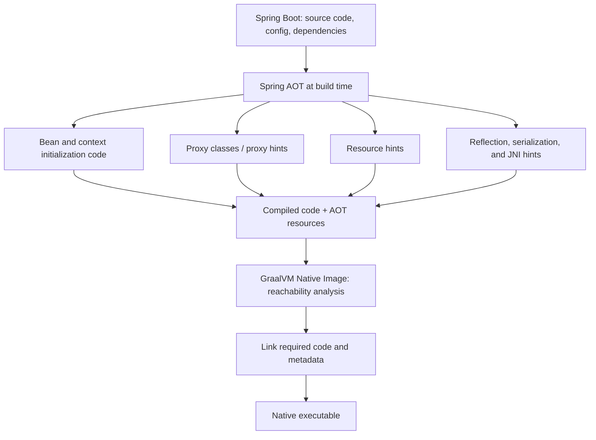

# Generating Proxies, Resources, and Metadata for Further GraalVM Analysis

## 1. The Problem Spring AOT Needs to Solve

When running a Spring Boot application on the JVM, the framework can look up classes, read annotations, instantiate beans, generate proxies, and load resources at runtime. For example, Spring can create proxies for beans using `@Transactional` or `@Cacheable`; the application can invoke `Class.forName(...)` or read a JSON file from the classpath when receiving the first request.

GraalVM Native Image uses a **reachability analysis** model to determine which code segments and data must be compiled into the executable. Statically determinable operations are usually analyzed well. Conversely, selecting classes by string name, generating proxies from interface names, or loading resources via runtime-computed paths may leave the compiler without enough information.

**Spring Ahead-of-Time (Spring AOT)** shifts part of Spring's initialization work to build time, generating code and registering the required **runtime hints**. GraalVM uses the AOT output alongside application bytecode, libraries, and metadata to perform further analysis and compile the native executable.

This lesson focuses on three groups of information that directly affect the outcome:

1. **Proxies:** which classes or interfaces must be usable by Spring or the application as proxies.
2. **Resources:** which classpath files and resource bundles must be packaged to be readable at runtime.
3. **Metadata:** which types, constructors, methods, fields, or special mechanisms require dynamic access even though static analysis cannot fully deduce them.

The ultimate goal is to preserve business behavior between the JVM-running Spring Boot application and the GraalVM Native Image build, while leveraging startup and memory-usage benefits when measured under realistic workloads.

## 2. Processing Chain: Spring AOT Prepares, GraalVM Analyzes Further



During the AOT phase, Spring inspects bean definitions and configurations knowable at build time. The framework can generate Java code to assist bean instantiation, register `ApplicationContext` initialization configuration, and prepare proxies required for recognized Spring features. AOT support mechanisms in Spring and libraries also contribute **`RuntimeHints`**, describing reflection, Java dynamic proxy, resource, serialization, or JNI access.

When GraalVM analyzes the application, metadata helps it understand runtime behaviors that cannot be inferred from static calls. However, keep these clearly separated:

| Component | Role | What it does **not** do |
| --- | --- | --- |
| Spring AOT initialization code | Reduces lookup and bean-structure setup work at startup | Does not turn every dynamic component into static code |
| Build-time generated proxies | Prepares proxies known to Spring upfront | Does not guarantee a library can generate arbitrary subclasses at runtime |
| `RuntimeHints` | Declares required dynamic accesses | Does not fix application logic or guarantee every branch was tested |
| Native Image metadata | Supplies configuration to GraalVM during analysis/build | Is not a mechanism for arbitrary reconfiguration after the executable is built |
| Reachability analysis | Selects components needed for the binary | Does not automatically know every class/resource string constructed from runtime data |

A *hint* is an input telling the compiler to support a behavior. It does not mean every registered class will be instantiated, every method will be invoked, or every compatibility issue has been resolved.

## 3. Proxies in Spring Boot: Which Kinds Are Generated and Why?

### 3.1. Proxies Appear in Familiar Features

A proxy intercepts calls to an object to add behaviors such as transactions, caching, security, or asynchronous execution. In Spring, a classic example is:

```java
@Service
public class OrderService {

    @Transactional
    public void placeOrder(Order order) {
        // Execute business logic inside a transaction.
    }
}
```

Typically, `@Transactional` is implemented via a Spring AOP proxy. In an application configured to use proxies, calls **through the proxy** are intercepted to open/close transactions; direct calls from one method of the bean to another method on **the exact same object** (*self-invocation*) do not automatically pass through the proxy. That is an AOP rule to note on both JVM and Native Image, not a native-only bug.

There are two common approaches:

| Proxy Type | How It Works | Key Conditions and Limitations |
| --- | --- | --- |
| **JDK dynamic proxy** | Creates an object implementing a set of interfaces | Only proxies calls made through the implemented interfaces |
| **Class-based proxy** (often CGLIB-based in Spring AOP) | Creates a subclass of the target class | Depends on inheritance and overriding capability; `final` classes/methods cannot be overridden normally |

Spring AOT can identify and pre-generate proxies Spring requires from bean configurations known during the build. JDK dynamic proxy metadata can also be declared via `RuntimeHints` if application or library code invokes proxy-creation APIs directly. These two cases are related but not identical.

### 3.2. What Must Be Declared for JDK Dynamic Proxies?

Suppose an external integration uses the following interface:

```java
package com.example.nativeimage;

public interface RatePort {
    int rateFor(String category);
}
```

A library might construct a proxy using Java Reflection:

```java
RatePort port = (RatePort) java.lang.reflect.Proxy.newProxyInstance(
    RatePort.class.getClassLoader(),
    new Class<?>[] { RatePort.class },
    (proxy, method, arguments) -> {
        if ("rateFor".equals(method.getName())) {
            return 10;
        }
        throw new UnsupportedOperationException(method.getName());
    }
);
```

When running on the JVM, the proxy class can be created dynamically. In a native executable, the interface list must be known to GraalVM ahead of time via toolchain-supported metadata mechanisms. When AOT does not collect this automatically, register:

```java
hints.proxies().registerJdkProxy(RatePort.class);
```

If a proxy implements **multiple interfaces**, declare the exact set of interfaces requested by the proxy creation call, including order when behavior or interface combination depends on ordering. Do not register every interface in the application "just in case": excessive metadata makes tracking compatibility causes harder and can increase analysis work.

### 3.3. How Are Subclass-Based Proxies Different?

JDK proxy metadata describes a list of **interfaces**; it is not a way to turn arbitrary classes into subclass proxies. For class-based proxies used by `@Transactional`, `@Async`, or `@Cacheable`, Spring AOT prepares the proxies the framework can determine from bean definitions and their corresponding advisors.

If a third-party library uses Byte Buddy, CGLIB, or a bytecode generation library to **create an arbitrary class at runtime**, simply adding `registerJdkProxy` or reflection hints will not reliably solve it. Check the library's native support, build-time code generation capabilities, declarative configuration options, or replace it with an approach that does not depend on runtime class generation.

Do not mechanically force `@Configuration(proxyBeanMethods = false)` just to "avoid proxies." That option can be helpful for independent factory-style configurations, but it can change the semantics of direct calls between `@Bean` methods. Evaluate actual configuration logic first.

## 4. Resources: A File Existing in a JAR Is Not Guaranteed to Enter the Native Binary

On the JVM, resources on the classpath are typically read via `ClassLoader.getResourceAsStream`, `ResourceLoader`, or `ClassPathResource`. Native Image needs to know **which non-class resources must be included in the image**. Having a resource in `src/main/resources` or inside a dependency JAR does not guarantee it is packaged into the executable in a runtime-readable manner.

Suppose the application needs:

```text
src/main/resources/
  rules/
    pricing.json
  messages.properties
  messages_vi.properties
```

Java example reading a configuration file:

```java
import java.io.IOException;
import java.io.InputStream;
import java.nio.charset.StandardCharsets;
import org.springframework.core.io.ClassPathResource;

public class PricingFileReader {

    public String readJson() throws IOException {
        var resource = new ClassPathResource("rules/pricing.json");
        try (InputStream stream = resource.getInputStream()) {
            return new String(stream.readAllBytes(), StandardCharsets.UTF_8);
        }
    }
}
```

If this path is not detected by Spring AOT or another metadata collection mechanism, register it with:

```java
hints.resources().registerPattern("rules/pricing.json");
```

For `ResourceBundle.getBundle("messages", locale)`, you can declare the bundle by **base name**:

```java
hints.resources().registerResourceBundle("messages");
```

Do not confuse `messages` with the filename `messages.properties` in the bundle registration API. When applying this to a native build, test the supported locales to verify fallback behavior and that the corresponding files are found.

**Choose narrow patterns whenever possible.** A pattern like `rules/**` or `**/*` can pull unnecessary files into the binary and bloat artifact size. Avoid embedding private keys, tokens, or secret configurations as executable resources. Values that vary by environment or require rotation should be provided from external configuration sources suited to your operations.

### Distinguishing Embedded Resources from External Files

- **Classpath resources:** belong to the artifact and can be packaged into the binary via metadata.
- **External filesystem files:** read from volumes, working directories, or configured paths at runtime; declaring a resource hint does not cause an external file to appear automatically.
- **Resource bundles:** a family of resources keyed by base name and locale; handled through a dedicated bundle mechanism.
- **Classes and bytecode:** inspected by GraalVM via reachability analysis; do not use resource patterns to work around missing reflective classes.

## 5. RuntimeHints: The Central API for Contributing Metadata

Spring provides the `org.springframework.aot.hint.RuntimeHintsRegistrar` interface for cases where an application or library must inform Native Image of additional details.

The following example illustrates JDK proxy, classpath resource, resource bundle, and reflection **together**. Assume the project already defines `RatePort` and `PricingRule` in package `com.example.nativeimage`:

```java
package com.example.nativeimage;

import org.springframework.aot.hint.MemberCategory;
import org.springframework.aot.hint.RuntimeHints;
import org.springframework.aot.hint.RuntimeHintsRegistrar;
import org.springframework.context.annotation.Configuration;
import org.springframework.context.annotation.ImportRuntimeHints;

@Configuration(proxyBeanMethods = false)
@ImportRuntimeHints(AppNativeHints.class)
class NativeSupportConfiguration {
    // Discovered by Spring via component scan or when importing this configuration.
}

final class AppNativeHints implements RuntimeHintsRegistrar {

    @Override
    public void registerHints(RuntimeHints hints, ClassLoader classLoader) {
        // Java dynamic proxy created directly by application or library code.
        hints.proxies().registerJdkProxy(RatePort.class);

        // Resource under src/main/resources.
        hints.resources().registerPattern("rules/pricing.json");

        // ResourceBundle: messages.properties, messages_vi.properties...
        hints.resources().registerResourceBundle("messages");

        // Permit reflective access to a type that may be selected dynamically.
        hints.reflection().registerType(
            PricingRule.class,
            MemberCategory.INVOKE_DECLARED_CONSTRUCTORS,
            MemberCategory.INVOKE_PUBLIC_METHODS
        );
    }
}
```

In this example:

1. `@ImportRuntimeHints(AppNativeHints.class)` links the registrar to the Spring AOT configuration.
2. `registerJdkProxy` adds metadata for the interface set to proxy.
3. `registerPattern` specifies the classpath file that must be present at runtime.
4. `registerResourceBundle` registers the localized message bundle.
5. `registerType` permits the specified categories of reflective operations.

**Conditions for this example to take effect:** `NativeSupportConfiguration` must be picked up by Spring in the application, `RatePort` and `PricingRule` must exist, and the resource files must be placed at the proper locations. The example uses placeholder packages; rename them to match your real code.

### 5.1. Choosing the Minimal Reflection Permission Level

Options in `MemberCategory` differ in the operations they permit, for example:

| Runtime Need | Registration Approach |
| --- | --- |
| Only need to know a type exists | Register the type, then verify actual behavior |
| Invoke constructors via reflection | Appropriate constructor member categories |
| Invoke methods via reflection | Register specific methods or corresponding member categories |
| Read/write fields via reflection | Register fields/member categories matching the operation |
| Bind DTOs using a framework with dedicated hint support | Prefer the framework's hint/binding mechanism |

You can register individual constructors, methods, or fields instead of opening an entire member category. Distinguish **metadata discovery** (such as looking up a method) from **permission to invoke** the method via reflection; tests must exercise the exact operations the application performs.

For type-based data binding (such as a DTO used in message conversion), Spring also provides the `@RegisterReflectionForBinding` annotation to contribute reflection hints for binding:

```java
import org.springframework.aot.hint.annotation.RegisterReflectionForBinding;
import org.springframework.context.annotation.Configuration;

@Configuration(proxyBeanMethods = false)
@RegisterReflectionForBinding(ExternalPricingDto.class)
class BindingHintsConfiguration {
}
```

This is an option for **appropriate binding cases**; do not apply it indiscriminately to every class out of habit. Common integrations in the Spring ecosystem usually contribute the required hints themselves. Confirm first whether a case actually lacks hints.

### 5.2. Reflection, Proxies, Resources, Serialization, and JNI Do Not Replace One Another

`RuntimeHints` clearly separates each category:

| Hint Group | When Used | Example Failure When Missing |
| --- | --- | --- |
| Reflection | `Class.forName`, dynamic constructor/method/field access | Constructor or invokable method not found |
| JDK proxy | `Proxy.newProxyInstance` with interfaces not statically identifiable | Unable to create proxy for the interface combination |
| Resource | Reading files from the classpath | `getResourceAsStream` returns `null` or resource not found |
| Resource bundle | `ResourceBundle` messages, locales | `MissingResourceException` |
| Serialization | Java object serialization or mechanisms needing serialization metadata | Class unsupported for deserialization in the used manner |
| JNI | Native interface calling or called by name at runtime | Native lookup fails or member inaccessible |

Registering one hint type does not automatically register the others. For instance, registering reflection for an interface is **not sufficient** to register a JDK dynamic proxy for that interface.

## 6. How Is GraalVM Metadata Produced and Consumed?

In many configurations, runtime hints are translated into **reachability metadata** in the format used by the active GraalVM Native Image version. You may encounter files such as:

```text
META-INF/native-image/<group-id>/<artifact-id>/
  reflect-config.json
  proxy-config.json
  resource-config.json
  serialization-config.json
  ...
```

These are examples of **common metadata names and layouts**; not every build produces all of these files. Generated formats and locations depend on Spring Boot/Spring Framework, GraalVM, and Native Build Tools versions; some toolchains may use consolidated metadata.

Understand the files by purpose rather than relying on filenames:

- **Reflection metadata:** type names and scope of accessible constructors/methods/fields.
- **Proxy metadata:** list of interfaces a JDK dynamic proxy can implement.
- **Resource metadata:** resource names/patterns to include in the image.
- **Serialization metadata:** types needing serialization support for the relevant mechanism.
- **JNI metadata:** Java member access from native code if the application integrates JNI.

The following example illustrates the meaning of a reflection declaration in the **traditional JSON configuration format** (not guaranteed to match output from a registrar byte-for-byte):

```json
[
  {
    "name": "com.example.nativeimage.PricingRule",
    "allDeclaredConstructors": true,
    "allPublicMethods": true
  }
]
```

A JDK proxy for the `com.example.nativeimage.RatePort` interface can be represented in traditional proxy JSON format as follows:

```json
[
  ["com.example.nativeimage.RatePort"]
]
```

When writing Spring Boot applications, **prefer `RuntimeHints` and built-in library hint contributions**. Only manage JSON manually when integrating a dependency that supplies no metadata or when special requirements apply. If using manual JSON, place it in the designated classpath directory, match the schema of the GraalVM version being built, and check for conflicts or duplicates with Spring-generated metadata.

### Do Not Mistake Metadata for Complete Analysis

GraalVM still analyzes code, dependencies, and reachable paths. Metadata supplements special capabilities to retain, but it does not turn an arbitrary call into a post-build loaded plugin into a native-compatible feature. If the application must load classes absent at build time, generate fresh bytecode, or arbitrarily reshape bean structure, redesign it or examine library native capabilities.

## 7. Inspecting Spring AOT Output During the Build

The following example commands require a project configured with the Spring Boot plugin, GraalVM Native Build Tools, and an appropriate GraalVM environment.

```bash
# Maven: with native profile configured
./mvnw -Pnative native:compile

# Gradle: with nativeCompile task available
./gradlew nativeCompile
```

Typically Maven/Gradle provide tasks or goals for AOT processing, with part of the output placed in build-generated code/resource directories such as `target/spring-aot` or `build/generated/aot*`. Exact paths vary by plugin and version. To understand the pipeline, inspect:

1. Generated Java sources/classes for constructing the `ApplicationContext` or beans.
2. Pre-generated proxy code for Spring features discovered during analysis.
3. Native Image resources and metadata generated or collected from dependencies.
4. Logs and native-image reports showing which configurations the compiler used and which architecture the artifact targeted.

Do not edit output in `target` or `build` directly: it will be regenerated on the next build. Changes belong in source/config/runtime hints in your codebase or library metadata maintained by the team.

### When Spring Conditions Vary by Environment

AOT can lock down bean-structure decisions evaluated at build time. If production configuration/profiles differ from the build environment on conditions governing the bean graph, the application may diverge from its JVM intent. Check critical profiles, `@Conditional`s, and properties at build time, then run integration tests in the target deployment configuration. Changing ordinary operational config values and changing **AOT-processed bean structure** are two separate matters.

## 8. Testing Proxies, Resources, and Metadata Before Release

### 8.1. Unit Tests for Runtime Hints

Spring provides `RuntimeHintsPredicates` to test whether a registrar registers an expected case. For the registrar above, you can write:

```java
package com.example.nativeimage;

import org.junit.jupiter.api.Test;
import org.springframework.aot.hint.RuntimeHints;
import org.springframework.aot.hint.predicate.RuntimeHintsPredicates;

import static org.junit.jupiter.api.Assertions.assertTrue;

class AppNativeHintsTests {

    @Test
    void registersProxyAndClasspathResource() {
        RuntimeHints hints = new RuntimeHints();
        new AppNativeHints().registerHints(
            hints, getClass().getClassLoader()
        );

        assertTrue(
            RuntimeHintsPredicates.proxies()
                .forInterfaces(RatePort.class)
                .test(hints)
        );

        assertTrue(
            RuntimeHintsPredicates.resource()
                .forResource("rules/pricing.json")
                .test(hints)
        );
    }
}
```

This test confirms **the hints are declared**; it does not prove the file exists or that the binary runs cleanly. Standard classpath resource tests and actual testing on the native executable remain necessary. Tests should also cover reflection and resource bundles if the system relies on them.

### 8.2. Integration Testing on the Native Executable Itself

Recommended sequence:

1. Run all relevant unit/integration tests on the JVM to establish a baseline.
2. Build the native executable cleanly and inspect build output/logs.
3. Start the native binary with target configuration (potentially inside its target container).
4. Invoke endpoints or jobs **that actually exercise proxies**, verifying transaction, cache, or async behavior takes effect.
5. Exercise **resource-reading** flows and compare content, encoding, and locales against the JVM run.
6. Exercise rare **reflection/serialization** branches, such as infrequent event types or optional integrations.
7. Check exception logs, status codes, business output, restart behavior, and effects on DBs/external services.

If the project already configures native tests, common tasks to reference include:

```bash
# Gradle, when nativeTest task is available from configuration
./gradlew nativeTest

# Maven, when the project has an appropriate nativeTest profile
./mvnw -PnativeTest test
```

Do not assume every project has enabled these tasks/profiles. Only run commands matching your actual configuration; a successful build still requires independent smoke testing on the generated executable.

### 8.3. Failure Classification Table for Fast Root-Cause Analysis

| Symptom on native | Check first | Remediation approach |
| --- | --- | --- |
| Classpath resource not found | Is name/path exact, file packaged, pattern registered? | Add or fix resource hint, check build output |
| `MissingResourceException` | Bundle name, locale, fallback, and resource bundle hint | Register bundle base name, test locales |
| Constructor/method inaccessible via reflection | Type and member category, dynamic invocation path | Add narrow reflection hint, retest real operation |
| Cannot create JDK dynamic proxy | Interface set, ordering, `newProxyInstance` call | Register accurate JDK proxy hint |
| Class-based proxy not generated | Bean/AOP advisor conditions, subclass/`final` restrictions | Check AOT proxy support; adjust config/library |
| Runtime bytecode generation error | Library creates arbitrary classes post-build | Switch to build-time generation or native-compatible option |
| Bean behavior differs by profile | `@Profile`/`@Conditional` conditions evaluated during AOT | Reconcile build-time and runtime configuration |
| Build succeeds but JSON binding fails | DTO unrecognized or insufficient metadata | Check binding mechanism, reflection hints, and adapters |

Do not "fix" issues by registering reflection for an entire package and stopping there. That easily masks incompatible mechanisms, inflates metadata, and complicates maintenance. Reproduce the error systematically, separate proxy/resource/reflection causes, add minimal hints, and add the failing case to your tests.

## 9. Integrating Third-Party Libraries

Many Spring Boot application dependencies already support AOT and contribute metadata via Spring or GraalVM mechanisms. When adding a new library, check:

- Does the library provide **native support** and metadata matching the version in use?
- Does the library create JDK proxies over fixed interfaces or generate dynamic classes via bytecode?
- Are resources (templates, schemas, lookup files, drivers, native libraries) packaged properly?
- Do DTOs or types selected by runtime names have sufficient reflection/serialization hints?
- Are there build-time/runtime class initialization mechanisms requiring separate configuration? (That is distinct from proxy and resource hints.)

If the library owns the metadata, fix or contribute it upstream so the application consumes accurate metadata across upgrades. For code specific to a single application, registering it in the application's AOT configuration is sensible. Avoid maintaining conflicting configurations in both the application and the dependency.

## 10. Suggested Lab: Identifying and Adding the Exact Missing Hint

**Scenario:** A Spring Boot API returns pricing calculations. It uses `RatePort` created via a Java dynamic proxy, reads `rules/pricing.json`, and instantiates a `PricingRule` selected by configuration code via reflection.

**Requirements:**

1. Run the API flow on the JVM, recording status, JSON output, computed values, and logs.
2. Build the native executable with Spring AOT; call the same endpoint and pinpoint exactly which behaviors fail, if any.
3. Use `RuntimeHintsRegistrar` from Section 5 to register the exact JDK proxy, resource, and reflection members used by this flow.
4. Add unit tests for hint registration and integration/smoke tests for the native endpoint.
5. Compare startup time, RSS, and business output before and after compatibility fixes; do not blame native performance while functionality is broken.

**Acceptance criteria:**

| Item | Acceptance Condition |
| --- | --- |
| Behavioral parity | JVM endpoint and native endpoint return identical business results |
| JDK proxy | Proxy is created and business methods execute accurately |
| Resource | `rules/pricing.json` is read accurately from the binary at runtime |
| Reflection | Required constructors/methods are accessed properly |
| Testing | Hint unit tests and native smoke tests both PASS |
| Build/packaging | Executable or container runs on the exact target OS/CPU |
| Evaluation | Startup and RSS recorded under identical resource limits |

**Self-assessment question:** If you register `PricingRule` for reflection yet the application still fails to read `rules/pricing.json`, which hint category is missing? If `registerJdkProxy(RatePort.class)` is already present yet a library still creates a new subclass via Byte Buddy at runtime, is adding extra reflection metadata guaranteed to solve it? Explain based on the build-time analysis mechanism.

## 11. Summary

Spring AOT converts information determinable by the framework into **pre-prepared initialization code and proxies**, while supplying **runtime hints** so GraalVM Native Image can analyze dynamic access. Proxy hints serve JDK dynamic proxies; resource hints ensure required files and bundles exist in the native executable; reflection, serialization, and JNI metadata address capabilities insufficiently expressed by static call paths.

Operating Spring Boot Native Image reliably requires understanding where metadata originates, registering **the right hint type and the right scope**, checking class-based proxies and dynamic code-generating libraries, and verifying **on the actual native binary**. A successful build only proves compilation completed; business results and compatibility testing prove the application is ready for deployment.
