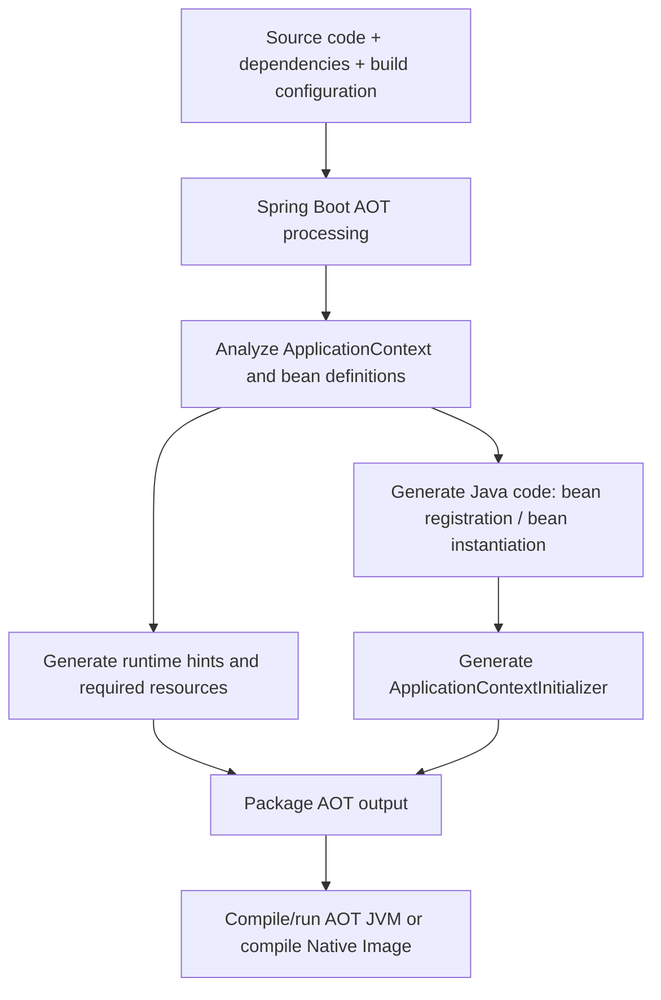
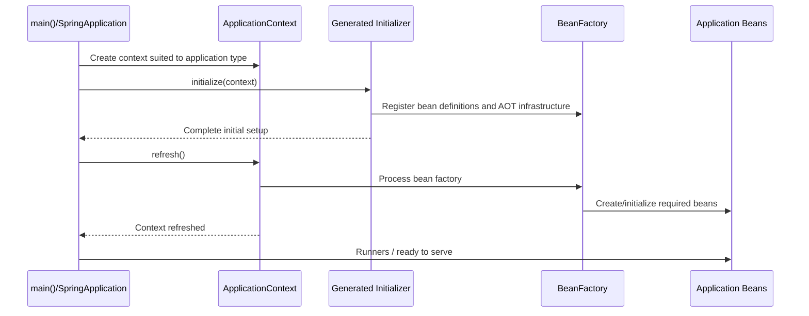

# Generated ApplicationContextInitializer and ApplicationContext Initialization

## Lesson Objectives

In Spring Boot, `ApplicationContext` is where beans, dependency injection, configuration, and application infrastructure components are managed. When using **Spring AOT (Ahead-of-Time)** to compile an application into a **GraalVM Native Image**, Spring can analyze the bean model during the build and generate Java code to set up `ApplicationContext` more efficiently at runtime.

A key component of this workflow is the **automatically generated `ApplicationContextInitializer`**. Understanding its exact role helps you read AOT code, analyze startup behavior, troubleshoot bean errors in native runs, and avoid confusing *initializing context configuration* with *creating beans* or *completing application startup*.

After this lesson, you will be able to:

- Explain the role of the `ApplicationContextInitializer` interface in the `ApplicationContext` lifecycle.
- Describe how Spring AOT generates bean registration code and uses the initializer at runtime.
- Distinguish work performed at **build time** vs. **runtime**.
- Run AOT tasks via Maven/Gradle and inspect the generated source files yourself.
- Identify common errors caused by conditional configuration, reflection, resources, or environment differences between build and runtime.

> Scope: this lesson focuses on **Spring AOT and the generated `ApplicationContextInitializer`** in the Spring Boot Native Image ecosystem. Generated class names and file paths may vary by Spring Boot/Spring Framework version and project configuration; inspect your own build output directly for comparison.

## 1. What Is `ApplicationContextInitializer`?

### 1.1. Role in Spring Framework

Spring Framework defines the interface:

```java
public interface ApplicationContextInitializer<C extends ConfigurableApplicationContext> {
    void initialize(C applicationContext);
}
```

An initializer receives **an already-created context** and gets an opportunity to customize or register components **before the context is refreshed**. For example, initialization code can configure property sources, register bean definitions, or prepare infrastructure so that `refresh()` can finish constructing the context.

These three actions are distinct:

| Action | Meaning |
|---|---|
| **Creating `ApplicationContext`** | Instantiates a context object suited to the application type (non-web, servlet, reactive, etc.) |
| **`ApplicationContextInitializer.initialize(context)`** | Applies setups/registrations to an **already existing** context, prior to refresh |
| **`ApplicationContext.refresh()`** | Completes container initialization: processes bean factory, registers post-processors, creates non-lazy singletons, starts required components, etc. |

**Core point:** the initializer **does not create** the `ApplicationContext` itself and **does not replace** the entire `refresh()`. In a Spring Boot application, `SpringApplication` orchestrates these stages.

### 1.2. Hand-Written Initializer vs. Spring AOT Generated Initializer

You can implement `ApplicationContextInitializer` yourself to customize startup. Spring AOT uses the very same concept, but generates the implementation **automatically from build-time application analysis results**.

| Developer-written Initializer | Spring AOT Generated Initializer |
|---|---|
| Serves a specific application initialization requirement | Serves bootstrapping of the AOT-analyzed bean model |
| Code maintained under `src/main/java` | Code generated under the build directory |
| May contain `Environment` or property source customizations | Usually coordinates bean definition registration and infrastructure classes generated by AOT |
| Developer registers it explicitly when needed | Spring Boot integrates its usage when running in AOT mode |

Do not edit generated code by hand because the next AOT pass will regenerate the output. If the application requires configuration customization or reflection/resource declarations, modify **the appropriate source code and metadata**, then rerun AOT.

## 2. Why Does Spring AOT Need to Generate an `ApplicationContextInitializer`?

When starting normally on the JVM, Spring processes a large amount of configuration at runtime: finding and parsing configuration classes, deciding which beans exist, preparing bean creation, processing infrastructure components, and resolving dependency relationships.

Native Image operates under a **closed-world** model: the types of code and metadata that may be used must be appropriately identified during compilation. Dynamic operations that are convenient on the JVM do not always have sufficient information to work automatically inside a native executable.

Spring AOT addresses part of this challenge by:

1. Analyzing application configuration and bean definitions during the build.
2. Evaluating conditions and components that can be decided from information available at build time.
3. Generating Java code to register bean definitions and support bean creation, instead of repeating full configuration analysis at runtime.
4. Generating or aggregating **runtime hints** for reflection, proxies, resources, and serialization as needed.
5. Generating an `ApplicationContextInitializer` as the entry point for the pre-built context setup.

The goal is to reduce startup work and make explicit what must be included in the native build. Benefits typically show up in **startup time** and **memory usage**, though they must be measured on real workloads. Generating an initializer **does not guarantee** every native application achieves higher throughput than the JVM.

## 3. Lifecycle: From Source Code to Ready Context

### 3.1. Build Phase (AOT Processing)

Suppose an application has a `@SpringBootApplication` class, `@Configuration` classes, `@Bean` methods, and Spring Boot auto-configuration. When running the AOT task:



Key understanding: AOT processing may execute part of configuration logic during analysis. Do not assume every piece of code tied to bean declarations only runs when the native binary executes. Conversely, analyzing bean definitions **does not mean** every application singleton has been created or production connections have been opened at build time.

### 3.2. Runtime Phase (AOT-Enabled)

When the native build runs, Spring Boot uses the generated artifacts to configure the context:



The diagram depicts **responsibility order**, not every internal call of a specific Spring version.

In AOT mode, the initializer provides pre-prepared registration information. The rest of the Spring lifecycle still exists: the context must be refreshed, dependencies must be injected, beans must be initialized at the right time, and the web server/workers still need to start up.

### 3.3. Do Not Confuse Bean Definition with Bean Instance

- **Bean definition** describes how Spring creates and manages a bean: type, scope, factory method, dependencies, and other configuration metadata.
- **Bean instance** is the concrete object in memory, created when Spring needs it according to its scope/lifecycle.
- **Generated initializer** primarily prepares registrations and hooks up AOT bootstrap pieces. Registering a definition **does not mean** every bean has been instantiated.
- **`refresh()`** still runs Spring's lifecycle; lazy or scoped beans may be instantiated later.

For example, a database connection bean may still have to perform network I/O at runtime. Native Image does not "pre-compile" an active live database connection.

## 4. Spring Boot Example and Generated Code Structure

### 4.1. Minimal Sample Application

Assume a Spring Boot project already has AOT-capable build configuration. Create an application with two beans:

```java
package com.example.aotdemo;

import org.springframework.boot.ApplicationRunner;
import org.springframework.boot.SpringApplication;
import org.springframework.boot.autoconfigure.SpringBootApplication;
import org.springframework.context.annotation.Bean;

@SpringBootApplication(proxyBeanMethods = false)
public class AotDemoApplication {

    public static void main(String[] args) {
        SpringApplication.run(AotDemoApplication.class, args);
    }

    @Bean
    GreetingService greetingService() {
        return new GreetingService("Hello from Spring AOT");
    }

    @Bean
    ApplicationRunner showGreeting(GreetingService greetingService) {
        return args -> System.out.println(greetingService.message());
    }
}

record GreetingService(String message) {}
```

When running normally on the JVM, Spring discovers and processes configuration to learn about those two beans. During AOT processing, Spring analyzes this model and generates corresponding code to serve AOT runtime bootstrap.

The example program prints the greeting after the context has been initialized and the runner executes. The code requires no custom reflection, making it suitable for observing AOT fundamentals.

### 4.2. Visualizing the Generated `ApplicationContextInitializer`

Generated classes typically have names linking back to the application class and bean registration components. The following **simplified pseudocode** illustrates the function; it is **not an exact copy** of the source generated by every Spring Boot version:

```java
// Illustration: generated code, do not copy into src/main/java
final class AotDemoApplication__ApplicationContextInitializer
        implements ApplicationContextInitializer<GenericApplicationContext> {

    @Override
    public void initialize(GenericApplicationContext context) {
        // Call Spring AOT generated code to register bean definitions
        new AotDemoApplication__BeanFactoryRegistrations()
                .registerBeanDefinitions(context);
    }
}
```

The key idea lies in the **register bean definitions** call. In actual generated code, you may see:

- An initializer class implementing `ApplicationContextInitializer`.
- Dedicated classes or methods registering bean definitions, factory methods, and infrastructure configuration.
- Direct calls to constructors or factory methods that the framework previously had to discover/prepare at runtime.
- Generated metadata supporting AOT runtime; depending on the version, some details are stored in resource directories.

The type name `AotDemoApplication__BeanFactoryRegistrations` and method body `registerBeanDefinitions` above merely illustrate the relationship between the initializer and bean registration. **Do not rely on generated class names** as a stable API contract.

### 4.3. Who Invokes the Initializer?

In a standard Spring Boot application, you still write:

```java
SpringApplication.run(AotDemoApplication.class, args);
```

When the application runs **in AOT mode** with generated artifacts, Spring Boot integrates discovering and invoking the initializer into its startup sequence. You **do not need** to modify `main()` to instantiate or invoke the `__ApplicationContextInitializer` class manually.

If testing AOT mode on the JVM, the application must be built with the appropriate AOT code/resources and run with AOT mode enabled (such as system property `spring.aot.enabled=true`). With **Native Image**, AOT artifacts are consumed through the Spring Boot-supported native build/run pipeline.

## 5. Generating and Inspecting the Initializer Using Maven/Gradle

### 5.1. Prerequisites

Use a Spring Boot version supporting Spring AOT, a Java version compatible with that Spring Boot version, and compatible build plugins. For Native Image targets, configure **GraalVM Native Build Tools**, a GraalVM environment providing `native-image`, or a buildpack supporting native compilation.

The examples below use wrapper scripts on Unix/macOS. On Windows, replace `./mvnw` with `mvnw.cmd` or `./gradlew` with `gradlew.bat`.

### 5.2. Maven

When the project uses the Spring Boot Maven plugin:

```bash
# Generate AOT artifacts for the main application
./mvnw -DskipTests spring-boot:process-aot

# Native build when the project has configured the native profile and matching plugins
./mvnw -Pnative native:compile
```

In many Maven Spring Boot projects, generated code is placed under:

```text
target/spring-aot/main/
├── sources/      # Java sources generated by Spring AOT
├── resources/    # Resources/metadata created by AOT
└── classes/      # Compilation output depending on task/build
```

Paths may vary depending on plugin configuration. After running `process-aot`, inspect the actual directory instead of assuming from the illustrative layout alone.

### 5.3. Gradle

When the Spring Boot Gradle plugin and GraalVM Native Build Tools are configured:

```bash
# Generate AOT artifacts
./gradlew processAot

# Compile native application
./gradlew nativeCompile
```

Output usually resides under directories named similarly to:

```text
build/generated/
├── aotSources/     # Generated Java sources
└── aotResources/   # AOT resources/metadata
```

Exact names and structure depend on plugin version. In your IDE, mark generated sources per build configuration if you want to search and navigate the code.

### 5.4. How to Read Generated Code

After `process-aot`, you can locate files containing `ApplicationContextInitializer` or `__BeanFactoryRegistrations` classes in the generated source tree:

```bash
# Maven: find Java files with names related to initializer
find target/spring-aot/main/sources -name '*ApplicationContextInitializer*.java'

# Gradle: search in generated sources directory
find build/generated/aotSources -name '*ApplicationContextInitializer*.java'
```

On PowerShell, an equivalent search:

```powershell
Get-ChildItem -Path target/spring-aot/main/sources -Recurse -Filter '*ApplicationContextInitializer*.java'
Get-ChildItem -Path build/generated/aotSources -Recurse -Filter '*ApplicationContextInitializer*.java'
```

Once found, trace the chain:

1. Which component does the initializer's `initialize(...)` method call?
2. What bean definitions does that component register for `GreetingService` and `ApplicationRunner`?
3. How do the definitions record factory methods, constructors, and dependencies?
4. What accompanying AOT metadata supports reflection, resources, or proxies?

Note: Spring Framework may generate multiple helper classes for a single context; do not expect each bean to correspond to exactly one generated class. If paths differ from documentation, follow the actual file tree and build info for the version you are using.

## 6. Build-Time Dependent Configuration: Commonly Overlooked Pitfalls

### 6.1. `@ConditionalOnProperty` and Changing Bean Counts

An application may declare a conditional bean:

```java
import org.springframework.boot.autoconfigure.condition.ConditionalOnProperty;
import org.springframework.context.annotation.Bean;
import org.springframework.context.annotation.Configuration;

@Configuration(proxyBeanMethods = false)
class ExportConfiguration {

    @Bean
    @ConditionalOnProperty(prefix = "export", name = "enabled", havingValue = "true")
    ExportService exportService() {
        return new ExportService();
    }
}

class ExportService {
    void export() {
        // Export data processing
    }
}
```

When AOT processes configuration, many conditions deciding **whether a bean exists** have already been evaluated against the environment present **at build time**. Therefore, if `export.enabled` controls bean registration, you cannot assume simply changing `EXPORT_ENABLED` when running the native binary will add a bean omitted from the compiled bean graph.

An important distinction:

- **Changing bean topology**: adding/removing beans, configurations, or dependencies controlled by conditions may require **rebuilding** for the corresponding profile/environment.
- **Changing business values at runtime**: a bean already included in the image can still read runtime properties to decide normal behavior, if the design permits.

For example, instead of expecting a bean condition to spawn an extra component at runtime, you can retain the bean and read a feature flag inside its processing method. This approach fits only if runtime behavior switching is truly required; consistency and security must still be considered.

### 6.2. `@Profile`, Environment, and Classpath

Some configuration decisions may be fixed during AOT processing, especially when they alter the set of registered beans. Therefore:

- Determine profiles and properties affecting the bean graph upfront at **AOT build**.
- Verify the native build with the exact profiles, properties, and dependencies used in deployment.
- Do not infer that a single native image contains every bean configuration variant if it was built with only one configuration.
- Do not hardcode secrets into source or build configuration arbitrarily; ordinary runtime properties should be supplied via proper secret-management mechanisms.

AOT builds do not forbid all runtime properties. The key is distinguishing **properties used to decide bean structure** from **properties read by beans during business execution**.

### 6.3. Reflection and Resources Not Automatically Inferred

Having a generated initializer **does not guarantee** all reflection or resource access by third-party libraries will work in native execution. For example:

```java
// Class name retrieved from configuration at runtime:
Class<?> pluginClass = Class.forName(pluginClassName);
Object plugin = pluginClass.getDeclaredConstructor().newInstance();
```

If `pluginClassName` is only known at runtime, AOT analysis may fail to recognize which class and constructor must be retained. In that case, you may need to declare **`RuntimeHints`** or Native Image metadata for the exact access pattern.

Example declaring Spring Runtime Hints:

```java
import org.springframework.aot.hint.MemberCategory;
import org.springframework.aot.hint.RuntimeHints;
import org.springframework.aot.hint.RuntimeHintsRegistrar;
import org.springframework.context.annotation.Configuration;
import org.springframework.context.annotation.ImportRuntimeHints;

final class PluginHints implements RuntimeHintsRegistrar {
    @Override
    public void registerHints(RuntimeHints hints, ClassLoader classLoader) {
        hints.reflection().registerType(
                SamplePlugin.class,
                MemberCategory.INVOKE_DECLARED_CONSTRUCTORS
        );
        hints.resources().registerPattern("plugin/defaults.json");
    }
}

@Configuration(proxyBeanMethods = false)
@ImportRuntimeHints(PluginHints.class)
class PluginHintConfiguration {}
```

`SamplePlugin` is a placeholder class; replace it with the real class in your project. For classes using proxies, serialization, or reflective field/method access, supply the **exact metadata** matching the actual operation. Runtime Hints and the generated initializer play related roles but are **not the same**: the initializer registers context configuration, whereas hints instruct the native compiler to retain required metadata/mechanisms.

## 7. Testing Initialization and Troubleshooting Failures

### 7.1. Testing End-to-End from Source to Runtime

With `AotDemoApplication`, proceed step by step:

1. **Standard JVM run:** verify the application runs and `ApplicationRunner` prints the greeting.
2. **Run `process-aot`:** verify the task completes and initializer/bean registration code appears in generated sources.
3. **Read generated code:** locate definition registration calls for `GreetingService` and `ApplicationRunner`.
4. **Native compile/run:** observe identical output while also testing endpoints, databases, or resources if the application includes them.
5. **Compare execution paths:** verify the bean graph, applied configuration, and functional parity; only then benchmark startup, RSS, and latency.

If running AOT on the JVM, ensure the package actually contains generated classes/resources and enable AOT mode for runtime. Merely passing `spring.aot.enabled=true` to a JAR that was never AOT-processed **does not make Spring generate an initializer while the program is running**.

### 7.2. Troubleshooting Matrix

| Symptom | Likely cause to check | Remediation |
|---|---|---|
| Generated initializer not found after build | `process-aot` not executed, plugin unconfigured, or wrong output directory checked | Verify build tasks, logs, and actual generated directory |
| Enabled AOT on JVM but missing generated artifact error | AOT mode enabled yet required classes/resources were not packaged | Build artifact with AOT output and verify classpath |
| Bean present on JVM but missing in native | `@Conditional...`, profile, or classpath differs between build and runtime | Compare build-time conditions and inspect generated bean definitions |
| `ClassNotFoundException` / reflection error in native only | Dynamically accessed class or member not covered by native analysis/hints | Check runtime hints and the failing execution path |
| `getResourceAsStream(...)` returns `null` in native | Resource not packaged into image or wrong path | Add resource hint/packaging config, verify resource name |
| Context initialization remains slow | DB connections, bean init, I/O, migrations, network, or infrastructure loading still happen at startup | Profile startup phases and optimize the actual bottleneck |
| Same image with changed profile yields unexpected results | Bean topology was decided by AOT build conditions | Build/test per target configuration and avoid mutating the bean graph at runtime |

### 7.3. Observing Initialization Order with a Custom Initializer

To observe an initializer running **before context refresh**, you can add a simple logging initializer yourself:

```java
import org.springframework.boot.SpringApplication;
import org.springframework.context.ApplicationContextInitializer;
import org.springframework.context.ConfigurableApplicationContext;

public class AotDemoApplication {

    public static void main(String[] args) {
        SpringApplication app = new SpringApplication(AotDemoApplication.class);
        app.addInitializers((ApplicationContextInitializer<ConfigurableApplicationContext>)
                context -> System.out.println("Initializer: context has been created"));
        app.run(args);
    }
}
```

**This is a standalone interface example**, not an instruction to replace `main()` in Section 4: when testing in practice, keep your application's existing annotations and beans. A hand-written initializer demonstrates invocation timing; the AOT-generated initializer is wired into bootstrap by Spring Boot's framework mechanism.

Note that a log printed from the initializer only proves **the context object exists**. It **does not prove** all beans or the web server are ready; to determine readiness, use appropriate health checks such as Spring Boot Actuator health/readiness probes.

## 8. Common Misconceptions When Reading the Generated Initializer

| Misconception | Accurate Understanding |
|---|---|
| "The initializer creates the entire `ApplicationContext`." | Spring Boot creates the context first and then applies the initializer before `refresh()`. |
| "Having an initializer means all beans were created at build time." | AOT analyzes and generates registration code; most instance lifecycles still run at startup/runtime. |
| "Just call the initializer manually in `main()` to enable native." | Spring Boot and build tools manage AOT mode; corresponding generated artifacts and native compilation are required. |
| "Generated classes are a suitable place to edit business logic." | Edit original source/config and rerun AOT; generated code can be overwritten. |
| "Every runtime property still reshapes the bean set just like on the JVM." | Many conditions are decided at build time; verify bean graph consistency. |
| "The initializer automatically resolves all reflection/resource errors." | Unrecognized dynamic accesses may still require runtime hints and native testing. |
| "Faster startup always means faster request processing." | Startup, throughput, steady-state latency, and memory are distinct measurements. |

## 9. Suggested Practice Exercise

Using `AotDemoApplication` from Section 4:

1. Generate AOT output with Maven or Gradle; locate the build-generated `ApplicationContextInitializer` class.
2. Trace the call path to registering `GreetingService` and `ApplicationRunner`; explain why registering a definition does not equate to creating a bean instance.
3. Add a `@ConditionalOnProperty` to a new bean. Try both property values at AOT build time and observe the differences in generated code and the bean graph.
4. Run the native build with the matching build configuration; verify functional correctness before measuring startup time and RSS.
5. Answer for yourself: does Spring Boot call `refresh()` before or after the generated initializer? What can still consume time after the initializer finishes?

**Conclusion:** in Spring Boot Native Image, Spring AOT prepares bootstrap by generating Java code and an `ApplicationContextInitializer` to **apply registrations to the context created by Spring Boot**. Afterwards, Spring still refreshes the context, manages bean lifecycles, and starts the application at runtime. Understanding the boundary between **AOT build**, **`initialize(context)`**, and **`refresh()`** is essential for analyzing compatibility errors, configuring reflection/resources, and accurately evaluating native startup and memory gains.
