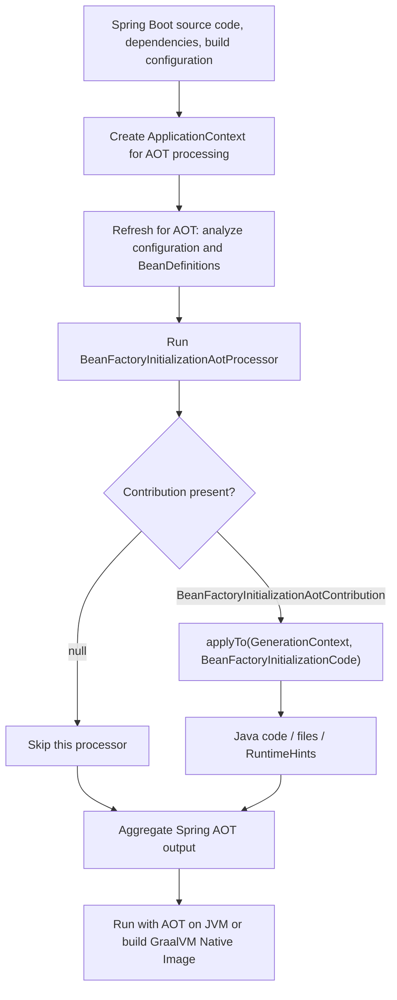

# Role of `BeanFactoryInitializationAotProcessor` in Spring AOT

> **Chapter:** Spring AOT  
> **Module:** `SPRING_BOOT_NATIVE_IMAGE`  
> **Objective:** Understand `BeanFactoryInitializationAotProcessor` as a `BeanFactory`-level extension point in Spring's Ahead-of-Time (AOT) processing; know when to implement it, how to create a `BeanFactoryInitializationAotContribution`, how to register the processor, and its impact on GraalVM Native Image and testing.

## 1. The Problem This Mechanism Solves

When running a Spring Boot application on the JVM in the traditional way, Spring spends part of startup locating configuration, evaluating conditions, registering `BeanDefinition`s, choosing how to instantiate beans, wiring dependency injection, and configuring the bean factory. These decisions typically rely on the classpath, annotations, and part of the application environment.

**Spring AOT** shifts pre-determinable work from application runtime to **build time**. It analyzes the known bean model, generates required Java code and metadata, and uses those outputs when the application starts in AOT mode. This also forms a foundation enabling Spring Boot to run on **GraalVM Native Image**, which restricts dynamic discovery compared to the HotSpot JVM.

However, Spring Framework cannot predict every initialization rule of custom libraries or infrastructure. A library may need to generate additional bean-factory initialization code, embed resources into the binary, or declare reflection access for types used at runtime. **`BeanFactoryInitializationAotProcessor`** is an interface allowing libraries or applications to contribute those optimizations at the **scope of the entire bean factory**.

This interface resides in the package:

```java
org.springframework.beans.factory.aot.BeanFactoryInitializationAotProcessor
```

It has been available since Spring Framework 6.0. When studying Spring Boot Native Image, clearly distinguish: **the processor creates an AOT contribution**, Spring AOT aggregates contributions, and **GraalVM Native Image** subsequently compiles application code and processes metadata into a native executable. The processor itself does not compile the application into machine code.

## 2. Where Does the Processor Sit in the Spring AOT Pipeline?



Execution sequence details:

1. **Create context in AOT mode.** `ApplicationContextAotGenerator` operates on a `GenericApplicationContext` model and a `GenerationContext` to prepare content to be generated.
2. **AOT-specific refresh.** Spring processes configuration classes, component scanning, `@Import`, `BeanFactoryPostProcessor`s, and applicable conditions to collect `BeanDefinition`s. This is not a full refresh: the application **does not instantiate all business beans** as it does at runtime.
3. **Discover and invoke processors.** Spring calls each available `BeanFactoryInitializationAotProcessor` with the prepared bean factory state.
4. **Collect contributions.** Each processor can return a contribution or `null` if not applicable.
5. **Apply contributions.** A contribution can generate initialization methods, source/resource files, or `RuntimeHints` for behaviors needed at runtime.
6. **Generate AOT output.** These results feed into AOT execution or the GraalVM Native Image pipeline. For native builds, hints help produce configuration metadata for analysis and packaging.

**Key takeaway:** the information a processor sees is **the bean model at build time**. A `@Profile` or `@Conditional` condition altering bean existence may already have been decided during AOT. Do not expect the processor to re-decide every branch based on the native binary's runtime environment.

## 3. API Contract: One Processor and One Contribution

The interface has a single functional method:

```java
// Abbreviated signature; nullable annotations may vary by version.
@FunctionalInterface
public interface BeanFactoryInitializationAotProcessor {

    BeanFactoryInitializationAotContribution processAheadOfTime(
            ConfigurableListableBeanFactory beanFactory);
}
```

In practice, the method is permitted to **return `null`** (as documented in its Javadoc). This is the standard way to signal that the current bean factory requires no additional AOT behavior from this processor.

| Component | Role |
|---|---|
| `ConfigurableListableBeanFactory` | Gives the processor visibility into the entire current `BeanDefinition` model and related metadata |
| `processAheadOfTime(...)` | Analyzes bean factory state **at build time**; decides whether a contribution is needed |
| `BeanFactoryInitializationAotContribution` | Object encapsulating how the chosen contribution is applied |
| `applyTo(GenerationContext, BeanFactoryInitializationCode)` | Applies the contribution to code generation, file generation, and runtime hints infrastructure |
| `GenerationContext` | Manages generated classes, generated files, and `RuntimeHints` |
| `BeanFactoryInitializationCode` | Manages generated methods and initializers used to configure the bean factory on AOT startup |

Separating **"detect need" → "emit contribution"** is intentional design. `processAheadOfTime` inspects the bean factory and chooses an action; `applyTo` uses the code generation infrastructure to express that action.

### 3.1. What Metadata Should the Processor Inspect?

Inside `processAheadOfTime`, appropriate operations typically include:

- Checking whether a `BeanDefinition` exists: `containsBeanDefinition("beanName")`.
- Reading bean names, expected bean types, scopes, properties, or annotations determinable from the model.
- Computing the list of behaviors to restore via pre-generated code or resources to embed into the native image.
- Returning `null` when applicability conditions are not met.

Avoid calling `getBean("someService")` solely to probe state, because doing so can **instantiate the real bean at build time**. Instantiation might trigger database queries, HTTP calls, opening sockets, reading secrets, or creating state inconsistent with the real runtime environment.

Certain **infrastructure beans** must be instantiated during AOT processing; that is a controlled exception, not a license to freely instantiate business beans.

### 3.2. What Can a Contribution Generate?

A `BeanFactoryInitializationAotContribution` is a functional interface with the method:

```java
void applyTo(
        GenerationContext generationContext,
        BeanFactoryInitializationCode beanFactoryInitializationCode);
```

It has two common groups of responsibilities:

**Generating initialization code:** Use `beanFactoryInitializationCode.getMethods()` to generate methods or `addInitializer(...)` to register initialization calls that appear in AOT code. That way, behavior previously executed via startup discovery logic can be pre-expressed as generated code.

**Supplying metadata/output artifacts:** Use `generationContext.getRuntimeHints()` to declare reflection, resource, serialization, or JDK proxy requirements; use generated classes/files APIs when creating classes, sources, or resources.

Skeleton snippet to visualize the flow:

```java
@Override
public BeanFactoryInitializationAotContribution processAheadOfTime(
        ConfigurableListableBeanFactory beanFactory) {

    if (!beanFactory.containsBeanDefinition("someInfrastructureBean")) {
        return null;
    }

    // Action applied during AOT code generation,
    // not executed as a callback on every native app startup.
    return (generationContext, initializationCode) -> {
        generationContext.getRuntimeHints().resources()
                .registerPattern("config/custom-rules.json");

        // When initialization code generation is needed, use:
        // initializationCode.getMethods()
        // initializationCode.addInitializer(...)
    };
}
```

Not every contribution must invoke both APIs: **a contribution that only adds runtime hints is completely valid**. Conversely, for custom initialization logic, merely adding hints may be insufficient; code reproducing the required behavior must be generated.

## 4. Complete Example: Retaining a Template Used by a Spring Bean

Suppose an application has a bean named `invoiceRenderer`. This bean reads `classpath:reports/invoice.html` at runtime. During Native Image compilation, if the resource is omitted from the binary, invoice rendering can fail even though the application builds cleanly.

We want to register the resource **only when** the `invoiceRenderer` bean appears in the Spring AOT model. This is a conditional example at the bean-factory level.

**Step 1 — Illustrative business bean**

```java
package com.example.invoice;

import org.springframework.context.annotation.Bean;
import org.springframework.context.annotation.Configuration;

@Configuration(proxyBeanMethods = false)
public class InvoiceConfiguration {

    @Bean
    InvoiceRenderer invoiceRenderer() {
        return new InvoiceRenderer();
    }
}
```

`InvoiceRenderer` is a hypothetical application-defined class containing logic to read `reports/invoice.html` from the classpath when rendering an invoice. The file must physically exist at:

```text
src/main/resources/reports/invoice.html
```

**Step 2 — Implement the AOT processor**

```java
package com.example.invoice.aot;

import org.springframework.beans.factory.aot.BeanFactoryInitializationAotContribution;
import org.springframework.beans.factory.aot.BeanFactoryInitializationAotProcessor;
import org.springframework.beans.factory.config.ConfigurableListableBeanFactory;

public final class InvoiceTemplateAotProcessor
        implements BeanFactoryInitializationAotProcessor {

    @Override
    public BeanFactoryInitializationAotContribution processAheadOfTime(
            ConfigurableListableBeanFactory beanFactory) {

        // Check metadata only; do not instantiate InvoiceRenderer at build time.
        if (!beanFactory.containsBeanDefinition("invoiceRenderer")) {
            return null;
        }

        return (generationContext, initializationCode) ->
                generationContext.getRuntimeHints()
                        .resources()
                        .registerPattern("reports/invoice.html");
    }
}
```

**Reading the example in two stages:**

- **Detection stage:** `processAheadOfTime` inspects the bean factory. If `invoiceRenderer` is absent, the processor has nothing to do and returns `null`.
- **Contribution stage:** If the bean exists, the contribution adds the pattern to `RuntimeHints`. With GraalVM Native Image, Spring AOT translates that information into the corresponding resource metadata.

`registerPattern(...)` **does not create the file itself**; it only requests retaining an existing resource on the classpath. The path must match case exactly and be packaged in build inputs.

**Step 3 — Register the processor with Spring AOT infrastructure**

Create a file at:

```text
src/main/resources/META-INF/spring/aot.factories
```

Contents:

```properties
org.springframework.beans.factory.aot.BeanFactoryInitializationAotProcessor=\
com.example.invoice.aot.InvoiceTemplateAotProcessor
```

This is the AOT configuration-file processor registration mechanism, suitable when writing extensions packaged in a library. The processor class must have a constructor instantiable by this loading mechanism (such as the default no-arg constructor above).

**Step 4 — Run AOT and verify the binary**

Example for a Spring Boot project configured with AOT/native build plugins:

```bash
# Maven: generate Spring AOT output, not yet native compilation
./mvnw spring-boot:process-aot

# Maven: build Native Image when GraalVM Native Build Tools is configured
./mvnw -Pnative native:compile

# Gradle: equivalent tasks if project uses Spring Boot and native plugin
./gradlew processAot
./gradlew nativeCompile
```

After building, run the actual executable and invoke the feature path that uses the template. **A passing build does not guarantee the resource loads successfully at runtime.** Depending on Spring Boot version, Maven/Gradle, and project layout, AOT generated directories may vary; confirm output against your actual build configuration.

### 4.1. Must You Write a Custom Processor Just to Declare a Resource?

Not necessarily. If a resource is always needed regardless of bean factory conditions, you can use `RuntimeHintsRegistrar` with `@ImportRuntimeHints` or a simpler Spring-provided hints mechanism. That approach is usually less complex.

The example above chose `BeanFactoryInitializationAotProcessor` to illustrate **inspecting the state of the entire bean factory before deciding whether to contribute**. That is its distinguishing value.

## 5. Registering as a Bean: Benefits and Common Pitfalls

In addition to `META-INF/spring/aot.factories`, Spring allows a **bean** to directly implement `BeanFactoryInitializationAotProcessor`. For instance:

```java
package com.example.invoice.aot;

import org.springframework.beans.factory.aot.BeanFactoryInitializationAotProcessor;
import org.springframework.context.annotation.Bean;
import org.springframework.context.annotation.Configuration;

@Configuration(proxyBeanMethods = false)
class InvoiceAotConfiguration {

    @Bean
    static BeanFactoryInitializationAotProcessor invoiceTemplateAotProcessor() {
        return new InvoiceTemplateAotProcessor();
    }
}
```

**Choose only one registration method** for the same processor: via `aot.factories` *or* via bean. Registering both can cause duplicate contribution processing and hard-to-trace issues.

Key characteristics to remember:

1. When a processor is registered as a bean, **the processor bean and its dependencies are instantiated during AOT processing**. This makes its constructor, dependency graph, and side effects part of the build.
2. Under Spring AOT's contract, **a processor bean of this kind is not contributed as an application bean into the AOT-optimized context**. It serves the build step, not the business services of the native build.
3. Spring recommends this interface for **infrastructure beans** with limited dependencies, such as components already instantiated early in the bean factory lifecycle.
4. If registering via `@Bean`, declare the factory method as **`static`**. Otherwise, Spring may have to instantiate the enclosing `@Configuration` class earlier than expected solely to create the processor.

Do not assume every bean implementing a processor needs to remain available to run inside the native executable. Its job is **contributing code/metadata at build time**.

## 6. Comparison with Easily Confused Interfaces

| Interface / Mechanism | Timing and Scope | Primary Responsibility | When to Choose? |
|---|---|---|---|
| `BeanFactoryPostProcessor` | When preparing the bean factory in standard Spring lifecycle; may also run during AOT refresh | Modifies or inspects `BeanDefinition`s, configures factory | Need to modify bean definitions within the Spring model |
| `BeanDefinitionRegistryPostProcessor` | Very early during definition registration phase | Adds/modifies `BeanDefinition`s via registry | Need to register beans programmatically so Spring AOT sees them |
| **`BeanFactoryInitializationAotProcessor`** | **Build time**, **bean factory** scope | Analyzes bean factory, returns contribution for init code/hints | Need to AOT-enable configuration behavior spanning multiple beans or depending on the factory model |
| `BeanFactoryInitializationAotContribution` | AOT result application stage | Writes generated code, initializers, and/or hints | This is the **output** of the processor, not the discovery mechanism |
| `BeanRegistrationAotProcessor` | Build time, **per bean registration** scope | Customizes registration/creation code generation for a specific bean | Need bean-specific handling for a `RegisteredBean` |
| `RuntimeHintsRegistrar` | Hint collection stage | Declares reflection, resources, proxies, serialization, JNI on demand | Primarily need native metadata without analyzing bean factory state |
| GraalVM Native Image | Native compilation step | Analyzes reachable code and compiles executable | Need to produce a native binary from application/AOT output |

### 6.1. Distinguishing `BeanFactoryInitializationAotProcessor` from `BeanRegistrationAotProcessor`

These are two extension layers at different scopes:

- **Factory-level:** the processor receives `ConfigurableListableBeanFactory`, observes many beans at once, and can contribute to initializing the whole factory.
- **Registration-level:** the processor receives a single `RegisteredBean` and focuses on generated code for **one bean registration**.

A core `BeanFactoryInitializationAotProcessor` implementation in Spring iterates through candidate `BeanDefinition`s and aggregates the corresponding `BeanRegistrationAotProcessor` contributions. Thus the per-bean mechanism is integrated into the factory-level aggregation pipeline.

For example: to change how injection code is generated for one specific bean type, look at `BeanRegistrationAotProcessor`; to inspect all beans integrating with a library and generate a shared configuration step, look at `BeanFactoryInitializationAotProcessor`.

### 6.2. Distinguishing from `BeanFactoryPostProcessor`

`BeanFactoryPostProcessor` is responsible for acting on **the bean configuration model**. `BeanFactoryInitializationAotProcessor` is responsible for generating **the AOT output matching that model**. Both interfaces may be implemented by the same infrastructure component if it modifies the model during configuration processing and must preserve matching behavior when running AOT.

Do not convert every `BeanFactoryPostProcessor` into an AOT processor. Many standard processors already work fine during the AOT step; a new extension is needed only when runtime behavior is not properly restored by default generated code.

## 7. From Contribution to Actual Running Code: Understanding the Lifecycle

Separate three points in time:

| Point in Time | What Happens | What Not to Assume |
|---|---|---|
| **Build time: creating the bean model** | Spring computes valid configuration and `BeanDefinition`s | Not all business beans have been instantiated |
| **Build time: running processor/contribution** | Analyzes factory, adds methods/initializers/runtime hints | This is not a callback that reruns every time the native binary starts |
| **Runtime: running AOT JVM or native binary** | Generated code initializes context and bean factory per AOT plan | Does not rerun `processAheadOfTime` to rediscover arbitrary config changes |

For example, a processor might see the `reportRenderer` bean and add a required initializer snippet to `BeanFactoryInitializationCode`. When the native app runs, the **generated code** executes in the context startup flow; the processor that produced it only participated at build time.

Notable APIs:

- `generationContext.getRuntimeHints()`: records reflection/resource/proxy/serialization needs.
- `generationContext.getGeneratedClasses()` and `getGeneratedFiles()`: manages generated code/files.
- `beanFactoryInitializationCode.getMethods()`: adds generated methods via `GeneratedMethods`.
- `beanFactoryInitializationCode.addInitializer(...)`: attaches generated initialization methods to the bean factory setup flow.

When writing a code-generating contribution, verify that types/constructors/methods referenced by generated code exist in native runtime. Do not implicitly capture build-phase objects inside generated code; state must be expressed via reproducible **code, constants, resources, or runtime hints**.

## 8. Typical Mistakes When Implementing Yourself

### 8.1. Instantiating Business Beans at Build Time

**Symptom:** native build tries connecting to a database, calling external APIs, reading secrets, or hangs before code generation.

**Cause:** processor calls `getBean(...)` or an infrastructure constructor depends heavily on business beans.

**Remediation:** inspect `BeanDefinition`s, annotations, and metadata; keep processor dependencies minimal; if real state is needed, revisit configuration design and the build/runtime contract.

### 8.2. Wrong Timing of Configuration Conditions

**Symptom:** native image runs with a different profile yet is missing beans or resources.

**Cause:** conditions affecting **bean presence** were fixed during AOT processing; a build configuration did not match the target environment.

**Remediation:** explicitly declare profiles/properties needed at build time, keep genuinely dynamic parameters (like endpoint URLs, credentials) at the runtime layer, and build/test separately when distinct bean topologies are needed.

### 8.3. Misusing Runtime Hints

**Symptom:** resource or reflection was registered yet code still fails.

**Cause:** wrong resource path registered, missing class/method in hints, or dynamic initialization logic itself was not translated into proper AOT code.

**Remediation:** determine whether the failure lies in **reachable metadata** or **behavior needing generated code**, verify the file actually exists on the classpath, and execute the exact feature branch with the native executable.

### 8.4. Processor Is Never Invoked

**Symptom:** build finishes yet contribution does not appear in AOT output.

**Possible causes:** `aot.factories` has wrong path/key/class name; processor not registered as a bean; conditional bean definition absent; or `processAheadOfTime` returned `null`.

**Remediation:** check registration mechanism, discovery conditions, and AOT build logs; place logs/breakpoints in `processAheadOfTime` during the build phase, keeping them distinct from native startup logs.

### 8.5. Expecting AOT to Resolve All Runtime Dynamism

**Symptom:** a plugin loaded by class name from new runtime data is absent from the native binary.

**Cause:** Native Image uses reachability analysis and metadata under a closed-world program assumption; the processor only knows what it detects at build time.

**Remediation:** fix the set of packagable plugins, register appropriate hints, or structure the plugin architecture in a native-compatible way. Do not rely on loading arbitrary classes from outside the binary.

## 9. Practical Testing Workflow

Do not write a processor solely to "boost performance"; there should be a **concrete missing behavior or runtime computation** justifying the extension.

Suggested workflow for the `invoiceRenderer` example:

1. **Standard JVM check.** Service renders invoices accurately with `invoice.html` on the classpath. This establishes the baseline.
2. **Run AOT task.** Verify the processor is loaded during build; `processAheadOfTime` returns non-`null` when the bean exists, and `null` when it is absent.
3. **Inspect output.** For builds exposing hint files, verify pattern `reports/invoice.html` is included in appropriate AOT/native metadata; do not assume identical generated filenames or locations across plugin versions.
4. **Run native binary.** Test the real invoice-rendering endpoint or use case. Verify template content loads and renders properly even when runtime config differs from the build environment on allowed mutable properties.
5. **Test negative branch.** Omit configuration creating `invoiceRenderer` in a separate build profile; confirm the processor contributes no unnecessary hints and AOT still builds cleanly.
6. **Reproducibility check.** Rebuild the same commit/configuration to verify metadata generation does not depend on timestamps, network, or mutable build-machine state.

### Sample Test Matrix

| Scenario | Expectation | Evidence |
|---|---|---|
| `invoiceRenderer` bean present at AOT build | Processor returns a contribution | Log or direct inspection of AOT invocation |
| Bean absent | Processor returns `null` | Test case without the bean |
| Resource present on classpath | Native binary reads the resource | Integration/smoke test with executable |
| Resource omitted from source/build | Tests detect missing resource | Build/test reports appropriate error, not inferred from hints alone |
| Changing runtime property unrelated to bean topology | Application operates using new property | Binary startup test with runtime configuration |
| Changing profile altering bean topology | Identifies need for separate AOT build | Compare `BeanDefinition`s per build profile |

Metrics like **startup**, **RSS/PSS**, and **build time** belong to the Spring Boot Native Image module's benchmarking goals. When adding custom processors, remeasure these metrics if optimizations have significant impact. Declaring `RuntimeHints` alone does not reduce startup time or RAM.

## 10. Self-Check Questions

1. If `processAheadOfTime` returns `null`, does Spring treat that as an error? **No**. It means the processor has no contribution for this AOT pass.
2. Why avoid calling `getBean` just to read a flag? Because doing so can trigger bean instantiation and side effects at build time.
3. When only keeping an always-present template file, is it necessary to write this processor? **No**. `RuntimeHintsRegistrar` or simpler hints mechanisms usually suffice.
4. Why should a `@Bean` creating a processor be `static`? To avoid instantiating the enclosing `@Configuration` class prematurely during the AOT phase.
5. How does the processor differ from the GraalVM native compiler? The processor analyzes the Spring model and creates AOT contributions; the compiler takes the output and bytecode to compile the native program.
6. When needing detailed code generation handling for **a single bean**, which interface should you check first? `BeanRegistrationAotProcessor`.
7. Does a passing build prove native can read a resource via reflection? **No**. You must run the executable and test the corresponding functional path.

## 11. Conclusion

`BeanFactoryInitializationAotProcessor` is **Spring AOT's build-time extension point at the bean-factory level**. It analyzes known `BeanDefinition`s and returns a `BeanFactoryInitializationAotContribution` to generate initialization code or declare metadata needed at runtime. It is the link enabling custom Spring configuration mechanisms to remain compatible with AOT mode and GraalVM Native Image.

When implementing it, keep boundaries clear: **analyze at build time, express behavior as contributions, verify behavior on a real running native build**. Write a custom processor only when default AOT mechanisms and lighter options like `RuntimeHintsRegistrar` cannot meet the requirement.

### References

- [Spring Framework Reference — Ahead of Time Optimizations](https://docs.spring.io/spring-framework/reference/core/aot.html)
- [Javadoc — BeanFactoryInitializationAotProcessor](https://docs.spring.io/spring-framework/docs/current/javadoc-api/org/springframework/beans/factory/aot/BeanFactoryInitializationAotProcessor.html)
- [Javadoc — BeanFactoryInitializationAotContribution](https://docs.spring.io/spring-framework/docs/current/javadoc-api/org/springframework/beans/factory/aot/BeanFactoryInitializationAotContribution.html)
- [Javadoc — GenerationContext](https://docs.spring.io/spring-framework/docs/current/javadoc-api/org/springframework/aot/generate/GenerationContext.html)
- [Javadoc — BeanFactoryInitializationCode](https://docs.spring.io/spring-framework/docs/current/javadoc-api/org/springframework/beans/factory/aot/BeanFactoryInitializationCode.html)
