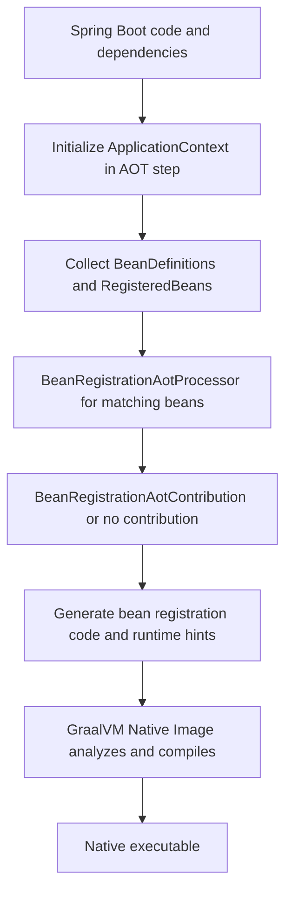

# Role of BeanRegistrationAotProcessor

## 1. Context: Why Does Spring Need to Process Bean Registration Ahead of Time?

In a Spring Boot application on the JVM, Spring Framework can read metadata, evaluate configuration, register `BeanDefinition`s, instantiate objects, and apply numerous bean-processing rules when the application starts. Some steps use reflection, type inference, or runtime discovery of application structure.

When compiling a **Spring Boot Native Image** using **Spring AOT** and **GraalVM Native Image**, pre-determinable work should be shifted to **build time**. Spring AOT analyzes the application context and generates initialization code, while GraalVM performs reachability analysis and compiles Java code into a native executable. As a result, applications typically reduce startup time and have the potential to lower memory usage; actual gains must still be measured by workload.

**`BeanRegistrationAotProcessor`** is an extension point at the **individual bean registration** level in Spring Framework. It allows an integration component to inspect information about a bean being registered and supply a tailored AOT contribution for that bean. This contribution can add appropriate initialization/registration code or runtime hints for dynamic operations. It is not a native compiler; it runs inside the Spring AOT pipeline **before** GraalVM Native Image creates the executable.

> Key point: `BeanRegistrationAotProcessor` handles **registering a specific bean**; it does not replace bean instantiation or the entire IoC container lifecycle.

## 2. Where Does the Processor Sit in the Spring AOT Cycle?

Conceptual workflow:



A `RegisteredBean` is Spring's representation of a registered bean via metadata and bean factory context. It differs from a live running instance: the processor works with **bean registration info**, which does not mean it may rely on arbitrary runtime bean state.

The workflow separates into three responsibilities:

| Component | Responsibility |
|---|---|
| Spring AOT engine | Traverses and prepares container structure, generates application startup code |
| `BeanRegistrationAotProcessor` | Inspects each `RegisteredBean` and decides whether any bean-specific AOT contribution is needed for that registration |
| `BeanRegistrationAotContribution` | Applies the determined contribution to code generation and/or runtime hints |
| GraalVM Native Image | Uses prepared code and metadata to perform reachability analysis, AOT compilation, and native runtime linking |

Crucially, **the processor determines what needs to be done**, while **the contribution performs the addition during code generation**. Separating these two roles allows an integration component to quickly signal a bean needs no handling by returning `null`.

## 3. API Contract and Invocation Timing

The core interface resides in package `org.springframework.beans.factory.aot`:

```java
public interface BeanRegistrationAotProcessor {
    BeanRegistrationAotContribution processAheadOfTime(
            RegisteredBean registeredBean);
}
```

This presents the minimal contract, omitting annotations and other framework details. Meaning:

1. Spring invokes `processAheadOfTime(registeredBean)` while performing AOT processing for a bean registration.
2. The processor inspects the bean type, metadata, and processing conditions determinable at build time.
3. If that registration **does not require** custom handling, return `null`.
4. If needed, return a `BeanRegistrationAotContribution`. Spring applies that contribution when generating bean registration code.

A contribution has the core method:

```java
void applyTo(
        GenerationContext generationContext,
        BeanRegistrationCode beanRegistrationCode);
```

`GenerationContext` supplies the code generation and runtime hints context. `BeanRegistrationCode` is the interaction point with the bean registration code being generated. Depending on the problem, a contribution may merely add hints or intervene in generated code through APIs supported by the Spring Framework version.

Do not interpret `processAheadOfTime` as a callback invoked every time the bean is created at runtime. This logic belongs to the **AOT processing phase**; only its output is reflected in the native executable.

## 4. Example: Adding Reflection Hints for a Special Bean

Suppose an application library provides the `LegacyInvoiceFormatter` bean. Another component in the system needs to invoke the formatter's constructor via reflection. On the JVM, looking up constructors normally occurs while the program runs; on native, reflective metadata must be registered.

```java
package example.invoice;

public final class LegacyInvoiceFormatter {
    public LegacyInvoiceFormatter() {
    }

    public String format(long amount) {
        return "Invoice total: " + amount;
    }
}
```

You can create a processor to recognize **bean registrations of this type** and contribute hints:

```java
package example.invoice;

import org.springframework.aot.hint.MemberCategory;
import org.springframework.beans.factory.aot.BeanRegistrationAotContribution;
import org.springframework.beans.factory.aot.BeanRegistrationAotProcessor;
import org.springframework.beans.factory.support.RegisteredBean;

public final class InvoiceFormatterRegistrationAotProcessor
        implements BeanRegistrationAotProcessor {

    @Override
    public BeanRegistrationAotContribution processAheadOfTime(
            RegisteredBean registeredBean) {

        if (!LegacyInvoiceFormatter.class.isAssignableFrom(
                registeredBean.getBeanClass())) {
            return null;
        }

        return (generationContext, beanRegistrationCode) ->
                generationContext.getRuntimeHints()
                        .reflection()
                        .registerType(
                                LegacyInvoiceFormatter.class,
                                MemberCategory.INVOKE_DECLARED_CONSTRUCTORS
                        );
    }
}
```

This example focuses on **contributing runtime hints**; the `beanRegistrationCode` parameter is unused because no bean instantiation code changes are needed. `INVOKE_DECLARED_CONSTRUCTORS` registers permission to invoke declared constructors. If the library also invokes a method or accesses a field via reflection, register the exact corresponding members; do not assume constructor hints are enough.

For Spring AOT to use the processor, **register the processor in the bean factory** (for example as a configuration bean), while ensuring it is present in the context processed by Spring AOT:

```java
package example.invoice;

import org.springframework.context.annotation.Bean;
import org.springframework.context.annotation.Configuration;
import org.springframework.beans.factory.aot.BeanRegistrationAotProcessor;

@Configuration(proxyBeanMethods = false)
class InvoiceAotConfiguration {

    @Bean
    static BeanRegistrationAotProcessor invoiceRegistrationProcessor() {
        return new InvoiceFormatterRegistrationAotProcessor();
    }

    @Bean
    LegacyInvoiceFormatter legacyInvoiceFormatter() {
        return new LegacyInvoiceFormatter();
    }
}
```

`@Bean static` is the appropriate declaration when the processor does not depend on the configuration class instance. The configuration class must be included in the application's context. Exact processor discovery/registration methods may vary with Spring Framework versions or library integration mechanisms.

**Limitation of the example:** for a standard Spring-managed class, Spring AOT or libraries may already register necessary constructor metadata. The goal here is to illustrate how to write a processor when **a component outside normal bean wiring** requires extra reflection. Do not add a processor merely because a class happens to be a Spring bean.

## 5. When Should You Use BeanRegistrationAotProcessor?

This extension point fits best for **frameworks or libraries managing how beans are used**, for example:

- A library with special handler beans that wants to generate tailored support code per registered handler.
- An integration needing to register reflective metadata depending on **each bean's type or annotations**.
- A custom bean registration mechanism with build-time data enabling more efficient registration code generation.
- A framework needing to create distinct support components from bean-specific metadata.

Suppose a library uses `@MessageHandler` across many bean types. A processor can inspect `RegisteredBean` metadata, generate contributions only for message-handler beans, and record metadata or generate library support code. This avoids maintaining a manual list of handlers, as long as metadata can be inferred during the AOT step.

It is unsuitable when you merely need to register a resource path or reflection hint **independent of individual beans**. In that case, `RuntimeHintsRegistrar` is usually simpler. Nor should you use a processor to read network state, production database query results, or deployment environment variables that the build cannot guarantee match runtime.

## 6. Distinguishing Spring's AOT Extension Points

| API | Scope | Typical Use Case |
|---|---|---|
| `BeanRegistrationAotProcessor` | Single bean registration | Generate tailored contributions per bean type |
| `BeanFactoryInitializationAotProcessor` | Entire bean factory at initialization stage | Analyze overall configuration and add container-level code/hints |
| `RuntimeHintsRegistrar` | Declaring runtime hints | Register reflection, resources, proxies, serialization, JNI when requirements are explicitly known |
| `BeanFactoryPostProcessor` | Modifies `BeanDefinition`s during bean factory prep | Alter bean registration metadata in standard lifecycle |
| `BeanPostProcessor` | Processes bean instances around initialization | Create wrappers, proxies, or customize bean instances at runtime |

The last two APIs in the table are **not equivalent AOT contribution mechanisms**. `BeanFactoryPostProcessor` and `BeanPostProcessor` can influence how Spring prepares the application context, but do not directly replace the interface generating `BeanRegistrationAotContribution`.

Also distinguish **Spring AOT** from **GraalVM Native Image**: Spring AOT prepares Spring application generated code and hints; GraalVM consumes that output to build the executable. A processor executing cleanly does not automatically guarantee all libraries are Native Image compatible.

## 7. Rules for Designing Safe and Effective Processors

### Use Only Build-Time Stable Data

Analyzed values can come from bean names, bean types, and existing annotations. Minimize side effects during processor execution:

```java
// Idea: decide based on known bean type
if (SupportedHandler.class.isAssignableFrom(
        registeredBean.getBeanClass())) {
    // Create appropriate contribution
}
```

Avoid calling production APIs, opening connections to external systems, or reading secrets during AOT. Values changing between build and deployment can cause the native executable to bake in stale configuration or fail during the build.

### Handle Multiple Beans Independently

A processor may encounter many bean registrations. Have `processAheadOfTime` decide based on each individual `RegisteredBean`; avoid storing shared mutable state where processing order affects results. If a contribution needs multiple members, register only those genuinely required to control artifact size and compatibility.

### Clear Exit Condition

Return `null` for out-of-scope beans. Do not unconditionally apply reflection hints to every bean in the application context, as that retains excessive metadata or introduces unnecessary constraints.

### Avoid Runtime Operations Inside Contributions

The `applyTo` block runs in the code and metadata generation pipeline, not where business logic executes. If a decision must happen at runtime, the contribution should generate code/metadata enabling runtime to decide over a **known set of possibilities**, rather than executing the decision at build time.

## 8. Verifying the Processor Produces the Intended Effect

For a Spring Boot project with an appropriate AOT plugin, follow this workflow:

1. Run the Spring AOT build step, such as Maven `./mvnw spring-boot:process-aot` or Gradle `./gradlew processAot` when plugins and versions support the corresponding task.
2. Inspect build logs, generated code, and created runtime hints. Output paths differ across Maven/Gradle and plugin versions; do not rely on a hardcoded path.
3. Build the native executable using the prepared configuration, e.g., `./mvnw -Pnative native:compile` or `./gradlew nativeCompile` if GraalVM Native Build Tools is configured.
4. Run the executable and exercise the exact code path requiring reflection/resources. Compare with the JVM run using identical profiles and inputs.
5. Verify functional correctness before measuring startup time, readiness, RSS, throughput, and latency. Native results may vary by dependencies, runtime, and real load.

Example test scenario:

```java
@Autowired
LegacyInvoiceFormatter formatter;

@Test
void formattingWorks() {
    assertEquals("Invoice total: 500", formatter.format(500));
}
```

The test above verifies ordinary Java logic only; it **does not** prove the reflection hint is applied properly. You must add a path that actively invokes `getDeclaredConstructor().newInstance()` from the native-running program and check the result. For critical logic, prefer native integration tests (or running the real executable) because JVM unit tests miss closed-world restrictions.

## 9. Common Mistakes and How to Resolve Them

| Symptom | Cause to check | Remediation |
|---|---|---|
| Processor does not run during AOT build | Processor bean not registered in context or configuration not loaded | Check `@Configuration`, configuration conditions, and build task |
| `processAheadOfTime` runs yet no contribution appears | Bean-type filter condition is wrong or returns `null` | Inspect `RegisteredBean` and selection conditions |
| Native still fails calling constructor via reflection | Hints registered for wrong class/member or code path uses different reflection | Verify exact class and member being invoked |
| JVM works fine, native missing resource | Reflection hints do not package resources | Add resource hints with matching patterns |
| Build depends on profile/environment | Processor relies on config unstable between build and runtime | Move decision to runtime or fix build inputs explicitly |
| Native startup is fast yet one business feature fails | Rare dynamic branch not included in image | Run tests triggering that branch and complete metadata |

When debugging, confirm three things independently: the processor is discovered by Spring, the contribution is applied, and GraalVM receives matching metadata. Each step can fail independently; avoid assuming simply adding `@Bean` eliminates every reflection error.

## 10. Comprehensive Practice and Conclusion

Recommended exercise for the **Spring AOT** topic in module `SPRING_BOOT_NATIVE_IMAGE`:

1. Create a small Spring Boot application with two formatter beans implementing the same interface and a code path using reflection to invoke a specific constructor.
2. Write a `BeanRegistrationAotProcessor` that selects only one bean type, returns `null` for the other, and creates a contribution registering constructor reflection.
3. Observe via logs/debugging during the AOT step that the processor runs at build time, not per request.
4. Build natively, test the exact reflective code path, and add a negative case proving the processor's scope.
5. Package the executable in a container with compatible system libraries, run smoke tests, and benchmark startup/memory against a functionally equivalent JVM run.

`BeanRegistrationAotProcessor` is an extension point scoped to **each bean registration**, enabling frameworks to contribute generated code or metadata from information known before execution. Understanding the boundary between **processor**, **contribution**, **runtime hints**, and the **GraalVM compiler** helps you choose the right API, avoid build-time side effects, and accurately test Spring Boot Native Image applications.
