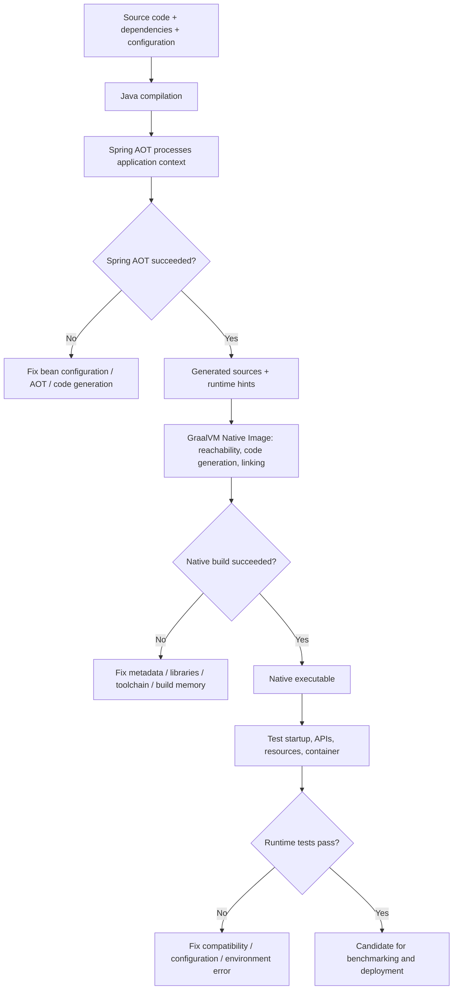

# Distinguishing Spring AOT Success from Native Compilation Success

## 1. Two Different Milestones in the Same Pipeline

In the **SPRING_BOOT_NATIVE_IMAGE** module, the goal is to compile a Spring Boot application into a **GraalVM Native Image** via **Spring AOT**, then evaluate startup time, memory usage, compatibility testing, and running the native executable or container. To diagnose failures accurately, you must separate two claims that are frequently conflated:

- **Spring AOT success**: the build-time Spring context analysis step, source code generation, and required metadata generation finished cleanly within the scope of the executed task.
- **Native compilation success**: GraalVM Native Image completed reachability analysis, compilation, linking, and produced a valid native executable for the target platform.

These two milestones are ordered sequentially in a typical Spring Boot native build, yet **AOT success does not guarantee native-image build success**. Even **native-image build success still does not prove the application behaves properly in production**.



The three statuses **AOT PASS**, **Native Build PASS**, and **Runtime PASS** should be recorded separately in CI logs and reports. Do not let a single `BUILD SUCCESS` line stand in for all three, because it only reflects the task that just ran, not necessarily the entire pipeline.

## 2. What Does Spring AOT Actually Do?

Spring AOT (Ahead-of-Time) shifts part of the work normally done at runtime to build time. It reads pre-determinable Spring components, analyzes configuration, prepares bean creation code, and registers *Runtime Hints* for dynamic operations such as reflection, JDK proxies, resources, or serialization. The output feeds into native image creation.

Example of an application with a controller, service, and bean configuration:

```java
@Configuration
class PaymentConfiguration {
    @Bean
    PaymentService paymentService(PaymentRepository repository) {
        return new PaymentService(repository);
    }
}
```

In AOT mode, Spring can generate code to instantiate beans and wire dependencies instead of discovering everything via reflection at runtime startup. This helps Native Image see more types and initialization paths through static analysis.

The AOT step can emit:

| Output | Meaning | Does it prove native was compiled? |
|---|---|---|
| AOT-generated Java sources | Code to register and instantiate beans, supporting context initialization | No |
| AOT-generated resources | Framework support data | No |
| Runtime Hints / metadata | Declares reflection, proxy, resource, etc. requirements for Native Image | No |
| AOT success log | Spring's processing step completed for the invoked scope | No |

Output directories depend on plugins, build tools, and versions. In Maven, paths are typically under `target/`; in Gradle, under `build/`. Do not rely on a hardcoded path without checking your project's version.

Spring AOT carries constraints tied to build-time state: conditions or bean choices decided at build time may not be freely changeable once the executable is compiled. Therefore, test the exact profiles, properties, and conditions used for building and running; do not assume changing runtime environment variables can rebuild the native executable's entire bean graph.

## 3. What Does GraalVM Native Image Do After AOT?

Once application bytecode and AOT results are ready, the GraalVM Native Image tool executes several further phases:

1. *Reachability* analysis: identifies callable components and data that must be retained under the *closed-world assumption*.
2. Combines information from code, dependencies, and native metadata to handle reflection, resources, proxies, JNI, and other dynamic mechanisms.
3. Analyzes, optimizes, compiles code, and constructs the image heap according to tool capabilities.
4. Links with the native runtime and target-environment libraries to produce the executable.

Consequently, an application can finish generating Spring AOT files yet still fail in later steps due to:

- **Missing metadata** for reflection, resources, or proxies accessed along dynamic paths unknown to Spring AOT.
- **Incompatible dependencies** with AOT analysis or native execution; they may use runtime bytecode generation or dynamic class loading.
- **Missing native toolchain**, OS libraries, or improper linker configuration.
- **Out of RAM/disk** while `native-image` analyzes and generates code; build load is usually much heavier than runtime.
- **Problematic build-time initialization code**, such as calling external services or capturing unsuitable state in the image heap.

To understand failures, read the *first failing step* in the log rather than only the final error message from Maven/Gradle. A native build can fail even when AOT generated code cleanly, and AOT can succeed while its generated code subsequently fails Java compilation.

## 4. Illustrating with Maven

Assume a Spring Boot Maven project with compatible Spring Boot and GraalVM Native Build Tools plugins, plus a `native` profile configured per Spring Boot's Native Image project template.

Run AOT processing on its own:

```bash
./mvnw spring-boot:process-aot
```

This command tells the Spring Boot plugin to perform AOT processing for the project configuration; compiling and running the generated AOT sources requires the appropriate lifecycle build steps. **This command does not produce a native executable on its own.**

To build the native executable via the native profile:

```bash
./mvnw -Pnative native:compile
```

In typical Spring Boot Maven setups, the `native` profile and plugin lifecycle integrate AOT prior to creating the native executable. Still, each project's actual lifecycle configuration must be verified; if success is reported at `process-aot`, that is only AOT success.

One way to distinguish outcomes after a run:

| Signal | Reasonable Interpretation |
|---|---|
| `spring-boot:process-aot` finishes cleanly | Spring AOT completed |
| Generated sources exist under `target/` | AOT artifacts exist; no evidence of a native executable yet |
| Logs show `native-image` analyzing reachable methods | Native build in progress; cannot conclude yet |
| `native:compile` finishes cleanly and target executable exists | Native build has evidence of success |
| Executable starts and health endpoint returns expected output | Passed specific runtime check; insufficient to conclude all features work |

Do not infer success solely from the existence of a file named like an executable: that file could be a stale artifact. To evaluate accurately, remove or isolate artifacts from prior builds per project workflow and record the build timestamp, then check the exit code, artifact path, and test the freshly created artifact itself. Artifact cleanup should be performed deliberately in a build environment under your control.

## 5. Illustrating with Gradle

With Gradle, the Spring Boot plugin provides the AOT processing task, while GraalVM Native Build Tools provides the native compilation task when the project is configured appropriately:

```bash
./gradlew processAot
```

This command runs **the Spring AOT phase**, potentially generating code/metadata under `build/generated/` or directories used by the plugins.

```bash
./gradlew nativeCompile
```

This command targets the **native executable**. In standard integrations, `nativeCompile` depends on required outputs including AOT processing; the exact order can be inspected in the Gradle task graph.

If `processAot` completes yet `nativeCompile` fails, inspect which task failed: `compileAotJava`, `nativeCompile`, a resource generation task, or linking. A PASS status on one task does not automatically carry over to others.

## 6. Examples Diagnosing Three Failure Types

### Scenario A — AOT Fails Before Native Compilation

A Spring configuration requires a bean or property unavailable at build time:

```text
> Task :processAot FAILED
...
BeanCreationException: Error creating bean ...
```

The failure occurs when Spring AOT attempts to prepare the application context. Check bean creation conditions, profiles, properties, initialization logic, and components accessing external resources. **You cannot fix this directly by increasing Native Image heap or arbitrarily declaring reflection metadata.**

With an error like `BeanCreationException`, read down to the root cause because bean failures can also arise from environment configuration, I/O access, or user code. The goal is enabling AOT to reproduce a valid configuration as designed.

### Scenario B — AOT PASS, Native Build FAIL

For example, logs may look like:

```text
> Task :processAot SUCCESS
> Task :nativeCompile FAILED
Error: ...
```

AOT completed, yet Native Image encountered an analysis limitation, missing metadata, insufficient resources, or toolchain error. Classify using the specific `nativeCompile` message:

- Mentions a class/member name, dynamic proxy, or resource: inspect Runtime Hints and library metadata.
- Mentions `OutOfMemoryError` or the process was OOM-killed: inspect build runner memory and builder heap flags.
- Linker/compiler error: inspect C toolchain, operating system, architecture, and native dependencies.
- Initialization error: inspect whether classes are initialized at build time vs. runtime, avoiding pushing environment-dependent state into the image heap.

AOT success proves only that Spring generated AOT output, not that GraalVM accepts or successfully compiles every dependency.

### Scenario C — Native Build PASS, Runtime FAIL

The executable is created, yet an untested dynamic endpoint fails:

```text
$ ./build/native/nativeCompile/app
...
java.lang.IllegalStateException: invoice template not found
```

Perhaps the template was excluded from the image, the resource path is wrong, or a runtime directory was not mounted. Another case is a JNI library missing its binary in a Linux container or configuration differing from the build environment. Native Build PASS means only that the executable was created cleanly; **it does not automatically validate full runtime behavior**.

If the error stems from metadata, add Spring Runtime Hints or GraalVM metadata, rebuild the image, and rerun the scenario. If it stems from a mounted file, fix packaging or deployment configuration rather than baking environment-specific data into the executable.

## 7. Verification via Artifacts and Testing

A testing workflow can use the following acceptance table:

| Quality Gate | PASS Condition | Evidence to Retain |
|---|---|---|
| **AOT** | AOT task exits cleanly | Task/goal logs, plugin versions, and generated outputs |
| **Native build** | Native compilation and linking finish, fresh executable exists | `native-image` logs, exit code, artifact path, OS/architecture |
| **Runtime smoke test** | Executable boots, readiness succeeds | Launch command, profile, logs, health/readiness status |
| **Integration / compatibility** | Key flows execute accurately, including reflection/resources/proxies/JNI if present | Test report and executed endpoints/test cases |
| **Container** | Native image runs cleanly in target environment | Image digest/tag, architecture, memory limits, mount configs |
| **Performance** | Measure startup, RAM, throughput/latency per workload | Load conditions, measurement method, iterations, JAR/native metrics |

Example running the executable and checking readiness:

```bash
./target/app
```

In another terminal:

```bash
curl -fsS http://localhost:8080/actuator/health
```

This example assumes the project includes Spring Boot Actuator, enables the health endpoint, and names the actual executable `app`. Artifact paths may differ; do not treat a single HTTP 200 response as proof that every business flow works.

To compare JAR vs. native, hold source code, profile, data, feature config, load, concurrency, and test environment constant. Measure **time to ready**, idle and under-load RSS, plus latency/throughput. A passing native build does not automatically guarantee faster speed or lower RAM across every workload.

## 8. Commonly Misunderstood Limitations

| Claim | Conclusion |
|---|---|
| "`processAot` BUILD SUCCESS means we already have a native executable." | False; that is only AOT success. |
| "`nativeCompile` failing means Spring AOT is definitely broken." | False; the fault may lie in GraalVM, the linker, metadata, or build resources. |
| "Having the native file means all APIs work properly." | False; dynamic code paths and runtime environments must be tested. |
| "Reflection works on the JVM, so Native Image knows it automatically." | Not always true; some cases need Runtime Hints or reachability metadata. |
| "Changing runtime profile makes Spring recompute the entire AOT bean graph." | Cannot be assumed; many decisions are locked at build time. |
| "Post-build runtime errors are always caused by metadata." | False; they can also stem from config, filesystem, JNI libraries, architecture, network, or application bugs. |

## 9. Suggested Practice Exercise

Create a small Spring Boot API with `/actuator/health` and an endpoint reading a template from the classpath. On the exact same commit:

1. Run `processAot` alone via Maven or Gradle and record the generated outputs; verify no native executable appears from this step alone.
2. Run `native:compile` or `nativeCompile`, noting both the AOT and Native Image steps in logs, build duration, and peak build RAM.
3. Start the fresh executable, call health and the template-reading endpoint; confirm the resource exists inside the native image.
4. Package the native executable into a container per project configuration and rerun those requests; note architecture, filesystem permissions, and external resources.
5. Run the traditional JAR application under the same load to measure startup time, RSS, and latency; explicitly document measurement conditions.
6. Intentionally introduce a bean configuration error in a test branch and observe which stage halts; revert before continuing.

Record results across three boxes — **AOT**, **Native build**, and **Runtime** — with independent PASS/FAIL statuses. On any FAIL, save the log of the first failing task and its root cause.

## 10. Self-Check Questions

1. What outputs does Spring AOT produce to support Native Image, and why are they not yet an executable?
2. Why does `processAot` succeeding not guarantee `nativeCompile` succeeds?
3. If a native build reports a linker error, which phase should be inspected first? Why?
4. The native executable starts up, yet a request loading a template fails. Which causes must be distinguished?
5. Why must profiles and properties be verified at both build time and runtime?
6. What is the minimum evidence needed to claim "the native Spring Boot application is ready for performance benchmarking"?

**Takeaway:** Spring AOT is the stage that generates code and metadata to assist ahead-of-time analysis; GraalVM Native Image is the stage that compiles and links the executable; and smoke tests plus compatibility testing validate actual runtime behavior. Tracking these three gates independently enables accurate debugging and evidence-based evaluation of Spring Boot Native Image startup and memory benefits.
