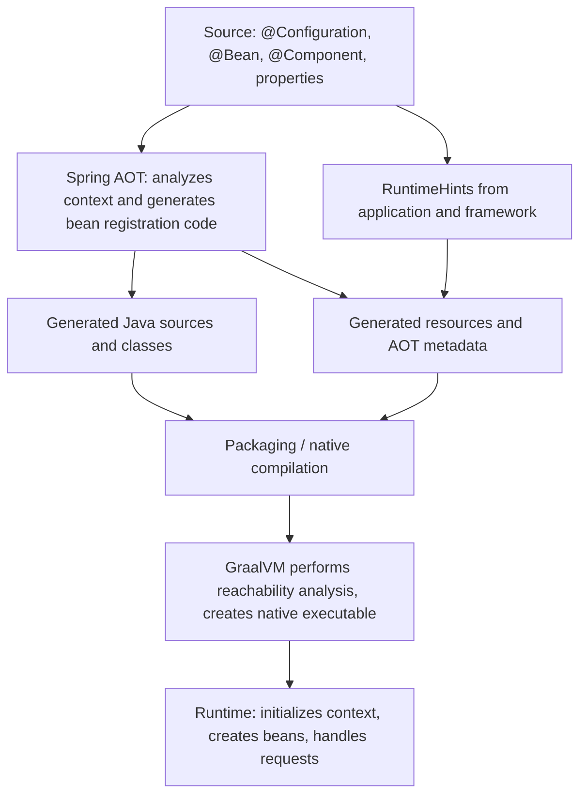
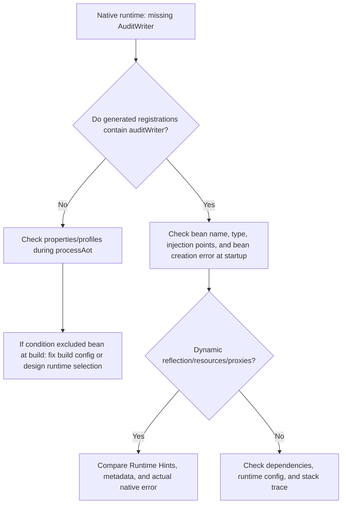

# Reading Generated Code, Classes, and Metadata to Explain Application Behavior

When running Spring Boot with GraalVM Native Image, part of the work Spring normally executes during JVM startup has moved to the **Spring Ahead-of-Time (AOT)** phase. To understand why a bean is created, why a configuration condition stops behaving as expected, or why reflection works on the JVM yet fails inside the native binary, you need to know how to **read what AOT generates**: Java sources, the classes compiled from them, and the metadata supplied to GraalVM.

This lesson belongs to the **Spring AOT** chapter of the `SPRING_BOOT_NATIVE_IMAGE` module. The goal is to trace the relationship from application source code to the pre-prepared Spring context structure, identify build-time/runtime boundaries, and know which artifact to inspect when explaining native behavior. This also provides the foundation for practicing Maven/Gradle builds, handling reflection/resources, compatibility testing, and running native containers.

## 1. Which Step's Output Are We Reading?



These three components serve distinct roles:

| Component | Description | What question does it answer? |
| --- | --- | --- |
| **Generated Java source** | Code created by Spring AOT to initialize `ApplicationContext`, register bean definitions, configure factories/suppliers, and optimize certain framework operations. | Which beans does Spring know about? Along which path are they registered and instantiated? |
| **Generated classes** | Bytecode compiled from generated Java; analyzed by the native compiler alongside application and library code. | Which classes were generated code compiled into? Are there class/method names allowing traceback to source? |
| **AOT/native metadata** | Information for dynamic capabilities such as reflection, resources, proxies, or serialization; may come from Spring, libraries, or custom config. | Is Native Image permitted to access a member via reflection, embed a resource into the binary, or create a proxy? |

**Spring AOT is not the GraalVM Native Image compiler.** Spring AOT prepares the application structure and hints; GraalVM then analyzes the entire program, strips unreachable code, and builds the executable. Therefore, **appearing in generated source does not mean every bytecode line ends up preserved verbatim in the binary**. Conversely, not seeing a class in a generated file does not prove its absence: the class may be called directly by application code or supplied by the framework/libraries.

## 2. Running Example: Predicting What Spring Will Generate

Suppose we have a simple application:

```java
package com.example.aotdemo;

import org.springframework.boot.SpringApplication;
import org.springframework.boot.autoconfigure.SpringBootApplication;

@SpringBootApplication
public class AotDemoApplication {
    public static void main(String[] args) {
        SpringApplication.run(AotDemoApplication.class, args);
    }
}
```

A configuration defining two beans:

```java
package com.example.aotdemo;

import java.time.Clock;
import org.springframework.boot.autoconfigure.condition.ConditionalOnProperty;
import org.springframework.context.annotation.Bean;
import org.springframework.context.annotation.Configuration;

@Configuration(proxyBeanMethods = false)
class DemoConfiguration {

    @Bean
    Clock applicationClock() {
        return Clock.systemUTC();
    }

    @Bean
    @ConditionalOnProperty(name = "feature.audit.enabled", havingValue = "true")
    AuditWriter auditWriter() {
        return new AuditWriter();
    }
}

class AuditWriter {
    void write(String message) {
        System.out.println("AUDIT: " + message);
    }
}
```

And a component consuming `Clock`:

```java
package com.example.aotdemo;

import java.time.Clock;
import java.time.Instant;
import org.springframework.stereotype.Service;

@Service
class TimeService {
    private final Clock clock;

    TimeService(Clock clock) {
        this.clock = clock;
    }

    String now() {
        return Instant.now(clock).toString();
    }
}
```

After AOT processing, we want to verify three predictions:

1. Spring knows how to register `applicationClock` and `timeService` without repeating full scanning and inference as during normal JVM startup.
2. Generated code expresses how `Clock` is supplied to `TimeService`'s constructor or its corresponding factory method.
3. `auditWriter` depends on `feature.audit.enabled` in the **AOT processing environment**. If the condition does not match at that moment, do not expect changing the property on a native run to spawn the excluded bean.

The key is reading **actual files generated by the Spring Boot version in use**, rather than memorizing internal class names or calls; code-generation details may vary across versions.

## 3. Generating AOT Artifacts for Inspection

AOT output can be generated before running full compilation into a native executable. This lets you inspect the bean graph and hints without waiting for the resource-intensive native compilation step.

### 3.1. Maven

For a Spring Boot 3.x project with compatible `spring-boot-maven-plugin` configuration:

```bash
./mvnw spring-boot:process-aot
```

Output typically resides under `target/spring-aot/main/`, for example:

```text
target/
└── spring-aot/
    └── main/
        ├── sources/       # Java sources generated by AOT
        ├── resources/     # Resources and metadata generated by AOT
        └── classes/       # Classes produced by the build (depending on config)
```

Maven native builds typically use:

```bash
./mvnw -Pnative native:compile
```

The `native` profile, plugin versions, output paths, and executable name depend on the project. When inspecting generated code, run `process-aot` first and verify the actual directory in build logs.

### 3.2. Gradle

For a Spring Boot/Gradle project with the corresponding plugins applied:

```bash
./gradlew processAot
```

In common versions, generated sources, resources, and classes appear in directories similar to:

```text
build/
└── generated/
    ├── aotSources/
    ├── aotResources/
    └── aotClasses/
```

To build natively with GraalVM Native Build Tools:

```bash
./gradlew nativeCompile
```

These paths are **common locations**, not an immutable contract across all plugin versions. If files are missing at the sample path, inspect task results, build configuration, and output paths reported in logs before concluding AOT did not run.

### 3.3. Finding Files Worth Reading

For example, in a terminal with `rg` (ripgrep), after running AOT:

```bash
# Maven: view classes/configurations related to the example
rg -n 'TimeService|DemoConfiguration|auditWriter|applicationClock' target/spring-aot

# Gradle: search within generated sources and resources
rg -n 'TimeService|DemoConfiguration|auditWriter|applicationClock' build/generated
```

You can also search by common suffixes such as `__BeanDefinitions`, `__BeanFactoryRegistrations`, or `__ApplicationContextInitializer`. These suffixes are **search hints**, not guaranteed filename rules. In particular, package names and metadata formats should not be assumed from an older example.

## 4. Reading Generated Source Along an Execution Path

Once AOT-generated `.java` files are located, follow the sequence: **initializer → bean definition registration → bean instance supplier/factory → dependency injection**.

### 4.1. What Does the Context Initializer Do?

An AOT-generated initializer connects generated code to Spring context construction. Its contents can call helper classes that register bean definitions and configure infrastructure. While reading the file, note:

- Which bean registration classes does it invoke?
- Do you see registrations for `DemoConfiguration`, `TimeService`, or beans from auto-configuration?
- Is there code initializing property sources, the bean factory, or infrastructure needed before regular beans are created?

Do not treat calls inside the initializer as **operations that already ran at build time**. Generated code is code **that will execute when the process starts** to reconstruct the pre-prepared Spring structure.

### 4.2. Bean Definition Is Not Bean Instance

Inside generated code, you may encounter elements resembling the following:

```java
// CONCEPTUAL ILLUSTRATIVE CODE — not an exact excerpt from Spring AOT.
// Actual API names, methods, and organization vary by version.

void registerBeanDefinitions(/* BeanDefinitionRegistry registry */) {
    // Register definition for bean "timeService".
    // Constructor/factory instructions may be generated or referenced here.

    // Register definition for bean "applicationClock".
    // When context starts, Spring uses the matching factory to create Clock.
}
```

This snippet deliberately describes **roles**, rather than providing a compilable implementation. In actual output, look for constructs like `RootBeanDefinition`, `BeanInstanceSupplier`, registering beans into the registry, constructor or factory method calls, and generated instance factories. Distinguish carefully:

| What appears in generated code | Meaning | What **cannot** be inferred from that alone |
| --- | --- | --- |
| Bean name / bean definition | Spring expects to instantiate and manage that bean in the context. | That the bean object was pre-created at build time. |
| Constructor or instance supplier | The creation path is pre-determined. | That business methods ran at build time. |
| Dependency info / dependency lookup calls | Spring knows which components to wire together. | That all real dependencies successfully connect at runtime. |
| `@Bean` factory method | Spring will call the factory along the prepared path. | That factory results are constant or identical across every environment. |
| References to auto-configuration beans | Auto-configuration joined the bean graph. | That every optional starter capability is retained in the native binary. |

For example, `Clock.systemUTC()` resides inside the factory method. AOT output knows **which method** creates the bean, yet the normal `Clock` instance is still created during process context startup. `TimeService.now()` continues returning the changing time on every call.

### 4.3. Tracing Back from Generated Classes to Application Source

If a file is named similarly to `TimeService__BeanDefinitions.java`, try this reading sequence:

1. Find `TimeService` to confirm the bean type being registered.
2. Locate how the `BeanDefinition` is built and the instance supplier is chosen.
3. Locate the `Clock` parameter and how Spring requests the bean dependency from the context/bean factory.
4. Trace back to application source: `TimeService(Clock clock)`, `@Bean Clock applicationClock()`.
5. Conclude: AOT knows the bean creation path, while values from the clock and request handling flow remain runtime data.

This technique is far more effective than opening hundreds of generated files at random, because every line read answers a verifiable question.

## 5. Conditions and Profiles: Finding Why a Bean Appears or Vanishes

Consider `auditWriter()` in the example. If AOT processing occurs when `feature.audit.enabled` does not equal `true`, the condition can exclude this bean from the generated structure. You will see evidence from **the bean definition not being registered** in AOT output, while verifying conditions at build time.

| Scenario | Expected in generated bean registrations | Behavior to understand |
| --- | --- | --- |
| AOT build with `feature.audit.enabled=true` | Bean definition for `auditWriter` should appear. | Runtime uses the bean per prepared structure; do not assume the condition is re-evaluated like on a normal JVM. |
| AOT build when property is missing and `matchIfMissing` defaults (`false`) | Bean can be omitted from registrations. | Setting the property to `true` only when running native is insufficient to add a bean omitted during AOT. |
| Bean always registered, only reads `@Value` or `@ConfigurationProperties` for values | Bean definition remains unchanged across both environments. | Runtime values can normally change between launches if they do not govern bean selection or code paths. |

For `@Profile`, `@ConditionalOnClass`, `@ConditionalOnProperty`, and conditions evaluated during AOT, examine profiles, classpath, and properties **at the time AOT runs**. For native applications, Spring Boot places constraints on changing profiles/conditions between build time and runtime. Custom application condition logic may also be incompatible with AOT if it depends on state only available while running.

Keep two reading caveats in mind:

1. **Not seeing a bean in one file is insufficient to conclude the bean is absent.** You may be inspecting the wrong output set, the bean may come from another configuration, or registration may reside in a different generated file.
2. **Seeing a class name does not prove a bean was registered.** The name may sit in metadata, a referenced code path, or another annotation. Locate the exact bean definition registration block and check its corresponding conditions.

When explaining errors, keep three pieces of evidence: **properties/profiles used during AOT**, **the bean registration file/snippet**, and **observed behavior when running the binary**.

## 6. Reading Native Metadata: What Cannot Be Inferred from Direct Calls

Spring AOT can generate or aggregate **Runtime Hints** for operations that GraalVM cannot reliably deduce from the call graph alone. Libraries can also ship their own metadata, and the native-image build tool can pull metadata from other sources. Thus, final file locations and formats depend on Spring/GraalVM versions and project configuration.

Categories to know:

| Category | Helps native compiler handle | Signs to look for |
| --- | --- | --- |
| Reflection | Constructors, methods, fields, annotation metadata, or dynamically accessed members. | Are the type and members permitted access? Only metadata query or invocation too? |
| Resource | Files on classpath that must be carried into the native image. | Does the pattern match the exact resource path being read? |
| JDK dynamic proxy | Dynamic proxies for a required set of interfaces. | Is the desired interface set declared/registered? |
| Serialization | Types dynamically accessed by Java serialization or equivalent mechanisms. | Have the type and required members been registered? |
| JNI | Types and members accessed by external native code. | Is corresponding metadata present for the JNI path? |

In some versions/toolchains, you may see JSON files such as:

```text
META-INF/native-image/...
    reflect-config.json
    resource-config.json
    proxy-config.json
    serialization-config.json
    jni-config.json
```

These are **examples of common metadata filenames**, not a guarantee every project emits all five files or places them at that exact path. Newer toolchains may package metadata differently. Read actual artifacts and `native-image` build logs; do not infer that a missing file means no metadata exists.

### 6.1. Reflection Example: How Much Reflection Is Allowed?

Suppose the application reads a type name from config and invokes:

```java
Class<?> type = Class.forName(className);
Object instance = type.getDeclaredConstructor().newInstance();
```

With the class name only known at runtime, static analysis may fail to identify the constructor that must be retained. Hints can be added via Spring's API:

```java
package com.example.aotdemo;

import org.springframework.aot.hint.MemberCategory;
import org.springframework.aot.hint.RuntimeHints;
import org.springframework.aot.hint.RuntimeHintsRegistrar;
import org.springframework.context.annotation.Configuration;
import org.springframework.context.annotation.ImportRuntimeHints;

@Configuration(proxyBeanMethods = false)
@ImportRuntimeHints(DynamicTypeHints.class)
class DynamicTypeConfiguration { }

class DynamicTypeHints implements RuntimeHintsRegistrar {
    @Override
    public void registerHints(RuntimeHints hints, ClassLoader classLoader) {
        hints.reflection().registerType(
                ReportPayload.class,
                MemberCategory.INVOKE_DECLARED_CONSTRUCTORS
        );
        hints.resources().registerPattern("templates/report.txt");
    }
}

class ReportPayload {
    ReportPayload() { }
}
```

The example illustrates a non-`public` constructor matching `getDeclaredConstructor()`; if invoked via Java reflection from another class without access rights, Java access rules and `setAccessible(true)` where appropriate must also be considered. **Hints tell GraalVM to retain metadata**, but do not automatically relax Java language access rules.

When inspecting reflection metadata (e.g., traditional JSON format), you may see content similar to:

```json
[
  {
    "name": "com.example.aotdemo.ReportPayload",
    "allDeclaredConstructors": true
  }
]
```

This is a **data-format illustration**, not a promise Spring emits that exact JSON snippet. Distinguish permission to **query metadata** from permission to **invoke constructors/methods** in APIs and formats supporting granular permissions. Do not unconditionally register all members, as doing so increases metadata volume and can impact native image size.

### 6.2. Resources: Where Is the File Read From?

`hints.resources().registerPattern("templates/report.txt")` declares classpath resources to embed into the binary. If the application uses:

```java
try (var input = getClass().getResourceAsStream("/templates/report.txt")) {
    if (input == null) {
        throw new IllegalStateException("Report template not found");
    }
    // Read content from input...
}
```

check the source file at `src/main/resources/templates/report.txt`, AOT resource outputs, and resource readability when running natively. Files embedded inside the binary normally **do not change** just because a same-named file on the filesystem is edited post-build. If templates must change at runtime, design external file reading (`Path`, container volumes, object storage, etc.) and keep that read path separate from classpath resources.

A resource hint does not prove file content existed at build time, nor does a file sitting in the source tree prove it was embedded properly. Verify the **pattern**, **actual artifact**, and **runtime read outcome**.

### 6.3. Proxies and Serialization

If the application directly calls `Proxy.newProxyInstance(...)`, inspect the proxy interface set and appropriate hints. Spring generates many proxies needed for AOP, transactions, and framework features, so add hints only for dynamic access paths not yet recognized by AOT processing.

Similarly, ordinary JSON mapping with Jackson and Java native serialization are not identical: metadata configuration must match **the mechanism the framework actually uses**. Do not see a JSON failure and immediately add a Java serialization hint, or vice versa.

## 7. Reading Generated Classes and Observation Limits

Once `.java` sources are compiled, corresponding generated classes can appear in the classes output directory. With a JDK available when comparison is needed, use `javap` to inspect signatures or bytecode of a known class:

```bash
# Illustration: replace <class-name> and classpath with values present in your project.
javap -classpath target/spring-aot/main/classes -p '<class-name>'
```

You can also read generated sources instead of bytecode; **sources are the best starting point** for reading bean registrations. As the compiler optimizes and merges code into the native executable, do not assume every class/method in JVM output retains the same shape in the binary. A Native Image is not a JAR you can open and browse in the same way.

Some generated files/classes support Spring internals, such as auto-configuration registration or bean property processing. Do not ascribe business meaning to a generated class name just because it is long or has an unfamiliar suffix. Look for call sites, bean names, target types, and factories/suppliers.

## 8. Investigating a Specific Failure with AOT Evidence

Suppose the JVM build exposes an audit-logging endpoint, yet the native binary launched with `--feature.audit.enabled=true` reports no `AuditWriter` bean exists.



Investigative steps to follow in order:

1. **Confirm which build is running:** code version, profiles, properties during AOT, toolchain, and the matching binary/container image.
2. **Locate generated artifacts:** search `auditWriter` across all generated sources/resources, identify where the condition was evaluated and where bean registration appears (or does not).
3. **Separate the two change types:** `feature.audit.enabled` governs bean structure; values like database host, port, or timeout for an already-existing bean can typically be supplied at startup.
4. **If the bean has a registration:** read the initialization path and actual error; do not automatically blame AOT conditions for every failure. Constructors, dependencies, reflection permissions, and resources can all be root causes.
5. **If the error involves metadata:** inspect `RuntimeHintsRegistrar`, library/framework contributions, and metadata received by the native compiler; fix the minimal declaration, rebuild, and exercise the exact usage path.

A useful way to record findings is a table:

| Question | Evidence to keep | Conclusion permitted |
| --- | --- | --- |
| Did AOT register the bean? | Generated file and exact bean-name registration snippet. | Identifies the bean structure prepared by AOT. |
| Why is the bean absent? | Source condition + config at AOT time + registration output. | Grounded conclusion that the condition excluded the bean. |
| Why did reflection fail? | Native stack trace + reflection call site + metadata/hints. | Identifies which dynamic access capability is missing. |
| Why could the template not be read? | Classpath path, resource pattern, actual resource, and runtime result. | Distinguishes unembedded resource, wrong path, or read error. |
| Why do JVM and native yield different results? | Identical data, identical feature, build/runtime config, logs from both runs. | Isolates discrepancies caused by AOT, metadata, or environment. |

## 9. Hands-On Verification on a Small Project

Use a Spring Boot 3.x project that runs on the JVM and has an appropriate native build toolchain. The steps below are **practice instructions**, not pre-measured benchmark results.

**Step 1 — See generated code.** Add `TimeService`, `DemoConfiguration`, and `AuditWriter` as in the example. Run `spring-boot:process-aot` (Maven) or `processAot` (Gradle). Locate generated sources and answer: where is the initializer, where are bean definitions, and how is `TimeService` instantiation represented?

**Step 2 — Change the condition before building.** Run AOT with `feature.audit.enabled=false` (or omit the property), then rerun with `true` in a fresh build. Compare generated registrations. The condition tested here is **changing the bean graph at AOT time**. Do not merely change a command-line argument at runtime and draw conclusions from an old binary.

**Step 3 — Test a runtime value.** Add an always-present bean injecting `@Value("${app.message:default}")`. Launch the same native binary twice with two different `--app.message=...` values and observe what value the bean receives at startup. The same binary can accept different values as long as that property does not govern build-closed bean structure.

**Step 4 — Check reflection/resources.** Write a real call path using `Class.forName` with a runtime-only class name or reading `/templates/report.txt`. If needed, add `RuntimeHintsRegistrar`, run AOT, and compare metadata before/after. Do not guess from JSON filenames: test the exact code path on the native build.

**Step 5 — Compare JVM and native.** Run equivalent requests, comparing outputs, initialization logs, errors, and bean state. Only after functional parity is confirmed should you measure cold-start time, process RSS/memory, and behavior under equivalent load. AOT artifacts help **explain** program structure; only runtime measurements reveal actual performance benefits.

## 10. Common Interpretation Mistakes

| Misconception | Accurate Reading |
| --- | --- |
| "Having a generated bean definition means the bean was created at build time." | Definitions/factories describe how to create it; normal beans are still instantiated when the runtime context starts. |
| "Not seeing a class in `__BeanDefinitions` means it is absent from the native image." | The class may be called by other code or reside in another artifact. Consider reachability and the actual build. |
| "Having `reflect-config.json` means all reflection works." | Only recognized or properly declared types/members gain corresponding access. |
| "No `reflect-config.json` means there are no hints." | Metadata may be packaged or supplied in a different format/source depending on the toolchain. |
| "Changing a runtime property always changes the bean graph." | Conditions processed by AOT may have locked down bean registration. |
| "AOT sources are the only sources used by the native compiler." | The compiler also analyzes application code, libraries, JDK, and other reachability metadata. |
| "Every file in `resources/` updates automatically post-build." | Classpath resources embedded in the binary are not external files reread automatically. |
| "Every generated class represents a business feature." | Many Spring-generated classes serve bean registration and framework infrastructure. |

## 11. Checklist When Reading an AOT Build

- **Confirm scope:** right code version, Spring Boot version, profiles, and properties used during `processAot`?
- **Find the entry point:** located the application's initializer or top-level registration class?
- **Read at the right layer:** looking at generated Java, bytecode, native metadata, or native compiler logs?
- **Trace the bean:** confirmed bean name, type, instance creation path, and matching dependencies?
- **Cross-check conditions:** does that bean depend on conditions/profiles processed by AOT?
- **Verify dynamic capabilities:** do reflection, resources, proxies, serialization, or JNI have proper hints/metadata?
- **Verify at runtime:** do findings from generated files match actual native execution?
- **Save reproduction evidence:** are build commands, input config, artifact paths, and error logs sufficient for someone else to re-investigate?

### Self-Assessment Questions

1. Why can `BeanInstanceSupplier` or a factory appear in generated source without meaning the bean was created at build time?
2. If `@ConditionalOnProperty` excludes a bean during `processAot`, why does changing the property when running the binary usually fail to restore that bean?
3. When native fails on `Class.forName` or `getDeclaredConstructor().newInstance()`, which artifacts do you inspect besides generated bean definitions?
4. Why might a classpath resource present in the source tree still fail to be read from the native image?
5. What evidence is needed to conclude a JVM/native discrepancy stems from AOT processing, rather than an unavailable configuration source or dependency at runtime?

Reading Spring AOT output is the practice of **cross-checking source-code intent against Spring's generated structure and the capabilities supplied to the native compiler**. Once you distinguish generated bean registrations, runtime hints, and actual process state, you can explain application behavior with evidence, isolate compatibility issues before container packaging, and decide accurately which parts require rebuilding and which only need operational configuration changes.
