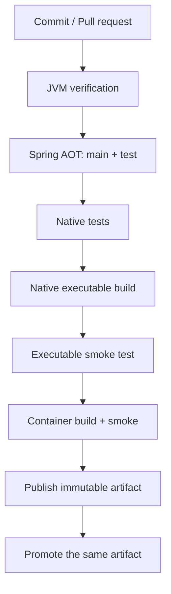

# Separating JVM, AOT, Native Build, and Smoke Test Gates

A CI/CD pipeline for Spring Boot Native Image needs to verify several different stages. Tests running on the JVM verify application logic and contracts; Spring AOT verifies that the context can be analyzed and code generated; the native build verifies that GraalVM can produce an executable; and native tests and smoke tests verify that critical execution paths work in the Native Image environment.

These stages are related, but they do not replace one another. A passing JVM test does not prove that reflection/resource metadata is complete. Successful AOT processing does not prove that the native compiler can produce a binary. Successful native compilation also does not prove that the executable can start, connect to dependencies, or return the right response.

This lesson belongs to the **CI/CD** chapter of the `SPRING_BOOT_NATIVE_IMAGE` module. We will design a pipeline around verification gates with clear inputs, outputs, and pass criteria; map Maven/Gradle tasks; organize pull requests, main branch, and releases; store artifacts; run smoke tests on the executable/container; and investigate failures by stage.

## 1. Why Separate CI Gates?

Each step detects a different group of failures:

| Gate | Checks | Examples of detectable failures |
| --- | --- | --- |
| JVM verification | Compile, unit/integration tests, static checks | Incorrect logic, API contract changes, broken dependencies |
| Spring AOT | Analyze main/test ApplicationContext and generate AOT assets | AOT-incompatible bean conditions, unsupported dynamic bean registration |
| Native tests | Run the test suite in Native Image | Missing reflection, proxy, resource, or serialization metadata |
| Native build | Compile the application executable | Native compiler error, unsupported feature, toolchain mismatch |
| Executable smoke | Start the binary and call endpoints | Runtime initialization, configuration, file permissions, port, or dependency errors |
| Container smoke | Run the image as deployed | Wrong entrypoint, missing files, unprivileged UID, wrong environment |
| Release gate | Verify release artifact and metadata | Wrong version, wrong architecture, missing checksum/SBOM, or untested artifact |

A logical flow:



Separating gates helps the pipeline fail fast when errors belong to compilation or JVM tests, while still keeping native verification on changes that affect AOT, reachability, resources, or runtime behavior.

## 2. Define Pass/Fail Criteria Before Configuring the Pipeline

Each gate needs an automatically verifiable pass condition.

| Gate | Minimum pass condition | Fail condition |
| --- | --- | --- |
| JVM | Build succeeds; tests are discovered and executed; no test failures | Compile/test failure, unexpectedly empty test suite |
| AOT | Main and test AOT processing complete successfully | Context initialization or AOT generation failure |
| Native test | Native test executable is created and tests actually run | Native compile/test runtime error or no tests discovered |
| Native build | Executable with expected name/target is created | GraalVM build failure or missing output |
| Executable smoke | Process becomes ready and business endpoints return expected results | Timeout, process exit, HTTP error, or wrong response |
| Container smoke | Image starts with production-like config/resources/permissions | Image fails to start, missing files, or endpoint errors |
| Publish | Artifact is tied to commit/version and accompanied by reports | Artifact cannot be traced to build source or lacks required checks |

In particular, a `BUILD SUCCESS` line in the logs is not enough to prove that native tests actually ran. Check test counts, reports, and exit codes. A skipped task or a task that discovers zero tests must be inspected explicitly.

## 3. Organize the Pipeline by Change Type

Native compilation typically consumes more time and resources than JVM tests. You can tier the pipeline while still ensuring high-risk changes pass through native gates.

| Event | Recommended gates | Purpose |
| --- | --- | --- |
| Standard pull request | JVM verification, AOT, native tests per project policy | Early detection of functional and compatibility regressions |
| Pull request modifying Runtime Hints/resources/class initialization | JVM, main/test AOT, native tests, native build, and related smoke tests | Protect dynamic access paths |
| Merge to main | Full native build and executable/container smoke | Produce a deployable candidate artifact |
| Tag/release | Build immutable artifact, re-test the exact artifact, scan, and publish | Traceable release |
| Nightly | Full integration, native tests, benchmarks, multiple targets | Catch time- and environment-dependent regressions |
| Dependency/toolchain upgrade | All AOT/native compatibility gates | Detect reachability and runtime changes |

Do not defer native builds exclusively to the final release if pull requests can modify Runtime Hints or AOT configuration. Path filters can be used to select gates, but avoid missing shared files such as build scripts, dependency catalogs, or native configurations.

## 4. Mapping Gates to Maven and Gradle

Task names depend on plugins and versions. The table below lists common commands in projects configured with Spring Boot AOT and GraalVM Native Build Tools.

| Gate | Maven | Gradle |
| --- | --- | --- |
| JVM tests | `./mvnw -B verify` | `./gradlew test check` |
| Main AOT | `./mvnw spring-boot:process-aot` | `./gradlew processAot` |
| Test AOT | `./mvnw spring-boot:process-test-aot` | `./gradlew processTestAot` |
| Native tests | `./mvnw -PnativeTest test` when the profile is configured | `./gradlew nativeTest` |
| Native application build | `./mvnw -Pnative native:compile` when the profile is configured | `./gradlew nativeCompile` |
| Run native application | Run the executable produced by the native plugin | `./gradlew nativeRun` |

A few notes:

- The Maven `native` and `nativeTest` profiles must be declared in the project; profile names do not appear automatically just by adding the Spring Boot plugin.
- The Native Maven Plugin must be configured with the appropriate goals and toolchain.
- The Gradle `nativeTest` task may pull in AOT/test processing according to the plugin's task dependency graph.
- Do not add manual task dependencies before checking whether the plugin already wires the tasks together.
- When a task does not exist, inspect the plugin ID/version and run `tasks --all` or `help --task`.
- Run `--dry-run` and `--info` to confirm which tasks are actually executed and which are `UP-TO-DATE` or `SKIPPED`.

### 4.1. Reference Maven Command Sequence

For a Maven project configured with the native goals/profiles:

```bash
# Gate 1: JVM verification
./mvnw -B verify

# Gate 2: Spring AOT
./mvnw -B spring-boot:process-aot
./mvnw -B spring-boot:process-test-aot

# Gate 3: Native test
./mvnw -B -PnativeTest test

# Gate 4: Native application build
./mvnw -B -Pnative native:compile
```

If the project does not have a native test or native build profile, add the configuration according to the documentation for the plugin version in use. Do not copy these commands into CI and assume they work properly without verifying the tasks/goals.

### 4.2. Reference Gradle Command Sequence

For a Gradle project with the Spring Boot Gradle Plugin and Native Build Tools applied:

```bash
# Gate 1: JVM verification
./gradlew test check

# Gate 2: Spring AOT
./gradlew processAot processTestAot

# Gate 3: Native test
./gradlew nativeTest

# Gate 4: Native application build
./gradlew nativeCompile

# Gate 5: Run native application
./gradlew nativeRun
```

If you want to inspect the task graph before running:

```bash
./gradlew nativeTest --dry-run
./gradlew nativeTest --info
```

Do not conclude that native tests passed solely from task name output. Check the reports to confirm tests were discovered and executed.

## 5. Standardize the Toolchain and Build Environment

Native builds depend tightly on GraalVM, the Native Image toolchain, OS, and CPU architecture. CI should pin and record:

- Java/GraalVM distribution and version.
- Native Image version.
- Spring Boot and Spring Framework versions.
- Maven/Gradle wrapper version.
- Native Build Tools plugin version.
- OS, architecture, and libc/base image.
- Build arguments, environment variables, and profiles.
- Container builder image if using Buildpacks.

Example toolchain check on a runner:

```bash
java -version
native-image --version
./mvnw --version
```

With Gradle:

```bash
java -version
native-image --version
./gradlew --version
```

Use the committed Maven/Gradle Wrapper so CI does not accidentally use a globally installed build tool version. Pin versions of actions, container images, or runner images according to repository policy.

### 5.1. Runners Need Sufficient Resources

Native compilation can consume significant CPU and RAM. Undersized runners commonly hit:

- The native compiler being killed due to out-of-memory.
- Prolonged builds or timeouts.
- Multiple jobs competing for CPU/RAM, causing unstable results.
- Disk exhaustion due to large caches and artifacts.

Choose a runner sized for the application and configure an appropriate timeout. If you need to cap native build parallelism or heap, configure it according to the Native Build Tools/GraalVM version in use and record it in the build metadata.

### 5.2. Control OS and Architecture

A native executable is tied to its target OS/architecture and may depend on libc. A Linux x64 binary cannot natively run on Windows, macOS, or Linux ARM64.

Produce separate artifacts per target, for example:

| Target | Artifact label |
| --- | --- |
| Linux x64 | `linux-x64` |
| Linux ARM64 | `linux-arm64` |
| Windows x64 | `windows-x64` |
| macOS ARM64 | `macos-arm64` |

Cross-compilation has its own limitations. Unless a supported cross-toolchain is configured, build on a runner matching the target and test the executable in a compatible environment.

## 6. Caching: Speed Up Without Losing Reproducibility

You can cache dependencies and build outputs to reduce CI time:

- Maven local repository or Gradle dependency cache.
- Gradle build cache if configured.
- Native build cache if supported by the plugin/toolchain with an appropriate cache key.
- Base container layers when building images.

Cache keys must include the factors that affect the output, such as OS/architecture, JDK/GraalVM version, build tool version, dependency lockfiles, and native build configuration.

Do not cache a native artifact as if it were portable across all OS/architectures. Do not use caching as a substitute for verifying builds from source. For critical releases, run a clean/reproducible build or verify the artifact from an independent job.

If a build suddenly passes only when the cache is used, inspect task inputs/outputs and dependency declarations. A cache hit must never mask a task missing input tracking.

## 7. Design Artifact Handoff Between Gates

Each gate produces outputs for the next gate to consume. Name and store outputs so they remain traceable:

| Gate | Artifact/output |
| --- | --- |
| JVM verification | Test reports, JAR if needed |
| AOT | Generated AOT sources/resources and diagnostic logs |
| Native tests | Native test reports and logs |
| Native build | Native executable, build log, toolchain metadata |
| Container build | OCI image digest, SBOM, scan report |
| Release | Version, checksum, provenance, and test evidence |

When running smoke tests, test the exact binary produced by the native build job. Do not rebuild a separate binary inside the smoke job and test the new binary, because then the published artifact may never have been tested.

If the pipeline passes artifacts between jobs, upload/download via an artifact store with appropriate retention. Attach commit SHA, version, and target architecture to the metadata.

## 8. GitHub Actions Example with Maven

The example below separates JVM/AOT verification from the native job. The native runner uses self-managed labels to indicate that GraalVM Native Image is installed and sufficient resources are available. Adjust labels and versions for your real infrastructure.

```yaml
name: spring-boot-native-ci

on:
  pull_request:
  push:
    branches: [main]
  workflow_dispatch:

permissions:
  contents: read

jobs:
  jvm:
    runs-on: ubuntu-latest
    steps:
      - uses: actions/checkout@v4

      - uses: actions/setup-java@v4
        with:
          distribution: temurin
          java-version: "21"
          cache: maven

      - name: JVM verification
        run: ./mvnw -B verify

  aot:
    needs: jvm
    runs-on: ubuntu-latest
    steps:
      - uses: actions/checkout@v4

      - uses: actions/setup-java@v4
        with:
          distribution: temurin
          java-version: "21"
          cache: maven

      - name: Process main and test AOT
        run: |
          ./mvnw -B spring-boot:process-aot
          ./mvnw -B spring-boot:process-test-aot

  native:
    # Only run on trusted pushes to main because this runner is self-hosted.
    # If PRs need a native gate, use a dedicated ephemeral/isolated runner.
    if: github.event_name == 'push' && github.ref == 'refs/heads/main'
    needs: [jvm, aot]
    runs-on: [self-hosted, linux, x64, graalvm]
    steps:
      - uses: actions/checkout@v4

      - name: Verify native toolchain
        run: |
          java -version
          native-image --version
          ./mvnw --version

      - name: Native tests
        run: ./mvnw -B -PnativeTest test

      - name: Compile native application
        run: ./mvnw -B -Pnative native:compile

      - name: Smoke test executable
        shell: bash
        run: |
          set -euo pipefail

          ./target/orders-service &
          app_pid=$!
          trap 'kill "$app_pid" 2>/dev/null || true' EXIT

          ready=0
          for attempt in $(seq 1 60); do
            if curl -fsS http://127.0.0.1:8080/actuator/health/readiness >/dev/null; then
              ready=1
              break
            fi

            if ! kill -0 "$app_pid" 2>/dev/null; then
              echo "Application exited before readiness"
              exit 1
            fi

            sleep 1
          done

          if [ "$ready" -ne 1 ]; then
            echo "Readiness timeout"
            exit 1
          fi

          curl -fsS http://127.0.0.1:8080/api/orders/100
```

This is an illustrative template. Adjust the following:

- `target/orders-service` must match the output path and final name of the native Maven build.
- `/actuator/health/readiness` must be enabled and exposed in the test configuration.
- `/api/orders/100` must be a real smoke test endpoint of the application with valid test data.
- The self-hosted runner must have the right GraalVM version, `native-image`, `curl`, and sufficient RAM/disk.
- Do not run untrusted pull request code on self-hosted runners that hold secrets or internal network access. Use ephemeral/isolated runners and appropriate security policies.
- In the sample workflow, the native job only runs on pushes to `main`; the AOT job on pull requests acts as an independent gate. The native job checks out the same commit and runs the Maven `native` profile, which may re-run AOT processing. If you want a native gate directly on pull requests, use an ephemeral/isolated runner without sensitive secrets and restrict permissions.
- If using hosted runners with GraalVM installed via an action, pin the action/version per repository policy and verify the actual toolchain.

## 9. Equivalent Configuration Example with Gradle

With Gradle, replace the Maven commands in the native job with:

```yaml
- name: JVM verification
  run: ./gradlew test check

- name: Spring AOT
  run: ./gradlew processAot processTestAot

- name: Native tests
  run: ./gradlew nativeTest

- name: Native application build
  run: ./gradlew nativeCompile

- name: Native application run
  run: ./gradlew nativeRun
```

If you need to smoke test endpoints against the specific binary, determine the output path generated by Gradle Native Build Tools and run the process the way it is deployed. The `nativeRun` task can be useful for quick verification, but container smoke tests still need to build the image and run the container if production ships containers.

Do not run both Maven and Gradle in the same pipeline unless the repository genuinely maintains both build systems. Choose a single build authority to avoid artifacts differing between local, CI, and release.

## 10. Smoke Tests Must Verify Behavior

A smoke test that only checks readiness can miss errors in business endpoints. A good smoke test should verify at least:

1. The process starts and does not exit prematurely.
2. Readiness transitions to UP within the timeout.
3. Key business endpoints return the expected status.
4. The response contains critical fields or values.
5. A critical serialization/resource/reflection path works when relevant to the change.
6. Logs contain no severe startup errors.

Shell example verifying a JSON response:

```bash
response=$(curl -fsS http://127.0.0.1:8080/api/orders/100)
printf '%s' "$response" | jq -e '.status == "ACCEPTED"'
```

If `jq` is not available on the runner, use a test client already present in the repository or a response-checking script. Do not check HTTP 200 alone if the contract requires a specific value.

Smoke tests should be fast, deterministic, and use deterministic fixture data. The full integration suite still needs to run at the appropriate gate.

## 11. Container Build and Smoke Test

If production deploys an OCI image, there must be a gate verifying that exact image. Running the binary directly on the runner does not verify:

- Docker entrypoint and command.
- Copied/mounted configuration files, resources, and certificates.
- UID/GID and filesystem permissions.
- Environment variables and port mapping.
- Required runtime libraries.
- Health checks and signal handling.

Simple Dockerfile example for a native executable dynamically linked against glibc:

```dockerfile
FROM debian:bookworm-slim

WORKDIR /app
COPY target/orders-service /app/orders-service

RUN useradd --system --uid 10001 appuser
USER 10001

EXPOSE 8080
ENTRYPOINT ["/app/orders-service"]
```

The base image must be compatible with the native executable and the shared libraries the binary requires. Do not use a minimal image like `scratch` if the executable still depends on glibc or runtime libraries that are not bundled.

Build and run the smoke test:

```bash
docker build -t orders-service:ci .
docker run -d --name orders-smoke -p 8080:8080 orders-service:ci
```

Then wait for readiness and call the business endpoint just like in the executable smoke test. Clean up the container in a cleanup step whether the test passes or fails. In real CI, use `trap`/`finally` or post-job cleanup to avoid leaving orphaned containers behind.

If production uses Kubernetes, you can add a deployment smoke test in a temporary namespace to verify probes, ConfigMap/Secret mounts, resource limits, and service routing. This is a separate deployment gate and does not replace native build/tests.

## 12. Verify the Artifact Before Publishing

Before publishing, verify the artifact:

- Matches the expected version and commit.
- Matches the target OS/architecture.
- Has executable permissions.
- Passed the native build and smoke tests.
- Has a checksum.
- Has build metadata/toolchain versions.
- Has an SBOM or provenance if required by organizational policy.
- Has an immutable OCI image digest and corresponding scan report.

Checksum example:

```bash
sha256sum target/orders-service > target/orders-service.sha256
```

Do not rebuild after the smoke test and publish a new binary under the same tag. If a rebuild is needed, the new binary must pass through the corresponding gates. With container registries, promote the same image digest between staging and production to ensure the deployed artifact is the exact artifact that was tested.

## 13. Pull Requests, Main Branch, and Releases

A common strategy:

| Stage | JVM | AOT | Native test | Native compile | Smoke | Publish |
| --- | --- | --- | --- | --- | --- | --- |
| Small pull request | Yes | Yes | Per risk/policy | Per risk/policy | Per risk/policy | No |
| PR changing hints/resources | Yes | Yes | Yes | Yes | Yes | No |
| Merge to main | Yes | Yes | Yes | Yes | Yes | Snapshot artifact |
| Release tag | Yes | Yes | Yes | Yes | Yes | Versioned artifact |
| Nightly | Full suite | Yes | Full suite | Yes | Container/deployment | Not necessarily |

If native build costs are high, you can offload native jobs to dedicated runners or run the native suite on a schedule. However, every release must have a native artifact that has been built and smoke tested. Changes affecting dynamic access should have native coverage before merging according to the project's quality policy.

## 14. Caches and Artifacts Must Not Mask Failures

Several principles:

- Cache dependencies using lockfile/wrapper/version keys.
- Cache native outputs by OS/architecture and toolchain.
- Do not share native binaries across incompatible targets.
- Store generated AOT outputs when needed for diagnostics, without treating them as the source of truth.
- Retain native executables and container images with an appropriate retention policy.
- Archive test reports even when a job fails.
- Explicitly log `SKIPPED` and `UP-TO-DATE` tasks as well as test counts.
- Run periodic clean builds to detect hidden cache dependencies.

If the build cache alters outcomes or only CI cache hits pass, inspect task input declarations and the dependency graph.

## 15. Security in Native Pipelines

Native builds and smoke tests still execute repository code. The pipeline must apply standard CI security principles:

- Do not expose production secrets to jobs running untrusted pull request code.
- Restrict workflow/token permissions to the minimum required.
- Use ephemeral or isolated runners for native compilation whenever possible.
- Do not share GraalVM caches containing sensitive data across trust boundaries.
- Pin actions/container images and verify their provenance.
- Scan dependencies and container images according to policy.
- Do not publish artifacts from forked pull requests.
- Only sign/publish artifacts after all mandatory gates pass.

In particular, self-hosted runners with internal network access or credentials must be isolated from pull requests coming from forks. Do not use the same persistent runner for untrusted code and release jobs with secrets.

## 16. Investigate Failures by Gate

When the pipeline fails, start from the first gate that failed:

| Failing gate | Data to inspect | Investigation path |
| --- | --- | --- |
| JVM verification | Compiler output, test report, dependency resolution | Fix source/tests/dependencies before looking at native |
| Main AOT | ApplicationContext startup log, condition report, AOT logs | Inspect bean graph, profiles, properties, and dynamic registration |
| Test AOT | Test context, test fixtures, active profiles, property sources | Inspect test configuration and context customizers |
| Native tests | Native stack trace, test report, reachability diagnostics | Inspect Runtime Hints, resources, proxies, serialization |
| Native compile | GraalVM version, compiler diagnostics, build args, memory | Inspect unsupported features, toolchain, and runner resources |
| Executable smoke | Process logs, exit code, readiness timeout, endpoint response | Inspect config, permissions, ports, dependencies, and runtime init |
| Container smoke | Image logs, entrypoint, filesystem, UID, mounted config | Inspect Dockerfile/base image and runtime environment |
| Publish | Artifact path, checksum, version, digest, permissions | Inspect handoff and immutable artifact policy |

Do not add Runtime Hints to work around an AOT bean graph error if the root cause is a condition/property issue. Do not edit the Dockerfile when the error is in the native compiler. Classifying the failure at the right stage prevents unrelated changes.

## 17. CI Report Template for a Native Build

Every pipeline run that produces an artifact should store a structured report:

```text
Application:
Git commit:
Build number:
Spring Boot:
Spring Framework:
JDK / GraalVM:
Native Image:
Maven / Gradle:
Native Build Tools:
OS / architecture:
Container base image:

JVM verification: PASS / FAIL
Main AOT: PASS / FAIL
Test AOT: PASS / FAIL
Native tests: PASS / FAIL / SKIPPED
Native compile: PASS / FAIL
Executable smoke: PASS / FAIL
Container smoke: PASS / FAIL / NOT RUN

Artifact path:
Artifact SHA-256:
OCI image digest:
SBOM / provenance:
Test report links:
Build log:
Known limitations:
```

Do not record `PASS` if a step was skipped. Use `NOT RUN` or `SKIPPED` and state the reason. The report must be linkable back to the commit and the released artifact.

## 18. Pre-Release Checklist for Native Artifacts

- [ ] Build tool and plugin versions are pinned.
- [ ] GraalVM/Native Image toolchain matches the expected version and target.
- [ ] JVM compile/unit/integration tests pass.
- [ ] Main Spring AOT processing passes.
- [ ] Test AOT processing passes if the project uses AOT test contexts.
- [ ] Native tests are actually compiled and executed.
- [ ] Native application executable is built from the expected commit.
- [ ] Executable smoke test waits for readiness and calls business endpoints.
- [ ] Container smoke test runs the image the same way production deploys it.
- [ ] Resource/config/secret mounts and filesystem permissions are verified.
- [ ] Artifact has checksum, version, commit, and architecture metadata.
- [ ] Test reports/logs are saved even when the job fails.
- [ ] Artifact is promoted using an immutable digest.
- [ ] Artifacts are never published from a job that has not passed mandatory gates.
- [ ] Runner, cache, and secret permissions match trust boundaries.

### Self-Assessment Questions

1. Why can't JVM verification replace native tests?
2. What different issues do main AOT and test AOT uncover?
3. Does successful native compilation prove that the executable can start?
4. What should a smoke test verify beyond the readiness endpoint?
5. Why must you test the exact binary or OCI image that will be published?
6. When is a dedicated GraalVM runner needed, and why must OS/architecture be controlled?
7. Why should you not publish an artifact rebuilt after the smoke test without re-running the gates?
8. Which factors should a native build cache key include?
9. Why should a self-hosted runner holding secrets not run untrusted pull request code?
10. When the pipeline fails at AOT, native compile, or container smoke, what data should be inspected first?

## References

- [Spring Boot — GraalVM Native Images](https://docs.spring.io/spring-boot/reference/packaging/native-image/): native build process and runtime limitations.
- [Spring Boot Gradle Plugin — AOT](https://docs.spring.io/spring-boot/gradle-plugin/aot.html): main/test AOT tasks in Gradle.
- [Spring Boot Maven Plugin — AOT](https://docs.spring.io/spring-boot/maven-plugin/aot.html): process AOT goals in Maven.
- [GraalVM Native Build Tools — Maven Plugin](https://graalvm.github.io/native-build-tools/latest/maven-plugin.html): native Maven goals and configuration.
- [GraalVM Native Build Tools — Gradle Plugin](https://graalvm.github.io/native-build-tools/latest/gradle-plugin.html): `nativeCompile`, `nativeTest`, and `nativeRun`.
- [GitHub Actions — Workflow artifacts](https://docs.github.com/en/actions/using-workflows/storing-workflow-data-as-artifacts): passing artifacts between jobs and storing test outputs.
- [GitHub Actions — Security hardening](https://docs.github.com/en/actions/security-for-github-actions/security-guides/security-hardening-for-github-actions): permissions, untrusted code, and runner protection.

**Expected outcome:** design a Spring Boot Native Image pipeline with separate JVM, AOT, native tests, native build, and smoke test gates; map Maven/Gradle tasks, control toolchains/runners/caches, hand off traceable artifacts, and publish only the exact tested executable/container.
