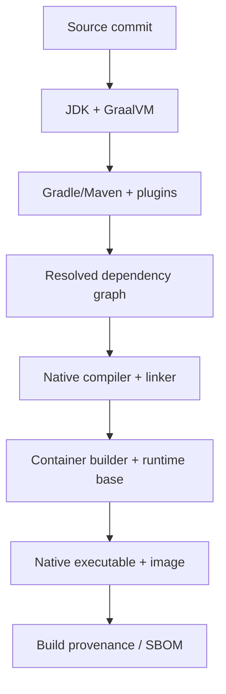

# Pinning JDK, GraalVM, Plugin, Builder, and Dependency Versions

## 1. Why Pin the Entire Toolchain?

A Native Image build is the result of many collaborating components: the JDK, GraalVM distribution, Native Image compiler, Spring Boot/Spring Framework, Gradle or Maven, build plugins, native compiler/linker, container builder, and the entire dependency graph. If even a single component changes, the generated AOT output, reachability analysis, binary, or runtime behavior can change as well.

If CI always pulls the latest versions, two builds from the same commit can produce different results. This makes it difficult to reproduce bugs, compare benchmarks, investigate CVEs, or roll back a release.

For the **SPRING_BOOT_NATIVE_IMAGE** module, the toolchain must be treated as a controlled part of the source/release process. Pinning versions makes builds reproducible, provides clear evidence of the environment that produced the binary, and enables intentional upgrades.

Pinning versions does not mean staying on old versions forever. It means every version change is reviewed, tested, and recorded as an engineering change.



## 2. Version Layers to Manage

Do not pin only the JDK or GraalVM. Inventory all components that affect the build:

| Layer | Components to record | Common management location |
|---|---|---|
| JDK | Vendor, major/minor/patch, distribution | CI image, toolchain config |
| GraalVM | Distribution, version, Native Image component | CI image/toolchain |
| Build tool | Gradle Wrapper or Maven Wrapper | Wrapper properties |
| Build plugin | Spring Boot, Native Build Tools, compiler plugin | Plugin management |
| Framework | Spring Boot, Spring Framework | BOM/dependency management |
| Runtime libraries | JDBC driver, JSON, logging, JNI libraries | Lockfile/dependency constraints |
| Native toolchain | C compiler, linker, binutils, SDK | Builder image/package manifest |
| Container builder | Buildpacks builder, lifecycle, buildpacks | Builder image reference |
| Runtime image | OS release, libc, shared libraries | Dockerfile/buildpack config |
| Platform | OS, architecture, ABI | CI runner/build matrix |

Record indirect versions as well. For example, a GraalVM build on Linux may depend on GCC, binutils, zlib headers, and glibc; a newer builder image can change those components even when source code has not changed.

## 3. Pinning the JDK with Gradle Toolchains

Gradle Java toolchains declare the Java version a project requires. For example:

```groovy
java {
    toolchain {
        languageVersion = JavaLanguageVersion.of(21)
    }
}
```

This configuration selects the Java language/toolchain version, but it does not automatically pin the vendor and patch distribution in every environment. If the build requires a GraalVM JDK, ensure that Gradle and Native Build Tools actually use the exact GraalVM installation.

You can configure a toolchain resolver/repository per organizational policy or use a digest-pinned CI image. Verify the actual runtime in the job:

```bash
java -version
./gradlew --version
native-image --version
```

Record the output in the build log/artifact. Do not rely solely on `JAVA_HOME`, because a runner may have multiple JDKs installed or a plugin may select a different toolchain.

## 4. Pinning the Gradle Wrapper

Commit the Gradle Wrapper to the repository so every developer and CI job uses the same Gradle distribution:

```properties
distributionUrl=https\://services.gradle.org/distributions/gradle-8.10.2-bin.zip
distributionSha256Sum=REPLACE_WITH_VERIFIED_SHA256
```

The illustrative version must be chosen according to the compatibility matrix of Spring Boot, Native Build Tools, and the JDK. Fill in the verified SHA-256 from the official distribution source; never copy checksums from unverified sources.

The wrapper checksum protects the integrity of the downloaded distribution. It does not pin plugins/dependencies, nor does it pin the JDK/GraalVM. Those are independent layers that must be managed separately.

Do not use dynamic versions such as `8.+` or `latest.release` for the Gradle distribution/plugins. They cause resolution results to drift over time.

## 5. Pinning Maven with the Maven Wrapper

Commit the Maven Wrapper and configure an explicit distribution URL/version. For example:

```properties
distributionUrl=https\://repo.maven.apache.org/maven2/org/apache/maven/apache-maven/3.9.9/apache-maven-3.9.9-bin.zip
wrapperSha256Sum=REPLACE_WITH_VERIFIED_SHA256
```

The illustrative version should be verified against your target plugins and JDK. Use a verified checksum from the official Maven release source.

CI should invoke `./mvnw` instead of relying on a pre-installed Maven on the runner. This reduces drift between developer machines and CI.

The Maven Wrapper pins the Maven distribution; it does not automatically pin the JDK, GraalVM, plugins, or the dependency graph.

## 6. Pinning the GraalVM Distribution and Native Image

GraalVM has multiple distributions and packaging options across versions. Choose the distribution with Native Image support for your build target, then pin an exact version.

You can use a CI image that already contains GraalVM or install from an official source using a verified version and checksum. Verification example:

```bash
java -version
native-image --version
native-image --help
```

Notes:

- Record the vendor/distribution, not just the major JDK version.
- Confirm that the Native Image component is installed.
- Verify the target OS/architecture.
- Record the compiler/linker versions.
- Do not use container tags like `latest`.
- Pin the image digest if using a GraalVM builder container.

A specific version tag can still be overwritten or changed depending on registry policy; a digest is a more immutable identifier for an image manifest.

## 7. Pinning Spring Boot and Plugin Versions

The Spring Boot plugin, Spring Framework, and Native Build Tools must fall within a compatible set of versions. With Gradle, declare explicit plugin versions:

```groovy
plugins {
    id 'java'
    id 'org.springframework.boot' version '3.4.2'
    id 'io.spring.dependency-management' version '1.1.7'
}
```

The versions above are illustrative examples only, not a recommendation for the latest release. Choose versions supported by your organization and check compatibility with the current JDK/GraalVM.

If using the Native Build Tools plugin separately, pin its version in plugin management and verify compatibility. Avoid declaring the same plugin in multiple places with different versions.

With Maven, declare the Spring Boot parent/plugin versions explicitly in the POM and inspect the effective POM to see the final resolved versions.

## 8. Managing Dependencies with BOM and Constraints

The Spring Boot BOM aligns versions across many dependencies in the Spring ecosystem. Gradle example:

```groovy
dependencies {
    implementation(platform(
        "org.springframework.boot:spring-boot-dependencies:3.4.2"
    ))
    implementation("org.springframework.boot:spring-boot-starter-web")
    runtimeOnly("org.postgresql:postgresql")
}
```

Maven can import the BOM in `dependencyManagement` or use the Spring Boot parent. Use one consistent version management mechanism to avoid hard-to-trace overrides.

A BOM does not necessarily manage every third-party library outside the ecosystem. For vendor dependencies or specialized libraries, declare explicit versions, use constraints, and document the rationale.

Do not use dynamic dependency versions such as `1.+`, `latest.release`, or uncontrolled snapshots in release builds. A snapshot's contents can change even when its version coordinates stay the same.

## 9. Dependency Locking in Gradle

Gradle dependency locking records the resolved versions for each locked configuration. Enable locking:

```groovy
dependencyLocking {
    lockAllConfigurations()
}
```

Generate/update lock state when intentionally upgrading dependencies:

```bash
./gradlew dependencies --write-locks
```

Commit the generated lockfiles. Run CI with dependency locking enabled to detect resolution changes that have not been updated in the repository.

Locking applies only to locked configurations and dependencies. Check the relevant runtime, test, and native build configurations. When using a version catalog, the catalog manages version declarations while the lockfile manages resolved versions; the two mechanisms complement each other.

## 10. Dependency Verification in Gradle

Dependency verification validates checksums or signatures of downloaded artifacts. Generate initial metadata:

```bash
./gradlew --write-verification-metadata sha256 help
```

Review the verification metadata file and only accept checksums from verified artifacts. Never run metadata generation and automatically commit the output without review, as an attacker or a compromised repository could cause untrusted checksums to be accepted.

When dependencies change, update checksums/signatures through a reviewed workflow. Verification helps detect unexpected artifact tampering; it does not replace dependency locking or verifying release provenance.

## 11. Pinning Dependencies in Maven

Maven can manage versions via parent/BOM and explicit declarations in `dependencyManagement`. The Enforcer plugin can enforce rules banning version ranges or requiring dependency convergence per project policy.

Example dependency tree inspection:

```bash
./mvnw dependency:tree
./mvnw help:effective-pom
```

You can use an internal repository manager to proxy/cache artifacts and enforce an allowlist. For release builds, avoid version ranges, uncontrolled snapshots, and untrusted repositories.

Maven does not have a built-in dependency lockfile mechanism equivalent to Gradle's in the same way. When strong reproducibility is required, combine fixed versions/BOMs, repository immutability, artifact checksums/provenance, and plugin controls.

## 12. Pinning Container Builder Images by Digest

If building the Native Image inside a container, pin the builder image by digest:

```dockerfile
FROM ghcr.io/graalvm/native-image-community:21 AS builder
```

In a real pipeline, use a reference with a verified digest:

```dockerfile
FROM registry.example.com/build/native-image:21.0.x@sha256:VERIFIED_DIGEST AS builder
```

These registries/references are examples only. Replace them with an organization-approved image and real digest. The version tag helps humans understand the version; the digest guarantees the exact same image content is used.

Record the image platform (`amd64`/`arm64`) as well as the manifest digest if it is multi-arch. A multi-arch tag can resolve to different manifests depending on platform.

## 13. Pinning Buildpacks Builder and Buildpack Versions

Spring Boot Buildpacks can produce a container image without a project-managed Dockerfile. Even so, the builder and buildpacks remain critical build inputs.

Configure an explicit builder image instead of relying on an uncontrolled default. If the buildpack supports pinning versions/buildpack order, record the corresponding versions and inspect the build logs.

Record:

- Builder image tag and digest.
- Buildpack IDs and versions.
- Lifecycle version.
- Run image reference/digest.
- Environment variables and build arguments.
- OS/architecture of the builder and target image.

The builder and run image play different roles: the builder contains build tools; the run image provides the runtime foundation. Do not assume packages present in the builder automatically exist in the run image.

## 14. Pinning the Native Compiler and Build OS

A Native Image build can depend on the system compiler/linker. On Linux, common dependencies include GCC/Clang, binutils, glibc development files, zlib, and other headers/libraries.

Record:

```bash
gcc --version
clang --version
ld --version
ldd --version
uname -a
```

Only invoke tools actually installed in the builder. You do not need both GCC and Clang if the toolchain only uses one compiler. Package versions should be pinned via the builder image digest or the distribution's repository snapshot/locking mechanism.

Changing the builder's OS release can change glibc, the linker, and package dependencies. Therefore, pinning GraalVM without pinning the builder OS does not guarantee the same native compilation environment.

## 15. Compatibility Matrix and Build Manifest

Produce a manifest for each native artifact:

```yaml
build:
  sourceCommit: "COMMIT_SHA"
  target: "linux-amd64"
  jdk:
    vendor: "GRAALVM_DISTRIBUTION"
    version: "PINNED_VERSION"
  graalvm:
    version: "PINNED_VERSION"
    nativeImage: true
  buildTool:
    name: "Gradle"
    version: "PINNED_WRAPPER_VERSION"
  springBoot:
    version: "PINNED_VERSION"
  nativeBuildTools:
    version: "PINNED_VERSION"
  builderImage:
    reference: "IMAGE@sha256:DIGEST"
  runtimeImage:
    reference: "IMAGE@sha256:DIGEST"
  dependencyLock:
    revision: "LOCKFILE_REVISION"
```

This is an illustrative schema a team can define for itself, not a standard GraalVM schema. Equivalent information can be stored in build provenance, SBOMs, or CI artifact metadata.

The manifest makes it possible to trace which toolchain and target produced a binary. Never put secrets or credentials into the manifest.

## 16. Upgrading Versions Through Controlled Single Changes

Do not upgrade the JDK, GraalVM, Spring Boot, Gradle, Native Build Tools, and the base image all at once unless necessary. When many layers change simultaneously, build/runtime failures are hard to attribute to a root cause.

Upgrade procedure:

1. Pick one component to upgrade and read its release notes/compatibility matrix.
2. Check minimum requirements of related plugins/frameworks.
3. Create a separate branch or change.
4. Update pin/lock/verification metadata.
5. Run JVM unit/integration tests.
6. Run Spring AOT processing.
7. Build the Native Image.
8. Run native tests and application smoke tests.
9. Run container integration tests on the target platform.
10. Compare startup time, RSS, binary/image size, and build duration.
11. Archive the manifest/provenance and review results.

If multiple components must be upgraded together due to compatibility constraints, document the dependencies between changes and verify with a build matrix.

## 17. Security Updates While Preserving Reproducibility

Version pinning must never become a mechanism for delaying security updates. Monitor advisories for the JDK/GraalVM, Spring, build plugins, dependencies, builders, and base images.

When a CVE is published:

- Identify affected components/versions.
- Assess exploitability and usage within the application.
- Select a supported patch.
- Update pins/locks/digests.
- Rebuild from the identified source.
- Run compatibility/native/container tests.
- Scan the image and SBOM.
- Store the new artifact/provenance.

Never switch an image tag to `latest` to "pick up a patch" without knowing the exact new contents. Update using explicit versions/digests so changes remain auditable and rollbackable.

## 18. CI Caching Without Sacrificing Correctness

Gradle/Maven caches reduce dependency download and build time. The cache must not be the source of truth for versions.

- Key caches by OS/architecture, JDK/GraalVM, wrapper, and lockfiles.
- Do not share native build outputs across different target architectures.
- Do not use stale caches to bypass dependency verification.
- Separate dependency caches from published release artifacts.
- Periodically clear caches and rebuild to verify the build does not rely on undeclared local files.
- Log cache keys in CI logs when investigating non-reproducible builds.

A cache hit does not prove dependencies are pinned; lockfiles and verification are what govern resolution and integrity.

## 19. Pre-Release Toolchain Audit Checklist

- JDK vendor/version/patch are pinned.
- GraalVM distribution/version and Native Image component are pinned.
- Gradle/Maven Wrapper version and checksum are verified.
- Spring Boot, Spring Framework, and build plugins have explicit versions.
- Runtime/test dependency graph is managed via BOM/constraints/locks.
- Dependency artifacts have checksum/signature verification per policy.
- Native compiler/linker and builder OS are recorded.
- Builder image and run image are pinned by digest.
- Buildpack/lifecycle versions are recorded if used.
- Target OS/architecture/libc are identified.
- Build manifest/provenance is tied to the source commit and artifact digest.
- Upgrade, security patch, and rollback procedures exist.
- CI can rebuild from a clean environment without relying on personal machine state.

## 20. Self-Check Questions

1. Why is pinning the JDK without pinning GraalVM and the native toolchain insufficient?
2. What does the Gradle Wrapper checksum protect, and what does it not protect?
3. What is the difference between a version catalog, dependency locking, and dependency verification?
4. Does a BOM manage every dependency outside Spring Boot?
5. Why must the builder image and runtime image be recorded separately?
6. What do the Buildpacks builder tag and digest signify?
7. How do the native compiler/linker and OS packages affect the binary?
8. How do you upgrade GraalVM or Spring Boot while keeping results reproducible?
9. Does pinning versions conflict with applying security updates?
10. What data should a manifest/provenance record contain to trace an executable?

**Remember:** a Native Image build can change whenever the JDK, GraalVM, plugins, dependencies, compiler, or builder change. Pin versions and checksums/digests for every layer, store a manifest tied to the commit/artifact, and upgrade in a controlled way using AOT, native, and container tests alongside benchmarks.
