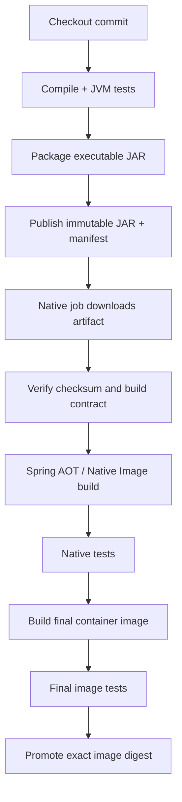

# Converting an AOT-Processed JAR to Native in a Dedicated Job

## 1. Why Separate the Native Job from the Regular Application Build Job?

A Spring Boot pipeline may need to run compile, unit tests, integration tests, and executable JAR packaging on every pull request. Native Image adds more resource-intensive steps: Spring AOT, Native Image compilation, native integration tests, and runtime container packaging. Running the full native pipeline on every job can significantly increase CI feedback times and CPU/RAM consumption.

One way to organize this is to create a dedicated job that receives the verified JAR artifact and build information from the previous job, then performs native compilation. This job uses the exact pinned source revision, dependency graph, profiles, and toolchain. The native output is tested and linked via provenance to its inputs before promotion.

In the **SPRING_BOOT_NATIVE_IMAGE** module, this lesson explains how to design the boundary between the JAR/AOT job and the native job: which artifacts to hand off, reproducibility requirements, Maven/Gradle configuration, testing, caching, security, and failure handling. The goal is to reduce duplicated work while ensuring the native artifact is built from traceable inputs.

## 2. Distinguishing a JAR Artifact from AOT Outputs

An executable JAR and Spring AOT outputs are not necessarily the same artifact. Clarify what the pipeline is handing off:

| Artifact | Contents | Usage |
|---|---|---|
| Executable JAR | Application classes, dependencies, or packaging layout | Can serve as input to certain native build workflows |
| Compiled classes | Compiled output of source code | Used if the native build pipeline needs to re-run AOT |
| Spring AOT generated sources/resources | Code and metadata generated from the analyzed `ApplicationContext` | Must match sources, dependencies, and structural inputs |
| Reachability metadata | Reflection/resource/proxy/JNI/serialization metadata | Native build input if not automatically packaged/contributed |
| Build manifest | Commit, toolchain, profile, dependency versions, checksums | Evidence for reproducing and verifying artifacts |
| Native executable | Binary created by the Native Image compiler | Runtime artifact requiring native integration tests |

Do not call a JAR an "AOT-enabled JAR" if the pipeline only ran `package` without executing Spring AOT. Conversely, if the plugin automatically runs AOT as part of the native build, clarify whether that output is archived and reused or regenerated in the native job.

## 3. Choosing the Right Handoff Model

There are two common models:

**Model A — JAR as input to the native job.** The native job downloads the JAR and uses Native Build Tools/Spring Boot plugin to produce a native executable via a supported workflow. This fits when the build tool can run AOT/native processing from the executable archive and all required configuration is available.

**Model B — Source and generated AOT outputs as input.** The native job downloads a source artifact or checks out the exact commit, reuses appropriate compiled/generated outputs, and runs Native Image compilation. This fits when the build requires source-level AOT processing, test AOT, or when the plugin lifecycle does not support a JAR-only workflow.

Not every Spring Boot version/plugin supports the same JAR-to-native workflow. Check the Native Build Tools and Spring Boot plugin documentation for your exact version. If the workflow requires sources to run AOT, handing off only the JAR is not sufficient.

## 4. Job-Based Pipeline Architecture

A pipeline can be split into independent jobs:



The native job starts only after the JAR-building job succeeds. The native job verifies that the artifact matches the commit and manifest, then runs the AOT/native steps required by the plugin version.

You can run the native job on a dedicated runner with higher RAM/CPU while JVM tests run on standard runners. This allocates resources by workload and prevents the native compiler from starving the rest of the pipeline.

## 5. Build Contract Must Accompany the JAR

A standalone JAR does not contain all the information needed to reproduce a native build. Generate an accompanying manifest:

```json
{
  "service": "orders-service",
  "gitCommit": "8a12f3c",
  "artifact": "orders-service.jar",
  "artifactSha256": "…",
  "javaVersion": "21",
  "graalvmDistribution": "pinned-distribution",
  "graalvmVersion": "pinned-version",
  "springBootVersion": "pinned-version",
  "nativeBuildToolsVersion": "pinned-version",
  "aotProfile": "native-prod",
  "structuralProperties": {
    "search.enabled": "true"
  }
}
```

These values are examples. Real manifests must record exact versions and real checksums. Never store secrets or sensitive property values; record only property keys and non-sensitive values required for build structure.

The manifest lets the native job verify that the JAR and configuration belong to the same commit, profile, and toolchain. If the JAR was built with a different JDK/Spring Boot version than the native job expects, the pipeline must fail early or follow a verified compatibility policy.

## 6. Verifying Checksums and Artifact Integrity

After publishing the JAR, compute a checksum and store it in the manifest or artifact store metadata:

```bash
sha256sum target/orders-service.jar
```

In the native job:

```bash
sha256sum --check orders-service.jar.sha256
```

The checksum filename and format must match how it was generated. On Windows runners, you can use `Get-FileHash`. The goal is to confirm the downloaded file is the exact published artifact, uncorrupted and not mixed up across builds.

Do not use generic names like `latest.jar` as the sole identifier. Use build IDs, commit SHAs, or immutable artifact versions; checksums provide content verification independent of filename.

## 7. Toolchain Parity Between the Two Jobs

The JAR job and the native job do not need identical runner sizes, but they must control all versions that affect output:

- JDK distribution/version and target bytecode.
- Spring Boot and Spring Framework versions.
- Maven/Gradle wrapper.
- Compiler/plugin versions.
- GraalVM distribution/edition/version.
- Native Build Tools version.
- Target OS/architecture.
- Dependency locks/BOM and repository resolution.
- Spring profiles and structural properties.
- Native build arguments and metadata inputs.

If the native job uses a different GraalVM version than the one tested by the project, results may differ. Record versions in the manifest and verify compatibility before building.

Do not use `latest` for builder images or toolchains in production pipelines. Pin tags/digests and update in a controlled manner.

## 8. When Can a JAR Be Used Directly for Native Compilation?

Whether a native executable can be built from a JAR depends on the Spring Boot version, Native Build Tools plugin, and configuration. Some workflows allow the native-image plugin to process an executable archive; other workflows require the source project to run Spring AOT and generate code.

Before designing the job:

1. Identify the exact Spring Boot and Native Build Tools versions.
2. Read how the plugin expects application input.
3. Check whether AOT processing runs inside the native job.
4. Confirm runtime hints/reachability metadata are discovered.
5. Build a proof-of-concept using only the published JAR, with no leftover workspace sources accidentally present.
6. Build and run a native scenario.
7. Document which artifact is the official input.

If a JAR-only path is unsupported, the native job should download a source archive or check out the exact commit and verify that the source revision matches the manifest. Never invent a workaround that copies a JAR into a build directory and assumes the plugin will automatically generate complete Spring AOT output.

## 9. Distinguishing Application AOT from Test AOT

Application AOT generates initialization code/metadata for the application's `ApplicationContext`. TestContext AOT processes contexts for test classes and has its own lifecycle.

If the native job only produces the production executable, it may need application AOT without needing test AOT. If the job also builds a native test executable, it must identify test classes, TestContext AOT processing, and corresponding dependencies.

| Process | Input | Purpose |
|---|---|---|
| Application AOT | Application sources/configuration | Prepare the application context |
| TestContext AOT | Test classes/context metadata | Prepare test contexts |
| Native application build | Application outputs + AOT/metadata | Produce the production executable |
| Native test build | Test outputs + test AOT support | Build/run native tests |

Do not mark "AOT completed" simply because one of the two processes ran. Build logs and manifests should state explicitly which stages were executed.

## 10. Passing Profiles and Structural Properties into the Native Job

Spring AOT analyzes the `ApplicationContext` using build-time profiles, properties, and classpath. The native job must apply the exact structural inputs of the artifact.

Profile example:

```bash
SPRING_PROFILES_ACTIVE=native-prod
```

Property condition example:

```bash
SEARCH_ENABLED=true
```

If `search.enabled` drives `@ConditionalOnProperty`, the value must be supplied to the exact process running Spring AOT. Setting a variable in the job shell without propagating it into the AOT JVM does not guarantee the context receives it.

Establish an explicit build contract and verify it through logs/configuration diagnostics. Runtime values such as URLs/timeouts can be supplied at runtime as long as they do not alter the generated bean graph.

## 11. Maven Native Job Example

A native job can download the artifact and manifest, verify the checksum, and execute the appropriate plugin workflow. Shell pseudocode:

```bash
set -euo pipefail

sha256sum --check orders-service.jar.sha256

native-image --version
java -version

SPRING_PROFILES_ACTIVE=native-prod \
SEARCH_ENABLED=true \
./mvnw -Pnative -DskipTests package
```

This illustrates a job that has the source/build project available. If the job only has a JAR, you cannot invoke the Maven wrapper from the JAR artifact unless the wrapper/POM/source project is also provided. Use a plugin-supported JAR-only workflow or download the source artifact for the same commit.

Some projects run the AOT goal separately before native packaging; others bind AOT into the plugin lifecycle. Inspect the POM and task execution logs to avoid running AOT twice unnecessarily or skipping it altogether.

## 12. Gradle Native Job Example

Similarly, a Gradle job can download the artifact and verified source/build workspace:

```bash
set -euo pipefail

sha256sum --check orders-service.jar.sha256

./gradlew --version
native-image --version

SPRING_PROFILES_ACTIVE=native-prod \
SEARCH_ENABLED=true \
./gradlew nativeCompile
```

The command above assumes the workspace contains the Gradle wrapper, build scripts, and required source/build inputs. If the job only receives a JAR, the `nativeCompile` task cannot materialize from a JAR file alone; you must use a plugin-supported workflow or provide the source project.

Document whether the native task automatically triggers `processAot`. Check `./gradlew tasks --all` and the task graph on your exact plugin version.

## 13. GitHub Actions Structure Example

A workflow can publish the JAR in a JVM job and download the artifact in the native job:

```yaml
jobs:
  package:
    runs-on: ubuntu-latest
    steps:
      - uses: actions/checkout@v4
      - uses: actions/setup-java@v4
        with:
          distribution: temurin
          java-version: '21'
      - run: ./mvnw -DskipTests package
      - uses: actions/upload-artifact@v4
        with:
          name: application-jar
          path: target/orders-service.jar

  native:
    needs: package
    runs-on: ubuntu-latest
    steps:
      - uses: actions/download-artifact@v4
        with:
          name: application-jar
      # Add the source/build workspace or JAR-native workflow
      # matching your Spring Boot/Native Build Tools version.
```

This is an illustrative skeleton, not a complete workflow. The native job still needs the GraalVM/Native Build Tools toolchain, build contract, checksum verification, source/build inputs if required, native compilation, tests, and native artifact upload. Pin action versions per organizational policy and prefer commit SHAs when supply-chain controls require it.

If checking out source again in the native job, check out the exact commit SHA from the `package` job; never assume the branch head still points to the same revision when the downstream job runs.

## 14. Artifact Handoff Must Not Lose Metadata

When uploading/downloading artifacts, ensure all required files are preserved:

- Executable JAR.
- Checksum.
- Build manifest.
- SBOM/provenance if generated by the pipeline.
- Standalone reachability metadata if not embedded in the JAR/dependencies.
- AOT generated outputs if required by the workflow.
- Test reports and relevant quality gate results.

Do not upload the entire workspace indiscriminately, as it may contain secrets, local caches, sensitive build logs, or unnecessary files. Use an explicit artifact list and verify files after download.

If the artifact store's compression/extraction alters permissions or timestamps, check any attributes that matter to the native/container step. JARs usually do not rely on executable permissions, whereas handed-off scripts/build wrappers may require execute bits.

## 15. Caching for the Native Job

Native compilation is resource-intensive, so caching can save time. However, cache keys must include everything that affects the output:

- GraalVM distribution/version.
- Native Build Tools/plugin version.
- OS/architecture.
- JDK/compiler version.
- Dependency lock/BOM.
- Native build arguments.
- AOT structural properties/profiles.
- Source revision or relevant inputs.
- Cache schema/version if tools change formats.

Never share caches across different toolchains merely because the project name matches. An invalid cache can cause build failures or non-reproducible outputs.

Distinguish dependency caches, Gradle/Maven build caches, and Native Image compiler caches. They have different lifecycles and invalidation rules. Only cache directories supported by toolchain documentation; never blindly cache the entire native output as if it were always reusable across commits.

## 16. Separating Runners by Resource Profile

Native jobs usually need more RAM than JVM packaging jobs. You can assign different runners:

| Job | Target resources | Reason |
|---|---|---|
| Compile/JVM tests | Standard runner | Workload is typically lighter |
| Spring AOT | Medium runner | Analyzes `ApplicationContext` and generates code |
| Native compile | High CPU/RAM runner | Reachability analysis, code generation, linking |
| Native tests | Runner suited for runtime tests | Executes the binary and external dependencies |
| Container image | Runner with container engine | Builds, inspects, and tests the final image |

Size runners based on measured peak memory and duration. Set sensible timeouts and memory limits, and capture OOM telemetry. Do not solve build failures by throwing unlimited resources at them; inspect heap, parallelism, dependencies, and caches first.

## 17. Artifact and Supply Chain Security

A JAR passed between jobs is an artifact that may be promoted or released. Safeguard it:

- Download artifacts only from trusted pipeline runs.
- Use immutable artifact IDs and checksums.
- Prevent untrusted pull requests from writing to caches consumed by protected branches.
- Never embed secrets into build outputs or generated sources.
- Manage repository credentials via a secret store.
- Attach SBOM/provenance and commit identity.
- Scan dependencies and container images per policy.
- Sign images/artifacts if supply-chain policy requires it.

The native job must validate the manifest before executing the build. Never run scripts packaged inside an untrusted artifact on a runner with broad privileges. For pull requests from forks, restrict secrets and registry publish permissions.

## 18. Failure Handling and Retries

Not every failure should be retried. Classify them:

| Failure | Action |
|---|---|
| Checksum mismatch | Fail immediately; re-fetch artifact from trusted source |
| Toolchain version mismatch | Fail and fix the build contract |
| Native compiler OOM | Collect metrics; tune runner/parallelism deliberately |
| Dependency repository outage | Retry with bounded attempts/backoff |
| Native compilation error | Do not retry blindly; analyze diagnostics |
| Native integration test failure | Preserve artifact/logs; fail quality gate |
| Container test failure | Do not promote image |
| Artifact upload failure | Retry per store semantics; verify checksum after upload |

A retry can produce different output if the toolchain or cache is unstable. Log every attempt and never overwrite a verified passing artifact with an untested retry artifact.

## 19. Native Tests and Final Image Tests Before Promotion

The native job should not stop once the binary is produced. Verify:

1. The native executable starts.
2. `ApplicationContext` uses the expected profiles/structural properties.
3. Critical reflection/resource/proxy/serialization/JNI scenarios work.
4. HTTP contracts and business flows succeed.
5. External dependencies are wired properly.
6. The runtime container includes required libc, CA certificates, timezone data, and native libraries.
7. The container runs as non-root with proper filesystem permissions.
8. Readiness/liveness probes pass.
9. Graceful shutdown on `SIGTERM` works.
10. The image digest is recorded.

Select native test coverage based on risk while keeping most logic tests on the JVM. For releases, final image tests must run against the exact image digest being promoted.

## 20. Promotion and Rollback

Once native builds and tests pass, publish artifacts with immutable tags or digests. Promotion must reference only the already-tested artifact; never rebuild the native image at deploy time if the goal is to deploy the exact verified binary.

A sample flow:

```text
JAR artifact + manifest
        |
        v
Native build job
        |
        v
Native executable + test report
        |
        v
Final container image
        |
        v
Image digest + provenance
        |
        v
Staging validation
        |
        v
Production promotion
```

Retain the JVM artifact or previous image as a rollback target during rollout. If the native image fails startup, health checks, or SLOs, roll back to a known-good digest. Never rely on mutable tags to identify rollback artifacts.

## 21. Diagnosing Common Failures

| Symptom | Possible cause | Remediation |
|---|---|---|
| Native job cannot find POM/build script | Downloaded only the JAR when workflow requires source | Hand off source artifact or use a supported JAR workflow |
| JAR checksum mismatch | Artifact from wrong build/run or file corruption in transit | Verify immutable artifact ID and checksum |
| AOT uses wrong profile | Environment variable did not reach the AOT process | Inspect plugin process and build contract |
| Native job uses different dependencies | BOM/lockfile not pinned or dependencies re-resolved | Lock dependencies and verify the graph |
| Build on runner fails with OOM | Insufficient RAM or excessive parallelism | Measure peak memory and size the runner properly |
| Cache causes non-deterministic output | Cache key omits toolchain/inputs | Partition caches by version/platform/config |
| Native binary runs locally, fails in container | Runtime image missing dependencies | Inspect the final image and ELF/shared libraries |
| Test report does not match binary | Build/test artifact replaced or rebuilt | Tie commit/digest and enforce immutable artifacts |
| Promotion deploys a different image than tested | Mutable tag used or image rebuilt | Promote by digest |

## 22. Hands-On Exercise: Separate the Native Job from a Maven Pipeline

**Context:** The current pipeline builds an executable JAR and runs JVM tests. The team wants native compilation on a dedicated runner with 16 GiB RAM.

**Step 1 — Standardize the package job.** Build the JAR from the commit SHA, run JVM tests, and upload the JAR with checksum/manifest.

**Step 2 — Verify the plugin workflow.** Check Spring Boot/Native Build Tools versions to confirm whether the native build can consume the JAR or requires the source workspace.

**Step 3 — Create the native job.** Use a pinned GraalVM runner; download the immutable artifact and verify its checksum.

**Step 4 — Pass the build contract.** Pin profiles, structural properties, dependency versions, architecture, and native build arguments.

**Step 5 — Run AOT/native compilation.** Confirm AOT runs exactly once in the required lifecycle and the Native Image compiler receives the right inputs.

**Step 6 — Run native tests.** Execute selected scenarios covering reflection, JSON, resources, proxies, and business flows.

**Step 7 — Build the final image.** Package runtime dependencies, a non-root user, and the proper entrypoint; record the image digest.

**Step 8 — Test and promote.** Run final image tests, archive reports/provenance, and promote only the passing digest.

**Step 9 — Verify rollback.** Retain the JVM artifact or previous image and rehearse rolling back if the native candidate misses SLOs.

Completion criteria: the JAR and manifest are handed off with checksums; the native job verifies commit/toolchain/structural inputs; the AOT/native workflow is plugin-supported; native tests and final image tests pass; and promotion uses the immutable digest.

## 23. Conclusion

Offloading native compilation to a dedicated job allocates runners according to CPU/RAM needs and keeps the JVM feedback loop fast. However, a JAR does not automatically carry everything needed for a Spring AOT/native build. The pipeline must define the plugin-supported workflow clearly, determine whether sources/generated AOT outputs are required, and hand off a manifest, checksums, metadata, and toolchain versions.

A reliable native job validates immutable inputs, applies exact profiles/structural properties, runs AOT/native compilation per the supported lifecycle, executes native tests, and validates the final image. Promote only artifact/image digests that pass all quality gates, and retain provenance and rollback targets so release issues remain traceable.
