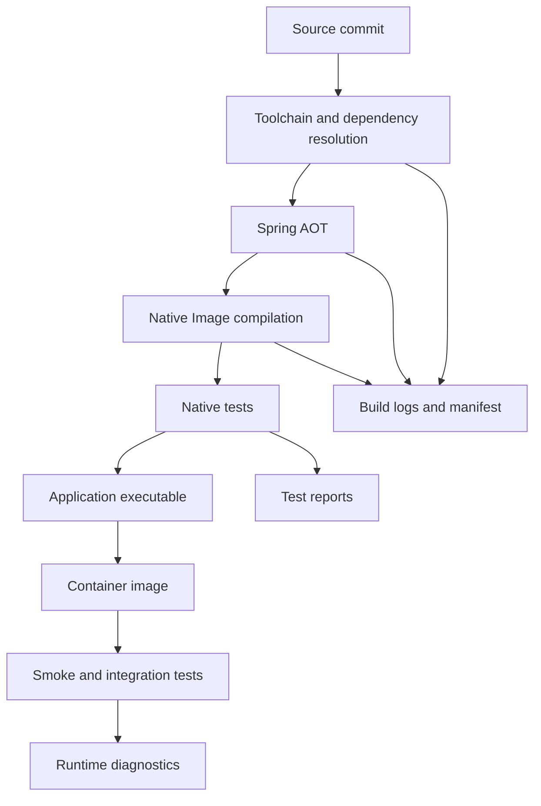

# Archiving Build Logs, Test Reports, and Failure Diagnostics

## 1. Why Save Evidence from Every Build?

A Spring Boot Native Image pipeline has many stages: dependency resolution, compilation, Spring AOT processing, Native Image compilation, native tests, application executable creation, container packaging, and final image verification. When a step fails, looking only at the last error line is rarely enough to pinpoint the cause.

Complete logs, test reports, and diagnostics tell the team which stage failed, which toolchain CI used, which profile Spring AOT ran with, which arguments the compiler received, which tests passed/failed/skipped, and which binary/container was produced from that commit.

For the **SPRING_BOOT_NATIVE_IMAGE** module, CI must archive enough evidence to investigate both build-time errors and failures that only surface when running the native executable/container. A generic "build failed" log is not enough to reproduce the issue.



## 2. Types of Artifacts to Collect

| Artifact | Contents | Purpose |
|---|---|---|
| Build console log | Gradle/Maven and `native-image` output | Identify failing step and error message |
| Test reports | XML/HTML, test summary, stack traces | Identify which tests failed/skipped |
| Toolchain manifest | JDK, GraalVM, plugins, compiler, OS | Reproduce the environment |
| Dependency report | Runtime/test graph, lockfiles | Investigate version/conflict issues |
| AOT metadata | Generated source/resource inventory, hints | Investigate Spring AOT |
| Native diagnostics | Compiler args, analysis/build reports | Investigate reachability/linking |
| Application artifact | Executable/JAR and checksum | Identify the tested binary |
| Container metadata | Image digest, base image, architecture, SBOM | Trace the image |
| Runtime diagnostics | Application logs, crash/core dumps | Investigate post-build failures |
| Benchmark results | Startup, RSS, latency, throughput | Evaluate regressions |

Not every run needs to archive every large file. Configure retention by pipeline type: pull request, main branch, release, and failure investigation.

## 3. Saving Complete Console Logs

Capture stdout/stderr of each step with timestamps and stage names. Do not keep only the tail of output or filtered error lines.

Gradle example:

```bash
./gradlew --no-daemon --stacktrace --info clean test nativeCompile
```

When investigating hard-to-reproduce errors, you can raise the log level:

```bash
./gradlew --no-daemon --stacktrace --debug nativeCompile
```

Debug logs can be huge and risk printing sensitive information from plugins or the environment. Enable them only in controlled investigation jobs with masking and short retention.

Maven example:

```bash
./mvnw --batch-mode --no-transfer-progress --errors verify
```

When debugging Maven:

```bash
./mvnw --batch-mode --errors -X package
```

Maven `-X` can also expose properties, internal URLs, or environment details. Do not enable verbose debug logging on every release build unnecessarily.

## 4. Separating Logs by Stage

Split the pipeline into stages with stable names:

1. Checkout/source metadata.
2. Toolchain verification.
3. Dependency resolution.
4. JVM tests.
5. Spring AOT processing.
6. Native Image compilation.
7. Native tests.
8. Application executable smoke test.
9. Container build.
10. Container integration test.
11. Artifact publish.

Each stage should record its command, exit code, start/end timestamps, and its own log. If a stage fails, preserve that stage's log as well as metadata from preceding stages.

Do not overwrite logs from previous runs using a static name like `build.log`. Use the CI run ID, commit SHA, or attempt number to identify artifacts.

## 5. Saving Test Reports and Distinguishing Test Statuses

Gradle typically writes test reports inside the build directory, for example:

```text
build/reports/tests/test/
build/test-results/test/
```

Maven Surefire typically writes:

```text
target/surefire-reports/
```

Maven Failsafe typically writes:

```text
target/failsafe-reports/
```

Exact paths depend on project/plugin configuration. The native test plugin may write reports elsewhere; inspect task outputs and actual report settings.

Reports must distinguish:

- **Passed**: test actually ran and passed.
- **Failed/Error**: test ran and failed.
- **Skipped/Disabled**: test was skipped or disabled.
- **Not run**: stage did not execute tests.
- **Infrastructure failure**: tests did not run due to runner/container/database/toolchain failure.

Never report "tests passed" if the test stage did not run. If native tests were skipped because the runner lacks support, record that explicitly as a limitation of the build.

## 6. Upload Reports Even When Tests Fail

CI should upload test reports in a step that always runs, even if a preceding step returned a non-zero exit code. GitHub Actions example:

```yaml
- name: Run JVM tests
  run: ./gradlew test

- name: Upload test reports
  if: always()
  uses: actions/upload-artifact@v4
  with:
    name: test-reports-RUN_ID-ATTEMPT
    path: |
      **/build/reports/tests/**
      **/build/test-results/**
    if-no-files-found: warn
    retention-days: 14
```

`RUN_ID` and `ATTEMPT` are placeholders to replace with your CI provider's expressions. For Maven, add `target/surefire-reports/**` and `target/failsafe-reports/**`. Tailor globs to your repository layout so unrelated reports or sensitive files are not uploaded.

If reports do not exist because the test stage never started, artifact upload should warn rather than treating empty reports as passing tests.

## 7. Collecting Toolchain Information at Job Start

Right after checkout, record tool versions into logs/artifacts:

```bash
java -version
./gradlew --version
native-image --version
gcc --version
ld --version
uname -a
```

Run only commands corresponding to tools present in the builder. For Maven, record `./mvnw --version`. On Windows/macOS, use the appropriate commands.

Also record GraalVM distribution/vendor, JDK vendor/version, Native Image component, Spring Boot and Native Build Tools plugins, compiler/linker, runner OS, architecture and libc, and container builder/runtime image digests.

Avoid recording only a single line like "Java 21". Two distributions sharing a major version can differ in compiler, Native Image support, and patch level.

## 8. Archiving Dependency Graphs and Lock State

Gradle:

```bash
./gradlew dependencies --configuration runtimeClasspath
./gradlew dependencies --configuration testRuntimeClasspath
```

Maven:

```bash
./mvnw dependency:tree
./mvnw help:effective-pom
```

In multi-module projects, run against the right application module and archive outputs by stage. Retain Gradle lockfiles, dependency verification metadata, or the Maven effective POM per repository policy.

Do not upload the entire Gradle cache or Maven local repository as a default artifact. They are usually huge; lockfiles, dependency reports, and a repository manager are normally enough to reproduce resolution.

## 9. Archiving Spring AOT Information

Spring AOT outputs help investigate differences between a normal context and the generated context. Archive useful metadata:

- Build-time profiles/properties.
- The `processAot` task/goal that ran.
- Generated source/resource inventory.
- `RuntimeHints`/registrars applied.
- Dependency graph at AOT time.
- AOT logs and exit code.
- Artifact digest after packaging.

Generated sources can contain class names, bean structures, and internal details. Store them only in an access-controlled artifact store; never expose them publicly if they contain internal details.

You do not need to upload every generated file for every pull request. You can keep an inventory/hash by default and archive full outputs only on build failures, releases, or AOT regression investigations.

## 10. Archiving Native Image Compiler Diagnostics

Native Image compilation can run long and emit extensive output. On failure, archive:

- Full compiler console output.
- Native Image version and command line.
- Build arguments and optimization options.
- Included reachability metadata/runtime hints.
- Build report/analysis outputs if supported by the version.
- Exit code and compile duration.
- Peak memory/runner resources if exposed by CI.

Option names for generating build reports vary across GraalVM versions. Check `native-image --help` on the active toolchain and record the exact supported flags. Do not copy flags from another version without verifying.

When a build hits OOM, the tail of the log may only show the process being killed. Archive runner memory limits, container memory events, and system diagnostics if your CI provider permits.

## 11. Logging Command Lines Without Exposing Secrets

Build scripts can assemble different command lines depending on environment, profile, and plugins. Log enough effective configuration to see what the compiler actually received.

Never dump all environment variables, as they often hold secrets. Maintain an allowlist of non-sensitive variables such as active profile, target OS/architecture, build mode, non-secret feature flags, toolchain versions, and builder references.

Mask tokens, passwords, private keys, signed URLs, and credentials before storing logs. Verify masking patterns; never assume CI automatically detects every secret.

## 12. Diagnosing When the Native Executable Fails to Start

When the application binary fails, collect:

- Full stdout/stderr.
- Exit code and signal if the process was terminated.
- Secret-scrubbed command line.
- Allowlisted runtime environment variables.
- OS/kernel/architecture.
- Binary SHA-256/build identity.
- Dynamic loader/shared library inspection.
- Health/readiness polling timeline.
- Container logs and image digest if running in a container.

Distinguish process startup failure from readiness timeout. The process may still be alive while waiting on database/migrations, or it may have crashed before opening a port. Record both process state and readiness probe results.

## 13. Collecting Runtime Diagnostics and Crash Dumps

If the process crashes or hits a native fault, core dumps/crash dumps can aid analysis with GDB, LLDB, or WinDbg. Enabling dumps depends on OS, container runtime, and security policies.

Before storing dumps:

- Define maximum size and retention.
- Restrict read permissions.
- Encrypt at rest and in transit.
- Assess whether they may contain secrets, tokens, or user data.
- Grant access only to authorized investigators.
- Delete per retention policy.

Never upload core dumps to public artifacts or external issue trackers. If dumps cannot be stored, keep stack traces, signals, binary identity, and safely collectable system logs.

## 14. Container Build and Image Diagnostics

When a container build fails or the app fails only inside the image, collect:

- Builder image reference/digest.
- Run image/base image reference/digest.
- Buildpack IDs/versions or Dockerfile revision.
- Complete build logs.
- OS/architecture and libc.
- SBOM and image scan report.
- Image digest if an image was produced.
- Entrypoint, command, and non-secret runtime configuration.
- Container exit code, logs, events, and health status.

Do not record only a tag like `latest`; tags can point to different image contents on subsequent runs. A digest is a far more precise identifier.

With Docker/Buildpacks, save binary/shared-library inspection results from a debug stage if the error relates to the dynamic loader or ABI. Never ship the entire debug toolchain inside the final runtime image merely for investigation convenience.

## 15. Creating a Build Manifest for Each CI Run

A manifest links source, toolchain, tests, and artifacts. Illustrative schema example:

```yaml
run:
  id: CI_RUN_ID
  attempt: ATTEMPT
  commit: COMMIT_SHA
  branch: main
  startedAt: UTC_TIMESTAMP
target:
  os: linux
  architecture: amd64
  libc: glibc
toolchain:
  jdk: VENDOR_VERSION
  graalvm: DISTRIBUTION_VERSION
  nativeImage: VERSION
  gradle: WRAPPER_VERSION
  springBoot: PLUGIN_VERSION
tests:
  jvm: passed
  native: passed
  applicationSmoke: passed
artifacts:
  executableSha256: SHA256
  imageDigest: sha256:DIGEST
```

This is not an official GitHub/GraalVM schema; teams can adapt it to their CI platform. Never place credentials, secrets, or personal data in the manifest.

Store the manifest alongside logs/reports and tie it to the artifact digest. If a stage did not run, record `not_run` instead of `passed`.

## 16. Retention and Artifact Classification

You do not need to keep every log indefinitely. Configure retention by category:

| Pipeline type | Artifacts to retain | Suggested retention |
|---|---|---|
| Pull request | Logs, JVM test reports, native failure summary | Short, per repository policy |
| Main branch | Test reports, build manifest, executable/image metadata | Longer than PR |
| Release | Full logs, reports, SBOM, provenance, symbols | Per release/audit policy |
| Failure investigation | Debug logs, diagnostic bundle, dumps if permitted | Tied to ticket with clear expiration |
| Benchmark | Raw samples, protocol, environment manifest | Long enough to compare across releases |

Day counts are policy suggestions, not fixed mandates. Follow your organization's security, legal, storage, and retention policies.

## 17. When Should Verbose Logging Be Enabled?

By default, use a log level sufficient to reproduce the pipeline and identify errors. Enable debug/trace only when needed:

- Classpath ordering or plugin-ordering issues.
- Dependency resolution differences between local and CI.
- Spring AOT bean graph diverging from expectations.
- Native Image analysis failing to locate a class/resource.
- Container runtime failing to load a shared library.
- Intermittent failures requiring a finer timeline.

After investigation, revert to normal log levels. Do not leave debug logging enabled where it could expose sensitive config or inflate storage costs indefinitely.

## 18. Workflow for Investigating a Failed Build

1. Identify the first failing stage and its exit code.
2. Open the full log of that stage and its prerequisite stages.
3. Check the toolchain manifest and commit.
4. Read test reports to distinguish failed, errored, skipped, and not-run tests.
5. Check the dependency graph/lock state if resolution or classpath errors occurred.
6. Check AOT outputs and profiles if context/generated-code errors occurred.
7. Check compiler diagnostics and runtime hints if Native Image compilation failed.
8. If a binary was created, run it on the exact target runtime and collect process diagnostics.
9. For container-only failures, inspect image digest, libc, dynamic loader, permissions, and environment.
10. Reproduce in an environment with the matching toolchain; document findings and linked artifacts.

Do not start by wiping caches or upgrading every dependency. Use evidence first to pinpoint the failing stage and root-cause layer.

## 19. CI Artifact Collection Configuration Checklist

- Each stage has a distinct name, command, exit code, and log.
- Console logs are preserved even when the job fails.
- JVM/native test reports are uploaded in an `always`/`finally` step.
- Statuses `passed`/`failed`/`skipped`/`not_run` are clearly distinguished.
- Toolchain manifest records JDK/GraalVM/plugins/compiler/OS/architecture.
- Dependency graph and lock state are traceable.
- Spring AOT profiles/properties and output inventory are recorded.
- Native Image command/diagnostics are archived when needed.
- Executable hash, image digest, and SBOM are bound to the commit.
- Runtime/container logs are retained when smoke/integration tests fail.
- Core/crash dumps are protected, encrypted, and retention-limited.
- Secrets are masked and full environments are never dumped.
- Artifact names include CI run ID/attempt/commit to avoid overwriting.
- Retention policies match PR, main, release, and investigation tiers.

## 20. Self-Check Questions

1. Why is saving only the final error line of a Native Image build insufficient?
2. Which test statuses should a CI report distinguish?
3. Why must reports be uploaded even when the test stage fails?
4. Which versions and target details should a toolchain manifest record?
5. When should Spring AOT outputs and Native Image diagnostics be archived?
6. How do you log command lines without leaking secrets?
7. Why is an image digest more important than recording only a tag?
8. What data can a core dump contain, and how must it be protected?
9. When should debug logging be enabled, and why shouldn't it stay on continuously?
10. What workflow helps classify build, test, executable, and container failures?

**Remember:** archive logs per stage, test reports even on failure, toolchain/dependency manifests, and executable/container identities. Collect diagnostics selectively, distinguish skipped tests from passing tests, protect secrets/core dumps, and retain artifacts long enough to reproduce the exact failing build.
