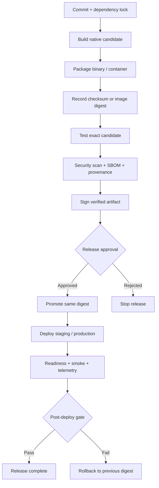

# Releasing Only After the Final Binary or Container Passes Verification

> **Chapter: CI/CD.** The **SPRING_BOOT_NATIVE_IMAGE** module compiles Spring Boot applications into GraalVM Native Image via Spring AOT to evaluate startup time and memory, and deploys native binaries or containers. A successful native build only proves the compiler produced an executable. Before releasing, the team must verify the exact artifact that will run in production, validate the target platform, runtime configuration, security, observability, and rollback plan. This lesson establishes release gates so only verified artifacts are promoted to the next environment.

## 1. Learning Objectives

After this lesson, you will be able to:

1. Distinguish successful native compilation from sufficient conditions for release.
2. Design a release pipeline with build, test, scan, artifact signing, approval, and deploy gates.
3. Verify the executable on the exact target OS and architecture.
4. Verify the final container image, including the run image, configuration, health checks, and dependencies.
5. Use image digests to guarantee staging and production run the exact same artifact.
6. Verify the SBOM, provenance, and image signature before deploying.
7. Test each platform in a multi-architecture image.
8. Monitor rollouts, detect post-deploy failures, and roll back to a known-good digest.
9. Record release evidence to trace commit, toolchain, tests, and artifacts.

## 2. Principle: Release the Exact Verified Artifact

A pipeline can pass compilation, unit tests, and packaging yet still ship a different image than the one tested. This happens when a pipeline rebuilds at deploy time, switches builder/run images, modifies container configuration, or relies on overwritable tags.

The release gate must bind test results to an immutable artifact identifier:

- For standalone executables: use a cryptographic checksum such as SHA-256, plus an artifact signature if required by the organization.
- For containers: use an image digest in the form **repository@sha256:...**.
- For multi-architecture images: record the digest of the image index/manifest list and verify each referenced platform image.

Tags like **latest**, **staging**, or **1.2.3** are convenient for human lookup, but a registry can reassign a tag to another digest. Therefore, use the tag to locate the artifact during the build step, then record its digest and use that digest for testing, promotion, and deployment.



**If an artifact changes after verification, prior verification results no longer apply.** For example, changing the base image, run image, binary, resources, certificate bundle, or startup command can all alter behavior. The new artifact must pass the affected gates before release.

## 3. Stages of the Release Gate

| Stage | Goal | Criteria to proceed |
|---|---|---|
| Source validation | Verify commit, dependencies, policies, and JVM tests | Source/test/quality gates pass |
| Native build | Build native executable with pinned toolchain | Compiler exit code 0, binary exists |
| Packaging | Package binary or create final OCI image | Package has identity and metadata |
| Artifact verification | Run tests on the exact candidate binary/image | Native tests, startup, readiness, and smoke tests pass |
| Security and supply chain | Vulnerability scan, generate SBOM/provenance, sign artifact | Security policy passes, valid signature/attestation |
| Approval | Confirm the release is cleared to deploy | Environment protection/approval passes |
| Promotion | Move the exact artifact to the next registry/environment | Digest remains unchanged |
| Deployment verification | Verify rollout and production behavior | Readiness, smoke tests, telemetry within thresholds |
| Release record | Archive evidence and rollback information | Manifest, digest, and reports recorded |

These steps can be organized across multiple jobs or workflows. What matters is that each gate has explicit inputs, outputs, and pass/fail criteria.

## 4. Preparing the Artifact and Build Information

Native Image depends on OS, CPU architecture, GraalVM distribution/version, Native Build Tools, Spring Boot, C/C++ toolchain, and system libraries. Store this information alongside the artifact:

- Git commit SHA and working tree status.
- Spring Boot, JDK/GraalVM, Native Build Tools, and Gradle/Maven versions.
- OS/architecture of the build runner and target runtime.
- Builder image, run image, or Docker base image with digest.
- Native Image build arguments and Spring AOT configuration.
- Dependency lockfile or resolved dependency list.
- Artifact name, checksum, or OCI digest.
- Test reports, scan reports, SBOM, and provenance references.

Do not record builder images solely by tags like `latest`; pin versions or digests whenever possible. If the builder/run image is updated, that is a build input change and the artifact must be re-evaluated.

### 4.1. A Successful Native Build Is Not Enough

The build gate should verify at minimum:

1. Native compilation returns exit code 0.
2. The executable or image exists at the expected path.
3. The artifact is non-empty and has proper executable permissions.
4. Target OS/architecture matches the deployment environment.
5. Build logs contain no policy-prohibited warnings.
6. Checksum/digest is computed and saved immediately after artifact creation.

With Gradle, projects typically use `nativeCompile`; with Maven, tasks/goals depend on Native Build Tools and Spring Boot plugin configuration. When using Spring Boot Buildpacks, a native image can be created via `bootBuildImage` or `spring-boot:build-image` once AOT/native configuration is enabled. Verify from logs that the buildpack actually created a native executable rather than a JVM image.

## 5. Verifying a Standalone Executable

If releasing a binary directly, test the binary in a production-like environment:

### 5.1. Inspect Format and System Dependencies

On Linux, you can run:

```bash
file orders-service
readelf -h orders-service
readelf -d orders-service
ldd orders-service
sha256sum orders-service
```

These commands identify file format, architecture, dynamic library dependencies, and checksum. `ldd` should only be run on executables produced by a trusted pipeline; for untrusted files, prefer static ELF inspection tools such as `readelf`.

A binary built against glibc will not automatically run on Alpine/musl. Check the dynamic linker and required system libraries; ensure the production image/host provides the matching ABI. If the binary is dynamically linked, document the required runtime libraries.

### 5.2. Run Tests on the Exact Target

Run the binary on an OS/architecture matching production:

```bash
./orders-service --version
./orders-service --help
```

If the application does not support those flags, run the smoke test command designed for the application. For web services, start the binary, wait for the readiness endpoint, send a business request, and validate the response. Tests must exercise resources, reflection, serialization, proxies, TLS certificates, locale, and JNI if the application uses them.

### 5.3. Bind the Checksum to Reports

Generate the checksum once the build finishes:

```bash
sha256sum orders-service > orders-service.sha256
sha256sum --check orders-service.sha256
```

Store the binary, checksum, test reports, and build manifest in the same release bundle. If the binary is copied or downloaded to another runner, verify the checksum before testing or deploying. If your organization signs binaries, the signature must cover the exact verified file.

## 6. Verifying the Final Container Image

For containers, test the image after full packaging. Testing the executable before packaging does not catch every container-layer issue:

- Run image missing system libraries, CA certificates, timezone data, or resource files.
- Incorrect entrypoint, command, port, or environment variables.
- Container user lacking read/write permissions on required directories.
- Read-only container filesystem preventing writes to temp/log/cache directories.
- Unconfigured health check or readiness endpoint.
- Runtime limits, signal handling, or graceful shutdown differing from the test environment.
- Base image/run image changing ABI relative to the native build environment.

Spring Boot supports building OCI images via Cloud Native Buildpacks with Maven and Gradle. Common commands are **mvn spring-boot:build-image** or **./gradlew bootBuildImage**; native image configuration depends on the active plugin and buildpack. When converting an AOT executable JAR into a native image via Buildpacks, verify the exact builder, run image, and native image environment variables against the documentation for your pinned Spring Boot/Buildpacks versions.

### 6.1. Inspect Image Configuration

Before testing, verify:

| Property | What to verify |
|---|---|
| Entrypoint/CMD | Launches the exact native executable |
| User | Runs as a non-root user if permitted by the application |
| Port | Container port matches Service/Ingress |
| Environment | Required profile, config location, and environment variables |
| Filesystem | Writable temp directories have appropriate permissions and capacity |
| CA certificates | Outbound HTTPS works with the expected trust store |
| Timezone/locale | Date/time outputs and formatting behave as expected |
| Health check | Liveness/readiness reflect actual health |
| Resource limits | Memory/CPU suffice for startup and expected load |
| Signals | `SIGTERM` is handled for graceful shutdown |

### 6.2. Build Candidate Image and Capture Digest

With Docker Buildx, you can build and push a candidate image along with metadata:

```bash
IMAGE_TAG="registry.example.com/orders-service:candidate-12345"

docker buildx build \
    --platform linux/amd64 \
    --tag "$IMAGE_TAG" \
    --push \
    --metadata-file image-metadata.json \
    --provenance=true \
    --sbom=true \
    .

IMAGE_DIGEST="$(jq -r '."containerimage.digest"' image-metadata.json)"
IMAGE_REF="registry.example.com/orders-service@$IMAGE_DIGEST"
printf '%s\n' "$IMAGE_REF" > verified-image-ref.txt
```

`--metadata-file` saves the digest of the build result. BuildKit can attach provenance and SBOMs to the image index/manifest; check that your active driver/image store supports attestations. When building with a driver that lacks attestation support, configure an appropriate builder or exporter before using these flags.

The candidate tag locates the image in the registry. Once the digest is captured, testing, scanning, signing, and deployment steps should reference `IMAGE_REF` with its digest. Do not rely on the tag again to identify the artifact to release.

### 6.3. Test the Exact Image Digest

Pull the image by digest and run smoke tests:

```bash
docker pull "$IMAGE_REF"
docker run --rm --entrypoint /app/orders-service "$IMAGE_REF" --version
```

Executable paths and flags depend on the image. For a web service, start the container detached, wait for readiness, send a business request, and collect logs before cleanup:

```bash
set -Eeuo pipefail

container_name="orders-candidate"
cleanup() {
    docker logs "$container_name" > container-smoke.log 2>&1 || true
    docker inspect "$container_name" > container-inspect.json 2>&1 || true
    docker rm -f "$container_name" >/dev/null 2>&1 || true
}
trap cleanup EXIT

docker run -d --name orders-candidate \
    -p 18080:8080 \
    "$IMAGE_REF"

ready=0
for attempt in $(seq 1 30); do
    if curl --fail --silent http://127.0.0.1:18080/actuator/health/readiness; then
        ready=1
        break
    fi
    if [ "$(docker inspect -f '{{.State.Running}}' "$container_name" 2>/dev/null || true)" != "true" ]; then
        break
    fi
    sleep 2
done

if [ "$ready" -ne 1 ]; then
    echo "Container did not become ready before the deadline" >&2
    exit 1
fi

curl --fail --silent --show-error \
    http://127.0.0.1:18080/api/orders/health-check

```

Adjust the endpoint, port, authentication, and wait timeout for your application. In a real CI script, if readiness or the smoke request fails, exit non-zero while still collecting logs/inspect output before cleanup. Do not check only whether the container state is `Running`; the app may be running without having bound the port or connected to dependencies yet.

### 6.4. Verify Multi-Architecture Images

If the image supports `linux/amd64` and `linux/arm64`, the build can produce an OCI index referencing multiple platform manifests:

```bash
docker buildx build \
    --platform linux/amd64,linux/arm64 \
    --tag registry.example.com/orders-service:candidate-12345 \
    --push \
    --metadata-file image-metadata.json \
    --provenance=true \
    --sbom=true \
    .

docker buildx imagetools inspect \
    registry.example.com/orders-service:candidate-12345
```

Do not test an image index on only one architecture and conclude every platform is compatible. Run smoke/integration tests on native runners for each target architecture. QEMU can assist with basic functional checks in some pipelines, but it does not replace real-hardware performance measurements or full validation of JNI/native libraries.

For each platform, verify:

- OS and CPU architecture in the manifest.
- The native executable built for the matching target.
- Dynamic libraries and ABI present in the run image.
- JNI/native libraries containing binaries for the matching architecture.
- Startup, health, requests, and graceful shutdown.
- SBOM/scan results corresponding to that platform image.

## 7. Functional and Operational Testing Before Release

Release gates should verify multiple layers rather than hitting a single endpoint:

### 7.1. Native Application Tests

- Run the project's configured native test suite.
- Test code paths using reflection, resources, serialization, and proxies.
- Test different profiles/configurations.
- Test database migrations, transactions, caching, and messaging.
- Test TLS, DNS, outbound HTTP, and connection pooling.
- Test locale, timezone, filesystem, and temp directories.
- Test graceful shutdown and `SIGTERM` handling.

### 7.2. Container Integration Tests

Run the candidate image alongside test dependencies such as databases, caches, brokers, or mock services. Verify service-to-service networking, DNS, TLS, timeouts, retries, and authentication. Use the exact same image digest in local integration environments and CI environments.

### 7.3. Runtime/Resource Tests

Configure CPU/memory limits close to production settings. Measure time to readiness, RSS, CPU, thread count, request latency, error rate, and restarts. Native Image can have a different footprint from the JVM; check for OOMs, throttling, thread pool sizing, and graceful shutdown under load.

### 7.4. Security Tests

Scan the pushed image by digest:

- OS packages and native libraries.
- Java dependencies retained in the SBOM.
- CVEs against severity and exploitability policies.
- Secrets or private keys accidentally copied into the image.
- User/root configuration, file permissions, exposed ports, and runtime settings.
- License/policy compliance if required by the organization.

A tiny or `scratch` image without a shell does not mean zero vulnerabilities. A final-stage SBOM may exclude toolchains/build dependencies from earlier stages; if full supply-chain assessment is required, configure SBOM scanning across build stages/contexts as well.

## 8. SBOM, Provenance, and Artifact Signatures

These three forms of evidence answer different questions:

| Evidence | Question |
|---|---|
| SBOM | Which packages, libraries, and components are inside the artifact? |
| Provenance | Which source, builder, parameters, and environment produced the artifact? |
| Signature | Was the artifact signed by a trusted identity/key, and has its content remained unaltered? |

With Docker Buildx, `--sbom=true` requests an SBOM attestation and `--provenance=true` requests a provenance attestation. BuildKit's default provenance may be minimal; select the full mode per organizational policy. Verify that attestations are stored alongside the image and preserved by the registry.

### 8.1. Sign the Image by Digest

Once the image passes test and security gates, sign it with Sigstore Cosign:

```bash
cosign sign "$IMAGE_REF"
```

Always sign the digest rather than the tag so the signature binds to the exact verified image. With keyless signing, the pipeline uses an OIDC identity to obtain a short-lived certificate; with key/KMS signing, manage access permissions and rotation per organizational policy.

For multi-architecture images, establish your organization's signing policy: a signature on the OCI index certifies the published manifest list; if policy requires signing each platform manifest individually, use Cosign's recursive mode and verify the corresponding manifests.

### 8.2. Verify Signatures Before Deploying

Keyless signature verification example:

```bash
cosign verify "$IMAGE_REF" \
    --certificate-identity "$EXPECTED_CERTIFICATE_IDENTITY" \
    --certificate-oidc-issuer "$EXPECTED_OIDC_ISSUER"
```

Production pipelines must pin allowed signer identities and OIDC issuers. Never use broad regexes or skip claim validation in release gates. If the organization uses public keys/KMS instead of keyless signing, verify with the exact managed public key or trust policy.

### 8.3. Verify Provenance and Policy

A signature proves the artifact was signed by an authorized identity; provenance shows how the artifact was built. Policy may require:

- Source repository and commit are on the allowlist.
- Workflow/build service is a trusted workflow.
- Builder image and GraalVM version are approved versions.
- Build parameters contain no prohibited options.
- SBOM contains complete metadata and no policy-blocked dependencies.
- Image digest in the attestation matches the digest being deployed.

If the attestation is missing, unreadable, or the subject digest does not match the image, halt promotion and investigate.

## 9. Promoting Between Staging and Production

Promotion moves an already-verified artifact to another environment. For containers, the safest approach is deploying the exact same image digest:

```yaml
apiVersion: apps/v1
kind: Deployment
metadata:
  name: orders-service
spec:
  template:
    spec:
      containers:
        - name: orders-service
          image: registry.example.com/orders-service@sha256:REPLACE_WITH_VERIFIED_DIGEST
```

Kubernetes supports image references by digest. A digest identifies an exact image, preventing tag mutations from causing new Pods to pull different code than older Pods.

If you must copy the image to another registry, verify the digest in the target registry afterward. Certain media-type or manifest conversions can alter the digest; if the digest changes, the destination artifact must be re-verified and re-tested per policy before deployment.

Never re-run `nativeCompile`, `bootBuildImage`, or `docker build` inside a production deploy job. If a rebuild is unavoidable, it produces a new artifact: capture the new digest and re-run testing/scanning/signing/approval, updating the release record.

### 9.1. Configuration Differences Across Environments

Staging and production may use different ConfigMaps, Secrets, endpoints, and resource limits. Manage these separately and validate them before deploy. Never bake secrets or environment-specific config into the native binary/image.

If a configuration change alters critical behavior, run a smoke test under production-like configuration. Confirm the native executable receives the expected trust store, timezone, writable directory, port, profile, and environment variables.

## 10. Approvals, Deployment Protection, and Permissions

Production deployments should have an approval gate independent of the build:

- Only trusted branches/tags or workflows may deploy.
- Only release jobs can access production credentials.
- Approvals bind to a specific commit and image digest.
- Production jobs re-verify signatures, provenance, and policy before deploying.
- Secrets are issued only after environment protection rules pass.
- Pull requests from forks must never access production signing/deploy credentials.

With GitHub Actions, Environment protection rules can require reviewers, restrict branches, and scope secrets per environment. Other CI providers offer equivalent features such as protected environments, manual approvals, or deployment policies.

Approval does not replace technical verification. Reviewers need visibility into the digest, test summary, scan results, SBOM/provenance, and release changes to make an informed decision.

## 11. Post-Deployment Verification

API-level deployment success does not prove the application is serving healthily. After rollout:

1. Check rollout status and ready replica count.
2. Confirm the running Pod/Task/Container image digest matches the approved digest.
3. Run readiness and smoke requests through the real traffic path.
4. Check liveness, restart counts, `OOMKilled` events, and startup errors.
5. Inspect logs, metrics, and distributed traces.
6. Compare latency, error rate, CPU/RSS, and saturation against baselines.
7. Verify dependencies such as databases, caches, brokers, and outbound APIs.
8. Observe during a defined canary/soak window before declaring the release complete.

With Kubernetes:

```bash
kubectl rollout status deployment/orders-service --timeout=5m
kubectl get pods -l app=orders-service -o wide
kubectl describe deployment orders-service
```

Check the image ID/digest on running Pods to confirm the rollout uses the exact artifact. `kubectl rollout status` only verifies rollout progression against readiness; smoke tests and telemetry are still needed to catch business logic errors.

## 12. Rolling Back to a Known-Good Artifact

Before releasing, record both the current digest and the new digest. If the post-deploy gate fails, roll back to the previous stable digest:

```bash
kubectl set image deployment/orders-service \
    orders-service=registry.example.com/orders-service@sha256:PREVIOUS_VERIFIED_DIGEST

kubectl rollout status deployment/orders-service --timeout=5m
```

You can use a Helm revision or GitOps revert if that is how deployments are managed. Either way, rollback must also restore configuration compatible with the previous image.

Database migrations must support safe rollback. Prefer backward-compatible expand/contract migrations:

1. Add new schema elements while old code can still read/write.
2. Deploy new code and verify.
3. Migrate data/traffic.
4. Drop old schema elements only once rolling back to old code is no longer needed.

If a migration breaks backward compatibility, rolling back the image alone may not be enough to restore the service.

## 13. Release Manifest and Verification Evidence

Every release should have a manifest linking source, toolchain, artifact, and gate outcomes. Example:

```json
{
  "service": "orders-service",
  "sourceCommit": "COMMIT_SHA",
  "build": {
    "graalvmVersion": "GRAALVM_VERSION",
    "springBootVersion": "SPRING_BOOT_VERSION",
    "nativeBuildToolsVersion": "NATIVE_BUILD_TOOLS_VERSION",
    "targetPlatforms": ["linux/amd64"]
  },
  "artifact": {
    "type": "container",
    "reference": "registry.example.com/orders-service@sha256:DIGEST",
    "builderImageDigest": "sha256:BUILDER_DIGEST",
    "runImageDigest": "sha256:RUN_IMAGE_DIGEST"
  },
  "verification": {
    "nativeTests": "passed",
    "containerSmokeTest": "passed",
    "vulnerabilityScan": "passed",
    "sbom": "attached",
    "provenance": "attached",
    "signature": "verified"
  },
  "deployment": {
    "environment": "production",
    "approval": "APPROVAL_REFERENCE",
    "rollbackDigest": "sha256:PREVIOUS_DIGEST"
  }
}
```

Values in this example are placeholders. Never place secrets, tokens, or sensitive details in the release manifest. Archive the manifest alongside logs, JUnit reports, native smoke tests, vulnerability reports, SBOMs, provenance, and signatures.

## 14. Release Gate Matrix

| Gate | Pass | Fail |
|---|---|---|
| Source | Commit and dependencies identified, source tests pass | Unclear working tree origin, test/quality failure |
| Native build | Exit code 0, binary/image exists | Compiler/linker failure, missing artifact |
| Artifact identity | Checksum/digest recorded | Cannot identify the tested artifact |
| Platform | OS/architecture and native dependencies match | Wrong architecture/ABI or missing library |
| Native tests | Tests actually ran, valid report | Test failure, unapproved skips, or missing report |
| Final image | Exact digest, startup/readiness/smoke pass | Tested only an intermediate binary or different image |
| Security | Scan meets policy, valid SBOM/provenance | Blocked vulnerability, missing required attestation |
| Signature | Valid signature, trusted signer | Wrong signer, digest, or signature |
| Approval | Production environment approval passes | Not yet approved |
| Promotion | Digest unchanged across environments | Unverified rebuild or digest change |
| Deployment | Rollout, smoke, and telemetry within thresholds | Crash, OOM, readiness failure, or error rate above threshold |
| Rollback | Prior digest and recovery path recorded | No identifiable artifact to roll back to |

If a gate does not apply, document the reason and the compensating gate. Never treat a skipped step or missing data as a pass.

## 15. Conceptual Pipeline Example

The following pipeline illustrates separating build, verification, and deployment. Adjust task names, actions, and secrets to match your CI provider and actual configuration:

```yaml
stages:
  - validate
  - build-native
  - package-candidate
  - verify-candidate
  - secure-artifact
  - approve-release
  - deploy
  - post-deploy-check

build-native:
  script:
    - run-jvm-tests
    - run-native-build
    - save-native-build-log
  artifacts:
    - native-executable
    - native-build-report

package-candidate:
  needs: [build-native]
  script:
    - build-final-container
    - push-candidate-image
    - capture-image-digest
  artifacts:
    - image-digest.txt
    - build-metadata.json

verify-candidate:
  needs: [package-candidate]
  script:
    - pull-image-by-digest
    - run-native-integration-tests
    - run-container-smoke-tests
    - scan-image-by-digest
  artifacts:
    - junit-reports
    - smoke-test-log
    - vulnerability-report

secure-artifact:
  needs: [verify-candidate]
  script:
    - verify-sbom-and-provenance
    - sign-image-digest
    - verify-image-signature
    - write-release-manifest
  artifacts:
    - release-manifest.json

deploy-production:
  needs: [secure-artifact]
  environment: production
  when: manual
  script:
    - verify-release-manifest
    - deploy-the-same-image-digest
    - wait-for-rollout
    - run-post-deploy-smoke-tests
```

A real pipeline must configure job dependencies so that test failures prevent security/release/deploy jobs from running. Artifact collection steps should run even on job failure to preserve logs and reports. Approvals should open only once all candidate evidence is present.

## 16. Common Pitfalls

| Symptom | Possible cause | Remediation |
|---|---|---|
| Native build passes, but container crashes | Run image missing libraries, CA certs, or resources | Test the final image in the target environment |
| Staging passes, but production runs different code | Deployed via mutable tag or rebuilt | Deploy by digest and verify running digest |
| Binary runs on runner, fails in production | Wrong OS/architecture, glibc/musl, or dynamic dependencies | Build/test on target platform and verify ABI |
| AMD64 passes, but ARM64 fails | Tested only one manifest/platform | Run tests on native runners for each architecture |
| Image scan passes, but misses build-time dependencies | SBOM scanned only the final stage | Expand SBOM scanning to build stage/context |
| Signature is valid, but for the wrong image | Signed by tag or digest claim not checked | Sign and verify by digest |
| Rollout passes, but API errors occur | Readiness checks only process liveness | Add smoke requests and monitor telemetry |
| Rollback fails to recover | Old image or old config is gone | Retain prior release digest/config and rehearse rollbacks |
| Release job rebuilds the image | Build and deploy do not share the same artifact | Decouple build/verify from deploy; promote verified digest |
| Tests were skipped, yet release proceeded | Gate checked exit code without inspecting reports | Check test counts, skipped tests, and mandatory reports |

## 17. Hands-On Exercise

A Spring Boot service is built as a native container for `linux/amd64` and `linux/arm64`. Staging runs fine, yet production occasionally runs a different version because the `stable` tag gets updated by another pipeline.

Steps:

1. Build the multi-platform image and push a candidate tag.
2. Extract the OCI index digest from Buildx metadata.
3. Use AMD64 and ARM64 runners to pull that exact digest and run native integration and smoke tests.
4. Generate SBOM/provenance, scan the image by digest, and sign the digest after gates pass.
5. Verify the signature against an allowed signer identity/issuer.
6. Record image digests and test results in the release manifest.
7. Deploy to staging by digest; verify Pod image IDs match the release manifest.
8. Require production approval, then deploy that exact same digest.
9. Run post-deploy smoke tests and observe error rate, latency, RSS, and restarts/OOMs.
10. Intentionally fail the smoke test and rehearse rolling back to the previous digest.

Report template:

| Item | Result |
|---|---|
| Source commit | … |
| Native toolchain | … |
| Platform manifests | … |
| OCI index digest | … |
| AMD64 native test | Pass/Fail |
| ARM64 native test | Pass/Fail |
| Container smoke test | Pass/Fail |
| Vulnerability scan | Pass/Fail |
| SBOM/provenance | Yes/No |
| Signature verification | Pass/Fail |
| Staging digest | … |
| Production digest | … |
| Rollback digest | … |

## 18. Self-Check Questions

1. Why is successful native compilation insufficient for releasing?
2. How do an executable's checksum and an OCI image digest differ?
3. Why shouldn't you test using one tag and deploy using another tag?
4. When must multi-architecture images be tested separately?
5. Why must the final container be tested after packaging?
6. What two types of information do an SBOM and provenance provide?
7. Why must signatures bind to digests and verify signer identity?
8. Why shouldn't production deployment rebuild the image?
9. How do readiness, smoke tests, and post-deploy telemetry complement one another?
10. What conditions can make rolling back an image insufficient to restore a service?

## Remember

**The release gate must guarantee that the tested artifact is the exact deployed artifact.** Build the candidate binary/container, record its checksum or digest, verify it on the exact target platform and final runtime, run security scans, store SBOM/provenance, sign the digest, obtain approval, and promote the exact same artifact. After deploying, verify rollout, readiness, smoke requests, and telemetry; if any gate fails, roll back to a known-good digest.

## Official References

- [Spring Boot — Advanced Native Image Topics](https://docs.spring.io/spring-boot/reference/packaging/native-image/advanced-topics.html): converting an AOT-processed executable JAR into a native image via Buildpacks or GraalVM.
- [Spring Boot — Packaging OCI Images with Maven](https://docs.spring.io/spring-boot/maven-plugin/build-image.html): builder, run image, platform, tags, cache, and image configuration.
- [Spring Boot — Packaging OCI Images with Gradle](https://docs.spring.io/spring-boot/gradle-plugin/packaging-oci-image.html): `bootBuildImage` and Buildpacks configuration.
- [Docker — Buildx build](https://docs.docker.com/reference/cli/docker/buildx/build/): platform, push, metadata file, and image digest.
- [Docker — Build attestations](https://docs.docker.com/build/metadata/attestations/): SBOM/provenance and attaching attestations to images.
- [Docker — SBOM attestations](https://docs.docker.com/build/metadata/attestations/sbom/): SBOM contents and build stage/context scan scope.
- [Docker — Provenance attestations](https://docs.docker.com/build/metadata/attestations/slsa-provenance/): source info and image creation process.
- [Kubernetes — Images](https://kubernetes.io/docs/concepts/containers/images/): using digests to pin exact images and avoid mutable tags.
- [Sigstore — Signing containers](https://docs.sigstore.dev/cosign/signing/signing_with_containers/): signing images with Cosign and attestations.
- [Sigstore — Verifying signatures](https://docs.sigstore.dev/cosign/verifying/verify/): verifying signatures, digest claims, and signer identity.
- [GitHub Actions — Deployment environments](https://docs.github.com/en/actions/concepts/workflows-and-actions/deployment-environments): approvals, branch restrictions, deployment protection, and environment secrets.
