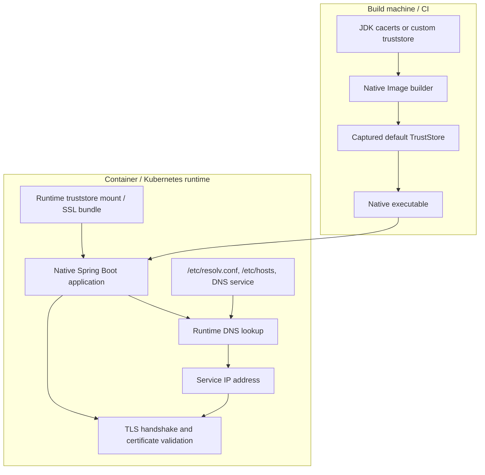

# Certificates, truststores, DNS, and differences between build machine and runtime environment

## 1. Why separate security and network configuration by lifecycle phase?

A Spring Boot service commonly makes HTTPS calls to internal APIs, TLS-enabled databases, message brokers, LDAP, or cloud services. These connections depend on two groups of information:

- **Trust material:** CA certificates trusted by the application, the application's own certificate and private key, TLS configuration, and hostname verification.
- **Network environment:** DNS resolvers, `/etc/hosts`, DNS search domains, proxies, routes, and container or Kubernetes Pod network policies.

On the JVM, an application typically reads the truststore and network configuration of the running environment. With GraalVM Native Image, part of the default trust material is collected at **build time**, whereas DNS is normally resolved at **runtime** using the deployment environment's network configuration.

If you do not distinguish these two phases, an executable that builds cleanly on a developer machine may fail in production: the build machine trusts an internal CA that is missing from the production image, or the build machine resolves a hostname while the Pod lacks the right DNS search domain. Conversely, a truststore captured from a build machine could bake a dev-only CA into a released executable.

After this lesson, you will be able to:

- Distinguish truststores from keystores, and root CAs from server certificates.
- Explain how GraalVM Native Image captures the default TrustStore at build time.
- Choose between an executable-embedded truststore and a runtime-mounted truststore.
- Configure Spring Boot SSL Bundles for JKS/PKCS12 and PEM.
- Verify runtime DNS, cache TTLs, and search domains in Docker/Kubernetes.
- Analyze TLS, hostname verification, and DNS errors with the right tools.
- Design tests running against the actual native executable and production container.

## 2. Distinguishing truststores, keystores, and certificate chains

### 2.1. Truststores and keystores serve different roles

| Component | What does it contain? | When is it used? |
|---|---|---|
| Truststore | CA certificates or certificates trusted by the application | Verifying the server certificate when a client opens TLS; verifying client certificates when a server requires mTLS |
| Keystore | The application's own certificate and matching private key | Server presenting its TLS identity; client presenting a client certificate when using mTLS |
| Certificate chain | Leaf/server certificate and intermediate CAs leading to a trust anchor | Allowing the peer to verify a path from the leaf certificate to a trusted CA |

For example, when `order-service` calls `https://inventory.internal.example`:

- `order-service` needs a truststore containing the CA that issued the inventory service's certificate.
- The inventory service must send its leaf certificate along with any required intermediate certificates.
- If inventory requires mutual TLS, `order-service` also needs a keystore holding its client certificate and private key.

### 2.2. Trust CAs rather than importing leaf certificates arbitrarily

In internal systems, you should normally add an organization-managed root CA or intermediate CA to the truststore. The server must present complete intermediate certificates so clients can build the certificate chain.

Import a leaf certificate only when the organization intentionally practices certificate pinning and has a rotation procedure. If you import a single server's leaf certificate into the truststore, rotating that server's certificate forces the application to update its trust material even if the new certificate is signed by the same CA.

Never disable hostname verification or use a trust-all manager to work around certificate errors. A valid trust chain alone is not enough: the URL hostname must match the certificate's Subject Alternative Name (SAN), the certificate must be within its validity window, and the system clock must be accurate.

### 2.3. Creating and inspecting a PKCS12 truststore

Example importing an internal CA into PKCS12:

```bash
keytool -importcert -noprompt \
  -alias company-root-ca \
  -file company-root-ca.pem \
  -keystore internal-truststore.p12 \
  -storetype PKCS12 \
  -storepass "$TRUSTSTORE_PASSWORD"
```

List imported certificates:

```bash
keytool -list -v \
  -keystore internal-truststore.p12 \
  -storetype PKCS12 \
  -storepass "$TRUSTSTORE_PASSWORD"
```

Verify the subject, issuer, validity dates, and fingerprint. Compare the fingerprint against your officially managed CA source before adding a certificate to the truststore.

## 3. GraalVM Native Image default TrustStore

### 3.1. Native Image captures the truststore from the build machine

By default in GraalVM Native Image, during the build, the Native Image builder captures the build environment's default TrustStore and embeds its certificate contents into the executable. This TrustStore is normally built from the root certificates file in the JDK used for the build.

Consequences:

- The executable can verify TLS using the captured CAs without needing the JDK's `cacerts` file on the runtime machine.
- The default certificate store reflects the build machine's trust material at image build time.
- If the production container adds an OS-level CA that was not in the captured truststore, do not assume the native executable will automatically read new CAs from the container.
- If built on a machine with a corporate proxy CA, that CA can be embedded into the artifact and trusted in every environment where that artifact is deployed.

This is a major difference from how many teams operate the JVM: updating a truststore file in a base image or mounting a CA file into a container does not automatically alter the truststore embedded inside a native executable.

GraalVM also reads the untrusted certificates list from `<java.home>/lib/security/blacklisted.certs` during build. This list is checked when verifying certificates at both build time and runtime, even if the application replaces the truststore with a runtime file. Therefore, updating the blacklist inside a container's JDK after the executable is built does not automatically update the captured blacklist; control your JDK/GraalVM build version and rebuild whenever this security data must be updated.

### 3.2. Build time and runtime diagram



The captured default TrustStore is build-time data. Normal DNS lookups happen at runtime using the container/Pod resolver configuration. If application code actively resolves a hostname inside a static initializer executed at build time, that result can become baked into the image heap; never perform network lookups in build-time initialized code.

### 3.3. Capturing a custom truststore at build time

If an executable is released strictly for an environment with stable CAs, you can configure a custom truststore during the build:

```bash
native-image \
  -J-Djavax.net.ssl.trustStore=/workspace/certs/production-truststore.p12 \
  -J-Djavax.net.ssl.trustStoreType=PKCS12 \
  -J-Djavax.net.ssl.trustStorePassword="$BUILD_TRUSTSTORE_PASSWORD" \
  -jar target/order-service.jar \
  order-service
```

`-J` passes the system property to the JVM running the Native Image builder. The truststore file must exist and be readable on the build machine. Native Image captures the certificate contents; the file does not need to exist on the target runtime solely for the embedded default TrustStore.

If using Maven Native Build Tools, the corresponding options can be passed via `buildArgs`:

```xml
<plugin>
    <groupId>org.graalvm.buildtools</groupId>
    <artifactId>native-maven-plugin</artifactId>
    <configuration>
        <buildArgs>
            <buildArg>-J-Djavax.net.ssl.trustStore=${env.BUILD_TRUSTSTORE_PATH}</buildArg>
            <buildArg>-J-Djavax.net.ssl.trustStoreType=PKCS12</buildArg>
            <buildArg>-J-Djavax.net.ssl.trustStorePassword=${env.BUILD_TRUSTSTORE_PASSWORD}</buildArg>
        </buildArgs>
    </configuration>
</plugin>
```

With Gradle Native Build Tools:

```groovy
graalvmNative {
    binaries {
        main {
            buildArgs.addAll(
                    "-J-Djavax.net.ssl.trustStore=${System.getenv('BUILD_TRUSTSTORE_PATH')}",
                    '-J-Djavax.net.ssl.trustStoreType=PKCS12',
                    "-J-Djavax.net.ssl.trustStorePassword=${System.getenv('BUILD_TRUSTSTORE_PASSWORD')}"
            )
        }
    }
}
```

The snippets above illustrate how to pass properties; use your CI secret store and never commit passwords or truststore files containing private keys to a repository. If build logs display full command lines, check CI masking and log retention policies. For a truststore used strictly to verify servers, only CA certificates are normally needed; do not put the application's private key into this truststore.

### 3.4. When should you avoid embedding environment-specific truststores?

Do not embed dev/test/prod-specific truststores into a shared executable if environments have different trust policies. An artifact with an embedded dev CA could inadvertently trust dev endpoints when running in production.

A build-time truststore fits when:

- The CA list is identical across every environment running the artifact.
- Trust material changes on a release cadence and build/deploy pipelines can reissue the executable when CAs change.
- The organization wants an immutable trust policy tied to the artifact.

A runtime truststore fits when:

- CAs are provisioned by the deployment platform and change independently of application releases.
- Each customer or cluster has different trust roots.
- CAs must rotate without rebuilding the executable.
- Secrets/certificates are mounted via Kubernetes Secrets or a secret manager.

## 4. Replacing the default TrustStore at runtime

### 4.1. Runtime `javax.net.ssl.trustStore*` properties

GraalVM supports replacing the default TrustStore at executable runtime via system properties:

- `javax.net.ssl.trustStore`
- `javax.net.ssl.trustStoreType`
- `javax.net.ssl.trustStoreProvider`
- `javax.net.ssl.trustStorePassword`

If any property in this group is set at runtime, `javax.net.ssl.trustStore` must also be set and point to a readable certificate store file. Otherwise, Native Image may throw `UnsupportedFeatureError`.

Example:

```bash
./order-service \
  -Djavax.net.ssl.trustStore=/run/secrets/internal-truststore.p12 \
  -Djavax.net.ssl.trustStoreType=PKCS12 \
  -Djavax.net.ssl.trustStorePassword="$INTERNAL_TRUSTSTORE_PASSWORD"
```

The path must exist inside the container, not on the host machine. Mount the secret read-only and restrict read permissions to the user running the application.

Never set `javax.net.ssl.trustStorePassword` alone while omitting the truststore path. This differs from some HotSpot expectations: Native Image cannot fall back to a JDK runtime `cacerts` file if that file does not exist alongside the executable.

### 4.2. Be careful with passwords and process arguments

Passing passwords via command-line arguments can expose values through process inspection, crash reports, or startup logs. For production applications, prefer configuring client TLS via Spring SSL Bundles and sourcing passwords from platform secret injection. If global JSSE properties are strictly required, set them before any client/`SSLContext` is created and apply appropriate secret protection controls.

Never embed truststore passwords in a committed `application.yml` or in `Dockerfile ENV`. Compiling into a native executable does not turn a packaged secret into a safe secret.

### 4.3. Global JSSE truststore and Spring SSL Bundles are not the same configuration

`javax.net.ssl.trustStore` changes the default TrustStore used by JSSE. A Spring SSL Bundle is a named set of trust/key material configured by Spring Boot and applied to designated servers/clients.

Both approaches can coexist:

- Use the default JSSE truststore for libraries relying on the default `SSLContext`.
- Use a dedicated SSL Bundle for a specific client calling an internal API with its own CA.

If you configure an SSL Bundle for a client, verify that the client actually uses that bundle. Do not assume every HTTP library, database driver, or SDK automatically picks up the same Spring SSL Bundle.

## 5. Configuring Spring Boot SSL Bundles

### 5.1. JKS/PKCS12 truststore for outbound HTTPS

Spring Boot supports named SSL Bundles via the `spring.ssl.bundle` prefix. Example configuring a dedicated truststore for the inventory API:

```yaml
spring:
  ssl:
    bundle:
      jks:
        inventory-api:
          truststore:
            location: file:/run/secrets/inventory-truststore.p12
            password: ${INVENTORY_TRUSTSTORE_PASSWORD}
            type: PKCS12
```

The truststore above is read from the runtime filesystem. Accordingly, the container must mount the file at `/run/secrets/inventory-truststore.p12`. If using `classpath:inventory-truststore.p12`, the resource must be packaged into the native image in a way the application can access.

### 5.2. Applying a bundle to WebClient

Example using Spring Boot 4.2 APIs:

```java
package com.example.orders.inventory;

import org.springframework.boot.webclient.autoconfigure.WebClientSsl;
import org.springframework.beans.factory.annotation.Value;
import org.springframework.stereotype.Component;
import org.springframework.web.reactive.function.client.WebClient;

@Component
public class InventoryClient {

    private final WebClient webClient;

    public InventoryClient(
            WebClient.Builder builder,
            WebClientSsl ssl,
            @Value("${inventory.base-url}") String baseUrl) {
        this.webClient = builder
                .baseUrl(baseUrl)
                .apply(ssl.fromBundle("inventory-api"))
                .build();
    }

    public WebClient webClient() {
        return webClient;
    }
}
```

Spring Boot also supports applying SSL Bundles to `RestClient` via `RestClientSsl`. If using Spring Boot 3.x, check the packages/imports for your minor version rather than copying 4.x packages verbatim.

### 5.3. PEM truststore

If the platform provides CAs in PEM format, you can use a PEM bundle:

```yaml
spring:
  ssl:
    bundle:
      pem:
        inventory-api:
          truststore:
            certificate: file:/run/secrets/inventory-ca.pem
```

Or use `classpath:` if the certificate is a resource shipped with the application. A PEM truststore holds trusted CA certificates; it does not need the remote server's private key.

### 5.4. Keystore for inbound HTTPS

When a native executable exposes an HTTPS server, the application needs its own certificate and private key. Example:

```yaml
spring:
  ssl:
    bundle:
      jks:
        web-server:
          key:
            alias: order-service
          keystore:
            location: file:/run/secrets/order-service.p12
            password: ${SERVER_KEYSTORE_PASSWORD}
            type: PKCS12

server:
  ssl:
    bundle: web-server
```

This is the server's keystore, distinct from a truststore used to verify server certificates on outbound calls. If mTLS is enabled, the server also needs a truststore to verify client certificates along with appropriate `client-auth` configuration.

### 5.5. Reloading certificates when files are updated

Spring Boot supports `reload-on-update` for certain compatible SSL Bundles and consumers. For example, a PEM bundle used by an embedded Tomcat/Netty server can read certificates and private keys from files and reload when those files change.

```yaml
spring:
  ssl:
    bundle:
      pem:
        web-server:
          reload-on-update: true
          keystore:
            certificate: file:/run/secrets/fullchain.pem
            private-key: file:/run/secrets/privkey.pem

server:
  ssl:
    bundle: web-server
```

Do not assume every HTTP client or database driver automatically reloads its SSL context. Spring Boot currently documents reload support for specific consumers such as Tomcat and Netty servers; verify your exact consumer before relying on this feature.

## 6. URL protocols and TLS support in Native Image

### 6.1. HTTPS is more than just a truststore

An HTTPS connection involves several steps:

1. Resolve the hostname to an IP address.
2. Establish a TCP connection.
3. Perform the TLS handshake.
4. Verify the certificate chain and hostname.
5. Execute the HTTP request.

A truststore only handles trust chain verification. If the native executable lacks a URL handler, DNS fails to resolve, or the client library lacks native support, adding a CA to the truststore will not fix the failure.

### 6.2. JDK `URL`/`HttpsURLConnection` require their own handlers

Native Image only includes reachable URL protocol handlers in the executable. Per current GraalVM documentation, `file` and `resource` are enabled by default; JDK handlers such as `http` and `https` require constructor metadata for the handler if the application calls `URL.openConnection()` or `HttpsURLConnection`.

Example metadata for the HTTPS handler:

```json
{
  "reflection": [
    {
      "type": "sun.net.www.protocol.https.Handler",
      "methods": [
        {
          "name": "<init>",
          "parameterTypes": []
        }
      ]
    }
  ]
}
```

Place this file under `META-INF/native-image/<groupId>/<artifactId>/reachability-metadata.json` on the classpath. If the application also uses the `http` URL handler, register `sun.net.www.protocol.http.Handler` similarly.

The `--enable-http`, `--enable-https`, and `--enable-url-protocols` options have been marked deprecated in recent Native Image documentation; prefer reachability metadata matching your GraalVM version. Do not add URL handler metadata just because the application has an `https://` URL; first verify whether the actual HTTP client uses `java.net.URL`, JDK `HttpClient`, Reactor Netty, or Apache HttpClient.

## 7. Where is DNS resolved?

### 7.1. The JDK resolver uses the runtime environment's configuration

The built-in JDK `InetAddress` resolver resolves hostnames using a combination of local host configuration and naming services such as DNS or LDAP. The exact resolver sources depend on the OS and environment configuration.

Normally, when a native executable calls `InetAddress.getByName("inventory")`, the DNS lookup happens while the executable is running. Results are not taken from the build machine merely because the native image was compiled there.

Runtime configurations that can affect resolution include:

- `/etc/hosts`: static hostname mappings.
- `/etc/resolv.conf`: nameservers, search domains, and resolver options on Linux.
- OS or container runtime resolver configuration.
- Kubernetes DNS service, Docker networks, or internal corporate DNS.
- JDK DNS cache or a custom HTTP client's own cache.

### 7.2. Do not resolve hostnames in build-time initializers

Native Image can execute certain code during the build, especially when classes are initialized at build time. If a static initializer calls DNS and stores the result in a static field, the build machine's IP can become baked into the image heap.

Avoid patterns like:

```java
static final InetAddress INVENTORY_ADDRESS = resolve("inventory.internal.example");
```

especially if the class might be initialized at build time. Instead, keep the hostname in configuration and let the HTTP client or DNS resolver resolve it at runtime. Never open connections, resolve hostnames, or read production network configuration inside static initializers.

### 7.3. Docker DNS

Containers typically inherit host DNS settings via `/etc/resolv.conf`. On custom Docker networks, Docker provides an embedded DNS resolver at `127.0.0.11` and forwards external queries to the host's DNS servers.

You can inspect inside a container:

```bash
cat /etc/resolv.conf
getent hosts inventory.internal.example
```

If you need to specify a DNS server for a container, Docker supports `--dns`. Do this only when that DNS server is reachable from the container's network namespace and authorized to resolve the required internal zones.

### 7.4. Kubernetes Pod DNS

Kubernetes normally configures Pods with `dnsPolicy: ClusterFirst`. Kubelet generates `/etc/resolv.conf` containing the cluster DNS server and search domains. A Pod in namespace `orders` can resolve service `inventory` using its short name within that namespace; to call a service in another namespace, use a namespace-qualified name or FQDN.

Example full DNS name:

```text
inventory.supply.svc.cluster.local
```

Example Pod configuration using default DNS:

```yaml
spec:
  dnsPolicy: ClusterFirst
  containers:
    - name: order-service
      image: example/order-service:native
```

If custom DNS is needed:

```yaml
spec:
  dnsPolicy: None
  dnsConfig:
    nameservers:
      - 10.20.0.53
    searches:
      - supply.svc.cluster.local
      - svc.cluster.local
      - cluster.local
    options:
      - name: ndots
        value: "5"
  containers:
    - name: order-service
      image: example/order-service:native
```

Use `dnsPolicy: None` only when you intentionally manage nameservers/searches/options yourself. Misconfiguration can break Pod resolution for both cluster services and external hostnames.

### 7.5. Prefer service DNS over fixed IPs

Do not hardcode Pod, database, or service load balancer IPs into executables. Use Kubernetes Service DNS, internal DNS names, or environment-configured hostnames. IPs can change when Pods are recreated, nodes change, or services migrate.

When accessing a service in a different namespace, use `service.namespace` or an FQDN to avoid relying on implicit search domains. This also keeps the application consistent across local Docker Compose, staging, and Kubernetes.

## 8. DNS caching and service address changes

### 8.1. The JDK caches both successful and failed lookups

`InetAddress` caches DNS results to reduce lookups and protect the application. Common Java Security properties:

| Security property | Meaning |
|---|---|
| `networkaddress.cache.ttl` | Seconds to retain successful resolution results; negative means cache forever, `0` means no caching |
| `networkaddress.cache.negative.ttl` | Seconds to cache failed resolution results; default is typically 10 seconds per JDK documentation |
| `networkaddress.cache.stale.ttl` | Window allowing stale addresses to be used if refresh fails, if supported by the JDK version |

These are **security properties**, not system properties. Do not configure them via `-Dnetworkaddress.cache.ttl=...` or `System.setProperty(...)`. Set them in `java.security` or call `java.security.Security.setProperty(...)` before the first DNS lookup.

Example setting them early in the entry point before creating HTTP clients:

```java
package com.example.orders;

import java.security.Security;

import org.springframework.boot.SpringApplication;
import org.springframework.boot.autoconfigure.SpringBootApplication;

@SpringBootApplication
public class OrderApplication {

    public static void main(String[] args) {
        Security.setProperty("networkaddress.cache.ttl", "30");
        Security.setProperty("networkaddress.cache.negative.ttl", "5");
        SpringApplication.run(OrderApplication.class, args);
    }
}
```

These values are examples only. They must be set before the first lookup; once DNS has been queried, changing the TTL may not affect already-cached entries. Verify behavior on your exact GraalVM/JDK version and HTTP client resolver.

### 8.2. DNS TTL and JDK cache are two separate layers

A DNS record has a TTL managed by the DNS server; the JDK maintains its own cache. A DNS record's TTL expiring does not mean `InetAddress` queries immediately if the Java cache entry is still valid. Conversely, setting a low Java cache TTL does not make the DNS server respond faster or bypass caching in intermediate resolvers.

With a Kubernetes Service, DNS typically returns the stable ClusterIP of the Service while `EndpointSlice` updates backend Pods. Clients usually do not need to resolve individual Pod IPs. With a headless Service, DNS can return multiple Pod IPs; in that case, caching and connection pooling must be evaluated more carefully.

### 8.3. Connection pools can retain old addresses

Even after a DNS lookup refreshes, an HTTP client may keep open TCP connections to an old IP inside its pool. DNS TTL does not close existing connections. When a service changes endpoints, inspect:

- DNS cache TTL.
- Connection pool max lifetime/idle timeout.
- Retry policy when an old connection is closed.
- Load balancer or Kubernetes Service behavior.

Do not set TTL to 0 by default to fix DNS errors. Choose TTL and connection lifetimes based on how the service is deployed and its fault-tolerance requirements.

## 9. Verifying certificates and DNS in the runtime environment

### 9.1. Inspecting which truststore is actually used

Before building native, record:

- GraalVM distribution/version and JDK version used for building.
- Default JDK truststore or custom truststore path.
- Certificate alias, subject, issuer, validity, and fingerprint.
- Which CAs belong strictly to dev/test and which are allowed in production.
- Where the runtime truststore is mounted and which user has read permissions.

When running the native executable, verify whether `javax.net.ssl.trustStore*` properties are set. If not, the executable uses the truststore captured at build time. If set, the specified file must exist and be readable inside the container.

### 9.2. Verifying the TLS handshake

From a network environment equivalent to the container:

```bash
openssl s_client \
  -connect inventory.internal.example:443 \
  -servername inventory.internal.example \
  -showcerts \
  -verify_return_error
```

If testing against a specific CA:

```bash
openssl s_client \
  -connect inventory.internal.example:443 \
  -servername inventory.internal.example \
  -CAfile company-root-ca.pem \
  -verify_return_error
```

This command inspects the certificate chain and handshake. It does not prove the Java native executable uses the same truststore or HTTP client implementation; you must still run real requests from the native application.

### 9.3. Verifying DNS inside a container/Pod

```bash
cat /etc/hosts
cat /etc/resolv.conf
getent hosts inventory.internal.example
```

In Kubernetes:

```bash
kubectl exec deploy/order-service -- cat /etc/resolv.conf
kubectl exec deploy/order-service -- getent hosts inventory.supply.svc.cluster.local
```

If the production image is distroless and lacks `getent`, `nslookup`, or `openssl`, use an ephemeral debug container or a debug image in the same network namespace. Do not install debugging tools into production images merely to troubleshoot temporary incidents.

### 9.4. Verifying with the Java resolver

A temporary test or diagnostic inside the application can check the resolver the JDK actually uses:

```java
import java.net.InetAddress;
import java.util.Arrays;

public class DnsDiagnostic {

    public static void main(String[] args) throws Exception {
        InetAddress[] addresses = InetAddress.getAllByName(args[0]);
        Arrays.stream(addresses).forEach(address ->
                System.out.println(address.getHostAddress()));
    }
}
```

Run this check on the native executable inside the same container/Pod. `getent` checks the OS resolver; `InetAddress` checks the JDK resolver; applications using Netty or a custom resolver may also need testing directly with that client.

## 10. Common errors and how to analyze them

| Symptom | Possible cause | Resolution |
|---|---|---|
| `PKIX path building failed` | CA missing from active truststore, missing intermediate certificate, or runtime truststore not loaded | Check server-sent chain, build-time captured truststore, and runtime `javax.net.ssl.trustStore*` |
| `UnsupportedFeatureError` when creating TrustStore | A `javax.net.ssl.trustStore*` property was set, but `javax.net.ssl.trustStore` does not point to a readable file | Set a valid runtime path and mount the file into the container; or remove overrides to use the embedded truststore |
| `No subject alternative DNS name matching ...` | URL hostname does not match the server certificate's SAN | Use a DNS name present in the SAN or issue a certificate for the right hostname; do not disable hostname verification |
| `CertificateExpiredException` | Certificate expired, system clock wrong, or an element in the chain expired | Check system time, validity dates, and certificate rotation process |
| Works on JVM but native reports TLS errors | Build-time default TrustStore differs from JVM test env, missing URL handler, or security provider | Check build-time truststore, client implementation, URL protocol metadata, and native runtime logs |
| Dev HTTPS works but production fails | Dev CA was captured while production CA is absent from executable/runtime truststore | Align artifact trust policy or mount production truststore and configure runtime |
| Production trusts an unwanted CA | Native executable was built on a machine with a corporate/dev CA in its default truststore | Build with a clean JDK/CA baseline, control CA capture, and audit truststores before release |
| `UnknownHostException` | Wrong DNS name, unreachable resolver, wrong Pod DNS policy/search domain | Check `/etc/resolv.conf`, `getent`, Kubernetes DNS service, and namespace suffix |
| Works locally but Pod fails to resolve service name | Local uses different hostnames/hosts file or Pod lacks search domain | Use namespace-qualified Service DNS/FQDN and check `dnsPolicy` |
| `curl` resolves but native application cannot | HTTP client uses a custom resolver, different cache, or incomplete native dependency support | Test `InetAddress` and the exact Reactor Netty/HTTP client in the native executable |
| DNS returns old IP after rollout | JDK cache or connection pool holding stale result/connection | Evaluate DNS TTL, stale cache, connection max lifetime, and retries |
| `https` URL handler not found in native | App uses `URL.openConnection`/`HttpsURLConnection` but handler is not reachable | Register `sun.net.www.protocol.https.Handler` in reachability metadata for your GraalVM version |
| New certificate not picked up after rotation | Truststore was embedded in executable or consumer does not support reload | Update artifact or use runtime SSL Bundle/TrustStore and verify consumer reload support |

## 11. Hands-on lab: running order-service in Kubernetes with an internal CA

**Context:** `order-service` is a Spring Boot native application calling `inventory.supply.svc.cluster.local` over HTTPS. The cluster provides an internal CA via a Kubernetes Secret. You must ensure the truststore and DNS are read from the runtime environment.

### Step 1 — Prepare the CA and truststore

1. Obtain the root/intermediate CA from the official certificate management source.
2. Verify subject, issuer, validity, and fingerprint.
3. Create `internal-truststore.p12` containing the required CAs.
4. Store the password in a secret manager; never commit it to source control.

### Step 2 — Configure the SSL Bundle

```yaml
spring:
  ssl:
    bundle:
      jks:
        inventory-api:
          truststore:
            location: file:/run/secrets/internal-truststore.p12
            password: ${INTERNAL_TRUSTSTORE_PASSWORD}
            type: PKCS12
```

Apply the bundle to the `WebClient` or `RestClient` actually used to call inventory. Confirm the client does not construct its own SSL context bypassing Spring Boot configuration.

### Step 3 — Mount the Kubernetes Secret

```yaml
apiVersion: v1
kind: Secret
metadata:
  name: order-service-truststore
type: Opaque
data:
  internal-truststore.p12: <BASE64_FROM_SECRET_PIPELINE>
```

Mount the file read-only in the Deployment and inject the password from a separate Secret key:

```yaml
spec:
  containers:
    - name: order-service
      image: example/order-service:native
      env:
        - name: INTERNAL_TRUSTSTORE_PASSWORD
          valueFrom:
            secretKeyRef:
              name: order-service-truststore
              key: truststore-password
      volumeMounts:
        - name: truststore
          mountPath: /run/secrets
          readOnly: true
  volumes:
    - name: truststore
      secret:
        secretName: order-service-truststore
        items:
          - key: internal-truststore.p12
            path: internal-truststore.p12
```

In the actual Secret, include the `truststore-password` key via your cluster's secret management workflow. Never store literal passwords in a ConfigMap or Git.

### Step 4 — Use the Service DNS name

Set the base URL using service DNS:

```yaml
inventory:
  base-url: https://inventory.supply.svc.cluster.local
```

Never store Pod IPs. Verify the `order-service` Pod uses `dnsPolicy: ClusterFirst` and can resolve the service FQDN.

### Step 5 — Build and run the native executable

Build the native image with the pinned JDK/GraalVM and toolchain. When using a runtime SSL Bundle, you do not need the runtime truststore inside the build context to capture a default TrustStore; the truststore is mounted when the container runs.

Run the native executable in the exact target image/container and call the inventory endpoint. Verify TLS handshake, hostname verification, DNS resolution, and retry behavior.

### Step 6 — Verify CA rotation

Replace the truststore Secret with the new CA set following your release procedure. Confirm whether the consumer supports reload or requires a Pod restart. Re-run HTTPS requests and verify the new certificate is accepted; also verify the old certificate is removed from the trust policy when required by procedure.

### Evidence log

| Item | Result to record |
|---|---|
| GraalVM/JDK version used to build | _(record)_ |
| Captured default TrustStore | _(record source)_ |
| Runtime truststore path | _(record)_ |
| Truststore format | JKS / PKCS12 / PEM |
| CA subject and fingerprint | _(record)_ |
| Spring SSL Bundle name | _(record)_ |
| HTTP client implementation | _(record)_ |
| DNS FQDN | _(record)_ |
| `/etc/resolv.conf` inside Pod | _(record)_ |
| `InetAddress` lookup | PASS/FAIL |
| TLS handshake on native | PASS/FAIL |
| Hostname verification | PASS/FAIL |
| CA rotation | PASS/FAIL |

## 12. Pre-release checklist

- [ ] Identified which default truststore is captured at build time.
- [ ] Excluded dev/test-only CAs from production artifacts.
- [ ] Distinguished truststores from keystores and client certificates.
- [ ] Verified certificate chain, SANs, validity, and system clock.
- [ ] If using a runtime truststore, confirmed the file exists in the container and all `javax.net.ssl.trustStore*` properties are configured consistently.
- [ ] Passwords/private keys are supplied via a secret manager or Kubernetes Secret.
- [ ] If using a Spring SSL Bundle, verified the exact HTTP client/consumer uses the bundle.
- [ ] If using `URL`/`HttpsURLConnection`, verified URL handler reachability metadata.
- [ ] No DNS lookups or network calls occur inside static initializers/build-time initialization.
- [ ] Checked `/etc/resolv.conf`, `/etc/hosts`, DNS search domains, and Pod `dnsPolicy`.
- [ ] Tested DNS and TLS from the native executable inside a production-equivalent container.
- [ ] Verified DNS caching, connection pools, and certificate rotation procedures.

## 13. Takeaways

GraalVM Native Image captures the default TrustStore from the build machine by default and embeds certificates into the executable. Therefore, trust policy can differ between the build machine and the runtime container. You can choose to embed a stable truststore into the artifact or mount a separate truststore at runtime; when setting any `javax.net.ssl.trustStore*` property at runtime, you must provide a readable truststore path.

Spring Boot SSL Bundles simplify configuring per-client or per-server truststores/keystores, supporting JKS/PKCS12 and PEM. DNS is normally resolved at runtime using the container/Pod resolver; Docker and Kubernetes provide their own DNS configuration, while the JDK maintains its own positive/negative caches. Always test the exact native executable, exact HTTP client, and exact network namespace before concluding TLS/DNS works.

### Official references

- [GraalVM — Certificate Management in Native Image](https://www.graalvm.org/latest/reference-manual/native-image/dynamic-features/CertificateManagement/)
- [GraalVM — URL Protocols in Native Image](https://www.graalvm.org/latest/reference-manual/native-image/dynamic-features/URLProtocols/)
- [GraalVM — Reachability Metadata](https://www.graalvm.org/latest/reference-manual/native-image/metadata/)
- [GraalVM — Native Image Basics: Build Time and Run Time](https://www.graalvm.org/latest/reference-manual/native-image/basics/)
- [Spring Boot — SSL Bundles](https://docs.spring.io/spring-boot/reference/features/ssl.html)
- [Spring Boot — Calling REST Services and SSL Support](https://docs.spring.io/spring-boot/reference/io/rest-client.html)
- [Oracle JDK 25 — `InetAddress` and DNS Cache](https://docs.oracle.com/en/java/javase/25/docs/api/java.base/java/net/InetAddress.html)
- [Oracle JDK 25 — Networking Properties](https://docs.oracle.com/en/java/javase/25/docs/api/java.base/java/net/doc-files/net-properties.html)
- [Docker — Networking and DNS Services](https://docs.docker.com/engine/network/)
- [Kubernetes — DNS for Services and Pods](https://kubernetes.io/docs/concepts/services-networking/dns-pod-service/)
