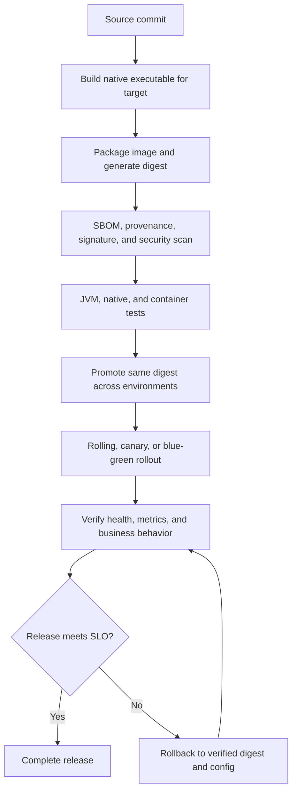

# Packaging, updating, and rolling back with verified artifacts

Operating Spring Boot Native Image requires a release process that is traceable from source code to the running container. A binary that builds successfully is not ready for production on its own: you must verify the target CPU architecture, native libraries, runtime configuration, security metadata, health checks, and shutdown behavior. When updating a version, the system must replace old instances in a controlled manner; when a new release fails, the operations team needs to restore the exact artifact that previously ran stably.

The guiding principle throughout this lesson is **build once, verify the artifact, release by digest, and deploy the exact same verified artifact**. Human-readable tags remain useful for operators, but the digest of an OCI image manifest or index uniquely identifies the exact published content.

## 1. Learning objectives

After this lesson, you will be able to:

- Standardize native executables and container images into release artifacts with versions, digests, and provenance.
- Verify architecture, libc, shared libraries, CA certificates, timezone data, and filesystem requirements before packaging.
- Generate SBOMs, build provenance, scan images, and verify signatures per organizational policy.
- Separate environment configuration and secrets from the native executable/container image.
- Deploy new versions using rolling updates, canary, or blue-green deployments.
- Configure startup, liveness, and readiness probes for Spring Boot.
- Have the application stop accepting new requests and drain in-flight requests when containers are replaced.
- Monitor rollouts, confirm the exact running image digest, and run post-deploy smoke tests.
- Roll back to a verified release, including compatible configuration.
- Recognize rollback limits when database schemas or external contracts have changed.
- Maintain release records and runbooks complete enough for investigation, recovery, and auditing.



## 2. What makes up a Native Image release artifact?

A production release typically consists of several linked artifacts:

| Component | What to manage | Why it is needed |
| --- | --- | --- |
| Native executable | Binary matching OS, architecture, libc, and CPU target | Runs the application on the runtime host |
| Container image | Executable, shared libraries, and required runtime files | Deployment unit distributed by the registry |
| Image digest | SHA-256 digest of the image manifest or multi-platform index | Unambiguously identifies published content |
| SBOM | List of packages, dependencies, versions, and licenses | Component inventory and vulnerability analysis |
| Build provenance | Source commit, builder, base image, build parameters | Traces how the artifact was produced |
| Signature/attestation | Cryptographic signatures and claims bound to the digest | Verifies publisher identity and policy compliance |
| Test evidence | JVM/native tests, container smoke tests, security scans | Proves the artifact passed verification |
| Runtime configuration | Endpoints, resource limits, feature flags, secret references | Adapts to environments without rebuilding |
| Release metadata | Version, commit SHA, digest, GraalVM version, architecture | Supports deployment, rollback, and auditing |

For multi-platform images, the OCI index digest represents the collection of platform-specific images. Docker/Kubernetes selects the child image matching each node, while the overall index remains identified by its digest. If a release supports only a single architecture, the digest points directly to that architecture's image manifest.

## 3. Producing reproducible and traceable artifacts

### 3.1. Pinning build inputs

Record at least:

- Git commit SHA and working tree status.
- Java/GraalVM distribution and version.
- Spring Boot, Maven/Gradle, and Native Build Tools versions.
- OS, architecture, libc, and C toolchain.
- Native Image build arguments, including GC, `-march`, monitoring, and static/dynamic linking options.
- Dependency lockfiles or dependency checksums.
- Base image by version and digest.

Never use the `latest` tag as the sole version identifier for a GraalVM builder or runtime base image in a release pipeline. Tags can be updated to point to different content; pinning by digest ensures the build record describes the exact base image used.

### 3.2. Building the native executable

Maven:

```bash
./mvnw -Pnative native:compile
```

Gradle:

```bash
./gradlew nativeCompile
```

When releasing for multiple architectures, build a separate binary for each target on the appropriate toolchain. Never package an AMD64 binary into an ARM64 image or share object-file caches across two architectures.

### 3.3. Inspecting the binary before packaging

On Linux:

```bash
file target/order-service
readelf -h target/order-service
ldd target/order-service
```

Verify:

- The ELF machine type matches the target.
- The dynamic loader and shared libraries are present in the runtime image.
- `ldd` reports no `not found` dependencies.
- The binary is compatible with the runtime base image's libc.
- The CPU instruction set does not exceed the target deployment fleet's CPUs.
- The file has execute permission and the runtime user has read/execute access.

If built fully static, `ldd` may report that the binary is not a dynamic executable. Use `readelf` and build metadata to verify linkage type. A mostly-static binary still requires a compatible libc.

### 3.4. Packaging the container

Example runtime Dockerfile for a pre-built binary:

```dockerfile
FROM debian:bookworm-slim

WORKDIR /app
COPY --chown=10001:10001 order-service /app/order-service

USER 10001:10001
EXPOSE 8080
ENTRYPOINT ["/app/order-service"]
```

This example assumes a glibc-compatible binary. The actual runtime image must contain all shared libraries, CA certificates, timezone data, or resources required by the application. For fully static executables, you can pick a more minimal base image after verifying all runtime behavior.

Best practices:

- Run the process as a non-root user.
- Keep the root filesystem read-only if supported by the application.
- Mount only necessary writable directories such as `/tmp`.
- Never place private keys, access tokens, or production truststore passwords in image layers.
- Use a minimal base image that still supplies required libc, CA certificates, and runtime files.
- Attach OCI labels such as version, source revision, and build timestamp per organizational standards.

### 3.5. Human-readable tags, digests for deployment

Push the image with a version tag:

```bash
docker buildx build \
  --platform linux/amd64,linux/arm64 \
  --tag registry.example.com/order-service:2.4.0 \
  --sbom=true \
  --provenance=mode=max \
  --push .
```

The command above assumes the build stage produces the native executable matching each platform's architecture. BuildKit requires verified native nodes, QEMU, or cross-compilation toolchains. `--platform` selects the target platform of the image; it does not magically turn a single native binary into a multi-architecture binary.

After pushing, fetch the artifact digest from the registry:

```bash
docker buildx imagetools inspect registry.example.com/order-service:2.4.0
```

Record the digest in the form:

```text
registry.example.com/order-service@sha256:REPLACE_WITH_VERIFIED_DIGEST
```

Do not put placeholder sample digests into production. Use the actual digest returned by the registry and save it in the release record. Never overwrite a released version tag; each new release needs a new tag.

## 4. Verifying artifacts before release

### 4.1. Running tests on the exact artifact

Pipelines should verify across layers:

1. JVM unit/integration tests to verify business logic.
2. Spring AOT processing and AOT tests on the JVM where applicable.
3. Native JUnit tests to verify test code and application code inside Native Image.
4. Native executable smoke tests.
5. Container smoke/integration tests on the final runtime image.
6. Per-architecture verification for multi-arch images.

If you only test the JAR while production runs the native executable, runtime divergence risks remain. If you test the executable outside a container while production uses a minimal container, you still must verify shared libraries, certificate stores, user permissions, filesystem mounts, and networking inside the final container.

### 4.2. Verifying SBOM and provenance

An SBOM describes components inside the image and can include packages/build inputs. Provenance describes how the image was built, including source, builder, base image, and build parameters.

BuildKit supports generating attestations:

```bash
docker buildx build \
  --tag registry.example.com/order-service:2.4.0 \
  --sbom=true \
  --provenance=mode=max \
  --push .
```

Before releasing, verify:

- The SBOM was generated for the exact digest.
- Provenance points to the expected source repository and commit.
- Base image and builder image comply with release policy.
- Image vulnerability scans show no findings exceeding policy thresholds.
- Attestations are retained by the registry and readable by deployment tooling.

Note: `provenance=mode=max` may record build arguments. Never pass passwords, tokens, or secrets via build arguments; use build secret mechanisms if the build requires credentials.

### 4.3. Signing and verifying images

If your organization uses Cosign or another signing system, sign the digest rather than only signing a tag:

```bash
cosign sign registry.example.com/order-service@sha256:REPLACE_WITH_VERIFIED_DIGEST
```

Verify before deploying:

```bash
cosign verify registry.example.com/order-service@sha256:REPLACE_WITH_VERIFIED_DIGEST
```

This syntax is illustrative; identity verification, keyless signing, key management, and trust policies depend on your organization's setup. A valid signature proves the digest was signed by an accepted identity; it does not replace checking test reports, SBOMs, vulnerability policies, or runtime configuration.

### 4.4. Release record

Create a record for each release, for example:

```yaml
release:
  application: order-service
  version: 2.4.0
  sourceCommit: 8a1b2c3d4e5f
  image: registry.example.com/order-service
  digest: sha256:REPLACE_WITH_VERIFIED_DIGEST
  platforms:
    - linux/amd64
    - linux/arm64
  javaVersion: "25"
  graalvmVersion: "25.1"
  springBootVersion: "4.2.0"
  runtimeBase: debian:bookworm-slim
  tests:
    jvm: passed
    native: passed
    containerSmoke: passed
  securityScan: passed
```

Version numbers in this example only illustrate the schema. Record your pipeline's actual versions and digests—never copy sample values into production metadata.

## 5. Managing configuration and secrets separately from the image

A native executable can run across environments when endpoints and configuration are supplied at runtime:

- External service base URLs.
- Database URLs and pool settings.
- Feature flags.
- Log levels and tracing exporters.
- CPU/memory requests and limits.
- Truststore/keystore paths or SSL Bundles.
- Secret references and credential rotation.

Do not bake production configuration into the image at build time. The same image digest should be promoted from test to staging to production; each environment supplies its own configuration via ConfigMaps, Secrets, or a secret manager.

### 5.1. ConfigMaps and Secrets

Example Deployment injecting non-sensitive config and secrets:

```yaml
env:
  - name: SPRING_PROFILES_ACTIVE
    value: production
  - name: PARTNER_API_URL
    valueFrom:
      configMapKeyRef:
        name: order-service-config-v7
        key: partner-api-url
  - name: PARTNER_API_TOKEN
    valueFrom:
      secretKeyRef:
        name: order-service-secrets-v12
        key: partner-api-token
```

Kubernetes Secrets are managed separately from images. Protect read access with RBAC, enable encryption at rest per cluster policy, and consider an external secret manager. Never put secret values into release records, Git manifests, or logs.

### 5.2. Attaching config versions to the Pod template

Kubernetes Deployment revisions primarily track changes to the Pod template. Changing the contents of a ConfigMap/Secret does not always trigger new Pods automatically, especially when read via environment variables. One pattern is attaching a configuration version/checksum annotation to the Pod template:

```yaml
spec:
  template:
    metadata:
      annotations:
        release.example.com/config-version: "config-v7-secret-v12"
```

When configuration changes, update the annotation or use checksums generated by Helm/Kustomize/CI to trigger an intentional rollout. Keep a release record mapping each image digest to its corresponding config version.

### 5.3. Native runtime configuration files

Native Image may require external runtime files:

- CA certificates.
- Mounted truststores/keystores.
- Timezone database.
- License or policy files.
- Temporary write directories.

Verify file presence and read permissions inside the container. For dynamic executables, ensure libc and shared libraries are compatible. For static executables, still verify CAs, timezones, filesystem mounts, and runtime-read resources.

## 6. Preparing Spring Boot for rollout

### 6.1. Health endpoints

Spring Boot Actuator can expose liveness and readiness states:

```properties
management.endpoint.health.probes.enabled=true
management.endpoints.web.exposure.include=health
```

Endpoints:

- `/actuator/health/liveness`: is the process still functioning at the application level?
- `/actuator/health/readiness`: is the instance ready to receive traffic?

Liveness should reflect unrecoverable errors such as deadlocks or an application process making no progress. Do not arbitrarily add databases, brokers, or external services to liveness; flaky dependencies can cause Kubernetes to restart Pods en masse and amplify an incident.

Readiness can verify conditions needed for the instance to serve requests: startup tasks completed, required configuration loaded, and required dependencies usable. Add dependency checks only when the application genuinely cannot serve requests while that dependency is unavailable.

### 6.2. Startup probe

Native Image usually starts quickly, yet startup can still take longer due to Spring context initialization, database connections, migrations, cache warm-up, or file loading. A startup probe lets Kubernetes wait for the application to boot before running liveness/readiness checks.

Example:

```yaml
startupProbe:
  httpGet:
    path: /actuator/health/liveness
    port: http
  periodSeconds: 5
  failureThreshold: 24

livenessProbe:
  httpGet:
    path: /actuator/health/liveness
    port: http
  periodSeconds: 10
  timeoutSeconds: 2
  failureThreshold: 3

readinessProbe:
  httpGet:
    path: /actuator/health/readiness
    port: http
  periodSeconds: 5
  timeoutSeconds: 2
  failureThreshold: 3
```

In this example configuration, the startup probe allows a maximum startup window determined by the configured check count and period. Choose values based on startup times measured in a production-like environment. Do not set `failureThreshold` too low if startup needs time to load configuration or connect to dependencies.

### 6.3. Graceful shutdown

Spring Boot supports graceful shutdown for embedded web servers. When the application context begins closing, the server stops accepting new requests and allows in-flight requests to finish within the grace period.

Explicit configuration:

```properties
server.shutdown=graceful
spring.lifecycle.timeout-per-shutdown-phase=25s
```

Kubernetes needs `terminationGracePeriodSeconds` to be longer than the application's shutdown duration and sufficient for other drain steps:

```yaml
spec:
  terminationGracePeriodSeconds: 40
```

When a Pod is deleted during a rollout, Kubernetes updates endpoint routing and sends `SIGTERM` to the container. Spring Boot closes the context, stops accepting new requests, and waits for active requests up to the configured timeout. When the grace period expires, the container runtime may send `SIGKILL`.

Do not assume a `preStop` sleep is always needed. If an ingress, load balancer, or service mesh needs extra time to update routing, measure propagation delay and add a drain hook only when needed. Hook execution time also counts against the termination grace period.

## 7. Deploying a new version

### 7.1. Rolling update

Rolling updates replace Pods in batches. On a Deployment:

- `maxUnavailable` bounds how many Pods can be unavailable during rollout.
- `maxSurge` bounds how many new Pods can be created above the desired replica count.
- The readiness probe prevents new Pods from receiving traffic before they are ready.

Example Deployment:

```yaml
apiVersion: apps/v1
kind: Deployment
metadata:
  name: order-service
spec:
  replicas: 3
  revisionHistoryLimit: 10
  strategy:
    type: RollingUpdate
    rollingUpdate:
      maxUnavailable: 0
      maxSurge: 1
  selector:
    matchLabels:
      app: order-service
  template:
    metadata:
      labels:
        app: order-service
      annotations:
        release.example.com/config-version: "config-v7-secret-v12"
    spec:
      terminationGracePeriodSeconds: 40
      containers:
        - name: app
          image: registry.example.com/order-service@sha256:REPLACE_WITH_VERIFIED_DIGEST
          imagePullPolicy: IfNotPresent
          ports:
            - name: http
              containerPort: 8080
          startupProbe:
            httpGet:
              path: /actuator/health/liveness
              port: http
            periodSeconds: 5
            failureThreshold: 24
          livenessProbe:
            httpGet:
              path: /actuator/health/liveness
              port: http
            periodSeconds: 10
            timeoutSeconds: 2
            failureThreshold: 3
          readinessProbe:
            httpGet:
              path: /actuator/health/readiness
              port: http
            periodSeconds: 5
            timeoutSeconds: 2
            failureThreshold: 3
```

Replace the placeholder digest with the verified release digest. With digest references, content is pinned; `imagePullPolicy: IfNotPresent` lets nodes reuse cached layers when that exact image digest is already present. Actual pull policies should fit your registry authentication and node lifecycle.

`maxUnavailable: 0` and `maxSurge: 1` require the cluster to have enough capacity to schedule an extra Pod. Without sufficient CPU/RAM or quota, the rollout can stall in Pending even with valid update settings. For single-replica deployments, check surge capacity and whether the application can run concurrently during transition.

### 7.2. Applying and monitoring a rollout

Apply the manifest:

```bash
kubectl apply -f deployment.yaml
kubectl rollout status deployment/order-service --timeout=5m
```

Inspect ReplicaSets and Pods:

```bash
kubectl get deployment,replicaset,pods -l app=order-service
kubectl describe deployment order-service
kubectl get events --sort-by=.lastTimestamp
```

Verify the Pod image ID/digest:

```bash
kubectl get pods -l app=order-service \
  -o jsonpath='{range .items[*]}{.metadata.name}{" "}{.status.containerStatuses[0].imageID}{"\n"}{end}'
```

Do not check only `spec.containers[].image`: that shows the declared reference. `status.containerStatuses[].imageID` is the image identifier reported by the container runtime. With multi-platform images, `imageID` may represent the child image/config digest for the selected platform rather than matching the OCI index digest in the release record. Keep both the index digest and platform manifest digests in release metadata; match `imageID` against the descriptor for the exact architecture using registry/runtime tools.

### 7.3. Canary or blue-green

Rolling updates suit many services, while higher-risk releases may benefit from canary or blue-green strategies:

| Strategy | How it works | When appropriate |
| --- | --- | --- |
| Rolling update | Replaces old Pods with new Pods in batches | Frequent releases with reliable readiness and adequate capacity |
| Canary | Routes a small percentage of traffic to the new release, then ramps up | Need to observe errors/latency on real traffic with small blast radius |
| Blue-green | Runs the new environment in parallel, switching traffic after verification | Need rapid cutover while keeping the old environment intact for fallback |

Canary and blue-green generally require support from an ingress controller, service mesh, traffic manager, or deployment controller. Simply creating two Deployments does not automatically yield safe traffic splitting.

## 8. Post-deploy verification

After rollout completes, verify in order:

1. All new Pods are Ready.
2. Pod image references use the approved OCI index digest; runtime-reported `imageID` maps to the child manifest for the right architecture.
3. Startup, liveness, and readiness probes are stable.
4. Run smoke tests on critical endpoints.
5. Verify database, broker, TLS, and external services.
6. Check startup logs, warnings, and exceptions.
7. Monitor request rate, error rate, p95/p99 latency, and saturation.
8. Monitor restart count, `OOMKilled`, CPU throttling, and memory usage.
9. Verify background jobs/consumers neither duplicate nor drop messages.
10. Compare against the pre-rollout baseline over a defined observation window.

A rollout can report complete while still harboring business bugs that appear only on specific requests or real load. Keep the release under observation until metrics and smoke tests satisfy acceptance criteria.

### 8.1. Rollout halt criteria

Predefine stop conditions, for example:

- Readiness not achieved within the allowed startup window.
- HTTP 5xx rate exceeds threshold.
- p95/p99 breaches error budget or SLO.
- `CrashLoopBackOff` or rising restart count.
- `OOMKilled` or CPU throttling exceeds threshold.
- Sudden spike in database, broker, TLS, or dependency errors.
- Unusual rise in business errors such as failed orders or payment failures.

Thresholds must reflect the service's SLOs and baseline. Do not apply a single generic threshold across all applications.

## 9. Rolling back to a verified release

Rollback means returning traffic to an artifact and configuration known to work stably. You must preserve the previous release's image digest, config version, release metadata, and database compatibility.

### 9.1. Viewing rollout history

```bash
kubectl rollout history deployment/order-service
```

Inspect details of a specific revision:

```bash
kubectl rollout history deployment/order-service --revision=4
```

Deployment revision history is stored via ReplicaSets. `revisionHistoryLimit` determines how many old ReplicaSets are retained; purging history limits the ability to roll back with `kubectl rollout undo`.

### 9.2. Rolling back to a previous revision

```bash
kubectl rollout undo deployment/order-service
kubectl rollout status deployment/order-service --timeout=5m
```

Roll back to a specific revision:

```bash
kubectl rollout undo deployment/order-service --to-revision=4
kubectl rollout status deployment/order-service --timeout=5m
```

After rollback, re-verify:

- Pods are running the exact previous image digest.
- The config version is compatible with the older release.
- Readiness and smoke tests pass.
- Error rates/latency return to baseline.
- The database schema remains compatible with the older code.

### 9.3. Rolling back via GitOps or Helm

In a GitOps setup, Git state is the desired source of truth. A `kubectl rollout undo` command may be reconciled away by the controller, reverting the Deployment back to what Git declares. The durable rollback approach is reverting the release commit or updating the manifest to the verified digest/config version and letting the controller sync.

With Helm, you can inspect history and roll back a release:

```bash
helm history order-service --namespace production
helm rollback order-service 12 --namespace production
helm status order-service --namespace production
```

Revision `12` is an example; choose a verified revision from Helm history. After running rollback, still wait for the rollout, verify Pod image digests, and run smoke tests.

### 9.4. Manual rollback to a specific digest

During urgent recovery:

```bash
kubectl set image deployment/order-service \
  app=registry.example.com/order-service@sha256:REPLACE_WITH_PREVIOUS_VERIFIED_DIGEST

kubectl rollout status deployment/order-service --timeout=5m
```

This is an imperative action. If the deployment is managed by GitOps/Helm, update the declarative source immediately after recovery so the controller does not redeploy the broken release.

Never rely on mutable tags like `stable` or `previous` if the registry allows tag overwrites. An old tag may already point to different content; only a digest references a specific artifact.

## 10. What an application rollback does not undo automatically

A Deployment rollback primarily restores the Pod template. It does not automatically restore external resources outside the Pod:

| Component | Automatically restored by Deployment rollback? | Required action |
| --- | --- | --- |
| Image reference in Pod template | Yes, if the old revision is retained | Verify digest and rollout |
| ConfigMap data | Not necessarily | Version/checksum configs and restore compatible config |
| Secret data | No | Version secrets and follow safe rotate/restore procedures |
| Database schema/data | No | Use compatible migrations or planned forward-fix/restore |
| Message schema/event contracts | No | Maintain producer/consumer compatibility across transitions |
| External API behavior | No | Coordinate version contracts and dependency rollouts |
| Persistent volume data | No | Maintain backups/restores and test recovery plans |

### 10.1. Database migrations and expand-contract

Code rollback is safe only when the database remains compatible with the older code. If a new release adds a non-null column, alters data types, or drops a column still used by the previous release, rolling back the image can cause the old application to fail immediately.

Use the expand-contract strategy:

1. **Expand:** add new columns/tables/indexes in a way that does not break old code.
2. **Compatible deploy:** the new release can read/write compatibly with both old and new schemas.
3. **Backfill:** migrate data in batches with verification and resumability.
4. **Switch:** switch code to the new structure once data is ready.
5. **Contract:** drop old columns or legacy contracts only after the rollback window has closed and all old consumers are gone.

Destructive migrations should not run automatically during deployment without a recovery plan. If an incompatible schema change has already occurred, a forward-fix or backup restore may be required instead of a simple binary rollback.

### 10.2. Message and event compatibility

If a service publishes new events or alters message schemas, older consumers might fail to parse them. Keep new fields optional, avoid changing the meaning of existing fields, and preserve compatibility while producers/consumers upgrade. Test reading both old and new events before release.

## 11. Troubleshooting during rollouts

| Symptom | Possible cause | Resolution |
| --- | --- | --- |
| Pod `ImagePullBackOff` | Wrong digest, registry auth error, or missing platform image | Check events, registry permissions, and manifest platforms |
| `exec format error` | Binary does not match the node architecture | Check ELF machine type and OCI platform image |
| `CrashLoopBackOff` | Startup exception, missing config/secret, native library, or permissions | Check `kubectl logs --previous`, `describe` Pod, and runtime dependencies |
| Startup probe fails | Startup slower than threshold or app fails to initialize | Measure startup time, check logs, and tune startup budget with data |
| Readiness fails | App not ready or required dependency unavailable | Check readiness contributors and dependency health |
| Mass liveness failures | Probe overly sensitive or app overloaded | Check deadlocks/CPU pressure; keep flaky dependencies out of liveness |
| New Pod Ready but requests fail | Smoke tests missed business path or config differs | Check config version, endpoints, credentials, and business metrics |
| Rollout hangs | Insufficient capacity, Pod pending, or readiness unmet | Check events, resource requests/limits, and rollout status |
| Rollback runs but GitOps re-applies bad image | Desired state in Git still points to new release | Revert commit or update manifest to old digest |
| Code rolled back but database errors | Schema changed incompatibly | Use forward-fix or a verified recovery plan |
| `SIGTERM` drops requests | Shutdown grace period too short or server stops immediately | Configure graceful shutdown and align termination grace period |
| Old tag runs new content | Registry tag was overwritten | Deploy by digest and maintain release records |

## 12. Release runbook

A runbook usable for every release:

### Before deploy

1. Confirm source commit and release version.
2. Build native executables for each supported architecture.
3. Verify binary format, libc, and native dependencies.
4. Build the container image and push a new version tag.
5. Record the image/index digest.
6. Verify SBOM, provenance, signatures, and vulnerability policies.
7. Run JVM tests, native tests, and container smoke tests.
8. Save the release record, test evidence, and config version.
9. Confirm rollback digest/config version are still available.
10. Verify database migrations remain compatible with the previous release.

### During deploy

1. Update the manifest/Helm release with the verified digest.
2. Confirm config version and secret references.
3. Monitor startup/readiness/liveness.
4. Wait for rollout completion.
5. Verify image reference and `imageID` across all Pods, matching platform manifests to node architectures.
6. Run smoke tests and inspect metrics/logs.
7. Ramp traffic gradually if using canary.

### When rollback is needed

1. Halt the rollout or reduce traffic to the new release.
2. Identify the most recent stable release digest and config version.
3. Restore the manifest/GitOps/Helm state to that release.
4. Monitor the rollback rollout.
5. Verify `imageID`, config, readiness, and smoke tests.
6. Verify database/message compatibility.
7. Monitor error rates, latency, and business metrics.
8. Save the incident timeline and root cause to address in the next release.

## 13. Comprehensive hands-on lab

**Context:** `order-service` version `2.4.0` was released as a multi-platform native image. After rollout, p99 latency climbed and the HTTP 5xx rate breached thresholds. The previous version `2.3.2` was verified and the database schema remains compatible.

Steps:

1. Build and test the native executable on each target architecture.
2. Package the image, generate SBOM/provenance, and record the image index digest.
3. Verify signatures, scan reports, and test evidence.
4. Create a release record mapping version, digest, source commit, and config version.
5. Deploy `2.4.0` by digest with rolling updates and health probes.
6. Monitor rollout status, Pod `imageID`, p99, 5xx, and restart count.
7. Once thresholds are breached, halt traffic ramp and select the verified `2.3.2` release digest.
8. Revert the manifest/Helm/GitOps state to the digest and config version of `2.3.2`.
9. Wait for the rollback rollout to complete, verifying Pod `imageID` and readiness.
10. Run smoke tests and confirm error rates and p99 return to baseline.
11. Confirm database schemas and message contracts remain compatible.
12. Save the incident record, both release digests, and rollback outcome.

**Self-check question:** Why does `kubectl rollout undo` not guarantee the system returns to the exact pre-release state? Because Deployment revisions primarily store the Pod template. ConfigMaps/Secrets, database schemas, external APIs, and persistent data have their own lifecycles. A safe rollback requires restoring the exact image digest alongside compatible configuration and ensuring data remains usable by the older code.

## 14. Takeaways

- A Native Image release must include an executable/container image, digest, SBOM, provenance, test evidence, and runtime configuration record.
- Check architecture, libc, shared libraries, CA certificates, timezones, and filesystem requirements before releasing.
- Build once, verify the artifact, then promote the same digest across staging and production.
- Tags help humans recognize versions; digests identify exact image content and should be used in production Deployments.
- Never put secrets into images or build arguments; version configuration and supply secrets via runtime secret mechanisms.
- Use startup probes for initialization, readiness to control traffic, and liveness to detect unrecoverable application failures.
- Graceful shutdown requires aligning Spring Boot timeouts with Kubernetes `terminationGracePeriodSeconds`.
- Rolling updates require readiness probes and sufficient capacity; canary/blue-green require traffic management support.
- After deployment, verify `imageID`/digest, health, smoke tests, latency, errors, restart counts, and business metrics.
- Roll back to verified digests/config versions; `kubectl rollout undo` only restores the Pod template.
- Database schemas, message contracts, ConfigMaps, Secrets, and persistent data require separate compatibility/recovery plans.
- When an incompatible schema change has already taken place, a controlled forward-fix or restore may be required instead of a binary rollback.

When artifacts are identified by digest, configuration is versioned, and rollouts/rollbacks are verified, operations teams can run Spring Boot Native Image in production with clear traceability and recovery.

## Official references

- [GraalVM Native Image — Containerize a Native Executable](https://www.graalvm.org/latest/reference-manual/native-image/guides/containerise-native-executable-and-run-in-docker-container/): packaging native executables, runtime images, and dependency checks.
- [GraalVM Native Image — Static and Mostly-Static Executables](https://www.graalvm.org/jdk25/reference-manual/native-image/guides/build-static-executables/): differences between static/mostly-static executables and choosing base images.
- [Docker — Build attestations](https://docs.docker.com/build/metadata/attestations/): SBOM, provenance, and metadata attached to images.
- [Docker — SBOM attestations](https://docs.docker.com/build/metadata/attestations/sbom/): generating and verifying SBOMs with BuildKit.
- [Docker — Trusted container delivery pipeline](https://docs.docker.com/learn/content/build-a-trusted-delivery-pipeline/): digests, signatures, attestations, and trusted release workflows.
- [Kubernetes — Update a Deployment Without Downtime](https://kubernetes.io/docs/tasks/run-application/update-deployment-rolling/): rolling updates, rollout history, and rollbacks.
- [Kubernetes — Deployments](https://kubernetes.io/docs/concepts/workloads/controllers/deployment/): Deployment revisions, ReplicaSets, and rollout undo.
- [Kubernetes — Liveness, Readiness, and Startup Probes](https://kubernetes.io/docs/concepts/configuration/liveness-readiness-startup-probes/): semantics and configuration of health probes.
- [Spring Boot — Graceful Shutdown](https://docs.spring.io/spring-boot/reference/web/graceful-shutdown.html): stopping new requests and draining active requests.
- [Spring Boot — Actuator Endpoints](https://docs.spring.io/spring-boot/reference/actuator/endpoints.html): application availability and health endpoints.
