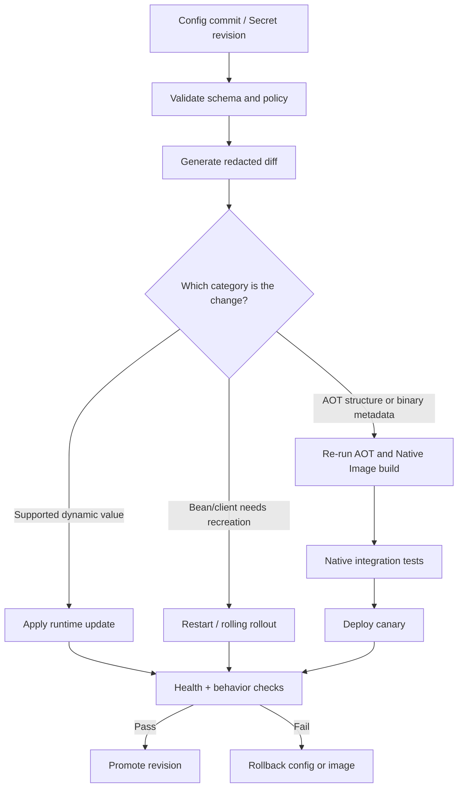

# Tracking configuration changes beyond what the current build supports

## 1. Why monitor configuration boundaries?

A standard Spring Boot application can read configuration from files, environment variables, the command line, or Config Server. When configuration changes, some components can adopt new values; others need a restart to recreate beans. For an application processed by Spring AOT and compiled into a GraalVM Native Image, there is an additional build-time boundary: the application structure was analyzed and fixed before the executable was built.

Therefore, not every configuration change can be applied to the existing binary. For example, changing an alert threshold or a timeout value that code reads dynamically may be supported. However, enabling a new module via a property when that module is registered through an AOT condition, adding classes to the classpath, changing a profile that alters the bean graph, or adding a subtype requiring reflection metadata can exceed what the build actually contains.

This lesson belongs to the **Operations** chapter of the **SPRING_BOOT_NATIVE_IMAGE** module. The goal is to classify configuration changes, track config drift, detect changes that exceed AOT scope, choose between reload/restart/rebuild actions, and design a rollback-capable deployment workflow.

## 2. What does Spring AOT fix at build time?

Spring AOT analyzes the `ApplicationContext` during the build to generate initialization code, supporting bytecode, and `RuntimeHints`. This process relies on the classpath and `Environment` at AOT time.

Key build-time decisions include:

- Which bean definitions exist in the `ApplicationContext`.
- Which configurations are selected via `@Profile`.
- Which conditions match via `@Conditional`, `@ConditionalOnProperty`, `@ConditionalOnClass`, and related conditions.
- Which proxy, reflection, resource, serialization, and JDK proxy metadata must be generated.
- Which classes and components are reachable in the Native Image.

Spring Framework states explicitly that the classpath must remain fixed at build time; bean definitions cannot change at runtime; profiles and `Environment` properties affecting bean presence are evaluated only during AOT processing. Profiles that merely change property values without affecting bean creation conditions can still be used in AOT applications. See [Spring AOT conditions](https://docs.spring.io/spring-boot/how-to/aot.html) and [Spring Framework AOT restrictions](https://docs.spring.io/spring-framework/reference/core/aot.html).

This means a property may still exist in the runtime `Environment`, yet changing that property will not automatically re-create a bean definition that was excluded during AOT processing.

### 2.1. Example of bean creation conditions

Suppose an application has two payment adapters:

```java
@Configuration(proxyBeanMethods = false)
class PaymentConfiguration {

    @Bean
    @ConditionalOnProperty(
        name = "payment.provider",
        havingValue = "stripe"
    )
    PaymentGateway stripeGateway() {
        return new StripePaymentGateway();
    }

    @Bean
    @ConditionalOnProperty(
        name = "payment.provider",
        havingValue = "bank"
    )
    PaymentGateway bankGateway() {
        return new BankTransferGateway();
    }
}
```

If AOT runs with `payment.provider=stripe`, the Stripe bean is baked into the generated structure. Changing the environment variable to `payment.provider=bank` at container startup does not guarantee the Bank bean will be created; the condition was already evaluated at build time.

If both adapters must exist in the same binary, design the bean graph so both are registered at build time, then select the adapter via controlled runtime logic. If enabling an adapter also requires classes, dependencies, reflection metadata, or native libraries absent from the binary, you must rebuild.

## 3. Classifying changes: runtime, restart, or rebuild

Before accepting a configuration change, classify it by its impact on the application:

| Change category | Examples | Appropriate action |
| --- | --- | --- |
| Dynamically read values | Business thresholds, display limits, retry ratios read by code from a dynamic config | Can be updated at runtime if the application has a mechanism to load, validate, and apply safely |
| Startup-bound values | Database URLs, TLS truststores, connection pools, executor sizes, SDK endpoints built once | Usually requires restart or rollout so beans reinitialize |
| Spring/AOT structure | Active profile changing beans, `@ConditionalOnProperty`, auto-configuration branches, new beans | Re-run AOT and rebuild |
| Binary components | Adding dependencies, classes, native libraries, resources, serializers, subtypes, proxies, or new reflection targets | Update metadata/AOT and rebuild Native Image |
| Platform changes | OS/architecture/libc, GraalVM runtime, Spring Boot/Spring Cloud versions | Build and test a new compatible artifact |

This table provides an initial classification guide. Actual behavior depends on how the application consumes each property. For instance, pool size may support live updates if the pool implementation exposes an update API; if the property is only bound when constructing the pool, a restart is required.

Never mark every property in a YAML file as runtime-reloadable. Trace from each property back to the beans or code consuming it to determine when its value is read.

## 4. Three questions before applying a change

For every config change, operators should answer:

1. **Is the value re-read?** If the property is only bound via constructor or used to build a client at startup, changing a file will not update already running instances.
2. **Does the change alter the bean structure?** If the property drives `@Conditional`, `@Profile`, or auto-configuration decisions, it belongs to build-time structure.
3. **Does the binary contain all required components?** If the change requires classes, dependencies, reflection hints, proxies, resources, or native libraries missing from the image, a rebuild is mandatory.

If any of these three questions cannot be answered, do not roll out the config directly to production. Send the change to staging, verify startup/AOT behavior, and confirm the required action before broad rollout.

## 5. Tracking config revisions and build identity

To detect config drift, you must know which exact binary a process is running and which configuration revision it is using.

Every release should record at least:

| Metadata | Purpose |
| --- | --- |
| Application version and Git commit | Identifies the source code |
| Container image digest | Identifies the exact deployed binary |
| Spring Boot and Spring Cloud versions | Verifies framework compatibility |
| GraalVM vendor, edition, and version | Identifies the toolchain that built the native executable |
| AOT profiles | Shows which profiles were active during AOT processing |
| Build flags and target architecture | Documents how the binary was built |
| Runtime config revision | Identifies the active configuration revision |
| Secret version/reference | Tracks secret versions without recording secret values |

Never record passwords, tokens, private keys, or secret contents in metadata. For secret managers, record version IDs or rotation references. When computing a config fingerprint, exclude secrets from the canonical payload; hashing a low-entropy secret can still aid offline guessing.

You can expose build identity via Actuator Info or structured startup logs, including only non-sensitive fields and restricting access if metadata reveals internal topology.

## 6. Tracking changes from Config Server or Git

Spring Cloud Config Client can retrieve properties from Config Server via Spring Boot Config Data:

```properties
spring.application.name=orders-api
spring.config.import=configserver:https://config.example.internal
spring.cloud.config.label=release-2026-11
```

A label can be a branch, tag, or commit ID depending on the backend. For production releases, prefer immutable revisions such as commit IDs or controlled tags rather than pointing at a mutable branch that might change while instances start up.

Config Client loads configuration during startup. Spring Cloud Config documentation also notes that in AOT/native mode, the configuration data source must be available during the AOT build; properties affecting bean creation must have consistent values between build time and runtime. Therefore, if using Config Server to supply properties affecting `@Conditional` or profiles, strictly control both the revision and the AOT environment. See [Spring Cloud Config Client](https://docs.spring.io/spring-cloud-config/reference/client.html).

### 6.1. Difference between startup config fetch and live refresh

These two actions are distinct:

- **Config fetch at startup:** the process loads property sources during startup and uses them to build the `Environment`.
- **Live refresh:** the application receives changes, updates the `Environment`, rebinds beans, or recreates beans.

Native image support in Config Client does not imply every Spring Cloud refresh mechanism is supported. Current Spring Cloud Commons documentation states that Context Refresh/`@RefreshScope` is not supported with Spring AOT transformations and Native Image; native client configurations should set `spring.cloud.refresh.enabled=false`. Accordingly, do not build native runbooks around `/actuator/refresh` or `@RefreshScope`. See [Spring Cloud Context refresh limitations](https://docs.spring.io/spring-cloud-commons/reference/spring-cloud-commons/application-context-services.html).

Native client configuration can make this boundary explicit:

```properties
spring.cloud.refresh.enabled=false
```

Spring Cloud Config Client also does not poll Config Server for changes by default. On the JVM you might set up events/bus notifications, whereas for native images use change notifications to trigger a controlled classification and rollout/restart pipeline rather than assuming refresh scope swaps beans in place.

## 7. Do not assume config file changes update beans automatically

A mounted ConfigMap, Secret volume, or configuration file may update on the filesystem. That alone does not guarantee Spring Boot re-reads the file, updates the `Environment`, or rebinds already-created beans.

Normally, Spring Config Data is loaded when the application context initializes. If the platform updates files afterward, the process may continue using old values. Applying a new revision may require:

- Restarting Pods/containers so Spring reads the new configuration.
- Rolling out the Deployment to replace all instances under a safe strategy.
- Building a dedicated dynamic configuration mechanism for an approved subset of values if restart-free updates are required.

With Native Image, choosing restart/rollout is usually far easier to control than attempting to refresh the entire `ApplicationContext`. When dynamic updates are truly needed, implement them only for values designed to be safely re-read and re-applied.

## 8. Designing dynamic configuration for values that truly need live updates

If a business value must change while the process is running, you do not need to refresh the entire Spring context. You can build a dedicated runtime configuration holder, validate new inputs, and atomically swap an immutable snapshot.

Example:

```java
import java.math.BigDecimal;

public record PricingPolicy(
    BigDecimal discountLimit,
    int maximumItems
) {
    public PricingPolicy {
        if (discountLimit.signum() < 0
                || discountLimit.compareTo(BigDecimal.ONE) > 0) {
            throw new IllegalArgumentException(
                "discountLimit must be between 0 and 1"
            );
        }
        if (maximumItems < 1) {
            throw new IllegalArgumentException(
                "maximumItems must be positive"
            );
        }
    }
}
```

A holder can swap snapshots atomically:

```java
import java.util.concurrent.atomic.AtomicReference;

import org.springframework.stereotype.Component;

@Component
class PricingPolicyHolder {

    private final AtomicReference<PricingPolicy> current =
        new AtomicReference<>(new PricingPolicy(
            new BigDecimal("0.10"), 50
        ));

    PricingPolicy current() {
        return current.get();
    }

    void update(PricingPolicy candidate) {
        // Constructor already validated before replacing the snapshot.
        current.set(candidate);
    }
}
```

Updates can arrive via an internal API, message bus, or an application-managed config watcher. Before calling `update`, validate schema, version, value bounds, and revision; swap the snapshot only when the entire configuration is valid.

This design only updates data actively read from the holder. It does not add new beans, classes, serializers, routes, or native metadata. For values baked into one-time-constructed clients/pools, you need an explicit update API or a restart of the corresponding component.

## 9. Distinguishing rebind, refresh, and restart

These terms are often conflated:

| Mechanism | Meaning | Known limitations |
| --- | --- | --- |
| Rebind | Assigns new properties into an existing `@ConfigurationProperties` bean | Does not create new beans or alter the bean graph |
| Refresh scope | Refreshes a bean's target behind a proxy | Context refresh/`@RefreshScope` is unsupported in Spring AOT and Native Image |
| Process restart | Builds a new `ApplicationContext` in a new process | Reloads config and initializes beans from the current binary |
| Native Image rebuild | Re-runs Spring AOT and GraalVM compilation | Required when changes exceed the binary's structure or metadata |

Spring Cloud on the JVM can emit `EnvironmentChangeEvent` to rebind certain `@ConfigurationProperties` and update logger levels. However, do not extrapolate that JVM behavior into a refresh guarantee for native executables. In native mode, check feature and version support explicitly; by default, disable Spring Cloud refresh per official guidance.

## 10. Identifying which changes force a rebuild

The following changes typically exceed the current binary's scope:

- Adding or removing dependencies, classes, or modules.
- Enabling a bean/configuration branch that AOT excluded from the bean graph.
- Switching to a profile that alters processed bean definitions.
- Adding a new JSON subtype, serializer/deserializer, or type discriminator that must be recognized.
- Adding reflection, JDK proxies, serialization, or resource access lacking `RuntimeHints`.
- Changing native libraries, JNI bindings, or protocol implementations requiring new binaries/linkage.
- Upgrading Spring Boot, Spring Framework, Spring Cloud, GraalVM, or target architecture.
- Modifying code that handles dynamic configuration or configuration schemas.

For example, if the binary only includes the Stripe payment adapter, changing `payment.provider=bank` in Config Server cannot inject the Bank adapter class into the binary. You must add the implementation, verify hints/AOT, and rebuild.

## 11. Selecting the right profile during AOT

Spring Boot evaluates `@Conditional` during AOT processing. Profiles governing bean creation conditions must be selected at build time. Profiles that only change property values without affecting conditions can vary under normal configuration rules.

Maven example configuring profiles for the `process-aot` execution:

```xml
<execution>
    <id>process-aot</id>
    <configuration>
        <profiles>production,metrics</profiles>
    </configuration>
</execution>
```

Gradle example:

```groovy
tasks.withType(
    org.springframework.boot.gradle.tasks.aot.ProcessAot
).configureEach {
    args('--spring.profiles.active=production,metrics')
}
```

This configures the profiles used when AOT processes the bean graph. If you need to add a conditional profile that alters beans, update the AOT configuration, re-run AOT processing, build the native image, and test the new artifact.

Never attempt to activate a different profile at runtime expecting beans excluded during AOT to appear. Spring Boot documents profile selection for Maven and Gradle in [Ahead-of-Time Processing](https://docs.spring.io/spring-boot/how-to/aot.html).

## 12. Workflow for classifying and approving config changes

A configuration management pipeline should receive a new revision, generate a diff, and classify it before rollout:



The pipeline should record:

- Previous and new config revisions.
- List of changed keys after redacting secrets.
- Impact category and classification rationale.
- Currently running image digest and new image digest if a rebuild was needed.
- Validation, AOT/native test, canary, and rollback results.

Never auto-apply unclassified properties. If a key is not on the runtime-changeable allowlist, route it into the restart/rebuild review flow.

## 13. Detecting config drift in running environments

Config drift occurs when an instance is not running the revision expected by the deployment. Common causes include:

- Older Pods were not restarted after configuration changed.
- One instance fetched a new revision while another kept an older revision.
- An environment variable overrides a property from Config Server.
- A new secret version was mounted, but the process has not reloaded it.
- An instance is running a different image digest than the release manifest.
- A Config Server label points to a branch that moved.

Monitor using these signals:

1. Build ID and image digest of each instance.
2. Config revision/label loaded at startup.
3. The binary's AOT profile manifest.
4. Secret version references (never secret values).
5. Timestamp of last configuration load and fetch status.
6. Number of instances still running an older revision during rollout.

Aggregate these signals into low-cardinality metrics or log events. Avoid turning individual property values into metric labels; doing so can both leak sensitive information and explode cardinality.

## 14. Compatibility checks before restarting or rebuilding

Before applying a new config revision, perform these steps:

- Validate file structure, data types, bounds, and required keys.
- Verify the config revision matches the image version/AOT profiles.
- Identify any properties affecting `@Conditional`, `@Profile`, or classpath decisions.
- Verify external dependencies and secret versions are ready.
- Run configuration tests against the exact native artifact or release candidate.
- Run a canary before rolling out to all instances.
- Confirm health, business behavior, error rates, and latency after updating.

For AOT structure changes, JVM tests alone are typically insufficient. Run AOT processing and native integration tests to verify the new executable contains the required beans, metadata, and resources.

## 15. Rolling back when new configuration is incompatible

Config rollback and binary rollback are two distinct actions:

- If the error stems purely from a supported runtime value, revert to the previous config revision.
- If the error stems from beans/clients constructed from startup config, roll back config and restart/roll out to recreate beans.
- If the error involves AOT structure or native metadata, revert to the previously compatible image digest paired with that release's config revision.
- If secrets were rotated, ensure old credentials remain valid during the rollback window or have a safe re-issuance plan.

Every release should store a verified `(image digest, config revision)` pair. Never roll config back to a revision incompatible with the running binary simply because both revisions share the same profile name.

## 16. Testing and rehearsing configuration changes

An operational test suite should include:

| Scenario | Expected outcome |
| --- | --- |
| Changing a runtime value designed for dynamic reads | Instance applies the new snapshot after validation |
| Changing a startup-bound-only property | Requires restart; old process is not treated as updated |
| Changing `@ConditionalOnProperty` post-AOT | Bean graph does not auto-update; pipeline requires rebuild |
| Enabling a new profile with bean conditions | New AOT/native build includes the right beans |
| Adding a subtype needing reflection | Native test fails before adding hints; new build must pass |
| Config Server unavailable at startup | Fail-fast/retry behavior matches policy |
| Config revision mismatch across replicas | Triggers config drift alert or incomplete rollout |
| Config rollback involving bean changes | Restart/rollout and verify behavior |
| Image rollback | Runs verified `(image, config)` pair |
| Refresh endpoint called in native mode | Does not rely on `@RefreshScope`/context refresh; request disabled or rejected by policy |

You can run the AOT-processed application on the JVM during testing to catch bean graph discrepancies before building native. Afterward, run native integration tests on the exact artifact to be deployed.

## 17. Runbook for handling config changes beyond binary limits

Upon receiving a configuration change request:

1. Record the current instance's config revision, image digest, and AOT profiles.
2. Generate a redacted diff; identify changed keys.
3. Trace each key to the bean or code consuming it.
4. Classify: dynamic runtime, startup-bound/restart, or AOT/build-time.
5. If dynamic, verify update mechanics, validation, and atomicity.
6. If startup-bound, trigger a rolling restart with the new config revision.
7. If AOT/build-time, update profiles/conditions/dependencies/hints and rebuild the native image.
8. Run JVM AOT tests, native integration tests, and an appropriate canary.
9. Monitor revisions across all replicas and confirm zero drift.
10. On failure, roll back to the verified image/config pair and document the root cause.

The runbook should clearly identify who approves config revisions, who can release images, rollback SLAs, and how accompanying secret rotations are handled.

## 18. Hands-on lab: detecting changes beyond the AOT build

**Context:** A service has `payment.provider` to select an adapter, `pricing.discount-limit` to adjust discount policy, and `partner.timeout` to configure an HTTP client.

**Steps:**

1. Create two payment adapters registered with `@ConditionalOnProperty`.
2. Run AOT with `payment.provider=stripe` and build a native executable.
3. Change `payment.provider=bank` in runtime config and observe that the bean graph does not change automatically.
4. Include the Bank adapter in build-time configuration or design both beans to be present and selected via runtime logic.
5. For `pricing.discount-limit`, build a dynamic configuration holder with validation and versioning.
6. For `partner.timeout`, determine whether the HTTP client has an update API or must be recreated via restart.
7. Record build ID, AOT profiles, and config revision in startup metadata.
8. Generate a config diff and classify all three keys by actual behavior.
9. Simulate a new config revision on a canary; inspect health, behavior, and logs.
10. Simulate a change requiring new reflection metadata and run native tests to confirm the current build does not support it.
11. Re-run the AOT/native build for structural changes and test the new image.
12. Rehearse rolling back both config revision and image digest.

**Acceptance criteria:**

- Distinguishes runtime property values from AOT-decided bean definitions.
- Knows which profiles and conditions must be fixed at build time.
- Does not rely on `@RefreshScope` or context refresh in Native Image.
- Tracks build identity and config revision per instance.
- Automatically routes ambiguous-scope changes into review/restart/rebuild.
- Has tests covering runtime updates, restarts, rebuilds, and rollbacks.
- Never writes secret values into logs, metrics, or config diffs.

## 19. Summary

Spring AOT lets Native Image boot from a pre-analyzed application structure, in exchange for keeping the classpath and bean graph fixed to build-time decisions. Configuration values can still be supplied at runtime if the binary already contains the needed code and beans; changing a file or Config Server property does not automatically create new beans, classes, proxies, or metadata.

Track build identity alongside config revisions, classify every change as dynamic runtime, startup-bound, or AOT/build-time, and then choose live update, restart, or rebuild accordingly. With Spring Cloud, Config Client can fetch configuration at startup, while `@RefreshScope`/context refresh is unsupported for AOT and Native Image. A disciplined workflow of diffs, compatibility checks, canaries, and rollbacks prevents new configuration from exceeding what the deployed binary can support.

## References

- [Spring Boot — Ahead-of-Time Processing](https://docs.spring.io/spring-boot/how-to/aot.html)
- [Spring Framework — Ahead of Time Optimizations](https://docs.spring.io/spring-framework/reference/core/aot.html)
- [Spring Cloud Config — Client](https://docs.spring.io/spring-cloud-config/reference/client.html)
- [Spring Cloud Commons — Application Context Services](https://docs.spring.io/spring-cloud-commons/reference/spring-cloud-commons/application-context-services.html)
- [GraalVM Native Image — Reference Manual](https://www.graalvm.org/reference-manual/native-image/)
