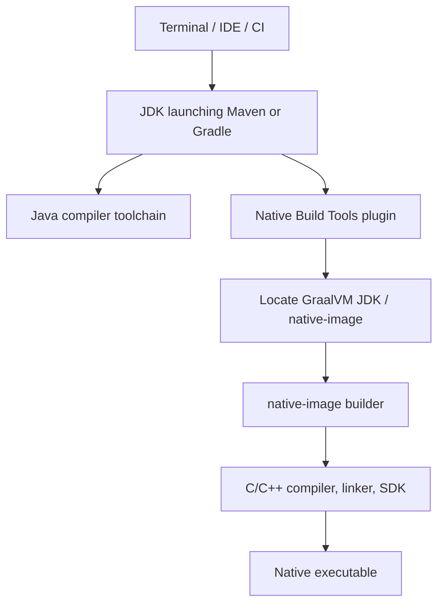

# native-image Not Found or Wrong JDK and Toolchain Selected

## 1. Identify the Right Error Before Changing PATH

When building a Spring Boot Native Image, you may encounter errors such as:

- The shell reports `native-image: command not found`, `native-image is not recognized`, or cannot find the executable.
- `java -version` shows one JDK, but Maven/Gradle runs with a different JDK.
- Native Build Tools reports that GraalVM cannot be found, or finds a standard JDK without `native-image`.
- The build succeeds in the terminal but fails in the IDE or CI.
- Maven/Gradle selects the wrong JDK version, causing bytecode or toolchain compatibility errors.
- `native-image --version` works, but the build fails when invoking the OS C/C++ compiler.

These errors can appear close together yet belong to different layers. Do not change environment variables in bulk before identifying which process is selecting which JDK and where the `native-image` tool is being resolved.

This lesson belongs to the **Diagnostics** chapter of the **SPRING_BOOT_NATIVE_IMAGE** module. The module guides compiling Spring Boot into a GraalVM Native Image with Spring AOT, practicing Maven/Gradle builds, configuring reflection/resources, compatibility testing, container packaging, and operating the native binary. This lesson helps identify the root cause when Native Image is not found or the build tool selects the wrong JDK/toolchain.

After this lesson, learners can:

- Distinguish between the JDK running the build, the JDK compiler toolchain, and the GraalVM containing Native Image.
- Inspect `JAVA_HOME`, `GRAALVM_HOME`, and `PATH` ordering.
- Identify the actual JDK used by Maven, the Gradle daemon, the IDE, and CI.
- Understand the executable discovery order of the GraalVM Native Build Tools Gradle plugin.
- Fix Maven/Gradle configuration without confusing the Java compilation toolchain with the Native Image compiler.
- Distinguish missing `native-image` errors from missing OS C/C++ compiler or SDK errors.

## 2. Distinguish the Four Components in the Build Process

A `nativeCompile` command does not use just one Java executable. You must distinguish four components:

| Component | Responsibility | How to verify |
|---|---|---|
| JDK running Maven/Gradle | Launches the build tool and plugins | `mvn -version`, `gradlew --version` |
| Java compiler toolchain | Compiles source code and runs certain tasks/tests | Gradle toolchains, Maven Toolchains |
| GraalVM JDK with Native Image | Provides `native-image` to produce the binary | `native-image --version` and executable path |
| Native C/C++ toolchain | Compiler, linker, headers, and SDK required by Native Image | `gcc --version`, `clang --version`, `cl.exe`/Visual Studio |

You can visualize the tool selection flow as follows:



For example, `mvn -version` shows that Maven is running on Temurin JDK. That does not prove the machine has Native Image installed. Conversely, `native-image --version` working does not prove Maven is using that same GraalVM installation.

`sourceCompatibility`, `targetCompatibility`, or `--release` only describe the Java source API/bytecode level. They do not automatically install GraalVM, do not add `native-image` to PATH, and do not determine which JDK runs the Maven/Gradle daemon.

## 3. Check the GraalVM Distribution and Native Image Component

First, identify the exact distribution installed:

- Oracle GraalVM or GraalVM Community Edition.
- A GraalVM JDK packaged by another vendor, such as Liberica Native Image Kit.
- A regular JDK such as Temurin, Corretto, or Microsoft Build of OpenJDK.
- An older GraalVM release with a separate component installation mechanism.

In current GraalVM distributions, `native-image` usually resides in the `bin` directory of the GraalVM JDK. However, packaging varies by vendor and version. Some older releases required installing the Native Image component separately using GraalVM Updater (`gu`). Do not apply old component installation commands to every GraalVM release: GraalVM for JDK 21 removed `gu`, and current documentation instructs using the executable already bundled in the distribution's `bin` directory.

The installation structure typically looks like:

```text
graalvm-jdk/
├── bin/
│   ├── java
│   ├── javac
│   ├── native-image
│   └── ...
├── conf/
├── include/
└── lib/
```

On Windows, the executable name may have a `.cmd` suffix, such as `native-image.cmd`. Some distributions use different naming or packaging; inspect the installation directory directly.

Do not confuse these cases:

- `java` exists but `native-image` does not: you may be using a regular JDK or a distribution without Native Image.
- `native-image` exists in one directory but PATH points to another: the shell may invoke the wrong version.
- `native-image` exists but the build reports missing `gcc`, MSVC, or headers: the executable was found; the issue lies in the OS native build toolchain.
- Multiple GraalVM installations exist side by side: you need to select the right version compatible with your project's Spring Boot, Java, and Native Build Tools plugin versions.

Always cross-check the release notes and installation guide for your exact GraalVM version rather than assuming all releases support the same component installation command.

## 4. Check on Windows PowerShell

In PowerShell, `where` is an alias for `Where-Object`, so when searching for executables on PATH, use `where.exe` or `Get-Command`.

Run the inspection set:

```powershell
$env:JAVA_HOME
$env:GRAALVM_HOME
$env:Path -split ';'

Get-Command java -All |
    Select-Object CommandType, Source, Definition

Get-Command native-image -All |
    Select-Object CommandType, Source, Definition

where.exe java
where.exe native-image

java -XshowSettings:properties -version 2>&1 |
    Select-String 'java.home|java.vendor|java.version'

java -version
native-image --version
```

Read the output in order:

1. `JAVA_HOME` must point to the root directory of the JDK/GraalVM, not the `bin` directory and not the `java.exe` file.
2. `Get-Command -All` shows which command PowerShell resolves and how many matching commands exist.
3. `where.exe` lists the executables found via PATH.
4. `java.home`, `java.vendor`, and `java.version` show the JVM that is actually running.
5. `native-image --version` confirms which Native Image command the shell is invoking.

If `JAVA_HOME` is already correct but `native-image` is still not found, check the executable inside the installation itself:

```powershell
$nativeImageCmd = Join-Path $env:JAVA_HOME 'bin\native-image.cmd'
$nativeImageExe = Join-Path $env:JAVA_HOME 'bin\native-image.exe'

Get-ChildItem (Join-Path $env:JAVA_HOME 'bin') -Filter 'native-image*'

if (Test-Path $nativeImageCmd) {
    & $nativeImageCmd --version
} elseif (Test-Path $nativeImageExe) {
    & $nativeImageExe --version
} else {
    Write-Error 'Native Image executable is not present in JAVA_HOME/bin'
}
```

If the file runs via its absolute path but `native-image` fails, the problem is PATH or PATH ordering. If the file does not exist, verify whether the installed distribution/version provides Native Image.

### 4.1. Fix Environment Variables in the Current PowerShell Session

Assuming GraalVM is installed at `C:\tools\graalvm-jdk-25`:

```powershell
$env:GRAALVM_HOME = 'C:\tools\graalvm-jdk-25'
$env:JAVA_HOME = $env:GRAALVM_HOME
$env:Path = "$env:GRAALVM_HOME\bin;$env:Path"

java -version
native-image --version
where.exe java
where.exe native-image
```

These commands only modify the environment of the current PowerShell window. Only after confirming the right toolchain should you update User/System Environment Variables according to your machine policy. If you just changed environment variables in Windows Settings, open a new terminal so processes receive the updated values; already-running terminals and IDEs do not pick up changes automatically.

## 5. Check on Linux and macOS

In Bash/Zsh, run:

```bash
printf 'JAVA_HOME=%s\n' "$JAVA_HOME"
printf 'GRAALVM_HOME=%s\n' "$GRAALVM_HOME"

type -a java
type -a native-image
command -v java
command -v native-image

java -version
java -XshowSettings:properties -version 2>&1 \
  | grep -E 'java.home|java.vendor|java.version'

native-image --version
```

`type -a` is useful when aliases, shell functions, or multiple executables share the same name. `command -v` only shows the first resolved command. On Linux, you can check further:

```bash
readlink -f "$(command -v java)"
readlink -f "$(command -v native-image)"
printf '%s\n' "$PATH" | tr ':' '\n'
```

On macOS, `readlink -f` is not available in every environment. Use `type -a`, `which -a`, and inspect symlinks with `ls -l`:

```bash
which -a java
which -a native-image
ls -l "$(command -v java)"
ls -l "$(command -v native-image)"
```

If you want to invoke the exact GraalVM installation without relying on PATH:

```bash
"$GRAALVM_HOME/bin/java" -version
"$GRAALVM_HOME/bin/native-image" --version
```

If the absolute path works but the bare command is not found, fix PATH. If the absolute path also does not exist, recheck the extraction location, directory name, architecture, and GraalVM package.

## 6. Understand the Roles of JAVA_HOME, GRAALVM_HOME, and PATH

These three values are often used interchangeably but have different meanings:

- `JAVA_HOME` typically indicates the default JDK that Java-based build tools use to launch.
- `GRAALVM_HOME` explicitly points to a GraalVM installation; the GraalVM Native Build Tools Gradle plugin can use this variable to locate `native-image`.
- `PATH` determines which executable the shell finds first when invoking a command. Setting `JAVA_HOME` does not automatically update PATH if the JDK's `bin` directory has not been added to PATH.

In a simple setup, both variables can point to GraalVM:

```bash
export GRAALVM_HOME=/opt/graalvm-jdk-25
export JAVA_HOME="$GRAALVM_HOME"
export PATH="$GRAALVM_HOME/bin:$PATH"
hash -r

java -version
native-image --version
```

If your Gradle version is not yet compatible with the installed GraalVM JDK, you may need a compatible JDK to run Gradle while keeping GraalVM separate for Native Image:

```bash
export JAVA_HOME=/opt/temurin-jdk-25
export GRAALVM_HOME=/opt/graalvm-jdk-25
export PATH="$JAVA_HOME/bin:$GRAALVM_HOME/bin:$PATH"

java -version
"$GRAALVM_HOME/bin/native-image" --version
./gradlew --version
```

This example is only suitable when the GraalVM version has been verified compatible with the project's Java/toolchain. If both directories contain `java`, PATH ordering determines which `java` is invoked; invoking Native Image by absolute path helps verify the exact distribution.

On Windows PowerShell, the equivalent is:

```powershell
$env:JAVA_HOME = 'C:\tools\temurin-jdk-25'
$env:GRAALVM_HOME = 'C:\tools\graalvm-jdk-25'
$env:Path = "$env:JAVA_HOME\bin;$env:GRAALVM_HOME\bin;$env:Path"

java -version
& "$env:GRAALVM_HOME\bin\native-image.cmd" --version
```

Do not put literal quotation marks inside the `JAVA_HOME` variable value, do not append `\bin` to the end of `JAVA_HOME`, and do not mix paths from multiple JDKs in PATH without checking their order.

## 7. Which JDK Is Maven Running On?

Maven Wrapper does not automatically download GraalVM just because the project has a `native` profile. The wrapper pins the Maven version; the JDK running Maven still comes from the environment or how the IDE/CI launches it.

Check what Maven is actually using:

```bash
./mvnw -version
./mvnw -Pnative help:active-profiles
./mvnw -Pnative help:effective-pom
```

On Windows:

```powershell
.\mvnw.cmd -version
.\mvnw.cmd -Pnative help:active-profiles
.\mvnw.cmd -Pnative help:effective-pom
```

In the `mvnw -version` output, pay attention to the Maven home, Java version, and Java home lines. If Java home is not the expected GraalVM installation, fix `JAVA_HOME` in the appropriate terminal/IDE/CI process and re-run.

According to the GraalVM Native Image documentation, the standard configuration for Native Build Tools Maven is to point `JAVA_HOME` to a GraalVM installation containing `native-image`. Make sure the `bin` directory of that same installation is on PATH if plugins or scripts need to resolve executables via PATH.

### 7.1. Distinguish Maven Toolchains from the Native Image Compiler

Maven Toolchains allows plugins such as Compiler, Surefire, or Javadoc to use a separately selected JDK, independent of the JRE/JDK launching Maven. The `~/.m2/toolchains.xml` file can declare multiple JDKs, and a project can select one by version/vendor.

That does not mean every plugin automatically uses the same JDK. Native Build Tools still requires a GraalVM JDK with Native Image. If the compiler toolchain points to Temurin while the Maven runtime or GraalVM compiler is picked from another path, inspect each selection separately. Do not edit `toolchains.xml` to fix a PATH issue before knowing which plugin is reading that toolchain.

### 7.2. Check Profile and Plugin Before Concluding native-image Is Missing

For a Spring Boot Maven project using `spring-boot-starter-parent`, the `native` profile configures the executions required for AOT/native builds. The project must also declare the Native Build Tools Maven plugin per the Spring Boot documentation.

The typical build command is:

```bash
./mvnw -Pnative native:compile
```

If you receive the error:

```text
No plugin found for prefix 'native'
```

then Maven has not resolved the plugin prefix, or the profile/plugin declaration is incorrect. This message does not prove that the `native-image` executable is missing. Check `help:active-profiles`, `help:effective-pom`, the `org.graalvm.buildtools:native-maven-plugin` declaration, repositories, and Maven Central connectivity.

If the plugin runs but reports that GraalVM or Native Image cannot be found, go back and check `JAVA_HOME`, PATH, and the distribution. When needed, enable verbose logging:

```bash
./mvnw -X -Pnative native:compile
```

In projects not using the Spring Boot parent, you must manually configure the AOT and Native Build Tools executions according to the documentation for your Spring Boot and Native Build Tools versions.

## 8. Gradle: Client JVM, Daemon JVM, and Native Image Launcher

Gradle can use multiple JDKs within a single build:

- **Gradle client JVM:** the process launched when invoking `gradle` or `./gradlew`; typically taken from `JAVA_HOME`, `java` on PATH, or the IDE.
- **Gradle daemon JVM:** the background process executing the build; can be chosen via `org.gradle.java.home`, Tooling API/IDE, or daemon JVM criteria.
- **Java toolchain:** the JDK used for compile/test tasks as configured by the project.
- **Native Image launcher:** the GraalVM JDK containing the `native-image` executable chosen by the Native Build Tools plugin.

Therefore, `java -version` in the terminal is not enough to determine which JDK the daemon or native compiler is using.

Inspect with:

```bash
./gradlew --version
./gradlew -q javaToolchains
./gradlew --stop
./gradlew --version
```

On Windows:

```powershell
.\gradlew.bat --version
.\gradlew.bat -q javaToolchains
.\gradlew.bat --stop
.\gradlew.bat --version
```

`--stop` stops the current user's Gradle daemons so the next run spawns a new daemon using the current environment configuration. This command does not modify toolchains or configuration files.

### 8.1. Check the Gradle Plugin's native-image Discovery Order

The GraalVM Native Build Tools Gradle plugin searches for `native-image` in the following order:

1. An explicitly configured `javaLauncher` on the native binary.
2. A launcher selected by Gradle toolchain detection, if enabled.
3. The `GRAALVM_HOME` environment variable.
4. The `JAVA_HOME` environment variable.
5. The JVM running Gradle.

Key point: if `javaLauncher` is explicitly configured, it is authoritative. The selected installation must contain `bin/native-image`; the plugin will not automatically fall back to another GraalVM installation if the executable does not exist. Automatic toolchain detection checks for the executable before using it and can continue falling back if the selected JDK lacks `native-image`.

You can enable toolchain detection in `build.gradle`:

```groovy
graalvmNative {
    toolchainDetection.set(true)
}
```

Then run:

```bash
./gradlew nativeCompile --info
```

Read the logs to determine which launcher/toolchain was selected. If the build script already explicitly configures `javaLauncher`, check that exact JDK before changing `GRAALVM_HOME`.

### 8.2. Check gradle.properties and the IDE

Look for configuration sources that can override the shell environment:

- `org.gradle.java.home` in the project or user `gradle.properties`.
- `gradle/gradle-daemon-jvm.properties` if the project uses daemon JVM criteria.
- The Gradle JVM selected in the IDE.
- The Java launcher/toolchain declared in `build.gradle` or `build.gradle.kts`.
- Tooling API requests sent from the IDE to Gradle.

Daemon JVM criteria, when configured, take precedence over `JAVA_HOME` and `org.gradle.java.home`. Thus, changing `JAVA_HOME` while the daemon continues running on the old JDK may be the expected behavior under the current configuration.

If the terminal build succeeds while the IDE fails, compare the IDE's Gradle JVM with `./gradlew --version` in the terminal. If the IDE build succeeds while the terminal fails, inspect `JAVA_HOME`, `GRAALVM_HOME`, `gradle.properties`, and daemon criteria in the shell/project.

## 9. Distinguish Native Image Errors from OS Compiler Errors

When `native-image --version` succeeds, executable discovery is already working. Native Image still requires a C/C++ toolchain matching the OS and architecture of the build machine.

| Operating system | Commonly required components | How to verify |
|---|---|---|
| Linux | GCC, libc headers, zlib development headers; some distros require static libstdc++ | `gcc --version`, check development packages |
| macOS | Xcode Command Line Tools and linker/SDK | `xcode-select -p`, `clang --version` |
| Windows | Visual Studio 2022 Build Tools/Visual Studio, MSVC, and Windows SDK | Developer Command Prompt, `cl` |

Example prerequisites installation on Ubuntu:

```bash
sudo apt-get update
sudo apt-get install build-essential zlib1g-dev
gcc --version
```

On macOS:

```bash
xcode-select --install
xcode-select -p
clang --version
```

On Windows, install Visual Studio Build Tools or Visual Studio with the appropriate C++ workload and Windows SDK. After installation, open **x64 Native Tools Command Prompt for VS** or Developer PowerShell and re-run the build. Native Image can auto-detect Visual Studio if the installation and SDK are installed in suitable locations.

Some indicators for categorization:

- `native-image is not recognized`: the shell cannot find the executable.
- `native-image --version` succeeds, but the build reports missing `gcc`, `cl.exe`, linker, or headers: missing native compiler toolchain.
- The build reports wrong architecture or the binary fails to run on the target machine: check the OS/architecture of the GraalVM builder and target runtime.
- `Unsupported class file major version` or Gradle/Maven does not support the Java version: check build tool compatibility rather than merely reinstalling Native Image.

Native Image produces an executable for the OS/architecture of the build environment; do not assume arbitrary cross-compilation. For example, building inside Linux/WSL typically produces a Linux binary, not a Windows executable.

## 10. Diagnostic Table for Common Error Messages

| Message or symptom | Problematic layer | First action |
|---|---|---|
| `native-image: command not found` / `not recognized` | Shell/PATH | Check `where.exe`, `type -a`, `JAVA_HOME`, `GRAALVM_HOME`, and the `bin` directory |
| `JAVA_HOME is not set` or points to a non-existent directory | Build environment | Set `JAVA_HOME` to the JDK root directory, open a new terminal |
| `native-image` runs but the version is wrong | PATH contains multiple GraalVMs | Use the absolute path, fix PATH ordering, and recheck `native-image --version` |
| `No plugin found for prefix 'native'` | Maven profile/plugin | Inspect the Native Build Tools plugin and `native` profile in the effective POM |
| `No toolchain found for requested specification` | Maven/Gradle Java toolchain | Check version/vendor criteria, toolchain installation, and project configuration |
| Gradle picks a regular JDK instead of GraalVM | Native Image launcher discovery | Check `javaLauncher`, toolchain detection, `GRAALVM_HOME`, `JAVA_HOME`, daemon JVM |
| `The selected Java installation does not contain native-image` | Selected launcher lacks Native Image | Select the proper GraalVM JDK; if `javaLauncher` is explicit, fix that selection |
| `Unsupported class file major version` | Java/build tool compatibility | Cross-check the JDK running Gradle/Maven, plugin version, and bytecode version |
| `Could not find or load main class` when running Maven/Gradle | JDK/build process or classpath | Check Java home, wrapper, classpath, and plugin configuration; do not assume it is a Native Image error |
| `gcc`, `cl.exe`, linker, or headers not found | Native C/C++ toolchain | Install the appropriate compiler/SDK and open the proper developer shell |
| Native build reports wrong architecture | Builder/target platform | Build on the target OS and architecture or use the corresponding builder |
| `bootBuildImage` fails on Docker daemon despite no local `native-image` | Buildpacks/container builder | Check Docker daemon, builder image, registry, and JDK version per Spring Boot docs |

### Distinguish Two Easily Confused Maven Errors

- `No plugin found for prefix 'native'`: Maven could not find the plugin goal. Check the plugin declaration, profile, repositories, and dependency resolution.
- The plugin started but cannot find `native-image`: check GraalVM JDK, `JAVA_HOME`, PATH, and how the plugin selects the tool.

Do not reinstall GraalVM to fix a Maven plugin resolution error. Conversely, do not edit the POM if the shell already fails to find the required executable.

### Distinguish Two Easily Confused Gradle Errors

- `No matching toolchain`: Gradle cannot find a JDK satisfying the project's language version/vendor criteria.
- `native-image` missing from selected installation: Gradle selected a JDK, but that installation does not contain Native Image.

If the error occurs after declaring `javaLauncher`, inspect the chosen launcher first. Per the Native Build Tools documentation, an explicitly configured launcher is authoritative and the plugin does not fall back to another installation.

## 11. IDEs, CI, and Cloud Native Buildpacks May Pick Tools Differently from the Terminal

### 11.1. IDE

An IDE can launch Maven/Gradle using its own configured JDK. Therefore, results in the terminal and IDE can differ even with the same source code.

Check the following settings:

- The IDE's JDK or project SDK.
- Maven runner JRE/JDK.
- Gradle JVM under Build Tools settings.
- Gradle toolchain and daemon JVM criteria in the project.
- Environment variables passed to the Run/Build Configuration.

If the terminal build succeeds, record the output of `java -version`, `native-image --version`, `mvnw -version`, or `gradlew --version`. Then compare them against the JDK and environment the IDE is using. Do not merely change the Project SDK and assume the Maven runner or Gradle daemon changes with it.

### 11.2. CI Pipeline

CI usually runs builds in a fresh process/container, so environment variables on a developer's machine do not automatically appear in the runner. In the native build job, print toolchain details before building:

Linux:

```bash
echo "JAVA_HOME=$JAVA_HOME"
echo "GRAALVM_HOME=$GRAALVM_HOME"
which java
which native-image
java -version
native-image --version
./mvnw -version
./gradlew --version
```

Windows PowerShell:

```powershell
Write-Output "JAVA_HOME=$env:JAVA_HOME"
Write-Output "GRAALVM_HOME=$env:GRAALVM_HOME"
Get-Command java -All
Get-Command native-image -All
java -version
native-image --version
.\mvnw.cmd -version
.\gradlew.bat --version
```

Also record:

- GraalVM distribution, version, vendor, and architecture.
- The JDK running the build tool and the compile/test toolchain JDK.
- Native Build Tools plugin version.
- Native C/C++ compiler and SDK version.
- OS/architecture of the runner or build container.
- Docker/Buildpacks builder image digest if building in a container.

Pin the versions of GraalVM, the Maven/Gradle wrapper, and plugins. Avoid floating builder tags or a PATH dependent on an uncontrolled runner image. If building inside a container, verify the toolchain inside the build container; having GraalVM on the host machine does not mean the container sees that installation.

### 11.3. Building with Cloud Native Buildpacks

When using Spring Boot `build-image` or `bootBuildImage`, the Native Image can be built inside a Cloud Native Buildpacks builder. In this flow, the local shell may not need `native-image` installed; the builder image and buildpack provide their own build environment.

If a Buildpacks build fails, categorize the error first:

- Docker daemon unreachable: check Docker Desktop/daemon, socket permissions, and service status.
- Builder image cannot be pulled: check registry, network, proxy, and image reference.
- Buildpack does not support the chosen JDK/version: check the Spring Boot and buildpack releases in use.
- Buildpack ran Native Image but lacks a compiler/dependency: inspect the builder stack and buildpack logs.

Buildpacks JDK requirements vary by Spring Boot/buildpack version. For example, current Spring Boot 4.2 documentation requires at least JDK 25 for the Paketo native image flow described there. Do not apply a current version's requirements to older Spring Boot projects; always check the documentation matching your actual version.

## 12. Ordered Diagnostic Procedure

Use this procedure to avoid fixing the wrong layer:

1. **Identify the build command and environment:** terminal, IDE, CI, or Buildpacks.
2. **Identify the JDK running the build tool:** run `mvnw -version` or `gradlew --version`.
3. **Identify the executable invoked by the shell:** run `where.exe`/`Get-Command` on Windows or `type -a`/`command -v` on Linux/macOS.
4. **Inspect GraalVM directly:** invoke `<GRAALVM_HOME>/bin/native-image --version`.
5. **Compare paths:** `JAVA_HOME`, `GRAALVM_HOME`, PATH, Maven toolchains, Gradle daemon JVM, and native launcher.
6. **Check plugins/profiles:** confirm the Native Build Tools plugin is declared and the native profile is active.
7. **Check the C/C++ toolchain:** only perform this step once `native-image` runs and the compiler reports missing OS tools.
8. **Re-run with verbose logging:** use `-X` for Maven; use `--info` or `--debug` for Gradle when needed.
9. **Record findings:** save versions, executable paths, command, OS/architecture, and the first error message.

A good diagnostic result should answer three questions: which JDK the build process is running on, which installation the plugin invokes `native-image` from, and if the executable already runs, which toolchain the subsequent error belongs to.

## 13. Hands-on Exercises

### Exercise A — Find the JDK Used by the Shell

On Windows, run the PowerShell commands in section 4. On Linux/macOS, run the commands in section 5. Assume the machine has both a regular JDK and a GraalVM JDK installed.

Record:

- The values of `JAVA_HOME` and `GRAALVM_HOME`.
- The first paths the shell resolves for `java` and `native-image`.
- The output of `java -version` and `native-image --version`.
- The output when invoking `native-image` via its absolute path in GraalVM.

**Completion criterion:** explain why `java` and `native-image` can come from two different installations.

### Exercise B — Diagnose Maven

1. Run `./mvnw -version` or `.\mvnw.cmd -version`.
2. Run `help:active-profiles` and `help:effective-pom` with the `native` profile.
3. Confirm `org.graalvm.buildtools:native-maven-plugin` is present in the build.
4. Run `native:compile` with verbose logging if needed.
5. Classify the error as plugin resolution, JDK selection, Native Image discovery, or C/C++ toolchain.

**Completion criterion:** identify the exact GraalVM path the Maven build needs to use and why.

### Exercise C — Diagnose the Gradle Daemon

1. Run `./gradlew --version` and `./gradlew -q javaToolchains`.
2. Inspect `org.gradle.java.home`, daemon JVM criteria, and the IDE's Gradle JVM.
3. Check `GRAALVM_HOME` and Native Build Tools' discovery order.
4. Stop the daemon with `./gradlew --stop`.
5. Run `nativeCompile --info` and note the selected launcher.

**Question:** why might changing `JAVA_HOME` fail to switch the Gradle daemon to the new JDK?

### Exercise D — Separate Native Image Errors from Native Compiler Errors

Run `native-image --version` first. If it succeeds but the build fails, check GCC/Clang or MSVC/Windows SDK. Record the first error message and determine whether it occurs before or after the Native Image builder starts.

**Completion criterion:** do not confuse PATH errors with C/C++ toolchain errors.

### Exercise E — Standardize the Toolchain in CI

Create a diagnostic step that runs before the native build, printing the GraalVM version, Java home, Native Image path, Maven/Gradle version, and OS/architecture. Pin toolchain versions and compare CI output with the developer machine.

**Completion criterion:** when a build fails, the logs contain enough information to determine the selected JDK/toolchain without guessing from a local machine.

## 14. Checklist Before Reporting a Bug or Changing the Environment

- [ ] Identified whether the build runs via terminal, IDE, CI, or Cloud Native Buildpacks.
- [ ] `JAVA_HOME` points to the JDK root directory, not `bin` or the `java` binary.
- [ ] Checked `java -version` and `java.home`.
- [ ] Checked `GRAALVM_HOME` and the actual distribution/version.
- [ ] Ran `native-image --version`.
- [ ] Identified the first executable path resolved by the shell.
- [ ] Tested invoking `native-image` using the absolute GraalVM path.
- [ ] Distinguished the JDK running Maven/Gradle from the Java compiler toolchain.
- [ ] Maven has the right profile active and declares the Native Build Tools plugin.
- [ ] Gradle daemon JVM, toolchain, and Native Image launcher were checked separately.
- [ ] Checked `org.gradle.java.home`, daemon JVM criteria, and IDE settings if using Gradle.
- [ ] Checked the OS C/C++ compiler, linker, and SDK if Native Image was already found.
- [ ] Confirmed the builder OS/architecture matches the target binary.
- [ ] CI prints toolchain versions/paths and pins required versions.
- [ ] Categorized the error by the first error message rather than changing multiple variables at once.

## References

- [GraalVM Native Image — Reference Manual](https://www.graalvm.org/latest/reference-manual/native-image/): location of `native-image` in a GraalVM installation, OS prerequisites, and building with Maven/Gradle.
- [GraalVM for JDK 21 — Release Notes](https://www.graalvm.org/release-notes/JDK_21/): distribution changes and removal of GraalVM Updater (`gu`) starting in GraalVM for JDK 21.
- [GraalVM Native Build Tools — Gradle Plugin](https://graalvm.github.io/native-build-tools/latest/gradle-plugin): discovery order for the Native Image executable, toolchain detection, `GRAALVM_HOME`, `JAVA_HOME`, and `javaLauncher`.
- [GraalVM Native Build Tools — Maven Plugin](https://graalvm.github.io/native-build-tools/latest/maven-plugin.html): GraalVM JDK requirements, plugin configuration, native goals, and build diagnostics.
- [Gradle — Gradle Daemon](https://docs.gradle.org/current/userguide/gradle_daemon.html): differences between client JVM and daemon JVM, `org.gradle.java.home`, Tooling API, and daemon JVM criteria.
- [Gradle — Toolchains for JVM projects](https://docs.gradle.org/current/userguide/toolchains.html): selecting a JDK toolchain for compile/test.
- [Apache Maven — Toolchains Plugin](https://maven.apache.org/plugins/maven-toolchains-plugin/): discovery and selection of a JDK toolchain independent of the JVM running Maven.
- [Spring Boot — Developing Your First GraalVM Native Application](https://docs.spring.io/spring-boot/how-to/native-image/developing-your-first-application.html): configuring Maven/Gradle Native Build Tools and Buildpacks for Spring Boot.
- [GraalVM — Installation on Windows](https://www.graalvm.org/docs/getting-started/windows/): Visual Studio, Windows SDK, and running Native Image on Windows.

## Conclusion

When `native-image` cannot be found or the build uses the wrong JDK, separately identify the JDK launching Maven/Gradle, the Java compiler toolchain, and the GraalVM installation containing Native Image. Check `JAVA_HOME`, `GRAALVM_HOME`, PATH ordering, and the actual executable path; then inspect Maven profiles/plugins or the Gradle daemon, toolchain, and launcher discovery. If `native-image --version` already works, move on to checking the C/C++ compiler, linker, SDK, and architecture of the build environment. This layered approach helps fix the exact configuration source and ensures local, IDE, and CI environments share a reproducible toolchain.
