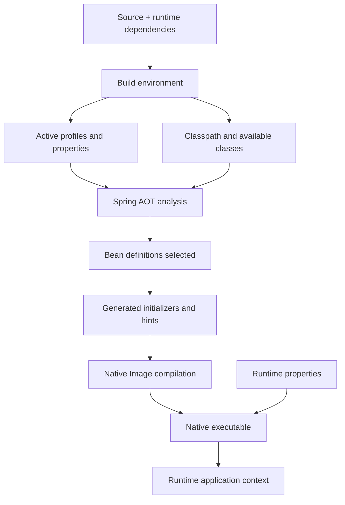

# Binary Missing Beans Due to Profile, Condition, or Build-Time Classpath

## 1. Why Is a Bean Present in Source Code but Missing from the Binary?

A Spring Boot application may run fine on the JVM yet lack a bean, controller, or integration when compiled into a GraalVM Native Image. A common cause is that Spring AOT generated the application context in a build environment whose profiles, properties, or classpath differed from what the team expected at runtime.

Spring AOT analyzes the ApplicationContext structure and generates initialization code and metadata for that configuration. Conditions such as `@Profile`, `@ConditionalOnProperty`, `@ConditionalOnClass`, `@ConditionalOnBean`, and auto-configuration conditions affect which bean definitions make it into the generated output. When a bean is excluded during AOT, changing a property at runtime will not necessarily make that bean reappear in the native executable.

Therefore, when encountering `NoSuchBeanDefinitionException`, 404 endpoints, or uninitialized integrations in a native binary, you must inspect both the build-time and runtime environments. Inspecting only the deployed `application.yml` is not sufficient.

In the **SPRING_BOOT_NATIVE_IMAGE** module, treat profiles, conditional properties, and the dependency classpath as part of artifact creation configuration. Each binary must be built with the feature set it is meant to provide.

## 2. When Are Spring AOT and the Bean Graph Decided?

In a traditional Spring application, many bean definitions and auto-configurations are evaluated when the ApplicationContext initializes. In the AOT flow, Spring initializes/analyzes the context during the build phase, applies configuration conditions, and generates the corresponding code.

High-level flow:



Runtime properties still control settings designed to vary at runtime, such as database URLs, ports, log levels, or certain feature behaviors. However, they cannot arbitrarily reintroduce classes/beans that were excluded from the generated bean graph.

Distinguish between:

- **Build-time condition**: a condition evaluated when AOT builds the context.
- **Runtime configuration**: a value read while the application runs.
- **Classpath condition**: depends on whether a class exists in the dependency graph when AOT runs.
- **Runtime class loading/reflection**: dynamic operations requiring reachability metadata that must still fit Native Image constraints.

## 3. Conditions That Commonly Prevent Bean Generation

| Condition | Deciding factor | Diagnostic question |
|---|---|---|
| `@Profile("production")` | Active profile during AOT analysis | Was the production profile active during the AOT build? |
| `@ConditionalOnProperty` | Property presence and value at evaluation time | Was the property supplied to the AOT process? |
| `@ConditionalOnClass` | Class presence on the AOT classpath | Is the dependency in the right application module? |
| `@ConditionalOnMissingBean` | Whether another bean already exists | Which bean caused auto-configuration to back off? |
| `@ConditionalOnBean` | Prerequisite bean is already registered | Was the prerequisite bean created in the AOT context? |
| `@ConditionalOnResource` | Resource availability | Was the resource on the build classpath? |
| Custom condition | Application/library condition logic | Which environment or filesystem state does the condition read? |

A condition can sit on a configuration class, a bean factory method, or an auto-configuration. Locate the exact declaration and determine which phase evaluates it.

## 4. Diagnose Missing Beans in Order

When a bean is missing from the native binary, check sequentially:

1. Confirm the bean class exists in source and is compiled.
2. Confirm the module containing the bean is included in the application build.
3. Check package/component scanning and configuration imports.
4. Identify every condition annotation applied to the class/method.
5. Record the active profiles and properties during the AOT process.
6. Check dependencies/classpath to satisfy `@ConditionalOnClass`.
7. Check prerequisite beans and auto-configuration ordering.
8. Inspect the generated AOT output to see if a registration exists for the bean.
9. Rebuild the native executable with the right configuration.
10. Test behavior against the newly built binary itself.

Do not start by adding reflection hints. Reflection hints tell Native Image to retain metadata for dynamic operations; they do not recreate bean definitions excluded from the AOT context by conditions.

## 5. Profiles Active During the AOT Phase

Suppose an application has two implementations:

```java
@Configuration
@Profile("local")
class LocalPaymentConfiguration {

    @Bean
    PaymentGateway paymentGateway() {
        return new SandboxPaymentGateway();
    }
}

@Configuration
@Profile("production")
class ProductionPaymentConfiguration {

    @Bean
    PaymentGateway paymentGateway(ProductionClient client) {
        return new ProductionPaymentGateway(client);
    }
}
```

If AOT runs with the `local` profile, the generated context may contain the sandbox gateway. Deploying that native executable to production and setting `SPRING_PROFILES_ACTIVE=production` does not guarantee the production bean will appear; the bean graph was already generated from the build configuration.

The fix is to run AOT for the target profile. If multiple deployment configurations require different bean graphs, build separate artifacts per configuration or design a stable bean graph and let runtime properties select behavior inside already-created beans.

## 6. Identify the Actual Profile of the AOT Process

Do not guess profiles from YAML files. Explicitly record the profiles passed to the AOT process and verify them in the logs.

You can use environment variables or system properties in the build environment, depending on how the plugin launches the AOT process:

```bash
SPRING_PROFILES_ACTIVE=production ./gradlew :api-app:processAot
```

With Maven, invoke the Spring Boot Maven Plugin's AOT goal for your project version and pass profiles/properties using the mechanism supported by the plugin. How arguments/environment are configured for the goal can vary between versions; verify via plugin documentation and build logs.

In CI, log the profile names and non-sensitive properties supplied to AOT. Do not dump the entire environment because it may contain passwords/tokens.

Note: the profile used to shape the bean graph must take effect inside the AOT process. Setting `SPRING_PROFILES_ACTIVE` only in a deployment manifest after the binary is built does not change the generated bean graph.

## 7. Mis-Evaluated Conditional Properties

Example:

```java
@Configuration
@ConditionalOnProperty(
    prefix = "app.payment",
    name = "enabled",
    havingValue = "true"
)
class PaymentConfiguration {

    @Bean
    PaymentService paymentService(PaymentGateway gateway) {
        return new PaymentService(gateway);
    }
}
```

If `app.payment.enabled` is not set to `true` when AOT runs, the configuration may be omitted from the generated context. Setting this property to true later in the deployment environment will not necessarily restore the bean.

Decide clearly whether that property is:

- A build-time condition selecting the bean graph; or
- A runtime flag controlling behavior inside an always-present bean.

If you want to toggle behavior at runtime, create a stable bean and check the property inside methods/services, or use an always-registered strategy bean. If you want to exclude the integration entirely from the binary, build separate artifacts per feature configuration.

## 8. Distinguish Build-Time Properties from Runtime Properties

| Property | Typical phase | Example |
|---|---|---|
| Profile selecting a bean implementation | Build-time AOT | local/production |
| Property enabling auto-configuration | Often build-time | app.payment.enabled |
| Database URL | Runtime | spring.datasource.url |
| Database password | Runtime secret | spring.datasource.password |
| HTTP port | Runtime | server.port |
| Log level | Runtime if supported by framework | logging.level.root |
| Feature behavior inside an existing bean | Runtime | app.checkout.read-only |

This classification reflects application design, not a rigid rule for every property. A single property can be used in both build-time conditions and runtime logic. Locate every annotation/condition consuming it.

Do not pass secrets into the AOT build just to satisfy a condition if the secret is only needed to connect to a database at runtime. Separate bean structure from connection credentials.

## 9. Classpath Conditions and Missing Dependencies

Auto-configuration example:

```java
@AutoConfiguration
@ConditionalOnClass(name = "com.vendor.sdk.PaymentClient")
class VendorPaymentAutoConfiguration {

    @Bean
    PaymentGateway vendorPaymentGateway(
            PaymentClient paymentClient) {
        return new VendorPaymentGateway(paymentClient);
    }
}
```

If the dependency containing `PaymentClient` is not on the classpath when AOT runs, the condition is not met and the bean is not generated. Dropping a JAR into the runtime container after the binary is built cannot add classes into an already-compiled executable.

Inspect the dependency graph of the exact application module:

```bash
./gradlew :api-app:dependencies --configuration runtimeClasspath
./gradlew :api-app:dependencyInsight --dependency vendor-sdk --configuration runtimeClasspath
```

With Maven:

```bash
./mvnw -pl api-app dependency:tree
```

Ensure the dependency is on the runtime classpath, has the right version, and is not excluded. If an integration is optional, verify the corresponding starter/module was added to the application build before AOT.

## 10. Component Scan and Package Boundaries

A bean may go undetected because its package lies outside component scanning. For example, the main class is in `com.example.api`, while an implementation sits in a sibling package `com.example.payment` not covered by the current scan configuration.

Check:

- Package of `@SpringBootApplication`.
- `scanBasePackages` or `@ComponentScan`.
- `@Import` configurations.
- Module dependencies between the application and feature modules.
- Conditional configurations enclosing the package/module.

Example explicit scan declaration:

```java
@SpringBootApplication(scanBasePackages = {
    "com.example.api",
    "com.example.payment"
})
public class ApiApplication {
}
```

Expand scanning only to packages that truly belong to the application. Overly broad component scanning can accidentally pull unwanted configurations into the bean graph.

## 11. Auto-Configuration Back-Off Due to Another Existing Bean

Many Spring Boot auto-configurations use `@ConditionalOnMissingBean`. If the application declares its own bean of the same type, the default auto-configuration can back off.

Example:

```java
@Bean
Clock applicationClock() {
    return Clock.systemUTC();
}
```

Another auto-configuration might create `Clock` only when no bean of that type exists. When a profile or component scan brings your custom bean into the AOT context, the default auto-configuration no longer applies.

When a bean is missing, inspect the condition evaluation report to see whether an auto-configuration matched or backed off and which bean caused the condition to fail. Do not delete a custom bean if another feature relies on it; adjust configuration intentionally.

## 12. Use the Condition Evaluation Report to Find the Cause

Spring Boot provides a condition evaluation report for auto-configuration. You can enable debug logging in a diagnostic environment to see matched/unmatched conditions:

```yaml
debug: true
```

Or use the logging category appropriate for your Spring Boot version:

```yaml
logging:
  level:
    org.springframework.boot.autoconfigure: DEBUG
```

The report helps identify which auto-configurations were applied, excluded, or backed off. Exact output depends on the version and how the context is initialized. For AOT, capture reports/logs from the actual build process and environment; a report from a JVM run with a different profile does not prove the AOT build's conditions.

Do not leave debug logging enabled unchecked in production because logs can become huge and expose configuration details.

## 13. Inspect Generated AOT Output

After running AOT processing, locate the generated sources/resources in the plugin's output directory. Locations vary across Gradle/Maven and plugin versions.

Look for signs such as:

- Generated initializer for the ApplicationContext.
- Bean registrations/invocations corresponding to configurations.
- RuntimeHints registrars or generated hints.
- Resource metadata.
- AOT logs recording profiles/conditions.

Do not edit generated sources directly. They are regenerated from source code and build configuration; manual edits will be overwritten on the next build. Fix annotations, configurations, dependencies, or AOT arguments at the source.

If the bean does not appear in generated registrations, focus on conditions/classpath/component scanning. If the bean has a registration but native runtime still fails, separately investigate class reachability, reflection/proxy metadata, and resources.

## 14. Check the Runtime Classpath and AOT Classpath

The classpath when AOT runs determines which classes conditions can detect. The application's runtime classpath must also contain all dependencies required to run.

Compare:

- Compile classpath.
- Runtime classpath.
- AOT process classpath.
- Test classpath.
- Native Image build inputs.

Never leave a dependency only in `testImplementation` or Maven `test` scope if the application needs it in production. Tests can pass because the test classpath includes the SDK, while the application AOT build cannot see that SDK.

In multi-module builds, verify that the application module depends on the right feature modules. Do not inspect only the root project's dependency report.

## 15. Multiple Profiles: Multiple Binaries or One Binary?

There are two main strategies:

**One stable bean graph with changing runtime configuration.** Use when environments share the same bean set and differ only in URLs, credentials, ports, endpoints, or behavior. Build one binary and supply runtime properties.

**Multiple distinct bean graphs.** If local, production, or specific deployments require different implementation/configuration classes selected by profiles/conditions, build separate AOT artifacts per graph. Tag artifact metadata and container images with the profile/target name.

Do not build a binary with a test profile and expect it to become a production binary merely by changing an environment variable. When combining multiple profiles, verify profile precedence and semantics in the AOT process.

## 16. Redesign Conditions When Runtime Flexibility Is Required

If a bean exists only when `app.feature.enabled=true`, yet the organization wants to toggle the feature without rebuilding, consider keeping the bean in the graph and letting the property control behavior:

```java
@Service
class OptionalFeatureService {

    private final FeatureProperties properties;

    OptionalFeatureService(FeatureProperties properties) {
        this.properties = properties;
    }

    public Result execute(Command command) {
        if (!properties.enabled()) {
            throw new FeatureDisabledException();
        }
        return perform(command);
    }
}
```

Illustrative example; define appropriate properties and error handling. This keeps the bean always present while behavior is decided at runtime.

If a feature pulls in heavy dependencies or native libraries not needed in every deployment, separate artifacts may be a better fit. Base the choice on image footprint, security boundaries, deployment model, and operational requirements.

## 17. Test Profiles and Conditions on JVM and Native Image

Create tests for each supported configuration:

- Production profile wires the right gateway.
- Local profile wires the sandbox implementation.
- Enabled/disabled properties yield the expected results.
- Missing optional dependencies cause auto-configuration to back off as expected.
- Bean overrides do not break unrelated integrations.
- Endpoints/services invoke the intended implementation.

Then run tests against the AOT-processed application and the corresponding native executable. Standard JVM tests using runtime profiles do not replace verifying the generated AOT graph.

Native tests should cover both positive and negative paths. For example, verify the feature enabled, the feature disabled, an optional bean absent, and endpoints returning appropriate statuses.

## 18. Common Errors and Troubleshooting

| Symptom | Likely cause | What to check |
|---|---|---|
| `NoSuchBeanDefinitionException` | Profile/condition did not create the bean | Check AOT profiles/properties and generated registrations |
| Controller returns 404 | Controller excluded from scan/bean graph | Check package scan and active profiles |
| Auto-configuration does not run | `@ConditionalOnClass` not satisfied | Check AOT runtime classpath |
| Default bean disappears | `@ConditionalOnMissingBean` backed off | Inspect condition report and bean overrides |
| Property enabled at runtime, bean still missing | Condition already evaluated at AOT | Rebuild with right configuration or keep bean stable |
| JVM passes, native misses integration | Test classpath differs from application classpath | Inspect runtime/AOT dependency graph |
| Generated initializer lacks configuration | AOT did not select the configuration | Check profiles, scanning, imports, and conditions |
| Bean exists but reflection fails | Missing reachability metadata | Check RuntimeHints and native stack trace |

## 19. Checklist for Investigating Missing Beans in a Binary

- Identified the bean type and the configuration class supposed to create it.
- Located all `@Profile` and `@Conditional*` annotations on configuration/bean methods.
- Recorded the actual profiles/properties used in the AOT process.
- Verified dependencies and classpath of the exact application module.
- Verified component scan and import boundaries.
- Checked the auto-configuration condition report and back-offs.
- Inspected generated AOT registrations.
- Distinguished bean graph issues from reflection/resource reachability issues.
- Rebuilt the native executable after fixing build-time conditions.
- Executed tests for every supported profile/feature configuration.
- Verified the exact binary/image digest deployed.

## 20. Self-Check Questions

1. Why does changing `SPRING_PROFILES_ACTIVE` at runtime not always restore a bean excluded during AOT?
2. Which inputs do `@ConditionalOnProperty` and `@ConditionalOnClass` use to shape the bean graph?
3. How do you verify which profile was actually active inside the AOT process?
4. Why is having a dependency only on the test classpath insufficient for production?
5. How does the condition evaluation report help diagnose auto-configuration back-off?
6. What can generated AOT sources reveal when a bean is missing?
7. When should you build separate binaries per profile?
8. How can you design a feature flag so behavior changes at runtime while the bean remains present?

**Takeaway:** a missing bean in a native executable usually stems from a bean graph already fixed by profiles, conditions, or the classpath when AOT ran. Verify the build-time environment and generated registrations first, fix the underlying conditions/dependencies, and then rebuild and test the artifact for your deployment configuration.
