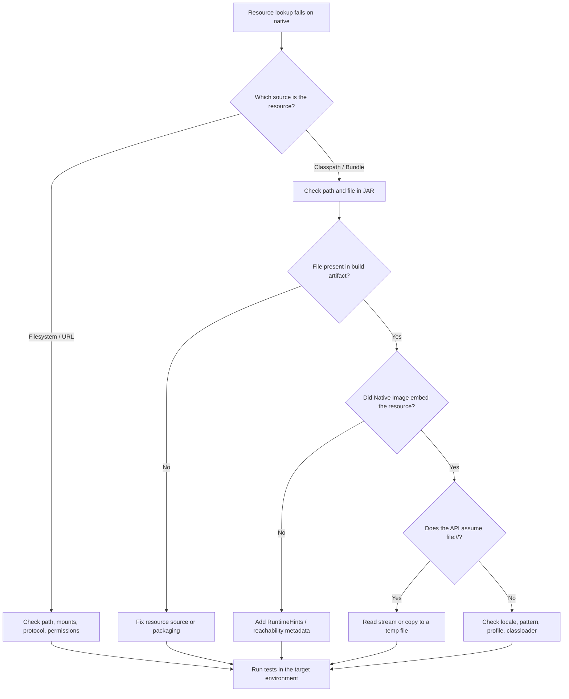

# Resource, Template, Bundle, or Migration File Not Found

> **Chapter: Diagnostics.** The **SPRING_BOOT_NATIVE_IMAGE** module compiles Spring Boot applications into a GraalVM Native Image using Spring AOT to improve startup time and memory usage. An application may run properly on the JVM yet report missing config files, templates, message bundles, or migrations after moving to native. The root cause typically lies in classpath paths, dynamic lookups, resources not included in the executable, or libraries assuming resources are always files on the filesystem. This lesson guides tracing resources from the source tree to the native executable, adding appropriately scoped RuntimeHints, and verifying with native tests.

## 1. Learning Objectives

After this lesson, you will be able to:

1. Distinguish classpath resources from external filesystem files.
2. Diagnose ClassPathResource, ResourceLoader, ClassLoader, and Class.getResource() when paths do not match.
3. Explain why Native Image does not automatically include every classpath resource in the executable.
4. Register templates, configuration files, message bundles, and migrations using Spring RuntimeHints.
5. Distinguish Spring/GraalVM glob patterns from legacy metadata regexes.
6. Verify which resources are actually embedded using Build Report or embedded-resources.json.
7. Handle templates selected by dynamic names, changing locales, and resources inside dependency libraries.
8. Separately verify SQL migrations, Java migrations, Liquibase changelogs, and files referenced by changelogs.
9. Write tests running on the native executable to confirm resources are readable and have the expected content.

## 2. Why Do Resources Work on the JVM but Disappear in Native Image?

On a standard JVM, the classpath and JARs can be traversed at runtime. A library can look up files using names built from configuration, scan resource directories, or probe multiple paths.

Native Image performs static analysis at build time. To keep the executable small and determine what is needed, the builder does not embed every classpath resource by default. Resources must be discovered via calls with constant arguments or declared through reachability metadata/RuntimeHints. If a resource name is constructed only at runtime, the builder may not know which files to keep.

Example:

```java
// Constant resource name: Native Image can recognize this call.
InputStream input = InvoiceRenderer.class
        .getResourceAsStream("/templates/invoice.html");

// Resource name built from runtime data: requires a resource pattern declaration.
String path = "templates/" + templateName + ".html";
InputStream dynamicInput = classLoader.getResourceAsStream(path);
```

The second case requires metadata covering allowed templates. Without metadata, getResourceAsStream() can return null even though the file exists in the source JAR.

Another key difference: resources embedded in a native executable may be returned under the `resource:` URL scheme instead of `file:`. Consequently, libraries calling URL.getFile() or coercing the URL into a filesystem path can fail even when the resource is packaged. Read via streams; if an API strictly requires a physical file, copy the resource to a temporary file first.

## 3. Classify the Resource Source Before Fixing

Do not start by adding broad patterns. First identify which kind of resource the application is reading:

| Type | Examples | How to distinguish |
|---|---|---|
| Classpath resource | classpath:config/app.yml, templates/invoice.html | Packaged in src/main/resources or a JAR dependency |
| Package-relative resource | com/example/messages.properties | Located alongside a package/class inside a JAR |
| Filesystem resource | /opt/orders/templates/invoice.html | File must exist on the host/container filesystem at runtime |
| URL resource | https://..., jar:... | Requires appropriate URL protocol support and connectivity/runtime |
| Resource bundle | com.example.i18n.messages | ResourceBundle selects files by base name and locale |
| Database migration | db/migration/V1__init.sql | Located by Flyway or Liquibase via location/changelog |

Spring can represent all of these sources with Resource, but Native Image metadata only embeds classpath resources into the executable. It does not create filesystem files, mount volumes, or guarantee remote URLs are reachable.

### 3.1. Distinguish Classpath Paths from Filesystem Paths

For resources in src/main/resources:

```text
src/main/resources/
  application.yml
  templates/
    invoice.html
    mail/
      receipt.html
  i18n/
    messages.properties
    messages_en.properties
    messages_vi.properties
  db/
    migration/
      V1__create_orders.sql
      V2__add_status.sql
    changelog/
      db.changelog-master.yaml
      changes/
        001-create-orders.yaml
```

When packaged, the corresponding paths are normally resolved relative to the classpath root, such as templates/invoice.html, i18n/messages_vi.properties, and db/migration/V1__create_orders.sql.

Do not include src/main/resources/ in runtime resource paths. For example, classpath:src/main/resources/templates/invoice.html is usually wrong because src/main/resources is a build source directory, not part of the classpath path inside the JAR.

### 3.2. Rules for ClassLoader and Class.getResource()

- ClassLoader.getResource("templates/invoice.html") takes a path relative to the classpath root, typically without a leading /.
- InvoiceRenderer.class.getResource("invoice.html") looks up relative to the package of class InvoiceRenderer.
- InvoiceRenderer.class.getResource("/templates/invoice.html") looks up from the classpath root.
- ClassPathResource("templates/invoice.html") accepts a path relative to the classpath root; avoid adding a classpath: prefix in this constructor.
- Resource paths are case-sensitive on Linux. Invoice.html and invoice.html are two different names.

If leading slashes or path conventions differ across APIs, check the exact API being called before editing metadata.

## 4. Layer-by-Layer Diagnostic Workflow

Use the following workflow to locate where the resource is lost:



Proceed step by step:

1. Record the full exception, resource path, and lookup API.
2. Confirm the file exists in the source tree and is copied into the JAR or dependency.
3. Confirm the file is present in the packaged artifact.
4. Check whether the resource was embedded by the native builder.
5. Check whether the code calls an API requiring a file: URL or filesystem path.
6. Check profiles, locales, working directory, and location configuration.
7. Run native tests targeting the exact code branch using the resource.

## 5. Inspect Resources in the JAR Before Tuning Native Image

First verify the resource made it past packaging. For an executable JAR:

```bash
jar tf target/orders-service.jar | grep -E \
  'templates/|i18n/|db/migration/|db/changelog/'
```

In a Spring Boot executable JAR, application resources typically reside under BOOT-INF/classes/; resources from dependencies sit inside nested JARs under BOOT-INF/lib/. Check both places if the resource comes from a library:

```bash
jar tf target/orders-service.jar | grep 'BOOT-INF/classes/templates/'
```

If the resource is missing from the JAR:

- Verify the file sits in the right source resource directory.
- Check whether build plugins filter out the file via excludes, includes, or resource filtering.
- Check whether the module containing the resource is declared as a dependency with the right scope.
- For Kotlin/Gradle or builds with custom source sets, confirm extra resource directories are included in output.
- Check for case differences in filenames between source and code.

Do not add RuntimeHints to fix a file that was never packaged. RuntimeHints only instruct the native builder to embed resources already on the classpath into the executable.

## 6. Verify Embedded Resources in the Native Executable

Once you confirm the resource is in the JAR, inspect the Native Image builder's output.

### 6.1. Generate a Build Report

Add the build report option:

```bash
native-image --emit build-report -jar target/orders-service.jar
```

Open the Build Report and check the **Resources** tab. The list shows which resources were registered, their origin, and their status. If a file is in the JAR but absent from this list, check metadata and resource patterns.

### 6.2. Generate the Embedded Resources List

You can ask the builder to emit a JSON file listing embedded resources:

```bash
native-image -H:+GenerateEmbeddedResourcesFile \
    -jar target/orders-service.jar
```

Locate embedded-resources.json in the build output. Inspect:

- Name: the path runtime code looks up.
- Origin: where the resource was sourced during the build.
- Type: resource type; watch for missing status.
- Size: resource size.
- Module: source module if the application uses Java modules.

Compare Name against the path used in code, not just the filename. If a resource shares the same name across multiple JARs, check Origin to see which copy the builder picked.

## 7. Register Resources with Spring RuntimeHints

With Spring Boot, prefer declaring resources near the component that uses them via RuntimeHintsRegistrar and @ImportRuntimeHints. Spring AOT invokes the registrar during build processing and translates hints into Native Image metadata.

Example of a service rendering invoices by template name, reading SQL migrations, and loading a message bundle:

```java
package com.example.orders.resource;

import org.springframework.aot.hint.RuntimeHints;
import org.springframework.aot.hint.RuntimeHintsRegistrar;
import org.springframework.context.annotation.ImportRuntimeHints;
import org.springframework.stereotype.Component;

@Component
@ImportRuntimeHints(OrderResourceHints.class)
public class OrderResourceConfiguration {
}

final class OrderResourceHints implements RuntimeHintsRegistrar {

    @Override
    public void registerHints(RuntimeHints hints, ClassLoader classLoader) {
        hints.resources().registerPattern("templates/**");
        hints.resources().registerPattern("db/migration/*.sql");
        hints.resources().registerPattern("db/changelog/**");
        hints.resources().registerResourceBundle("com.example.i18n.messages");
    }
}
```

These patterns illustrate an application with templates in templates/, SQL migrations in db/migration/, Liquibase changelogs in db/changelog/, and a bundle with base name com.example.i18n.messages. Narrow patterns to match your actual layout; do not register the entire classpath when only a few directories are needed.

### 7.1. Spring ResourceHints Pattern Rules

Spring ResourceHints.registerPattern(...) uses glob patterns for classpath resources:

| Pattern | Meaning |
|---|---|
| application.yml | A single resource at the classpath root |
| templates/invoice.html | A specific template |
| templates/*.html | HTML files in templates/ and subdirectories |
| templates/** | All resources in templates/ and subdirectories |
| db/migration/*.sql | SQL migration files under db/migration/ |

Patterns are relative to the classpath root and use forward slashes /. Do not add a leading /. Spring patterns are not Java regexes; do not write .*\\.html$ inside registerPattern.

@ImportRuntimeHints should be placed near the bean/component needing the resource. If the component does not participate in the AOT-processed ApplicationContext, the registrar attached to it may not contribute either.

### 7.2. Register Specific Resources and Resource Bundles

If you know the exact file:

```java
hints.resources().registerPattern("config/payment-rules.yml");
```

If code uses ResourceBundle:

```java
hints.resources().registerResourceBundle("com.example.i18n.messages");
```

The base name is the bundle name without locale suffixes or .properties. With base name com.example.i18n.messages, files typically look like:

```text
com/example/i18n/messages.properties
com/example/i18n/messages_en.properties
com/example/i18n/messages_vi.properties
```

Resource bundles work only with locales included in the native executable. If the application supports a specific set of locales, declare those locales in Native Image configuration, for example:

```bash
native-image -H:IncludeLocales=en,vi -jar target/orders-service.jar
```

Use -H:+IncludeAllLocales only when all locales are truly needed, as it can increase executable size. Check both fallback locales and the base messages.properties file; if only messages_vi.properties exists, fallback behavior when a locale is missing must be clearly defined.

## 8. Reachability Metadata Without Spring RuntimeHints

For libraries not integrated with Spring AOT or native executables not driven by Spring, you can declare reachability metadata in:

```text
META-INF/native-image/<groupId>/<artifactId>/reachability-metadata.json
```

Example using the current metadata schema:

```json
{
  "resources": [
    {
      "glob": "templates/**"
    },
    {
      "glob": "db/migration/**"
    },
    {
      "glob": "db/changelog/**"
    },
    {
      "bundle": "com.example.i18n.messages"
    }
  ]
}
```

Native Image reads resource metadata from reachability-metadata.json on the classpath. In this schema:

- glob specifies resource paths to embed into the executable.
- bundle specifies the base name of a Java ResourceBundle.
- module can be specified when a resource belongs to a specific Java module.

GraalVM reachability metadata globs support only the documented wildcards (* and **). Do not confuse this current schema with the legacy resource-config.json format, where resources.includes[].pattern used Java regular expressions. Do not copy regexes from legacy metadata into the glob field.

If a Spring application already has a RuntimeHintsRegistrar, keep hints in one place to avoid two separate configurations declaring overlapping resources. Use JSON when that fits a library or build pipeline better.

## 9. Dynamic Resources, Classpath Scanning, and URL Protocols

Some APIs work fine on the JVM but cannot be fully inferred at build time:

- ClassLoader.getResource(dynamicName).
- ResourceBundle.getBundle(baseNameFromConfig).
- PathMatchingResourcePatternResolver.getResources("classpath*:**/*.xml").
- Scanning packages or classpath directories at startup.
- Libraries probing templates, plugins, or migrations by iterating URLs/JARs.

### 9.1. Resource Names Constructed at Runtime

If resource paths are assembled from input or configuration, declare a pattern covering the valid resource set. Example:

```java
String templatePath = "templates/" + templateName + ".html";
Resource template = resourceLoader.getResource("classpath:" + templatePath);
```

Declare:

```java
hints.resources().registerPattern("templates/*.html");
```

Never accept arbitrary file paths from requests and use broad patterns to embed everything. Restrict template names via an allowlist or enum, both reducing binary size and preventing path traversal.

### 9.2. Runtime Classpath Scanning

Native Image does not preserve HotSpot's dynamic classpath model. Spring AOT performs required discovery at build time; arbitrary runtime classpath scanning is not a substitute for AOT. If the application needs to discover plugins or resources:

1. Determine the set of plugins/resources at build time.
2. Create an explicit registry or list in application configuration.
3. Register resource patterns for the files the registry will read.
4. Test all branches with native integration tests.

If a library depends on runtime JAR scanning, verify whether that library supports Native Image. Adding resource hints will not make an incompatible JAR-scanning algorithm work on its own.

### 9.3. URL Protocols: jar, https, and resource URLs

Spring Boot notes that the jar URL protocol is not enabled by default in Native Image. If a dependency genuinely needs to open jar: URLs, you may need to build with:

```bash
native-image --enable-url-protocols=jar -jar target/orders-service.jar
```

Enable only protocols required by dependencies. With Flyway 12.3+, the Spring Boot wiki also notes a case where Flyway constructs https: URLs during startup; on default Spring Boot 4.1 configuration, --enable-url-protocols=https may be needed to prevent unenabled-protocol errors. This is a URL protocol requirement, distinct from embedding SQL migration files into the executable.

Once embedded, a resource's URL can have the `resource:` scheme. Avoid code such as:

```java
URL url = resource.getURL();
File file = new File(url.getFile()); // Fails for embedded resource URLs.
```

Read via stream:

```java
try (InputStream input = resource.getInputStream()) {
    // Parse content directly from the stream.
}
```

If a library accepts only File, copy the resource to a temporary file:

```java
Path temporaryFile = Files.createTempFile("invoice-template-", ".html");
try (InputStream input = resource.getInputStream()) {
    Files.copy(input, temporaryFile, StandardCopyOption.REPLACE_EXISTING);
}
try {
    legacyRenderer.render(temporaryFile.toFile());
}
finally {
    Files.deleteIfExists(temporaryFile);
}
```

Ensure the temporary directory is writable and clean up the file after use.

## 10. Diagnose Missing Templates

For template engines such as Thymeleaf, FreeMarker, or Mustache, inspect template prefix, suffix, resource paths, and how the engine loads templates together.

### 10.1. Check Prefix and Suffix

Example Thymeleaf configuration:

```yaml
spring:
  thymeleaf:
    prefix: classpath:/templates/
    suffix: .html
    check-template-location: true
```

If code requests template mail/receipt, the actual resource path is usually templates/mail/receipt.html. Verify the file is in the JAR and the pattern covers subdirectories.

### 10.2. Common Causes

| Symptom | Likely cause | How to verify |
|---|---|---|
| TemplateInputException or template resolver reports not found | Wrong prefix/suffix or template name | Log the resolved template name; check file in JAR |
| Only root-level templates work | Pattern does not cover subdirectories | Use an appropriate pattern like templates/** |
| Works on JVM, native reports template not found | Resource not embedded | Check Build Report/embedded-resources |
| Template exists but rendering fails | File read, but missing include/fragment/layout | Inspect th:insert, include, or partial files |
| Fails only in Linux containers | Case mismatch | Compare exact filenames and paths |
| Template selected from database/config | Dynamic path not declared | Allowlist templates and register matching patterns |

If a template includes fragments or references other resources, check the entire template dependency tree. The main template may be embedded while a referenced fragment is missing.

## 11. Diagnose Missing ResourceBundles and Messages

Common errors:

- MissingResourceException.
- Message key works on JVM but is missing in native.
- Locale vi works, while locale en or fallback locale fails.
- Application uses a base name differing from the actual bundle path.

Example:

```java
ResourceBundle messages = ResourceBundle.getBundle(
        "com.example.i18n.messages", Locale.forLanguageTag("vi"));
String title = messages.getString("invoice.title");
```

Register:

```java
hints.resources().registerResourceBundle("com.example.i18n.messages");
```

Check:

1. Does the base name match the package and filename?
2. Is there a default messages.properties file?
3. Is the runtime locale among the locales included at build time?
4. Does the key exist in the corresponding locale file?
5. Are there multiple bundles with the same base name across dependencies?
6. Is a custom ResourceBundle.Control or dynamic bundle loading logic used?

With Spring MessageSource, check spring.messages.basename, encoding, and locale files. If configuring a base name other than messages, register the exact bundle name. Do not register filenames with locale suffixes when the API expects a base name.

## 12. Diagnose Flyway Migrations

Flyway distinguishes locations by prefix:

- classpath: or prefixless location: classpath package, which can contain SQL and Java-based migrations.
- filesystem: directory on the filesystem; relative paths resolve against the process working directory.

In Spring Boot, a common configuration is:

```yaml
spring:
  flyway:
    locations:
      - classpath:db/migration
```

The default Flyway API typically searches classpath:db/migration. Maven/Gradle Flyway plugins default to filesystem:src/main/resources/db/migration because plugins run in the build environment. Do not copy filesystem:src/main/resources/... from build plugin config into native application runtime config; in production containers, that source directory usually does not exist.

### 12.1. Check SQL Migrations

Verify:

1. Are V1__...sql, V2__...sql files inside the JAR?
2. Does spring.flyway.locations point properly to classpath:db/migration?
3. Do filenames follow Flyway's naming convention?
4. Are SQL files included or loaded from subdirectories?
5. Does any profile override locations between build and runtime?
6. Can the native executable connect to the database and read migrations before migrating?

If migration paths are configured dynamically, register patterns covering valid migration directories, then run native integration tests against a test database. Verify the flyway_schema_history table holds the expected version and migrations were actually applied.

### 12.2. Java-Based Migrations

Spring Boot with GraalVM notes that Flyway's automatic detection of Java migrations is not supported in native images. Register migrations explicitly via FlywayConfigurationCustomizer:

```java
@Component
class JavaMigrationsFlywayCustomizer implements FlywayConfigurationCustomizer {

    @Override
    public void customize(FluentConfiguration configuration) {
        configuration.javaMigrations(
                new V1__CreateOrders(),
                new V2__AddOrderStatus());
    }
}
```

Ensure migration classes are included in the native image and required metadata for reflection/JDBC drivers is supported. If migrations read extra classpath resources, register those resources separately.

### 12.3. Warning: unsupported protocol: resource

The Spring Boot GraalVM wiki documents Flyway log lines such as:

```text
WARN FlywayExecutor: Unable to scan location: /db/migration
(unsupported protocol: resource)
```

This is a known warning in Flyway Native Image integration and can be a benign side effect of how Flyway scans resource URLs. Still, never ignore all migration warnings blindly. Confirm via native integration tests that:

- Flyway received the right location.
- Expected migrations appear in schema history.
- The database reaches the expected schema version.
- Startup does not proceed unmigrated when migrations are mandatory.

If migrations are genuinely not discovered, inspect Flyway version, Spring Boot version, locations, and the resource accessor mechanism before adding metadata.

## 13. Diagnose Liquibase Changelogs

Spring Boot defaults to changelog:

```yaml
spring:
  liquibase:
    change-log: classpath:db/changelog/db.changelog-master.yaml
```

Liquibase uses a ResourceAccessor to locate changelogs and referenced files. If the master changelog exists yet startup reports missing files, check the entire include tree:

```text
db/changelog/
  db.changelog-master.yaml
  changes/
    001-create-orders.yaml
    002-add-status.yaml
  data/
    seed-orders.csv
  sql/
    create-index.sql
```

References such as include, includeAll, sqlFile, loadData, or other data files must all resolve to runtime-accessible resources. Embedding the master changelog does not automatically prove every child file is inside the executable.

### 13.1. Check Changelog Paths

For each file:

1. Determine the path relative to the master changelog or configured search paths.
2. Check relativeToChangelogFile if used in include or sqlFile.
3. Check filename, extension, and case sensitivity.
4. Verify the resource in both the JAR and the Build Report.
5. Verify referenced CSV/SQL files are included in the image.
6. Run native integration tests against a test database and inspect DATABASECHANGELOG.

If files live outside the classpath and are volume-mounted, configure filesystem paths and container mounts separately. RuntimeHints cannot embed a production file that exists only on a developer's machine.

### 13.2. Check Changelogs Referencing Dynamic Resources

If a changelog uses paths constructed from environments, profiles, or parameters, determine the full set of valid files before building. Consider organizing changelogs cleanly by module/profile so AOT and native builds know which resources to package.

Do not switch classpath: to filesystem: just to silence errors. Choose locations based on where files actually reside at runtime and how Liquibase ResourceAccessor is configured.

## 14. Test RuntimeHints and Resources in Native

Maintain two layers of tests:

- Unit tests verifying registrars declare expected patterns/bundles.
- Native integration tests verifying the executable can actually read files and execute flows using those resources.

### 14.1. Verify Registrars with RuntimeHintsPredicates

Example:

```java
class OrderResourceHintsTests {

    @Test
    void registersTemplatesAndMessages() {
        RuntimeHints hints = new RuntimeHints();
        new OrderResourceHints().registerHints(hints, getClass().getClassLoader());

        assertThat(RuntimeHintsPredicates.resource()
                .forResource("templates/invoice.html"))
                .accepts(hints);

        assertThat(RuntimeHintsPredicates.resource()
                .forResource("db/migration/V1__create_orders.sql"))
                .accepts(hints);

        assertThat(RuntimeHintsPredicates.resource()
                .forBundle("com.example.i18n.messages"))
                .accepts(hints);
    }
}
```

This test proves the registrar creates hints matching expectations. It does not prove the files exist in the JAR or native executable; separate tests are required for that.

### 14.2. Verify Resources Are Readable

Example checking templates and migrations via ClassLoader:

```java
@Test
void requiredClasspathResourcesCanBeOpened() throws IOException {
    ClassLoader classLoader = getClass().getClassLoader();

    try (InputStream template =
                 classLoader.getResourceAsStream("templates/invoice.html")) {
        assertThat(template).isNotNull();
        assertThat(new String(template.readAllBytes(), StandardCharsets.UTF_8))
                .contains("Invoice");
    }

    try (InputStream migration =
                 classLoader.getResourceAsStream(
                         "db/migration/V1__create_orders.sql")) {
        assertThat(migration).isNotNull();
        assertThat(new String(migration.readAllBytes(), StandardCharsets.UTF_8))
                .contains("CREATE TABLE");
    }
}
```

Running this test on the JVM can pass while native still lacks the resources. Include the test in the native test suite or run an equivalent smoke/integration test against the native binary.

### 14.3. Test Templates and Bundles via Real Services

Beyond opening files directly, invoke the actual service/template engine:

- Render a root template and a subdirectory template.
- Render templates containing includes/fragments.
- Read messages under the default locale, en, and vi.
- Exercise branches selecting templates by dynamic names.
- Verify fallback behavior when a locale lacks its own file.

If the template engine caches results, test with fresh template names to ensure the file-loading path is genuinely exercised.

### 14.4. Test Migrations Against a Test Database

For Flyway:

- Run the native application against a clean test database.
- Confirm all required versioned migrations ran.
- Inspect the flyway_schema_history table.
- Run a second time to confirm completed migrations are not re-applied.

For Liquibase:

- Run the native application against a clean test database.
- Confirm the master changelog and all referenced include/SQL/CSV files are read.
- Inspect the DATABASECHANGELOG table.
- Test rollbacks/preconditions if the application relies on those features.

Never use a developer database that already has the full schema as your sole test; missing migrations can be masked when no pending changes remain.

## 15. Symptom and Remediation Matrix

| Symptom | Common cause | Remedy |
|---|---|---|
| getResourceAsStream() returns null | Resource not embedded or wrong path | Check JAR, Build Report, RuntimeHints |
| FileNotFoundException on native while file is in JAR | Code requires a filesystem path | Use a stream or copy to a temp file |
| MissingResourceException | Bundle unregistered or locale not included | Register bundle and locales |
| Template not found | Wrong prefix/suffix, pattern too narrow | Check resolver and resource paths |
| Only root templates work | Pattern does not cover subdirectories | Use pattern templates/** |
| classpath* returns fewer resources than JVM | Legacy runtime classpath scanning unsupported | Move discovery to build time, declare registry |
| SQL migrations not discovered | Wrong locations, naming, or unembedded resource | Check Flyway locations and embedded resources |
| Flyway Java migrations do not run | Automatic detection unsupported in native | Register explicitly via customizer |
| Liquibase finds master but misses child files | include, sqlFile, CSV, or relative path wrong/missing metadata | Check each referenced resource |
| unsupported protocol: resource | Resource URL scanner does not handle native URLs | Check version/integration and verify actual migrations |
| jar: or https: URL rejected | Protocol not enabled in image | Enable only protocols dependencies truly need |
| Resource appears in Build Report but code still fails | Wrong URL API, path normalization, or locale | Use streams, verify path/base name and runtime config |

## 16. Diagnostic Checklist Before Editing Metadata

- [ ] Captured full exception and exact resource name.
- [ ] Identified whether lookup uses classpath, filesystem, or URL.
- [ ] Confirmed file exists in the source resource directory.
- [ ] Confirmed file exists in the JAR or resource-providing dependency.
- [ ] Checked path root, leading /, and case sensitivity.
- [ ] Checked whether code builds resource names from runtime data.
- [ ] Checked whether APIs assume a file: URL or physical file.
- [ ] Checked Build Report/embedded-resources to confirm resource embedding.
- [ ] Verified bundle base name and locales.
- [ ] Checked all include/fragment/SQL/CSV references of templates or migrations.
- [ ] Verified profiles and resource location settings fixed at AOT build time.
- [ ] Executed native tests on the final binary/container.

## 17. Hands-on Exercise

A native Spring Boot service exhibits three errors after deployment:

1. Template mail/receipt.html cannot be found.
2. Message invoice.title fails only when the locale is vi.
3. Flyway fails to apply migration V3__add_invoice_status.sql.

Tasks:

1. Inspect the JAR to confirm all three resources were packaged.
2. Check template prefix/suffix, message bundle base name, and Flyway locations.
3. Add RuntimeHints for templates/**, bundle com.example.i18n.messages, and db/migration/*.sql if the build report confirms they were excluded.
4. Add locale vi in native image configuration.
5. Generate a Build Report or embedded-resources.json and verify all three resources are embedded.
6. Run native tests rendering mail/receipt.html and reading message invoice.title under locale vi.
7. Run a native integration test against a clean database and confirm version 3 appears in flyway_schema_history.
8. Inspect startup logs to distinguish benign resource-scanning warnings from genuine migration failures.

Report template:

| Resource | Path/base name | Present in JAR? | Present in native image? | Native test |
|---|---|---|---|---|
| Email template | templates/mail/receipt.html | Yes/No | Yes/No | Pass/Fail |
| Message bundle | com.example.i18n.messages | Yes/No | Yes/No | Pass/Fail |
| Flyway migration | db/migration/V3__add_invoice_status.sql | Yes/No | Yes/No | Pass/Fail |

## 18. Self-Check Questions

1. Why can a resource present in a JAR still be absent from the native executable?
2. How do Class.getResource() and ClassLoader.getResource() differ in path resolution?
3. Why is URL.getFile() unsuitable for resources embedded in a Native Image?
4. In which phase are RuntimeHintsRegistrar and @ImportRuntimeHints used?
5. How does the Spring resource pattern templates/** differ from a Java regex?
6. What information must be registered for a resource bundle and why do locales also matter?
7. What do Build Report and embedded-resources.json help verify?
8. Why is arbitrary runtime classpath scanning not a good solution for Native Image?
9. How do Flyway classpath: and filesystem: differ in a runtime application?
10. Why should migrations be tested against a clean database using the native executable?

## Takeaways

**Identify which layer is missing the resource before adding metadata.** Verify the file in source and JAR, confirm the resource is embedded in the native executable, and then check resource-reading APIs and runtime configuration. Use Spring RuntimeHints for dynamically selected templates, bundles, and migrations; check every child file referenced by templates/changelogs; and finally run native tests to prove resources and migrations actually work.

## Official References

- [Spring Framework — Ahead of Time Optimizations](https://docs.spring.io/spring-framework/reference/core/aot.html): RuntimeHints, RuntimeHintsRegistrar, @ImportRuntimeHints, and resource testing.
- [Spring Framework API — ResourceHints](https://docs.spring.io/spring-framework/docs/current/javadoc-api/org/springframework/aot/hint/ResourceHints.html): registering resource patterns and resource bundles.
- [Spring Framework API — ResourcePatternHint](https://docs.spring.io/spring-framework/docs/current/javadoc-api/org/springframework/aot/hint/ResourcePatternHint.html): glob rules for resource paths.
- [GraalVM — Reachability Metadata](https://www.graalvm.org/latest/reference-manual/native-image/metadata/): resource metadata, resource bundles, globs, and embedded resource reports.
- [GraalVM Native Build Tools — Maven Plugin](https://graalvm.github.io/native-build-tools/latest/maven-plugin.html): generateResourceConfig, resource patterns, and tracing agent.
- [Spring Boot — GraalVM Native Image](https://github.com/spring-projects/spring-boot/wiki/Spring-Boot-with-GraalVM): resource limitations, WebJars, Flyway Java migrations, and URL protocols.
- [Flyway — Locations Setting](https://documentation.red-gate.com/flyway/reference/configuration/flyway-namespace/flyway-locations-setting): classpath, filesystem, and migration locations.
- [Flyway — Migrations](https://documentation.red-gate.com/flyway/flyway-concepts/migrations): how Flyway discovers and executes migrations.
- [Liquibase — Spring Boot Configuration](https://contribute.liquibase.com/extensions-integrations/directory/integration-docs/springboot/configuration/): default changelog and spring.liquibase.change-log.
- [Liquibase — Configure File Access](https://contribute.liquibase.com/extensions-integrations/integration-guides/configure-file-access/): ResourceAccessor, search paths, and reading changelog files.
