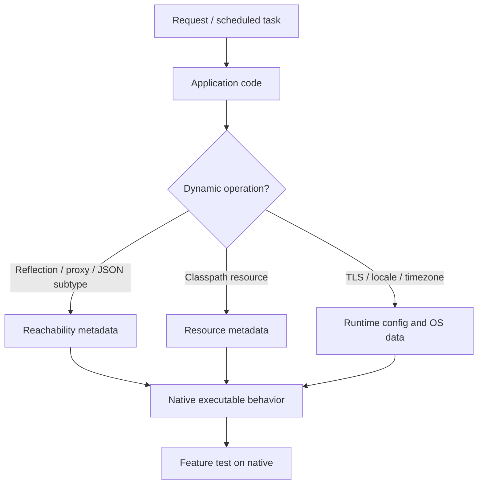

# JVM Works Properly While Native Fails on JSON, TLS, Locale, or Rarely Tested Branches

## 1. Why Do Failures Appear Only in the Native Executable?

A Spring Boot application can run reliably on the JVM yet fail after compilation with GraalVM Native Image. Failures typically surface on rarely exercised paths: deserializing an uncommon JSON subtype, loading a TLS certificate, formatting dates in another locale, reading a dynamically named resource, or invoking a method via reflection.

The JVM can typically load classes and metadata dynamically at runtime. Native Image analyzes reachability at build time and includes only the elements determined to be necessary in the executable. Dynamic operations require matching metadata; readable resources must be embedded in the image or supplied as runtime files. Therefore, an untested path can work on the JVM yet fail in native.

In the **SPRING_BOOT_NATIVE_IMAGE** module, separate three root-cause groups: (1) missing AOT/reachability metadata and resources; (2) incorrect runtime configuration such as TLS, locale, timezone, or environment; (3) container/OS environment and native library differences. Do not assume every native failure is caused by reflection.

## 2. How Does Native Image Change Class and Resource Loading?

Native Image performs static analysis to identify code reachable from entry points and build configuration. The output is a native executable packaged with the code, metadata, and resources required by that analysis.

- Directly invoked classes are easier to analyze for reachability than classes looked up by runtime names.
- Reflection, dynamic proxies, serialization, and JNI may require hints/metadata.
- Classpath resources loaded via patterns/dynamic names must be registered or checked for packaging.
- Config files, certificates, and secrets mounted at runtime must exist on the runtime filesystem.
- Runtime values such as URLs, passwords, locales, or timezones do not automatically become build-time metadata.



## 3. Classify Symptoms Before Fixing

| Symptom | Area to check first |
|---|---|
| Jackson cannot find constructor/property or subtype | JSON mapping, reflection/serialization metadata |
| JSON endpoint returns 500 only for one payload | DTO graph, polymorphism, custom serializer |
| TLS handshake fails | Truststore, CA bundle, protocol/cipher, provider |
| Certificate not found | File path, classpath resource, secret mount |
| Dates/currencies format differently from JVM | Locale, timezone, default locale/timezone |
| Missing template/schema/message bundle | Resource pattern, resource path, locale suffix |
| Failure when selecting a plugin/provider | ServiceLoader, classpath condition, reflection |
| Class/method not found on a rare branch | Dependency/runtime classpath or dynamic loading |
| Fails only inside container | libc, shared libraries, file permissions, CA/timezone data |

Save the exception type, stack trace, request fixture, non-sensitive runtime configuration, image digest, and binary hash. A generic HTTP 500 is not enough to diagnose the root cause.

## 4. JSON: Why the Happy Path Is Not Enough

Jackson can serialize/deserialize POJOs, records, generic types, enums, date/time types, polymorphic types, and custom serializers/deserializers. Testing a single common DTO does not cover the full real-world object graph.

Frequently missed cases:

- DTOs with non-public constructors or creator annotations.
- Fields/private accessors accessed via reflection.
- Polymorphic deserialization with rare subtypes.
- Nested generic collections/maps.
- Enums with fallback values or custom names.
- Indirectly registered custom serializers/deserializers.
- Jackson modules for Java Time or parameter names.
- DTOs coming from external libraries.
- Payloads containing nulls, missing fields, unknown properties, or legacy formats.

Identify the supported JSON contracts and build fixtures for every variant. If an API accepts multiple payload versions, test each version separately.

## 5. JSON Round-Trip Testing Example

```java
public record PaymentRequest(
        String reference,
        BigDecimal amount,
        PaymentMethod method) {
}

public enum PaymentMethod {
    CARD, BANK_TRANSFER
}
```

Round-trip test using the Spring-configured ObjectMapper:

```java
@SpringBootTest
class PaymentJsonTest {

    @Autowired
    ObjectMapper objectMapper;

    @Test
    void serializesAndDeserializesPayment() throws Exception {
        var input = new PaymentRequest(
            "PAY-1001",
            new BigDecimal("125.50"),
            PaymentMethod.CARD
        );

        String json = objectMapper.writeValueAsString(input);
        PaymentRequest output =
            objectMapper.readValue(json, PaymentRequest.class);

        assertThat(output).isEqualTo(input);
    }
}
```

This is a baseline Spring context test. Run the equivalent test against the native executable/native test setup to verify metadata in the actual runtime. Do not test a standalone ObjectMapper alone if production uses HTTP message converters with different configuration.

## 6. JSON Polymorphism and Rare Subtypes

Example API with multiple event types:

```java
@JsonTypeInfo(
    use = JsonTypeInfo.Id.NAME,
    include = JsonTypeInfo.As.PROPERTY,
    property = "type"
)
@JsonSubTypes({
    @JsonSubTypes.Type(value = CardPayment.class, name = "card"),
    @JsonSubTypes.Type(value = BankPayment.class, name = "bank")
})
public interface PaymentEvent {
}

public record CardPayment(String token, BigDecimal amount)
        implements PaymentEvent {
}

public record BankPayment(String account, BigDecimal amount)
        implements PaymentEvent {
}
```

Test both subtypes, especially rarely invoked branches:

```json
{
  "type": "bank",
  "account": "ACCT-42",
  "amount": 125.50
}
```

If JVM passes while native fails, verify the subtype is registered in Jackson configuration and required metadata is present. With current Spring Boot/Spring Framework versions, prefer framework-provided hints/serialization support; add manual RuntimeHints only when tests and documentation indicate it is needed.

Do not register an entire package for reflection just to make a test pass. Register only the exact types and access required, and keep regression tests for that subtype.

## 7. Serialization Metadata and RuntimeHints

Spring provides the RuntimeHints API to describe runtime operations that Native Image must support. Registration details depend on the serializer and Spring/GraalVM version. Some framework integrations provide built-in hints; other libraries may ship reachability metadata.

Diagnostic procedure:

1. Identify which type is being serialized/deserialized in the stack trace.
2. Check whether the library/framework version already includes built-in metadata.
3. Run a native test to reproduce accurately.
4. Inspect Native Image agent output if appropriate.
5. Write narrowly scoped RuntimeHintsRegistrar/hints when necessary.
6. Retest on the native executable with the failing payload.

Illustrative reflection hint example:

```java
hints.reflection().registerType(
    BankPayment.class,
    MemberCategory.INVOKE_DECLARED_CONSTRUCTORS
);
```

Member categories must match how the serializer instantiates objects and the Spring version in use. Do not copy examples verbatim if the framework already supplies hints or the serializer needs different access.

## 8. HTTP Message Conversion Differs from Standalone ObjectMapper Tests

Spring MVC/WebFlux can use HttpMessageConverters/codecs with an ObjectMapper customized by auto-configuration, modules, mixins, and customizers. A manually constructed ObjectMapper test may not reflect production.

Maintain three test layers:

- Unit tests of serializers/deserializers with the actual mapper configuration.
- MVC/WebFlux integration tests sending payloads through endpoints.
- Native application tests calling endpoints on the built executable.

Check content types, charsets, date formats, unknown fields, validation, and exception mapping. Save request/response fixtures to compare JVM and native outputs.

## 9. TLS: Distinguish Certificates, Truststores, and Protocols

TLS failures have many causes:

- Expired server certificate or hostname mismatch.
- Root/intermediate CA missing from the truststore.
- Wrong truststore path/password or unmounted file.
- Incompatible TLS protocol/cipher suite.
- Missing client certificate when the server requires mutual TLS.
- Different crypto provider/implementation across environments.
- Missing native library or shared crypto library.

Never disable certificate verification to "fix" an error. First inspect the exception chain: certificate path validation, hostname verification, protocol negotiation, or provider loading failure.

Verify the certificate chain and system clock. An inaccurate container clock can make valid certificates appear not-yet-valid or expired.

## 10. CA Bundles in Containers

If the application makes HTTPS calls, the runtime image generally needs appropriate CA certificates. Minimal base images may omit the trust bundle available in a developer environment.

Check:

- CA package is installed in the final runtime image.
- Truststore path matches HTTP client/JDK configuration.
- Internal certificates are mounted at the right path and are readable.
- Non-root process has read permissions.
- Private keys or truststore passwords are not copied into image layers.
- DNS and system clock inside the container work properly.

For Debian-based images, the standard package is `ca-certificates`; other distributions have their own packages/paths. Verify on the final image itself, not just the builder stage.

## 11. Supply Truststores via Runtime Configuration

If using a custom truststore, mount the file read-only and pass its path via environment/configuration:

```yaml
app:
  tls:
    trust-store: ${TLS_TRUST_STORE:/var/run/certs/service-truststore.p12}
    trust-store-password: ${TLS_TRUST_STORE_PASSWORD:}
```

These are illustrative application properties; bind them to your specific HTTP client and protect passwords with a secret manager. Do not assume every HTTP client reads custom properties automatically.

If using JVM system properties, verify how the Native Image runtime handles system properties in your GraalVM version and test on the binary. For native HTTP clients or JNI crypto providers, check vendor documentation on CA/truststore support.

## 12. TLS Tests Must Hit Real Endpoints

TLS tests must not merely check that a certificate file exists. Connect through the actual HTTP client/driver inside the actual container runtime.

A test suite should cover:

- Valid certificate with matching hostname.
- Untrusted certificate.
- Expired certificate or mismatched hostname.
- Mutual TLS if used by the product.
- Runtime-mounted internal CA.
- Certificate rotation/reload if supported.
- Database TLS if the JDBC driver uses TLS.

Negative tests must verify the application rejects invalid connections. This prevents configuration changes from accidentally disabling verification.

## 13. Locale and Timezone Are Two Separate Configurations

**Locale** governs language/regional rules for formatting numbers, currencies, dates, and messages. **Timezone** governs converting an instant into local date/time.

The same instant can display as different dates/times across timezones; the same number can format with different decimal separators across locales.

Never rely on the host's default locale/timezone as an implicit contract. Specify locale/timezone explicitly where business logic demands it and test with deterministic values.

```java
Locale locale = Locale.forLanguageTag("vi-VN");
ZoneId zone = ZoneId.of("Asia/Ho_Chi_Minh");

String amount = NumberFormat
    .getCurrencyInstance(locale)
    .format(new BigDecimal("125000.50"));

ZonedDateTime localTime =
    Instant.parse("2026-11-23T10:00:00Z").atZone(zone);
```

Formatting results depend on the JDK locale data version. If output is an external contract, test it against the exact runtime distribution/version the application ships with.

## 14. Locale Data and Native Image

Some runtime/Native Image configurations may restrict packaged locale data compared to a full JDK. GraalVM provides locale/charset options varying by version and distribution. Do not assume every locale is bundled just because it works on a developer JDK.

Check supported locales, locale data built into the executable, default process/container locale, required charsets, locale-specific message bundles, and actual output from the native executable.

If the build needs additional locales, use the Native Image option supported by your exact version and check build logs. Do not copy flags from documentation for another version without verifying.

## 15. Message Bundles and Locale Resources

Spring message sources can read resources such as `messages.properties`, `messages_vi.properties`, or `messages_en.properties`. If resource names are constructed by the framework from the runtime locale, verify all required bundles are packaged in the native image.

Example structure:

```text
src/main/resources/
  messages.properties
  messages_vi.properties
  messages_en.properties
```

Write tests for every supported locale and missing-key fallback. If using resource hints, register patterns matching bundle naming. Do not test only the default locale because other locale branches might reference resources omitted from the image.

## 16. Resource Lookup by Dynamic Names

Some applications read templates/schemas named by database records, tenants, or requests. Static analysis may not see every runtime name.

```java
Resource resource = resourceLoader.getResource(
    "classpath:templates/" + templateName + ".html"
);
try (InputStream input = resource.getInputStream()) {
    // Read template bytes.
}
```

If `templateName` is chosen only at runtime, register resource patterns covering valid templates or use the corresponding resource metadata mechanism. Also use an allowlist so users cannot pass arbitrary paths.

Test every supported template/tenant/locale on the native executable. A passing test for `invoice.html` does not prove `receipt.html` was packaged too.

## 17. Build a Test Matrix for Rarely Exercised Branches

Do not run only the happy path. List inputs and conditions capable of altering behavior:

| Feature | Branches to test |
|---|---|
| JSON | rare subtypes, null/missing fields, new enums, legacy payloads |
| TLS | internal CA, hostname mismatch, certificate rotation |
| Locale | vi-VN, en-US, fallback locale |
| Timezone | UTC, Asia/Ho_Chi_Minh, DST zones if supported |
| Resource | each template/schema/bundle, missing resource |
| Reflection | constructors/methods called only on rare branches |
| Proxy/AOP | interface calls, concrete class calls, async paths |
| JDBC | driver discovery, TLS, reconnect, and migrations |
| Error handling | rare exceptions, fallbacks, and retry paths |
| Serialization | nested types, generic collections, custom serializers |

Each branch needs concrete fixtures and pass/fail criteria. Explicitly document unsupported features rather than letting test coverage create a false sense of completeness.

## 18. Compare JVM and Native Using Identical Fixtures

To isolate discrepancies, run identical request fixtures and external dependencies across both runtimes:

1. Same source commit and application configuration.
2. Same JSON payloads and expected responses.
3. Same CA/truststore and TLS endpoints.
4. Same explicitly specified locale/timezone.
5. Same resource files and external mounts.
6. Compare status codes, response bodies, headers, and side effects.
7. Save logs/stack traces whenever differences appear.

Do not compare output that depends on two different machines' default timezone/locale and blame Native Image. Standardize the environment first.

## 19. Evidence-Based Diagnostic Procedure

When JVM passes but native fails:

1. Create the smallest test reproducing the failure with concrete input.
2. Identify whether the error occurs at startup, on first feature invocation, or after running for some time.
3. Inspect the stack trace and involved classes/resources/providers.
4. If JSON/reflection/proxy: check framework hints and reachability metadata.
5. If resources: verify the resource is in the image and the runtime path is correct.
6. If TLS: check CA chain, truststore, hostname, clock, and provider.
7. If locale/timezone: log defaults and verify locale data.
8. If container-only: check libc, shared libraries, permissions, filesystem, and environment.
9. Fix the root cause in the corresponding source/build/runtime configuration.
10. Add a regression test running on the native executable/container.

Enable only necessary tracing/debug output. Never log passwords, private keys, raw tokens, or sensitive payloads.

## 20. Common Errors

| Symptom | Likely cause | Remedy |
|---|---|---|
| Jackson fails on rare subtype | Type/constructor metadata not registered | Check polymorphic config and hints |
| ObjectMapper unit test passes, HTTP fails | MVC converter uses a different mapper/config | Test endpoint through HTTP layer |
| TLS trust failure in container | Missing CA/truststore or permissions | Check final image and mounted trust material |
| TLS fails only on one host | Clock, DNS, proxy, or protocol difference | Compare runtime environments |
| Different currency/date format | Different default locale/timezone | Specify locale/ZoneId explicitly |
| Message key not found | Missing bundle resource | Check resource patterns and locale files |
| Rare template missing | Dynamic resource not included | Register pattern and test each template |
| JVM passes, native fails on rare branch | Tests did not trigger dynamic code path | Add fixtures and native regression tests |
| Fails only in minimal image | Missing CA, timezone, font, or shared library | Check runtime files of final image |

## 21. Pre-Release Checklist

- JSON tests cover DTOs, subtypes, generic types, and custom serializers.
- HTTP endpoints are tested with realistic payloads on the native executable.
- Reflection/serialization hints are added only when backed by evidence.
- TLS tests verify certificate chains and hostname validation.
- CA/truststore exists in the runtime image or is mounted properly.
- TLS secrets are supplied at runtime and not packaged into the binary/image.
- Locale/timezone are specified and tested per feature contract.
- Required locale data/message bundles are present in the native runtime.
- Every valid resource name is tested.
- Rarely exercised branches have fixtures and native regression tests.
- JVM and native use identical inputs and external dependencies during comparison.
- The final container image is tested with the target user, filesystem, and base image.
- Logs/diagnostics do not leak sensitive data.

## 22. Self-Check Questions

1. Why can the JVM execute a JSON branch while the native executable lacks metadata for it?
2. How do you distinguish a Jackson mapping error from an HTTP message converter error?
3. What causes can trigger a TLS handshake failure in a native container?
4. Why should certificate verification never be disabled to work around TLS errors?
5. How does locale differ from timezone?
6. Why should message bundles and templates be tested per locale?
7. When resources are selected by runtime names, what is needed for Native Image to package them properly?
8. How do you standardize JVM/native tests to eliminate environment differences?
9. When are RuntimeHints needed versus runtime files/configuration?
10. Why do rarely exercised branches require dedicated fixtures and regression tests?

**Takeaway:** when the JVM succeeds yet native fails, reproduce with concrete input and classify the error into metadata/reachability, resources, runtime configuration, or container environment. Test JSON, TLS, locale, timezone, and every rarely invoked branch on the actual native executable and container image being released.
