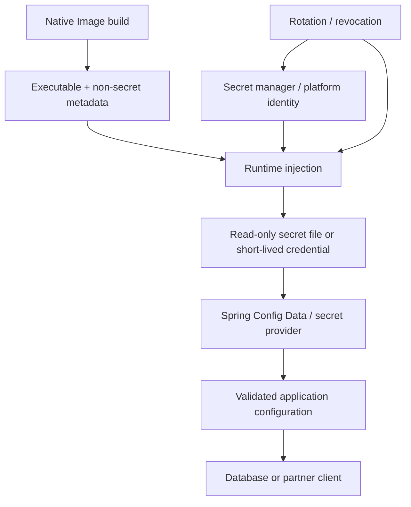

# Keeping Secrets and Environment-Bound Data at the Appropriate Runtime Stage

## 1. Why must secrets be separated from the Native Image?

A Spring Boot application typically needs database passwords, API tokens, private keys, TLS details, service URLs, and values that differ across local, staging, or production environments. This data must be supplied when the application runs, matching the right environment and workload permissions.

GraalVM Native Image builds an executable from a pre-analyzed program. Some classes can be initialized during the build; static state of classes initialized at build time can be stored in the image heap and become part of the binary. If a static initializer reads secrets or build-machine-specific data, those values can be baked into the executable.

Therefore, the core principle is: **the binary contains the code and metadata needed to run; the deployment environment supplies secrets and environment-dependent data when the process starts or during runtime**. Do not put production credentials into source code, packaged resources, build arguments, image layers, or Native Image static state.

This article belongs to the **Security** chapter of the **SPRING_BOOT_NATIVE_IMAGE** module. It covers how to classify data, supply secrets at runtime, bind them with Spring Boot, protect TLS material, control access permissions, handle rotation, and test native artifacts.

## 2. Build time and runtime in Native Image

Native Image has two stages:

- **Build time:** GraalVM performs reachability analysis, runs certain AOT operations, processes metadata, and may initialize some classes.
- **Runtime:** the container or process launches the executable; the application receives environment variables, command-line arguments, file mounts, secret providers, and connects to dependencies.

When a class is initialized at build time, its static values are stored in the image heap. If that class reads environment variables, files, hostnames, timestamps, or credentials inside a static initializer, the executable may retain state from the build environment.

Risky example:

```java
final class PartnerCredentials {

    static final String API_TOKEN =
        System.getenv("PARTNER_API_TOKEN");
}
```

If this class is initialized during the build, the token can become data inside the binary. This depends on actual class initialization; not every call to System.getenv automatically runs at build time. The risk arises when the call sits inside a class initializer executed during the build or in AOT code executed at build time.

By default, GraalVM initializes most application classes at runtime unless a class is proven safe to initialize early or configuration specifies otherwise. Do not rely on this default to manage secrets. Remove secret reading from static initializers and fetch data only through Spring Environment or a secret provider at runtime.

When a class is initialized at build time, its static state is stored in the image heap. See [Native Image Basics](https://www.graalvm.org/latest/reference-manual/native-image/basics/) and [Class Initialization](https://www.graalvm.org/latest/reference-manual/native-image/optimizations-and-performance/ClassInitialization/).

## 3. Classifying data before packaging

Not every configuration setting is a secret. Classification helps choose the right storage location and lifecycle.

| Data type | Examples | Appropriate location |
| --- | --- | --- |
| Long-lived secrets | Database passwords, API keys, signing keys | Secret manager or secret volume supplied at runtime |
| Short-lived credentials | OAuth access tokens, cloud workload tokens, database leases | Identity provider or secret provider at runtime |
| Private keys | TLS server keys, client certificate private keys | Secret store or restricted-permission volume mount |
| Public certificates/CAs | CA certificates, public certificates | Can be packaged if shared and environment-independent; if environment-specific, mount/configure at runtime |
| Environment configuration | Service URLs, ports, regions, feature flags, timeouts | Environment variables or external config files |
| Build identity | Commit SHA, image digest, GraalVM version | Build metadata or filtered Actuator Info |
| AOT structure | Profiles/conditions that alter the bean graph | Determined and fixed when running Spring AOT |

Do not treat URLs, usernames, or public certificates as secrets if they contain no authentication material. However, these values can still be sensitive because they disclose topology, tenants, or internal infrastructure.

## 4. Flow for supplying and using secrets

A secure flow should look like:



The build pipeline produces the executable without needing to know production passwords or private keys. The deployment platform supplies secrets to the authorized workload. The application reads, validates, and uses the secrets; when credentials change, the rotation workflow updates the provider and restarts/reloads clients according to the designed capability.

## 5. Spring Boot configuration and property precedence

Spring Boot supports externalized configuration from files, environment variables, system properties, JSON property sources, and command-line arguments. Higher-precedence properties can override lower-precedence sources.

For a typical application, the abbreviated order from highest to lowest is:

1. Command-line arguments.
2. `SPRING_APPLICATION_JSON`.
3. Java system properties.
4. OS environment variables.
5. Config data such as `application.yaml` and profile-specific files.
6. Default properties.

The full order also includes sources such as JNDI, servlet parameters, and test property sources. Consult the documentation for your exact Spring Boot version when multiple sources set the same key.

Environment variables are usually appropriate for non-sensitive configuration:

| Spring property | Environment variable |
| --- | --- |
| `spring.profiles.active` | `SPRING_PROFILES_ACTIVE` |
| `server.port` | `SERVER_PORT` |
| `partner.api.base-url` | `PARTNER_API_BASEURL` |
| `spring.datasource.url` | `SPRING_DATASOURCE_URL` |

Do not pass passwords, tokens, or private keys via the command line because they can appear in process listings, shell history, CI logs, or deployment system metadata. Environment variables can also be exposed via process inspection, diagnostic endpoints, or dumps; for secrets, prefer file mounts or a managed secret provider.

Refer to [Spring Boot Externalized Configuration](https://docs.spring.io/spring-boot/reference/features/external-config.html).

## 6. Loading secrets from files with Config Tree

Spring Boot supports `configtree:` to map filenames to property keys and file contents to property values. This approach works well with Docker Swarm secrets, Kubernetes Secret volumes, and CSI secret providers.

Example volume in a container:

```text
/run/secrets/
  spring.datasource.username
  spring.datasource.password
  partner.api.api-key
```

Add the import in `application.yaml`:

```yaml
spring:
  config:
    import: "configtree:/run/secrets/"
```

Or use an environment variable:

```bash
SPRING_CONFIG_IMPORT=configtree:/run/secrets/
```

The file `spring.datasource.password` is mapped to the property `spring.datasource.password`. The file `partner.api.api-key` is mapped to `partner.api.api-key`, which can then bind to the `apiKey` field via relaxed binding.

In production, omit the `optional:` prefix if the secret is required. When the file does not exist, the application should fail fast rather than starting with empty credentials and only failing when receiving requests. Only use `optional:configtree:` for profiles where the secret is genuinely optional, such as local development.

Config tree values can bind to String or byte[] depending on content. Use byte[] if you need to preserve binary data such as key material; never convert private keys into log strings or diagnostic output.

## 7. Binding and validating configuration containing secrets

Use `@ConfigurationProperties` to bind a structured group of configuration settings. Example:

```java
import java.net.URI;
import java.time.Duration;

import jakarta.validation.constraints.NotBlank;
import jakarta.validation.constraints.NotNull;

import org.springframework.boot.context.properties.ConfigurationProperties;
import org.springframework.validation.annotation.Validated;

@ConfigurationProperties(prefix = "partner.api")
@Validated
public class PartnerApiProperties {

    @NotNull
    private URI baseUrl;

    @NotBlank
    private String apiKey;

    @NotNull
    private Duration timeout = Duration.ofSeconds(3);

    public URI getBaseUrl() {
        return baseUrl;
    }

    public void setBaseUrl(URI baseUrl) {
        this.baseUrl = baseUrl;
    }

    public String getApiKey() {
        return apiKey;
    }

    public void setApiKey(String apiKey) {
        this.apiKey = apiKey;
    }

    public Duration getTimeout() {
        return timeout;
    }

    public void setTimeout(Duration timeout) {
        this.timeout = timeout;
    }
}
```

Register the class with `@ConfigurationPropertiesScan` or `@EnableConfigurationProperties(PartnerApiProperties.class)`. The example requires a validation provider, typically the `spring-boot-starter-validation` dependency. Validation helps the application reject configurations missing a URL or API key right at startup.

Do not auto-generate a `toString()` containing secrets. Java records auto-generate `toString()` from all components; Lombok `@Data` also commonly generates a `toString()` including fields. If configuration contains passwords/tokens, avoid logging the whole object and do not include that object in exception messages. Log only whether it was loaded, never its value.

For required secrets, do not set dummy default values such as password=changeme or an empty token in production config. Use validation and startup failure to avoid running in an insecure state.

## 8. Using secrets without leaking their values

Secrets should only be passed to the components that need them. For example, an API key should only be supplied to the corresponding outbound client; a database password should only be used to create the datasource or obtain connection credentials.

Principles:

- Do not log request headers such as Authorization, cookies, API keys, or database URLs containing credentials.
- Do not put tokens into query strings because URLs are frequently recorded in access logs, proxy logs, and tracing spans.
- Do not include secret configuration in exception messages.
- Do not serialize configuration beans into JSON responses.
- Do not use secrets as metric labels, trace attributes, or correlation IDs.
- Avoid keeping unnecessary copies of secrets or caches without TTLs.
- Grant secret read permissions only to the service accounts/workloads that actually need them.

When creating an HTTP client, use the appropriate header API to pass bearer tokens; do not concatenate tokens into URLs. When creating a JDBC datasource, let Spring Boot use standard properties and avoid logging full connection strings.

When using `@ConfigurationProperties`, inject the bean only where needed. Do not pass the entire configuration object through multiple layers if only one component needs the API key.

## 9. Preventing secrets from entering the build pipeline or Native Image

Control secrets from checkout through image publishing:

### 9.1. Source code and packaged config

Do not commit secrets into:

- application.yaml, application.properties, or profile-specific config.
- src/main/resources, test fixtures, or native image resource configuration.
- Dockerfiles, Compose files, or Kubernetes manifests.
- Build scripts, shell history, or CI variables printed to logs.
- Native Image build arguments or generated metadata.

Packaged configuration files may contain non-sensitive defaults such as timeouts or pool sizes. Secrets must be provided from the deployment environment.

### 9.2. Docker build arguments and layers

Do not use Dockerfile `ARG` or `ENV` to pass secrets during builds. Values can remain in image history, layers, build cache, or image configuration.

If the build needs credentials to download dependencies from a private repository, use the build system's secret mounts, scope them to the exact build step, and ensure files/tokens are not copied into outputs or cache artifacts. Credentials used to access repositories during the build are separate build credentials; do not reuse them as runtime application secrets.

### 9.3. Static initialization and build-time initialization

Do not read secrets in static initializers:

```java
class UnsafeSettings {

    static final String DATABASE_PASSWORD =
        System.getenv("DATABASE_PASSWORD");
}
```

If this class is initialized at build time, the static value can be stored in the image heap. If a third-party library has a static initializer that reads environment-dependent data, inspect the class initialization report and explicitly configure that class to run at runtime when needed.

Example option that can be used to force a class to initialize at runtime:

```text
--initialize-at-run-time=com.example.security.RuntimeCredentialHolder
```

Apply this only to identified and tested classes. Do not arbitrarily put entire application packages under runtime initialization because doing so can alter performance or cause compatibility issues. Best practice remains designing code so secrets are only read via Spring Environment or a provider after the process starts.

### 9.4. AOT must not depend on production secrets

Spring AOT may need the Environment to evaluate profiles and bean creation conditions. Properties affecting `@Conditional` or `@Profile` must be consistent between build-time AOT configuration and runtime; however, passwords, tokens, and private keys should not be used to decide the bean graph.

If AOT processing needs to access Config Server or a configuration service, supply only minimal, short-lived build credentials for that step. Do not place production application secrets in the build environment, and verify logs/build outputs do not retain credentials.

## 10. TLS certificates, truststores, and private keys

TLS material must be classified:

- **CA certificate/public certificate:** usually not a secret, though it may vary by environment.
- **Private key:** a secret, must be supplied from a secret manager or protected volume.
- **Keystore password:** a secret, must not be placed in packaged configuration files.
- **Truststore:** may contain public CAs; if it contains private keys, it must be protected as a secret.

Example server TLS configuration using file mounts:

```properties
server.ssl.enabled=true
server.ssl.key-store=file:/run/tls/server.p12
server.ssl.key-store-type=PKCS12
```

The keystore password can be supplied via config tree with the `server.ssl.key-store-password` property. The `server.p12` file is mounted read-only from a secret provider. Do not COPY keystores containing private keys into the image.

For outbound TLS, use the SSL configuration/client API appropriate for your Spring Boot version and HTTP client. Ensure custom CAs are loaded from a runtime location when environment-dependent. Do not disable hostname verification or trust-all certificates to work around certificate errors.

Native Image must be tested with the exact TLS provider, cipher suites, certificate chains, and client libraries in use. A successful binary build does not prove every TLS path will work at runtime.

## 11. Preferring workload identity and short-lived credentials

Static secrets create storage, rotation, and revocation burdens. If the platform supports it, prefer workload identity:

- Kubernetes service accounts linked to a cloud identity.
- Cloud managed identities or instance roles.
- OAuth client credential exchanges with short-lived tokens.
- IAM-based database authentication or credential leases.
- Secret managers issuing credentials based on workload identity.

This approach reduces the need to store long-lived bootstrap passwords in the environment. The process receives short-lived tokens at runtime and refreshes them through a provider/client designed to support rotation.

Do not store long-lived tokens in static fields yourself. If a client needs to refresh tokens, design a provider with a TTL, synchronized access, and error handling when the identity provider is unavailable. Do not assume every cloud SDK supports Native Image; check reachability metadata and run integration tests against the native executable.

## 12. Rotating and revoking secrets

Supplying a new runtime secret does not automatically cause running beans to switch credentials. If a password is bound at startup and a datasource/client is created once, the process may continue using the old value.

A rotation procedure should:

1. Create the new credential on the target system; keep an overlap window if the system allows it.
2. Update the secret manager or secret volume.
3. Verify the workload has permission to read the new version.
4. Restart/roll out instances or use a credential provider with explicitly designed refresh support.
5. Verify new connections succeed without logging credentials.
6. Revoke the old credential after all instances have switched over.
7. Record the secret version/reference and completion timestamp.

Kubernetes can update the contents of a projected Secret volume, but Spring Config Data typically reads files during application context initialization. A changed file does not mean already-bound beans update automatically. Mounting via subPath also has different update behavior from regular volume mounts.

With Spring Cloud, Context Refresh and `@RefreshScope` are not supported for Spring AOT transformations and Native Image; native clients need to set `spring.cloud.refresh.enabled=false`. Therefore, do not rely on `/actuator/refresh` to rotate secrets in a native process. Refer to [Spring Cloud Context Services](https://docs.spring.io/spring-cloud-commons/reference/spring-cloud-commons/application-context-services.html).

## 13. File permissions and secret volumes

Run containers as a non-root user and mount only the secrets the process needs. Kubernetes example:

```yaml
apiVersion: apps/v1
kind: Deployment
metadata:
  name: orders-api
spec:
  selector:
    matchLabels:
      app: orders-api
  template:
    metadata:
      labels:
        app: orders-api
    spec:
      securityContext:
        runAsNonRoot: true
        runAsUser: 10001
        runAsGroup: 10001
        fsGroup: 10001
      containers:
        - name: app
          image: registry.example.com/orders-api:native
          volumeMounts:
            - name: app-secrets
              mountPath: /run/secrets
              readOnly: true
      volumes:
        - name: app-secrets
          secret:
            secretName: orders-api-runtime
            defaultMode: 0440
```

The example assumes the `orders-api-runtime` Secret is created by a secret manager integration or protected deployment workflow. Do not store real credentials in source-controlled manifests. Verify the actual UID/GID can read files on the cluster; `fsGroup` and volume permissions can depend on the CSI driver.

Kubernetes Secrets are base64-encoded in the API representation; base64 is not encryption. Enable encryption at rest for the datastore, restrict RBAC, mount secrets only into containers that need them, and consider an external secret store. Refer to [Kubernetes Secrets](https://kubernetes.io/docs/concepts/configuration/secret/).

With Docker Swarm, secrets are mounted under `/run/secrets`; Spring Boot can read them via `configtree:/run/secrets/`. With local Docker Compose, file-backed secrets are commonly implemented via mounts; check file permissions and do not treat `.env` files as a secret manager.

## 14. Protecting logs, Actuator, and telemetry

Secrets can leak even after being loaded into the process:

- Logging configuration or objects whose `toString()` contains passwords/tokens.
- Logging HTTP request/response headers.
- Exception messages containing URLs with usernames/passwords.
- Actuator `env` or `configprops` exposing sensitive configuration.
- Heap dumps, core dumps, or crash reports containing objects in memory.
- Trace attributes, baggage, or metric labels containing tokens/customer secrets.
- Debug logs from SDKs or HTTP clients.

Spring Boot has sanitization mechanisms for certain Actuator endpoints, but do not use them as the sole layer of defense. Restrict endpoint exposure, authentication/authorization, network access, and read permissions on logs/dumps. Check version-specific sanitization configuration and do not return secrets in custom health indicators or Info contributors.

When investigating incidents, collect logs/metrics first; create heap/core dumps only when necessary and handle dumps as sensitive data. Encrypt storage locations, restrict readers, set retention policies, and delete temporary copies after finishing.

## 15. Testing secret handling on the native executable

Testing on the JVM is not enough to prove secrets were not baked into the Native Image. A test suite should include:

| Check | Expected result |
| --- | --- |
| Build in an environment without production secrets | Native Image still builds cleanly |
| Run native binary with runtime secrets | Application reads secrets and connects to dependencies |
| Missing required secret | Application fails fast |
| Change secret file after startup | Do not assume beans auto-update; restart/refresh workflow is verified |
| Static initializer reading environment | No environment-dependent secret in build-time state |
| Image scan and secret scan | No credentials found in source, layers, metadata, or artifacts |
| Log/Actuator/trace inspection | Does not return or log secret values |
| Non-root execution | Process can only read required files |
| Rotation/revocation | Instances transition to new credential and old credential is revoked |
| Native TLS test | Certificates, private keys, truststores, and hostname verification work properly |

Dummy canary secrets can be used in a test environment to verify source, build logs, image layers, and binaries. Searching strings with `strings` is only a supplementary check; not finding a string does not prove the binary contains no encoded or transformed secrets.

Run tests on the exact final image, with the same UID, volume mounts, network policies, and GraalVM runtime that will be deployed. Do not just run the executable directly on the build machine.

## 16. Common issues and troubleshooting

| Symptom | Possible cause | Resolution |
| --- | --- | --- |
| Native process uses build machine's secret | Static initializer ran during build or class was build-time initialized | Remove static read, use Spring runtime config; check class initialization |
| Secret is not bound | Wrong config tree filename or import location | Match filename against property key and mount path |
| App starts despite missing credential | Config tree uses `optional:` for required secret or has an unsafe default | Remove optional and enable validation |
| Rotation has no effect | Bean/client still holds old credential | Restart/roll out or use a refresh-capable credential provider |
| Token appears in logs | Debug logging, `toString()`, or exception contains configuration | Redact logs, remove secrets from object representations, and inspect telemetry |
| Pod cannot read secret file | Incompatible UID/GID, mode, or CSI volume policy | Check permissions inside container, adjust group/mode |
| Secret appears in image history | Used Docker `ARG`/`ENV` or COPYed file at build time | Use runtime secret mounts and secret mounts for build steps |
| TLS works on JVM but fails in native | Provider, metadata, or native library differences | Run native TLS integration tests and check dependency support |
| New config causes bean not to exist | Property affecting `@Conditional` or profile was processed at AOT | Select the right AOT profile and rebuild |

## 17. Hands-on lab: supplying database password and partner API key at runtime

**Scenario:** A Spring Boot Native Image service connects to PostgreSQL and a partner API. The same image is deployed to staging and production with different credentials.

**Steps:**

1. Remove all passwords/tokens from source code, `application.yaml`, Dockerfile, and build arguments.
2. Configure the datasource and partner API using Spring properties.
3. Create secret files for `spring.datasource.password` and `partner.api.api-key`.
4. Mount the files read-only into `/run/secrets/` and configure `spring.config.import=configtree:/run/secrets/`.
5. Bind partner API settings using `@ConfigurationProperties` with validation, without generating a `toString()` containing secrets.
6. Run the native executable with a non-root UID and verify file permissions.
7. Build the native image in an environment without production secrets.
8. Scan source, build logs, container layers, and artifacts using a secret scanner with dummy canaries.
9. Send requests to verify the database and partner client use the runtime credentials properly.
10. Test with a missing secret file and confirm the application fails to start.
11. Rotate credentials in staging, restart/roll out instances, and revoke the old credentials.
12. Verify logs, Actuator, traces, and dump workflows do not leak secrets.

**Pass criteria:**

- Production secrets do not appear in source, build environment, native binary, or container image.
- Secrets are supplied to the right workload at runtime.
- Spring Config Tree binds properties properly and validation fails fast when missing.
- Private keys and keystore passwords are mounted/managed as secrets.
- The process runs as non-root and reads only necessary secrets.
- Rotation includes update steps, supported restart/refresh, and old credential revocation.
- Native integration tests verify connectivity and TLS on the final artifact.
- Secrets are never logged or placed into metrics, traces, or Actuator responses.

## 18. Summary

With Spring Boot Native Image, secrets and environment-dependent data must be supplied at runtime. Static initializers or classes initialized at build time can store state in the image heap; therefore, do not read credentials in static fields and do not put secrets into source code, packaged resources, Docker build arguments, or image layers.

Spring Boot Config Tree maps mounted files into properties; `@ConfigurationProperties` with validation catches missing configuration at startup. Combine this with a secret manager or workload identity, least-privilege file permissions, proper TLS handling, log redaction, and controlled rotation. Test on the final native container to confirm secrets are not baked into the artifact and only authorized workloads can use them.

## References

- [Spring Boot — Externalized Configuration](https://docs.spring.io/spring-boot/reference/features/external-config.html)
- [Spring Cloud Commons — Application Context Services](https://docs.spring.io/spring-cloud-commons/reference/spring-cloud-commons/application-context-services.html)
- [GraalVM — Native Image Basics](https://www.graalvm.org/latest/reference-manual/native-image/basics/)
- [GraalVM — Class Initialization](https://www.graalvm.org/latest/reference-manual/native-image/optimizations-and-performance/ClassInitialization/)
- [Kubernetes — Secrets](https://kubernetes.io/docs/concepts/configuration/secret/)
