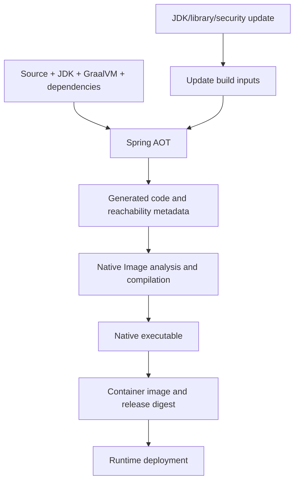

# Updating the JDK, GraalVM, or Libraries May Require Building and Releasing a New Binary

A Spring Boot application running on the JVM typically gets its JDK and dependencies from the environment or classpath at startup. With **GraalVM Native Image**, application code, required JDK classes, the runtime, and portions of native code are compiled into the executable at build time. Spring AOT also analyzes the ApplicationContext and generates code/hints based on the build configuration. Therefore, updating the JDK, GraalVM, Java libraries, or AOT metadata usually requires regenerating the native executable and publishing a new release.

Not every change requires recompiling the executable. If only a dynamically linked shared library or an OS package in the runtime image is updated, rebuilding only the container image may suffice as long as ABI compatibility is preserved. If configuration is read entirely at runtime, you can change configuration while keeping the same binary. This lesson helps you accurately scope what needs to be built, tested, and released so security patches actually reach production.

## 1. Learning Objectives

After this lesson, you will be able to:

- Explain why a native executable contains application code, required JDK classes, and the runtime chosen at build time.
- Distinguish updates requiring a native executable rebuild from updates requiring only a container image rebuild.
- Assess the impact of JDK, GraalVM compiler/runtime, and Java library patches.
- Understand how Spring AOT, reachability metadata, and build-time conditions affect native output.
- Manage dependency versions, lockfiles, and checksums for reproducible builds.
- Handle security advisories/CVEs based on impact and exploitability.
- Re-run AOT, native compilation, native tests, and container tests after an upgrade.
- Generate SBOMs, provenance, and release records to prove patches are present in the artifact.
- Release new native builds by digest, monitor rollouts, and roll back when needed.
- Avoid confusing runtime configuration updates, runtime shared libraries, and statically compiled code.

## 2. Why do dependency updates differ from JVM applications?

Native Image analyzes bytecode and metadata to determine reachable code, then compiles the reachable subset into an executable for a specific OS and architecture. The executable contains application classes, required standard-library classes, the language runtime, and native code linked from the JDK. It does not start a full JVM and re-read all JAR dependencies like a conventional application.

Consequences:

- Changing source code or JAR dependencies changes the inputs to the Native Image builder.
- Changing the JDK can change the standard-library classes, security implementations, and native runtime code included in the executable.
- Changing GraalVM can change the compiler, Native Image runtime, garbage collector, optimizer, or metadata processing.
- Changing Spring AOT inputs can change context initialization code, the bean graph, and runtime hints.
- Without rebuilding, the running binary remains the product of older versions, even if the source repository has been updated.



Updating a dependency in `pom.xml` or `build.gradle` does not change the running executable yet. Only after AOT/native build succeeds, tests pass, and the new image is deployed does the update take effect.

## 3. Which changes require a rebuild?

Classify the scope of a change before running the pipeline:

| Change | Rebuild native executable? | Rebuild container image? | Reason |
| --- | --- | --- | --- |
| Application source code | Yes | Yes | Machine code and application resources change |
| JDK patch/version | Yes | Yes | JDK classes and runtime/security code are packaged by the build toolchain |
| GraalVM distribution/compiler/runtime | Yes | Yes | Native executable is produced by the new compiler/runtime version |
| Spring Boot or Java library dependency | Yes | Yes | Dependency bytecode and reachability graph change |
| Reachability metadata/reflection/resource hints | Yes | Yes | Native Image analysis must regenerate the executable with new metadata |
| Spring AOT profile/property affecting bean conditions | Yes | Yes | AOT already evaluated conditions and generated code from the build-time environment |
| Runtime environment variable not affecting AOT graph | No | Not necessarily | Application reads the value at startup |
| ConfigMap/Secret mounted or injected at runtime | No | Not necessarily | Value is not inside the binary/image |
| CA certificate mounted at runtime | No | Not necessarily | Client reads trust material from a file outside the executable |
| Default TrustStore captured by Native Image at build time | Yes if updating the embedded truststore; or configure a runtime truststore explicitly | Yes if changing the image | The build host's CA store may be captured into the executable |
| OS package in runtime image | No, if binary does not depend on new package contents | Yes | Patched package must be put into the container |
| Dynamically linked shared library | Usually no if ABI is compatible and library is supplied at runtime | Yes | Container must include the new library for the right architecture/ABI |
| Native library statically linked into executable | Yes | Yes | Native code is embedded into the binary |
| Resource file packaged into executable | Yes | Yes | Resource content is part of build output |
| Runtime file outside the image and mounted | No | Not necessarily | File can be updated via deployment/configuration |

### 3.1. JDK update

If upgrading the JDK from one patch release to a newer patch release, rebuild the native executable using the updated JDK/GraalVM toolchain. Native Image embeds required standard library classes and portions of native code from the JDK; an old binary does not automatically pick up patches from a newer JDK on the build server.

Example:

1. A security advisory identifies a bug in TLS, a crypto provider, serialization, or a JDK library.
2. CI updates the GraalVM/JDK distribution to a patched and supported release.
3. Re-run Spring AOT and the Native Image build.
4. Test affected paths such as HTTPS, certificate validation, cryptography, or parsing.
5. Package a new image and deploy the new digest.

Do not assume changing the container's JAVA_HOME is enough to patch a previously compiled native executable. The executable does not run on a JVM in JAVA_HOME.

### 3.2. GraalVM update

GraalVM supplies the compiler, Native Image builder, and runtime components. When upgrading versions, build output can change in:

- Compiler optimizations and generated machine code.
- Native Image runtime and garbage collector.
- OS/architecture or CPU instruction set support.
- Handling of reflection, resources, serialization, and proxies.
- Reachability metadata and third-party library compatibility.
- Debugging, monitoring, and security features.

Review the compatibility/release notes of your GraalVM and Spring Boot versions. Do not automatically pick the latest GraalVM if Spring Boot/Native Build Tools do not yet support that version in your project combination.

### 3.3. Java library update

When updating Spring Framework, Jackson, Netty, database drivers, logging, or third-party libraries:

- The new JAR becomes an input to the AOT/native build.
- The transitive dependency graph may change.
- The library may introduce new reflection, proxies, serialization, or resource access.
- Reachability metadata may need updating.
- Native library classifiers or JNI implementations may change.

Therefore, you must re-run AOT and the Native Image build. If you only update the version in the dependency manifest without building/redeploying, production keeps running old code.

### 3.4. OS packages and shared libraries

If the executable dynamically links to libssl, libstdc++, glibc, or other OS libraries, you can update the package in the runtime image without recompiling application code, provided ABI and symbol versions remain compatible. However, you must rebuild the container image to include the patched package, then run smoke/integration tests on the new image.

If the library is statically linked into the native executable, replacing the package in the runtime base image does not change the embedded code. You must rebuild the native executable using the patched toolchain/library.

Do not infer solely from package names. Inspect the binary with readelf, ldd, linker configuration, and how the Native Image build linked native dependencies.

## 4. Spring AOT and build-time configuration

Spring AOT analyzes the application at build time and generates optimized code so the Spring ApplicationContext can run in Native Image. Configuration conditions and certain bean selections are evaluated during this phase.

### 4.1. Why does the build-time profile matter?

Suppose an application has two beans:

```java
@Configuration(proxyBeanMethods = false)
class PaymentConfiguration {

    @Bean
    @Profile("sandbox")
    PaymentGateway sandboxGateway() {
        return new SandboxPaymentGateway();
    }

    @Bean
    @Profile("production")
    PaymentGateway productionGateway() {
        return new ProductionPaymentGateway();
    }
}
```

If AOT is run with the sandbox profile, the generated context may reflect the sandbox environment's bean graph. Merely changing SPRING_PROFILES_ACTIVE=production when running the executable does not guarantee the production bean was included in the AOT output.

Choose a build-time profile aligned with your deployment model. If a single binary must support multiple environments, design configuration so environment differences are read at runtime without altering the bean graph frozen during AOT.

### 4.2. Changing AOT inputs requires a rebuild

The following changes typically require re-running AOT and native compilation:

- Profiles/properties used to select beans during AOT.
- Auto-configuration or conditional bean conditions.
- Packages/classpath and dependency versions.
- AOT processors, annotation processors, or generated sources.
- Runtime hints for reflection, resources, serialization, JNI, and proxies.
- Native Image build arguments.

For purely runtime configuration changes such as endpoints, log levels, or properly injected credentials, the executable can remain unchanged. Always determine whether a property is consumed at build time or at runtime.

## 5. Controlled dependency and toolchain management

### 5.1. Avoid dynamic versions

Avoid declarations like:

```kotlin
dependencies {
    implementation("com.example:partner-client:1.+")
}
```

Dynamic versions can resolve to different versions across two builds. This makes native executables hard to reproduce and makes it hard to know which dependencies went into a release.

Prefer explicit versions or a centrally managed version catalog/BOM. Record the resolved dependency graph in the release pipeline.

### 5.2. Gradle dependency locking

Enable dependency locking for configurations to manage:

```kotlin
configurations.all {
    resolutionStrategy.activateDependencyLocking()
}
```

Generate or update the lock state:

```bash
./gradlew dependencies --write-locks
```

Commit gradle.lockfile to source control. When upgrading versions, review the lockfile diff to see which transitive dependencies also changed.

Dependency locking preserves resolved versions; it does not prove downloaded artifacts are trustworthy. Combine it with dependency verification.

### 5.3. Gradle dependency verification

Gradle can verify checksums or signatures of dependencies using `gradle/verification-metadata.xml`.

Initialize the metadata:

```bash
./gradlew --write-verification-metadata sha256 help
```

The bootstrap command records checksums from the currently configured repositories. This is not yet independent proof that artifacts are safe. Cross-check checksums against trusted publisher sources, update verification metadata in a controlled manner, and keep this file in source control.

When building:

```bash
./gradlew --dependency-verification strict build
```

When adding or upgrading dependencies, verification metadata may need updating. Never blindly accept every new checksum without checking its source and diff.

### 5.4. Maven dependency graph

With Maven, inspect the dependency tree before and after an upgrade:

```bash
./mvnw dependency:tree
```

To focus on a specific library:

```bash
./mvnw dependency:tree -Dincludes=com.example:partner-client
```

Manage versions through parent/BOM or dependency management so modules do not drift to mismatched versions. Maven Wrapper standardizes the Maven version in CI. Combine with repository policies, checksum/signature verification, or your organization's supply-chain tooling to control input artifacts.

### 5.5. Recording GraalVM and JDK versions

In CI, record:

```bash
java -version
native-image --version
./mvnw --version
```

With Gradle:

```bash
./gradlew --version
```

Save the output into build logs/release metadata. Pin the builder image by version/digest so two builds of the same commit do not use different toolchains.

## 6. Handling security advisories and CVEs

When a scanner reports a CVE, do not merely bump a version by package name and release immediately. You must identify the component, dependency path, and impact.

### 6.1. Triage

Gather:

- CVE/advisory ID and severity score.
- Affected component, current version, and patched version.
- Direct or transitive dependency.
- Whether the component is present in the image/SBOM or native dependency graph.
- Whether the code path is reachable in the native executable.
- Whether the application invokes the affected functionality.
- Exposure: internet-facing input, authenticated users, or internal-only.
- Workarounds and remediation deadlines per policy.

Reachability can help assess likelihood of impact, but does not automatically prove a CVE is irrelevant. Reflection, dynamic loading, JNI, and metadata can make execution paths harder to recognize. Follow organizational security policy; do not dismiss a CVE simply because you assume Native Image eliminated that code.

### 6.2. Choosing a remediation action

| Situation | Action |
| --- | --- |
| JDK/GraalVM has a security patch | Upgrade toolchain and rebuild native executable |
| Java dependency has a patch | Upgrade dependency/BOM, resolve graph, and rebuild |
| Statically linked native library | Upgrade native library/toolchain and rebuild executable |
| Dynamically linked shared library in runtime image has CVE | Update OS package/base image, rebuild image, and test ABI |
| Base image has CVE | Select patched base image, rebuild container image |
| Reachability metadata missing or broken | Update metadata/hints and rebuild native executable |
| No patch available yet | Evaluate workarounds, reduce exposure, block exploit vectors, and monitor advisory |

### 6.3. SBOMs for native applications

A native executable can contain Java dependencies compiled into machine code. An SBOM that only scans container filesystem packages may fail to identify Java libraries compiled into the executable.

Therefore, generate and retain at least two views:

- **Java/application SBOM:** generated from the Maven/Gradle dependency graph before compilation.
- **Container/OS SBOM:** describes the base image, OS packages, and shared libraries in the final image.

Link both to the same source commit and image digest in the release record. If your SBOM tooling supports Native Image or build provenance, include that metadata to improve traceability.

## 7. Workflow for upgrading and rebuilding a native executable

A safe workflow must verify both build inputs and the final artifact.

### Step 1: Create an upgrade branch

Isolate JDK/GraalVM/dependency changes into a reviewable commit. Document the upgrade reason, advisory/CVE, and target versions.

### Step 2: Update dependencies and toolchain

- Choose a JDK/GraalVM version supported by Spring Boot and Native Build Tools.
- Update the BOM/parent or dependency catalog.
- Update Gradle lockfiles and verification metadata if used.
- Check transitive dependency changes.
- Check native library classifiers and target architecture.

### Step 3: Run JVM tests

```bash
./mvnw test
```

Or:

```bash
./gradlew test
```

Verify application logic remains correct before investigating Native Image-specific issues.

### Step 4: Run Spring AOT and native build

Maven with the native profile:

```bash
./mvnw -Pnative native:compile
```

Gradle:

```bash
./gradlew nativeCompile
```

The Spring Boot Maven native profile can configure process-aot, Native Build Tools, and reachability metadata. The GraalVM Native Image Gradle plugin automatically integrates Spring Boot AOT tasks. If the project does not use default parent/plugins, inspect the project's AOT executions and build arguments.

### Step 5: Test the native executable

Run the native executable on the target OS/architecture. Focus on areas sensitive to upgrades:

- Reflection and classpath scanning.
- JSON/XML serialization.
- Dynamic proxies and AOP.
- Resource loading.
- TLS, crypto providers, and certificate validation.
- JDBC drivers, JNI, and native libraries.
- Logging, tracing, and metrics.
- Shutdown hooks, threads, and scheduled tasks.

If upgrading GraalVM, review build warnings and compatibility changes. If upgrading a library, check the corresponding reachability metadata.

### Step 6: Build a new container image

Package the new binary into an updated runtime base image. Verify:

- Correct OS/architecture.
- Compatible libc and shared libraries.
- Required CA certificates/timezone/resources are present.
- Container runs as a non-root user.
- Secrets are not embedded in the image.
- Image contains only artifacts from the exact commit/toolchain.

### Step 7: Scan and produce release evidence

Generate the Java/application SBOM, container SBOM, build provenance, and security scans. Sign the digest if required by release policy. Archive GraalVM/JDK versions, dependency lock state, and test results.

### Step 8: Deploy and verify

Promote the exact same image digest through staging and production. Run smoke tests and monitor error rate, latency, restart count, memory/CPU, and CVE-related functionality. If rollback is needed, revert to a previously verified digest and confirm configuration compatibility.

## 8. Compatibility testing after an upgrade

Do not rely solely on unit tests. An upgrade can alter compiler behavior, generated code, native library linkage, or runtime semantics.

| Test layer | What to verify |
| --- | --- |
| Unit tests on JVM | Business logic and API contracts |
| Integration tests on JVM | Spring wiring, database, messaging, and HTTP |
| AOT processing | Conditions, generated code, and AOT hints |
| Native compilation | Reachability, reflection, resources, JNI, and linker |
| Native tests | Runtime behavior of the new executable |
| Container tests | libc, shared libraries, CA store, user, and filesystem |
| Architecture tests | Each binary runs on the exact target CPU/OS |
| Security tests | Patched CVEs, TLS/crypto, and dependency policy |
| Performance tests | Startup, throughput, latency, heap/RSS after toolchain update |

### 8.1. Testing TLS and security providers

A JDK/GraalVM update can affect security providers, TLS protocol/cipher defaults, certificate parsing, or truststore handling. Test:

- HTTPS to servers using public CAs.
- HTTPS to servers using internal CAs.
- Hostname verification.
- Certificate expiry and chain validation.
- Mutual TLS if the application uses client certificates.
- Cryptographic algorithms actually used by the application.

Do not resolve TLS failures by disabling certificate validation. Identify changes to providers, CA stores, or certificate chains and fix the configuration properly.

### 8.2. Checking reachability metadata

A new dependency may use reflection or dynamic resource access that Native Image cannot statically infer. Check:

- Metadata shipped by the library itself.
- The reachability metadata repository matching the dependency version.
- Spring AOT hints and the application's RuntimeHintsRegistrar.
- Whether build output warns of missing metadata.
- Whether rarely invoked code paths involving reflection/serialization work properly.

If metadata changes, you must re-run the native build and test the new executable. You cannot drop JSON metadata into a runtime directory and expect an old binary to read it if that metadata is consumed at build time.

## 9. Cases requiring only a runtime image update

For example, the runtime image uses Debian slim and the native executable dynamically links to a system library. When Debian releases a security update for that package:

1. Update the base image digest/package version.
2. Rebuild the container image with the existing executable.
3. Check ABI and symbol versions using readelf/ldd.
4. Run container integration tests.
5. Rescan the container SBOM and image.
6. Release the new digest.

You do not necessarily need to re-run the Native Image compiler if the application binary does not embed the patched library and the ABI remains compatible. However, if the native dependency is statically linked, packaged into the executable, or requires recompiling against new headers/libraries, you must rebuild the executable.

### 9.1. Checking dynamic linking

```bash
readelf -d target/order-service
ldd target/order-service
```

readelf -d shows the dynamic section and dependency names. ldd displays shared libraries resolved in the environment where the command runs. Inspect using the actual runtime base image; results on the build host can differ from the production container.

### 9.2. Static and mostly-static

With a fully static executable, most native dependencies are already linked into the binary. Updating packages in the runtime base image does not patch embedded copies. You must rebuild the binary with the new toolchain/libraries.

With a mostly-static executable, certain components like glibc may still be provided by the runtime. Understand the exact linking mode of your executable before deciding to update only the container image.

### 9.3. Special note on the default TrustStore

By default, GraalVM Native Image can capture the default TrustStore from the build machine and embed certificates into the executable. Therefore, updating the CA package in the runtime container does not necessarily update the default truststore used by the binary.

When CA updates are needed:

- If the application relies on the captured default JSSE TrustStore, rebuild the executable on a build environment with a verified CA store.
- Or configure clients to use a mounted truststore file loaded at runtime, and verify that exact client actually uses the new truststore.
- If using a Spring Boot SSL Bundle pointing to a runtime file, verify the bundle is created and loaded from the mounted file; do not assume changing the global truststore automatically applies to every client.

This is a case where you must distinguish updating container OS packages from updating certificate data captured inside the native executable.

## 10. Changes that can be made at runtime

Not every operational change requires native compilation:

- Database or external service endpoints.
- Log levels, tracing exporters, and certain feature flags.
- Credentials fetched from a secret manager.
- CA/truststore files mounted and loaded at runtime, if the client is configured to read that file instead of using the captured default TrustStore.
- Container CPU/memory limits.
- ConfigMaps containing properties read by the application at runtime.

The condition is that the application genuinely reads these values at runtime and they do not alter the bean graph or resource reachability produced during AOT/native build.

If changing a profile/property requires a bean created only during AOT builds to appear or disappear, you must re-run AOT and rebuild. When designing applications, keep variable environment differences in runtime configuration rather than freezing them into the build.

## 11. Rollout and rollback after a security update

### 11.1. Releasing the patched build

After the native build and tests pass:

1. Push the image with a new version tag.
2. Record the image digest and source commit.
3. Record GraalVM/JDK versions and the dependency graph.
4. Attach the Java SBOM, container SBOM, and provenance.
5. Sign the digest according to release policy.
6. Deploy to staging by digest.
7. Run native/container/security tests.
8. Promote the exact same digest to production.

Do not rebuild a different artifact at the production promotion step. If rebuilt, it is a different artifact and must be re-verified.

### 11.2. Rollback does not replace patching

Rolling back to an older image can restore service availability, but it can also reintroduce known CVEs. If rolling back due to a patch regression:

- Limit the duration and scope of the rollback.
- Apply network/config mitigations if available.
- Monitor advisories and follow-up patches.
- Prepare a forward-fix rather than staying on the old build long-term.
- Do not mark the CVE as resolved simply because deployment stabilized after rollback.

If the database schema or external contracts changed, verify the older build remains compatible before rolling back.

## 12. Troubleshooting

| Symptom | Possible cause | Resolution |
| --- | --- | --- |
| Upgraded JDK in CI but production lacks the patch | Old executable is still deployed | Build a new native executable, push a new digest, and roll out |
| Dependency tree changed but native behavior unchanged | New binary not built and deployed yet | Re-run AOT/native build, check the digest running in Pods |
| Native build fails after GraalVM update | Version compatibility, toolchain, or metadata changed | Check release notes, supported JDK, and reachability metadata |
| AOT build produces a different bean graph | Build-time profile/property changed | Verify AOT environment and runtime configuration |
| Reflection/serialization fails after library update | Dependency added dynamic access or metadata is insufficient | Update hints/reachability metadata and rebuild |
| HTTPS fails after JDK/GraalVM update | Providers, TLS defaults, CA store, or certificate parsing changed | Read exception cause, check provider/chain/hostname |
| Container scan still flags CVE after Java dependency update | Base image or OS package still old; scanner reads different SBOMs | Check Java SBOM and container SBOM separately, rebuild base image if needed |
| Shared library missing in new container | Runtime base image missing package or ABI mismatch | Check ldd, readelf, and runtime dependencies |
| Native library CVE persists after OS package update | Library was statically linked into executable | Upgrade native dependency/toolchain and rebuild executable |
| Gradle build fails on dependency verification | New checksum/signature not yet reviewed | Verify artifact from trusted source and update verification metadata |
| Dependency lockfile mismatch | Version graph changed without updating lock state | Review dependency graph and update lockfile under control |
| New build runs fine on JVM but fails in native | Native reachability, AOT, linker, or runtime differences | Run native tests and container integration tests |
| Rollback brings CVE back | Old digest contains affected dependency/JDK | Limit rollback, mitigate, and prepare a patched forward-fix |

## 13. Comprehensive hands-on lab

**Scenario:** order-service uses GraalVM Native Image. A security scanner detects a CVE in an HTTP client library and the current JDK patch has reached end-of-support. The team needs to upgrade the dependency, update GraalVM/JDK, and release a new binary.

Execute:

1. Record the current source commit, GraalVM/JDK version, dependency graph, and image digest.
2. Identify the CVE, affected versions, patched version, and code paths using the component.
3. Choose a GraalVM/JDK version supported by Spring Boot and Native Build Tools.
4. Upgrade the HTTP client dependency/BOM and review all transitive dependencies.
5. Update Gradle lockfile/verification metadata if using Gradle; inspect Maven dependency tree if using Maven.
6. Run JVM unit/integration tests.
7. Re-run Spring AOT and the Native Image build.
8. Run native tests focused on HTTP, TLS, proxies, timeouts, and certificate validation.
9. Build a new runtime container, check shared libraries and architecture.
10. Generate Java SBOM, container SBOM, provenance, and security scans; verify digest/signature.
11. Deploy to staging using the new digest and run smoke/load/security tests.
12. Promote the same digest to production; monitor latency, error rate, and restart count.
13. If a regression forces a rollback, revert to the verified digest, reassess CVE exposure, and set a forward-fix deadline.

**Self-check question:** Why does changing the JDK in the build environment without building a new native executable fail to patch JDK code already inside the binary? Because Native Image already compiled the required JDK classes and runtime/native code into the executable at build time. The running binary continues to contain content from the old toolchain until rebuilt and re-released.

## 14. Takeaways

- A native executable contains application code, required standard-library classes, the language runtime, and native code linked from the JDK.
- Upgrading the JDK, GraalVM, Java dependencies, Spring AOT inputs, or reachability metadata usually requires re-running AOT and native compilation.
- Dynamically linked OS package/shared library updates may require only rebuilding the container image if ABI-compatible; statically linked native code requires rebuilding the executable.
- Spring AOT evaluates certain conditions at build time. Profiles/properties affecting the bean graph must stay aligned with the build-time environment.
- Use explicit versions, dependency locking, and dependency verification to keep builds reproducible and control artifact sources.
- When handling CVEs, evaluate the dependency graph, reachability, exposure, and patches; never dismiss advisories based on guesswork.
- Generate both a Java/application SBOM and a container/OS SBOM because the executable can hold Java dependencies as machine code.
- After upgrading, run JVM tests, AOT, native compilation, native tests, and container tests on the target architecture.
- Release new artifacts with digests, provenance, and test evidence; promote the same digest across environments.
- Rollback can restore availability but can also reintroduce CVEs. Time-bound mitigations and a forward-fix are required.

By accurately distinguishing build-time changes from runtime changes, engineering teams can patch the JDK, GraalVM, and libraries in a controlled way while proving the running binary genuinely contains those updates.

## Official References

- [GraalVM Native Image](https://www.graalvm.org/reference-manual/native-image/): executable contents, static analysis, reachable code, and native compilation.
- [Spring Boot Maven Plugin — Ahead-of-Time Processing](https://docs.spring.io/spring-boot/maven-plugin/aot.html): process-aot, native profile, and build-time conditions.
- [Spring Boot Gradle Plugin — Ahead-of-Time Processing](https://docs.spring.io/spring-boot/gradle-plugin/aot.html): AOT tasks and GraalVM Native Image plugin integration.
- [Gradle — Locking Versions](https://docs.gradle.org/current/userguide/dependency_locking.html): dependency locking and reproducible resolution.
- [Gradle — Securing Dependencies](https://docs.gradle.org/current/userguide/dependency_verification.html): checksum/signature verification and updating verification metadata.
- [Gradle — Dependency Verification](https://docs.gradle.org/current/userguide/securing_dependencies.html): verification modes and bootstrap security considerations.
