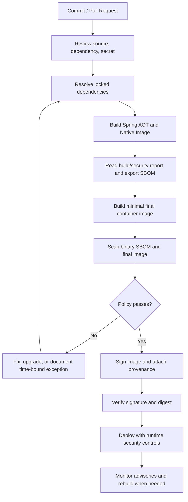

# Reducing Packaged Components Without Treating It as a Substitute for Security Checks

## 1. Goal: controlled attack surface reduction

Spring Boot applications typically pull in many dependencies, helper libraries, build tools, and operating system components. Some are only needed during compilation or testing; others are never exercised along real runtime paths. Putting everything into a production image increases size, the number of components to track, and the number of places where vulnerabilities can hide.

GraalVM Native Image and multi-stage container builds provide mechanisms to reduce what gets deployed. Native Image analyzes reachable code from the entry point and packages required components under a closed-world model. Multi-stage builds let you copy only the executable and runtime assets into the final image, omitting compilers, Maven/Gradle caches, and build sources. You can choose a small base image, drop unnecessary shells/package managers, run as non-root, and grant minimal privileges.

However, a small image or the absence of a JVM does not mean the application is secure. Reachable code can still contain vulnerabilities; libraries compiled into the binary still need tracking and patching; native executables can still suffer from logic flaws, memory-safety bugs in native libraries, unsafe deserialization, or weak TLS configuration. Containers still share the host kernel and require isolation, patching, scanning, and runtime controls.

This lesson belongs to the **Security** chapter of the **SPRING_BOOT_NATIVE_IMAGE** module. The module guides compiling Spring Boot into a GraalVM Native Image with Spring AOT to evaluate startup time and memory, while practicing Maven/Gradle builds, reflection/resource configuration, compatibility testing, container packaging, and operating native builds.

After this lesson, learners will be able to:

- Explain how Native Image removes unreachable code and the limits of that mechanism.
- Remove unnecessary dependencies and build tools from the final image without breaking functionality.
- Choose a base image compatible with the native executable and runtime libraries.
- Combine non-root execution, a read-only filesystem, minimal capabilities, and secret management.
- Generate and use SBOMs for native executables and container images.
- Scan for vulnerabilities, sign images, verify provenance, and establish an update workflow.
- Test security on the final artifact instead of inferring it from image size.

## 2. Understanding the component layers to reduce

A Spring Boot Native Image deployment has several component layers:

| Layer | Examples | Control approach |
|---|---|---|
| Build environment | GraalVM compiler, Maven/Gradle, test tools, source code | Multi-stage build; never copy to runtime stage |
| Java dependencies | Spring modules, database drivers, JSON libraries, logging | Pick only needed starters/modules; review dependency tree and SBOM |
| Reachable application code | Controllers, services, serializers, reflection targets | Static analysis and reachability metadata |
| Native runtime | GC, thread support, runtime libraries, linked system libraries | Choose compatible GraalVM/runtime options and base image |
| OS packages | libc, CA certificates, timezone data, shell, package manager | Keep only necessary runtime packages |
| Runtime configuration | Secrets, TLS trust, endpoints, feature flags | Inject from environment/secret store; never bake into image |
| Deployment privileges | UID/GID, Linux capabilities, writable paths | Non-root, read-only root filesystem, and security context |

Reducing one layer does not automatically reduce the others. For instance, Native Image may strip unreachable methods from the executable while the final image still carries a shell, package manager, and unnecessary OS packages. Conversely, using a tiny base image does not automatically remove vulnerable dependencies linked into the native binary.

Define concrete goals before optimizing:

- Reduce image size and image pull time.
- Reduce the number of OS packages requiring patching.
- Reduce the code/dependencies actually compiled into the executable.
- Reduce the privileges a process could abuse if compromised.
- Improve traceability and detection of dependencies with CVEs.

Measure and report each goal separately. Image size is an operational metric, not a complete measure of security posture.

## 3. How does Native Image eliminate unreachable code?

Native Image performs static analysis starting from the application's entry point, typically `main`, and traces classes, methods, and fields that may be used. Only components determined to be reachable are included in the executable. This is the closed-world assumption: new classes cannot be loaded arbitrarily after the binary is built.

This can reduce code volume compared to packaging the entire JVM classpath. Yet "unreachable" depends on what the builder can observe. Java reflection, JNI, dynamic proxies, resource loading, serialization, and certain framework extensions can access components dynamically. Without reachability metadata, a required component may be dropped and fail at runtime. If metadata is registered too broadly, many unnecessary classes/methods will still be retained.

For example, suppose an application deserializes two DTOs via Jackson. If the types are statically inferred and Spring AOT generates sufficient hints, the builder can pinpoint the needed set of types. If the application accepts arbitrary class names from a message header and calls `Class.forName`, the builder cannot inherently know every class that may appear. Adding metadata for an entire large package keeps many types alive and widens dynamic processing surface.

Example registering binding for a specific DTO:

```java
import org.springframework.aot.hint.annotation.RegisterReflectionForBinding;
import org.springframework.stereotype.Component;

@Component
@RegisterReflectionForBinding(OrderCreated.class)
public class OrderMessageConfiguration {
}
```

Register only the types the application genuinely needs. With custom `RuntimeHintsRegistrar` implementations, review each reflection member, resource pattern, proxy interface, and serialization type. Metadata describes runtime capabilities that must be preserved, not a list where you slap wildcards to make a build pass.

Do not delete metadata solely to shrink binary size if functionality depends on it. Changing metadata can break the application when rare payloads arrive, feature flags flip, or a locale/resource not covered by smoke tests is handled.

## 4. Less code does not mean vulnerabilities have vanished

Static analysis drops components the builder does not consider reachable. It does not prove the remaining methods are vulnerability-free. A controller with an authorization bug, a parser with an input validation bug, or an outdated crypto library can still end up inside the native executable if the application uses them.

Nor should you assume that because a dependency does not appear in class-level reachability, every risk of that dependency has disappeared. Know which layer a scanner/SBOM describes: the Maven dependency graph, classes/components inside the native binary, OS packages in the image, or linked native libraries. These inventories complement one another.

Risks that still must be controlled:

- **Logic flaws:** authorization, authentication, tenant isolation, input validation.
- **Library vulnerabilities:** parsers, JSON/XML, HTTP clients, database drivers, logging, and crypto.
- **Native vulnerabilities:** C/C++ libraries, libc, compression libraries, and memory handling.
- **Configuration flaws:** TLS trust, CORS, management endpoints, debug endpoints, actuator exposure.
- **Operational flaws:** leaked secrets, stale images, overly broad container privileges, missing network policies.
- **Supply-chain attacks:** tampered dependencies/build images, untrusted artifacts, or compromised pipelines.

Therefore, reducing components is only one attack-surface reduction measure. Continue performing dependency reviews, vulnerability scanning, secure coding reviews, integration/security testing, and patch management.

## 5. Reviewing dependencies before building native

Start from the application's dependency graph. With Maven:

```bash
./mvnw dependency:tree
./mvnw -Pnative dependency:tree
```

With Gradle:

```bash
./gradlew dependencies --configuration runtimeClasspath
./gradlew dependencyInsight \
  --dependency jackson-databind \
  --configuration runtimeClasspath
```

Look for development/test-only dependencies, unused modules, duplicate versions, and superseded libraries. Choose Spring Boot starters based on actual functional needs: do not include both WebFlux and MVC, multiple logging backends, or multiple JSON providers if the application only uses one option.

If a dependency is optional or pulled in by a large starter, check how it is excluded. For example, Spring Boot `build-image` excludes certain modules such as DevTools and Docker Compose by default during repackaging; optional dependencies also follow specific inclusion rules. Do not rely on these defaults to assume all development dependencies are gone. Inspect the actual dependency tree and artifact/image contents.

Example marking a dependency so it is not automatically propagated to consumers:

```xml
<dependency>
    <groupId>com.example</groupId>
    <artifactId>legacy-client</artifactId>
    <version>${legacy-client.version}</version>
    <scope>runtime</scope>
    <optional>true</optional>
</dependency>
```

`optional` alters how a dependency propagates to consumers; it does not make the dependency vanish from the current application if the project still declares and uses it. If the application does not need the library, remove the dependency declaration from the project or exclude the exact transitive dependency after confirming no code path depends on it.

Example excluding a transitive dependency:

```xml
<dependency>
    <groupId>com.example</groupId>
    <artifactId>integration-starter</artifactId>
    <version>${integration.version}</version>
    <exclusions>
        <exclusion>
            <groupId>com.example</groupId>
            <artifactId>unused-transport</artifactId>
        </exclusion>
    </exclusions>
</dependency>
```

Exclude only after checking the dependency tree, functionality, and tests. A dependency that appears uncalled directly may be loaded dynamically via auto-configuration, ServiceLoader, reflection, or native libraries.

Do not remove a library merely because a scanner reports a CVE if the library is still required. First upgrade to a patched version or replace it with a supported library. If no patch exists yet, assess exploitability, relevant code paths, mitigations, risk acceptance deadline, and accountable owner. Never use exclusions as a way to hide pipeline alerts.

## 6. Separating build stage and runtime stage

Multi-stage Docker builds are the direct way to keep toolchains out of the production image. The build stage holds GraalVM Native Image, Maven/Gradle, and OS compilers. The runtime stage receives only the executable and necessary assets.

Illustrative example:

```dockerfile
# syntax=docker/dockerfile:1
FROM <graalvm-builder-image>@sha256:<builder-digest> AS build
WORKDIR /workspace

COPY . .
RUN ./mvnw -Pnative native:compile

FROM <minimal-runtime-image>@sha256:<runtime-digest> AS runtime
WORKDIR /app

COPY --from=build --chown=10001:10001 \
    /workspace/target/application /app/application

USER 10001:10001
EXPOSE 8080
ENTRYPOINT ["/app/application"]
```

Because the builder stage receives the build context, add `.dockerignore` so unnecessary files or secrets are never sent into the Docker build context:

```text
.git
.idea
.gradle
target
build
.env
.env.*
*.pem
*.key
secrets/
```

Tailor the list to your project; do not ignore outputs or config files the build genuinely needs. `.dockerignore` reduces data sent to the builder, but does not replace a secret manager or repository secret scanning. If credentials are needed to fetch private dependencies, use BuildKit secret mounts or CI credential mechanisms rather than `ARG`/`ENV` containing secrets.

Image/digest placeholders must be replaced with versions and digests approved by your organization. The runtime base image must be compatible with the native executable and linked libraries. If the binary needs glibc or OS libraries, a `scratch` image lacking those libraries will fail to run.

Multi-stage builds strip compilers and caches from the final stage, yet the builder remains part of the supply chain. Pin builder digests, update them periodically, scan builder images, and control image sources. Do not treat building with multi-stage as proof of a trustworthy artifact.

With Spring Boot Buildpacks, you can build OCI images via Maven `spring-boot:build-image` or Gradle `bootBuildImage`. Buildpacks generally produce images with sensible runtime structure and non-root execution; you must still inspect the run image, SBOM, digest, packages, and security configuration of the generated image.

## 7. Choosing a small yet compatible base image

The fewer packages a base image has, the fewer OS packages require patching, though the smallest image is not always suitable. A native executable may depend on libc, DNS/NSS, CA certificates, timezone data, fonts, or other system libraries.

Before selecting `scratch`, distroless, or a slim image:

1. Determine whether the binary is dynamically or statically linked and which libraries are required at runtime.
2. Inspect with `ldd` or `readelf -d` on the Linux binary when those tools apply.
3. Check CA certificates if the application makes HTTPS calls.
4. Check timezone/locale if business logic depends on them.
5. Check DNS resolution and user/group lookups.
6. Run integration tests inside the actual final image, not just in the builder stage.

Example on Linux:

```bash
file target/application
readelf -d target/application
ldd target/application
```

Some static executables may make `ldd` inapplicable or return different output; interpret results according to binary type and toolchain. Do not copy shared libraries haphazardly from builder to runtime; use a runtime base image designed to match how the binary was built.

Consider the options:

| Image type | Advantages | What must be verified |
|---|---|---|
| Slim OS image | Broad compatibility, easy debugging | Extra packages, shell/package manager, and CVEs |
| Distroless | Minimal runtime tools, fewer packages | CA certs, timezone, user, libc, and debugging approach |
| Minimal/micro image | Small footprint | Runtime libraries, DNS, TLS, locale |
| `scratch` | No default OS packages | Binary and all runtime dependencies must be self-contained |
| Buildpacks run image | Prepared runtime structure and user | Stack version, packages, non-root, lifecycle updates |

Do not strip CA certificates, timezone data, or security libraries just to shave a few MB. If the application needs outbound TLS, missing a trust store can cause connection failures or lead to unsafe workarounds like disabling certificate validation.

## 8. Restricting runtime privileges after shrinking the image

Even a small image can be exploited if the process runs as root, holds excessive Linux capabilities, or mounts an arbitrarily writable filesystem.

Configurations to consider:

- Run with a non-zero UID/GID.
- Set the root filesystem to read-only.
- Mount writable volumes only on required paths such as `/tmp` or an upload directory.
- Drop unnecessary capabilities.
- Disable privilege escalation.
- Apply an appropriate seccomp profile and AppArmor/SELinux policy.
- Limit CPU/memory/processes and file descriptors.
- Use network policies to restrict ingress/egress connections.
- Do not enable `--privileged` unless the application has a specifically evaluated requirement.

Docker runtime example:

```bash
docker run --rm \
  --read-only \
  --user 10001:10001 \
  --cap-drop=ALL \
  --security-opt no-new-privileges:true \
  --tmpfs /tmp:rw,noexec,nosuid,size=64m,mode=1777 \
  --memory=512m \
  --cpus=1 \
  -p 8080:8080 \
  my-service:native
```

This is an illustrative baseline. Applications may require extra writable paths, groups, or specific capabilities; grant only permissions proven necessary. Test uploads, TLS, report generation, graceful shutdown, and health checks under the final hardened configuration.

With Kubernetes, configure `runAsNonRoot`, `readOnlyRootFilesystem`, `allowPrivilegeEscalation: false`, drop capabilities, seccomp, and temporary volumes. Do not assume `fsGroup` behaves identically across all CSI drivers; test actual mount permissions. These hardening layers reinforce each other and do not replace kernel/container runtime patching.

## 9. Keeping secrets out of builds and image snapshots

Native Image can execute certain static initializers during the build and store their state in the image heap. If an initializer reads environment variables, credential files, truststores, or generates random seeds at build time, those values can be saved inside the binary. Builder output can also write sensitive details into logs or caches.

GraalVM recommends running the Native Image builder in an isolated build environment free of secrets. Classes handling sensitive data or needing fresh state when the application starts should be evaluated for runtime initialization, for instance via `--initialize-at-run-time` or the version-appropriate `RuntimeClassInitialization` API.

Illustrative option example:

```bash
native-image \
  --initialize-at-run-time=com.example.security.SecretProvider \
  -jar target/application.jar
```

Do not apply this option wholesale. Changing initialization timing can impact performance, startup ordering, and compatibility; thoroughly test the specified class and its dependencies.

Secret management principles:

- Do not pass passwords/tokens via build arguments or bake them into Dockerfile layers.
- Do not commit secrets into source, `application.yml`, resources, or `RuntimeHints`.
- Do not bake private keys, database passwords, or API tokens into the native executable.
- Inject secrets at runtime via a secret manager, orchestrator, or appropriately permissioned file mounts.
- Do not print secrets into logs during diagnostics or build failures.
- Rotate secrets per operational procedures and restrict access permissions.

Build-time config and runtime config must be clearly separated. Production URLs/credentials should not exist in the native image build environment.

## 10. Generating SBOMs for Native Image and containers

A Software Bill of Materials (SBOM) is an inventory of components, libraries, and modules used to create an artifact. It helps security teams know which components, versions, and dependency relationships an application contains.

Some Oracle GraalVM distributions support generating an SBOM for Native Image via `--enable-sbom`; exact features and options depend on distribution/version. Per current GraalVM documentation, the native image SBOM can be embedded in the executable or exported as JSON, with CycloneDX as the default format. Do not assume this option exists in every GraalVM Community/vendor distribution; check documentation for your actual toolchain.

Example with Oracle GraalVM Native Image:

```bash
native-image \
  --enable-sbom=classpath,export \
  -jar target/application.jar
```

If the binary is built via Native Build Tools plugins, configure the corresponding native image build arguments in Maven/Gradle for your plugin version. Store the exported SBOM alongside the artifact and build metadata.

You can extract an embedded SBOM using Native Image Utils or Syft, if supported by the distribution/binary:

```bash
$GRAALVM_HOME/bin/native-image-utils extract-sbom \
  --image-path=target/application

syft scan target/application -o cyclonedx-json
```

The Native Image SBOM can list Java libraries and components identifiable from artifact metadata. The container image SBOM can list OS packages and components inside image layers. Generate/retain both when supported by the pipeline; one inventory does not necessarily cover all other layers.

Do not treat an SBOM as proof an artifact has no CVEs. An SBOM only describes components; it must be matched against an advisory database while accounting for version/component detection limits. If a library is shaded or lacks version metadata, scanners may fail to classify it accurately. Nor does an SBOM detect logic bugs in source code.

## 11. Scanning dependencies and the final image

Run security scans at multiple stages:

| Stage | Target | Goal |
|---|---|---|
| Pull request | Maven/Gradle dependency graph | Detect vulnerable dependencies before merge |
| Build | Source, IaC, Dockerfile, secrets | Detect code/config flaws and leaked secrets |
| Native build | Executable SBOM | Check Java/GraalVM components for CVEs |
| Container build | Final OCI image | Check OS packages, libraries, and image metadata |
| Release | Image digest, signature, provenance | Verify artifact was built by a trusted pipeline |
| Runtime | Deployed image and config | Detect new CVEs, drift, and insecure configs |

Example using Syft and Grype:

```bash
# Generate SBOM for the final image.
syft my-service:native -o cyclonedx-json \
  > image-sbom.cdx.json

# Scan the image against Grype's vulnerability database.
grype my-service:native

# Scan the SBOM exported from Native Image.
grype native-image.sbom.json
```

Example using Trivy:

```bash
trivy image --scanners vuln,misconfig,secret my-service:native
```

Actual tools and options vary by version; consult scanner documentation before integrating into CI. Scanners can find packages in image layers, but statically linked libraries or code compiled into the native executable require SBOM/native binary support for accurate inventorying. Therefore, scan both the final image and the SBOM/binary whenever possible.

Set policies based on severity, exploitability, relevant code paths, deployment environment, and remediation timelines. Never ignore all warnings simply because a binary is small or lacks a JVM. For false positives, record evidence, rationale, owner, and review expiry; never suppress indefinitely.

## 12. Signing images, pinning digests, and provenance

An image with a clean CVE scan can still be swapped after scanning or pushed from an untrusted pipeline. You must verify artifact origin and integrity.

Practices to adopt:

- Pin base images/builder images by digest in controlled builds.
- Record commit SHA, dependency lock/hash, GraalVM version, plugin versions, and build arguments.
- Generate provenance/attestations linking the artifact to its source revision and workflow.
- Sign the image by digest after building and scanning.
- At deployment time, verify signature/identity and registry policy.
- Use immutable digests in production manifests instead of mutable tags that can be overwritten.

Example signing and verifying with Cosign in a pipeline configured with OIDC/identity:

```bash
cosign sign registry.example.com/team/service@sha256:<image-digest>

cosign verify \
  registry.example.com/team/service@sha256:<image-digest> \
  --certificate-identity=<expected-workflow-identity> \
  --certificate-oidc-issuer=<expected-oidc-issuer>
```

Identity/issuer values must come from organizational trust policy. Signing requires registry access and configured authentication; never hardcode private keys in repositories or CI logs.

A signature confirms the artifact is bound to a signing identity under policy. It does not prove source code is secure, that scanners missed no CVEs, or that the pipeline had no flaws. Provenance helps trace how a build ran, yet you still must verify dependency sources, builders, and pipeline permissions.

## 13. Native Image build report and security report

Native Image build output can include a security report with security-relevant details about the binary. Read the report after every change to dependencies, reachability metadata, or class initialization. Pay special attention to:

- Whether deserialization code is included in the attack surface.
- Which serialization components are registered.
- Which components can be identified in the SBOM.
- Which components lack hashes or required metadata if SBOM/hash features are enabled.
- Classes initialized at build time that could store state in the image heap.

Native Image does not single-handedly prevent deserialization vulnerabilities. If an application deserializes untrusted data, you must still enforce type allow-lists, validate input, limit payload size, control producers, and keep libraries updated. Never rely on the closed-world assumption to permit arbitrary class names.

For JCA/security providers, Native Image includes analysis and registration mechanisms for security services; some paths use reflection or provider architecture. If disabling automatic security services or configuring custom providers, supply appropriate metadata and test real algorithms: TLS handshakes, certificate validation, signatures, digests, encryption, and key management.

Do not disable security providers or drop the truststore just to shrink the binary if the application requires them. Removing a provider can break valid algorithms/formats or inadvertently push teams toward weaker TLS configurations.

## 14. Functional and security testing on the final artifact

Testing on the JVM is not enough to prove the native executable behaves identically. Testing the native executable alone is not enough to prove the final container is hardened. Run tests across layers:

1. **Functional parity:** identical endpoints, authentication, authorization, input validation, serialization, and error handling.
2. **Native compatibility:** reflection, resources, proxies, JNI, serialization, TLS, and security providers.
3. **Container runtime:** non-root, read-only filesystem, temp paths, mounted configs/secrets, DNS, and CA certificates.
4. **Security tests:** dependency CVEs, image CVEs, secret scanning, misconfigurations, API authorization, and deserialization.
5. **Supply chain:** SBOM, digests, signatures, provenance, and registry policies.
6. **Operational tests:** patching images, rollbacks, rotating secrets, revoking signing identities, and re-testing artifacts after rebuilds.

Example quick check on the final image:

```bash
docker image inspect \
  --format 'User={{.Config.User}} Entrypoint={{json .Config.Entrypoint}}' \
  my-service:native

docker run --rm --read-only \
  --cap-drop=ALL \
  --security-opt no-new-privileges:true \
  --tmpfs /tmp:rw,noexec,nosuid,size=64m,mode=1777 \
  my-service:native
```

This is only an illustrative smoke check. Add writable volumes, port mappings, environment settings, and health probes matching the application. Verify the process genuinely runs as non-root, required endpoints work, and no writable paths exist outside the allow-listed locations.

## 15. Reference CI/CD workflow

A secure pipeline can be structured in sequence:



The pipeline should retain artifacts and results for auditing:

- Native executable and final image digest.
- Native binary and container image SBOMs.
- Vulnerability scan results with database timestamp/version.
- Native Image security/build report.
- Commit SHA, dependency lock/hash, and toolchain versions.
- Signature verification and provenance/attestation.
- Exceptions with owner, rationale, deadline, and remediation status.

When updating a dependency or base image, rebuild the native executable and container image, run compatibility tests, generate new SBOMs, and rescan. Do not merely rebuild the image from an old binary if the CVE resides in a dependency linked into the executable; rebuild the binary with the patched dependency.

## 16. Common mistakes

| Mistake | Consequence | Right approach |
|---|---|---|
| Treating a small binary as a secure binary | Overlooking vulnerabilities in still-reachable code | Scan dependencies/binary and review source code |
| Deleting reflection hints to shrink size | Runtime failures in rarely tested dynamic flows | Narrow metadata with justification and test thoroughly |
| Excluding a CVE-affected dependency without checking | May break features or merely mask alerts | Upgrade/replace, assess exploitability, and document exceptions |
| Using `scratch` without checking native linkage | Missing libc, CA certs, DNS, or timezone | Inspect binary/runtime dependencies and run integration tests |
| Scanning only container layers | Missing libraries linked into the executable | Scan both the image and native SBOM/binary |
| Scanning only the Java SBOM | Missing OS packages and base image | Generate SBOMs/scans for the final OCI image as well |
| Disabling SBOM because it adds size | Losing dependency inventory and tracking capability | Choose appropriate embed/export options; store artifacts outside the image |
| Baking secrets into build-time initializers | Secrets/state can land in the image heap | Use a clean build environment and runtime secret injection |
| Believing image signatures prove image security | Signatures only verify artifact/identity per policy | Combine scans, provenance, tests, and runtime controls |
| Pinning digests without updating | Freezing stale images with known CVEs | Monitor base image updates and rebuild under control |
| Running non-root with wrong volume permissions | App fails to write files or permissions are too wide | Verify UID/GID/mode and explicit writable paths |

## 17. Hands-on exercises

### Exercise A — Compare dependency graph and native reachability

Select a Spring Boot service with Web, Data, and Security. Export the dependency tree, build a Native Image, read the SBOM/build report, and identify which modules were included. Document why critical dependencies remain necessary.

**Completion criteria:** distinguish declared dependencies from components/classes actually included in the native executable; explain the impact of reflection metadata.

### Exercise B — Build a multi-stage image

Create a Dockerfile with separate build and runtime stages. Copy only the executable and required runtime assets. Pin the base image digest, set a non-root user, and configure minimal writable paths.

**Completion criteria:** final image contains no Maven/Gradle caches, source code, or Native Image compiler; the application runs inside the final image.

### Exercise C — Generate SBOMs and scan

If supported by your distribution, export the Native Image SBOM. Generate an SBOM for the final image using Syft or an equivalent tool, then scan with Grype/Trivy/Docker Scout.

**Question:** why can scan results for the native executable SBOM and the final container image differ?

### Exercise D — Test build-time initialization

Create a class static initializer that reads a value from the build environment. Build the native executable and verify whether the value was saved into the binary. Move the appropriate class to runtime initialization and repeat the test.

**Completion criteria:** explain the risk to secrets/random state when class initialization happens at build time.

### Exercise E — Sign and verify an image

Sign an image by digest using Cosign in an environment with a configured OIDC identity. Verify against the expected identity/issuer policy. Try verifying a different digest or mismatched identity.

**Completion criteria:** pipeline only deploys artifacts verified and scanned per policy.

## 18. Pre-release checklist

- [ ] Dependency graph reviewed; no dependencies removed solely to pass builds or hide CVEs.
- [ ] Native Image reachability metadata restricted to actually needed types/members/resources/proxies.
- [ ] Functional tests cover reflection, serialization, JNI, TLS, and provider flows.
- [ ] Build stage and runtime stage separated; compiler/cache/source absent from final image.
- [ ] Base image/runtime libraries compatible with the native executable.
- [ ] CA certificates, timezone, DNS, and required system libraries remain present.
- [ ] Final process runs as non-root; capabilities and privileges restricted.
- [ ] Root filesystem is read-only where possible; writable paths explicitly declared.
- [ ] No production secrets in build environment, build logs, resources, or image heap.
- [ ] Class initialization reviewed to prevent snapshotting sensitive state at build time.
- [ ] Native Image security/build report reviewed.
- [ ] Native binary and final container image SBOMs generated/stored when supported by toolchain.
- [ ] Dependencies, binary/SBOM, and final image scanned.
- [ ] CVE exceptions have an owner, rationale, and expiry.
- [ ] Base image/builder pinned by digest with an update workflow.
- [ ] Image signed, provenance stored, and digest verified prior to deploy.
- [ ] Final artifact tested under production security context.
- [ ] Procedures in place for rebuilding, patching, rolling back, and monitoring new advisories.

## References

- [GraalVM — Security Considerations in Native Image](https://www.graalvm.org/latest/security-guide/native-image/): security report, class initialization, sensitive data in the image heap, SBOM, and deserialization.
- [GraalVM — Native Image Basics](https://www.graalvm.org/latest/reference-manual/native-image/basics/): static analysis, reachable code, build time/run time, and the closed-world assumption.
- [GraalVM — Reachability Metadata](https://www.graalvm.org/latest/reference-manual/native-image/metadata/): reflection, JNI, resource, proxy, and serialization metadata.
- [GraalVM — SBOM in Native Image](https://www.graalvm.org/latest/security-guide/native-image/sbom/): CycloneDX SBOM, extraction via Native Image Utils/Syft, Grype scanning, and component hashes.
- [Spring Boot — Advanced Native Image Topics](https://docs.spring.io/spring-boot/reference/packaging/native-image/advanced-topics.html): AOT assets, Native Image, and Buildpacks.
- [Spring Boot — Packaging OCI Images](https://docs.spring.io/spring-boot/maven-plugin/build-image.html): Buildpacks images, non-root execution, and dependency exclusion.
- [Docker — Multi-stage builds](https://docs.docker.com/build/building/multi-stage/): copying required artifacts between build stage and final stage.
- [Docker — Build best practices](https://docs.docker.com/build/building/best-practices/): pinning image digests, updating base images, and running as a non-root user.
- [Docker Scout — Image analysis](https://docs.docker.com/scout/explore/analysis/): image inventory, SBOM, and vulnerability analysis.
- [Sigstore — Signing containers](https://docs.sigstore.dev/cosign/signing/signing_with_containers/): signing container images.
- [Sigstore — Verifying signatures](https://docs.sigstore.dev/cosign/verifying/verify/): verifying signatures, identities, and OIDC issuers.

## Conclusion

Native Image can reduce unreachable code in the executable; multi-stage builds and minimal base images can reduce runtime packages and deployment tooling. These changes shrink the attack surface and operational overhead, yet they do not prove remaining code is vulnerability-free. Review dependencies, keep reachability metadata accurate, audit build-time class initialization, generate SBOMs, scan both the native binary and final container, sign and verify artifacts, and run tests in a hardened production configuration. Application security comes from the entire development and operations lifecycle, of which reducing packaged components is just one layer of control.
