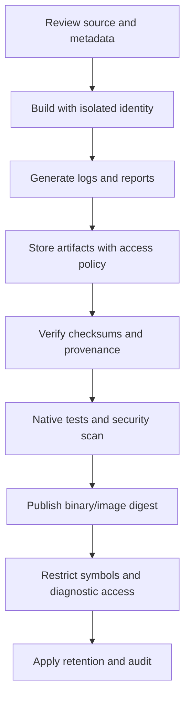

# Protecting Metadata, Logs, PGO Profiles, Debug Symbols, and Diagnostic Data

## 1. Why do build and debugging support artifacts need protection?

A Spring Boot Native Image workflow produces a variety of data beyond the executable itself: RuntimeHints and reachability metadata, generated AOT sources, build logs, profile-guided optimization (PGO) profiles, debug symbols, build reports, core dumps, heap dumps, and JFR recordings. This data helps the compiler optimize the binary and helps operations teams investigate incidents, but it can also disclose application structure, source paths, dependencies, internal configuration, or data residing in process memory.

In the **SPRING_BOOT_NATIVE_IMAGE** module, security does not stop at dependency scanning and binary generation. You must control who can create, read, modify, download, and retain build/diagnostic support artifacts. A tampered PGO profile can render a build untrustworthy; altered metadata can change the access scope retained by the compiler; a core dump can contain tokens or sensitive payloads.

This lesson establishes how to protect metadata, logs, PGO profiles, debug symbols, and diagnostic data across the entire CI/CD and operations lifecycle: data classification, access control, integrity, storage, sharing, retention, and incident response.

## 2. Classifying data by sensitivity

Not every artifact carries the same risk level. Classify before selecting storage and access policies:

| Data | Information that could be exposed | Controls needed |
|---|---|---|
| RuntimeHints/reachability metadata | Class, member, and package names, plus enabled capabilities | Change review, restricted write access, version control |
| Generated AOT sources | Bean/configuration structure and internal names | Project-scoped access, keep free of secrets |
| Build logs | Paths, dependencies, environment, compiler arguments | Redaction, restricted read access, and retention |
| PGO profiles | Workload characteristics and executed code paths | Integrity, provenance, restricted access |
| Debug symbols | Function names, source paths, symbol mappings | Separate artifact store, controlled download permissions |
| Build reports | Reachability, dependencies, compiler diagnostics | Internal classification and sharing limits |
| Core dumps/heap dumps | Memory contents, tokens, request payloads, keys | Highly sensitive data, encryption, and short retention |
| JFR recordings | Threads, classes, allocations, events, and potentially app data | Restricted access, sampling, and retention |
| SBOM/provenance | Dependencies, toolchain, source/build identity | Integrity, signatures/attestations if supported |

Classification must be based on actual contents and organizational policy. Do not assume a file contains no secrets simply because its filename is `*.json`, `*.iprof`, or `*.debug`.

## 3. Metadata is part of the security input

Native Image metadata describes dynamic access paths the compiler must preserve or support, such as reflection, resources, proxies, serialization, and JNI. Incorrect or tampered metadata can alter which code/resources are included in the executable and change runtime behavior.

Protect metadata with these principles:

- Allow only authorized developers/automation to modify it.
- Review changes alongside source code and dependency updates.
- Do not accept arbitrary metadata from untrusted artifacts.
- Tie metadata to commit and toolchain versions.
- Inspect unusual diffs such as overly broad reflection registrations or inclusion of sensitive resources.
- Run tests to verify hints and behavior after changes.

Metadata is not a secret store. Never place passwords, tokens, private keys, or environment configuration values into RuntimeHints or generated sources. Inject secrets at runtime via a secret manager or platform mount/injection mechanism.

## 4. Avoiding overly broad metadata registration

Overly broad metadata can expand reachability and retain more components than necessary. That can affect image size, attack surface, and auditability.

For instance, opening reflection configuration for an entire package or all members can force many classes to be retained. Prefer declaring specific types/members matching features actually in use.

Metadata reviews should ask:

- Which classes need reflection and why?
- Which constructors/methods/fields are genuinely accessed?
- Do resource patterns cover sensitive configuration files?
- Is the proxy interface set accurate?
- Does metadata come from frameworks/dependencies or project declarations?
- Are there predicate tests/runtime tests verifying it?

Do not strip valid metadata merely to shrink binary size. The goal is sufficient, justified, and traceable access.

## 5. Protecting build logs

Native build logs can contain:
- Full compiler arguments.
- Dependency coordinates and repository URLs.
- Workspace/source paths.
- Environment variable names/values.
- Diagnostics about classes, resources, and reachability.
- Artifact, cache, and toolchain paths.
- Details from exceptions or test payloads.

Do not keep verbose debug logging enabled across the entire pipeline long-term unless needed. For diagnostic logs, enable them for a bounded window and inspect contents before sharing outside the organization.

Do not print the entire environment with `env`, `set`, or dump system properties in CI if they might contain credentials. When configuration must be verified, log only property names and present/absent status or redacted values.

## 6. Redacting secrets and personal data in logs

Logs should preserve enough context without copying sensitive data. Avoid logging:
- Authorization headers, bearer tokens, cookies/session IDs.
- Passwords, API keys, private keys, database connection secrets.
- Full payment card/bank data.
- Request bodies containing unnecessary personal data.
- Secrets passed via system properties or command-line arguments.
- Credential file contents or environment dumps.

Use structured logging with an allowlist of fields. When correlation is needed, use a normalized request ID/trace ID instead of storing a user token. For reconcilable records, use internal identifiers permitted by policy.

Redaction should occur at the application logging boundary and in collectors when appropriate. Collector-side redaction cannot claw back data already written to temporary log files or CI artifacts beforehand.

## 7. Controlling access by least privilege

Partition access by role:

| Role | Typical permissions needed |
|---|---|
| Developer | Read project build logs, edit metadata via review |
| CI build identity | Read source/dependencies, write artifacts of the current run |
| Release automation | Read verified artifacts, publish images/digests |
| On-call engineer | Read runtime logs/metrics and incident-scoped diagnostics |
| Security team | Read SBOMs/scans/provenance and data needed for triage |
| Artifact administrator | Manage retention/access policies, not read every dump by default |

Use RBAC and distinct service identities for each pipeline/job. Avoid using a single credential with write access across all artifacts and registries for all pull requests, branches, and environments.

For core/heap dumps, keep reader access narrower than ordinary logs. Access should be audited and auto-expire when the incident ends if supported by the platform.

## 8. Protecting CI secrets and the build environment

Native builds can run plugins, annotation processors, code generators, and scripts from dependencies. Build jobs therefore hold substantial access to source code, package registries, and artifact stores.

Practices:
- Grant required secrets only to the exact job/step.
- Never expose release credentials to untrusted pull requests.
- Never store secrets in Gradle/Maven caches or generated files.
- Use short-lived credentials and OIDC/workload identity where available.
- Separate ordinary build jobs from signing/release jobs.
- Never allow build scripts from forks to write into protected caches.
- Pin actions/plugins/toolchains per policy.
- Restrict network egress and repository sources whenever possible.

If build logs are publicly accessible, verify both secret masking and URLs containing credentials. String-based secret masking does not guarantee every encoding or transformed representation is masked.

## 9. What information does a PGO profile contain?

Profile-Guided Optimization uses profile data from a representative workload to help the compiler optimize code. In Native Image, the workflow can collect a profile from an instrumented executable and apply that profile in an optimized build, depending on the GraalVM distribution/version.

A PGO profile can reflect:
- Frequently executed code paths.
- Call/branch distributions and workload behavior.
- Indirect characteristics of request mix or feature usage.
- Build/runtime metadata tied to the collection run.

Do not assume profiles are harmless data. If a profile is tied to internal workloads, endpoints, or rare features, it can reveal operational characteristics. Protect profiles like internal build artifacts: restricted access, clear provenance, integrity checks, and retention.

## 10. Ensuring the integrity of PGO profiles

Profiles used in builds must come from trusted sources and controlled workloads. If a profile is swapped, the build can produce an executable optimized for unrepresentative or manipulated data.

Recommended workflow:
1. Collect profiles from a binary built by a trusted pipeline.
2. Record the commit, binary digest, toolchain version, and workload test ID.
3. Store profiles in an artifact store with restricted write permissions.
4. Compute checksums and verify them upon download.
5. Review the workload source and collection conditions.
6. Never use profiles from untrusted pull requests for release builds.
7. Keep profiles matched to the exact target architecture/toolchain as required.
8. Rebuild and benchmark after profile updates.

Do not mix profiles from incompatible application versions or divergent workloads without evaluation. Stale profiles may no longer represent current traffic.

## 11. Preventing PGO workloads from collecting sensitive production data

PGO typically requires a representative workload, but it does not necessarily require real production data. Prefer:
- Synthetic workloads modeled on traffic distributions.
- Sanitized fixtures.
- Test accounts and sandbox integrations.
- Payloads stripped of personal data/secrets.
- Versioned datasets with explicit usage authorization.

If collecting a profile from a production-like environment is necessary, follow data policies, bound the duration, avoid recording payloads or credentials, and evaluate moving the profile out of that environment.

PGO profiles do not replace logs/tracing and should never be created by copying live request data into build artifacts.

## 12. Debug symbols and source paths

Debug symbols map native addresses back to symbols/source locations when supported by debuggers and toolchains. They can reveal:
- Class/function/package names.
- Source file paths and workspace layout.
- Internal module names.
- Dependency structure.
- Portions of build information.

You can keep symbol archives separately and ship stripped runtime binaries if supported by the platform/toolchain. Crucially, symbols must match the exact running binary.

Do not discard symbols before archiving security artifacts if the organization requires crash analysis. Nor should you publish symbols broadly without reason. Use an access-controlled artifact store, retention, and auditing.

## 13. Matching the right debug symbols to the binary

When an incident happens, symbols from a different build can produce wrong stack mappings or misleading conclusions. Tie symbols to:
- SHA-256 or digest of the executable.
- Git commit.
- Binary Build ID if available.
- GraalVM distribution/version.
- Compiler arguments.
- Target OS/architecture.
- Linker/build environment identity.

In the release manifest, record the symbol artifact location and binary digest. When fetching symbols for an investigation, verify the digest/build ID before opening a core dump.

Do not name a shared symbol file `orders-service.debug` and overwrite it on every build. Use immutable build IDs/versions to maintain a one-to-one mapping with the executable.

## 14. Core dumps and heap dumps are highly sensitive data

A core dump typically records process memory state at the moment of a crash. A heap dump contains the object graph and may include request payloads, tokens, user data, caches, or credentials. Even when an application redacts logs, raw data can still appear in dumps.

Before enabling:
- Define a concrete investigation objective.
- Check storage capacity and quotas.
- Limit the number of processes/replicas producing dumps.
- Choose encrypted, access-controlled storage.
- Define who is authorized to download/view them.
- Set short retention and deletion procedures.
- Never send dumps over ordinary tickets/email/chat.
- Verify applicable legal/data policies.

Do not enable unbounded core dumps across all production pods. A crash loop can produce numerous large dumps, filling disks or triggering cascading incidents.

## 15. JFR recordings and build reports

JFR recordings and Native Image build reports can contain details on threads, classes, allocations, dependencies, source paths, and internal activity. Availability of JFR/heap dumps/JMX in Native Image depends on the GraalVM distribution/version and build options.

Protect them like other diagnostics:
- Enable only needed capabilities with a clear purpose.
- Bound recording duration and size.
- Store in internal storage.
- Inspect before attaching to external tickets.
- Delete per retention schedule.
- Link recordings/reports to binary digest and environment.

Do not assume Native Image JFR has the exact same event set/semantics as HotSpot. Before relying on it in incident runbooks, verify toolchain support and rehearse recording/reading.

## 16. Encryption at rest and in transit

Sensitive artifacts must be protected both in transit and at rest:
- Use TLS to the artifact store/registry.
- Enable encryption at rest per storage capabilities.
- Manage encryption keys via a KMS/secret manager.
- Time-limit download links.
- Avoid public buckets or anonymous artifact access.
- Do not log pre-signed temporary URLs.
- Verify checksums after downloading.
- Audit read/delete operations.

Storage encryption does not replace RBAC. Anyone authorized to download a dump can still decrypt it through the service; both authorization and key policies must be controlled.

## 17. Retention and secure deletion

Each artifact type should have an appropriate retention window:
- Build logs: per CI/audit retention schedule.
- Metadata/generated sources: tied to source/release lifecycle.
- PGO profiles: keep active version and history needed for reproducibility.
- Debug symbols: per release support policy.
- Build reports: per audit/diagnostic needs.
- Core/heap dumps/JFR: short retention, tied to incident.
- SBOM/provenance: per compliance requirements and artifact lifecycle.

Do not apply a single retention policy to everything. Memory-containing dumps generally require shorter retention than provenance. When an incident closes, locate copies in caches, local downloads, and ticket attachments for deletion per procedure.

## 18. Sharing diagnostic data with vendors or third parties

Before sending logs, core dumps, heap dumps, JFR files, or debug symbols to a vendor:
1. Confirm approved contract and support channels.
2. Identify data that may contain secrets/PII.
3. Redact or create a minimal sample whenever possible.
4. Obtain approval per policy.
5. Use a secure upload portal; never send attachments over unencrypted channels.
6. Record the files, checksums, recipients, and timestamp.
7. Establish retention/deletion timelines on the receiving side if agreements permit.

Do not share a full dump merely because a vendor requests "reproduction data". Ask which exact data region is needed and check whether reproduction is possible using synthetic inputs or a reduced dump.

## 19. Controlling metadata and diagnostics in CI/CD

A pipeline can enforce the following gates:

Automated checks can include:
- No secret patterns in published logs/artifacts.
- Metadata changes have code review.
- PGO profiles have checksums and trusted sources.
- Debug symbols are not uploaded to public registries outside policy.
- Dumps are enabled/captured only in authorized environments/incidents.
- Artifacts are tagged with build ID and digest.
- Storage access and retention policies are enforced.

Do not treat a secret scanner as an absolute guarantee; still enforce log field allowlists and avoid printing environment dumps.

## 20. Incident runbook when collecting diagnostics

When a native process crashes or memory spikes:
1. Record service version, image digest, pod/container ID, and timestamp.
2. Collect logs/metrics/traces by correlation ID.
3. Capture exit code, signal, OOM events, and cgroup metrics.
4. Decide whether a core/heap dump is genuinely needed.
5. If needed, enable/capture the dump per incident approval and storage policy.
6. Retrieve debug symbols matching the exact binary digest.
7. Verify checksums and access permissions.
8. Analyze in a secure environment.
9. Redact before sharing findings.
10. Delete temporary dumps and unneeded copies after the incident per retention policy.

Do not restart/redeploy or delete the pod before collecting required evidence, unless doing so is necessary to restore service. Capturing dumps can cause pauses/overhead and must be weighed against availability.

## 21. Hands-on lab: protecting diagnostic artifacts for Order API

**Scenario:** Order API native uses PGO, retains debug symbols for releases, and can produce core dumps on crashes in staging.

**Step 1 — Build an inventory.** List RuntimeHints, generated AOT output, build logs, PGO profiles, symbols, build reports, and dumps.

**Step 2 — Classify data.** Assign sensitivity level, owner, purpose, storage location, and retention for each type.

**Step 3 — Separate CI permissions.** Use distinct identities for builds, artifact uploads, release signing, and incident diagnostics.

**Step 4 — Protect PGO.** Collect profiles from sanitized workloads, record binary digest/toolchain/workload ID, and verify checksums on use.

**Step 5 — Protect symbols.** Store symbol archives by build ID in a separate store, never pushing them to public registries.

**Step 6 — Protect logs.** Use structured logging, redact secrets, and avoid dumping full environment/system properties.

**Step 7 — Rehearse dumps.** In staging, capture a core/heap dump if supported by toolchain/platform; verify access controls, encryption, and deletion.

**Step 8 — Audit and retention.** Verify who can download artifacts, log access events, and test deleting all copies per policy.

Completion criteria: every artifact has an owner and classification; PGO/symbols have integrity and provenance; logs contain no secrets; dumps/JFR are controlled; read/write permissions and retention are tested.

## 22. Conclusion

Metadata, PGO profiles, debug symbols, build logs, and diagnostic dumps help build and operate native executables, yet they can expose internal structure or in-memory data. Protect them through clear classification, least privilege, checksums/provenance, encryption, auditing, and per-type retention policies.

Never put secrets into metadata/generated sources or logs; use PGO profiles only from trusted, controlled workloads; match debug symbols to the exact binary digest; and treat core/heap dumps as highly sensitive data. Prepare incident workflows before an outage occurs so you collect sufficient evidence, analyze it securely, and delete temporary data once finished.
