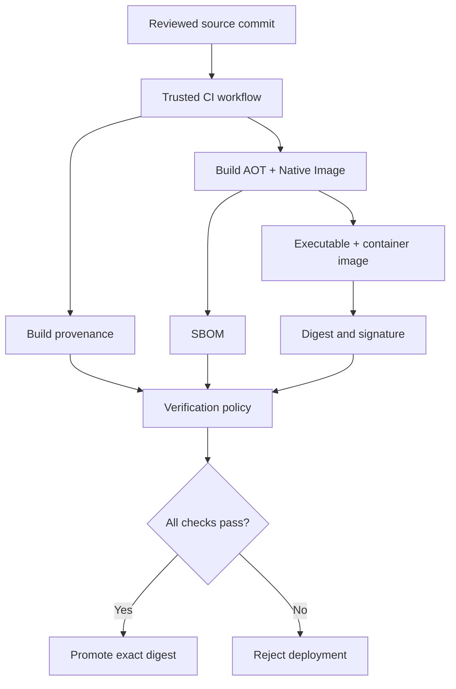

# Verifying Artifact Origin and Checking Integrity Before Deployment

## 1. Pre-deployment verification goals

Spring Boot Native Image produces a native executable, typically packaged in a container image. The artifact passes through multiple stages: source checkout, dependency resolution, running Spring AOT, native compilation, packaging, scanning, publishing, and promotion across environments. Without verifying origin and integrity, a system can accidentally deploy the wrong binary, a tampered image, or an artifact built from a different source revision than the one reviewed.

**Integrity** answers: do the artifact's contents match the recorded contents? **Provenance** answers: from which source, by which workflow, and using which toolchain and dependencies was the artifact created? **Digital signatures** verify that the contents were signed by a trusted identity.

In the **SPRING_BOOT_NATIVE_IMAGE** module, both the native executable and the container image must be verified. A standalone checksum can detect byte modifications compared against a trusted checksum, yet a checksum fetched alongside the artifact from the same source does not prove who built the artifact. You must combine digests, signatures, provenance, SBOMs, and deployment policies.



## 2. Checksum, digest, signature, provenance, and SBOM

| Concept | Purpose | What it proves |
|---|---|---|
| Checksum/hash | Compare content using a hash algorithm | Content matches the referenced digest |
| Artifact digest | Uniquely identify file or image content | Deployment uses the exact recorded content |
| Digital signature | Verify signature via trusted key/identity | Content was signed by that identity and unaltered since signing |
| Provenance attestation | Record how the artifact was built | Artifact is linked to declared source, builder/workflow, and parameters |
| SBOM | List components and dependencies | Provides an inventory for vulnerability/license review |
| Deployment policy | Acceptance or rejection rules | Artifact meets required conditions before deployment |

A SHA-256 hash is not a signature. If an attacker replaces both the artifact and the checksum file in the same location, the comparison can still pass. The expected digest must come from protected metadata or be verified via signature/attestation.

A signature does not prove code is secure either. It confirms the signing identity and integrity of the signed content. Source reviews, dependency reviews, tests, and security policies remain necessary.

## 3. Identifying trust boundaries

List where the artifact passes and where it could be altered:

- Source repository, branches, and release tags.
- CI runners, workflow definitions, and reusable actions.
- Dependency repositories/proxies.
- GraalVM builder and container builder.
- Artifact registry/container registry.
- Promotion process between dev, staging, and production.
- Deployment controller/admission policy.
- Secret stores and signing identities.

Define who is authorized to build, sign, publish, and deploy. Identities holding registry write access and release signing rights are sensitive; scope permissions by repository, branch, environment, and time.

Never allow pull requests from forks to access production signing keys. For untrusted code, use isolated runners with read-only credentials or no credentials.

## 4. Linking source revisions to build identities

Every artifact must be tied to an immutable source revision, typically a commit SHA, along with build details:

- Repository identity and commit SHA.
- Protected branch/tag.
- CI workflow identity and run ID/attempt.
- Build timestamp.
- JDK/GraalVM/Native Image version.
- Gradle/Maven Wrapper and plugin versions.
- Resolved dependency graph/lockfiles.
- Builder image digest and target OS/architecture/libc.
- Non-sensitive build arguments.
- Test results and scan results.

Do not record only an application version such as 1.2.0. Two builds with the same version string can come from different commits or dependency graphs.

Never place passwords, access tokens, private keys, signing secrets, or secret environment variables into provenance.

## 5. Computing checksums for the executable

After the native executable is built, compute its SHA-256 hash and store it with the build metadata.

Linux:

```bash
sha256sum build/native/nativeCompile/api-app
```

macOS:

```bash
shasum -a 256 build/native/nativeCompile/api-app
```

PowerShell:

```powershell
Get-FileHash .\build\native\nativeCompile\api-app -Algorithm SHA256
```

Exact paths depend on build plugins/tasks and OS. Compute the hash on the final file after release strip/package operations. When artifacts are compressed, distinguish the archive hash from the extracted executable hash.

When downloading the artifact into a deployment environment, recompute the digest and compare against verified metadata. If the binary was modified after hashing, the old hash no longer represents the new binary.

## 6. Verifying checksums from a trusted source

Baseline workflow:

1. CI builds the artifact and computes the digest.
2. The digest is recorded in a protected build manifest/provenance or release metadata.
3. The artifact is published to the registry/repository.
4. The deployment process fetches the target artifact.
5. The deployment process recomputes the digest.
6. Compare against the digest obtained from trusted metadata.
7. Reject if mismatched or if metadata cannot be verified.

Do not download both the artifact and the checksum over the same unprotected channel and treat the comparison as sufficient. Use TLS, proper registry permissions, and signatures/attestations to protect source metadata.

## 7. Using OCI image digests instead of mutable tags

Tags such as `latest`, `stable`, or `1.2` can be updated to point to different image contents. A SHA-256 digest uniquely identifies an image's manifest/config/layers under the OCI distribution model.

Example reference:

```text
registry.example.com/platform/native-api@sha256:IMAGE_DIGEST
```

In production manifests, reference the verified digest. Tags remain helpful for humans and promotion workflows, but deployments should bind to a concrete digest.

For multi-platform images, a manifest list/index digest can point to per-architecture manifests. Explicitly note whether the verified digest is an index or a platform-specific manifest; verify the platform selected by the cluster.

## 8. Signing container images and verifying signatures

Image signatures verify that an image was signed by a trusted identity. You can use OCI signing tools such as Cosign or an organization-approved registry/cloud platform signing mechanism.

Illustrative example with key-based Cosign:

```bash
cosign sign --key cosign.key registry.example.com/platform/native-api@sha256:IMAGE_DIGEST
cosign verify --key cosign.pub registry.example.com/platform/native-api@sha256:IMAGE_DIGEST
```

Exact syntax depends on Cosign version and key management model. Never store private keys in repositories or images. Prefer keys in KMS/HSM or keyless signing with policy-constrained OIDC identities.

During verification, check the signer identity/certificate issuer and subject against policy. A valid signature is insufficient if any arbitrary identity is permitted to sign.

## 9. Keyless signing and CI identity

Keyless signing can use a short-lived identity issued by an OIDC provider rather than storing long-lived private keys in CI. Verifiers check the certificate/identity and transparency log according to the tool's ecosystem.

Policies should constrain:

- Trusted OIDC issuer.
- Specific repository/workflow identity.
- Branches/tags/environments permitted to sign.
- Reviewed and protected build workflows.
- Certificates/attestations meeting the verifier's trust model.

Do not accept every certificate issued by a broad issuer. The identity must be bound to the official repository and release workflow.

## 10. Provenance attestation

Provenance is a structured record of how an artifact was produced. An attestation can contain:

- Subject artifact and digest.
- Source repository and commit.
- Builder identity/workflow.
- Build invocation parameters.
- Dependencies/materials.
- Build timestamps and environment.
- Predicates per supported tool standards.

Provenance can be signed so verifiers confirm the attestation contents came from a trusted builder identity. Formats depend on tools/standards, such as in-toto attestations or SLSA provenance.

Provenance does not by itself prove the pipeline was never compromised. It provides evidence of the declared process; trust depends on builder identity, isolation, workflow permissions, and policy.

## 11. SBOMs for executables and container images

An SBOM (Software Bill of Materials) describes the components in a product, typically including package name/version, supplier, relationships, and identifiers. For Spring Boot Native Image, the inventory should reflect:

- Application dependencies resolved at build time.
- Spring Boot/Spring Framework and Java libraries.
- GraalVM/build toolchain within the build SBOM scope.
- Native libraries and OS packages in the final image.
- Base image and package components.
- License/vulnerability identifiers if supported by tooling.

A JAR/dependency graph SBOM does not necessarily cover OS packages or native shared libraries in the container. You may need SBOMs for both the application/build artifact and the final image, linked by digest.

An SBOM is not a security certification. It is inventory input for vulnerability/license policies and incident response.

## 12. Scanning for vulnerabilities before promotion

Scan all relevant layers:

- Application dependencies.
- Builder image and build tools.
- Final runtime image/OS packages.
- Native shared libraries.
- Base image and package updates.

Define clear policies: severity thresholds, exploitability, reachability, exception owners, expiry dates, and false-positive handling. Do not rely solely on a severity number while ignoring packages actually present in the final image or real exploitability.

When granting an exception, record the rationale, artifact scope, approver, and expiration date. Exceptions should never become a permanent state.

## 13. Build once, promote the exact same digest

A core principle is to build the artifact once from a reviewed source revision, then promote the exact same digest across dev, staging, and production.

Do not rebuild separately for production merely to change URLs or secrets. Runtime values should be supplied via environment/config/secret management. If you rebuild, it is a new artifact and must be re-scanned, re-signed, re-attested, and re-tested.

Promotion workflow:

1. CI builds the executable and image.
2. Run JVM/native/container tests.
3. Generate SBOM, provenance, and signatures.
4. Verify signatures, attestations, and policies.
5. Deploy the digest to staging.
6. Run smoke/integration/acceptance tests.
7. Promote the exact verified digest to production.
8. Record a deployment log entry containing digest, environment, and release identity.

## 14. High-level GitHub Actions example

The pipeline can be structured into jobs:

```yaml
name: native-image-release

on:
  push:
    tags:
      - "v*"

permissions:
  contents: read
  packages: write
  id-token: write
  attestations: write

jobs:
  build:
    runs-on: ubuntu-latest
    steps:
      - uses: actions/checkout@v4
      - uses: actions/setup-java@v4
        with:
          distribution: graalvm
          java-version: "21"
      - name: Build native executable
        run: ./gradlew clean test nativeCompile
      - name: Build and push image
        run: ./gradlew bootBuildImage
      - name: Generate release evidence
        run: ./scripts/create-release-evidence.sh
      - name: Sign image
        run: ./scripts/sign-image.sh
```

This is an illustrative skeleton, not a complete production workflow. Pin actions by full commit SHA per supply-chain policy; pin JDK/GraalVM, builder images, and plugins. Configure explicit builder/run images. Scripts generating SBOMs/provenance/signatures must be well-defined, have their outputs verified, and be bound to the exact digest.

Do not grant `id-token`, `packages: write`, or `attestations: write` to jobs that do not need them. Separate jobs running untrusted pull requests from release signing/publishing jobs. Signing jobs must run only on protected refs and approved environments.

## 15. Pre-deployment verification policy

A deployment policy may require:

- Image reference must be a digest, not a mutable tag.
- Valid signature with signer identity in an allowlist.
- Provenance subject digest matches the image digest.
- Source repository/commit belongs to the official repository and a protected ref.
- Approved builder/workflow identity.
- SBOM exists and was generated from the exact image digest.
- Vulnerability scan meets thresholds or has a valid exception.
- Mandatory tests passed on the exact artifact/image digest.
- Artifact target OS/architecture matches the cluster.

Policies should be enforced in the deployment pipeline or an admission controller. If the verification service cannot reach metadata, production should fail closed unless an approved and audited break-glass procedure is invoked.

## 16. Protecting signing keys and CI permissions

Private signing keys are high-value credentials. Apply:

- Never commit keys to Git.
- Never bake keys into Docker images or build artifacts.
- Use KMS/HSM or OIDC keyless signing where appropriate.
- Restrict which workflows/refs/environments are permitted to sign.
- Use short-lived credentials and least privilege.
- Audit signing events and key access.
- Maintain key rotation/revocation procedures.
- Protect release workflows from unauthorized modifications.

Never let jobs running code from fork pull requests access production secrets. On self-hosted runners, clean workspaces/caches and isolate jobs across trust levels.

## 17. Verifying the executable inside the image

If publishing both the executable and the OCI image, record both the executable digest and the image digest in the release manifest. An image digest does not replace the executable file hash; the two values identify two different contents.

When investigating:

1. Extract the executable from the published image in a trusted environment.
2. Compute the executable's SHA-256 hash.
3. Compare against the hash in the verified release manifest.
4. Verify the image signature/provenance.
5. Inspect the binary target and shared library requirements.
6. Store the results alongside the deployment record.

If the Dockerfile runs strip, copy, chmod, or modifies the binary after the build step, compute the executable hash after the final operation prior to image creation.

## 18. Handling verification failures

Never bypass signature/digest errors for a "temporary deploy". Classify the failure:

| Error | Action |
|---|---|
| Digest mismatch | Reject artifact, re-fetch from trusted registry, and investigate mutation |
| Signature invalid | Reject; check signer, key rotation, and artifact reference |
| Unauthorized signer identity | Reject; verify workflow/ref and policy |
| Missing provenance or subject mismatch | Reject; verify attestation is bound to exact digest |
| Missing SBOM | Block promotion per policy and generate inventory for exact artifact |
| Vulnerability policy failure | Fix dependency/base image or request a time-bound exception |
| Wrong artifact architecture | Build/publish for the exact target platform |
| Metadata registry unavailable | Bounded retry; production fails closed or uses audited break-glass |

Never edit metadata to make an old artifact appear valid. Produce a new build from verified source, re-sign/re-attest, and run verification again.

## 19. Pre-deployment checklist

- Source commits and release tags are protected.
- CI workflows use least privilege and runners aligned with trust boundaries.
- JDK/GraalVM/plugin/dependency/builder versions are recorded.
- Executable SHA-256 and OCI image digest are stored.
- Artifacts come from trusted registries/repositories.
- Signatures are valid and signer identities match policy.
- Provenance subject matches the exact artifact digest.
- Source revision and builder/workflow identity are verified.
- SBOMs are linked to the exact executable/image.
- Vulnerability scan results exist and exceptions are audited.
- Tests passed on the exact artifact/image to be deployed.
- Deployment uses digests rather than mutable tags.
- Signing keys are absent from repositories, images, and logs.
- Staging/production promotions use the exact same verified digest.
- Deployment records capture digest, environment, and release identity.

## 20. Self-check questions

1. How does a checksum differ from a digital signature?
2. Why is fetching a checksum and artifact from the same source insufficient to prove publisher origin?
3. What does an OCI image digest identify, and why should deployments use digests?
4. Beyond signature validity, which identity details must signature verification check?
5. What information does a provenance attestation provide?
6. How does an application dependencies SBOM differ from a final container image SBOM?
7. Why should you build once and promote the exact same digest across environments?
8. How do you protect signing keys and isolate untrusted pull requests from release signing?
9. When a provenance subject does not match the image digest, how should the pipeline respond?
10. Which evidence should be stored in the deployment record?

**Key takeaway:** before deploying a native executable/container, verify the digest, signature and signer identity, provenance bound to the exact source/build, SBOM, and vulnerability policy. Build once, promote the exact verified image digest, protect signing identities, and archive evidence for audits and rollbacks.
