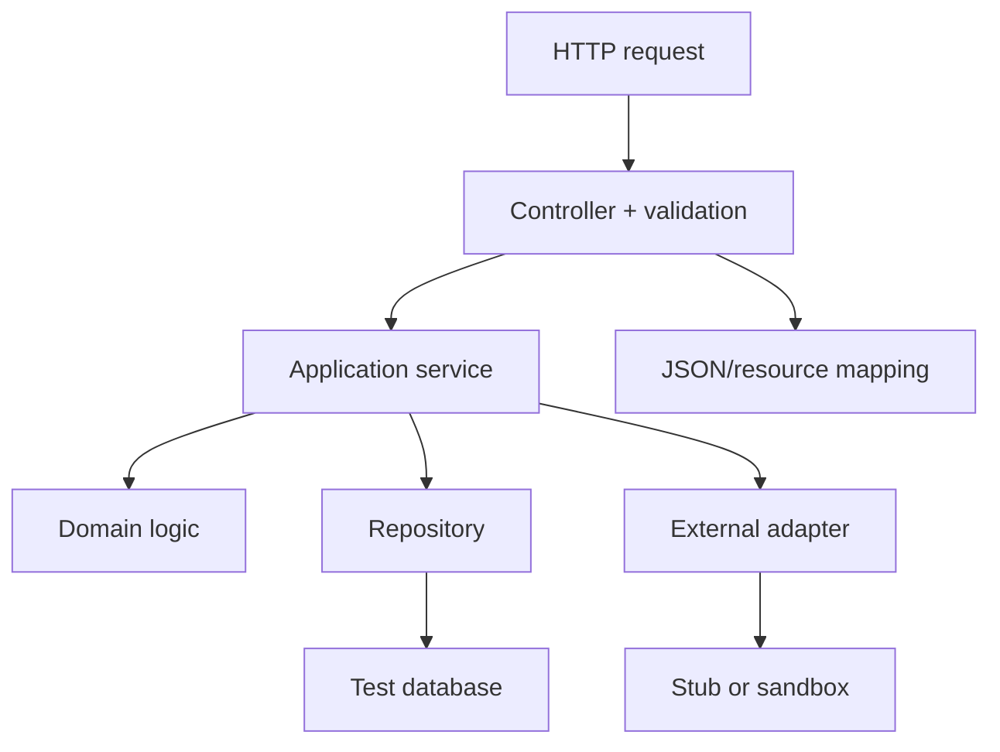

# Choosing a Small Slice to Run AOT and Native Before Scaling Application-Wide

## 1. Why Start with a Small Slice?

Migrating a large Spring Boot application to GraalVM Native Image all at once can surface many hard-to-separate failures: Spring AOT configuration, reflection, resources, proxies, serialization, JNI, system libraries, and container packaging. If the entire application changes at once, the team struggles to tell which dependency or module caused an error, while fix and rollback costs increase.

A small vertical slice lets you verify an entire meaningful path from Spring configuration to an endpoint or job: bean registration, request binding, service logic, persistence/clients, resources, and the native executable. Once that slice runs reliably, the team has evidence covering the toolchain, how to declare hints, testing, and operations before applying them more broadly.

In the **SPRING_BOOT_NATIVE_IMAGE** module, this approach enables migrating in measurable, testable, and rollback-ready increments. This lesson covers slice selection criteria, defining dependency boundaries, AOT/native stages, quality gates, rollout, and expansion conditions.

## 2. A Vertical Slice Differs from Just Picking a Package

A vertical slice cuts across the layers needed to complete a business capability. For example, "view order details" might include:

- HTTP controller and request/response DTOs.
- Validation and JSON serialization.
- Service/use case.
- Repository or HTTP client.
- Domain model and converters.
- Spring configuration, security, and transactions.
- Resources or message bundles if the endpoint uses them.
- Logging, metrics, and error mapping.

Picking only a controller package to build natively might miss persistence, serializers, or dynamic dependencies. Conversely, a small yet complete slice verifies multiple runtime risks within an understandable scope.

You don't need to put all business logic into the first slice. Choose a valuable flow that is independent enough to run in a test environment.

## 3. Criteria for Selecting the First Slice

The first slice should be moderate in scope and measurable. Evaluate:

| Criterion | Suitability signal |
|---|---|
| Business value | A real flow verifiable via contract |
| Clear boundaries | Well-defined inputs/outputs and dependencies |
| Manageable dependencies | Few dynamic plugins, few specialized native libraries |
| Testability | Reproducible fixtures and integration environment |
| AOT complexity | Context/profiles/conditions without excessive variants |
| Native risk | Necessary reflection/resources/proxies can be covered |
| Rollback | Can keep the JVM path operating independently |
| Ownership | A team responsible for fixing and operating it |

Do not pick a slice so trivial that it stops representing the application. If the first slice lacks databases, serializers, or proxies that production uses widely, passing results can create a false sense of security.

## 4. Avoid Picking a First Slice with Too Many Simultaneous Risks

A flow that combines JNI, plugin loading, dynamic scripting, multiple databases, multiple profiles, and custom classpath scanning makes a poor pilot. If it fails, the team won't know whether to fix the toolchain, a dependency, or the architecture first.

Inventory capabilities and choose a slice with a few representative yet isolatable risks. For example:
- A JSON controller with validation.
- A service and repository.
- A transaction boundary.
- A resource/template if needed.
- A proxy/AOP path used in production.

Harder capabilities such as runtime plugins or JNI can be investigated in separate spikes. Do not drop them from the migration plan; just avoid making all of them variables in the first slice.

## 5. Build a Dependency Map Before Extracting the Slice

Map the components the slice calls:



Record dependencies in three groups:

- **Inside the slice:** code compiled and packaged with the application.
- **External dependencies:** databases, brokers, HTTP services requiring a runtime environment.
- **Shared dependencies:** security, logging, configuration, common models, or shared libraries.

If the slice depends on a shared module with heavy dynamic behavior, verify that module is native-compatible too. A package cannot be considered independent merely because its source code lives in a separate directory.

## 6. Choose an Appropriate Spring Context Boundary

Spring AOT analyzes the ApplicationContext based on actual configuration. If the full application has many profiles and conditions, the slice needs a context representative enough of the intended deployment mode.

Consider:
- What is the component scan scope?
- Which auto-configurations are enabled?
- Which beans are created via `@ConditionalOnProperty`?
- Which profiles are active?
- Which security/filters/interceptors apply?
- Which repositories and clients are initialized?
- Does test configuration alter the bean graph?

You can create a Spring Boot test slice or lean application configuration for the pilot, provided you understand what it excludes. If the production context is completely different, native success on a test slice does not prove the production application context is compatible.

## 7. Distinguish Test Slices from Migration Slices

Annotations such as `@WebMvcTest` and `@DataJpaTest` create test contexts focused on a single layer. They are useful for fast tests, but do not necessarily represent a complete vertical slice.

A migration slice is the capability scope chosen to move through AOT/native. It may use multiple test slices to check individual layers, but needs at least one integration scenario running under a production-like configuration.

For example:
- `@WebMvcTest` verifies binding/controllers.
- `@DataJpaTest` verifies repository/entity mapping.
- `@SpringBootTest` verifies the application context and integration flow.
- Native executable/container tests verify the actual artifact.

Do not equate a passing `@WebMvcTest` with the entire endpoint being ready to run natively.

## 8. Define the Contract and Pass Criteria Upfront

Before running AOT, specify what the slice must accomplish. For example, for "view order details":

- Accept valid requests and return the expected schema.
- Invalid requests return validation errors matching the contract.
- Repository queries the expected data.
- Security enforces the expected authorization.
- JSON serializer handles required DTOs/subtypes.
- Resources are read if the flow uses them.
- Native executable starts and passes readiness.
- Container runs non-root with production-like configuration.

Criteria should have observable outcomes; avoid phrasing like "no errors." Record test classes, fixtures, expected statuses/responses, dependencies, and metrics to collect.

## 9. Establish the JVM Baseline Before Migrating

The JVM baseline helps separate migration issues from pre-existing bugs. Run current tests on the same commit:

- Domain/service unit tests.
- Controller/contract tests.
- Repository/integration tests.
- Security tests.
- End-to-end slice scenarios.
- Startup/readiness and resource usage where applicable.

Save test reports and fixtures. If the JVM baseline fails, fix or document it before migrating. Do not use a native build in a way that accidentally changes logic and obscures root causes.

The baseline also enables comparing JVM and native behavior later: responses, exception mapping, transactions, serialization, and performance must preserve the contract.

## 10. Run Application AOT for the Slice

Once the context and structural properties are defined, run Spring AOT using the lifecycle supported by the project's Spring Boot/Native Build Tools version. Depending on the plugin, AOT may be invoked automatically by the native task or require a dedicated task/goal.

Verify:
- Correct application main class.
- Correct profiles and structural properties.
- Correct classpath/dependency graph.
- Generated sources/resources are produced.
- AOT warnings/errors are addressed.
- Test-only beans are not accidentally pulled into the production context.
- Task graph confirms AOT ran.

Do not edit generated files by hand. If AOT output is wrong, fix source/configuration/hints and re-run.

## 11. Add RuntimeHints Based on Evidence

When native analysis reveals missing reflection/resource/proxy/serialization/JNI metadata, identify the exact access path and add the necessary hints.

Registrar example:

```java
final class OrderSliceHints implements RuntimeHintsRegistrar {

    @Override
    public void registerHints(
            RuntimeHints hints,
            ClassLoader classLoader) {
        hints.resources().registerPattern("templates/order/*.html");
    }
}
```

This example is only appropriate if the slice actually reads those templates and the resource pattern is accurate. You can attach the registrar using `@ImportRuntimeHints` on an appropriate configuration class.

Do not register broad package-wide wildcards just to pass the build. Every hint should have a reason, owner, and verifying test. Prefer existing Spring/dependency native metadata before writing duplicate metadata.

## 12. Run the Native Build Within Slice Scope

Once AOT and metadata are ready, build the native executable using the pinned Maven or Gradle plugin. Record:
- GraalVM distribution/version.
- JDK, Spring Boot, and Native Build Tools versions.
- OS/architecture and C toolchain.
- Native build arguments.
- Build duration and peak memory.
- Binary size and build logs.
- Commit/source revision.

A passing build only proves the compiler produced an executable. You must run the binary and test the slice's paths. If native compilation fails, classify the error as toolchain, reachability, class initialization, dependency compatibility, or build configuration.

## 13. Test the Slice on the Native Executable

Select tests matching the defined contract:
- Start the ApplicationContext.
- Invoke endpoints or use cases.
- Binding/validation and JSON serialization.
- Repository/queries or external adapters.
- Security/authorization.
- Proxies/transactions where applicable.
- Resources/templates/locales where applicable.
- Exception/error mapping.

If the native test framework does not support certain test classes, you can run a black-box contract suite from a separate test process against the native application. Clearly document which tests run inside the native executable and which only call the application externally.

Do not check only exit code 0 or the health endpoint. You must prove the slice's business behavior.

## 14. Package the Final Container Image for the Slice

The native binary needs a runtime image compatible with its architecture, libc, and shared libraries. The image may also need CA certificates, timezone data, configuration, and writable paths.

Verify:
- Base image and binary ABI.
- Runtime shared libraries.
- Non-root UID/GID.
- Exec-form entrypoint.
- Read-only filesystem and writable mounts.
- Runtime profiles/config/secrets.
- TLS/DNS/networking.
- Startup/readiness/liveness.
- Graceful shutdown.

Run tests against the final image, not just the builder stage. Tie results to the image digest so you know the exact artifact verified.

## 15. Measure Pilot Results

Compare JVM and native under the same workload:

| Category | Metrics |
|---|---|
| Build | Wall-clock time, peak RAM, cache state |
| Artifact | JAR/binary size, container image size |
| Startup | Process start and time-to-ready |
| Runtime | RSS/cgroup memory, CPU, throughput |
| Latency | p50/p95/p99 |
| Stability | Errors, restarts, OOMs |
| Compatibility | Number of hints/workarounds and dependency issues |
| Engineering | Time spent fixing, testing, and operating |

Measure across multiple runs using identical request mixes, CPU/RAM limits, data, and environments. Native may start fast without necessarily improving throughput or total cost. The pilot must answer both technical and operational questions.

## 16. Use Feature Flags or Dedicated Routes During Rollout

If the application can run JVM and native as two deployments, rollout can begin with a small traffic slice or a dedicated route. Keep contracts identical and prevent both deployments from executing side effects for the same request unless idempotency is in place.

Options:
- Native canary for a percentage of traffic.
- Internal route reserved for testing.
- A group of test tenants/accounts.
- Read-only shadow traffic or traffic with side-effect suppression.
- Native batch job running on a separate test dataset.

Monitor error rate, latency, readiness, restarts, and dependency behavior. Keep a rollback route back to the JVM if the native candidate misses SLOs.

## 17. Expand by Capability, Not Just Package Count

After the pilot, expand by grouping capabilities:

1. Spring context/AOT configuration.
2. JSON binding, validation, and serialization.
3. Data access and transactions.
4. HTTP clients, messaging, and external SDKs.
5. Reflection/resources/proxies.
6. JNI/native libraries and dynamic behavior.
7. Security, observability, and container runtime.

Each capability can span many packages. Expanding purely by package risks missing shared dependencies called across packages.

Create a compatibility matrix recording capability, dependency versions, hints, tests, and native status. When upgrading a dependency, re-run tests for the affected capabilities.

## 18. Criteria for Expanding to the Next Slice

Do not expand just because native compilation passes. The current slice must meet:

- Contract/business tests pass on native.
- Final image tests pass.
- Runtime dependencies and resources are verified.
- No unapproved CVE/compatibility blockers.
- Startup/readiness and SLOs meet targets.
- Observability is sufficient for operations.
- Rollback has been tested.
- Hints and workarounds have documentation/owners.
- Build pipeline is reproducible from a pinned commit and toolchain.

If unresolved issues remain, document the blast radius and decide whether to accept them for expansion or fix them first. Do not mask errors by skipping tests or adding overly broad metadata.

## 19. Managing Shared Modules and Common Dependencies

A small slice may depend on a common module containing DTOs, serializers, security, logging, or utilities. When the native slice passes, that common module is only partially verified—not all of its features are necessarily covered.

Maintain a list of:
- APIs/modules called by the slice.
- Beans/configurations discovered by AOT.
- Types serialized/deserialized.
- Resources read.
- Proxies generated.
- Dependency versions and native metadata.
- Code paths not yet exercised.

When a subsequent slice uses another capability in the shared module, add tests. Do not label an entire shared module "native compatible" based on a single endpoint.

## 20. Common Pilot Mistakes

| Mistake | Consequence | How to avoid |
|---|---|---|
| Picking an overly simple slice | Fails to represent production dependencies | Choose a vertical flow with real risks |
| Picking an overly large slice | Hard to isolate root causes | Scope to one capability/business flow |
| Running only controller tests | Misses repositories/clients/resources | Include a native integration scenario |
| Using a test profile unlike production | AOT context is unrepresentative | Specify structural inputs explicitly |
| Adding broad hints | Larger binary and hard to audit | Register exact members/resources |
| Testing binary only on builder | Final image may miss dependencies | Test exact image digest |
| Expanding right after build passes | No operational evidence | Wait for test/SLO/rollback gates |
| Migrating many dependencies at once | Hard to isolate regressions | Expand by capability and version |

## 21. Hands-on Exercise: Native Pilot for the Order Detail Flow

**Context:** The Order API has several modules, so the team selects the order detail read flow for the pilot. The flow uses a controller, JSON DTOs, service, repository, and database; it does not yet include the payment SDK/JNI.

**Step 1 — Lock scope.** List classes, beans, repositories, profiles, dependencies, and endpoints in the flow.

**Step 2 — Define contract.** Prepare request/response fixtures, authorization cases, validation, and expected errors.

**Step 3 — Run JVM baseline.** Execute unit, repository, controller, and integration tests; save reports.

**Step 4 — Configure AOT.** Pin profiles/structural properties, run Application AOT, and inspect generated outputs.

**Step 5 — Handle metadata.** Add minimal hints for resources/reflection/proxies if required by evidence; write verification tests.

**Step 6 — Build native.** Pin the toolchain, record build duration/peak RAM, and save the binary digest.

**Step 7 — Run native contract tests.** Call the endpoint on the native process and verify JSON, security, repository, and database behavior.

**Step 8 — Build final image.** Run non-root and verify TLS/DNS/config/readiness and graceful shutdown.

**Step 9 — Measure and canary.** Compare JVM/native under identical workloads; route a controlled traffic slice.

**Step 10 — Decide on expansion.** Only add a new slice once the pilot meets contract, SLO, observability, and rollback criteria.

Completion criteria: pilot scope is documented; JVM baseline and native tests pass; AOT/native artifacts have provenance; final image is verified; comparison metrics are reproducible; the team makes an expansion decision based on quality gates.

## 22. Conclusion

Migrating Spring Boot to Native Image one vertical slice at a time reduces variables, isolates dependencies, and builds evidence before scaling out. The first slice should represent a real business capability with clear dependency boundaries, contract tests, and a rollback path.

Progress from the JVM baseline through Spring AOT, evidence-backed `RuntimeHints`, native builds, native integration tests, and final container validation. Measure build, startup/readiness, memory, latency, and engineering effort under the same workload. Only expand when the current slice clears quality gates with clear observability and rollback; expand by shared capabilities so risks outside package boundaries are not overlooked.
