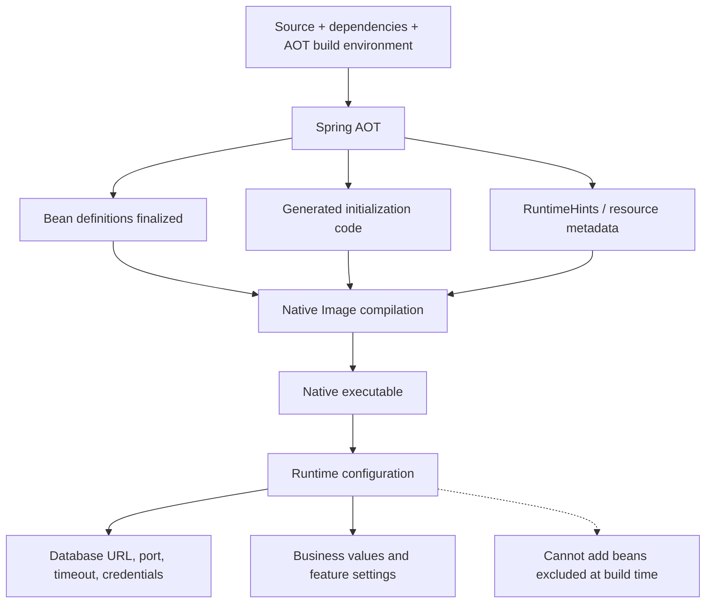

# Migrating Bean Registration, Resource Loading, and Environment Configuration

> **Chapter: Migration and Upgrade.** The **SPRING_BOOT_NATIVE_IMAGE** module compiles Spring Boot applications into GraalVM Native Images using Spring AOT to improve startup time and memory usage. When migrating a JVM application to AOT/Native Image, most business code can remain intact, but how Spring discovers beans, how libraries locate resources, and how environment configuration works must be re-examined. This lesson shows how to migrate dynamic registration mechanisms to build-time analyzable bean definitions, switch resource reading to native-compatible APIs, and separate fixed bean graph configuration from runtime-supplied environment values.

## 1. Learning Objectives

After this lesson, you can:

1. Explain which parts of the Spring ApplicationContext are decided at build time during AOT.
2. Identify dynamic bean registration patterns that cannot be directly converted to AOT.
3. Migrate singleton registration and runtime callbacks to `@Configuration`, `@Bean`, or `ImportBeanDefinitionRegistrar`.
4. Declare exact bean types so Spring AOT can analyze injection, lifecycle, and proxies.
5. Choose how to use `@Profile`, `@Conditional`, and feature flags with a fixed bean graph.
6. Migrate classpath resource loading from `File`/`URL` to `Resource`/`InputStream` and register `RuntimeHints` when resource names are built dynamically.
7. Move configuration from hard-coded values or build profiles to `@ConfigurationProperties`, `Environment`, and externalized config.
8. Use environment variables, external config files, and config trees for container environments.
9. Distinguish configuration that affects build-time bean registration from configuration that only alters runtime behavior.
10. Test the AOT-processed application on the JVM before compiling and running the native executable.

## 2. Shifting Mindset When Moving to Spring AOT

A Spring application on the JVM typically builds its ApplicationContext at startup. During refresh, Spring reads configuration, scans the classpath, evaluates conditions, registers bean definitions, creates beans, and runs extension callbacks.

Spring AOT performs part of discovery and ApplicationContext preparation right during the build. AOT generates initialization code, required bytecode, and `RuntimeHints` for reflection, resources, serialization, or JDK proxies. Native Image uses this information to create an executable with a fixed set of code and metadata.

This creates three decision groups:

| Group | Examples | Decision time |
|---|---|---|
| Application structure | Classpath, bean definitions, component scans, imports, bean creation conditions | Build time |
| Packaged resources | Classpath resources, resource bundles, reflection/proxy hints | Build time |
| Operational values | Database URLs, ports, timeouts, credentials, log levels, external endpoints | Runtime, if they do not alter the bean graph |

A property value can still be read from `Environment` at runtime. However, if that property controls whether a bean is created via `@Conditional`, Spring AOT already evaluated the condition during the build. Changing the property after the executable is built will not automatically add a bean that was excluded from the ApplicationContext.



Therefore, when migrating an application, ask three separate questions: which beans must exist, which resources must be packaged, and which values need to vary by runtime environment.

## 3. Migration Map from JVM Applications to AOT/Native

| Pattern in legacy JVM application | Appropriate migration |
|---|---|
| Calling `registerSingleton` to add an instance after context start | Register a bean definition via `@Bean` or `BeanDefinitionRegistry` |
| Arbitrarily scanning classpath/plugin directories at runtime | Determine the component/plugin set at build time or use an explicit registry |
| Registering beans via callbacks not processed by Spring AOT | Use `@Import`, `ImportBeanDefinitionRegistrar`, or an appropriate AOT contribution |
| `@Bean` declares an overly generic return type | Declare the concrete implementation type when AOT needs to analyze it |
| Changing `@Profile` to alter the bean graph post-deploy | Select profiles during AOT processing or keep the bean graph stable and vary behavior via runtime properties |
| Using `@ConditionalOnProperty` to toggle beans per environment post-deploy | Use conditions only for build-time selection; use feature flags inside stable beans for runtime toggles |
| Using `URL.getFile()` or `Resource.getFile()` for resources inside a JAR | Read `InputStream`; copy to a temporary file if a library strictly requires `File` |
| Constructing dynamic resource names without declaring metadata | Register `RuntimeHints` for the valid resource set |
| Hard-coding database URLs, passwords, or paths | Use `@ConfigurationProperties` and externalized configuration |
| Packaging secrets in `application.yaml` | Mount secrets via config trees or a secret manager |

You do not need to rewrite the entire application just to move to Native Image. Focus on fixing places that rely on a dynamic classpath, runtime-created instances, or filesystem assumptions.

## 4. Migrating Bean Registration

### 4.1. Prefer Analyzable Spring Configuration

The following mechanisms are understood directly by Spring AOT during configuration processing:

- `@Configuration` and `@Bean`.
- `@Component`, `@Service`, `@Repository`, and component scanning resolved at build time.
- `@Import` and `ImportSelector`.
- `@Profile` and `@Conditional` evaluated in the AOT environment.
- `BeanDefinition` registered during configuration class parsing.

Explicit configuration example:

```java
@Configuration(proxyBeanMethods = false)
@Import({OrderRepositoryConfiguration.class, PaymentConfiguration.class})
public class OrderApplicationConfiguration {
}

@Configuration(proxyBeanMethods = false)
public class PaymentConfiguration {

    @Bean
    public StripePaymentGateway stripePaymentGateway(
            PaymentClient paymentClient) {
        return new StripePaymentGateway(paymentClient);
    }
}
```

This declaration informs AOT of the bean definition, bean type, and dependency relationships right at build time. When imported by the application configuration, Spring can include those beans in the AOT context.

### 4.2. Replace `registerSingleton` with Bean Definitions

Some legacy JVM applications instantiate objects and register them directly:

```java
// Old approach: register a pre-created instance at runtime.
singletonRegistry.registerSingleton("paymentGateway", new StripePaymentGateway(client));
```

Beans registered with `registerSingleton` cannot be converted by Spring AOT like normal bean definitions. AOT needs to know how to create the bean, its type, and its dependencies before an instance exists.

Migrate to `@Bean`:

```java
@Configuration(proxyBeanMethods = false)
public class PaymentConfiguration {

    @Bean
    public StripePaymentGateway paymentGateway(PaymentClient client) {
        return new StripePaymentGateway(client);
    }
}
```

If multiple beans need to be registered based on module metadata, use `ImportBeanDefinitionRegistrar`:

```java
public final class PaymentModuleRegistrar
        implements ImportBeanDefinitionRegistrar {

    @Override
    public void registerBeanDefinitions(
            AnnotationMetadata importingClassMetadata,
            BeanDefinitionRegistry registry) {

        RootBeanDefinition definition =
                new RootBeanDefinition(StripePaymentGateway.class);
        registry.registerBeanDefinition("stripePaymentGateway", definition);
    }
}

@Configuration(proxyBeanMethods = false)
@Import(PaymentModuleRegistrar.class)
class PaymentModuleConfiguration {
}
```

The registrar runs during configuration parsing, so the bean definition is created before Spring AOT generates initialization code. If the bean needs constructor arguments or properties, declare explicit constructors/factory methods in the `BeanDefinition` or consider `@Bean` for readability.

### 4.3. When to Use `BeanDefinitionRegistryPostProcessor`?

`BeanDefinitionRegistryPostProcessor` remains a valid extension point if registry manipulation is needed. However, if the processor itself is registered as a bean, it may be invoked again at runtime. In AOT, callbacks need appropriate build-time contributions so behavior is reproduced accurately.

Spring Framework recommends `ImportBeanDefinitionRegistrar` for most custom bean registration cases because it executes during configuration parsing. Only use `BeanFactoryInitializationAotProcessor` or `BeanRegistrationAotProcessor` when building infrastructure that deeply customizes AOT code generation.

If implementing an AOT processor:

- Keep processor dependencies small and stable.
- Avoid depending on bean instances created late.
- If declared via `@Bean`, consider a static factory method so the enclosing configuration class does not need to be instantiated during the AOT phase.
- Ensure the AOT contribution reproduces equivalent runtime behavior.
- Write tests for both the generated context and the native executable.

Do not build a custom AOT processor just to replace a few ordinary `@Bean` methods.

### 4.4. Declare Exact Bean Types

Spring AOT needs to know the bean type to detect annotations, injection points, lifecycle callbacks, and proxies. Avoid declaring overly generic return types when the implementation carries important metadata.

Insufficiently informative example:

```java
@Bean
public PaymentGateway paymentGateway() {
    return new StripePaymentGateway();
}
```

If the bean implementation has methods Spring must discover or needs to be injected by implementation type, declare the concrete type:

```java
@Bean
public StripePaymentGateway paymentGateway() {
    return new StripePaymentGateway();
}
```

Other components can still inject via the `PaymentGateway` interface. What matters is that the bean definition exposes the exact implementation type so AOT can analyze it thoroughly.

### 4.5. Avoid Bean Definitions Depending on Dynamic Instance Suppliers

Bean definitions whose instance supplier is an arbitrary lambda or method reference may not translate to AOT code. Likewise, singletons registered by instance do not supply enough information for AOT to recreate the bean.

Instead of creating a supplier from runtime data:

```java
RootBeanDefinition definition = new RootBeanDefinition(OrderHandler.class);
definition.setInstanceSupplier(
        () -> handlerFactory.create(resolveHandlerType()));
registry.registerBeanDefinition("handler", definition);
```

Determine handler types at build time and register concrete bean definitions, or create a stable router bean that receives registered implementations:

```java
@Component
public class HandlerRouter {

    private final Map<String, OrderHandler> handlers;
    private final HandlerProperties properties;

    public HandlerRouter(
            Map<String, OrderHandler> handlers,
            HandlerProperties properties) {
        this.handlers = handlers;
        this.properties = properties;
    }

    public OrderHandler currentHandler() {
        OrderHandler handler = handlers.get(properties.handler());
        if (handler == null) {
            throw new IllegalStateException(
                    "Unknown order handler: " + properties.handler());
        }
        return handler;
    }
}
```

The router keeps the bean graph stable. The `handler` property can be bound at runtime to select an implementation from the existing beans.

## 5. Migrating `@Profile`, `@Conditional`, and Feature Flags

### 5.1. Bean Creation Conditions Are Evaluated at Build Time

Spring AOT evaluates `@Conditional` against the environment used during AOT processing. `@Profile` is also implemented on top of conditions, so profiles affecting which beans are created must be selected during the build.

Example:

```java
@Configuration(proxyBeanMethods = false)
@Profile("cloud")
class CloudStorageConfiguration {

    @Bean
    CloudStorage cloudStorage() {
        return new CloudStorage();
    }
}
```

If the `cloud` profile is not active during AOT processing, the `cloudStorage` bean may be omitted from the generated context. Setting `SPRING_PROFILES_ACTIVE=cloud` when running the executable cannot restore a bean excluded at build time.

### 5.2. Selecting Profiles When Running Process AOT

With Maven, configure profiles in the `spring-boot:process-aot` execution:

```xml
<plugin>
    <groupId>org.springframework.boot</groupId>
    <artifactId>spring-boot-maven-plugin</artifactId>
    <executions>
        <execution>
            <id>process-aot</id>
            <goals>
                <goal>process-aot</goal>
            </goals>
            <configuration>
                <profiles>cloud</profiles>
            </configuration>
        </execution>
    </executions>
</plugin>
```

With Gradle, configure the `ProcessAot` task:

```groovy
tasks.withType(
        org.springframework.boot.gradle.tasks.aot.ProcessAot
).configureEach {
    args('--spring.profiles.active=cloud')
}
```

Task names and configuration APIs may vary by Spring Boot plugin version. Consult documentation matching the exact version declared in your project.

### 5.3. Profiles That Only Change Configuration Values

Not every profile requires building a separate native executable. Profiles that only override property values without affecting bean creation conditions can still be used at runtime.

Example:

```yaml
# application-prod.yaml
orders:
  retry:
    max-attempts: 5
    delay: 2s
```

If the `prod` profile only changes the retry count and delay of an existing bean, values can be bound from runtime config. If that profile enables/disables a `@Configuration` or `@Bean` via `@Profile`/`@Conditional`, that choice must be made during the AOT build.

### 5.4. Moving Feature Flags from Bean Conditions to Runtime Behavior

Suppose a legacy application uses `@ConditionalOnProperty` to create a bean only when `payment.enabled=true`. To toggle this feature per environment post-deploy, keep the bean and read the property at execution time:

```java
@ConfigurationProperties("payment")
public record PaymentProperties(boolean enabled) {
}

@Configuration(proxyBeanMethods = false)
@EnableConfigurationProperties(PaymentProperties.class)
class PaymentFeatureConfiguration {
}

@Component
public class PaymentService {

    private final PaymentProperties properties;
    private final PaymentGateway gateway;

    public PaymentService(
            PaymentProperties properties,
            PaymentGateway gateway) {
        this.properties = properties;
        this.gateway = gateway;
    }

    public PaymentResult pay(PaymentRequest request) {
        if (!properties.enabled()) {
            throw new IllegalStateException("Payment is disabled");
        }
        return gateway.pay(request);
    }
}
```

Both `PaymentService` and `PaymentGateway` are always present in the graph; the property merely governs method behavior. This works well when the required implementations are already on the classpath and registered.

If different implementations need different libraries/native dependencies or produce very different bean graphs, create separate build variants, each running AOT processing with the appropriate profile. Do not expect a single binary to arbitrarily reshape its ApplicationContext structure after launch.

## 6. Migrating Resource Loading

### 6.1. Distinguish Classpath Resources from External Files

Classpath resources are packaged inside the JAR/dependencies, for example:

```text
src/main/resources/
  templates/
    invoice.html
  dictionaries/
    en.txt
    vi.txt
  config/
    payment-rules.yml
```

Files external to the executable can be mounted from a volume, for example:

```text
/etc/orders/application.yaml
/run/secrets/database-password
/opt/orders/templates/custom-invoice.html
```

These two types have different lifecycles:

| Source | Included in native executable? | How to change |
|---|---|---|
| Classpath resource | Only if discovered or registered via hints | Usually requires rebuilding the executable to update contents |
| External filesystem file | Not embedded automatically | Swap file/mount/config without recompiling |
| External URL | Not embedded | Accessed over the network at runtime |

Do not use `RuntimeHints` for production files that exist only on a mounted volume. Conversely, do not assume files under `src/main/resources` will automatically exist as physical files on disk when the native executable runs.

### 6.2. Use `Resource` and `InputStream` Instead of `File`

Legacy code may assume classpath resources are always `File` objects:

```java
URL url = getClass().getResource("/templates/invoice.html");
File templateFile = new File(url.getFile());
legacyRenderer.render(templateFile);
```

In Native Image, resources may be stored inside the executable and URLs are not file URLs. Use Spring `Resource`:

```java
Resource template = new ClassPathResource("templates/invoice.html");

try (InputStream input = template.getInputStream()) {
    invoiceRenderer.render(input);
}
```

If a legacy library strictly requires a `File`, copy the resource to a temporary file:

```java
Path temporaryFile = Files.createTempFile("invoice-", ".html");
try (InputStream input = template.getInputStream()) {
    Files.copy(input, temporaryFile, StandardCopyOption.REPLACE_EXISTING);
}
try {
    legacyRenderer.render(temporaryFile.toFile());
}
finally {
    Files.deleteIfExists(temporaryFile);
}
```

The temporary directory must be writable and have sufficient space. Never store temporary files containing sensitive data in locations readable by other users.

### 6.3. Register Dynamically Selected Resources with `RuntimeHints`

If a resource name is built from a locale or runtime property, Native Image may not infer the full set of files to retain.

```java
@Component
@ImportRuntimeHints(DictionaryResourceHints.class)
public class DictionaryService {

    private final ResourceLoader resourceLoader;

    public DictionaryService(ResourceLoader resourceLoader) {
        this.resourceLoader = resourceLoader;
    }

    public String load(Locale locale) throws IOException {
        String language = locale.getLanguage();
        Resource resource = resourceLoader.getResource(
                "classpath:dictionaries/" + language + ".txt");
        try (InputStream input = resource.getInputStream()) {
            return new String(input.readAllBytes(), StandardCharsets.UTF_8);
        }
    }

    static class DictionaryResourceHints implements RuntimeHintsRegistrar {

        @Override
        public void registerHints(RuntimeHints hints, ClassLoader classLoader) {
            hints.resources().registerPattern("dictionaries/*.txt");
        }
    }
}
```

Register patterns covering only the valid resources supported by the application. If the locale comes from a request, restrict the locale set with an allowlist. Never construct paths from arbitrary input to expose unrestricted resources.

### 6.4. Keep Resources External When Post-Deploy Updates Are Needed

If templates or policies must be updated without rebuilding the executable, store them on the filesystem or an external store:

```java
@ConfigurationProperties("orders.templates")
public record TemplateProperties(Path directory) {
}

@Configuration(proxyBeanMethods = false)
@EnableConfigurationProperties(TemplateProperties.class)
class TemplateConfiguration {
}

@Component
public class ExternalTemplateLoader {

    private final TemplateProperties properties;

    public ExternalTemplateLoader(TemplateProperties properties) {
        this.properties = properties;
    }

    public String read(String name) throws IOException {
        Path root = properties.directory().toAbsolutePath().normalize();
        Path file = root.resolve(name + ".html").normalize();
        if (!file.startsWith(root)) {
            throw new IllegalArgumentException("Invalid template path");
        }
        return Files.readString(file, StandardCharsets.UTF_8);
    }
}
```

Mount the template directory into the container and configure `orders.templates.directory` from the environment. Always normalize paths and check for path traversal before opening files.

## 7. Migrating Environment Configuration to Externalized Configuration

### 7.1. Use `@ConfigurationProperties` Instead of Hard-Coded Values

Instead of reading scattered environment variables or hard-coding endpoints:

```java
@ConfigurationProperties(prefix = "orders.client")
@Validated
public record OrdersClientProperties(
        @NotNull URI baseUrl,
        @NotNull Duration timeout,
        @Min(1) int maxAttempts) {
}
```

Register the properties:

```java
@Configuration(proxyBeanMethods = false)
@EnableConfigurationProperties(OrdersClientProperties.class)
public class OrdersClientConfiguration {

    @Bean
    OrdersClient ordersClient(OrdersClientProperties properties) {
        return new OrdersClient(
                properties.baseUrl(),
                properties.timeout(),
                properties.maxAttempts());
    }
}
```

Or use `@ConfigurationPropertiesScan` if the project organizes properties classes by package. Spring Boot AOT automatically generates many of the reflection hints required for configuration properties.

### 7.2. Check Nested Configuration Properties

For nested types that are not inner classes, `@NestedConfigurationProperty` may be required so Spring Boot recognizes and binds them fully in a native image:

```java
@ConfigurationProperties("orders")
public class OrdersProperties {

    private String name;

    @NestedConfigurationProperty
    private RetryProperties retry = new RetryProperties();

    public String getName() {
        return name;
    }

    public void setName(String name) {
        this.name = name;
    }

    public RetryProperties getRetry() {
        return retry;
    }

    public void setRetry(RetryProperties retry) {
        this.retry = retry;
    }
}

public class RetryProperties {
    private int maxAttempts;
    private Duration delay;
    // getters and setters
}
```

With records or constructor binding, place the annotation on the corresponding component/parameter according to Spring Boot's guidelines. Ensure public accessors exist so the `Binder` can bind properties.
Register `OrdersProperties` with `@EnableConfigurationProperties` or `@ConfigurationPropertiesScan` so Spring creates the configuration bean.

### 7.3. Use Environment Variables Following Relaxed Binding

Spring Boot maps property names to environment variables using these rules:

1. Replace dots with underscores.
2. Remove dashes.
3. Convert to uppercase.

Examples:

| Property | Environment variable |
|---|---|
| `orders.client.base-url` | `ORDERS_CLIENT_BASEURL` |
| `orders.client.timeout` | `ORDERS_CLIENT_TIMEOUT` |
| `orders.client.max-attempts` | `ORDERS_CLIENT_MAXATTEMPTS` |
| `spring.profiles.active` | `SPRING_PROFILES_ACTIVE` |
| `spring.config.additional-location` | `SPRING_CONFIG_ADDITIONALLOCATION` |

Environment variables work well for endpoints, ports, timeouts, and small configuration values. For secrets or multi-line configuration, consider config trees or a secret manager.

### 7.4. Separate Default Values from Environment-Specific Configuration

`application.yaml` should contain safe defaults:

```yaml
orders:
  client:
    base-url: https://orders.internal
    timeout: 2s
    max-attempts: 3

spring:
  config:
    import: optional:configtree:/run/secrets/
```

The runtime environment can override values:

```bash
export ORDERS_CLIENT_BASEURL=https://orders.prod.internal
export ORDERS_CLIENT_TIMEOUT=1500ms
```

Never place passwords or private keys in `application.yaml` packaged inside the executable. When using Kubernetes Secrets or Docker secrets, mount files into the container and import them via `configtree`.

Example secret layout:

```text
/run/secrets/
  spring.datasource.username
  spring.datasource.password
  orders.client.api-key
```

With configuration:

```yaml
spring:
  config:
    import: optional:configtree:/run/secrets/
```

Spring Boot exposes file names and file contents as properties in `Environment`. Secret values are read at startup; modifying files later does not automatically refresh all beans. If secret rotation while running is needed, use a refresh-capable integration or design clients to fetch credentials dynamically.

### 7.5. Choose the Right Config Location for the Purpose

Spring Boot supports:

- `spring.config.location`: replaces default search locations.
- `spring.config.additional-location`: adds new locations and allows overriding default configuration.
- `spring.config.import`: imports files, config trees, or supported config sources.

Example adding an external config directory:

```bash
SPRING_CONFIG_ADDITIONAL_LOCATION=file:/etc/orders/
```

Directory locations require a trailing `/`. If a location may not exist, use the `optional:` prefix. Properties `spring.config.name`, `spring.config.location`, and `spring.config.additional-location` are processed very early, so pass them as environment variables, system properties, or command-line arguments.

Do not put all external configuration on the classpath if the goal is to change endpoints and credentials per environment without rebuilding the binary.

## 8. Distinguishing Build-Time and Runtime Configuration

| Property/decision | Build time | Runtime |
|---|---|---|
| Which libraries exist on classpath/dependencies | Yes | Cannot arbitrarily add JARs post-build |
| `@Profile` determining the bean graph | Yes | Cannot change the bean graph with a different profile |
| `@ConditionalOnProperty` creating beans | Yes | Post-build property changes cannot add/remove beans |
| Database URL of an existing bean | Need not be fixed | Can be read from `Environment` |
| HTTP port of an already-created server | Need not be fixed | Can be overridden via environment |
| Timeout, retry, log level | Need not be fixed | Can be overridden if code reads runtime config |
| Embedded classpath templates/resources | Yes | Cannot alter embedded contents without rebuilding |
| Externally mounted configuration files | Need not be embedded | Read from the filesystem at startup |
| Secrets mounted via config tree | Need not be in binary | Read from volume at startup |

This principle prevents two common mistakes: building a binary with the wrong profile and trying to use runtime environment variables to enable a bean that AOT excluded.

## 9. Testing AOT on the JVM Before Building Native

A safe transition step is running the application with AOT-generated code on the JVM. This catches bean graph and configuration issues before spending time on native compilation.

With Maven, use the `native` profile to run AOT processing and packaging:

```bash
./mvnw -Pnative package
```

With Gradle, enable the Spring Boot AOT plugin; when the GraalVM Native Image plugin is applied, the AOT plugin is typically configured automatically:

```bash
./gradlew processAot
```

Once the JAR contains AOT-generated assets, run:

```bash
java -Dspring.aot.enabled=true -jar target/orders-service.jar
```

Verify:

- Which beans appear in the ApplicationContext?
- Which profiles were active during `process-aot`?
- Do conditional beans match the artifact variant?
- Does runtime config override endpoints/timeouts as expected?
- Are templates and resources read using compatible APIs?
- Are config trees and external files loaded from the expected mount paths?

If AOT on the JVM already fails, fix the configuration before running `nativeCompile`/`native-image`.

## 10. Testing After Migration

### 10.1. Testing the Bean Graph

Write tests confirming required beans exist in the AOT context:

```java
@SpringBootTest
class AotBeanGraphTests {

    @Autowired
    ApplicationContext context;

    @Test
    void registersExpectedApplicationComponents() {
        assertThat(context.getBean(PaymentService.class)).isNotNull();
        assertThat(context.getBean(HandlerRouter.class)).isNotNull();
    }
}
```

Run tests with the AOT-generated application setup or native test task. A test running only on a standard JVM does not prove the bean graph is reproduced properly under AOT.

### 10.2. Testing `RuntimeHints`

When registering resource hints manually, use `RuntimeHintsPredicates` to verify:

```java
@Test
void registersDictionaryResources() {
    RuntimeHints hints = new RuntimeHints();
    new DictionaryResourceHints().registerHints(
            hints, getClass().getClassLoader());

    assertThat(RuntimeHintsPredicates.resource()
            .forResource("dictionaries/vi.txt"))
            .accepts(hints);
}
```

Hint tests verify that metadata is registered, but you still need tests that actually read resources on the native executable.

### 10.3. Testing Runtime Configuration

Run the same binary with two different configurations:

- Different database URLs and API endpoints.
- Different timeouts or retry counts.
- Secrets mounted via config tree.
- Profiles that only change properties without changing the bean graph.

Verify the application picks up the new values without recompiling. Never log secrets while verifying configuration.

### 10.4. Testing Profiles That Affect the Bean Graph

If production needs a different bean graph than staging:

1. Build an AOT artifact for each required profile/variant.
2. Record the profile and build arguments in release metadata.
3. Run AOT-on-JVM tests for each variant.
4. Build the native executable for each variant.
5. Test the bean graph and native behavior of each binary.

If only endpoints or credentials differ, keep a single bean graph and supply runtime configuration to avoid maintaining multiple binaries.

## 11. Step-by-Step Migration Process

1. **Inventory dynamic beans:** find `registerSingleton`, `registerBeanDefinition`, `BeanFactoryPostProcessor`, custom scanners, and lambda suppliers.
2. **Classify beans:** which beans are always needed, which only swap implementations, and which truly need build variants.
3. **Migrate registration:** prefer `@Bean`/`@Import`; use `ImportBeanDefinitionRegistrar` for custom module registration.
4. **Clarify bean types:** declare concrete return types and explicit constructor dependencies.
5. **Lock profiles/conditions:** determine the environment used during `process-aot`; drop expectations of changing the bean graph post-deploy.
6. **Extract feature flags:** move behavior toggle properties to runtime config if the bean must always exist.
7. **Audit resource access:** find `getResource`, `getResourceAsStream`, `getFile`, `URL.getFile`, classpath scans, and dynamic resource names.
8. **Register hints:** add `RuntimeHints` for required resources/reflection/proxies; include only the valid resource set.
9. **Externalize config:** move URLs, timeouts, credentials, and paths to `@ConfigurationProperties`, env vars, or config trees.
10. **Run AOT on JVM:** verify context and resources before native builds.
11. **Build and test native:** run native tests, integration tests, and smoke tests on the exact binary/container.
12. **Record build variants:** store AOT profile, GraalVM/JDK, dependencies, and config schema per release.

## 12. Common Migration Errors

| Symptom | Cause | Resolution |
|---|---|---|
| Bean exists on JVM but missing in native | Singleton registration or runtime callback not processed by AOT | Migrate to bean definitions registered during the AOT phase |
| `@Profile` bean missing | Profile was not active during `process-aot` | Configure profiles for the Maven/Gradle AOT task |
| Changing `SPRING_PROFILES_ACTIVE` does not change beans | Bean graph was fixed at build time | Build a new variant or keep the bean graph stable |
| `@ConditionalOnProperty` ignores runtime env | Condition was evaluated at AOT build time | Convert property into runtime behavior on an always-present bean |
| Bean implementation lacks annotations/lifecycle metadata | `@Bean` return type is too generic | Return the concrete implementation type |
| Custom `BeanDefinition` has no generated AOT code | Uses unsupported callbacks or dynamic suppliers | Use `ImportBeanDefinitionRegistrar` or an AOT contribution |
| Classpath scan misses new plugin | Plugin added post-build | Fix plugin set at build time or use a designed external plugin protocol |
| Resource exists in JAR but unreadable in native | Resource not included in executable | Register `RuntimeHints` and inspect the Build Report |
| Resource readable on JVM but `FileNotFound` on native | Code assumes classpath resource is a `File` | Use `InputStream` or copy to a temp file |
| Nested `ConfigurationProperties` fails to bind | External nested type not recognized | Add `@NestedConfigurationProperty` in the proper location |
| Native binary ignores env var | Env var name breaks relaxed binding rules | Map property to uppercase/underscores properly |
| External config file not loaded | Incorrect `spring.config.location` or missing trailing `/` | Check config location and precedence order |
| Secret missing from `Environment` | Wrong config tree path or volume mount | Verify mount path, file key, and `spring.config.import` |
| Native container missing config | File assumed to be in source directory | Mount file or config tree at runtime |

## 13. Hands-on Exercise

An order management service on the JVM currently has three mechanisms:

- The payment provider is created using `registerSingleton` based on the `PAYMENT_PROVIDER` variable.
- Email templates are loaded using `URL.getFile()`.
- Database URL and password are hard-coded in `application-prod.yaml`.

Migrate the application to Spring AOT/Native Image:

1. Create `PaymentGateway` implementations as explicit bean definitions.
2. Use `PaymentGatewayRouter` and `PaymentProperties` to select the provider at runtime if all providers are packaged together.
3. If providers need different dependencies/native libraries, create build variants with corresponding AOT profiles.
4. Switch template loading to `Resource`/`InputStream`; register resource patterns if templates are selected dynamically.
5. Move database URL and timeout to `@ConfigurationProperties`.
6. Mount the password as a secret file and import it via `configtree`.
7. Run AOT processing on the JVM with the exact profile of each build variant.
8. Test the bean graph, template rendering, and config binding.
9. Build the native executable and run integration tests with a test database plus smoke tests.
10. Run the same binary with different endpoints/credentials to confirm runtime config changes without rebuilding.

Report template:

| Item | Before migration | After migration | Result |
|---|---|---|---|
| Payment bean registration | `registerSingleton` | `@Bean`/`ImportBeanDefinitionRegistrar` | Pass/Fail |
| Provider selection | Build/runtime callback | AOT profile or runtime router | Pass/Fail |
| Email template | `URL.getFile()` | `Resource`/`InputStream` + hints | Pass/Fail |
| Database URL | Hard-coded | `Environment`/`ConfigurationProperties` | Pass/Fail |
| Database password | Packaged YAML | Config tree/secret mount | Pass/Fail |
| AOT JVM test | None | AOT-generated context | Pass/Fail |
| Native integration test | None | Test on native executable | Pass/Fail |

## 14. Self-Check Questions

1. Why does Spring AOT need to know bean definitions before creating a native executable?
2. Why is `registerSingleton` not equivalent to `@Bean` in AOT?
3. How does `ImportBeanDefinitionRegistrar` help migrate dynamic bean registration?
4. Why should `@Bean` declare exact return types?
5. When are `@Profile` and `@Conditional` evaluated in AOT?
6. How do you toggle a feature post-deploy without altering the bean graph?
7. Why should classpath resources not be forced into `File` objects?
8. When are `RuntimeHints` required for resources?
9. Which runtime configurations can change without rebuilding the native executable?
10. Why should you run the AOT-generated application on the JVM before native compilation?

## Key Takeaways

**Move application structure decisions to build time and keep operational values at runtime.** Register beans via analyzable configuration/registrars, select appropriate profiles during AOT processing, use `Resource`/`InputStream` with `RuntimeHints` for classpath resources, and externalize URLs/timeouts/secrets using `ConfigurationProperties`, environment variables, or config trees. Finally, test AOT on the JVM and run native integration tests to prove the bean graph, resources, and configuration all work in the final executable.

## Official References

- [Spring Framework — Ahead of Time Optimizations](https://docs.spring.io/spring-framework/reference/core/aot.html): bean graph constraints, programmatic registration, AOT contributions, and `RuntimeHints`.
- [Spring Boot — Ahead-of-Time Processing](https://docs.spring.io/spring-boot/reference/packaging/aot.html): AOT processing on the JVM and generated application setup.
- [Spring Boot — Ahead-of-Time Processing with Maven](https://docs.spring.io/spring-boot/maven-plugin/aot.html): `process-aot` goal and build-time profile configuration.
- [Spring Boot — Ahead-of-Time Processing with Gradle](https://docs.spring.io/spring-boot/gradle-plugin/aot.html): `ProcessAot` task, `processTestAot`, and native tasks.
- [Spring Boot — Ahead-of-Time Processing Questions](https://docs.spring.io/spring-boot/how-to/aot.html): conditions, profiles, and configuring the environment during AOT builds.
- [Spring Boot — Externalized Configuration](https://docs.spring.io/spring-boot/reference/features/external-config.html): `Environment`, property precedence, environment variables, config locations, and config trees.
- [Spring Boot — Advanced Native Image Topics](https://docs.spring.io/spring-boot/reference/packaging/native-image/advanced-topics.html): nested configuration properties, custom hints, and `RuntimeHintsPredicates`.
- [Spring Framework — Resources](https://docs.spring.io/spring-framework/reference/core/resources.html): `Resource` abstraction, classpath/file/URL, and `ResourcePatternResolver`.
