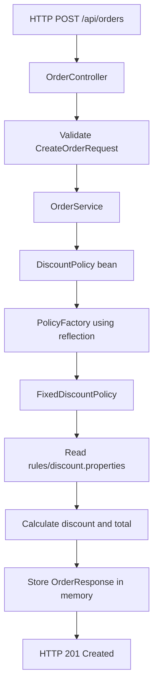
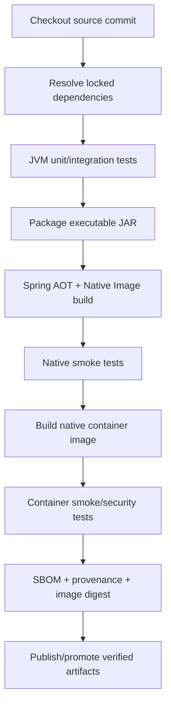

# Building the Same Application as a JAR, Native Executable, and Native Container

This hands-on practice takes a small Spring Boot application through three packaging formats: **a JAR running on the JVM, a native executable built with GraalVM Native Image, and a container image running the native executable**. All three artifacts use the same source code and expose the same REST API. This allows you to verify correctness, observe Spring AOT constraints, measure startup and resource usage, and understand exactly what changes across deployment approaches.

The sample application is `order-service`: it accepts order creation requests, calculates a discount from a classpath resource file, and stores orders in memory. The policy is instantiated via reflection with registered runtime hints. This is a small example, yet complete enough to practice Spring AOT, reflection, resource inclusion, JVM tests, native builds, Docker packaging, and container testing.

## 1. Expected Outcomes

After completing this practice, you will be able to:

- Build a Spring Boot REST application with validation, a service, a policy, and health endpoints.
- Run the same source code as an executable JAR.
- Run Spring AOT and compile into a native executable using GraalVM.
- Register reflection and resource hints for dynamic accesses.
- Run JVM tests and verify the native executable with smoke tests.
- Package the native executable into a container image running as non-root.
- Compare the JAR, native executable, and native container under controlled measurement conditions.
- Verify architecture, shared libraries, health checks, and shutdown behavior.
- Prepare artifacts and metadata for a CI pipeline.

The final deliverables include:

| Artifact | How to Run | Contents |
| --- | --- | --- |
| `target/order-service.jar` | `java -jar` | Application bytecode and dependencies running on the JVM |
| `target/order-service` | Run directly | Native executable for the build-time OS/architecture |
| `order-service:native` | `docker run` | Native executable along with required runtime files in a container |

## 2. Practice Application Architecture

The API provides the following endpoints:

| Method | Path | Purpose |
| --- | --- | --- |
| `POST` | `/api/orders` | Create an order and calculate the discount |
| `GET` | `/api/orders/{id}` | Retrieve a created order |
| `GET` | `/actuator/health` | Health status |
| `GET` | `/actuator/health/liveness` | Liveness state |
| `GET` | `/actuator/health/readiness` | Readiness state |

Processing flow:



Example request:

```http
POST /api/orders
Content-Type: application/json

{
  "customer": "Lan",
  "subtotal": 100.00
}
```

Example response:

```json
{
  "id": "a0c8f34a-2a4c-4b64-9d50-9f9c6b3f3c11",
  "customer": "Lan",
  "subtotal": 100.00,
  "discount": 5.00,
  "total": 95.00
}
```

The application uses in-memory storage to keep the focus on build and runtime behavior. Data is lost when the process restarts; in a real system, replace the repository with a database and test JDBC driver/native compatibility separately.

## 3. Environment Preparation

You need:

- A JDK supported by the chosen Spring Boot version.
- A GraalVM distribution matching the JDK and OS/architecture.
- The Native Image component installed and able to run `native-image --version`.
- Maven Wrapper or Gradle Wrapper.
- A C compiler/linker and the development libraries required by the Native Image builder on your OS.
- Docker Engine/Desktop or an equivalent runtime to build and run containers.
- `curl` to send HTTP requests.

Verify the toolchain:

```bash
java -version
native-image --version
./mvnw --version
docker version
```

If using Gradle:

```bash
./gradlew --version
```

The examples in this guide use Spring Boot 3.5.16, Java 21, and Native Build Tools 0.10.6. This is an illustrative version set that can be replaced with compatible patch releases approved by your project; pin the versions of Spring Boot, GraalVM, Native Build Tools, and base images in source/CI. Do not use the `latest` tag as evidence of toolchain versions.

On Linux, Native Image requires a C toolchain and the appropriate development headers. On Windows/macOS, build requirements differ by platform. If the deployment target is a Linux container, prefer building and testing the native executable on a Linux runner with the matching architecture.

## 4. Create the Project Structure

Create a Maven project with the following structure:

```text
order-service/
├── pom.xml
├── mvnw
├── Dockerfile.native
├── Dockerfile.jvm
├── measure-startup.sh
├── load.js
├── .mvn/
└── src/
    ├── main/
    │   ├── java/com/example/orders/
    │   │   ├── OrderApplication.java
    │   │   ├── api/
    │   │   │   ├── CreateOrderRequest.java
    │   │   │   ├── OrderResponse.java
    │   │   │   └── OrderController.java
    │   │   ├── service/
    │   │   │   └── OrderService.java
    │   │   └── policy/
    │   │       ├── DiscountPolicy.java
    │   │       ├── DiscountPolicyConfiguration.java
    │   │       ├── DiscountPolicyFactory.java
    │   │       ├── FixedDiscountPolicy.java
    │   │       └── OrderRuntimeHints.java
    │   └── resources/
    │       ├── application.properties
    │       └── rules/discount.properties
    └── test/
        └── java/com/example/orders/api/
            └── OrderControllerTest.java
```

Set the root package to `com.example.orders` so Spring Boot discovers components and configurations under that package.

## 5. Declare Maven Dependencies and Native Profile

Example `pom.xml`:

```xml
<?xml version="1.0" encoding="UTF-8"?>
<project xmlns="http://maven.apache.org/POM/4.0.0"
         xmlns:xsi="http://www.w3.org/2001/XMLSchema-instance"
         xsi:schemaLocation="http://maven.apache.org/POM/4.0.0
         https://maven.apache.org/xsd/maven-4.0.0.xsd">
    <modelVersion>4.0.0</modelVersion>

    <parent>
        <groupId>org.springframework.boot</groupId>
        <artifactId>spring-boot-starter-parent</artifactId>
        <version>3.5.16</version>
        <relativePath/>
    </parent>

    <groupId>com.example</groupId>
    <artifactId>order-service</artifactId>
    <version>1.0.0</version>
    <name>order-service</name>

    <properties>
        <java.version>21</java.version>
    </properties>

    <dependencies>
        <dependency>
            <groupId>org.springframework.boot</groupId>
            <artifactId>spring-boot-starter-web</artifactId>
        </dependency>
        <dependency>
            <groupId>org.springframework.boot</groupId>
            <artifactId>spring-boot-starter-validation</artifactId>
        </dependency>
        <dependency>
            <groupId>org.springframework.boot</groupId>
            <artifactId>spring-boot-starter-actuator</artifactId>
        </dependency>
        <dependency>
            <groupId>org.springframework.boot</groupId>
            <artifactId>spring-boot-starter-test</artifactId>
            <scope>test</scope>
        </dependency>
    </dependencies>

    <build>
        <finalName>order-service</finalName>
        <plugins>
            <plugin>
                <groupId>org.springframework.boot</groupId>
                <artifactId>spring-boot-maven-plugin</artifactId>
            </plugin>
            <plugin>
                <groupId>org.graalvm.buildtools</groupId>
                <artifactId>native-maven-plugin</artifactId>
                <version>0.10.6</version>
                <extensions>true</extensions>
                <configuration>
                    <imageName>order-service</imageName>
                    <buildArgs>
                        <buildArg>--no-fallback</buildArg>
                    </buildArgs>
                </configuration>
            </plugin>
        </plugins>
    </build>
</project>
```

`--no-fallback` instructs the build to fail if Native Image cannot produce a standalone native executable, instead of generating a fallback artifact that runs on the JVM. This is a useful choice for this lab so that reachability/toolchain errors are caught immediately during the build.

If your project already uses its own Spring Boot parent or plugin management, you do not need to copy the entire POM. Integrate `native-maven-plugin` into the existing configuration and keep versions aligned with your chosen toolchain.

## 6. Write the Application Code

### 6.1. Main Application

File `OrderApplication.java`:

```java
package com.example.orders;

import org.springframework.boot.SpringApplication;
import org.springframework.boot.autoconfigure.SpringBootApplication;

@SpringBootApplication
public class OrderApplication {

    public static void main(String[] args) {
        SpringApplication.run(OrderApplication.class, args);
    }
}
```

### 6.2. Request and Response Models

File `CreateOrderRequest.java`:

```java
package com.example.orders.api;

import jakarta.validation.constraints.DecimalMin;
import jakarta.validation.constraints.NotBlank;
import jakarta.validation.constraints.NotNull;
import java.math.BigDecimal;

public record CreateOrderRequest(
        @NotBlank String customer,
        @NotNull @DecimalMin("0.01") BigDecimal subtotal) {
}
```

File `OrderResponse.java`:

```java
package com.example.orders.api;

import java.math.BigDecimal;
import java.util.UUID;

public record OrderResponse(
        UUID id,
        String customer,
        BigDecimal subtotal,
        BigDecimal discount,
        BigDecimal total) {
}
```

### 6.3. Discount Policy

File `DiscountPolicy.java`:

```java
package com.example.orders.policy;

import java.math.BigDecimal;

public interface DiscountPolicy {
    BigDecimal discountFor(BigDecimal subtotal);
}
```

File `FixedDiscountPolicy.java`:

```java
package com.example.orders.policy;

import java.io.IOException;
import java.io.InputStream;
import java.math.BigDecimal;
import java.math.RoundingMode;
import java.util.Properties;

public class FixedDiscountPolicy implements DiscountPolicy {

    public FixedDiscountPolicy() {
    }

    @Override
    public BigDecimal discountFor(BigDecimal subtotal) {
        try (InputStream input = FixedDiscountPolicy.class
                .getResourceAsStream("/rules/discount.properties")) {
            if (input == null) {
                throw new IllegalStateException("Missing discount policy resource");
            }

            Properties properties = new Properties();
            properties.load(input);
            BigDecimal rate = new BigDecimal(properties.getProperty("discount.rate"));
            return subtotal.multiply(rate).setScale(2, RoundingMode.HALF_UP);
        } catch (IOException exception) {
            throw new IllegalStateException("Cannot load discount policy", exception);
        }
    }
}
```

Create the file `src/main/resources/rules/discount.properties`:

```properties
discount.rate=0.05
```

The policy reads the resource from the classpath when invoked. With Native Image, the resource must be included in the executable via reachability metadata/runtime hints if the builder cannot automatically infer the access path.

### 6.4. Factory Instantiating Policy via Reflection

File `DiscountPolicyFactory.java`:

```java
package com.example.orders.policy;

public final class DiscountPolicyFactory {

    private DiscountPolicyFactory() {
    }

    public static DiscountPolicy create() {
        try {
            Class<?> type = Class.forName(
                    "com.example.orders.policy.FixedDiscountPolicy");
            return (DiscountPolicy) type.getDeclaredConstructor().newInstance();
        } catch (ReflectiveOperationException exception) {
            throw new IllegalStateException("Cannot create discount policy", exception);
        }
    }
}
```

The factory uses a class name string and invokes the constructor via reflection. Static analysis cannot always determine all classes and constructors that must be retained; this practice will declare the hints explicitly.

### 6.5. Register Runtime Hints

File `OrderRuntimeHints.java`:

```java
package com.example.orders.policy;

import org.springframework.aot.hint.MemberCategory;
import org.springframework.aot.hint.RuntimeHints;
import org.springframework.aot.hint.RuntimeHintsRegistrar;

public class OrderRuntimeHints implements RuntimeHintsRegistrar {

    @Override
    public void registerHints(RuntimeHints hints, ClassLoader classLoader) {
        hints.reflection().registerType(
                FixedDiscountPolicy.class,
                MemberCategory.INVOKE_DECLARED_CONSTRUCTORS);

        hints.resources().registerPattern("rules/discount.properties");
    }
}
```

File `DiscountPolicyConfiguration.java`:

```java
package com.example.orders.policy;

import org.springframework.context.annotation.Bean;
import org.springframework.context.annotation.Configuration;
import org.springframework.context.annotation.ImportRuntimeHints;

@Configuration(proxyBeanMethods = false)
@ImportRuntimeHints(OrderRuntimeHints.class)
public class DiscountPolicyConfiguration {

    @Bean
    DiscountPolicy discountPolicy() {
        return DiscountPolicyFactory.create();
    }
}
```

The two hints serve two purposes:

- `reflection().registerType(...)` retains the constructor needed to instantiate the policy via reflection.
- `resources().registerPattern(...)` includes `rules/discount.properties` in the native executable.

Register only the exact members and resources needed. Avoid opening reflection for an entire package, as doing so increases metadata scope, binary size, and the executable's analysis surface.

### 6.6. Service and REST Controller

File `OrderService.java`:

```java
package com.example.orders.service;

import com.example.orders.api.CreateOrderRequest;
import com.example.orders.api.OrderResponse;
import com.example.orders.policy.DiscountPolicy;
import java.math.BigDecimal;
import java.util.Map;
import java.util.Optional;
import java.util.UUID;
import java.util.concurrent.ConcurrentHashMap;
import org.springframework.stereotype.Service;

@Service
public class OrderService {

    private final DiscountPolicy discountPolicy;
    private final Map<UUID, OrderResponse> orders = new ConcurrentHashMap<>();

    public OrderService(DiscountPolicy discountPolicy) {
        this.discountPolicy = discountPolicy;
    }

    public OrderResponse create(CreateOrderRequest request) {
        BigDecimal discount = discountPolicy.discountFor(request.subtotal());
        BigDecimal total = request.subtotal().subtract(discount);

        OrderResponse order = new OrderResponse(
                UUID.randomUUID(),
                request.customer(),
                request.subtotal(),
                discount,
                total);

        orders.put(order.id(), order);
        return order;
    }

    public Optional<OrderResponse> find(UUID id) {
        return Optional.ofNullable(orders.get(id));
    }
}
```

File `OrderController.java`:

```java
package com.example.orders.api;

import com.example.orders.service.OrderService;
import jakarta.validation.Valid;
import java.net.URI;
import java.util.UUID;
import org.springframework.http.HttpStatus;
import org.springframework.http.ResponseEntity;
import org.springframework.web.bind.annotation.GetMapping;
import org.springframework.web.bind.annotation.PathVariable;
import org.springframework.web.bind.annotation.PostMapping;
import org.springframework.web.bind.annotation.RequestBody;
import org.springframework.web.bind.annotation.RequestMapping;
import org.springframework.web.bind.annotation.RestController;
import org.springframework.web.server.ResponseStatusException;

@RestController
@RequestMapping("/api/orders")
public class OrderController {

    private final OrderService orderService;

    public OrderController(OrderService orderService) {
        this.orderService = orderService;
    }

    @PostMapping
    public ResponseEntity<OrderResponse> create(
            @Valid @RequestBody CreateOrderRequest request) {
        OrderResponse order = orderService.create(request);
        return ResponseEntity.created(URI.create("/api/orders/" + order.id()))
                .body(order);
    }

    @GetMapping("/{id}")
    public OrderResponse find(@PathVariable UUID id) {
        return orderService.find(id)
                .orElseThrow(() -> new ResponseStatusException(
                        HttpStatus.NOT_FOUND, "Order not found"));
    }
}
```

### 6.7. Application Configuration

File `application.properties`:

```properties
server.port=8080
management.endpoints.web.exposure.include=health,info
management.endpoint.health.probes.enabled=true
server.shutdown=graceful
spring.lifecycle.timeout-per-shutdown-phase=20s
```

The health endpoints will be used to inspect the application in the JVM, native executable, and container. Do not expose all Actuator endpoints to the public network in production.

## 7. Write Integration Tests

File `OrderControllerTest.java`:

```java
package com.example.orders.api;

import org.junit.jupiter.api.Test;
import org.springframework.beans.factory.annotation.Autowired;
import org.springframework.boot.test.autoconfigure.web.servlet.AutoConfigureMockMvc;
import org.springframework.boot.test.context.SpringBootTest;
import org.springframework.http.MediaType;
import org.springframework.test.web.servlet.MockMvc;

import static org.springframework.test.web.servlet.request.MockMvcRequestBuilders.post;
import static org.springframework.test.web.servlet.result.MockMvcResultMatchers.jsonPath;
import static org.springframework.test.web.servlet.result.MockMvcResultMatchers.status;

@SpringBootTest
@AutoConfigureMockMvc
class OrderControllerTest {

    @Autowired
    MockMvc mockMvc;

    @Test
    void createsOrderAndAppliesDiscount() throws Exception {
        mockMvc.perform(post("/api/orders")
                        .contentType(MediaType.APPLICATION_JSON)
                        .content("""
                                {
                                  "customer": "Lan",
                                  "subtotal": 100.00
                                }
                                """))
                .andExpect(status().isCreated())
                .andExpect(jsonPath("$.customer").value("Lan"))
                .andExpect(jsonPath("$.discount").value(5.00))
                .andExpect(jsonPath("$.total").value(95.00));
    }

    @Test
    void rejectsInvalidOrder() throws Exception {
        mockMvc.perform(post("/api/orders")
                        .contentType(MediaType.APPLICATION_JSON)
                        .content("""
                                {
                                  "customer": "",
                                  "subtotal": 0
                                }
                                """))
                .andExpect(status().isBadRequest());
    }
}
```

These tests verify the controller, validation, Spring bean wiring, reflection factory, and resource loading in the JVM. The native executable still needs to be run and verified separately because JVM tests do not prove that every dynamic access is retained in the binary.

## 8. Build and Run the JAR on the JVM

Run tests and package:

```bash
./mvnw clean package
```

Inspect the artifact:

```bash
ls -lh target/order-service.jar
```

Run the application:

```bash
java -jar target/order-service.jar
```

In another terminal, check health:

```bash
curl -i http://localhost:8080/actuator/health
curl -i http://localhost:8080/actuator/health/readiness
```

Create an order:

```bash
curl -i -X POST http://localhost:8080/api/orders \
  -H 'Content-Type: application/json' \
  -d '{"customer":"Lan","subtotal":100.00}'
```

The response must return HTTP `201`, discount `5.00`, and total `95.00`. Save the `id` from the response and call:

```bash
curl -i http://localhost:8080/api/orders/ORDER_ID
```

Replace `ORDER_ID` with the UUID just received. Because storage is in-memory, GET only finds orders within the same running process.

## 9. Run Spring AOT and Build the Native Executable

### 9.1. Build with Maven

Stop the JVM app first to avoid port conflicts, then run:

```bash
./mvnw -Pnative native:compile
```

The Spring Boot parent provides the `native` profile; when the profile is enabled, Maven runs AOT processing and Native Image compilation according to the parent's configuration and the plugins declared in `build/plugins`. The command above creates a native executable, not just a JAR.

Expected output:

```text
target/order-service
```

Verify:

```bash
file target/order-service
```

The binary must be a native executable for the build runner's OS/architecture.

### 9.2. Build with Gradle

If the project uses Gradle, integrate the corresponding plugins in `build.gradle`:

```groovy
plugins {
    id 'java'
    id 'org.springframework.boot' version '3.5.16'
    id 'io.spring.dependency-management' version '1.1.7'
    id 'org.graalvm.buildtools.native' version '0.10.6'
}

group = 'com.example'
version = '1.0.0'

java {
    toolchain {
        languageVersion = JavaLanguageVersion.of(21)
    }
}

dependencies {
    implementation 'org.springframework.boot:spring-boot-starter-web'
    implementation 'org.springframework.boot:spring-boot-starter-validation'
    implementation 'org.springframework.boot:spring-boot-starter-actuator'
    testImplementation 'org.springframework.boot:spring-boot-starter-test'
}

repositories {
    mavenCentral()
}
```

Run:

```bash
./gradlew clean test bootJar
./gradlew nativeCompile
```

The Gradle native executable is typically located at `build/native/nativeCompile/order-service` (the name may depend on the project name).

The Spring Boot Gradle plugin integrates AOT tasks with the GraalVM Native Image plugin. Check the build output to confirm that `processAot` and `nativeCompile` ran as configured for the project.

Do not use both Maven and Gradle build files in the same pipeline if the project chooses only one build system. The snippets above are two equivalent ways to configure the same source code.

### 9.3. If the Native Build Fails

Read the first meaningful error in the Native Image build output. Categorize it:

- Missing compiler/linker/headers: fix the C toolchain on the build host.
- Class or member not found via reflection: add minimally scoped runtime hints.
- Resource missing from the executable: check the resource pattern and classpath path.
- Library does not support Native Image: check the dependency's version, metadata, and native support.
- Out of memory during build: allocate sufficient RAM/swap for the builder or reduce parallelism appropriately.

Do not add global reflection metadata to mask every error. Identify the exact class, constructor, method, proxy, or resource requested by the stack trace.

## 10. Run and Test the Native Executable

Start the executable:

```bash
./target/order-service
```

Check health:

```bash
curl -i http://localhost:8080/actuator/health
curl -i http://localhost:8080/actuator/health/liveness
curl -i http://localhost:8080/actuator/health/readiness
```

Send the order creation request again:

```bash
curl -i -X POST http://localhost:8080/api/orders \
  -H 'Content-Type: application/json' \
  -d '{"customer":"Lan","subtotal":100.00}'
```

The result must match the JAR: HTTP `201`, discount `5.00`, total `95.00`. If the JVM run succeeds but native fails, check:

1. Whether the reflection hint registers the constructor of `FixedDiscountPolicy`.
2. Whether the resource pattern matches `rules/discount.properties`.
3. Whether the resource file is located under `src/main/resources`.
4. Whether `@ImportRuntimeHints` is attached to a configuration discovered by Spring AOT.
5. Whether there is a native library, TLS, or filesystem error unrelated to the policy.

Test the GET endpoint with the received UUID to verify storage/retrieval within the same process. Then send an invalid payload and confirm HTTP `400`.

### 10.1. Test Shutdown

Send SIGTERM using the OS/container's process-stopping mechanism. Spring Boot graceful shutdown stops accepting new requests and waits for in-flight requests within the configured timeout. Observe the logs and exit code; if running in Kubernetes, `terminationGracePeriodSeconds` must be long enough for the shutdown phase.

## 11. Package the Native Executable into a Container

### 11.1. Create the Native Dockerfile

Create `Dockerfile.native`:

```dockerfile
FROM debian:bookworm-slim

RUN apt-get update \
    && apt-get install -y --no-install-recommends ca-certificates zlib1g \
    && rm -rf /var/lib/apt/lists/*

WORKDIR /app
COPY --chown=10001:10001 target/order-service /app/order-service

USER 10001:10001
EXPOSE 8080
ENTRYPOINT ["/app/order-service"]
```

This is a sample runtime image for an executable compatible with glibc and the installed packages. The final package list must be based on `ldd` results for the binary and tested in the exact base image. If the executable links additional shared libraries, the corresponding packages must be installed. If using a fully static executable, you still need to verify CA certificates, timezone data, resources, and filesystem paths used by the application.

### 11.2. Build the Image

First build the native executable on the matching Linux architecture. Then:

```bash
docker build \
  -f Dockerfile.native \
  -t order-service:native \
  .
```

Inspect metadata:

```bash
docker image inspect order-service:native \
  --format '{{.Os}}/{{.Architecture}}'
```

Run:

```bash
docker run --rm \
  --name order-service-native \
  -p 8080:8080 \
  --cpus=1.5 \
  --memory=768m \
  order-service:native
```

Verify health and the API via `localhost:8080` as in the native executable step. The container runs as user `10001`, so it should not rely on root permissions to write files. If the application needs a writable directory, create/chown that directory in the image or mount a volume with appropriate permissions.

### 11.3. Package the JAR for Container Comparison

To compare under the same container conditions, you can create `Dockerfile.jvm`:

```dockerfile
FROM eclipse-temurin:21-jre

WORKDIR /app
COPY target/order-service.jar /app/order-service.jar

USER 10001:10001
EXPOSE 8080
ENTRYPOINT ["java", "-jar", "/app/order-service.jar"]
```

Build:

```bash
docker build -f Dockerfile.jvm -t order-service:jvm .
```

Run with the same CPU/memory limits:

```bash
docker run --rm \
  --name order-service-jvm \
  -p 8081:8080 \
  --cpus=1.5 \
  --memory=768m \
  order-service:jvm
```

The JVM container uses a JRE; the native container uses the executable. Because the base images differ, record OS packages and image sizes when comparing. To evaluate runtime CPU/RAM, keep the host, CPU quota, memory limit, and workload identical.

## 12. Measure Startup, Memory, and Throughput

Do not draw conclusions solely from build time or file size. Measure startup, steady-state, and resource usage separately.

### 12.1. Measure Startup

On Linux, do not use `time` alone to measure server startup because it measures the entire lifetime of the process. Create the script `measure-startup.sh`:

```bash
#!/usr/bin/env bash
set -euo pipefail

if [ "$#" -eq 0 ]; then
  echo "Usage: ./measure-startup.sh command [args...]" >&2
  exit 2
fi

start_ns=$(date +%s%N)
"$@" &
app_pid=$!
trap 'kill -TERM "$app_pid" 2>/dev/null || true; wait "$app_pid" 2>/dev/null || true' EXIT
deadline=$((SECONDS + 30))

until curl -fsS http://localhost:8080/actuator/health/readiness >/dev/null; do
  if ! kill -0 "$app_pid" 2>/dev/null; then
    wait "$app_pid" || true
    echo "Application exited before readiness" >&2
    exit 1
  fi
  if (( SECONDS >= deadline )); then
    echo "Readiness timeout" >&2
    exit 1
  fi
  sleep 0.05
done

ready_ns=$(date +%s%N)
echo "Readiness time: $(( (ready_ns - start_ns) / 1000000 )) ms"
```

Make the script executable:

```bash
chmod +x measure-startup.sh
```

Run two separate passes, ensuring port 8080 is free:

```bash
./measure-startup.sh java -jar target/order-service.jar
./measure-startup.sh ./target/order-service
```

Measure startup of the native container in a separate run:

```bash
start_ns=$(date +%s%N)
docker run -d --name order-service-native -p 8080:8080 \
  --cpus=1.5 --memory=768m order-service:native
deadline=$((SECONDS + 30))
until curl -fsS http://localhost:8080/actuator/health/readiness >/dev/null; do
  if (( SECONDS >= deadline )); then
    docker logs order-service-native
    docker stop order-service-native
    exit 1
  fi
  sleep 0.05
done
ready_ns=$(date +%s%N)
echo "Container readiness time: $(( (ready_ns - start_ns) / 1000000 )) ms"
docker stop order-service-native
```

Use the same measurement approach for the JAR container, changing the image name and keeping the CPU/RAM limits unchanged. Remove old containers or use a different name before each run.

The process script measures wall-clock time from launch to readiness and sends SIGTERM automatically when finished. The container example likewise measures from `docker run -d` until readiness and then stops the container. Repeat multiple times on the same host, with the same dependency availability and cache state. Report the median and variance, not just the fastest run.

Do not compare a JAR running on the host against a native executable running in a container and attribute the entire difference to the compiler. When measuring containers, run both images under identical conditions.

### 12.2. Measure Container Memory and CPU

While the workload is running:

```bash
docker stats order-service-jvm order-service-native
```

Record:

- Container memory usage and peak.
- CPU usage.
- Restart count and exit reason.
- Throughput, error rate, and p50/p95/p99 latency.

Process RSS, Java heap, and cgroup memory are not the same metric. A native executable still uses native memory, thread stacks, direct buffers, and shared libraries. Do not treat Xmx or heap usage as total container RAM.

### 12.3. Repeatable Workload

Use the same request mix, payload, concurrency, and duration. Minimal example k6 script `load.js`:

```javascript
import http from 'k6/http';
import { check } from 'k6';

export const options = {
  vus: 20,
  iterations: 5000,
};

export default function () {
  const payload = JSON.stringify({
    customer: 'Load Test',
    subtotal: 100.00,
  });

  const response = http.post(
    'http://localhost:8080/api/orders',
    payload,
    { headers: { 'Content-Type': 'application/json' } },
  );

  check(response, {
    'created': (res) => res.status === 201,
  });
}
```

Run:

```bash
k6 run load.js
```

Adjust the base URL/port according to the image being measured. Run the JAR container and native container in separate passes; do not let two workloads contend for CPU/RAM on the same host during the same measurement window.

### 12.4. Results Table Template

| Artifact | Startup median | Peak process/container memory | CPU/request | Throughput | p95 | p99 | Error rate |
| --- | ---: | ---: | ---: | ---: | ---: | ---: | ---: |
| JAR on JVM | Record measurement | Record measurement | Record measurement | Record measurement | Record measurement | Record measurement | Record measurement |
| Native executable | Record measurement | Record measurement | Record measurement | Record measurement | Record measurement | Record measurement | Record measurement |
| Native container | Record measurement | Record measurement | Record measurement | Record measurement | Record measurement | Record measurement | Record measurement |

Do not fill in hypothetical benchmark numbers. Document the CPU model, OS/kernel, GraalVM/JDK version, base image digest, CPU/RAM limits, and workload so others can reproduce the results.

## 13. Fairly Compare the Three Artifacts

| Criterion | JAR | Native executable | Native container |
| --- | --- | --- | --- |
| Runtime JVM dependency | Yes | No separate JVM needed | No separate JVM needed |
| Portability | High across OSes with a compatible JDK | Depends on OS/architecture/ABI | Depends on image and node platform |
| Startup | Includes JVM startup and class loading | Typically fast, depends on application | Includes container startup and native app startup |
| Build time | Typically shorter | Typically significantly longer | Includes native build and image packaging |
| Runtime memory | Heap and JVM/native runtime | Native Image heap and native runtime | Total memory accounted by container/cgroup |
| Reflection/resources | Flexible JVM runtime | Requires reachability/hints for dynamic access | Same as executable inside the image |
| Debug/profiling | JFR/JMX and JVM tooling | Support depends on Native Image build/runtime | Requires monitoring config and container permissions/access |
| Release unit | JAR + JRE | Target-specific binary | OCI image digest |

To make benchmarks meaningful:

1. Use the same source commit and dependency versions.
2. Use the same business behavior and test payload.
3. Run on the same CPU/host type or document any differences.
4. Use the same CPU quota and memory limit when comparing containers.
5. Separate startup tests from steady-state load tests.
6. Warm up the JVM before steady-state measurement; native still needs connection pool/cache warm-up.
7. Repeat runs and report the median along with dispersion.
8. Check error rates before comparing throughput.

Native Image often has advantages in startup and footprint for certain workloads, but results depend on the collector, allocation pattern, CPU, heap sizing, dependencies, and load level. Use real measurements to choose the artifact.

## 14. CI Pipeline for Three Artifacts

A pipeline can be split into jobs:



Example Maven commands:

```bash
./mvnw clean package
./mvnw -Pnative native:compile
docker build -f Dockerfile.native -t order-service:native .
```

If releasing for both AMD64 and ARM64, run the native build on the corresponding runner or a builder configured with emulation/cross toolchain. Do not package an AMD64 binary into an ARM64 image merely by passing `docker buildx --platform linux/arm64`.

Store along with the release:

- Git commit SHA.
- JDK/GraalVM/Native Build Tools versions.
- OS, architecture, libc, and `-march`.
- Dependency lock state.
- Native Image build arguments.
- JVM/native/container test reports.
- Container base image digest.
- Image digest, SBOM, and provenance.

Promote the same digest from staging to production. If rebuilt, it is a new artifact and requires re-running the relevant verification steps.

## 15. Troubleshooting

| Symptom | Possible Cause | Resolution |
| --- | --- | --- |
| JAR runs but native build fails | Reflection/resource/JNI not analyzed | Read Native Image diagnostics, add accurate hints, and rebuild |
| ClassNotFoundException or constructor reflection fails | Class/member not retained in native executable | Register reflection hint and verify class name |
| discount.properties not found | Resource not included in executable or wrong path | Check classpath path and resource hint |
| native-image not found | Native Image component not installed or wrong PATH | Check GraalVM distribution and native-image --version |
| C compiler/linker error | Missing toolchain or development headers | Install build dependencies for the OS and GraalVM version |
| Native build OOM | Builder lacks RAM or build concurrency too high | Increase build runner memory and limit parallelism |
| exec format error in container | Binary built for wrong architecture | Check file, readelf -h, and image platform |
| libXYZ.so not found | Runtime image missing shared library | Run ldd in matching base image and install required packages |
| HTTPS fails in native/container | CA certificates or truststore differ between build/runtime | Check default TrustStore capture, CA store, and client config |
| Container exits immediately | Startup exception, missing config/resource, or permission issue | Inspect docker logs, exit code, and filesystem permissions |
| Health probe fails | Probe path not exposed or app not ready | Check Actuator configuration and startup logs |
| JVM/native benchmark fluctuates | Host contention, warm-up, or different workload | Run passes separately, fix load, and report median |
| Unusually large image | Debug symbols, build tools, or extra packages leaked into runtime stage | Use a separate runtime image, multi-stage build, and inspect layers |

## 16. Practice Completion Criteria

Mark as complete when all of the following conditions are met:

- [ ] JVM unit/integration tests pass.
- [ ] JAR is created and runs via `java -jar`.
- [ ] Spring AOT/native compilation produces an executable with no fallback.
- [ ] Reflection factory creates `FixedDiscountPolicy` in the native executable.
- [ ] Resource `rules/discount.properties` is readable in the native executable.
- [ ] REST API returns the same discount calculation results as the JAR.
- [ ] Validation returns HTTP 400 for invalid payloads.
- [ ] Health, liveness, and readiness endpoints work.
- [ ] Native container image builds successfully and runs as non-root.
- [ ] Container has all required shared libraries, CA certificates, and runtime files.
- [ ] SIGTERM/graceful shutdown is verified.
- [ ] JAR and native containers are measured under identical CPU/RAM limits.
- [ ] Results table documents the environment, workload, and actual measurements.
- [ ] Release metadata records source commit, GraalVM/JDK, architecture, and image digest.

## 17. Post-Practice Extensions

After completing the baseline version, you can extend it in the following directions:

- Replace the in-memory repository with PostgreSQL and test the JDBC driver in the native executable.
- Add Spring Security, JWT validation, and inspect crypto providers/TLS.
- Add a Redis or Kafka client to evaluate native compatibility of external libraries.
- Build multi-platform images for `linux/amd64` and `linux/arm64`.
- Enable JFR or GC logs in the native build for runtime analysis.
- Add SBOM/provenance and sign the image digest in CI.
- Deploy to Kubernetes with startup/readiness/liveness probes and rolling updates.
- Measure CPU, GC, RSS, and cgroup memory under varying resource limits.

## 18. Key Takeaways

- A single codebase can produce a JAR, a native executable, and a native container; each artifact has different runtime requirements and portability scope.
- A JAR requires a JVM at runtime; a native executable is compiled AOT and depends on OS, architecture, ABI, and native libraries.
- Spring AOT and Native Image build are mandatory steps to produce the binary; changing dependencies after a build does not update the old executable.
- Dynamic reflection and resource access require appropriate metadata/hints. This practice uses `RuntimeHintsRegistrar` to retain the constructor and properties file.
- A native executable must be tested directly; JVM tests do not prove every dynamic access is included in the binary.
- A native container needs the right libc/shared libraries, CA certificates, permissions, and runtime resources.
- Performance comparisons must use the same source, workload, host, and resource limits; separate startup from steady-state.
- Choose JAR or native based on measurements and requirements for portability, startup, memory, build time, and operations.

Upon completing this practice, you have an end-to-end workflow from Spring Boot source to JAR, native executable, and native container, along with testing and measurement methods to decide which artifact fits your deployment environment.

## Official References

- [Spring Boot — Native Images](https://docs.spring.io/spring-boot/reference/packaging/native-image/): Spring AOT, native builds, and deploying native executables.
- [Spring Boot — Maven Plugin](https://docs.spring.io/spring-boot/maven-plugin/): Maven plugin configuration and native profile.
- [Spring Boot — Gradle Plugin](https://docs.spring.io/spring-boot/gradle-plugin/): integrating AOT tasks with Gradle.
- [Spring Framework — Runtime Hints](https://docs.spring.io/spring-framework/reference/core/aot.html): reflection/resource hints and RuntimeHintsRegistrar.
- [GraalVM — Native Image](https://www.graalvm.org/reference-manual/native-image/): Native Image build, reachability analysis, and executables.
- [GraalVM — Native Image Build Tools](https://graalvm.github.io/native-build-tools/latest/index.html): Maven/Gradle integration and native build tasks.
- [Docker — Multi-stage builds](https://docs.docker.com/build/building/multi-stage/): separating the build environment from the runtime image.
- [Docker — Resource constraints](https://docs.docker.com/engine/containers/resource_constraints/): CPU and memory limits when measuring containers.
