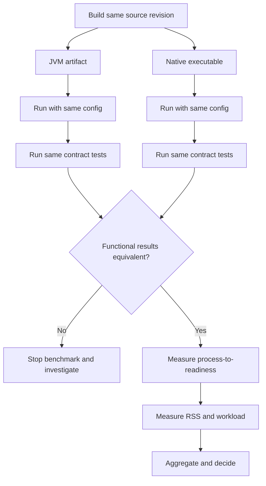

# Comparing Functionality, Startup, and RSS Using the Same Scenario

## Practice Objectives

In this practice, you will produce two ways of running the same Spring Boot application:

- A JAR running on the JVM.
- A native executable built with GraalVM Native Image and Spring AOT.

Both variants are built from the same source revision, use the same business configuration, and are verified with the same black-box test suite. After confirming functional parity, you measure the time from process launch until the application is ready to accept requests, then measure RSS at readiness and under the same workload.

The goal is to answer with data:

1. Do both artifacts execute the same business behavior?
2. Does native shorten the time from process start to readiness?
3. How does RSS differ between the two variants immediately after startup and under load?
4. Is the difference significant enough to meet the service's operational goals?

Do not change logic, dependencies, profiles, or resources between the two runs unless that is an explicitly recorded test variable.

## 1. Application Scenario

### 1.1. Sample Service

Suppose you have a Spring Boot service named `catalog-service`, providing an API to read product details:

| Component | Value |
|---|---|
| Business endpoint | `GET /api/products/sku-001` |
| Readiness endpoint | `GET /actuator/health/readiness` |
| Port | `8080` |
| Benchmark profile | `benchmark` |
| Response | JSON containing SKU, name, and price |

Example business response:

```json
{
  "sku": "sku-001",
  "name": "Mechanical Keyboard",
  "price": 1250000
}
```

The values above are illustrative fixture data only. In a real project, use a stable endpoint and dataset from the service being benchmarked.

### 1.2. Why Use Readiness Instead of Only Watching Startup Logs?

Spring Boot may log that the application started before all system conditions required to serve traffic are satisfied. A process that opens a port but is not yet ready to handle business logic does not count as ready.

Use the readiness endpoint as the end marker for the measurement. If the service needs connections to a database, cache, or message broker before serving requests, the readiness group must accurately reflect the dependencies truly required for traffic.

Scenario diagram:



### 1.3. Prerequisites

Before starting, you need:

- A Spring Boot application that runs on the JVM.
- Spring Boot Actuator with health probes enabled.
- GraalVM Native Image and Spring AOT configuration compatible with your Spring Boot version.
- An HTTP/contract test suite that can run against a configurable base URL.
- The same database, cache, broker, and test data for both variants if the service uses them.
- Tools for observing process RSS and generating load, such as `ps`, `curl`, and `wrk` or `hey`.

Record the OS, CPU architecture, Java/GraalVM version, Spring Boot version, and build plugin version. A native executable depends on the target OS/architecture and operating system libraries.

The shell commands in this article use Bash on Linux with GNU coreutils. If running on Windows, you can use WSL/a Linux runner or translate the process/RSS measurements to equivalent tools for that environment; do not compare numbers collected on two different operating systems in the same benchmark table.

## 2. Keeping Comparison Conditions Identical

### 2.1. Both Artifacts Must Come from the Same Revision

Record the commit before building:

```bash
git rev-parse HEAD
git status --short
```

Build both JVM and native from that same revision. If the working tree has uncommitted changes, record them clearly so the two builds do not accidentally use different sources.

Do not edit code between the two builds. If you need to test an optimization, create a separate revision and re-benchmark both variants from the new revision.

### 2.2. Keep Business Configuration Identical

The following values must be equivalent:

| Factor | Condition |
|---|---|
| Spring profile | Same profile, e.g. `benchmark` |
| Environment variables | Same values for port, database, cache, and feature flags |
| Dependency services | Same version, endpoint, dataset, and state |
| Authentication | Same user/token and policy |
| Request payload | Same data and size |
| Logging | Same log level and appenders |
| Metrics/tracing | Same instrumentation for equivalent overhead |
| Cache | Same policy and initial state |
| Connection pool | Same pool and timeout configuration |

Do not let JVM use the development profile while native uses the production profile. Also do not disable metrics/tracing on one variant while the other keeps them enabled.

### 2.3. Keep Resource Limits Identical

If running in containers, set the same:

- CPU quota and CPU set.
- Memory limit.
- PID limit.
- Network mode and DNS.
- Volumes/mounts.
- User and security context.

For example, run both images with `--cpus=1.0` and `--memory=512m`. If one variant gets more CPU or RAM, startup and RSS results are no longer directly comparable.

### 2.4. Distinguish Process Cold Start from Host Cold Start

In this practice, **cold start** means starting a new process/container. It does not necessarily require rebooting the machine or dropping the OS page cache.

If production requires a cold host or a new node, that is a different scenario. Record image pull, container scheduling, filesystem cache, and process startup time separately; do not collapse these milestones into a single number without explanation.

For process startup benchmarks, pre-pull images and keep the state of external dependencies consistent across runs.

## 3. Build Both Variants from the Same Application

### 3.1. Build the JVM JAR with Maven

Example:

```bash
./mvnw clean package
```

Identify the actual executable JAR in `target/`. Record the checksum to identify the artifact:

```bash
sha256sum target/catalog-service.jar
```

Substitute the filename according to your project's `artifactId` and packaging configuration.

### 3.2. Build Native with Maven

For a project already configured with Native Build Tools and the native profile, a common command is:

```bash
./mvnw -Pnative native:compile
```

Some projects use the Spring Boot Maven plugin/buildpacks to create a native container image:

```bash
./mvnw -Pnative spring-boot:build-image
```

Use only the command matching the plugin/execution configured in the project. Check the build logs and the generated native executable path; do not assume every project places the binary in the same directory.

### 3.3. Build the JVM JAR with Gradle

Example:

```bash
./gradlew clean bootJar
```

Identify the executable JAR in `build/libs/` and record the checksum:

```bash
sha256sum build/libs/catalog-service.jar
```

### 3.4. Build Native with Gradle

With Gradle Native Build Tools configured:

```bash
./gradlew nativeCompile
```

If the project builds a container image using Spring Boot buildpacks, the task may be:

```bash
./gradlew bootBuildImage
```

Task names and build arguments depend on the plugin/version. Inspect the task output to identify the exact binary/image.

### 3.5. Record Build Information

Create a record for each build:

| Field | JVM | Native |
|---|---|---|
| Git commit | ... | ... |
| Artifact checksum | ... | ... |
| Spring Boot version | ... | ... |
| Java/GraalVM version | ... | ... |
| Maven/Gradle plugin version | ... | ... |
| OS/architecture | ... | ... |
| Build profile | ... | ... |
| Build arguments | JVM flags | Native Image arguments |
| Build duration | ... | ... |
| Artifact size | ... | ... |

Build duration and artifact size are supporting details. This practice focuses on functionality, startup, and RSS; do not use compile time as a substitute for runtime startup time.

## 4. Verify Functional Parity Before Measuring

### 4.1. Use the Same Contract Test Suite

Contract tests must call the real HTTP endpoints of the running application. Run the same test suite with the base URL pointed sequentially to JVM and native.

Behaviors to verify:

- HTTP status codes.
- Response JSON and data types.
- Validation on missing/invalid input.
- Error responses and error codes.
- Authentication/authorization.
- Serialization/deserialization.
- Database queries and updates.
- Cache hits/evictions if applicable.
- Transaction commit/rollback if applicable.
- Async/event processing if within the service's scope.
- Health/readiness endpoints.

Do not just check that an endpoint returns HTTP 200. Both variants must produce the same business result for the same input.

### 4.2. Smoke Test the Business Endpoint

Example verifying JSON with `curl` and `jq`:

```bash
BASE_URL=http://127.0.0.1:8080

BODY=$(curl -fsS "$BASE_URL/api/products/sku-001")

printf '%s\n' "$BODY" | jq -e '
  .sku == "sku-001" and
  .name == "Mechanical Keyboard" and
  .price == 1250000
'
```

If the service returns data from a database, prepare the fixture before each test run and confirm identical data. Do not serve a cached response on one variant while the cache is empty on the other.

### 4.3. Check HTTP Errors and Validation

Example checking a non-existent SKU:

```bash
STATUS=$(curl -sS -o /tmp/missing-product.json \
  -w '%{http_code}' \
  "$BASE_URL/api/products/not-found")

test "$STATUS" = "404"
```

If the API uses a different status/error schema, adjust the expected value to match the actual contract. Check the error body as well, not just the status code.

### 4.4. Run the Same Test Suite Against Both Base URLs

For example, if the test runner accepts a `BASE_URL` variable:

```bash
BASE_URL=http://127.0.0.1:8080 ./scripts/contract-tests.sh
```

Run the command above once while JVM is running and once while native is running. Keep test data and test order identical; reset the database/cache between runs if tests have side effects.

If the project uses JUnit/RestAssured, Newman, Karate, or another tool, simply configure the base URL to reuse the same test definitions.

### 4.5. Stop Criteria

If any contract test passes only on JVM or only on native:

1. Stop performance benchmarking.
2. Save the request, response, logs, and exceptions.
3. Identify the difference caused by configuration, reflection/resource metadata, serialization, proxies, or dependencies.
4. Fix the root cause and rebuild both artifacts from the same revision.
5. Re-run the full contract test suite.

A faster binary that executes incorrect business logic is not a valid benchmark result.

## 5. Run Both Variants with the Same Configuration

### 5.1. Run JVM

Example:

```bash
SPRING_PROFILES_ACTIVE=benchmark \
  java -jar target/catalog-service.jar
```

If JVM flags are needed, record them completely. For production comparisons, use the JVM configuration intended for deployment and optionally add a separately tuned JVM baseline.

### 5.2. Run Native Executable

Example:

```bash
SPRING_PROFILES_ACTIVE=benchmark \
  ./target/catalog-service
```

Replace the path with the actual binary. Use the same profile, port, environment variables, external services, and feature flags as the JVM run.

### 5.3. Run Only One Variant at a Time

Two processes cannot bind the same port simultaneously. Procedure for each run:

1. Start one variant.
2. Wait for readiness.
3. Run contract tests and the selected measurements.
4. Send SIGTERM and wait for the process to exit.
5. Confirm the port and external resources are released.
6. Reset fixtures/cache if the scenario requires it.
7. Start the other variant.

Do not run both variants in parallel on the same runner if the goal is to compare resources; they will contend for CPU, memory, and I/O.

## 6. Measure Process Start to Readiness Time

### 6.1. Define the Measurement Milestones

Use:

```text
startup_to_ready_ms =
    readiness_timestamp - process_start_timestamp
```

`process_start_timestamp` is the time immediately before launching the process. `readiness_timestamp` is the first time the readiness endpoint returns a success response.

Do not include Maven/Gradle build time in startup. If you want to measure end-to-end deployment, measure image pull, container creation, scheduling, and readiness separately.

### 6.2. Prepare the Readiness Endpoint

With Spring Boot Actuator:

```properties
management.endpoint.health.probes.enabled=true
management.endpoints.web.exposure.include=health
management.endpoint.health.show-details=never
```

Commonly used endpoint:

```text
http://127.0.0.1:8080/actuator/health/readiness
```

Ensure this endpoint is enabled on both variants and uses the same port. If the service has a separate management port, verify actual readiness of the main web server to avoid measuring a healthy management server while the API server is not yet accepting requests.

### 6.3. Measure JVM Startup on Linux

Open the first terminal:

```bash
START_MS=$(date +%s%3N)
READY_MS=""

SPRING_PROFILES_ACTIVE=benchmark \
  java -jar target/catalog-service.jar \
  > jvm.log 2>&1 &
APP_PID=$!

for attempt in $(seq 1 900); do
  if curl -fsS --max-time 1 \
      http://127.0.0.1:8080/actuator/health/readiness \
      > /dev/null; then
    READY_MS=$(date +%s%3N)
    break
  fi

  if ! kill -0 "$APP_PID" 2>/dev/null; then
    break
  fi

  sleep 0.1
done

if [ -z "$READY_MS" ]; then
  echo "JVM did not become ready"
  cat jvm.log
  kill -TERM "$APP_PID" 2>/dev/null || true
  wait "$APP_PID" 2>/dev/null || true
  exit 1
fi

echo "JVM startup_to_ready_ms=$((READY_MS - START_MS))"
echo "JVM pid=$APP_PID"
```

The command uses GNU `date` on Linux to get millisecond timestamps. The loop waits up to roughly 90 seconds; adjust the limit if the application's startup SLO differs.

### 6.4. Measure Native Executable Startup

Stop the JVM after finishing its measurement run:

```bash
kill -TERM "$APP_PID"
wait "$APP_PID"
```

Then run the same measurement with native:

```bash
START_MS=$(date +%s%3N)
READY_MS=""

SPRING_PROFILES_ACTIVE=benchmark \
  ./target/catalog-service \
  > native.log 2>&1 &
APP_PID=$!

for attempt in $(seq 1 900); do
  if curl -fsS --max-time 1 \
      http://127.0.0.1:8080/actuator/health/readiness \
      > /dev/null; then
    READY_MS=$(date +%s%3N)
    break
  fi

  if ! kill -0 "$APP_PID" 2>/dev/null; then
    break
  fi

  sleep 0.1
done

if [ -z "$READY_MS" ]; then
  echo "Native executable did not become ready"
  cat native.log
  kill -TERM "$APP_PID" 2>/dev/null || true
  wait "$APP_PID" 2>/dev/null || true
  exit 1
fi

echo "Native startup_to_ready_ms=$((READY_MS - START_MS))"
echo "Native pid=$APP_PID"
```

Keep the same measurement method, readiness URL, and timeout. Using the startup log line for JVM while using readiness for native will skew the comparison.

### 6.5. Measure Multiple Cold Starts

Each run requires a fresh process. Record:

- Run number.
- Variant (JVM/native).
- Process start time.
- Readiness time.
- Startup duration.
- Exit status if the process fails to become ready.
- Dependency and cache state.

Run at least 10 trials per variant in a stable benchmark environment; increase the number of runs if results vary widely. Alternate JVM and native runs to reduce the effect of background load and caching.

Calculate the median and p95 of startup duration. Do not report only the fastest run.

## 7. Measure RSS and Memory Footprint

### 7.1. Distinguish Process RSS from Container Memory

RSS (Resident Set Size) is the amount of process memory pages currently resident in RAM as reported by the operating system. It includes shared pages mapped into the process, so summing RSS across multiple processes can double-count shared pages.

Container memory/cgroup usage measures memory accounted by the kernel to the cgroup. This is the more appropriate metric when the goal is preventing OOM kills or sizing container density per node.

In this practice, clearly record whether you are comparing:

- Process RSS of JVM and native.
- Container/cgroup memory of the two images.
- Managed heap metrics if available.

Do not compare JVM heap used against native RSS and conclude that native uses less memory.

### 7.2. Read RSS at Readiness

Once the process is ready, use the PID saved during the startup step:

```bash
ps -o pid=,rss=,etime=,args= -p "$APP_PID"
```

The `rss` field of `ps` is typically displayed in KiB on Linux. Record units in your report; do not compare a KiB value against a MiB value without converting units.

Measuring at readiness reveals the initial footprint, but does not reflect populated caches, expanded connection pools, or in-flight request processing.

### 7.3. Sample RSS During Runtime

While the process is running, open another terminal and sample periodically:

```bash
APP_PID=12345
: > jvm-rss-kb.txt

while kill -0 "$APP_PID" 2>/dev/null; do
  ps -o rss= -p "$APP_PID" >> jvm-rss-kb.txt || true
  sleep 0.2
done

sort -n jvm-rss-kb.txt | tail -n 1
```

Replace `12345` with the PID of the variant being measured. Save a separate file for each run and each variant, e.g., `jvm-rss-kb.txt` and `native-rss-kb.txt`. You can compute the median, maximum, and memory growth trend from these samples.

Sampling every 0.2 seconds can still miss very brief spikes. If you need a more accurate peak, use cgroup v2 `memory.peak`, container monitoring tools, or an appropriate profiler.

### 7.4. Measure Container Memory

When running with Docker, apply the same CPU/memory limits to both images:

```bash
docker run -d \
  --name catalog-jvm \
  --cpus="1.0" \
  --memory="512m" \
  -e SPRING_PROFILES_ACTIVE=benchmark \
  -p 8080:8080 \
  catalog-service:jvm
```

While the JVM container is running, capture a memory snapshot:

```bash
docker stats --no-stream \
  --format "table {{.Name}}\t{{.CPUPerc}}\t{{.MemUsage}}\t{{.MemPerc}}"
```

Run this command before stopping the container and save the output separately for JVM.

Run only one container at a time because both use port 8080. Pull images beforehand so image download time is not included in process startup. After measuring JVM, stop and remove the container:

```bash
docker stop catalog-jvm
docker rm catalog-jvm
```

Then run the native image with the same configuration, changing only the container and image names:

```bash
docker run -d \
  --name catalog-native \
  --cpus="1.0" \
  --memory="512m" \
  -e SPRING_PROFILES_ACTIVE=benchmark \
  -p 8080:8080 \
  catalog-service:native
```

Repeat the `docker stats --no-stream` command while the native container is running and save its output separately.

After measuring native, clean up the container:

```bash
docker stop catalog-native
docker rm catalog-native
```

If you want to measure container-to-readiness instead of process-to-readiness, record the timestamp immediately before `docker run` and the timestamp when the readiness endpoint first succeeds. Keep images pre-pulled and use the exact same measurement method for both images.

`docker stats --no-stream` only provides a point-in-time snapshot, not peak memory. Sample continuously throughout the workload or use cgroup metrics to obtain the peak.

### 7.5. Read cgroup v2 Memory Peak

On Linux hosts using cgroup v2, a container may expose a `memory.peak` file in its corresponding cgroup. When accessing the right cgroup, this value reports peak memory usage since the cgroup was created or reset according to system behavior.

Useful files typically include:

```bash
cat /sys/fs/cgroup/memory.current
cat /sys/fs/cgroup/memory.peak
cat /sys/fs/cgroup/memory.max
```

These paths only apply when the process is inside that cgroup and the mount hierarchy permits access. On hosts with multiple containers or nested cgroups, locate the exact path via `/proc/self/cgroup` and the cgroup mount.

## 8. Run the Same Workload to Measure RSS Under Load

### 8.1. Distinguish Post-Startup Footprint from Steady-State

Record at least three milestones:

1. RSS immediately after readiness.
2. RSS after warm-up.
3. RSS/peak memory during the steady-state or burst measurement window.

A service may have low RSS right after startup yet grow substantially once caches, thread pools, and connection pools are exercised.

### 8.2. Prepare a Fixed Workload

Example with `wrk`:

```bash
wrk -t2 -c20 -d60s \
  http://127.0.0.1:8080/api/products/sku-001
```

Or with `hey`:

```bash
hey -z 60s -c 20 \
  http://127.0.0.1:8080/api/products/sku-001
```

Choose one tool and keep constant:

- Number of workers/threads.
- Concurrency.
- Duration.
- Request path, headers, and payload.
- Load generator machine.
- Network topology.

The load generator should run on a separate machine or have sufficient resources so it does not compete for CPU/RAM with the service under test.

For example, if using `wrk`, you can run a 60-second warm-up followed by a 120-second measurement window:

```bash
wrk -t2 -c20 -d60s \
  http://127.0.0.1:8080/api/products/sku-001

wrk -t2 -c20 -d120s \
  http://127.0.0.1:8080/api/products/sku-001 \
  | tee native-or-jvm-load-result.txt
```

Adjust the output filename per variant and run. Use the same duration, concurrency, and request mix for JVM and native; if the application has its own warm-up policy, note that duration in the report.

### 8.3. Warm-Up and Steady-State

For steady-state measurements:

1. Start a fresh process.
2. Wait for readiness.
3. Send the same warm-up workload for the defined duration.
4. Start the measurement window.
5. Keep concurrency and request mix fixed.
6. Record RSS, container memory, throughput, p95/p99, and error rate.
7. Stop the process and save the results.

The JVM may JIT-compile hot paths during warm-up. A native executable does not have a JIT like the JVM, but may still complete lazy initialization, populate caches, or establish connections. Use the same request volume and warm-up duration to compare operational conditions; note the differences between the two runtimes separately.

### 8.4. Do Not Merge Cold-Start with Warm-Up

Cold-start measures a fresh process up to readiness. Steady-state measures after the application has processed workload traffic. If you merge both phases, you will not know whether gains come from startup or runtime execution.

If production frequently scales to zero, cold-start carries high weight. If the service runs continuously for hours or days, steady-state RSS and latency usually matter more.

## 9. Repeat Runs and Aggregate Metrics

### 9.1. Measurement Matrix

| Scenario | JVM | Native | Runs |
|---|---|---|---:|
| Contract tests | Pass/Fail | Pass/Fail | Same test suite |
| Process-to-readiness | Measure ms | Measure ms | 10+ |
| RSS at readiness | Measure KiB/MiB | Measure KiB/MiB | 10+ |
| RSS after warm-up | Measure KiB/MiB | Measure KiB/MiB | 5+ |
| Peak container memory | Measure MiB | Measure MiB | 5+ |
| Steady-state throughput | Measure req/s | Measure req/s | 3+ |
| p95/p99 latency | Measure ms | Measure ms | 3+ |
| Error rate | Measure % | Measure % | 3+ |

The run counts in this table are guidelines for the lab, not a statistical rule for all systems. Increase the run count when the workload or runner exhibits high variance.

### 9.2. Results Table Template

Do not fill in numbers before running. Record actual measured results:

| Metric | JVM median | Native median | Difference |
|---|---:|---:|---:|
| Startup-to-ready (ms) | ... | ... | ... |
| RSS at readiness (MiB) | ... | ... | ... |
| RSS after warm-up (MiB) | ... | ... | ... |
| Peak container memory (MiB) | ... | ... | ... |
| Throughput (req/s) | ... | ... | ... |
| p95 latency (ms) | ... | ... | ... |
| p99 latency (ms) | ... | ... | ... |
| Error rate (%) | ... | ... | ... |

Also record p95 startup and variance range if enough runs were collected. For RSS, record both median and peak; a single sample cannot represent the entire memory profile.

### 9.3. Calculate Percentage Change

For lower-is-better metrics such as startup or RSS:

```text
improvement_percent =
    (JVM_value - Native_value) / JVM_value * 100
```

A positive value means native is lower than JVM on that metric. A negative value means native is higher.

For throughput, interpretation is reversed: higher is generally better, but latency and error rate must still be considered.

### 9.4. Use Median and Percentiles Properly

- Median reduces the impact of a single anomalous run.
- p95/p99 reveal tail behavior.
- Min/max help spot outliers, but should not be the sole representative metrics.
- Document the number of runs, duration, and criteria for excluding measurement errors.

Do not discard a slow run simply because it worsens the results. Only exclude runs when a documented exceptional cause occurred, such as another task consuming CPU on the runner or a test dependency interruption.

## 10. Analyzing Results

### 10.1. Native Starts Faster but RSS Is Similar

This may fit services needing rapid scale-out without tight memory constraints. Check whether readiness and first-request latency gains sufficiently improve the SLO.

### 10.2. Native RSS Is Lower but Throughput Drops

Calculate the number of replicas required to serve the same load and examine CPU cost per request. If more replicas are needed or CPU increases significantly, memory savings may not translate into cost savings.

### 10.3. Native Starts Faster but Readiness Hardly Improves

Check how much time is spent in database connections, cache warm-up, service discovery, image pulls, or orchestration. Native only improves the process/application startup portion it controls.

### 10.4. JVM RSS Is Higher at Startup but Drops or Stabilizes After Warm-Up

Record both milestones. JVM heap sizing, GC, and JIT can alter the memory profile after handling workload traffic. Comparing only at readiness may not reflect continuously running services.

### 10.5. Native RSS Grows Sharply Under Load

Inspect caches, object retention, thread pools, direct/native allocations, connection pools, and request concurrency. Native Image does not eliminate memory leaks or unbounded data growth in application code.

## 11. Decision Criteria

### 11.1. Select Primary Metrics Based on Deployment Goal

| Goal | Priority Metric | Guardrail |
|---|---|---|
| Scale-to-zero/scale-out | Startup-to-ready and first-request latency | Error rate, readiness stability |
| Reduce RAM density | RSS/container memory | Throughput, p95/p99, CPU |
| Continuously running API | Steady-state throughput and latency | Memory, GC/runtime behavior, error rate |
| Short-lived job | Total completion time | Business output, peak memory |

### 11.2. Conditions to Conclude Native Is Suitable

Conclude that native is suitable only when:

- The same contract test suite passes.
- Startup or RSS improves according to the target goal.
- Throughput and latency still meet the SLO.
- Error rate does not exceed the threshold.
- Peak container memory retains headroom below the limit.
- Results remain stable across multiple runs.
- Build and operational costs are acceptable.

If one metric improves while a guardrail is violated, do not move to production yet.

## 12. Benchmark Report Template

After running the lab, record:

```text
Service:
Source revision:
Build date:
OS / CPU architecture:
Spring Boot version:
GraalVM version:
Maven/Gradle plugin version:

Environment:
CPU quota:
Memory limit:
Database/cache/broker:
Spring profile:
Load generator:

Functional parity:
JVM contract tests: PASS/FAIL
Native contract tests: PASS/FAIL
Known differences:

Startup:
JVM startup-to-ready median:
JVM startup-to-ready p95:
Native startup-to-ready median:
Native startup-to-ready p95:
Number of trials:

Memory:
JVM RSS at readiness:
Native RSS at readiness:
JVM RSS after warm-up:
Native RSS after warm-up:
JVM peak container memory:
Native peak container memory:
Sampling interval / source:

Steady-state:
JVM throughput / p95 / p99 / error rate:
Native throughput / p95 / p99 / error rate:
Warm-up duration:
Measurement duration:

Decision:
Primary objective met:
Guardrails met:
Trade-offs:
Limitations:
Next action:
```

## 13. Common Issues and How to Handle Them

| Symptom | Possible Cause | Resolution |
|---|---|---|
| Native passes health but contract test fails | Differences in serialization, reflection, resources, or config | Stop benchmark and fix parity first |
| JVM/native use different data | Fixture/cache/database state not reset | Reset state and re-run the same test suite |
| Startup time fluctuates widely | Runner contention, dependency latency, or CPU throttling | Isolate runner, measure dependencies, and interleave run order |
| Readiness reports success too early | Probe does not reflect required dependencies | Adjust readiness group to match real traffic requirements |
| Native RSS is low but container memory is high | Native memory, page cache, or auxiliary processes | Compare process RSS against cgroup/container usage |
| Peak RSS is unstable | Sampling interval too sparse or different workload | Increase sampling frequency or use cgroup peak |
| JVM measured without warm-up | Only sent a single request right after startup | Separate cold-start and steady-state |
| Native measured with an already-warm cache | Dependency state not reset between runs | Standardize cache and run order |
| One variant has more CPU/RAM | Different container limits | Use identical resource limits |
| Fast startup but slow first request | Lazy initialization or dependency not ready | Measure first-request latency and readiness semantics separately |

## 14. Extension Exercises

### Exercise 1 — Compare Process Startup and Container Startup

Measure process-to-readiness when running directly on the same runner. Then build two container images, pre-pull the images, and measure container creation-to-readiness. Record image pull, container startup, and application readiness separately.

### Exercise 2 — Compare Memory Across Concurrency Levels

Run sequentially at concurrency 1, 10, 20, and 50 with the same request mix. Record RSS, peak cgroup memory, throughput, and p95/p99. Identify the load level where memory begins to rise sharply.

### Exercise 3 — Verify Stability Across Multiple Runs

Run at least 10 cold starts for each variant, alternating run order. Compare median/p95 and explain outliers using logs or runner metrics.

### Exercise 4 — Turn Results into a Deployment Decision

Pick a concrete production goal: rapid scale-out, lower memory density, or maintaining throughput. Set one primary metric and at least two guardrails. Use the results table to conclude whether to deploy native or continue optimizing.

### Self-Check Questions

1. Why must you run the same contract tests before comparing performance?
2. Why is the readiness timestamp more appropriate than the application started log line for measuring startup?
3. How do process RSS and cgroup memory differ?
4. Why is it necessary to measure RSS at readiness, after warm-up, and peak under load?
5. Why must process cold start be separated from image pull and scheduling?
6. Why does the JVM need warm-up for steady-state measurements, and why should native receive the same warm-up workload?
7. Why might a native executable that lowers RSS but reduces throughput fail to reduce costs?
8. When should p95/p99 be used instead of only the median?

## References

- [Spring Boot Actuator — Kubernetes Probes](https://docs.spring.io/spring-boot/reference/actuator/endpoints.html#actuator.endpoints.kubernetes-probes)
- [GraalVM Native Image Reference Manual](https://www.graalvm.org/latest/reference-manual/native-image/)
- [Docker — Resource Constraints](https://docs.docker.com/engine/containers/resource_constraints/)
- [Linux Kernel — Control Group v2](https://docs.kernel.org/admin-guide/cgroup-v2.html)

**Remember:** both variants must come from the same source revision and use identical configuration, dependencies, resource limits, and workload. Only benchmark after the same contract test suite passes. Measure process-to-readiness, RSS across multiple stages, and cgroup memory using the same methodology; repeat multiple runs, use medians/percentiles, and check guardrails before making a decision.
