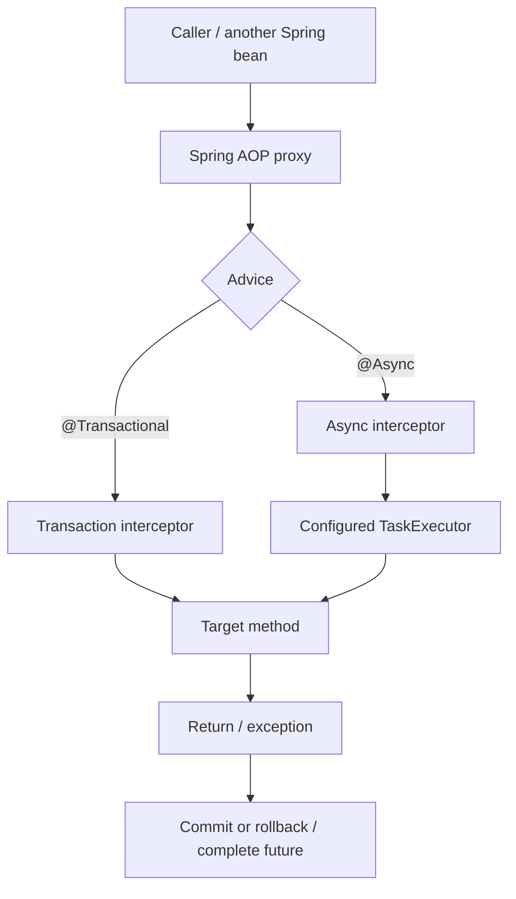

# Verifying @Transactional or @Async Traverses Proxies After AOT

Spring AOP applies `@Transactional` and `@Async` through proxies. When a service is called from another bean, the proxy intercepts the call, runs the corresponding interceptor, and only then delegates to the target object's method. Spring AOT must prepare the necessary components so that mechanism continues to work in Native Image.

This practice creates a small Spring Boot application with two services: one to verify transaction commit/rollback and one to execute work asynchronously. We will confirm that the beans are actually wrapped in proxies, verify that the interceptors were invoked, and then run the same test suite on the JVM and in the native test executable.

The goal is to prove three things:

- The method is invoked through the proxy so transaction advice or async advice actually runs.
- Behavior remains correct after Spring AOT and when tests run in Native Image.
- Design mistakes such as self-invocation can still occur in a native application, because AOT does not change Spring's proxy rules.

## 1. Call Flow Through a Proxy

With `@Transactional`, the proxy applies the transaction interceptor: it opens or joins a transaction, calls the target method, and then commits or rolls back based on the outcome and rollback rules.

With `@Async`, the proxy dispatches the method invocation to the configured executor. The caller receives a Future/CompletableFuture and does not execute the method body on the original calling thread.



In Native Image, Spring AOT processes bean definitions and proxies identifiable from the application context. Necessary runtime hints for Spring-managed mechanisms are also contributed during AOT processing. This does not mean every arbitrary dynamically created proxy in application code is automatically discovered.

An internal call from one method to another on the same object does not pass through the proxy. Therefore, a method calling `this.someTransactionalMethod()` will not trigger the transaction interceptor merely because the target method has `@Transactional`. This rule is the same on the JVM and in Native Image.

## 2. Prepare the Practice Project

The example uses Java 21 and Spring Boot 3.x with Spring AOT/Native Image support. Use the same Spring Boot, GraalVM, and Native Build Tools versions pinned in your actual project; task names and plugin configuration may vary across versions.

Minimal source structure:

```text
src/
├── main/
│   └── java/com/example/proxydemo/
│       ├── ProxyDemoApplication.java
│       ├── ProxyInfrastructureConfiguration.java
│       ├── TransactionalProbe.java
│       └── AsyncProbe.java
└── test/
    └── java/com/example/proxydemo/
        ├── ProxyAotIntegrationTest.java
        └── RecordingTransactionManager.java
```

The test uses a small TransactionManager solely to record begin/commit/rollback counts. This isolates verifying the transaction interceptor from a database and JDBC driver, which can introduce additional native metadata requirements. It proves the call passed through transaction advice; it does not replace an integration test verifying data rollback against a real database. The extension section at the end shows how to add that test.

### 2.1. Dependencies

Core dependencies for Gradle:

```groovy
dependencies {
    implementation("org.springframework.boot:spring-boot-starter")
    implementation("org.springframework.boot:spring-boot-starter-aop")
    implementation("org.springframework:spring-tx")

    testImplementation("org.springframework.boot:spring-boot-starter-test")
}
```

For Maven:

```xml
<dependencies>
    <dependency>
        <groupId>org.springframework.boot</groupId>
        <artifactId>spring-boot-starter</artifactId>
    </dependency>
    <dependency>
        <groupId>org.springframework.boot</groupId>
        <artifactId>spring-boot-starter-aop</artifactId>
    </dependency>
    <dependency>
        <groupId>org.springframework</groupId>
        <artifactId>spring-tx</artifactId>
    </dependency>
    <dependency>
        <groupId>org.springframework.boot</groupId>
        <artifactId>spring-boot-starter-test</artifactId>
        <scope>test</scope>
    </dependency>
</dependencies>
```

Versions are managed by Spring Boot dependency management/BOM. If the application already includes a JDBC/JPA starter or a dependency providing the transaction API, do not add duplicate dependencies. Native Build Tools and AOT configuration must be enabled according to the project's existing build setup.

## 3. Create the Application and Enable Infrastructure

Create the main application class:

```java
package com.example.proxydemo;

import org.springframework.boot.SpringApplication;
import org.springframework.boot.autoconfigure.SpringBootApplication;

@SpringBootApplication
public class ProxyDemoApplication {

    public static void main(String[] args) {
        SpringApplication.run(ProxyDemoApplication.class, args);
    }
}
```

Enable async and transaction management, and register a clearly named executor:

```java
package com.example.proxydemo;

import org.springframework.context.annotation.Bean;
import org.springframework.context.annotation.Configuration;
import org.springframework.scheduling.annotation.EnableAsync;
import org.springframework.scheduling.concurrent.ThreadPoolTaskExecutor;
import org.springframework.transaction.annotation.EnableTransactionManagement;

@Configuration(proxyBeanMethods = false)
@EnableAsync
@EnableTransactionManagement
public class ProxyInfrastructureConfiguration {

    @Bean(name = "nativeTaskExecutor")
    ThreadPoolTaskExecutor nativeTaskExecutor() {
        ThreadPoolTaskExecutor executor = new ThreadPoolTaskExecutor();
        executor.setCorePoolSize(2);
        executor.setMaxPoolSize(2);
        executor.setQueueCapacity(20);
        executor.setThreadNamePrefix("native-proxy-");
        executor.setWaitForTasksToCompleteOnShutdown(true);
        executor.setAwaitTerminationSeconds(5);
        return executor;
    }
}
```

In a Spring Boot application with an auto-configured transaction manager, transaction annotations may already be enabled by auto-configuration. In this lab, `@EnableTransactionManagement` is declared explicitly to highlight the infrastructure required by the proxy. Do not register two duplicate transaction management configurations if the project already has equivalent configuration.

The executor is named `nativeTaskExecutor` so the `@Async` annotation can reference it directly, avoiding reliance on default executor selection when the application has multiple pools.

## 4. Create the @Transactional Service

The service has two paths: one method that completes normally to test commit, and one method that throws a runtime exception to test rollback.

```java
package com.example.proxydemo;

import org.springframework.stereotype.Service;
import org.springframework.transaction.annotation.Transactional;

@Service
public class TransactionalProbe {

    @Transactional
    public String complete() {
        return "completed";
    }

    @Transactional
    public void fail() {
        throw new IllegalStateException("expected failure");
    }

    public void invokeFailInternally() {
        this.fail();
    }
}
```

Methods annotated with `@Transactional` must be invoked through the Spring proxy. For example, `complete()` and `fail()` are public, the class is non-final, and the bean is managed by Spring.

The `invokeFailInternally()` method intentionally demonstrates self-invocation. The caller invokes a non-transactional method; the method body calls `this.fail()` directly on the target object. That call never re-enters the proxy, so the transaction manager receives no begin/rollback for `fail()`. Do not use this call pattern in business code if transaction advice is expected to apply.

## 5. Create the @Async Service

The async service returns a `CompletableFuture`. The returned value contains the name of the thread executing the method body, allowing the test to verify the call switched to the executor.

```java
package com.example.proxydemo;

import java.util.concurrent.CompletableFuture;

import org.springframework.scheduling.annotation.Async;
import org.springframework.stereotype.Service;

@Service
public class AsyncProbe {

    @Async("nativeTaskExecutor")
    public CompletableFuture<String> execute() {
        return CompletableFuture.completedFuture(
                Thread.currentThread().getName());
    }
}
```

Do not call an async method via `this.execute()` inside the same bean if you want work dispatched to the executor. Inject another bean or extract the async logic into a separate collaborator so the call goes through the proxy.

Async methods should have a Spring-supported return type, typically `void` or `Future`/`CompletableFuture`. With a Future return type, exceptions in the task are propagated to the Future and the caller can observe them via `get()` or completion stages. If the method returns `void`, configure an `AsyncUncaughtExceptionHandler` to handle exceptions that have no Future receiving the outcome.


## 6. Create an Observable TransactionManager for Tests

To verify that the transaction interceptor is actually invoked, create a test-only transaction manager that counts begin, commit, and rollback calls. It manages neither connections nor data; its purpose is to observe calls emitted by `TransactionInterceptor`.

```java
package com.example.proxydemo;

import java.util.concurrent.atomic.AtomicInteger;

import org.springframework.transaction.TransactionDefinition;
import org.springframework.transaction.support.AbstractPlatformTransactionManager;
import org.springframework.transaction.support.DefaultTransactionStatus;

public class RecordingTransactionManager
        extends AbstractPlatformTransactionManager {

    private final AtomicInteger begins = new AtomicInteger();
    private final AtomicInteger commits = new AtomicInteger();
    private final AtomicInteger rollbacks = new AtomicInteger();

    @Override
    protected Object doGetTransaction() {
        return new Object();
    }

    @Override
    protected void doBegin(
            Object transaction,
            TransactionDefinition definition) {
        begins.incrementAndGet();
    }

    @Override
    protected void doCommit(DefaultTransactionStatus status) {
        commits.incrementAndGet();
    }

    @Override
    protected void doRollback(DefaultTransactionStatus status) {
        rollbacks.incrementAndGet();
    }

    public int beginCount() {
        return begins.get();
    }

    public int commitCount() {
        return commits.get();
    }

    public int rollbackCount() {
        return rollbacks.get();
    }
}
```

This is a test fixture, not for use as a production transaction manager. A real transaction manager such as `DataSourceTransactionManager` or `JpaTransactionManager` must also manage resources, connections, synchronization, and data rollback.

## 7. Write Integration Tests Verifying Proxies

The test starts a real Spring ApplicationContext, obtains beans from the container, and verifies both the proxies and advice behavior.

```java
package com.example.proxydemo;

import java.util.concurrent.TimeUnit;

import org.junit.jupiter.api.Test;
import org.junit.jupiter.api.parallel.Execution;
import org.junit.jupiter.api.parallel.ExecutionMode;

import org.springframework.aop.support.AopUtils;
import org.springframework.beans.factory.annotation.Autowired;
import org.springframework.boot.test.context.SpringBootTest;
import org.springframework.boot.test.context.TestConfiguration;
import org.springframework.context.annotation.Bean;
import org.springframework.context.annotation.Import;

import static org.assertj.core.api.Assertions.assertThat;
import static org.assertj.core.api.Assertions.assertThatThrownBy;

@SpringBootTest
@Execution(ExecutionMode.SAME_THREAD)
@Import(ProxyAotIntegrationTest.TransactionTestConfiguration.class)
class ProxyAotIntegrationTest {

    @Autowired
    TransactionalProbe transactionalProbe;

    @Autowired
    AsyncProbe asyncProbe;

    @Autowired
    RecordingTransactionManager transactionManager;

    @Test
    void transactionalMethodRunsThroughProxyAndCommits() {
        assertThat(AopUtils.isAopProxy(transactionalProbe)).isTrue();

        int beginsBefore = transactionManager.beginCount();
        int commitsBefore = transactionManager.commitCount();

        assertThat(transactionalProbe.complete()).isEqualTo("completed");

        assertThat(transactionManager.beginCount())
                .isEqualTo(beginsBefore + 1);
        assertThat(transactionManager.commitCount())
                .isEqualTo(commitsBefore + 1);
    }

    @Test
    void transactionalMethodRunsThroughProxyAndRollsBack() {
        assertThat(AopUtils.isAopProxy(transactionalProbe)).isTrue();

        int beginsBefore = transactionManager.beginCount();
        int rollbacksBefore = transactionManager.rollbackCount();

        assertThatThrownBy(transactionalProbe::fail)
                .isInstanceOf(IllegalStateException.class)
                .hasMessage("expected failure");

        assertThat(transactionManager.beginCount())
                .isEqualTo(beginsBefore + 1);
        assertThat(transactionManager.rollbackCount())
                .isEqualTo(rollbacksBefore + 1);
    }

    @Test
    void selfInvocationDoesNotEnterTransactionalProxy() {
        int beginsBefore = transactionManager.beginCount();
        int rollbacksBefore = transactionManager.rollbackCount();

        assertThatThrownBy(transactionalProbe::invokeFailInternally)
                .isInstanceOf(IllegalStateException.class)
                .hasMessage("expected failure");

        assertThat(transactionManager.beginCount()).isEqualTo(beginsBefore);
        assertThat(transactionManager.rollbackCount())
                .isEqualTo(rollbacksBefore);
    }

    @Test
    void asyncMethodRunsOnConfiguredExecutor() throws Exception {
        assertThat(AopUtils.isAopProxy(asyncProbe)).isTrue();

        String callerThread = Thread.currentThread().getName();
        String workerThread = asyncProbe.execute()
                .get(5, TimeUnit.SECONDS);

        assertThat(workerThread).startsWith("native-proxy-");
        assertThat(workerThread).isNotEqualTo(callerThread);
    }

    @TestConfiguration(proxyBeanMethods = false)
    static class TransactionTestConfiguration {

        @Bean
        RecordingTransactionManager transactionManager() {
            return new RecordingTransactionManager();
        }
    }
}
```

To keep the code concise, the example uses `@Autowired` directly on fields. In a project, you can import `org.springframework.beans.factory.annotation.Autowired` and place the annotation directly.

### 7.1. Expected Results

| Test | What It Proves |
| --- | --- |
| `transactionalMethodRunsThroughProxyAndCommits` | Bean is an AOP proxy; transaction manager receives begin and commit |
| `transactionalMethodRunsThroughProxyAndRollsBack` | Runtime exception exits the method; transaction interceptor triggers rollback |
| `selfInvocationDoesNotEnterTransactionalProxy` | Calling `this.fail()` bypasses the proxy and does not open a transaction |
| `asyncMethodRunsOnConfiguredExecutor` | Bean is an AOP proxy; method runs on an executor thread with the configured prefix |

Do not assert specific proxy class names using `isCglibProxy` or `isJdkDynamicProxy` if your goal is only to verify advice execution. The proxy type can change depending on interfaces, Spring AOP configuration, and framework version. `AopUtils.isAopProxy()` combined with behavioral assertions is less coupled to implementation details.

## 8. Run Tests on the JVM First

Start with JVM tests to verify source code, context, and assertions are correct before moving to AOT/native.

With Gradle:

```bash
./gradlew test --tests "com.example.proxydemo.ProxyAotIntegrationTest"
```

With Maven:

```bash
./mvnw -B -Dtest=ProxyAotIntegrationTest test
```

If tests fail here, resolve context, bean scanning, transaction manager, or executor issues first. There is no need to investigate Native Image yet.

Check the test report to ensure all four tests were discovered and executed. A task that succeeds while tests are skipped or undiscovered does not prove proxies work.

## 9. Run Spring AOT for Main and Test Contexts

Spring AOT analyzes the ApplicationContext and generates the required runtime contributions. For tests, the test context must also be processed so native tests can initialize the exact configuration.

Gradle:

```bash
./gradlew processAot processTestAot
```

Maven:

```bash
./mvnw -B spring-boot:process-aot
./mvnw -B spring-boot:process-test-aot
```

Tasks/goals depend on the Spring Boot plugin version and build configuration. Check the task graph or Maven plugin help if goal names differ. In particular, verify that test AOT processes the `ProxyAotIntegrationTest` test class and the nested `TransactionTestConfiguration`.

If AOT fails, inspect the ApplicationContext startup logs and condition evaluation. Common causes include beans registered dynamically after AOT analysis, build-environment-dependent conditions, unsupported test context customizers, or unpredictable bean definitions.

## 10. Run Tests with Native Image

Once JVM tests and AOT processing pass, run the test suite through the native test task.

Gradle with GraalVM Native Build Tools configured:

```bash
./gradlew nativeTest
```

Maven requires a native test profile/execution configured in the project, for example:

```bash
./mvnw -B -PnativeTest test
```

The profile name `nativeTest` is only a common convention; Maven does not create it automatically. The profile must wire up the Native Build Tools test goal and proper test AOT configuration.

Native tests can take longer to compile than JVM tests. Distinguish clearly:

- JVM tests: tests running on the Java runtime.
- Test AOT: Spring generating metadata/source for the test context.
- Native tests: tests compiled into a native executable and executed.
- Native application build: the production application compiled into its own executable.

Passing native tests is stronger evidence of proxy behavior in Native Image. However, it still only covers contexts and code paths that the tests actually initialize.

### 10.1. Build and Run the Native Application

You can build the application separately after native tests pass.

Gradle:

```bash
./gradlew nativeCompile
./gradlew nativeRun
```

Maven, with the native profile configured:

```bash
./mvnw -B -Pnative native:compile
```

Run the generated executable in the project's output directory and confirm the ApplicationContext initializes successfully. This lab does not add a web server, so there are no HTTP endpoints; when applying this to a real web service, also invoke business endpoints via smoke tests. Filenames and output directories depend on finalName/plugin configuration.


## 11. Extending Tests to Verify Real Data Rollback

`RecordingTransactionManager` in this lab proves the transaction interceptor calls begin/commit/rollback. It does not manage database resources, so it does not prove a row was rolled back.

For a real application, add an integration test using the production transaction manager and a compatible database:

```java
@Service
class OrderWriter {

    private final JdbcTemplate jdbcTemplate;

    OrderWriter(JdbcTemplate jdbcTemplate) {
        this.jdbcTemplate = jdbcTemplate;
    }

    @Transactional
    public void insertThenFail(String orderId) {
        jdbcTemplate.update(
                "insert into orders(id) values (?)",
                orderId);
        throw new IllegalStateException("force rollback");
    }
}
```

The test invokes the method on the injected bean, catches the exception, and then queries the database in an independent transaction/query to confirm the row does not exist:

```java
@Test
void failedTransactionalWriteLeavesNoRow() {
    assertThatThrownBy(() -> orderWriter.insertThenFail("order-42"))
            .isInstanceOf(IllegalStateException.class);

    Integer count = jdbcTemplate.queryForObject(
            "select count(*) from orders where id = ?",
            Integer.class,
            "order-42");

    assertThat(count).isZero();
}
```

Do not place `@Transactional` on the test method itself if you want to verify the service's transaction independently; test-level transactions can make results harder to interpret. Use a dedicated test database instance/schema and clean up data cleanly.

You can use PostgreSQL Testcontainers or an equivalent database integration environment. If using H2, check whether the driver and H2 version are compatible with Native Image in your target toolchain. Native tests must run with the exact database driver, datasource configuration, and transaction manager used by the released application.

## 12. Reading Results and Investigating Native-Only Failures

If JVM tests pass but native tests fail, collect evidence in order:

1. Confirm native tests were actually compiled and executed; check test counts/reports.
2. Read ApplicationContext initialization errors before adding hints.
3. Verify the bean proxy was created and injected with the expected type.
4. Confirm the transaction manager or executor bean was discovered.
5. Check errors related to reflection, dynamic proxies, or class initialization.
6. Inspect AOT generated output and Native Image build diagnostics.
7. Create the smallest possible reproducer to isolate framework issues from business logic.

| Symptom | Investigation Direction |
| --- | --- |
| `AopUtils.isAopProxy()` returns false | Check bean scanning, `@EnableAsync`/`@EnableTransactionManagement`, annotations, and how the bean is obtained |
| Transactional method runs but commit count does not change | Check the selected PlatformTransactionManager and whether the call goes through the proxy |
| Async thread name is still the caller | Check `@EnableAsync`, self-invocation, and executor qualifier |
| JVM tests pass, native test reports missing proxy | Check proxy type/interfaces and AOT contribution before adding a JDK proxy hint |
| Native test reports missing reflection metadata | Identify dynamically accessed class/member; add exact RuntimeHints if Spring cannot infer it |
| AOT test context fails to initialize | Check nested test configuration, bean overrides, dynamic property sources, and context customizers |
| Native test times out | Check executor shutdown, Future wait, thread pool, and runner resources |

Do not treat every error by enabling broad reflection options or adding bulk proxy hints. Excess hints bloat image metadata and obscure the real root cause.


## 13. Complete Practice Workflow

1. Create the project and pin Spring Boot/GraalVM/Native Build Tools versions.
2. Add AOP and transaction dependencies.
3. Enable `@EnableTransactionManagement` and `@EnableAsync`.
4. Register `nativeTaskExecutor`.
5. Create `TransactionalProbe` and `AsyncProbe`.
6. Create `RecordingTransactionManager` in test sources.
7. Write tests for commit, rollback, self-invocation, and async thread execution.
8. Run JVM tests and confirm all four tests pass.
9. Run main/test AOT processing.
10. Run the native test executable and confirm the same assertions pass.
11. Build the native application executable.
12. Run smoke tests and observe logs/executor shutdown.
13. If using a real database, also run native integration tests confirming data rollback.
14. Archive test reports, toolchain versions, and native build diagnostics.

### 13.1. Results Table to Record

| Check | JVM | AOT | Native test |
| --- | --- | --- | --- |
| ApplicationContext initializes | PASS/FAIL | PASS/FAIL | PASS/FAIL |
| Transactional bean is an AOP proxy | PASS/FAIL | Proxy contribution generated | PASS/FAIL |
| Transaction commit callback | PASS/FAIL | AOT processing passes | PASS/FAIL |
| Transaction rollback callback | PASS/FAIL | AOT processing passes | PASS/FAIL |
| Self-invocation does not trigger advice | PASS/FAIL | Proxy semantics unchanged | PASS/FAIL |
| Async runs on executor thread | PASS/FAIL | AOT processing passes | PASS/FAIL |
| Real database rollback (if applicable) | PASS/FAIL | Test AOT passes | PASS/FAIL |

AOT is an output-generation phase, not an independent runtime test. Therefore, the AOT column records whether processing/generation succeeded; final runtime behavior must be verified by native tests or executable tests.

## 14. Lab Completion Checklist

- [ ] Service is managed by the Spring container and tests obtain beans via injection.
- [ ] `@EnableTransactionManagement` is enabled or equivalent transaction auto-configuration is active.
- [ ] `@EnableAsync` is enabled.
- [ ] Transactional methods are eligible for proxying.
- [ ] Test confirms the transactional bean is an AOP proxy.
- [ ] Test confirms the commit callback is invoked.
- [ ] Test confirms a runtime exception triggers the rollback callback.
- [ ] Self-invocation test proves internal calls bypass the proxy.
- [ ] Async method uses a clearly named executor.
- [ ] Test confirms the async task runs on an executor thread.
- [ ] Test awaits the Future with a finite timeout.
- [ ] JVM tests pass with the expected test count.
- [ ] Main AOT and test AOT processing pass.
- [ ] Native tests actually compile and execute.
- [ ] Native tests pass with the same assertions as JVM.
- [ ] No unnecessary Runtime Hints were added to mask wiring/proxy errors.
- [ ] Transaction callback tests are distinguished from real database rollback.
- [ ] If the application uses a DB, native integration tests cover the target driver/database.
- [ ] Toolchain versions, logs, and test reports are archived.

### Self-Assessment Questions

1. Why do `@Transactional` and `@Async` require calls to go through a Spring proxy?
2. How does Spring AOT support Spring-managed proxies when building a Native Image?
3. What does `AopUtils.isAopProxy()` prove, and what does it not prove?
4. Why does self-invocation fail to trigger transaction or async advice?
5. At what level does `RecordingTransactionManager` prove the transaction interceptor works?
6. Why is an additional database integration test needed to prove data rollback?
7. How does default rollback behavior differ between runtime exceptions and checked exceptions?
8. Why should async tests use a Future timeout instead of sleep?
9. Does a caller's transaction automatically propagate to a thread spawned by `@Async`?
10. When JVM tests pass but native tests fail, what should you check before adding Runtime Hints?

## 15. Why Are Proxy Tests Meaningful in Native Image?

Native Image does not have a dynamic classpath like the JVM. Required classes, proxy interfaces, reflection accesses, and resources must be determinable during the build process or declared via runtime hints.

For Spring-managed proxies identifiable from the ApplicationContext, Spring AOT can contribute the necessary proxy metadata and code. Therefore, the proper way to verify is:

1. Declare the bean in the Spring context.
2. Invoke methods through the bean obtained from the context.
3. Assert the bean is an AOP proxy.
4. Assert the transaction manager receives commit/rollback or the async method runs on the executor.
5. Run the same tests in the native test executable.

Do not instantiate via `new TransactionalProbe()` in tests. That instance is not Spring-managed and has no proxy.

Also avoid adding Runtime Hints arbitrarily to mask a proxy error. First verify the bean was scanned/imported by Spring, annotation infrastructure is enabled, the method can be proxied, and the call passes through the proxy bean.

### 15.1. When Must Runtime Hints Be Declared Manually?

Only consider manual hints when the application creates custom proxies or performs dynamic accesses that Spring AOT cannot infer, for example:

- Using `Proxy.newProxyInstance()` with an interface list constructed from runtime configuration.
- Creating proxies via `ProxyFactory` in custom code without a matching AOT contribution.
- Using reflection to look up methods/constructors by names loaded from a file or database.
- Loading implementations by class name after the process starts.

For application-created JDK dynamic proxies, you can register the interfaces to proxy via RuntimeHints:

```java
import org.springframework.aot.hint.RuntimeHints;
import org.springframework.aot.hint.RuntimeHintsRegistrar;

public class ClientProxyHints implements RuntimeHintsRegistrar {

    @Override
    public void registerHints(RuntimeHints hints, ClassLoader classLoader) {
        hints.proxies().registerJdkProxy(InventoryClient.class);
    }
}
```

You can attach the registrar to configuration via `@ImportRuntimeHints`:

```java
import org.springframework.context.annotation.Configuration;
import org.springframework.context.annotation.ImportRuntimeHints;

@Configuration(proxyBeanMethods = false)
@ImportRuntimeHints(ClientProxyHints.class)
class NativeClientConfiguration {
}
```

Register the registrar according to the Spring AOT mechanism matching your Spring Framework version. The example above is only for custom JDK proxies. Do not use this hint as a substitute for Spring AOP configuration or to work around self-invocation.

## 16. Conditions That Prevent @Transactional from Applying

When proxy tests fail or the transaction manager receives no callbacks, check the following conditions:

| Condition | Issue | How to Check/Fix |
| --- | --- | --- |
| Bean not managed by Spring | No proxy | Inject the bean from ApplicationContext |
| Calling method via `new ...()` | Bypasses container | Inject collaborator |
| Self-invocation | `this.method()` call skips the proxy | Extract method to another bean |
| Final class/method with class-based proxy | Cannot override to create proxy | Remove final or use an appropriate interface proxy |
| Method not on interface when using JDK proxy | Caller cannot invoke method via interface proxy | Add method to interface or use class proxy |
| Annotation placed on non-invoked method | Interceptor does not run | Place annotation on the method/contract invoked through the proxy |
| No transaction manager | Cannot open transaction | Register the proper PlatformTransactionManager |
| Checked exception | Does not roll back by default | Declare `rollbackFor` if business logic requires it |
| Calling private method | Standard proxy mode does not intercept private methods | Place transaction boundary on externally called public methods |

Example rollback for checked exceptions:

```java
@Transactional(rollbackFor = Exception.class)
public void updateAndFail() throws Exception {
    // Perform update
    throw new Exception("business failure");
}
```

By default, `@Transactional` rolls back on `RuntimeException` and `Error`. Checked exceptions usually do not trigger rollback unless a rollback rule is configured. Set rules according to business semantics, rather than defaulting to rolling back all exceptions if some checked exceptions represent outcomes that should commit.

## 17. Conditions That Prevent @Async from Running Asynchronously

| Condition | Symptom | How to Check/Fix |
| --- | --- | --- |
| Missing `@EnableAsync` | Method runs synchronously | Enable async infrastructure |
| Bean not from Spring container | No async proxy | Inject managed bean |
| Self-invocation | Method runs on caller thread | Call through collaborator bean |
| Wrong executor name | Executor not found or unexpected pool used | Match `@Async` qualifier with bean name |
| Unsupported return type | Result/exception hard to observe | Use `void` or `Future`/`CompletableFuture` |
| Executor queue full or shut down | Task rejected or incomplete | Configure pool, queue, and rejection policy |
| Test does not await Future | Test finishes before task completes | Use `get(timeout)` or awaitility |
| Thread starvation | Future does not complete in time | Check pool size, blocking calls, and queue |

Do not use fixed sleep calls to wait for async tasks in tests. Await the Future with a finite timeout so tests stay fast and detect deadlocks/hangs.

## 18. Transactions Do Not Automatically Propagate to @Async Threads

Standard Spring transactions are bound to the current thread. When a method dispatches work via `@Async`, the executor runs on a different thread; the caller's transaction does not automatically propagate to that thread.

Clear design example:

```java
@Service
class AsyncOrderWorkflow {

    private final TransactionalOrderWriter writer;

    AsyncOrderWorkflow(TransactionalOrderWriter writer) {
        this.writer = writer;
    }

    @Async("nativeTaskExecutor")
    public CompletableFuture<String> process(String orderId) {
        writer.persist(orderId);
        return CompletableFuture.completedFuture(orderId);
    }
}

@Service
class TransactionalOrderWriter {

    @Transactional
    public void persist(String orderId) {
        // Write data within the worker thread's transaction
    }
}
```

When `process()` runs on the executor, the `writer.persist()` call goes through the other bean's proxy and opens a transaction on the worker thread. This is the task's own transaction, not the transaction opened on the caller thread.

If business logic requires atomicity between synchronous updates and asynchronous work, design the workflow explicitly—such as using the outbox pattern, a message broker, or separate transaction boundaries. Do not rely on ThreadLocal transaction propagation across executors.
## References

- [Spring Framework — AOP Proxies](https://docs.spring.io/spring-framework/reference/core/aop/proxying.html): how proxies work and self-invocation limitations.
- [Spring Framework — Declarative Transaction Management](https://docs.spring.io/spring-framework/reference/data-access/transaction/declarative.html): transaction interceptor, rollback rules, and proxy modes.
- [Spring Framework — Task Execution and Scheduling](https://docs.spring.io/spring-framework/reference/integration/scheduling.html): `@Async`, executors, and exception handling.
- [Spring Framework — AOT Processing](https://docs.spring.io/spring-framework/reference/core/aot.html): AOT contributions and runtime hints.
- [Spring Boot — GraalVM Native Images](https://docs.spring.io/spring-boot/reference/packaging/native-image/): building and testing native applications.
- [GraalVM Native Build Tools](https://graalvm.github.io/native-build-tools/latest/): native test and native compilation tasks/goals for Maven/Gradle.

**Expected outcome:** have an integration test proving `@Transactional` actually traverses the proxy and invokes commit/rollback, a test proving `@Async` runs on an executor thread, understand self-invocation and thread-bound transactions, and run the same checks after Spring AOT in Native Image.
