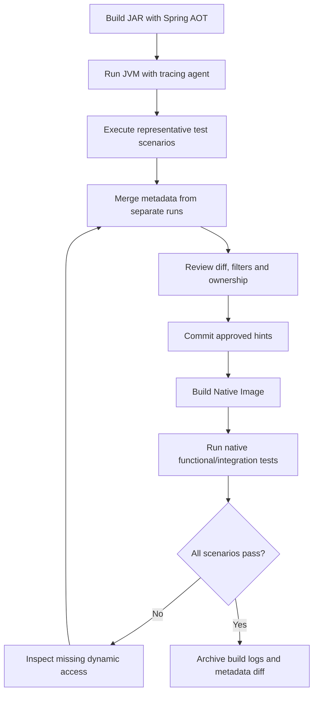

# Collecting Metadata with the Tracing Agent, Then Reviewing and Re-Testing

## 1. Practice Objectives

Spring AOT and GraalVM Native Image analyze an application based on what can be determined at build time. However, some Java features only manifest at runtime, such as reflection, JNI, dynamic proxies, serialization, or reading resources by dynamically constructed names. When static analysis cannot fully determine those accesses, Native Image requires reachability metadata to retain the right classes, members, proxies, or resources.

The GraalVM Tracing Agent observes dynamic accesses while the application runs on the JVM and generates JSON configuration. This practice uses the agent to collect metadata from a Spring Boot service, review the output, incorporate the necessary metadata into the project, and then rebuild and re-test the Native Image.

This lesson belongs to the **Integrated Practice** chapter of the **SPRING_BOOT_NATIVE_IMAGE** module. The module teaches compiling Spring Boot applications into GraalVM Native Images with Spring AOT to evaluate startup time and memory, while practicing Maven/Gradle builds, configuring reflection and resources, compatibility testing, container packaging, and operating native builds.

After this lesson, learners will be able to:

- Prepare a Spring Boot executable JAR containing AOT-generated assets to run with the tracing agent.
- Run representative workloads to record required reflection, resources, proxies, JNI, and serialization.
- Collect multiple runs and merge metadata.
- Identify metadata generated from test infrastructure or non-production code paths.
- Choose the appropriate way to store metadata: JSON reachability metadata or Spring `RuntimeHints`.
- Build a Native Image from the reviewed metadata and verify business flows on the binary.
- Establish a repeatable workflow for collecting, reviewing, and updating metadata in CI.

The expected outcome is a well-justified set of metadata tested on the native executable. The tracing agent helps discover missed dynamic accesses; it does not prove the application covered every path or is secure.

## 2. Understand What the Tracing Agent Collects

The Tracing Agent runs alongside a regular JVM and tracks dynamic accesses for which Native Image may need metadata, for example:

| Metadata Type | Common Scenario | Spring Boot Example |
|---|---|---|
| Reflection | Looking up classes, constructors, fields, or methods by name/runtime API | JSON binding, mappers, framework extensions |
| Resource | Reading classpath files by name or pattern | JSON schemas, templates, XML mappings |
| Dynamic proxy | Creating proxies from interfaces at runtime | Client proxies, certain integration libraries |
| JNI | Invoking methods/fields or native libraries via JNI | Crypto libraries, image processing, drivers |
| Serialization | Serializing/deserializing via Java serialization | Legacy messages or cache payloads |

The agent only records activity that actually takes place in the attached JVM process. If the application has a CSV import branch but the workload sends no CSV file, the agent cannot infer the reflection/resources needed for that branch. If tests only run with the default locale, resource metadata for other locales may remain unrecorded.

Spring AOT already generates many hints for common Spring patterns. Therefore, use the tracing agent to find what is missing—especially third-party libraries or dynamic access patterns Spring cannot infer. Do not add broad metadata for every class merely because the agent can generate it.

Nor is the tracing agent a vulnerability scanner. It does not detect CVEs, evaluate authorization, or prove input data is safe. Its purpose is to record dynamic accesses so Native Image can package the required components.

## 3. Practice Scenario: Order Management Service

Suppose the Spring Boot application has the following capabilities:

| Feature | Flow to Execute | Potentially Related Metadata |
|---|---|---|
| View order | `GET /api/orders/{id}` | DTO binding, JSON serialization |
| Create order | `POST /api/orders` | Request DTO, validation, response DTO |
| Import orders | `POST /api/orders/import` | Multipart upload, CSV parser, resource/schema |
| Export report | `GET /api/orders/{id}/report` | Template/resource, serializer |
| Emit events | Publish/consume `OrderCreated` | Message serialization, proxy/client |
| Error handling | Invalid payload, missing fields, unauthorized | Error DTO, validation, security paths |

This is an illustrative scenario; substitute endpoints and data with your project's actual business functionality. If the application does not have import, reporting, or messaging, replace them with corresponding features. Do not add dummy libraries or fake code solely to generate metadata.

Prepare a reproducible test dataset. Use test accounts, mock secrets, and supporting services meant for test environments. Never run the tracing agent against production credentials or real customer data.

## 4. Prepare the Toolchain and AOT Executable JAR

You need a GraalVM JDK compatible with the project's Spring Boot, Native Build Tools, and Java versions. Run `java` from that exact GraalVM JDK containing the tracing agent; using another JDK may lack the agent or be incompatible.

Verify the toolchain:

```bash
echo "$GRAALVM_HOME"
"$GRAALVM_HOME/bin/java" -version
"$GRAALVM_HOME/bin/native-image" --version
```

On Windows PowerShell:

```powershell
$env:GRAALVM_HOME
& "$env:GRAALVM_HOME\bin\java.exe" -version
& "$env:GRAALVM_HOME\bin\native-image.cmd" --version
```

Before attaching the agent, build an executable JAR containing Spring AOT generated assets. For Maven projects using `spring-boot-starter-parent` and the Native Build Tools plugin, the `native` profile configures AOT processing. You can prepare the JAR with:

```bash
./mvnw -Pnative package -DskipTests
```

With Gradle, ensure the project applies the `org.graalvm.buildtools.native` plugin matching the Native Build Tools version. Spring Boot wires AOT tasks into the build. For example:

```bash
./gradlew bootJar
```

Task names and plugin DSLs may vary by version. Use the project wrapper and inspect the current build script. What matters is that the executable JAR contains AOT-generated classes/resources; a plain JVM JAR without AOT assets does not accurately represent the configuration that will run in Native Image.

You can inspect JAR contents:

```bash
jar tf target/orders-service.jar | grep -E 'META-INF/native-image|springframework/aot'
```

If using Gradle, replace the JAR path with the file in `build/libs`. Confirm AOT assets are packaged before proceeding.

## 5. Launch the Application Directly with the Tracing Agent

Create a dedicated directory for metadata. The agent writes JSON files to this directory when the JVM shuts down normally.

On Linux/macOS:

```bash
mkdir -p target/native-agent/run-01

"$GRAALVM_HOME/bin/java" \
  -Dspring.aot.enabled=true \
  -agentlib:native-image-agent=config-output-dir=target/native-agent/run-01 \
  -jar target/orders-service.jar
```

On Windows PowerShell:

```powershell
$metadataDir = "target/native-agent/run-01"
New-Item -ItemType Directory -Force -Path $metadataDir | Out-Null
& "$env:GRAALVM_HOME\bin\java.exe" -Dspring.aot.enabled=true "-agentlib:native-image-agent=config-output-dir=$metadataDir" -jar "target\orders-service.jar"
```

Details to keep exact:

- `java` must come from a GraalVM JDK with the Native Image Tracing Agent.
- `-Dspring.aot.enabled=true` instructs Spring Boot to use the AOT-generated initialization code packaged inside the JAR.
- `-agentlib:native-image-agent=...` must appear before `-jar` and the application name.
- `config-output-dir` is the directory where the agent writes metadata; create a fresh directory for each initial run.
- When the workload finishes, stop the application via normal shutdown mechanisms such as `Ctrl+C` so the agent has a chance to write the files.

Do not use `kill -9`, Task Manager End Process, or other forced termination for the final collection run. An abruptly terminated JVM may fail to execute the metadata write step on shutdown.

For long-running applications where periodic metadata dumps are desired, the agent supports `config-write-period-secs` and `config-write-initial-delay-secs`. Enable them only when needed; for short lab exercises, writing on JVM shutdown is easier to control.

## 6. Run a Purposeful Workload

Once the application is ready, execute the business flows one by one. Do not just call the health endpoint and conclude the metadata is complete.

Example HTTP requests:

```bash
# Read an order
curl --fail http://localhost:8080/api/orders/1001

# Create an order using JSON DTO
curl --fail -X POST http://localhost:8080/api/orders \
  -H 'Content-Type: application/json' \
  -d '{"customerId":"C-100","items":[{"sku":"SKU-01","quantity":2}]}'

# Send an invalid payload to exercise error/validation paths
curl -i -X POST http://localhost:8080/api/orders \
  -H 'Content-Type: application/json' \
  -d '{"customerId":"","items":[]}'

# Test report generation if the application supports it
curl --fail http://localhost:8080/api/orders/1001/report
```

Paths and JSON payloads are examples only. Use valid payloads matching your project's real schema. If an endpoint requires authentication, supply test tokens via your environment's secure mechanism; never hardcode tokens into committed scripts or the metadata repository.

Draft a workload matrix before running:

| Category | Examples to Execute | Questions to Answer |
|---|---|---|
| Core APIs | GET/POST/PUT/DELETE with valid data | Were DTOs and serializers observed? |
| Validation/errors | Missing fields, wrong types, non-existent records | Were error handlers and error resources invoked? |
| Security | Anonymous, authorized role, unauthorized role | Were security branches and related responses executed? |
| Files/resources | Upload, download, reports, templates, schemas | Were resources and parsers accessed? |
| Serialization | JSON messages, legacy payloads if any | Which dynamic types were deserialized? |
| Proxies/clients | Database calls, HTTP clients, messaging | Were any proxy interfaces or dynamic features used? |
| Background work | Async tasks, schedulers, consumers | Were non-HTTP flows executed? |
| Config variants | Supported profiles, feature flags, locales | Do certain resources/types appear only in one variant? |

Only exercise features that genuinely exist in the application. If a flow requires a database or broker, use a test service with a known initial state. If the workload mutates data, reset fixtures before the next run so results stay reproducible.

Record the executed requests/test cases and expected outcomes. This shows exactly which branches were not yet observed by the agent, rather than simply looking at the volume of generated JSON.

## 7. Collect Multiple Runs and Merge Metadata

A single run is rarely sufficient. Run distinct workload groups to expand coverage: core APIs, upload/reporting, messaging, security branches, and supported profiles.

There are two ways to merge:

**Sequential runs into the same directory:** use `config-output-dir` for the first run, then `config-merge-dir` on subsequent runs to append to the existing metadata set.

```bash
# First run
"$GRAALVM_HOME/bin/java" \
  -Dspring.aot.enabled=true \
  -agentlib:native-image-agent=config-output-dir=target/native-agent/merged \
  -jar target/orders-service.jar

# Subsequent runs: vary workload, then stop the app gracefully
"$GRAALVM_HOME/bin/java" \
  -Dspring.aot.enabled=true \
  -agentlib:native-image-agent=config-merge-dir=target/native-agent/merged \
  -jar target/orders-service.jar
```

Each subsequent run must actually exercise new branches. `config-merge-dir` adds observations to existing configuration; it does not create coverage for unexecuted code.

**Parallel or isolated runs:** each process writes to its own output directory to avoid multiple processes writing to the same folder simultaneously. Then use the current GraalVM's `native-image-utils` to merge:

```bash
native-image-utils generate \
  --input-dir=target/native-agent/run-api \
  --input-dir=target/native-agent/run-import \
  --input-dir=target/native-agent/run-messaging \
  --output-dir=target/native-agent/merged
```

Some older GraalVM versions use a tool named `native-image-configure`. Check `native-image-utils help` or the utility distributed with your GraalVM version; do not copy commands from a different version without verifying.

Never share a single output directory across concurrent test forks. If attaching the agent to a test JVM, configure a single fork or give each process its own output directory and merge afterward. With test frameworks, metadata may include accesses from JUnit, Spring Test, and test libraries; review and filter before using for production.

## 8. Read the Generated Metadata Structure

Depending on the GraalVM version and metadata format, the directory may contain individual files or unified reachability metadata. Common individual files include:

| File | Contents |
|---|---|
| `reflect-config.json` | Classes, constructors, fields, and methods accessed via reflection |
| `resource-config.json` | Resources or resource patterns to retain in the image |
| `proxy-config.json` | Interfaces used to create dynamic proxies |
| `jni-config.json` | Classes/members accessed via JNI |
| `serialization-config.json` | Types requiring Java serialization |
| `reachability-metadata.json` | Reachability metadata in the unified format supported by current versions |

Not every run generates all files. An absent file does not prove the application does not use that feature; the workload may not have touched it yet, or Spring AOT/existing metadata may already handle it.

For example, a reflection entry might describe a class and its accessed members:

```json
[
  {
    "name": "com.example.orders.OrderImportRequest",
    "allDeclaredConstructors": true,
    "allPublicMethods": true
  }
]
```

This is solely an example illustrating structure, not metadata taken from a project. The agent may emit more specific members or different flags. Keep the schema and format generated by your toolchain version intact until you understand the impact of every edit.

Metadata must be read alongside source code, call paths, and test cases. An entry appearing in JSON may originate from application code, a third-party library, or a test framework. Looking at the class name alone is not enough to decide whether an entry can be deleted.

## 9. Review Metadata Quality Before Adding to the Project

Before copying metadata, review each file and answer:

1. Which business flow does this entry serve?
2. Is the caller application code, a runtime library, or test infrastructure?
3. Is this entry already handled by Spring AOT or library-provided reachability metadata?
4. Is the entry overly broad—for example, registering an entire package or all members when only one method is needed?
5. Does it contain local machine paths, test filenames, sensitive data, or environment details?
6. Can the JSON metadata be replaced by a small, clearly tested Spring `RuntimeHintsRegistrar`?
7. If the entry is removed, which test will detect the regression?

You can use `git diff --no-index` to compare runs, or place reviewed metadata under Git and inspect diffs like source changes. Do not commit an entire temporary output directory if it contains unfiltered data, duplicate files, or test-only metadata.

Do not delete an entry solely because it increases binary size. Confirm the entry is unneeded for production by removing it on an experimental branch, building native, and re-running the exact test case that used that entry. If you cannot prove it is safe to remove, keep the entry or replace it with a narrower tested hint.

Likewise, do not add wildcards such as `allDeclaredMethods` for an entire package just to make the build succeed without justification. Overly broad metadata increases executable size and retains unnecessary dynamic accesses.

## 10. Filter Metadata Originating from Test Infrastructure

Spring Boot documentation notes that running the agent via a test suite can generate metadata for test infrastructure as well. This is why it is preferable to run the application directly first to discover hints for libraries or patterns Spring has not recognized, and then use tests to add targeted coverage.

The Tracing Agent supports two distinct types of filters:

- **Caller filter:** filters by the class performing the dynamic access. Useful when excluding accesses originating from test classes or test frameworks.
- **Access filter:** filters by the target class/type being accessed. Useful when a target package is known not to belong in metadata.

Illustrative caller filter example to exclude accesses originating from test packages:

```json
{
  "rules": [
    { "excludeClasses": "com.example.orders.test.**" },
    { "excludeClasses": "org.springframework.test.**" },
    { "excludeClasses": "org.junit.**" }
  ]
}
```

Apply filters only after inspecting actual packages. If a production library also calls from an excluded package, the filter may drop required metadata. Filter rules are processed in order; later rules can override earlier ones.

Launch the agent with a caller filter:

```bash
"$GRAALVM_HOME/bin/java" \
  -Dspring.aot.enabled=true \
  -agentlib:native-image-agent=caller-filter-file=caller-filter.json,config-output-dir=target/native-agent/filtered \
  -jar target/orders-service.jar
```

Do not disable the built-in caller filter or heuristic filter to generate production metadata without understanding the consequences. Those options can flood the output with unneeded JVM/library accesses. Keep an unfiltered raw run for cross-reference if needed.

## 11. Place Reviewed Metadata into the Spring Boot Project

With Spring Boot, static JSON metadata can be placed under `src/main/resources/META-INF/native-image/`. Spring AOT also generates hints in its own subdirectory organized by `groupId` and `artifactId`. Place additional metadata in a distinct subdirectory so it does not overwrite AOT-generated output.

Example:

```text
src/main/resources/
└── META-INF/
    └── native-image/
        └── com.example/
            └── orders-service-additional-hints/
                ├── reflect-config.json
                ├── resource-config.json
                └── proxy-config.json
```

Filenames and directories must match the reviewed output. Copy only files with necessary contents; do not create empty files or arbitrarily rename schemas.

On Linux/macOS, example copying metadata:

```bash
mkdir -p src/main/resources/META-INF/native-image/com.example/orders-service-additional-hints
cp target/native-agent/merged/*.json \
  src/main/resources/META-INF/native-image/com.example/orders-service-additional-hints/
```

On Windows PowerShell:

```powershell
$hintDir = "src/main/resources/META-INF/native-image/com.example/orders-service-additional-hints"
New-Item -ItemType Directory -Force -Path $hintDir | Out-Null
Copy-Item "target/native-agent/merged/*.json" -Destination $hintDir -Force
```

In a multi-module project, place metadata in the module producing the executable or in the module providing the corresponding library, depending on packaging. Inspect the JAR after building to verify the files are on the classpath.

## 12. When Should JSON Be Converted to Spring RuntimeHints?

Keeping JSON is valid when metadata is auto-generated, compatible with the GraalVM version, and easy to review. For metadata belonging to your own application code, `RuntimeHintsRegistrar` often expresses intent more clearly, stays type-safe in Java, and can be tested using Spring APIs.

Example registering a dynamically read resource:

```java
import org.springframework.aot.hint.RuntimeHints;
import org.springframework.aot.hint.RuntimeHintsRegistrar;

public class OrderResourceHints implements RuntimeHintsRegistrar {

    @Override
    public void registerHints(RuntimeHints hints, ClassLoader classLoader) {
        hints.resources().registerPattern("schemas/orders/*.json");
    }
}
```

Activate the registrar via configuration:

```java
import org.springframework.context.annotation.Configuration;
import org.springframework.context.annotation.ImportRuntimeHints;

@Configuration(proxyBeanMethods = false)
@ImportRuntimeHints(OrderResourceHints.class)
class OrderNativeHintsConfiguration {
}
```

You can use `@RegisterReflectionForBinding` for DTOs requiring dynamic binding, or register specific reflection/proxy/serialization entries via the `RuntimeHints` API. Do not mechanically convert all JSON into Java code; choose the representation your team can understand, review, and maintain.

If metadata belongs to a third-party library, prefer reachability metadata provided by the library authors or the GraalVM Reachability Metadata Repository when appropriate. Avoid copying dependency metadata into your project if the dependency already bundles official metadata, as the two sources can drift out of sync across versions.

## 13. Test Spring RuntimeHints and JSON Metadata

For `RuntimeHintsRegistrar`, Spring provides `RuntimeHintsPredicates` to verify registered metadata.

Example checking a resource:

```java
import org.junit.jupiter.api.Test;
import org.springframework.aot.hint.RuntimeHints;
import org.springframework.aot.hint.predicate.RuntimeHintsPredicates;

import static org.assertj.core.api.Assertions.assertThat;

class OrderResourceHintsTests {

    @Test
    void registersOrderSchemaResources() {
        RuntimeHints hints = new RuntimeHints();

        new OrderResourceHints().registerHints(
            hints, getClass().getClassLoader()
        );

        assertThat(
            RuntimeHintsPredicates.resource()
                .forResource("schemas/orders/order-v1.json")
        ).accepts(hints);
    }
}
```

The test above verifies that the registrar declares the expected resource. It does not substitute for running the native application. For JSON metadata, verify the file is packaged and let the Native Image build validate the schema; then run the real flow requiring that entry.

Write corresponding tests for each type of project-managed hint:

- Reflection: accessed classes/members have metadata.
- Resource: resource paths are registered and present in the artifact.
- Proxy: interface sets are registered in the right order.
- Serialization: types are registered using the appropriate API.
- JNI: classes/members/native libraries are tested on the target platform.

## 14. Rebuild the Native Image from Reviewed Metadata

Once metadata is on the classpath, build the native executable using the project configuration.

Maven:

```bash
./mvnw -Pnative native:compile
```

Gradle:

```bash
./gradlew nativeCompile
```

If the project uses Buildpacks, you can build a native container image with the corresponding Maven/Gradle build-image command. Ensure the Buildpacks builder and run image match your project's GraalVM/Java version.

When the build fails, distinguish metadata errors from toolchain errors:

| Sign | What to Check |
|---|---|
| JSON parse/schema error | Does the metadata file match your GraalVM version's format? |
| Class/member not found | Are class name, package, and dependency version accurate? |
| Duplicate/conflicting metadata | Do multiple files declare the same entry or does the library already bundle metadata? |
| Missing resource | Do the resource path and pattern match the actual classpath? |
| Native compiler error | GCC/Clang/MSVC, linker, SDK, and architecture |
| Build passes but native runtime fails | Workload lacked coverage or metadata was not packaged properly in the artifact |

Do not fix errors by adding an entire package to reflection. Read the build output, identify the exact dynamic access, add the smallest possible hint, and write a reproduction test.

## 15. Re-Test on the Native Executable

Once the native build succeeds, run the exact workload used to collect metadata and compare results against the JVM AOT run.

Minimum checks:

- The application starts and the readiness probe succeeds.
- Core APIs return the same status codes and response schemas.
- JSON binding/serialization works with realistic payloads.
- Upload, reporting, and resource loading work if the application includes those features.
- Security/authorization branches still behave properly.
- Message listeners, schedulers, and async tasks are tested if present.
- Error paths return controlled errors, without `MissingReflectionRegistrationError`, resource errors, or proxy errors.
- Logs contain no class or provider initialization failures.
- The final container still works under non-root/read-only policies if that is the deployment target.

Do not test only the happy path. Missing-metadata bugs commonly surface on rare paths: a different payload shape, a seldom-used endpoint, a locale, a template, or an error-handling branch. Re-run the full workload matrix with the same test fixtures.

If the native runtime fails while JVM AOT succeeds, inspect the stack trace to locate the first missing dynamic access. Add metadata or a Spring RuntimeHint for that exact class/member/resource, rebuild, and re-run regression tests. Never add broad hints before identifying the missing access.

## 16. Repeatable Workflow in CI

A CI workflow can be organized as follows:



In regular CI, it is not necessary to collect metadata on every build. You can run the agent in a dedicated job whenever dependencies, framework versions, AOT config, or dynamic features change. Once metadata is reviewed and committed, subsequent builds consume the approved metadata and run native regression tests.

Archive the following evidence:

- GraalVM, Java, Spring Boot, and Native Build Tools versions.
- Git commit, dependency lock/versions, and build profile.
- List of executed scenarios with outcomes.
- Metadata before/after merge and the reviewed diff.
- Filter files and rationale for using them.
- Native build logs and native integration test reports.

Metadata must be updated when dependencies, reflection usage, resource naming, proxies, serialization, or business features change. A single successful tracing run does not guarantee metadata stays valid after upgrading a library version.

## 17. Common Errors When Collecting Metadata

| Symptom | Possible Cause | Resolution |
|---|---|---|
| `agent library failed to init` | Running Java from a JDK without the agent or wrong GraalVM installation | Run using `java` from a compatible GraalVM JDK |
| Empty output directory | Dynamic paths not executed, app did not shut down cleanly, or wrong output path | Check workload, process exit, and path |
| Metadata only contains basic reflection | Resource/proxy/JNI/serialization paths were not exercised | Expand workload according to the matrix |
| Metadata is excessively large | Test infrastructure, overly broad filter, or workload invoking many dynamic classes | Analyze caller/target and filter with justification |
| Native build reports missing hint despite agent run | Code path lacked coverage or metadata is not on classpath | Reproduce failing branch, check JAR/resource path |
| JVM AOT works but native fails | JVM is more permissive and can mask missing metadata | Use native stack trace to add specific hints |
| Build passes but rare request fails | Only tested happy path | Add regression scenario for that request/locale/feature |
| Multiple processes overwrite output | Shared `config-output-dir` across parallel forks | Use separate directories and merge |
| JSON is not picked up | Wrong `META-INF/native-image` directory or schema/version mismatch | Check JAR contents and GraalVM-supported format |

When the agent produces no output, remember that metadata is normally written when the JVM exits. If the process is forcefully killed, files may not be flushed. For long-lived applications, use periodic writing or stop via the configured shutdown path.

## 18. Practice Exercises and Completion Criteria

### Exercise A — Collect Metadata Directly from the Application

Build a JAR with AOT assets, run it with the tracing agent, and execute at least three scenario groups: API/JSON, resources/files, and a security or background branch appropriate to the project.

**Completion criteria:** JSON output is produced by the agent, executed scenarios are documented, and metadata entries are mapped to each flow.

### Exercise B — Merge Multiple Runs

Collect two independent output directories or use `config-merge-dir` across sequential runs. Produce a single merged metadata set.

**Completion criteria:** the merged metadata preserves entries from distinct scenarios without sharing an output directory across parallel processes.

### Exercise C — Review and Filter

Identify entries originating from test infrastructure or non-production classes. Test a filter on a separate output copy, compare before/after, and verify no business metadata was dropped.

**Completion criteria:** every excluded entry has a documented rationale and tests confirm production functionality does not depend on it.

### Exercise D — Integrate Hints and Tests

Place approved metadata under `META-INF/native-image` or convert application-owned hints into a `RuntimeHintsRegistrar`. Write a test with `RuntimeHintsPredicates` for at least one resource or reflection hint.

**Completion criteria:** metadata is packaged inside the JAR and the hint test passes.

### Exercise E — Build and Test the Native Image

Build the executable using Maven/Gradle, run the native binary, and re-execute every collected scenario.

**Completion criteria:** the native executable starts, selected flows succeed, no missing-metadata errors occur, and business results match JVM AOT.

## 19. Checklist Before Finalizing Metadata

- [ ] Compatible GraalVM JDK used and tracing agent verified to start.
- [ ] Executable JAR contains Spring AOT generated assets.
- [ ] `spring.aot.enabled=true` enabled when running the JVM application with AOT assets.
- [ ] Agent option placed before `-jar`/main class.
- [ ] Dedicated output directory assigned per concurrent process.
- [ ] Representative workload executed across production endpoints and features.
- [ ] Error payloads, security branches, and critical resource paths tested.
- [ ] Multiple runs executed or outputs merged properly.
- [ ] Caller filters distinguished from access filters.
- [ ] Test infrastructure and overly broad metadata entries reviewed.
- [ ] No metadata removed without tests proving the entry is unnecessary.
- [ ] JSON/hints placed under `META-INF/native-image` or registered via Spring RuntimeHints.
- [ ] Additional directory does not overwrite AOT-generated hints.
- [ ] Custom RuntimeHints covered by `RuntimeHintsPredicates` tests.
- [ ] Native Image build consumed the reviewed metadata.
- [ ] Native executable re-ran the same workload and regression tests.
- [ ] Toolchain versions, scenarios, metadata diffs, and build/test logs archived.

## References

- [GraalVM — Collect Metadata with the Tracing Agent](https://www.graalvm.org/latest/reference-manual/native-image/metadata/AutomaticMetadataCollection/): attaching the agent, config-output-dir, config-merge-dir, filters, trace output, and merging metadata.
- [GraalVM — Reachability Metadata](https://www.graalvm.org/latest/reference-manual/native-image/metadata/): metadata types and how metadata is supplied to Native Image.
- [Spring Boot — Advanced Native Image Topics](https://docs.spring.io/spring-boot/reference/packaging/native-image/advanced-topics.html): tracing agent, Spring RuntimeHints, static metadata, and testing hints.
- [Spring Boot — Developing Your First GraalVM Native Application](https://docs.spring.io/spring-boot/how-to/native-image/developing-your-first-application.html): Maven/Gradle configuration, native profile, and AOT executables.
- [Spring Boot Maven Plugin — Ahead-of-Time Processing](https://docs.spring.io/spring-boot/maven-plugin/aot.html): process-aot, process-test-aot, and native test profiles.

## Conclusion

The Tracing Agent helps uncover dynamic accesses that static analysis or Spring AOT has not fully captured by observing the application on the JVM. The value of collected metadata depends on workload coverage and review rigor: run diverse scenarios, merge outputs, filter noise with justification, place hints in the right locations, and re-test on Native Image. When metadata is managed as a versioned part of the source code, every dependency or dynamic feature change can be verified through builds and regression tests rather than relying on a single agent run.
