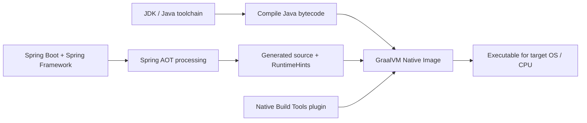

# Choosing a Compatible Version Set Across Spring Boot, Java, GraalVM, and Plugins

## 1. Goal of Choosing a Synchronized Version Set

A Spring Boot application that runs well on the JVM is not guaranteed to build into a GraalVM Native Image. Beyond Java code, the native build process also requires **Spring AOT**, the **GraalVM Native Image** compiler, **Maven/Gradle plugins**, and a matching toolchain. Each component has its own release lifecycle and compatibility requirements.

In the **SPRING_BOOT_NATIVE_IMAGE** module, the goal does not stop at producing a binary. We also need to test reflection and resources, package containers, operate the native build, and then compare startup time and memory usage against the JVM build. For a reliable comparison, we must first select and pin a reproducible toolset.

This lesson answers four questions:

1. Which Java and GraalVM versions does the Spring Boot version in use support?
2. Is the JDK used to compile Java compatible with the GraalVM Native Image actually being invoked?
3. Do the Spring Boot Maven/Gradle plugin, GraalVM Native Build Tools, and Maven/Gradle wrapper work together?
4. Are the toolsets on developer machines, CI, and the container environment targeting the same operating system, architecture, and Java major version?

**Key principle:** compatibility cannot be determined simply by seeing each tool run `--version`. You must cross-check constraints **across tools**, run a test build, and test the native binary.

## 2. Four Version Layers and Each Layer's Responsibilities

| Component | Role in Native Image | What to Check |
|---|---|---|
| **Spring Boot** and Spring Framework | Provides application infrastructure, AOT processing, and runtime hints for Spring configuration | Java requirements, documented supported GraalVM/Native Build Tools versions, native support of starters and dependencies |
| **Java/JDK** | Compiles application bytecode, provides Java APIs and toolchain | Java major version, bytecode target level, `JAVA_HOME`, Maven/Gradle toolchain configuration |
| **GraalVM for JDK ...** | Contains `native-image` to analyze and compile the application into a native binary | GraalVM version, bundled **JDK major**, operating system/architecture support |
| **Build plugins and build tool** | Triggers Spring AOT, invokes Native Image, manages dependencies and build lifecycle | Spring Boot plugin, GraalVM Native Build Tools plugin, Maven or Gradle wrapper, required profiles/tasks |

Typical flow:



The diagram only illustrates the key inputs. In an actual build, Spring AOT, Java compilation, resource processing, reachability analysis, and native compilation are orchestrated into multiple interdependent tasks or goals.

### Easily Confused Version Pairs

- **Spring Boot and Java:** Spring Boot specifies a **minimum Java** requirement, and each release's documentation lists supported Java versions. The ability to run on a newer JVM does not automatically prove that Native Image supports that combination.
- **Java and GraalVM:** "GraalVM for JDK 21" provides a toolchain based on JDK 21. It differs from "GraalVM for JDK 17". If an application is compiled to Java 21 bytecode, that bytecode cannot be fed as-is into a processor that only supports Java 17 class files.
- **Spring Boot plugin and GraalVM Native Build Tools plugin:** These are two plugins with different responsibilities and **do not need the same version number**. The Spring Boot plugin typically follows the Spring Boot release; Native Build Tools has an independent version series.
- **Build tool and plugins:** A newer Gradle plugin may require a newer Gradle wrapper. Likewise, Maven or Maven plugin versions have their own support thresholds.
- **Build host and runtime:** A native executable targets a specific OS, CPU architecture, and system libraries. Choosing the right Java/GraalVM alone is not enough to guarantee that a Linux binary will run on Windows or vice versa.

## 3. Start with the Spring Boot Version, Then Lock the Java Major

### 3.1. Choose a Maintained Spring Boot Line

For a new project, choose a still-supported Spring Boot line and **the latest patch appropriate for your project policy**. Then read the *System Requirements* and *GraalVM Native Image Support* documentation corresponding to **that exact line/release**; do not use documentation from another major version to infer compatibility.

Key milestones to recognize:

- **Spring Boot 2.x:** the older Native Image system previously used Spring Native with different mechanisms/integrations. Do not mechanically apply AOT syntax and guides from Spring Boot 3.x/4.x to these projects.
- **Spring Boot 3.x:** Spring AOT and GraalVM Native Image support are part of the Spring Boot ecosystem. The 3.x line requires Java 17 or higher, while the maximum supported Java version depends on the specific release.
- **Spring Boot 4.x and future lines:** continue to verify the specific release's support conditions. Do not conclude from an earlier version's compatibility that a later version is guaranteed to work with your current plugin or GraalVM.

Distinguish between **happens to run** (a JVM build starts successfully by coincidence) and **supported** (a combination confirmed by official documentation and testing).

### 3.2. Choose an LTS Java Supported by the Boot Release

Java 17 and Java 21 are common LTS milestones in Spring Boot 3.x projects. Java 25 is also an LTS milestone, but whether it can be used in a native build depends on the **specific release** of Spring Boot, GraalVM, and plugins. A common choice for projects running Java 21 is to use **GraalVM for JDK 21** and standardize on Java 21 bytecode target.

There is no need to upgrade Java just to use Native Image if your current version set is already supported. Conversely, you should not lock Java to a version so old that you cannot use the required Spring Boot line or plugins.

### 3.3. Lock GraalVM by Java Major and Supported Release

For example, if you lock on Java 21, find a GraalVM for JDK 21 release supported by the Spring Boot and GraalVM Native Build Tools documentation for that release set. Do not arbitrarily pick a "latest GraalVM" when it comes with a different Java major.

You should also check:

- The JDK version in `java -version` and in `native-image --version`.
- Whether Native Image is installed/included and present on `PATH`.
- Whether the GraalVM architecture matches the build machine (for example, Linux x86_64 vs. Linux AArch64).
- The native compiler and system libraries required by GraalVM on that OS.
- Whether application libraries use JNI, native libraries, or features unsupported in an image.

A matching GraalVM JDK **does not mean** every Java application on that major version is automatically supported; reflection, resources, proxies, and class initialization still have to be evaluated at the application level.

## 4. Build a Selection Matrix Before Configuring the Project

The following matrix is a **way to record decisions**, not an official support certification matrix or a recommendation of the latest versions as of today:

| Scenario | Spring Boot | Java Target | GraalVM | Native Build Tools | Initial Assessment |
|---|---|---|---|---|---|
| A. Existing Boot 3.x project running Java 21 | 3.x, verified patch | 21 | Supported GraalVM **for JDK 21** | Plugin version confirmed by Boot and NBT docs | **Reasonable candidate**; must verify specific release |
| B. Boot 3.x project running Java 17 | 3.x supporting Java 17 | 17 | Supported GraalVM **for JDK 17** | Compatible plugin version | **Reasonable candidate**; do not infer that every 3.x release supports every GraalVM release |
| C. Java 21 bytecode, native-image based on JDK 17 | Any line | 21 | GraalVM **for JDK 17** | Any | **Major mismatch**; Java 21 bytecode cannot be processed as Java 17 |
| D. Plugin taken from another Boot release guide | Any | Valid | Valid | Unverified | **Insufficient basis**; must cross-check plugin and wrapper |
| E. Build Linux binary to run directly on Windows | Suitable | Suitable | GraalVM for Linux | Suitable | **Incompatible runtime platform** unless built for the right target |

A **complete version set** should be recorded as a reproducible configuration specification:

```text
Spring Boot release:           <exact release and patch>
Java language/bytecode:        <major, e.g., 21>
GraalVM distribution:          <distribution name + release + JDK major>
Spring Boot Maven/Gradle plugin: <version matching Spring Boot release>
GraalVM Native Build Tools:    <verified plugin version>
Maven/Gradle wrapper:          <version supported by the plugins>
Build OS / CPU / libc:         <e.g., Linux x86_64 / glibc>
Runtime OS / CPU / libc:       <target compatible with the build>
Container builder/run image:   <image with pinned tag/digest and Java config>
```

Values in angle brackets `<...>` are placeholders to fill in after checking documentation, **not** copy-paste runnable configuration. Recording this is helpful when comparing native/JVM results or reproducing failures on CI.

## 5. Low-Error Version Selection Process

Follow these steps in order:

1. **Identify product constraints:** which Spring Boot version the app currently runs, which dependencies cannot be upgraded, which OS/CPU it will deploy to, and whether Java LTS or long-term support is required.
2. **Read the version requirements of the target Spring Boot:** check minimum/maximum Java and the Native Image documentation of the same release. If upgrading Boot major, account for Spring Framework and starter changes.
3. **Choose the Java major:** based on the current system, dependencies, Boot release, and maintenance window.
4. **Choose GraalVM for the same JDK major:** cross-check the GraalVM guide referenced by the Boot release and OS/architecture support.
5. **Choose plugins and wrapper:** Spring Boot plugin matching Boot version; Native Build Tools at a compatible version; Maven/Gradle wrapper supported by both plugins.
6. **Lock versions in repo/CI:** wrapper, plugin versions, Java toolchain, GraalVM distribution/container image, and buildpack image if applicable.
7. **Run verification:** JVM build/tests, AOT/native build, and direct testing of the binary; check `--version` output in the exact build environment.
8. **Record the verified version set:** when upgrading any component, rerun native tests instead of assuming the remaining components remain automatically compatible.

If a conflict occurs, change only one configuration variable per iteration (such as GraalVM release or plugin) so you know exactly which change resolves the error.

## 6. Maven Example: Coordinating Spring Boot, JDK, and GraalVM

For Spring Boot projects using `spring-boot-starter-parent`, Spring Boot manages many dependency versions and pre-integrates required build configurations. Here is a minimal configuration showing where versions are locked:

```xml
<project xmlns="http://maven.apache.org/POM/4.0.0"
         xmlns:xsi="http://www.w3.org/2001/XMLSchema-instance"
         xsi:schemaLocation="http://maven.apache.org/POM/4.0.0
             https://maven.apache.org/xsd/maven-4.0.0.xsd">
    <modelVersion>4.0.0</modelVersion>

    <parent>
        <groupId>org.springframework.boot</groupId>
        <artifactId>spring-boot-starter-parent</artifactId>
        <version>3.5.0</version>
        <relativePath/>
    </parent>

    <groupId>com.example</groupId>
    <artifactId>native-demo</artifactId>
    <version>0.0.1-SNAPSHOT</version>

    <properties>
        <java.version>21</java.version>
    </properties>

    <dependencies>
        <dependency>
            <groupId>org.springframework.boot</groupId>
            <artifactId>spring-boot-starter-web</artifactId>
        </dependency>
    </dependencies>

    <build>
        <plugins>
            <plugin>
                <groupId>org.springframework.boot</groupId>
                <artifactId>spring-boot-maven-plugin</artifactId>
            </plugin>
        </plugins>
    </build>
</project>
```

**Example explanation:** `3.5.0` only illustrates how to declare **a specific Spring Boot 3.x release**; it does not imply it is the recommended patch for current deployment. Before real-world use, replace it with a still-supported patch and re-verify matching GraalVM/Native Build Tools. `<java.version>21</java.version>` controls the Java target; it **does not install** GraalVM and **does not change** the actual JDK Maven uses.

Verify the environment:

```bash
java -version
native-image --version
./mvnw -version
./mvnw test
```

For projects using `spring-boot-starter-parent` and the native profile provided by that Boot version, the typical build command is:

```bash
./mvnw -Pnative native:compile
```

The `native` profile activates Spring AOT processing and GraalVM Native Image according to that plugin set's integration. If a project **does not inherit** `spring-boot-starter-parent`, uses a custom parent, or uses a different Boot version, inspect `pom.xml`/effective POM to make sure **Spring Boot Maven Plugin**, **GraalVM Native Maven Plugin**, the required AOT goals, and the profile are declared. You cannot assume the `native` profile appears automatically in every POM.

To verify dependencies/plugins resolved by Maven:

```bash
./mvnw help:effective-pom
./mvnw dependency:tree
```

These commands help detect overridden dependencies or plugin versions altered by a parent/project; read the relevant sections rather than treating a long log as a certification of compatibility.

### Easily Overlooked Maven Details

- `<java.version>21</java.version>` does not guarantee `JAVA_HOME` points to GraalVM for JDK 21.
- A properly configured native profile can still fail due to a missing native compiler or insufficient machine resources.
- Dependencies can be managed by the Spring Boot BOM; do not manually upgrade Spring Framework or core libraries outside the Boot-tested dependency set without a reason and verification.
- If CI uses a different Maven/JDK than local, the same source code can produce different results; pin the Maven wrapper and CI toolchain.

## 7. Gradle Example: Plugin Versions and Java Toolchain

With Gradle, both the Spring Boot plugin and the GraalVM Native Build Tools plugin are typically declared:

```kotlin
plugins {
    java
    id("org.springframework.boot") version "3.5.0"
    id("io.spring.dependency-management") version "1.1.7"
    id("org.graalvm.buildtools.native") version "0.10.6"
}

group = "com.example"
version = "0.0.1-SNAPSHOT"

java {
    toolchain {
        languageVersion = JavaLanguageVersion.of(21)
    }
}

repositories {
    mavenCentral()
}

dependencies {
    implementation("org.springframework.boot:spring-boot-starter-web")
    testImplementation("org.springframework.boot:spring-boot-starter-test")
}

tasks.withType<Test> {
    useJUnitPlatform()
}
```

**Example scope:** the version numbers `3.5.0`, `1.1.7`, and `0.10.6` illustrate three **independent** plugin declarations. Before applying them, confirm they belong to a combination documented for your chosen Boot and Native Build Tools releases; in particular, update Spring Boot patches and plugins for bug/security fixes. Do not assume plugins must share the same major/minor version.

After ensuring a compatible Gradle wrapper and configuring the toolchain to point to the actual **GraalVM JDK 21**, verify:

```bash
java -version
native-image --version
./gradlew --version
./gradlew -q javaToolchains
./gradlew test
./gradlew nativeCompile
```

`java.toolchain.languageVersion = 21` requests **a** JDK 21, but a machine with multiple JDK 21 installations may still cause Gradle to select a regular JDK 21 instead of GraalVM JDK 21. Check the toolchain list detected by Gradle, `JAVA_HOME`, and the `nativeCompile` log to confirm the Native Image tool selected. For complex setups, you can also declare `vendor`/`implementation` criteria as supported by that version of Gradle and Native Build Tools.

**Do not confuse:** the **Gradle wrapper** version (`gradle-wrapper.properties`) is different from the **Spring Boot Gradle plugin** version and the **GraalVM Native Build Tools Gradle plugin** version. All three must be verified.

## 8. Checking the Actual Toolchain Locally and in CI

### 8.1. Linux/macOS

```bash
echo "$JAVA_HOME"
java -version
javac -version
native-image --version
./mvnw -version
./gradlew --version
```

If the project uses Maven, Gradle is not required, and vice versa. These commands cross-check the **tool JDK** against the **JDK the build tool launches**, rather than just checking folder names.

One way to select a toolchain in a shell session:

```bash
export JAVA_HOME="/path/to/graalvm-jdk-21"
export PATH="$JAVA_HOME/bin:$PATH"

java -version
native-image --version
```

Replace `/path/to/graalvm-jdk-21` with the actual GraalVM installation directory. Some GraalVM distributions bundle `native-image`, while some distributions/older versions require a separate component install step; check the exact instructions for the distribution you use.

### 8.2. Windows PowerShell

```powershell
$env:JAVA_HOME = "C:\path\to\graalvm-jdk-21"
$env:Path = "$env:JAVA_HOME\bin;$env:Path"

java -version
native-image --version
.\mvnw.cmd -version
.\gradlew.bat --version
```

Native Image on Windows also requires suitable C/C++ tools per GraalVM's Windows documentation, typically the Microsoft Visual C++/Windows SDK environment. Setting `JAVA_HOME` does not automatically install those compilers.

### 8.3. Native Tools on the Operating System

| Build OS | Components Typically Needing Verification | Things to Remember |
|---|---|---|
| Linux | C toolchain, linker, C library, and development libraries required by the GraalVM release | Binaries depend on ABI, architecture, and link type; `glibc` and `musl` are not identical |
| macOS | Xcode Command Line Tools/Clang and appropriate SDK | macOS binaries do not run directly like Linux binaries |
| Windows | Native C/C++ toolchain, SDK, and shell supported by GraalVM | Do not use a Windows binary to deploy directly on Linux |
| Container build | Builder image containing toolchain for target OS/CPU | Toolchain inside the container may differ from GraalVM installed on the host |

The native compile environment consumes significantly more resources than regular Java compilation. Required memory and disk space depend on dependency count, optimization level, and build configuration; do not set a single fixed threshold for every project.

## 9. Containers and Buildpacks: Host JDK Is Not Necessarily Builder JDK

Spring Boot can build container images using Cloud Native Buildpacks via `spring-boot:build-image` or `bootBuildImage`. In that case, the **builder image** has its own buildpacks and JDK/Native Image selection mechanism. Running `java -version` on the host **is not enough** to prove the builder uses the same Java major.

For example, with Paketo buildpacks that support the corresponding environment variables, the desired configuration may be:

```text
BP_JVM_VERSION=21
BP_NATIVE_IMAGE=true
```

These are variable names specific to the buildpack ecosystem that supports them, **not a universal contract across all builders**. Verify builder documentation and actual build logs. Depending on the Spring Boot version and native profile configuration, how variables are passed to Maven/Gradle differs. Also verify that the run image fits the binary and required native libraries.

A container checklist should include:

- Are the builder and run image selected/pinned with an appropriate version or digest?
- Does the builder use the chosen Java major and a supported GraalVM Native Image?
- Do the image platform (Linux x86_64/arm64), libc, and system libraries match the deployment target?
- Does the image actually contain a **native executable**, rather than a JAR running on a JVM?
- Are container startup tests and endpoint probes executed after building?

If using a custom multi-stage Dockerfile, explicitly specify a build stage with the matching GraalVM for JDK and a target stage that satisfies system dependencies and build platform. Do not assume native tools cross-compile across operating systems/architectures by default.

## 10. Symptoms of an Incompatible Version Set

| Symptom | First Cause to Check | How to Verify/Resolve |
|---|---|---|
| `Unsupported class file major version` or bytecode read error | Java toolchain, target bytecode, and GraalVM JDK major differ | Check `javac -version`, `java -version`, `native-image --version`, verify `--release`/toolchain |
| `native-image` not found | `JAVA_HOME`/`PATH` points to another JDK, or distribution lacks the component | Check executable path and the distribution's Native Image install instructions |
| Gradle reports incompatible plugin | Wrapper is too old/new for plugin, or plugin repository is missing | Cross-check requirements of Spring Boot Gradle plugin, Native Build Tools, and wrapper |
| Maven does not recognize `native:compile` or native profile is missing | Native plugin/profile is absent from effective POM | Check parent, plugin goals/profile; configure per the exact release docs |
| AOT task fails due to changed API | Spring Framework, Boot, AOT plugin, or related library overridden to mismatched version | Inspect dependency tree/lockfile, restore Boot-managed dependency set |
| C linker, header, or system library error | Native compiler/SDK/linker missing or build image mismatches platform | Verify OS prerequisites, C/C++ tools, glibc/musl, and target architecture |
| Native build succeeds, but a runtime branch fails on reflection/resource | Runtime hints or dependency compatibility incomplete | Invoke the failing branch, inspect stack trace, add appropriate `RuntimeHints` |
| Native runs locally, fails in container | ABI, architecture, libc, dynamic library, or run image mismatch | Verify target platform and runtime libraries of the container |
| JVM tests pass, native tests fail | Differences in AOT, class initialization, dynamic features, or runtime config | Run tests directly against the native binary; separate app logic bugs from toolchain bugs |

**Bytecode example:** Java 17 produces class-file major `61` and Java 21 produces major `65`. If Native Image is based on an older JDK that does not support newer Java bytecode, a version error can occur during build. However, exact messages vary by toolchain; rely on actual logs.

Failures caused by missing reflection/resources can manifest **after** the native build succeeds. Therefore, do not blame every Native Image failure on "wrong plugin version."

## 11. Verification Process for a Selected Version Set

A minimal process for a `/hello` or `/greet` demo application:

### Step 1: verify requirements using official documentation

Look up the same release milestone across sources:

- **Spring Boot Reference Documentation:** *System Requirements*, *GraalVM Native Image Support*, Maven and Gradle guides.
- **GraalVM Native Image Documentation:** supported JDK versions, OS prerequisites, class initialization, reachability metadata, and Native Image options.
- **GraalVM Native Build Tools:** requirements, Maven/Gradle plugins, Gradle compatibility, and release notes.
- **Maven/Gradle documentation:** compatibility of the wrapper with the JDK and plugins used.

Record the release and verification date in technical/CI docs. Do not use a "current" doc page from another version to draw conclusions for a project pinned to an older release.

### Step 2: build/test JVM first

```bash
# Choose the tool used in the repo:
./mvnw clean verify
# or
./gradlew clean test bootJar
```

This step confirms bytecode, dependencies, and common logic. If the JVM build fails, do not analyze native errors yet.

### Step 3: build/test native

```bash
# Maven with a verified native profile:
./mvnw -Pnative native:compile

# Or Gradle with Native Build Tools configured:
./gradlew nativeCompile
```

Maven/Gradle must use the **selected GraalVM toolchain**, not merely a coincidentally matching Java major. Plugin documentation specifies when toolchain detection or environment configuration must be enabled.

### Step 4: run the binary and test characteristic features

Run the generated native executable on a compatible platform. Verify:

- HTTP endpoints and request/response handling.
- JSON binding, reflection, resources (such as templates on the classpath).
- Proxies, transactions, security, serialization if used by the application.
- Profiles and runtime environment variables; do not assume every runtime configuration value was present during AOT processing.
- Startup, RSS/memory, and realistic load using the same measurement method when comparing against the JVM build.

An error that only appears on a resource-reading branch indicates you should check resource hints; do not rush to swap out all of GraalVM when the base build already succeeded.

### Step 5: pin the build set for reproducibility

Commit the Maven/Gradle wrapper, lock plugin versions, declare the Java toolchain, and standardize the GraalVM distribution in CI. For containers, pin appropriate builder/run images. Record artifact details including Spring Boot release, Java major, GraalVM Native Image version, plugin versions, target OS/architecture, and build command.

Even **patch upgrades** within the same major can change optimizations, metadata, or behavior. For changes affecting native builds, rebuild and re-run real tests.

## 12. Practice: Choosing a Version Set for Three Scenarios

### Scenario A — Existing Spring Boot 3.x App Running Java 21

The team wants to build native using Maven. They are unsure whether to install GraalVM for JDK 17 or 21.

**How to choose:** keep Java 21 as the target; find GraalVM **for JDK 21** and a Native Build Tools release matching the **specific Boot release**. Lock verified versions and run `./mvnw -Pnative native:compile` on a Maven setup with the native profile. Do not pick GraalVM for JDK 17 just because that tool happens to be pre-installed.

### Scenario B — CI Builds on Linux, Deployed to ARM64 Kubernetes Nodes

Developer laptops run macOS x86_64; CI currently produces Linux x86_64 binaries and puts them directly into an ARM64 image.

**How to choose:** decide the **final deployment platform** first. Set up a builder/CI capable of building for Linux ARM64 with GraalVM and native tools supporting that architecture; pick matching container images and runtime dependencies. Do not expect a laptop binary or Linux x86_64 binary to run natively on ARM64.

### Scenario C — Project Changes Spring Boot Major While Keeping an Old Gradle Wrapper

The JVM build might still run, but native AOT tasks or new plugins fail to load.

**How to choose:** read the requirements of the **Spring Boot Gradle plugin** and **GraalVM Native Build Tools plugin** for the new Boot major; update the wrapper and JDK/GraalVM if required by the release. Check dependency overrides and rebuild JVM before native. Checking Java major alone is not enough.

## 13. Self-Check Questions

**Question 1.** If `java -version` prints Java 21 but `native-image --version` reports GraalVM based on JDK 17, is the toolset synchronized?

*Answer:* No. You must identify which executable is being invoked and update `JAVA_HOME`/`PATH` or the toolchain so Native Image matches the bytecode and selected release.

**Question 2.** Does a `3.x` Spring Boot plugin require the Native Build Tools plugin to also carry version `3.x`?

*Answer:* No. The two plugins are released and versioned independently. Cross-check each plugin's compatibility/requirements instead of matching identical version numbers.

**Question 3.** Is installing the right GraalVM on the host enough to guarantee `bootBuildImage` builds the native image with the same toolchain?

*Answer:* No. The builder may contain its own toolchain; you must inspect the build logs and buildpack configuration to verify Java/GraalVM inside the builder.

**Question 4.** Does a native executable running successfully with the `/greet` endpoint prove all reflection/resource branches work?

*Answer:* No. You must exercise business branches and test the native build directly, because missing metadata may only surface at runtime.

## Conclusion

Choosing a version set for Spring Boot Native Image is a **multi-layered linked** decision: Spring Boot and Spring Framework release, Java target/JDK, corresponding GraalVM for JDK, Native Build Tools plugin, Maven/Gradle wrapper, and build OS/architecture. An effective approach is to lock the Boot release, cross-check support docs, choose one consistent Java major, pin the tools in reproducible configuration, and verify with a **native build and direct tests on the binary**. Once a stable foundation is established, evaluating startup performance, memory, compatibility, reflection/resources, and container packaging becomes meaningful.
