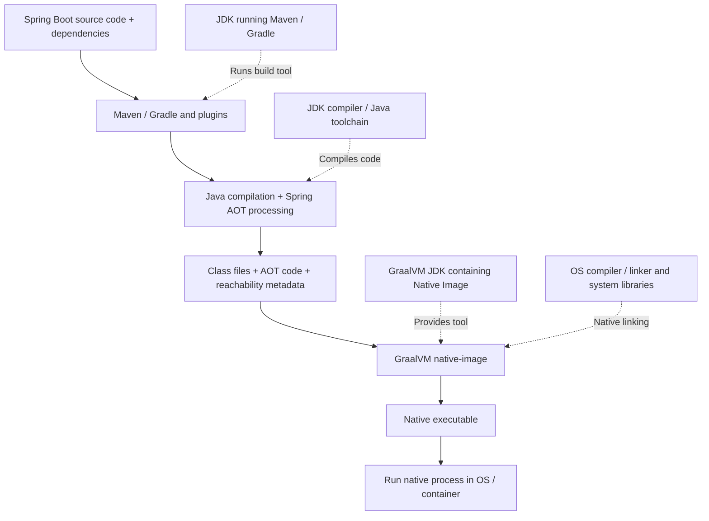

# Distinguishing GraalVM JDK, `native-image`, and the JDK Used to Run Gradle or Maven

When turning a Spring Boot application into a **GraalVM Native Image**, a common misconception is that installing GraalVM automatically means Gradle/Maven runs on GraalVM, or that a matching `java -version` guarantees `native-image` will use the right JDK. In reality, these are **distinct roles** within the build system.

In the **Build Environment** chapter of the **`SPRING_BOOT_NATIVE_IMAGE`** module, we will identify each component, locate where it is selected, verify it with real commands, and establish a reproducible build environment on developer machines, CI, and containers. Correctly distinguishing these three components is a prerequisite for running Spring AOT, building with Maven/Gradle, configuring reflection/resources, testing compatibility, and evaluating startup time alongside memory usage of the native build.

## 1. Learning Objectives

After this lesson, you will be able to:

1. Explain how **GraalVM JDK** differs from the **`native-image`** command and from the **JDK used by Maven or Gradle**.
2. Distinguish the JDK running the build tool, the JDK compiling Java via a *toolchain*, and the JDK containing the Native Image tool.
3. Determine exact tool versions and paths on Linux/macOS/Windows, even when `JAVA_HOME`, `PATH`, and the IDE point to different JDKs.
4. Choose a simple configuration for beginners and recognize when separating JDKs in CI is necessary.
5. Isolate build errors caused by picking the wrong JDK, missing `native-image`, or missing the operating system's C/C++ toolchain.

## 2. The Three Most Important Concepts

### 2.1. GraalVM JDK: a Java Development Kit

**GraalVM JDK** is a JDK distribution containing familiar Java tools such as `java`, `javac`, and core libraries, while also providing integration with the GraalVM ecosystem. Depending on the version and distribution, the installer may already bundle Native Image or require installing the corresponding component separately.

Because it is a JDK, GraalVM JDK can still:

- Run Java programs on the JVM via `java -jar app.jar`.
- Run Maven or Gradle, if the build tool selects this JDK.
- Compile Java code using `javac`, when build tools choose it as the compiler/toolchain.
- Provide the environment and tools needed to use **Native Image**, once that component is installed.

**Key takeaway:** using GraalVM JDK to run Java **is not the same as** creating a native executable. The `java -jar app.jar` command still runs the application on the JVM; producing a standalone machine binary independent of a standard JVM requires the Native Image compilation step.

### 2.2. `native-image`: the Tool That Creates Native Executables

**`native-image`** is a command-line program in the GraalVM Native Image ecosystem. It processes the classpath/module path, analyzes code and reachability, performs ahead-of-time (AOT) compilation, and links a native executable for the supported target operating system/architecture.

Its inputs are typically compiled Java classes and metadata required for reflection, proxies, resources, or JNI; its output is typically a **native executable**, such as `my-app` on Linux or `my-app.exe` on Windows.

With Spring Boot, the build plugin invokes `native-image` within a workflow that includes Spring AOT processing and metadata preparation. Developers usually trigger it via Maven's `native:compile` or Gradle's `nativeCompile` rather than passing every `native-image` flag manually.

Notes:

- `native-image` is **not** a second JDK independent of GraalVM JDK.
- Finding the `native-image` command on `PATH` does not prove Maven/Gradle is using the right GraalVM.
- `native-image` requires appropriate operating system tools, usually including a C/C++ compiler/linker and system libraries; installing the JDK alone does not guarantee all build prerequisites are met.
- The built native executable can run **without installing a full JVM** on the target machine, though it still needs an operating system environment and native libraries compatible with how it was built.

### 2.3. The JDK Used to Run Maven or Gradle: the Build Tool's JVM

Maven and Gradle are applications that run on the JVM. To launch the build tool, the machine needs a Java runtime compatible with the **Maven/Gradle and plugin versions**.

This JDK can be:

- GraalVM JDK, such as a GraalVM JDK 21.
- A standard JDK such as Eclipse Temurin, Oracle JDK, or another compatible distribution.
- A JDK chosen by the IDE/CI, which may differ from the JDK in an open terminal.

With **Maven**, `mvn -version` or `./mvnw -version` shows which Java is running Maven for that invocation. With **Gradle**, the launcher and daemon may use separate JVM configurations; verify via `./gradlew --version`, daemon settings, and build logs. Gradle can select JDKs for the **daemon**, **compiler**, and **Native Image toolchain** via different mechanisms.

**Do not conflate the JDK running the build tool with the JDK compiling the source.** Maven Toolchains or Gradle Java Toolchains can designate a different JDK for compiling or running specific tasks, even while Maven/Gradle continues operating in its initial JVM.

## 3. Quick Comparison Table

| Component | Nature | Primary Job | How to Identify |
|---|---|---|---|
| **GraalVM JDK** | JDK distribution | Provides Java runtime, compiler, and GraalVM platform | Check `java` inside the GraalVM directory and `java -version` |
| **`native-image`** | GraalVM CLI tool | Compiles Java classes into a native program | `native-image --version`, executable path |
| **JDK running Maven** | Java runtime of the Maven process | Runs Maven lifecycle, plugins, and tasks | `mvn -version` or `./mvnw -version` |
| **JDK running Gradle** | Java runtime of the Gradle launcher/daemon | Runs build scripts, plugins, and Gradle tasks | `gradle --version` or `./gradlew --version`, daemon JVM/logs |
| **JDK compiling Java** | JDK selected via compiler/toolchain | Compiles `*.java` into `*.class` | Compiler config, Gradle Java toolchain/Maven Toolchains |

These are **roles**, not necessarily five separate installations. One suitable **GraalVM JDK** can simultaneously serve all JDK roles, with the `native-image` tool residing in the same installation. Conversely, a complex pipeline might run Gradle on a standard JDK while using a separate GraalVM JDK to compile native.

## 4. Flow of a Spring Boot Native Image Build



The diagram shows **logical responsibilities**, not an implication that every box always uses a separate process or separate JDK. How Maven/Gradle locates the native tool depends on the chosen plugin and configuration. Spring AOT steps can run inside the build's JVM, while the final binary is not a regular JAR file.

### Example of a Multi-JDK Environment

Suppose a CI machine has:

```text
/opt/jdks/temurin-21/       JDK A: runs the Gradle daemon
/opt/jdks/graalvm-jdk-21/   JDK B: contains native-image
```

Gradle can run using **JDK A** and still compile native using `native-image` from **JDK B**, *if* the build plugin is configured to select JDK B. Simply having both JDKs installed on the machine does not mean the build will automatically pick the right one.

A simpler setup for a new project is to use **the same GraalVM JDK** as both the JDK running Maven/Gradle and the JDK containing `native-image`; this reduces the number of environment variables to coordinate. When separating JDKs is genuinely necessary, verify each path independently.

## 5. Four Common Variants

| Scenario | Maven/Gradle Runs With | Native Build Tool | Key Takeaway |
|---|---|---|---|
| A. One JDK for the whole pipeline | GraalVM JDK | `native-image` in the same GraalVM installation | Easy to set up and troubleshoot initially |
| B. Standard JDK runs build, GraalVM builds native | Temurin/Oracle JDK | `native-image` belonging to a separate GraalVM JDK | Must configure toolchain or tool path explicitly |
| C. IDE and terminal differ | IDE picks JDK X, terminal picks JDK Y | May vary by where the build runs | Build results can differ despite the same repository |
| D. Build via Cloud Native Buildpacks | Host JDK runs Maven/Gradle to drive the build | JDK/Native Image inside the builder image environment | Host GraalVM may not be needed, depending on the build path |

Scenario D is especially noteworthy when packaging containers: Maven's `spring-boot:build-image` or Gradle's `bootBuildImage` can use a **buildpack builder** with its own toolchain inside the container. In that case, `native-image --version` on the host machine is not evidence of the Native Image version used **inside the builder**. Check the builder configuration and image build logs.

## 6. Checking the Right JDK and Native Image on Your Machine

### 6.1. Linux/macOS

Run in the terminal you intend to use for the build:

```bash
echo "JAVA_HOME=$JAVA_HOME"
command -v java
command -v javac
command -v native-image
java -version
javac -version
native-image --version
```

Check the **Maven Wrapper** or **Gradle Wrapper** depending on the project:

```bash
./mvnw -version
# Or, for a Gradle project:
./gradlew --version
```

If not using a Wrapper, substitute `mvn -version` or `gradle --version`. The Wrapper pins the **build tool version** matching the project, but **does not automatically pin the JDK that the build tool uses**.

### 6.2. Windows PowerShell

```powershell
$env:JAVA_HOME
Get-Command java, javac, native-image | Select-Object Name, Source
java -version
javac -version
native-image --version

# Maven project:
.\mvnw.cmd -version

# Or Gradle project:
.\gradlew.bat --version
```

If `native-image` is not found, PowerShell may raise `CommandNotFoundException`. In that case, check the installed GraalVM distribution, the presence of the executable in the `bin` directory, and how `PATH` is configured.

### 6.3. Interpreting the Output Accurately

Suppose the output shows:

```text
java -version          -> Eclipse Temurin 21
./mvnw -version        -> Java version: 21, vendor: GraalVM
native-image --version -> GraalVM Native Image 21
```

This is **not self-contradictory**: the `java` command on `PATH` may be Temurin, while the Maven Wrapper launches via `JAVA_HOME` pointing to GraalVM. Meanwhile, `native-image` is an executable resolved from another entry on `PATH`. To conclude which exact tools the build uses, inspect the **actual paths** and native task logs, not just the `21` numbers.

Another scenario:

```text
java -version          -> GraalVM JDK 21
native-image --version -> command not found
```

This can happen because Native Image is not installed in the distribution being used, or because the executable is not yet on `PATH`. On some older GraalVM generations, the Native Image component was installed via `gu`; in other releases, the executable is pre-bundled. **Do not assume `gu install native-image` is always available or applies to every GraalVM release.** Follow the installation instructions for your exact JDK version and vendor.

## 7. Hands-On Configuration: Using One GraalVM JDK for Local Builds

To start smoothly, use a GraalVM JDK whose Java version is compatible with the Spring Boot project and includes Native Image. The examples below assume the project uses **Java 21**; if your project uses a different Java version, substitute the appropriate version instead of hardcoding `21`.

### 7.1. Linux/macOS

```bash
# Replace with the actual GraalVM JDK path.
export JAVA_HOME=/opt/jdks/graalvm-jdk-21
export PATH="$JAVA_HOME/bin:$PATH"

java -version
javac -version
native-image --version
./mvnw -version
```

For Gradle, replace the last line with `./gradlew --version`. Prepending `$JAVA_HOME/bin` to `PATH` ensures Java and Native Image commands in the terminal prioritize the selected JDK.

Run the **Maven** build if the project has the Spring Boot/Maven Native profile and compatible Native Build Tools plugin configured:

```bash
./mvnw -Pnative native:compile
```

Run the **Gradle** build if the project applies the `org.graalvm.buildtools.native` plugin:

```bash
./gradlew nativeCompile
```

These two commands are **two options depending on project type**, not two sequential steps to run on the same repository. The output binary path depends on the plugin, project name, and configuration.

### 7.2. Windows PowerShell

```powershell
# Replace with the GraalVM JDK path installed on your machine.
$env:JAVA_HOME = 'C:\jdks\graalvm-jdk-21'
$env:PATH = "$env:JAVA_HOME\bin;$env:PATH"

java -version
native-image --version
.\mvnw.cmd -version
```

Or for a Gradle project:

```powershell
.\gradlew.bat --version
.\gradlew.bat nativeCompile
```

For Maven:

```powershell
.\mvnw.cmd -Pnative native:compile
```

On Windows, Native Image also requires a **compatible native compiler toolchain**, typically the C/C++ components and Windows SDK from Visual Studio Build Tools. Depending on your GraalVM version and system setup, you may need to run inside a terminal environment that has that toolchain loaded. A successful `java -version` does not prove the linker is ready.

**Scope caution:** setting environment variables as above applies only to the **current terminal**. Opening another terminal, running builds from an IDE, or running in CI can result in a different JDK selection.

## 8. How Does Gradle Have Multiple "JDKs"?

Gradle separates the **JVM executing Gradle** from **Java Toolchains** used for tasks like compile and test. The GraalVM Native Build Tools plugin also has mechanisms to detect or select the Native Image tool.

Example of a Java/Groovy DSL project using Java 21:

```groovy
java {
    toolchain {
        languageVersion = JavaLanguageVersion.of(21)
    }
}

graalvmNative {
    toolchainDetection = true
}
```

In this example, the `java.toolchain` block states that Java tasks require Java 21 tools. `toolchainDetection` instructs the GraalVM Native Build Tools plugin to perform its toolchain detection mechanism. **Declaring `languageVersion = 21` alone does not guarantee Gradle picked a GraalVM distribution**, because a machine can have multiple JDKs of the same Java version installed. You must verify which JDK is detected and which Native Image executable is actually invoked. Detection syntax and behavior depend on plugin version.

If you need to explicitly require the **GraalVM vendor** for the Java toolchain in a Gradle version that supports this vendor filter, you can write:

```groovy
java {
    toolchain {
        languageVersion = JavaLanguageVersion.of(21)
        vendor = JvmVendorSpec.GRAAL_VM
    }
}
```

This is a **JDK selection constraint**, not a command to download GraalVM or install `native-image`. Gradle must be able to find the matching JDK through discovery directories or a configured **toolchain resolver**; otherwise, toolchain selection may fail.

### Three Places to Check When Gradle Picks the Wrong Java

1. **JVM running the Gradle daemon:** `JAVA_HOME`, IDE Gradle JVM setting, `org.gradle.java.home`, daemon JVM configuration matching the Gradle version.
2. **JDK serving Java Toolchains:** `java.toolchain` block, list of JDKs discovered by Gradle, and toolchain provisioning source if any.
3. **JDK/Native Image tool:** `graalvmNative` plugin configuration, GraalVM detection capability, and the `native-image` command logged during the build.

When you need to inspect paths and selection reasons, run:

```bash
./gradlew --version
./gradlew javaToolchains
./gradlew nativeCompile --info
```

These commands fit projects with the native plugin installed and the corresponding task available. `javaToolchains` lists installations recognized by Gradle; `--info` shows build task details. If you just changed the JDK for the Gradle daemon and an old daemon is still affecting runs, stop the project's daemon before retrying:

```bash
./gradlew --stop
```

**Do not change the entire system JDK just to fix one Gradle task** if the root cause is Gradle Toolchains or the native plugin picking the wrong executable.

## 9. How Does Maven Select a JDK?

Maven is normally launched via `mvn` or the Maven Wrapper `mvnw` using the Java selected in the process environment. The following command provides more direct information than `java -version` when investigating Maven:

```bash
./mvnw -version
```

Sample output might display:

```text
Apache Maven ...
Java version: 21.x, vendor: GraalVM
Java home: /opt/jdks/graalvm-jdk-21
```

In `pom.xml`, many Spring Boot projects specify:

```xml
<properties>
    <java.version>21</java.version>
    <maven.compiler.release>21</maven.compiler.release>
</properties>
```

These properties declare the **source/bytecode Java level** per compiler configuration; they **do not automatically install GraalVM and do not change the JDK running Maven**. For example, `maven.compiler.release=21` does not turn a JDK 17 into a compiler capable of compiling Java 21.

Maven also has a **Toolchains** mechanism to let certain plugins use a different JDK from the JDK running Maven, if the plugin supports it and it is configured properly. During native compilation, the GraalVM Native Build Tools plugin must locate a **compatible Native Image tool**; how it locates the tool depends on the plugin version and project setup.

For a Spring Boot project configured with a native profile (such as the profile generated by Spring Boot project templates), a common command example is:

```bash
./mvnw -Pnative native:compile
```

If it reports `Unknown lifecycle phase`, goal not found, or plugin not found, check **whether the profile and plugin are declared**; installing GraalVM does not automatically add these entries to `pom.xml`.

To inspect the build in greater detail, you can run:

```bash
./mvnw -version
./mvnw -Pnative native:compile -X
```

The `-X` log is very verbose; use it only when tracing JDK/executable paths, classpath, arguments, or plugin errors. In CI environments, avoid publishing logs containing sensitive configuration information.

## 10. Tool-Running JDK vs. Native-Building JDK: When Is Separating Appropriate?

In larger engineering teams, CI might standardize one JDK to run Gradle/Maven, while Native Image requires a different GraalVM version suited to the plugin and target. This is valid if **every component is configured and verified consistently**.

Example:

```text
CI machine:
  JDK running Gradle:   Temurin 21
  Java toolchain:       GraalVM JDK 21
  Native Image:         GraalVM Native Image 21
  Target:               Linux x86_64
  C/C++ toolchain:      Linux compiler/linker + required libraries
```

In this case, running `java -version` only answers which JDK is on the shell's `PATH`; it does not answer which JDK the Gradle daemon is using or which tool `nativeCompile` invokes. The build log and toolchain mechanism are the final evidence.

### Compatibility Principles

- **Language/bytecode:** the JDK compiling Java must support the project's source/release version.
- **Native Image:** the chosen GraalVM Native Image version must support the application's class-file/library versions as well as requirements from Spring Boot and GraalVM Native Build Tools.
- **Build tool:** the Gradle/Maven version must run on the selected JDK and be compatible with the plugin versions.
- **Native platform:** operating system, CPU architecture, C/C++ toolchain, and linked libraries must match the target binary.

If you compile Java with too new a JDK and pass it to too old a Native Image, you may hit class-file parsing errors, such as an unsupported **class file major version** message. If the JDK running Maven/Gradle is too old, the build may fail before the Native Image task even starts.

**Matching Java versions alone does not guarantee absolute compatibility.** You must cross-check Spring Boot, GraalVM, Gradle/Maven plugin versions, operating system tools, and libraries used in the project.

## 11. Where Is a Native Image Built?

### Direct Local Build on the Machine

With `native:compile` or `nativeCompile`, the Native Image tool is normally invoked in the **environment of the machine running the build**. On Linux it needs the appropriate toolchain and system libraries; on macOS it needs developer tools from Xcode Command Line Tools or equivalent; on Windows it usually needs a compatible Microsoft C/C++ toolchain.

The produced binary targets the **native target platform supported by the toolchain**. Building native directly on Windows and copying `.exe` into a Linux container will not turn it into a Linux binary. You must build in the right environment/target or use an explicitly supported cross-compilation workflow.

### Building with Cloud Native Buildpacks

Spring Boot supports image building via buildpacks, for example with goals/tasks like:

```bash
# Maven, when the project has the corresponding native profile configured:
./mvnw -Pnative spring-boot:build-image

# Gradle, when the build task is configured to enable Native Image in the buildpack:
./gradlew bootBuildImage
```

In this approach, the Java/Native Image components used for the build can **reside inside the builder image**, independent of the host JDK. Do not infer the GraalVM version inside the container solely from `JAVA_HOME` on your laptop. Inspect the builder configuration, buildpack environment (for instance the `BP_NATIVE_IMAGE=true` flag when using a supporting buildpack to enable native), and actual logs.

When running the native build, the runtime image also needs a compatible system library environment. Reflection, resource, and Runtime Hints configurations concern **what Native Image needs to retain inside the application**, and cannot replace installing or selecting the proper JDK/Native Image.

## 12. Repeatable Verification Workflow

When onboarding a new Spring Boot project that needs a native build, follow these steps:

1. **Determine the project's Java version** from build configuration and related Spring Boot/plugin versions. Do not pick GraalVM arbitrarily.
2. **Install a compatible GraalVM JDK** and confirm the `native-image` executable runs; install the linker/compiler tools matching the operating system.
3. **Verify the JDK running Maven/Gradle** via `mvnw -version` or `gradlew --version`, paying attention to the daemon JDK and IDE.
4. **Verify the Java compiler/toolchain**, if the project uses Maven Toolchains or Gradle Java Toolchains.
5. **Confirm the Native Image tool actually invoked by the plugin** via native task logs; do not check `PATH` alone.
6. **Run the native build** using the declared goal/task, then test-run the native executable.
7. **Verify the output**: endpoints, reflection, resources, serialization, and deployment environment; measure startup, memory, and image size under consistent conditions.

### Pre-Escalation Checklist Before Reporting an Issue to Teammates

```text
[ ] Know the exact Java version required by the project
[ ] JDK running Maven/Gradle verified
[ ] Java compiler / toolchain JDK verified (if used)
[ ] Compatible GraalVM JDK version installed
[ ] `native-image --version` works in the native build environment
[ ] Maven/Gradle Native plugin points to the right Native Image
[ ] C/C++ compiler/linker and OS libraries available
[ ] Know whether building directly on host or inside buildpack/container
[ ] Output binary runs on the intended OS/architecture
```

## 13. Diagnosing Common Failures

| Symptom | Possible Cause | How to Check and Fix |
|---|---|---|
| `java -version` shows the right GraalVM, but `native-image` does not exist | Native Image component missing or `PATH` misconfigured | Check GraalVM's `bin` folder and Native Image install steps for that release |
| `mvnw -version` uses a different JDK than `java -version` | `JAVA_HOME`/Wrapper/runtime env picks a different JVM than PATH | Compare `JAVA_HOME`, `Java home` from Maven, and `Get-Command`/`command -v` output |
| Gradle uses a different JDK than the terminal | Daemon JVM, IDE Gradle JVM, `org.gradle.java.home`, or toolchain | Check `gradlew --version`, daemon config, `gradlew javaToolchains`, and `--info` |
| Java compiles cleanly, but the native task uses the wrong GraalVM | Native plugin detects a different toolchain/executable than expected | Inspect native task logs, toolchain/plugin config, and JDK installations |
| `invalid target release` or class file version error | Compiler JDK/Native Image does not support the requested Java level | Cross-check `--release`, compiler JDK version, and Native Image version |
| Native Image reports missing `cl.exe`, linker, compiler, or headers | Missing operating system native toolchain | Install and load the C/C++/SDK toolchain matching the platform |
| Maven does not recognize `native:compile` | Native plugin not declared or wrong profile | Check `pom.xml`, profiles, and plugin versions |
| Native build finishes, but app fails on reflection/resources | Missing reachability metadata or dynamic library usage | Check Spring AOT, Runtime Hints, metadata, and test directly; this is not necessarily a JDK selection bug |

### Two Analysis Scenarios

**Scenario A.** A machine has Temurin 21 and GraalVM JDK 21. `java -version` shows Temurin; `./mvnw -version` shows GraalVM; `native-image --version` works. Do you need to reinstall all JDKs?

No. First check **the paths that Maven and the native plugin are using**. The toolset may already be working properly. If you want to unify local builds, point `JAVA_HOME` and `PATH` to the same GraalVM JDK, then re-verify. Do not reinstall solely because the three commands print different output.

**Scenario B.** The Gradle daemon runs on Temurin 21, while the project's Java toolchain selects GraalVM 21. Can `nativeCompile` succeed?

Yes, provided Gradle/plugins support that version combination and **the native plugin actually selects the right GraalVM Native Image**. The Gradle daemon does not necessarily have to run on GraalVM JDK. If the task fails, investigate the executable/Java toolchain selection logs rather than blaming it solely on the daemon's JDK name.

## 14. Self-Check Questions

**1. Are GraalVM JDK and `native-image` the same thing?**  
No. GraalVM JDK is a **JDK distribution**; `native-image` is a **tool** in the GraalVM ecosystem used to create native executables.

**2. If `java -version` prints GraalVM, does that guarantee Maven/Gradle runs on GraalVM?**  
No. Maven usually follows the environment's Java at startup; Gradle also involves its launcher, daemon, and IDE settings. Check `mvnw -version` or `gradlew --version` and the actual JVM path.

**3. Does setting `maven.compiler.release=21` automatically select GraalVM JDK 21?**  
No. That is a Java level setting for the compiler, not an instruction to select a JDK vendor or install Native Image.

**4. Does the resulting native executable need to be run with `java -jar`?**  
No. It is a native program that runs directly on a compatible platform; it is not a JAR containing bytecode for a JVM to execute.

**5. If `spring-boot:build-image` produces a native container, can we conclude the host machine has GraalVM Native Image properly installed?**  
No. Native Image may run inside the **buildpack builder**, using a different JDK/toolchain from the host.

**6. If GraalVM Native Image is installed successfully but the linker reports an error, is Spring AOT to blame?**  
Not necessarily. This can be an operating system compiler, linker, header, or native library issue; inspect the original error message and linking environment first.

## 15. Takeaways for Real-World Projects

Three independent questions help prevent most environment issues:

- **Who runs the build?** → The JDK/JVM of Maven or Gradle.
- **Who produces the executable?** → The `native-image` tool from GraalVM and the OS native toolchain.
- **Who compiles Java code?** → The compiler JDK chosen by the build, potentially via Java/Maven Toolchains.

You **can** use the same GraalVM JDK for all three JDK roles and Native Image when starting out, or separate them in CI when there is a clear reason. When testing Spring Boot Native Image, always record the exact **build-running JDK version/path, compiler JDK, `native-image` version, linker environment, and container build method**. Only when these components are clearly identified can you fairly evaluate the startup, memory, and compatibility benefits of a native build.
