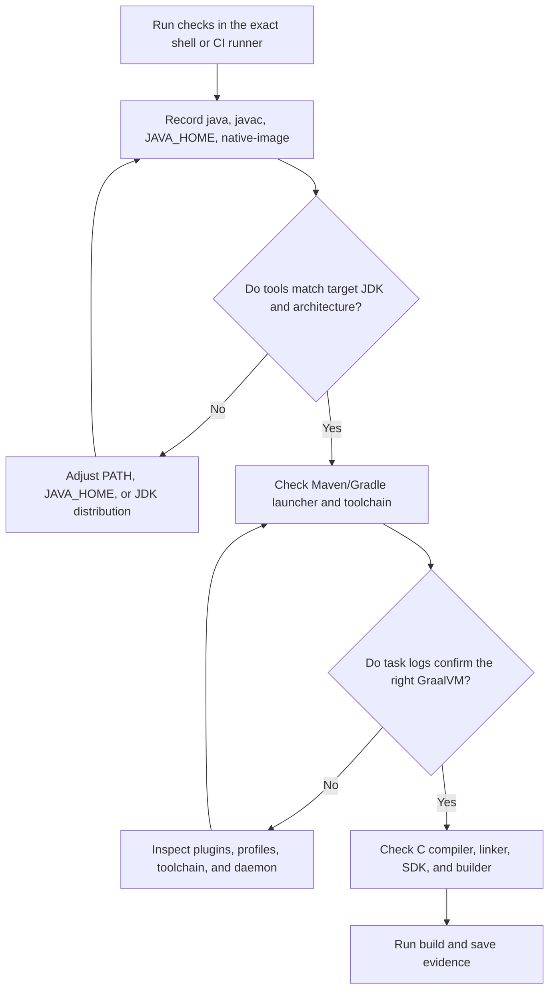

# Checking `java`, `native-image`, `JAVA_HOME`, and the Toolchain Actually Selected

## 1. Why Must You Identify the Exact Tools Before Building?

In the **SPRING_BOOT_NATIVE_IMAGE** module, learners compile a Spring Boot application into a GraalVM Native Image using Spring AOT, test reflection/resources, compare startup time and memory, and package containers for operations. One prerequisite for the entire workflow is **knowing exactly which JDK, Native Image, and OS compiler are being used**.

A development machine can have multiple JDKs installed. When that happens, four pieces of information can differ:

- `java -version` shows the version of the **`java` command found by the shell** via `PATH`.
- `JAVA_HOME` is an **environment variable pointing to a JDK directory**, not necessarily the JDK at the front of `PATH`.
- Maven/Gradle may run on one JVM, while the **Java toolchain used to compile** is a different JDK.
- The Native Image task may pick `native-image` from a different GraalVM installation than the command typed directly, depending on the plugin, configuration, and build method.

Looking only at a single line of `java -version` makes it very easy to wrongly conclude that the native build is using the right GraalVM. This lesson shows how to trace each layer, record evidence, and find the root cause when values disagree.

### Verification Scope

| Execution Layer | What Question Must Be Answered? | Source of Evidence |
| --- | --- | --- |
| Terminal/shell | Which `java`, `javac`, `native-image` command is found first? | Executable path, `PATH`, `--version` output. |
| `JAVA_HOME` | Does the variable point to the right **JDK root** and contain the required binaries? | Variable value and running directly from `JAVA_HOME/bin`. |
| Maven launcher | Which JVM does the Maven wrapper run on? | `./mvnw -version` or `mvn -version`. |
| Maven compiler/native plugin | Which Java toolchain/Native Image does the plugin actually use? | Toolchains/config and plugin execution logs. |
| Gradle launcher/daemon | Which JVM do the Gradle client/daemon run on? | `./gradlew --version`, daemon info. |
| Gradle Java/native toolchain | Which JDK do `compileJava`, AOT, and `nativeCompile` select? | `javaToolchains`, task/plugin config, `--info` logs. |
| OS toolchain | Which C compiler, linker, SDK, and target libraries are used? | `cc`, `clang`, `ld`, MSVC/Windows SDK, linker logs. |
| Buildpack/container | Which builder and architecture does the native build run inside? | Builder, stack/run image, build logs, image metadata. |

**Acceptance standard:** you have path or log evidence for **the actual tool used by the build task**, not just knowledge that the tool exists on the machine.

## 2. Distinguishing `PATH`, `JAVA_HOME`, JDK, and `native-image`

### 2.1. How Does the Shell Resolve Commands?

Suppose a Linux machine has:

```text
JAVA_HOME=/opt/graalvm-jdk-21
PATH=/usr/lib/jvm/temurin-21/bin:/opt/graalvm-jdk-21/bin:...

java         -> /usr/lib/jvm/temurin-21/bin/java
native-image -> /opt/graalvm-jdk-21/bin/native-image
```

This is a **hypothetical example**. `JAVA_HOME` points to GraalVM, yet `java` from the shell is Temurin because the Temurin directory appears earlier in `PATH`. Thus `java -version` can display Temurin, while `native-image --version` shows GraalVM. This can lead to unpredictable results when plugins rely on different tool-selection sources.

`JAVA_HOME` must point to the **JDK root directory**, such as `/opt/graalvm-jdk-21` or `C:\\Java\\graalvm-jdk-21`; do not point it to `bin` itself or the `java` binary. A JDK used for Java builds typically contains `bin/java` and `bin/javac`; a GraalVM JDK used for native builds must be able to run Native Image according to the distribution/installation in use.

To know **which** program runs, inspect the command path, not just the version number. Two JDKs both on Java 21 can still differ in vendor, patch, architecture, or native tooling.

### 2.2. Checking on Linux and macOS (Bash)

Run each command group in the **exact terminal that will be used for the build**:

```bash
# 1. Environment variable value and order of candidate executables
printf 'JAVA_HOME=%s\n' "${JAVA_HOME:-<not-set>}"
type -a java || true
type -a javac || true
type -a native-image || true

# 2. Executables selected via PATH
command -v java
java -version
command -v javac
javac -version

# 3. Executables inside JAVA_HOME (if set)
if [ -n "${JAVA_HOME:-}" ]; then
  "$JAVA_HOME/bin/java" -version
  "$JAVA_HOME/bin/javac" -version
  if [ -x "$JAVA_HOME/bin/native-image" ]; then
    "$JAVA_HOME/bin/native-image" --version
  else
    echo 'JAVA_HOME/bin/native-image is missing or not executable'
  fi
fi

# 4. Native Image found on PATH (if any)
if command -v native-image >/dev/null 2>&1; then
  native-image --version
fi
```

`type -a` reveals multiple same-named executables across `PATH` directories. `command -v` shows where the current shell resolves a command name, though in environments with aliases/functions or wrapper launchers you should continue verifying the final target. On Linux you can inspect symlinks with `ls -l` or `readlink -f` (if available); `readlink -f` is not present by default on all macOS versions.

Extract runtime properties reported by Java itself:

```bash
java -XshowSettings:properties -version 2>&1 \
  | grep -E '^[[:space:]]*(java.home|java.vendor|java.version|os.arch) ='
```

`java.home` is a runtime property reported by the JVM; it is **not the sole verification of the `JAVA_HOME` variable**. Compare the executable path, vendor, version, and architecture as well.

On macOS, the following command lists JDKs recognized by the operating system:

```bash
/usr/libexec/java_home -V
```

This command helps locate installed JDKs, though a list of available JDKs does not prove which one a Maven/Gradle task selects.

### 2.3. Checking on Windows (PowerShell)

PowerShell does not use `which`/`type -a` the same way Bash does. Use:

```powershell
# 1. Environment variable and matching commands
"JAVA_HOME=$env:JAVA_HOME"
Get-Command java -All -ErrorAction SilentlyContinue | Select-Object Name, Source
Get-Command javac -All -ErrorAction SilentlyContinue | Select-Object Name, Source
Get-Command native-image -All -ErrorAction SilentlyContinue | Select-Object Name, Source

# 2. Executables resolved from PATH
where.exe java
where.exe native-image
java -version
javac -version
native-image --version

# 3. Run directly from JAVA_HOME, if present
if ($env:JAVA_HOME) {
  & (Join-Path $env:JAVA_HOME 'bin\java.exe') -version
  & (Join-Path $env:JAVA_HOME 'bin\javac.exe') -version
  $nativeCmd = Join-Path $env:JAVA_HOME 'bin\native-image.cmd'
  if (Test-Path $nativeCmd) {
    & $nativeCmd --version
  }
}
```

Commands for **uninstalled** tools may report not found; that is a finding to record. `where.exe` is written in full to avoid confusion with PowerShell's `where` alias. For Native Image on Windows, the launcher name may be `native-image.cmd`; check your distribution before concluding the tool is missing.

To tell whether your environment is Windows or WSL, observe the shell, paths (`C:\\...` vs. `/usr/...`), and `java -version` output within **that exact environment**. Windows `JAVA_HOME` is not automatically the WSL distro's `JAVA_HOME`, and a native binary built for Linux is not a Windows executable.

## 3. When Do You Need to Fix `JAVA_HOME` and `PATH`?

Only change configuration after confirming the target JDK/GraalVM matches the project's Java version and native plugin. Example on Bash:

```bash
# Illustrative values; replace with the actual installed JDK directory
export JAVA_HOME="/opt/graalvm-jdk-21"
export PATH="$JAVA_HOME/bin:$PATH"
hash -r  # Refresh Bash command-path cache if needed

command -v java
java -version
"$JAVA_HOME/bin/java" -version
native-image --version
```

Example in a PowerShell session:

```powershell
# Illustrative values; replace with the actual installed JDK directory
$env:JAVA_HOME = 'C:\Java\graalvm-jdk-21'
$env:Path = "$env:JAVA_HOME\bin;$env:Path"

Get-Command java | Select-Object Source
java -version
& (Join-Path $env:JAVA_HOME 'bin\java.exe') -version
native-image --version
```

The changes above apply only to the **current shell session**. If running builds inside an IDE, integrated terminal, CI runner, WSL, or container, re-check **that process's environment**. Changing system variables after an IDE is already open may not affect the active session.

Do not install Native Image using one fixed command for every release: some GraalVM distributions already include the tool, some older releases use a component manager, and how the tool is provided depends on the release. Consult the official installer docs for your release, then re-check `native-image --version`.

## 4. Which JVM and Native Image Is Maven Using?

### 4.1. Separating the Maven Launcher from the Compiler Toolchain

At the root of the Maven project, run:

```bash
./mvnw -version
# On Windows: .\mvnw.cmd -version
```

The output typically shows **Java version**, **Java home**, operating system, and architecture that Maven runs on. This is evidence of the **JVM running Maven**, not necessarily the JDK chosen by the Maven Compiler Plugin. A project with Maven Toolchains Plugin and toolchain configuration in `~/.m2/toolchains.xml` can request a different JDK for compilation tasks. Some plugins do not use Maven toolchains, so inspect actual plugin behavior instead of assuming everything shares one JDK.

Example findings to compare:

```text
Terminal: java                -> /usr/lib/jvm/temurin-21/bin/java
JAVA_HOME                     -> /opt/graalvm-jdk-21
./mvnw -version: Java home    -> /opt/graalvm-jdk-21
Compiler toolchain (if any)   -> inspect compile task logs
Native Image executable       -> inspect native plugin logs
```

The hypothetical scenario above can be completely valid if toolchains are configured intentionally. Problems arise when developers **are unaware** of these differences, or when the native build picks the wrong JDK/architecture.

### 4.2. Checking Profiles, Goals, and Actual Native Paths

For projects with Spring Boot Maven Plugin and GraalVM Native Build Tools configured, run these commands in order:

```bash
./mvnw -version
./mvnw help:active-profiles -Pnative
./mvnw -Pnative spring-boot:process-aot

# Only when ready to perform an actual native build:
./mvnw -Pnative native:compile
```

`spring-boot:process-aot` indicates whether ahead-of-time processing succeeds; it **does not prove** which native compiler will be selected. `native:compile` is a native plugin goal and can consume substantial CPU, RAM, and time. These commands assume the project **already declares the proper plugins/profile**; `-Pnative` only activates the profile if it exists, and does not create missing configuration.

When tracing is needed, enable **targeted** verbose logging:

```bash
./mvnw -Pnative native:compile -X
```

Read the native plugin log section to confirm tool path, Native Image arguments, GraalVM version, classpath configuration, and platform. `-X` logs are long and may contain sensitive information from build configuration; extract only the necessary parts when sharing. Avoid using the shell's `java -version` line to guess in place of build logs.

For Maven Compiler Plugin and Maven toolchains, check the **JDK selection configuration** and the compiler/toolchain message printed in the `compile` task log. A `toolchains.xml` file listing JDK 21 only describes candidates **available for selection**; you still need to confirm the toolchain matched the build's requirements.

**Maven checkpoint:** you have recorded Maven's Java home, the compiler JDK actually used (if different), the Native Image invoked by the native plugin, and its corresponding version.

## 5. Gradle: Launcher, Daemon, Java Toolchain, and Native Image

Gradle adds another layer to distinguish: the Gradle runner, the **Gradle daemon**, and task Java toolchains can each use different JDKs.

### 5.1. Listing JDKs Known to Gradle

```bash
./gradlew --version
./gradlew -q javaToolchains

# When you need compile task info and how Gradle chooses a compiler:
./gradlew compileJava --info
```

On Windows use `gradlew.bat`. The `javaToolchains` task is normally available in projects applying the Java plugin and lists JDKs discovered by Gradle, including paths and compiler capability. **A discovered list is not the same as the toolchain `compileJava` selects**. Inspect the `java { toolchain { ... } }` configuration, task logs, and corresponding Gradle config.

Example Java toolchain configuration in `build.gradle` using Groovy DSL:

```groovy
java {
    toolchain {
        languageVersion = JavaLanguageVersion.of(21)
    }
}
```

This is a **language version 21** requirement, not necessarily a requirement to use GraalVM. If the machine has multiple JDK 21 installations, Gradle may pick a different one. To enforce vendor or path, configure the toolchain according to your project's Gradle/plugin version and verify via execution logs. Configuration files like `gradle.properties` (`org.gradle.java.home`), Java toolchains, daemon JVM rules, and IDE settings can also influence JDK selection.

### 5.2. Verifying AOT and Native Tasks

For projects applying Spring Boot and a compatible `org.graalvm.buildtools.native` plugin:

```bash
./gradlew processAot --info

# Actual Native Image build, usually resource-intensive:
./gradlew nativeCompile --info
```

Observe the logs of the **`nativeCompile` task itself** to identify the GraalVM executable/installation used by the plugin. GraalVM Native Build Tools supports Java toolchain detection depending on version and configuration, so it may use a different GraalVM than the Java visible in your shell. `./gradlew --version` only describes the Gradle runtime/daemon; identifying the compiler requires task-level info.

If you just changed `JAVA_HOME` or daemon configuration, an existing Gradle daemon may still be running on the previous JVM. When diagnosing JDK changes, you can stop the **current project's** daemon and re-run to check:

```bash
./gradlew --stop
./gradlew --version
```

Note that `--stop` stops daemons matching the Gradle version in the current environment, so avoid calling it indiscriminately when other builds are running. Stopping the daemon does not fix toolchain configuration; what matters is the log output of the subsequent task.

**Gradle checkpoint:** you know the JDK running the daemon, the JDK selected by `compileJava`, the GraalVM used by `nativeCompile`, and which configuration controls each choice.

## 6. Native Image Also Depends on the OS Compiler and Linker

A working `native-image --version` is necessary but **not sufficient** for native compilation. Native Image must also work with an appropriate C toolchain, linker, headers, base libraries, and CPU architecture.

### 6.1. Linux

```bash
uname -s
uname -m
command -v cc
cc --version
command -v ld
ld --version
```

Record the actual compiler (`gcc` or `clang` depending on the system), linker, and versions. Required package names such as `gcc`, `glibc-devel`, `zlib-devel`, or equivalents vary by distro and linking mode; check GraalVM docs and missing header/library logs to install the right packages. If you need static or musl binaries, that is a separate build option with different libc/linker conditions; do not assume the exact same steps as standard glibc.

### 6.2. macOS

```bash
uname -m
xcode-select -p
xcrun --find clang
xcrun clang --version
xcrun --find ld
```

Verify Command Line Tools or an appropriate Xcode installation. On Apple Silicon machines, verify Java, `native-image`, and target architecture compatibility; running Terminal under Rosetta or mistakenly using an `x86_64` JDK can cause mismatches against the desired `arm64`.

### 6.3. Windows

Native Image on Windows typically requires **MSVC Build Tools/Visual Studio C++ toolchain** along with the corresponding Windows SDK. Open a Developer Command Prompt/Developer PowerShell with the proper build environment loaded, then check:

```powershell
where.exe cl
where.exe link
cl.exe
```

`cl.exe` may print a missing source message and return an error code when called with no arguments; the goal of this check is to confirm the compiler is in the environment and view its version. Inspect native-image error logs for missing Windows SDK, linker, or architecture mismatches. Having MinGW's `gcc` on `PATH` does not mean the Windows plugin is using a GraalVM-supported toolchain.

### 6.4. OS/Architecture Compatibility Rules

A native executable is tied to the **operating system and architecture it was built for**. A Linux `x86_64` binary cannot serve as a Windows binary, and will not automatically run on Linux `aarch64`. Do not confuse a Java JAR, which can run on many compatible JVMs, with a platform-dependent native executable. Building multi-architecture images requires building/supplying artifacts appropriate for each target architecture.

## 7. Where to Check If Building via Buildpacks or Containers?

When using Spring Boot `build-image`/`bootBuildImage` with Cloud Native Buildpacks, many compilation steps occur **inside the builder image**. Therefore:

- `java -version` or `native-image --version` **on the host** may differ; in fact, a host without `native-image` installed can still build native because the buildpack supplies the tool.
- The GraalVM version and toolchain used in the build depend on the builder, buildpack, environment, and stack; inspect the **builder's build logs** to confirm.
- The final runtime container may use a different runtime image/stack than the build environment; verify architecture, libc/dynamic libraries, entrypoint, and real runtime behavior.

The following Maven example requires the project to have a native profile configured and an appropriate Docker daemon/buildpack builder available:

```bash
docker version
./mvnw -Pnative spring-boot:build-image \
  -Dspring-boot.build-image.imageName=example/spring-native:local

docker image inspect example/spring-native:local
```

With Gradle, a project with appropriate builder/native configuration can run `bootBuildImage`; the task name alone does not prove the resulting image is native. Check buildpack logs, builder/stack names, native settings, and the executable contents inside the image.

If the native build runs in CI or Docker, the minimum evidence must come from the **actual runner/builder**. Environment checks on a personal machine cannot substitute for CI results. When investigating issues, record the pinned image digest/tag, builder version, and target architecture for exact reproduction.

## 8. Diagnostic Workflow When Results Conflict



| Symptom | Possible Cause | What to Do to Verify |
| --- | --- | --- |
| `java -version` is right, but `native-image` is not found | Using a JDK without Native Image or `PATH` lacks the launcher. | Check `JAVA_HOME/bin`, `native-image` location, and installed GraalVM distribution. |
| `JAVA_HOME` points to GraalVM, yet `java -version` shows another JDK | Another JDK directory comes first on `PATH`, alias, or shell cache. | Run `type -a`/`Get-Command -All`; invoke `"$JAVA_HOME/bin/java" -version` directly. |
| `native-image --version` differs from the Java version Maven reports | PATH and Maven's JVM launcher resolve different tools. | Check `./mvnw -version`, `native-image` path, and native plugin logs. |
| Gradle detects multiple JDK 21s | `javaToolchains` lists available ones, while the task selects only one. | Check Java toolchain, `compileJava --info`, and `nativeCompile --info`. |
| Changing `JAVA_HOME` still leaves Gradle on the old JVM | Daemon unchanged, or IDE / `org.gradle.java.home` selects another JDK. | Check Gradle daemon, runtime config, and task logs; stop daemon if appropriate. |
| `native-image` runs, but build fails on linker/headers | Missing C compiler, libc headers, SDK, libraries, or wrong architecture. | Verify compiler/linker/SDK and the first meaningful error in the log. |
| Local build works, CI or Docker build differs | Different CI runner, container builder, or Java toolchain/architecture. | Capture fingerprint **inside CI/builder**, compare logs and image metadata. |
| Build succeeds, but binary fails to start on another machine | Incompatible OS/architecture or runtime libraries. | Check binary target, image `Architecture`/`Os`, libc, and required libraries. |
| `javac` not found, while `java` works | Runtime installed instead of JDK, or PATH points to another Java. | Check `JAVA_HOME/bin/javac`, `javac -version`, and JDK installation contents. |

When troubleshooting, move systematically from **executable path → launcher/toolchain config → task logs → OS toolchain**, rather than changing multiple variables at once. Change one factor, re-verify the affected layer, and save the diff so it stays reproducible.

## 9. Practice: Create a Build Environment Verification Record

### Hypothetical Context

A team is migrating a Spring Boot API to Native Image to compare startup/RSS. Developer machines have both Temurin JDK 21 and GraalVM JDK 21 installed; Gradle selects Java 21 for `compileJava`, while CI uses a builder container.

**Exercise:** using the commands above, determine the exact `java`, `javac`, `JAVA_HOME`, JVM running Maven or Gradle, project compiler toolchain, Native Image selected by the build task, and C compiler/linker. Run separate checks for local and CI/buildpack environments, then fill in the table below with **real measurements**, not hypothetical example output.

| Attribute to Record | Local | CI/builder | How to Verify |
| --- | --- | --- | --- |
| Operating system / CPU architecture | *Fill when running* | *Fill when running* | `uname`, OS info, container metadata. |
| JDK invoked by shell | *Path + version* | *Path + version* | `command -v`/`Get-Command`, `java -version`. |
| `JAVA_HOME` | *Path* | *Path* | Read variable in the actual environment. |
| JDK at `JAVA_HOME/bin` | *Vendor + version* | *Vendor + version* | Run the `java` binary directly. |
| Maven/Gradle launcher JVM | *Java home + version* | *Java home + version* | `mvnw -version`/`gradlew --version`. |
| Java compiler JDK chosen by task | *Path + version* | *Path + version* | Compile log + toolchain. |
| Native Image **invoked by build task** | *Path/version* | *Path/version* | `native:compile`/`nativeCompile` or builder logs. |
| C compiler/linker/SDK | *Name + version* | *Name + version* | OS tools + build logs. |
| Profile/plugin/builder | *Config/version* | *Config/version* | Logs and effective build config. |
| Commit and timestamp recorded | *Fill in* | *Fill in* | CI revision and timestamp. |

### Completion Checklist

- [ ] `java`, `javac`, and `native-image` verified for both **path** and **version**, including cases where a tool is absent.
- [ ] `JAVA_HOME` points to the intended JDK, and that value is confirmed inside the actual build process.
- [ ] JVM running Maven/Gradle distinguished from the Java toolchain used to compile.
- [ ] Logs prove which GraalVM/Native Image the native plugin or buildpack uses.
- [ ] C compiler/linker/SDK and OS/architecture match the native target.
- [ ] Local, CI, and builder environments documented separately; discrepancies explained.
- [ ] Only then proceed to AOT/native compilation, reflection/resource testing, startup, memory, and container packaging.

**Expected outcome:** a standalone verification record enabling any team member to identify the exact toolchain producing the native executable, reproduce the build, and separate environment bugs from application bugs.

## 10. Self-Assessment Questions

1. Why is `java -version` showing GraalVM insufficient proof that Maven Native Build Tools is using that GraalVM?
2. When `JAVA_HOME` and `PATH` select two different JDKs, which commands accurately inspect both?
3. How does `./gradlew -q javaToolchains` differ from proving that the `compileJava` task chose a specific JDK?
4. If `native-image --version` works, yet the native build reports a missing linker, which tool group must be checked?
5. Why is checking `native-image` on the host insufficient to confirm the version used in Cloud Native Buildpacks?
6. What minimum evidence must be stored to reproduce a native build on CI and analyze differences from local?

## 11. Official Reference Documentation

Toolchain selection methods and build requirements can change across Java, Gradle, Maven, Spring Boot, GraalVM, and OS versions. Cross-check the docs for your project's exact release:

- [Spring Boot Reference — GraalVM Native Image](https://docs.spring.io/spring-boot/reference/packaging/native-image/index.html): native builds with Maven/Gradle and Buildpacks.
- [GraalVM Native Image](https://www.graalvm.org/latest/reference-manual/native-image/): platform requirements, native tools, and compilation mechanics.
- [GraalVM Native Build Tools](https://graalvm.github.io/native-build-tools/latest/): Maven/Gradle plugins and Java toolchain configuration.
- [Gradle — Toolchains for JVM projects](https://docs.gradle.org/current/userguide/toolchains.html): separating the JVM running Gradle, compiler, and toolchain discovery.
- [Apache Maven — Guide to Using Toolchains](https://maven.apache.org/guides/mini/guide-using-toolchains.html): mechanism for selecting a separate JDK for toolchain-aware plugins.

Only once you have proven **which exact tools the build invokes** do the remaining steps of SPRING_BOOT_NATIVE_IMAGE — Spring AOT, reflection/resource handling, native tests, startup/memory benchmarks, and container packaging — have a clear enough configuration baseline for reliable evaluation.
