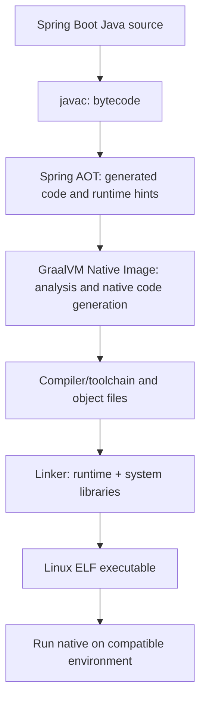

# Required C Tools, Linker, and Development Libraries on Linux

## 1. Why Does Compiling Java into a Native Image Need C Tools?

In the **SPRING_BOOT_NATIVE_IMAGE** module, a Spring Boot application is processed by Spring AOT and compiled into a GraalVM Native Image to evaluate startup time, memory usage, library compatibility, and container packaging. Even though most application code is written in Java, **the native build process on Linux still requires a system toolchain**, typically consisting of a C compiler, linker, headers, and appropriate development libraries.

GraalVM Native Image analyzes Java bytecode, translates reachable code into machine code, combines it with native runtime code, and finally links those components into a Linux ELF executable. The C compiler/toolchain is used by Native Image for certain compilation/linking steps of native components; the linker joins object files and libraries. These tools run on the **build machine**, which does not mean the native program needs `gcc` on the production machine.

### Main Stages



Distinguish two toolsets: the **JDK and Native Image** handle Java/AOT; the **Linux system toolchain** handles native compilation and linking. A machine with GraalVM JDK installed that lacks a compiler, linker, or development headers can still run `java -jar` normally yet fail to build a native executable.

## 2. Essential Components in the Linux Toolchain

| Component | Role | Common Check |
|---|---|---|
| `gcc` or compatible C toolchain | C compiler driver and link coordinator per Native Image config | `gcc --version` |
| `ld` and binutils | Links objects, manages symbols, reads ELF metadata | `ld --version`, `readelf --version` |
| `make` (when needed by the build flow) | Runs dependent native compilation targets | `make --version` |
| GNU libc (glibc) headers and development files | Headers, startup objects, and components supporting linking against Linux libc | Check `libc6-dev` / `glibc-devel` package by distro |
| zlib development files | Compression headers and library needed for some Native Image releases/configs | Check `zlib1g-dev` / `zlib-devel` package |
| GraalVM JDK with Native Image | Runs the `native-image` tool and compiles Java AOT | `java -version`, `native-image --version` |

This list is a **common starting point**, not a fixed catalog for every GraalVM version or project. Some environments also require `libstdc++`, `libstdc++-devel`, LLVM tools, `-dev` libraries for JNI dependencies, or other packages. Check the requirements of your exact **GraalVM version and target operating system**.

**Runtime libraries differ from development packages:** a shared library like `libz.so` may exist for running programs, yet the build still fails if the `zlib.h` header, linker symlink, or development files provided by the `-dev`/`-devel` package are missing.

## 3. Installing Across Linux Distribution Families

### Debian and Ubuntu

Example build environment using `apt`:

```bash
sudo apt-get update
sudo apt-get install -y build-essential zlib1g-dev
```

`build-essential` typically pulls in `gcc`, `g++`, `make`, and libc development components on Debian/Ubuntu. `zlib1g-dev` adds headers and linking metadata for zlib.

For minimal build environments, check which packages are actually installed instead of assuming `build-essential` is already present.

### Fedora, RHEL, Rocky Linux, and AlmaLinux

Package manager names vary by distro and version. A common setup:

```bash
sudo dnf install -y gcc glibc-devel zlib-devel binutils
```

If the workflow needs `make` or C++, install the corresponding packages as well. Some documentation uses the `Development Tools` group; group names and group support vary between distributions, so check the system's repository directly.

### Oracle Linux

Example on an Oracle Linux release using `dnf`:

```bash
sudo dnf install -y gcc glibc-devel zlib-devel binutils
```

Minimal Oracle Linux releases or container images may require enabling the appropriate repository to install complete development files. Actual package names depend on the distribution and repository.

### Alpine Linux and musl

Alpine uses **musl libc**, which differs from the glibc of Debian/Ubuntu/RHEL. Alpine toolchains typically involve `build-base`, `musl-dev`, and `zlib-dev`, but **you cannot treat every GraalVM JDK/Native Image downloaded for Linux glibc as compatible with Alpine**. To build or run a musl-based binary, choose a toolchain release and linking strategy supported for that target. Do not take a binary built on Ubuntu and assume it will run in Alpine just because both are Linux.

The installation commands above are examples for systems where the builder has administrative privileges; CI/CD or container builders typically install these packages inside a Dockerfile rather than modifying the host.

## 4. Checking the JDK, Native Image, and Compiler Actually Used

Check sequentially:

```bash
java -version
javac -version
native-image --version
gcc --version
ld --version
```

Commands must be run **in the same environment** used for the build: the CI runner, container builder, or local machine. Finding `gcc` in the host shell does not prove `gcc` is also inside the build container.

Check paths to avoid mistakenly using multiple JDK installations:

```bash
command -v java
command -v javac
command -v native-image
command -v gcc
command -v ld
printf '%s\n' "$JAVA_HOME"
```

If `native-image: command not found`, check the GraalVM distribution and the Native Image installation method for the version in use; do not assume every JDK includes this program. If Maven/Gradle runs on a different JDK than `JAVA_HOME`, the plugin may pick an unsuitable toolchain.

Example setting `JAVA_HOME` in a shell session (illustrative path only):

```bash
export JAVA_HOME=/opt/graalvm
export PATH="$JAVA_HOME/bin:$PATH"
java -version
native-image --version
```

Use `java -version` to confirm this is the right distribution and Java version for the Spring Boot project; `/opt/graalvm` must be replaced with the actual installation path.

## 5. What Work Does the Linker Perform?

The **compiler** translates source or intermediate code into object code; the **linker** combines objects and libraries, resolves symbols and relocations, and produces an executable. In a Native Image build, the linker needs runtime objects and native libraries matching the right architecture and ABI.

On Linux, an ELF executable can be:

- **Dynamically linked:** depends on shared libraries (`.so`) such as libc or system libraries. At runtime, the dynamic loader locates their matching version and architecture.
- **Statically linked:** code from multiple libraries is embedded into the executable at build time; the degree of static linking varies by option and toolchain. A static executable still needs verification for system compatibility, DNS, certificates, and native component behavior.

Example inspecting information after building:

```bash
file ./myapp
readelf -h ./myapp
ldd ./myapp
```

`file` identifies ELF and architecture; `readelf` reads headers. `ldd` typically lists dynamic libraries for compatible binaries; a static binary may report `not a dynamic executable`. For untrusted binaries, avoid running `ldd` directly due to environment-dependent risks; using `readelf -d` to inspect `NEEDED` entries is safer when you only want to read metadata.

```bash
readelf -d ./myapp
```

If the binary depends on `libc.so.6`, copying it to a base image without glibc can fail even though the build succeeded. This is a **linking/runtime ABI** issue, separate from Spring AOT reflection metadata.

## 6. glibc, musl, and Executable Portability

**Linux** is a broad operating system name; executables are built for a specific **CPU architecture** and **ABI/system library** set. Factors to consider:

| Factor | At Build Time | At Runtime |
|---|---|---|
| CPU architecture | Built for `x86_64`, `aarch64`, etc. | Host/container must run that architecture |
| libc and ABI | Linked against glibc or musl depending on toolchain | Needs compatible library/loader when dynamically linked |
| Dependent libraries | Needs headers and linker files if native code exists | Needs corresponding shared libraries if dynamically linked |
| Platform | Native Image builds usually target one specific OS/architecture | Do not expect a Linux binary to run directly on Windows |
| Packaging type | Produces ELF and defines dependencies | Choose a matching base image |

A common mistake is building on a Linux release with a newer glibc, then running on an image with an older glibc and encountering symbol version errors. To avoid this, use a build environment compatible with deployment, typically a standard builder image and a version-controlled runtime image.

The term **static linking** does not automatically mean a binary has zero external dependencies. Native libraries, NSS/DNS resolution, CA certificates, or JNI libraries can still require dedicated configuration. Only conclude portability after checking executable metadata and running a smoke test in the actual image.

## 7. Example Building a Spring Boot Native Image Application

Assume the Spring Boot project has AOT enabled and a suitable native plugin configured, and Java/GraalVM plus the Linux toolchain are working.

### Maven

```bash
./mvnw -Pnative native:compile
```

Common command when Spring Boot Maven Plugin and GraalVM Native Build Tools are configured per the corresponding Native Image setup. The Maven `native` profile can activate the necessary configuration. The executable name and location depend on artifact/project and plugin version; it typically appears under `target/`.

### Gradle

```bash
./gradlew nativeCompile
```

The `nativeCompile` task is provided by GraalVM Native Build Tools when the plugin is properly applied. Output usually resides under `build/native/nativeCompile/`, though you should check the build configuration instead of assuming the filename.

### Running Verification

```bash
# Replace the path with the generated executable
./target/myapp
```

Use another terminal to call endpoints and verify startup, health, and branches using JSON binding, reflection, resources, databases, SSL, or messaging. A successful native build only proves the **compilation and linking steps** passed; metadata errors or runtime behavior issues can still appear when running.

## 8. Distinguishing Toolchain Errors from Spring AOT and GraalVM Metadata Errors

| Message or Symptom | Cause Category | First Action to Take |
|---|---|---|
| `gcc: command not found` | Missing compiler or wrong PATH | Install an appropriate C compiler in the build environment |
| `ld: cannot find -lz` | Missing zlib development library/linker file | Check `zlib1g-dev` or `zlib-devel` and search paths |
| `fatal error: zlib.h: No such file or directory` | Missing headers | Install the development package and check include paths |
| `cannot find crt1.o` or startup object error | Missing/incompatible libc development files or toolchain | Check libc development package and architecture |
| `undefined reference to ...` | Missing symbol at link time, ABI or dependency mismatch | Inspect link command log, libraries, and matching versions |
| `GLIBC_x.y not found` at runtime | Build requires newer glibc than runtime provides | Use compatible builder/runtime or a different build strategy |
| `Exec format error` | Wrong architecture or executable format | Check `file`, `uname -m`, target architecture |
| Native runs, yet misses classes, reflection, resources | Reachability metadata or Spring AOT | Check runtime hints and business flows; do not fix by installing more GCC |
| `native-image: command not found` | Missing Native Image tool / unsuitable JDK | Identify distribution and install the tool for that version |

**Debugging rule:** find **the first meaningful error** in the log. One `ld` error can trigger many downstream messages; fix missing headers or libraries first, then rebuild. If compilation/linking completes but the executable fails when requests arrive, focus on runtime/configuration/AOT metadata.

Useful commands when verifying tools:

```bash
uname -m
cat /etc/os-release
command -v gcc
command -v ld
gcc -print-search-dirs
```

`gcc -print-search-dirs` shows the tool and library paths known to GCC. When inspecting container images, run equivalent commands inside the builder image to faithfully reproduce the CI environment.

## 9. Designing a Multi-Stage Docker Build

Normally, use a **builder stage** with GraalVM JDK, Native Image, and the C toolchain; the **runtime stage** contains only the executable plus needed shared libraries/certificates. This reduces image size and keeps compilers out of production.

An **illustrative** Dockerfile:

```dockerfile
# Choose a GraalVM builder image with Native Image and matching OS.
FROM <graalvm-builder-image> AS build
WORKDIR /workspace

# Install the toolchain using the builder image's package manager
# before running the native build step.
COPY . .
RUN ./mvnw -Pnative native:compile

# Runtime base must match the binary's libc/architecture.
FROM <compatible-linux-runtime-image>
WORKDIR /app
COPY --from=build /workspace/target/myapp /app/myapp
USER 10001
ENTRYPOINT ["/app/myapp"]
```

The placeholders `<graalvm-builder-image>` and `<compatible-linux-runtime-image>` **must be replaced** with real images whose tags and compatibility have been verified. Do not copy the example verbatim to build without choosing JDK, architecture, and runtime base. If the executable dynamically links shared libraries, the runtime base must include those libraries. If the app uses TLS, DNS, zone IDs, or reads files from the filesystem, verify CA certificates, timezone data, and read permissions for the non-root user.

Spring Boot also supports building OCI images for native via plugins/buildpacks with appropriate configuration. When using buildpacks, many toolchain packages are handled by the builder; you should still verify the runtime image and binary dependencies afterward.

## 10. Building a Stable CI Environment

Native compilation typically consumes **more CPU, RAM, and build time** than regular JAR packaging, due to whole-program analysis and native code compilation. For CI, you should:

1. **Pin versions** of GraalVM JDK, Spring Boot/Native Build Tools, builder image, and critical dependencies.
2. **Match runner architecture** to the target or use a toolchain-supported cross-build solution; do not assume cross-compilation works by default.
3. **Install development packages in the builder stage** using a standard, reproducible Dockerfile or image.
4. **Inspect the binary** using `file`, `readelf -d`, and a smoke test inside the runtime image.
5. **Run native integration tests** covering reflection, resources, serialization, and infrequently hit paths.
6. **Compare performance** against the JVM build under identical workload, configuration, resources, and container limits; collect startup-to-readiness, RSS, throughput, and latency.

Do not optimize builds by stripping out test suites just to shorten CI time. A binary that compiles yet lacks resources or has the wrong ABI is not a trustworthy release artifact.

## 11. Practice Exercise: From Linker Error to Runnable Executable

**Goal:** identify why a Spring Boot Native Image application needs a compiler, linker, and development libraries.

**Step 1 — Check the environment.** Run `java -version`, `native-image --version`, `gcc --version`, `ld --version`. Record the Linux distribution, architecture, and GraalVM version.

**Step 2 — Install the appropriate packages.** On Debian/Ubuntu install `build-essential zlib1g-dev`; on Fedora/RHEL-like systems install `gcc glibc-devel zlib-devel binutils` per the actual repository.

**Step 3 — Build native.** Run Maven or Gradle configured for AOT. If an error occurs due to missing compiler/linker/headers, classify it using the table in Section 8, verify the relevant package, and rebuild.

**Step 4 — Inspect the executable.** Use `file` and `readelf -d` to identify architecture and shared libraries; run the executable on the build machine, then in a compatible runtime container.

**Step 5 — Measure and compare.** Run the JAR on the JVM and the native executable with the same profile, RAM, CPU, and load. Measure time from process start to readiness and RSS while idle/under load; document measurement method and margin of error.

**Self-check questions:** Why can missing `zlib-devel` cause the build to fail even when `libz.so` exists at runtime? Why might a Linux x86-64 binary built successfully still fail to run in an Alpine container? Can a missing reflection metadata error be fixed by installing `gcc`?

## 12. Conclusion

To compile a **Spring Boot Native Image on Linux**, GraalVM and Spring AOT must be supported by a **C compiler, linker, libc development files, and related development libraries**. These components complete the creation of the ELF executable; they are distinct from the reflection/resource metadata that makes the native application behave correctly. Toolchain choices must align with architecture, libc, and runtime container choices, because a successfully built binary is not guaranteed to run on the target image. Verifying actual dependencies, reproducing CI, and testing the executable are prerequisites before drawing conclusions about the native build's startup performance and memory usage.
